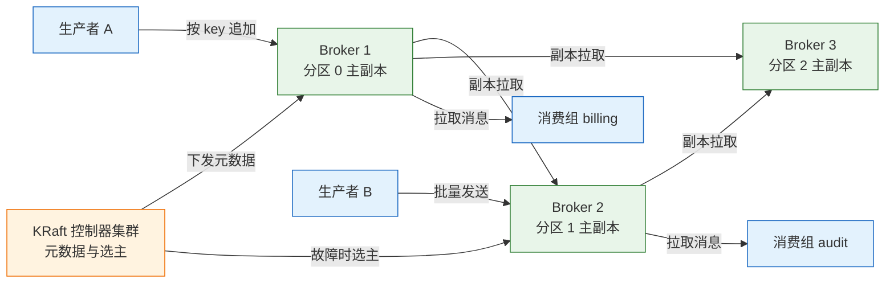
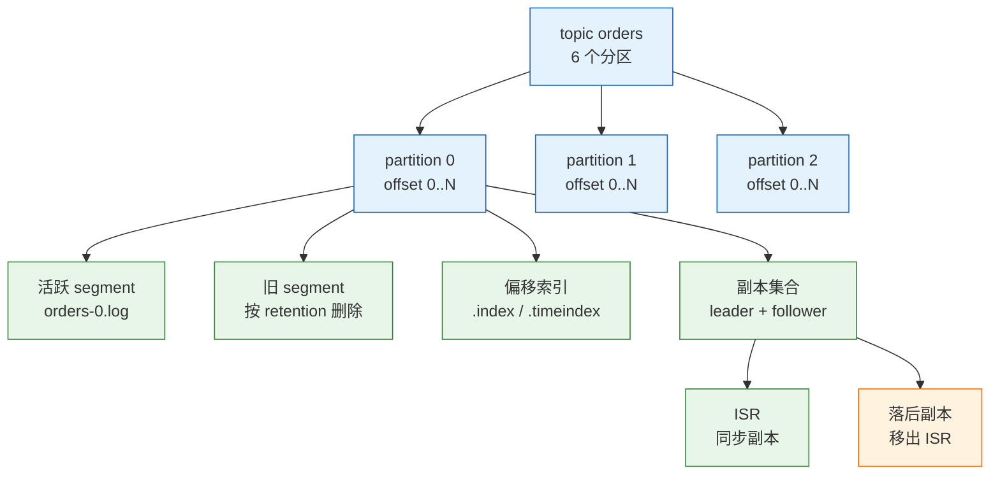
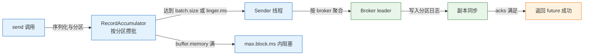
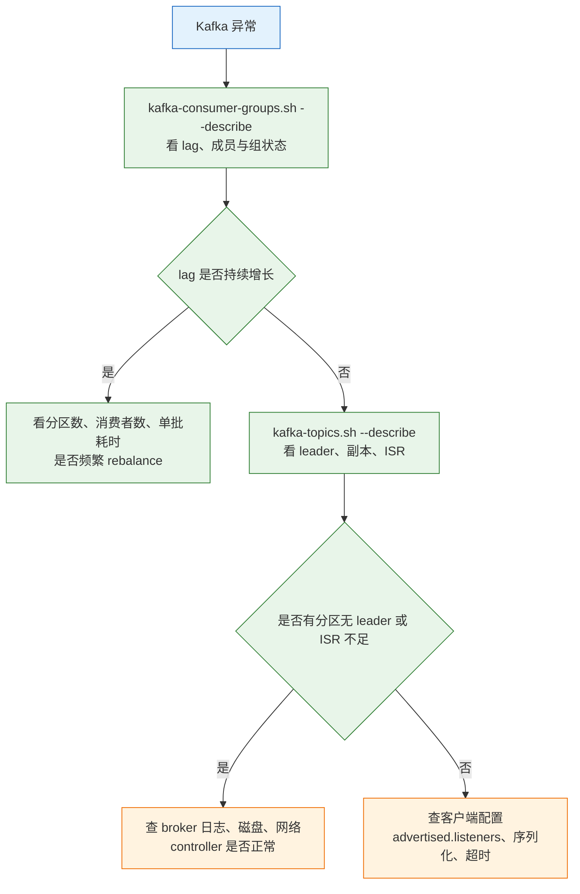

# Kafka

---

## 一、Kafka 是什么

Kafka 是一个分布式事件流平台。它把消息按分区追加成日志，生产者只负责写入，消费者按 offset 自行读取，消息的删除由保留策略决定，与是否被消费无关。这个模型让 Kafka 同时具备高吞吐、可重放和多订阅者能力。

从系统设计视角看，Kafka 承担四类职责：

- **事件总线**：订单、支付、库存等业务事件统一进入 topic，下游按需订阅。
- **数据管道**：把业务库、日志、埋点数据搬运到数仓或检索系统。
- **削峰缓冲**：上游突发流量写入日志，下游按自身能力消费。
- **流处理底座**：配合 Kafka Streams 或 Flink 做窗口聚合、连接和状态计算。

它不擅长的地方要提前划清：Kafka 没有按消息的复杂路由、优先级和单条延迟；不支持“消费后立即删除”；低消息量、强事务的小规模业务队列用 RabbitMQ 更省心；运维需要磁盘、副本和 controller 选举的知识，不能只把它当成一个会收消息的端口。

> **版本现状（2026）**：Kafka 4.x 为当前稳定线。4.0 起只支持 KRaft 元数据模式，ZooKeeper 已移除；本文容器示例使用 `apache/kafka:4.1.0`。

### 1.1 核心概念

Kafka 的核心不是“队列”，而是**分区日志加消费者位点**。一条消息写入某个分区后获得一个递增的 offset，之后不再改变；消费者记住自己读到哪，读多快、读几遍都由消费者决定。

| 概念 | 本质 | 需要记住的点 |
|---|---|---|
| topic | 一类事件的逻辑名称 | 由若干分区组成，跨 broker 分布 |
| partition | 有序、追加写的日志 | 并行与顺序的基本单位 |
| offset | 消息在分区内的位置 | 单调递增，删除后不回收 |
| replica | 分区的副本 | 一主多从，leader 服务读写 |
| ISR | 与 leader 保持同步的副本集合 | 决定选主范围和写入可用性 |
| consumer group | 一组协作消费的消费者 | 组内一个分区只分给一个消费者 |
| coordinator | 管理消费组与位点的 broker | 负责分配、心跳和 offset 提交 |
| controller | KRaft 中负责元数据与选主的角色 | 由 controller quorum 选举产生 |

**partition 是顺序的唯一范围**。同一分区内按追加顺序排列，跨分区没有全局顺序。业务说“消息要按订单有序”，实际含义是“同一订单的事件落同一分区”，而不是“整个 topic 有序”。

**offset 是消费者维护的进度**，不是消息 ID。消费者提交的是“下一条要读的位置”，不是“最后处理成功的那条”。理解这一点，才能明白为什么“先处理再提交”能避免丢消息，以及为什么重复消费无法完全避免。

**副本不是备份文件，而是参与选举的日志**。leader 处理读写，follower 主动拉取；只有追得上 leader 的副本才在 ISR 里。leader 故障时，controller 从 ISR 中选新 leader，超出 ISR 的副本不会被选中，除非显式允许不干净选举。

### 1.2 与相邻技术的关系

| 技术 | 存储模型 | 消费方式 | 典型定位 |
|---|---|---|---|
| Kafka | 分区追加日志，按保留期删除 | 拉取，消费者提交 offset | 高吞吐事件流、重放、流处理 |
| RabbitMQ | 队列，确认后删除 | broker 推送，单条 ack | 业务解耦、复杂路由、低延迟 |
| RocketMQ | 队列，支持定时与事务消息 | 拉取，消费确认 | 交易链路、延迟消息 |
| Pulsar | 分区日志加分层存储 | 订阅制，支持多种消费模式 | 多租户、分层存储 |
| Redis Stream | 内存追加流 | 消费组与 pending 列表 | 轻量异步、低延迟小规模 |

Kafka 与 RabbitMQ 最根本的差别是**消息是否因消费而消失**。RabbitMQ 的消息在 ack 后删除，队列深度代表待办工作量；Kafka 的消息按时间或容量删除，消费组只是移动自己的 offset，因此同一份数据可以被账单、风控、审计三个组独立读取，也可以重置 offset 重放。

> **运维提示**：不要把 Kafka 当数据库做点查。按 key 查最新值可以用压缩 topic，但随机读、范围查询、事务更新仍然应该交给数据库或索引系统。

### 1.3 架构组成



一个 Kafka 集群由三类角色组成：

- **broker**：存储分区日志，处理生产与拉取请求，参与副本复制。
- **controller**：管理 topic、分区、副本和 leader 选举。KRaft 模式下由一组 controller 节点组成 quorum，不再依赖 ZooKeeper。
- **coordinator**：某个 broker 上的组件，负责消费组的心跳、成员管理和 offset 提交，位点保存在内部 topic `__consumer_offsets`。

KRaft 把元数据也做成了一份 Raft 日志。controller quorum 的多数派在线，集群才能修改元数据；broker 注册、topic 创建、leader 切换都经过它。生产环境建议 controller 与 broker 分开部署，至少 3 个 controller，避免 broker 负载影响选主。

每个分区的日志由多个 segment 文件组成，包括 `.log`、`.index` 和 `.timeindex`。写入总是追加到活跃 segment，达到 `segment.bytes` 或 `segment.ms` 后滚动；旧 segment 按 `retention.ms` 或 `retention.bytes` 删除。消费者读最近数据通常命中操作系统页缓存，不直接读磁盘，这是 Kafka 高吞吐的重要来源。

> **注意**：Kafka 依赖页缓存，不等于数据已经安全落盘。`acks=all` 保证多数副本写入，但每个副本仍可能先写页缓存；强制每条 fsync 会严重拖慢吞吐。可靠性靠副本，不靠单机刷盘。

---

## 二、安装与连接

Kafka 的安装分成两步：先决定元数据模式，再决定节点角色。4.x 只有 KRaft，单节点可以把 broker 和 controller 合并，生产环境应拆分。所有客户端只需要一个可用的 bootstrap 地址，连上后会获取完整集群元数据。

### 2.1 单节点 KRaft 部署

```bash
# ========== 启动单节点 broker + controller ==========
# 合并角色只适合开发验证，生产环境应拆分
docker run -d --name kafka \
  -p 9092:9092 \
  -e KAFKA_NODE_ID=1 \
  -e KAFKA_PROCESS_ROLES=broker,controller \
  -e KAFKA_LISTENERS=PLAINTEXT://:9092,CONTROLLER://:9093 \
  -e KAFKA_ADVERTISED_LISTENERS=PLAINTEXT://127.0.0.1:9092 \
  -e KAFKA_CONTROLLER_LISTENER_NAMES=CONTROLLER \
  -e KAFKA_INTER_BROKER_LISTENER_NAME=PLAINTEXT \
  -e KAFKA_LISTENER_SECURITY_PROTOCOL_MAP=CONTROLLER:PLAINTEXT,PLAINTEXT:PLAINTEXT \
  -e KAFKA_CONTROLLER_QUORUM_VOTERS=1@127.0.0.1:9093 \
  -e KAFKA_OFFSETS_TOPIC_REPLICATION_FACTOR=1 \
  -e KAFKA_TRANSACTION_STATE_LOG_REPLICATION_FACTOR=1 \
  -e KAFKA_TRANSACTION_STATE_LOG_MIN_ISR=1 \
  -e KAFKA_GROUP_INITIAL_REBALANCE_DELAY_MS=0 \
  -e CLUSTER_ID=MkU3OEVBNTcwNTJENDM2Qk \
  -v kafka-data:/var/lib/kafka/data \
  apache/kafka:4.1.0

# ========== 等待启动完成 ==========
# 日志出现 Kafka Server started 后再操作
docker logs -f kafka

# ========== 验证节点与元数据 ==========
# 查看 broker 支持的 API 版本，确认端口可达
docker exec kafka /opt/kafka/bin/kafka-broker-api-versions.sh \
  --bootstrap-server 127.0.0.1:9092 | head -5
# 查看 KRaft controller quorum 的 leader 与成员
docker exec kafka /opt/kafka/bin/kafka-metadata-quorum.sh \
  --bootstrap-server 127.0.0.1:9092 describe --status
```

单节点示例把 `offsets.topic.replication.factor` 和事务状态日志的副本数降为 1，否则在只有一个 broker 时内部 topic 无法创建，消费组提交 offset 会失败。这三个参数只适用于本地环境，生产环境必须恢复为 3。

关键环境变量与 `server.properties` 的对应关系如下：

| 容器变量 | 配置文件项 | 作用 |
|---|---|---|
| `KAFKA_NODE_ID` | `node.id` | 节点唯一编号 |
| `KAFKA_PROCESS_ROLES` | `process.roles` | broker、controller 或两者 |
| `KAFKA_LISTENERS` | `listeners` | 实际监听地址 |
| `KAFKA_ADVERTISED_LISTENERS` | `advertised.listeners` | 返回给客户端的地址 |
| `KAFKA_CONTROLLER_QUORUM_VOTERS` | `controller.quorum.voters` | controller 选举成员 |
| `CLUSTER_ID` | `cluster.id` | 集群唯一标识，格式化时使用 |

> **注意**：`advertised.listeners` 写错是 Kafka 最常见的“能连上却收不到消息”。客户端先用 bootstrap 地址连上，随后 broker 返回 advertised 地址；如果返回的是容器内网 IP 或错误主机名，后续请求就会超时。

### 2.2 多节点集群与 KRaft 选举

生产集群通常部署 3 个 controller 和 3 个以上 broker。controller 只负责元数据，不存业务数据；broker 负责分区日志。两者分开可以避免 broker 的磁盘和 GC 抖动影响选主。

```properties
# server.properties：3 节点集群中的一个 broker 节点
# 节点身份与角色
node.id=1
process.roles=broker
controller.quorum.voters=1@controller1:9093,2@controller2:9093,3@controller3:9093

# 监听与对外地址
listeners=PLAINTEXT://0.0.0.0:9092
advertised.listeners=PLAINTEXT://broker1.example.com:9092
inter.broker.listener.name=PLAINTEXT
controller.listener.names=CONTROLLER
listener.security.protocol.map=CONTROLLER:PLAINTEXT,PLAINTEXT:PLAINTEXT

# 数据目录与保留
log.dirs=/data/kafka
num.partitions=6
default.replication.factor=3
min.insync.replicas=2
unclean.leader.election.enable=false

# 内部 topic 的副本
offsets.topic.replication.factor=3
transaction.state.log.replication.factor=3
transaction.state.log.min.isr=2
```

```bash
# ========== 格式化数据目录 ==========
# 生成集群 ID，所有节点必须使用同一个
KAFKA_CLUSTER_ID=$(/opt/kafka/bin/kafka-storage.sh random-uuid)

# 在每个节点上执行格式化，-t 指定集群 ID
/opt/kafka/bin/kafka-storage.sh format \
  -t "$KAFKA_CLUSTER_ID" \
  -c /opt/kafka/config/server.properties

# ========== 启动 broker ==========
# 前台启动便于观察日志，生产用 systemd 管理
/opt/kafka/bin/kafka-server-start.sh /opt/kafka/config/server.properties

# ========== 验证集群 ==========
# 查看 broker、controller 与元数据版本
/opt/kafka/bin/kafka-metadata-quorum.sh \
  --bootstrap-server broker1:9092 describe --status

# 查看所有 topic 的分区与副本分布
/opt/kafka/bin/kafka-topics.sh \
  --bootstrap-server broker1:9092 --describe
```

| 角色 | 数量建议 | 故障影响 |
|---|---|---|
| controller | 3 或 5，奇数 | 少于多数派无法修改元数据 |
| broker | 至少 3 | 少于副本数时部分分区降级 |
| coordinator | 由 broker 兼任 | 所在 broker 故障触发消费组迁移 |

> **运维红线**：不要把 `controller.quorum.voters` 配成偶数，也不要在集群运行中随意改这个列表。controller quorum 失去多数派后，topic 创建、分区扩容、leader 切换全部停止，已有读写也可能因元数据无法更新而受影响。

### 2.3 命令行工具与连接

Kafka 自带脚本覆盖 topic、生产、消费、消费组和分区重分配。脚本位于发行包的 `bin/`，容器镜像中在 `/opt/kafka/bin/`。

```bash
# ========== topic 管理 ==========
# 创建 3 分区、单副本的 topic，仅用于本地验证
docker exec -it kafka /opt/kafka/bin/kafka-topics.sh \
  --bootstrap-server 127.0.0.1:9092 \
  --create --topic orders --partitions 3 --replication-factor 1

# 查看 topic 的分区、leader、副本与 ISR
docker exec -it kafka /opt/kafka/bin/kafka-topics.sh \
  --bootstrap-server 127.0.0.1:9092 --describe --topic orders

# 增加分区，只能增不能减
docker exec -it kafka /opt/kafka/bin/kafka-topics.sh \
  --bootstrap-server 127.0.0.1:9092 --alter --topic orders --partitions 6

# ========== 生产与消费 ==========
# 从标准输入写入两行消息
printf 'order-1\norder-2\n' | docker exec -i kafka \
  /opt/kafka/bin/kafka-console-producer.sh \
  --bootstrap-server 127.0.0.1:9092 --topic orders

# 从头读取两条消息后退出
docker exec -it kafka /opt/kafka/bin/kafka-console-consumer.sh \
  --bootstrap-server 127.0.0.1:9092 \
  --topic orders --from-beginning --max-messages 2

# ========== 消费组与位点 ==========
# 用指定消费组读取，组名会记录在 __consumer_offsets
docker exec -it kafka /opt/kafka/bin/kafka-console-consumer.sh \
  --bootstrap-server 127.0.0.1:9092 \
  --topic orders --group billing --from-beginning --max-messages 2

# 查看该组的 CURRENT-OFFSET、LOG-END-OFFSET 与 LAG
docker exec -it kafka /opt/kafka/bin/kafka-consumer-groups.sh \
  --bootstrap-server 127.0.0.1:9092 --describe --group billing
```

`--bootstrap-server` 只需要给一个或几个可用节点，客户端会通过 Metadata 请求拿到所有 broker 和分区 leader。不要假设请求会均匀分布：生产请求总是发往分区 leader，bootstrap 只负责首次发现。

> **注意**：控制台生产者默认不打印发送结果，命令退出只代表本地发送完成。要确认 broker 是否收下，应使用 `acks=all` 的客户端并检查 future，或者直接用消费组读回。

### 2.4 关键配置项

| 配置 | 作用 | 生产建议 |
|---|---|---|
| `num.partitions` | 新 topic 默认分区数 | 按吞吐估算，不要盲目调大 |
| `default.replication.factor` | 默认副本数 | 3 |
| `min.insync.replicas` | 最少同步副本数 | 3 副本时设 2 |
| `log.dirs` | 数据目录，可多盘 | 独立磁盘，避免与系统盘混用 |
| `log.retention.ms` | 消息保留时长 | 按业务与磁盘容量定 |
| `auto.create.topics.enable` | 自动创建 topic | 生产设为 false |
| `unclean.leader.election.enable` | 是否允许非 ISR 副本当 leader | false |
| `message.max.bytes` | broker 接收的单条上限 | 与生产者、消费者一起核对 |

```yaml
# docker-compose.yml：单机验证环境
services:
  kafka:
    image: apache/kafka:4.1.0
    container_name: kafka
    ports:
      - "9092:9092"
    environment:
      KAFKA_NODE_ID: 1
      KAFKA_PROCESS_ROLES: broker,controller
      KAFKA_LISTENERS: PLAINTEXT://:9092,CONTROLLER://:9093
      KAFKA_ADVERTISED_LISTENERS: PLAINTEXT://127.0.0.1:9092
      KAFKA_CONTROLLER_LISTENER_NAMES: CONTROLLER
      KAFKA_CONTROLLER_QUORUM_VOTERS: 1@127.0.0.1:9093
      KAFKA_OFFSETS_TOPIC_REPLICATION_FACTOR: 1
      KAFKA_TRANSACTION_STATE_LOG_REPLICATION_FACTOR: 1
      KAFKA_TRANSACTION_STATE_LOG_MIN_ISR: 1
      KAFKA_GROUP_INITIAL_REBALANCE_DELAY_MS: 0
      CLUSTER_ID: MkU3OEVBNTcwNTJENDM2Qk
    volumes:
      - kafka-data:/var/lib/kafka/data

volumes:
  kafka-data:
```

> **安全警告**：上面的 `PLAINTEXT` 监听没有任何认证和加密。生产环境应配置 SASL/SSL 或 mTLS，至少把 9092 限制在内网安全组，绝不能直接暴露到公网。

---

## 三、核心模型：日志、分区与副本

Kafka 的所有行为都可以从“分区是一份只能追加的日志”推导出来。写入追加到末尾，读取按 offset 前进，删除按保留策略整段清理；副本复制的是同一份日志，消费组只是各自保存一个位置。

### 3.1 分区日志与段文件



一个分区目录下有几类文件：

| 文件 | 内容 | 作用 |
|---|---|---|
| `.log` | 消息批次 | 实际数据，按 offset 追加 |
| `.index` | offset 到文件位置的稀疏索引 | 快速定位消息 |
| `.timeindex` | 时间戳到 offset 的索引 | 按时间查找位点 |
| `.snapshot` | 幂等生产者状态 | 去重与事务恢复 |
| `leader-epoch-checkpoint` | leader 任期记录 | 防止旧 leader 写入 |

segment 是清理的最小单位，不是单条消息。`retention.ms` 到期后，Kafka 删除整个旧 segment；正在写的活跃 segment 不会被删。因此实际保留时间可能略长于配置值，最长会多出一个 segment 的滚动周期。

offset 单调递增但不保证连续。日志压缩会保留每个 key 的最新值，删除旧记录后在索引里留下空洞；事务消息也有控制批次，消费者看不到但占用 offset。任何依赖“offset 连续”的逻辑都是错的。

> **注意**：不要手工删除 `log.dirs` 下的 segment 文件。broker 的内存索引与磁盘文件会不一致，轻则报错，重则分区不可用。清理只能通过保留策略、`kafka-delete-records.sh` 或删除 topic 完成。

### 3.2 分区与 key 的路由

生产者写入时，分区选择规则决定消息落到哪个 partition：

| 情况 | 路由方式 | 结果 |
|---|---|---|
| 指定 partition | 直接使用 | 完全可控，但业务需自己均衡 |
| 有 key，未指定 partition | 对 key 做哈希后取模 | 同一 key 固定落同一分区 |
| 无 key | 粘性分区，攒批后切换 | 吞吐好，顺序不保证 |
| 自定义 partitioner | 调用业务实现 | 灵活，但容易写出热点 |

同一 key 落同一分区，是该 key 事件有序的前提。订单用 `order_id`，用户行为用 `user_id`，设备数据用 `device_id`。

分区数只能增加，不能减少。增加分区后，`hash(key) % 分区数` 的结果会变，历史 key 的新消息可能落到不同分区，原来“同 key 有序”的保证被打断。已经上线的 topic 要在创建时就把分区数估够，后续扩容分区必须接受顺序语义变化，或者用双写迁移。

> **运维提示**：分区数不是越多越好。每个分区都有文件句柄、索引、副本复制和 leader 选举开销；分区过多会拉长 controller 故障恢复和 rebalance 时间。常见起点是 6–12 个分区，再按压测和监控调整。

### 3.3 副本、ISR 与 leader 选举

每个分区有一个 leader 和若干 follower。生产者和消费者只与 leader 交互，follower 主动向 leader 拉取数据。ISR 是“追得上 leader”的副本集合，只有 ISR 中的副本有资格在 leader 故障时被选为新 leader。

| 参数 | 作用 | 典型值 |
|---|---|---|
| `replication.factor` | 分区副本总数 | 3 |
| `min.insync.replicas` | 写入所需的最少同步副本 | 2 |
| `acks` | 生产者要求的确认级别 | `all` |
| `unclean.leader.election.enable` | 是否允许非 ISR 副本选主 | false |
| `replica.lag.time.max.ms` | follower 落后多久移出 ISR | 30000 |

`acks=all` 的确切含义是：leader 等待 ISR 中所有副本写入，且 ISR 数量不少于 `min.insync.replicas`。如果副本数是 3、`min.insync.replicas=1`，坏掉两个副本仍可写入，可靠性并没有提高。正确的组合必须一起设置：

```text
replication.factor=3
min.insync.replicas=2
acks=all
unclean.leader.election.enable=false
```

这套组合最多容忍 1 个副本故障；少于 2 个同步副本时，生产请求直接失败并返回 `NOT_ENOUGH_REPLICAS`，而不是悄悄写到可能丢数据的节点。可用性与一致性在这里是明确的取舍，不能只改其中一个参数。

leader 故障时，controller 从 ISR 中选择新 leader，并把新 leader 和 ISR 写进元数据。客户端收到 `LEADER_NOT_AVAILABLE` 或 `NOT_LEADER_FOR_PARTITION` 后刷新元数据并重试，这是正常的一次切换过程。若 ISR 为空且不允许不干净选举，分区会保持不可用，直到副本恢复。

> **运维红线**：`unclean.leader.election.enable=true` 会让落后很多甚至已经丢数据的副本当 leader，用数据一致性换可用性。交易、账务、订单类 topic 必须保持 false。

### 3.4 消费组与位点

消费组是 Kafka 实现“一条消息在组内只被处理一次”的机制。组内每个分区同一时刻只分配给一个消费者；消费者数超过分区数时，多出来的消费者空闲。

| 状态 | 含义 | 常见触发 |
|---|---|---|
| Empty | 组内没有成员 | 所有消费者停止 |
| PreparingRebalance | 正在重新分配 | 成员加入、离开、订阅变化 |
| CompletingRebalance | 等待分配方案生效 | coordinator 下发 assignment |
| Stable | 正常消费 | 心跳与拉取持续 |
| Dead | 组被删除或 coordinator 迁移 | 长期无成员后清理 |

位点保存在内部 topic `__consumer_offsets`，由 coordinator 管理。消费者提交的是“下一条要读的 offset”，例如处理完 offset 5 的消息后提交 6。提交频率越高，故障时重复越少，但请求开销越大。

`auto.offset.reset` 只在组内没有已提交位点或位点越界时生效，不是“每次都从头读”。它的取值有 `earliest`、`latest` 和 `none`，默认 `latest`；生产环境常设为 `earliest`，避免新组漏掉历史消息，但要配合积压告警。

> **注意**：`auto.offset.reset=latest` 加上组名写错，会表现为“消费者启动了但一条消息都收不到”。先确认组名和已提交位点，再怀疑 broker。

### 3.5 保留、压缩与重放

| 配置 | 含义 | 默认倾向 |
|---|---|---|
| `retention.ms` | 按时间保留 | 7 天 |
| `retention.bytes` | 按分区容量保留 | 无限制 |
| `cleanup.policy=delete` | 到期删除整段日志 | 普通事件 |
| `cleanup.policy=compact` | 按 key 保留最新值 | 状态、配置流 |
| `delete.retention.ms` | tombstone 保留时间 | 压缩 topic 的删除标记 |
| `min.cleanable.dirty.ratio` | 触发压缩的脏数据比例 | 0.5 |

日志压缩适合“每个 key 只关心最新值”的场景，例如用户资料、库存快照、配置下发。value 为 `null` 的消息是 tombstone，表示删除该 key；它会在 `delete.retention.ms` 后真正消失，在此之前消费者仍可能读到。

重放就是重置消费组位点。重置前必须停掉该组所有消费者，否则在线消费者会继续提交位点，重置结果立即被覆盖。

```bash
# ========== 查看当前位点 ==========
docker exec -it kafka /opt/kafka/bin/kafka-consumer-groups.sh \
  --bootstrap-server 127.0.0.1:9092 --describe --group billing

# ========== 重置到最早位点 ==========
# 先停掉该组消费者，再执行；--dry-run 可先预演
docker exec -it kafka /opt/kafka/bin/kafka-consumer-groups.sh \
  --bootstrap-server 127.0.0.1:9092 \
  --group billing --topic orders \
  --reset-offsets --to-earliest --execute

# ========== 按时间点重置 ==========
# 重置到指定时间之前最近的位置
docker exec -it kafka /opt/kafka/bin/kafka-consumer-groups.sh \
  --bootstrap-server 127.0.0.1:9092 \
  --group billing --topic orders \
  --reset-offsets --to-datetime 2026-10-01T00:00:00.000 --execute
```

重放会产生重复副作用。消费端必须幂等，或者把重放结果写到新的 topic，避免覆盖线上状态。

---

## 四、生产与消费

Kafka 的客户端是批处理系统，不是逐条 RPC。生产者把消息攒进缓冲区，由 sender 线程按 broker 批量发送；消费者一次 poll 拉回一批，处理完再提交位点。

### 4.1 生产者发送流程与批处理



`send()` 是异步的，返回的 `Future<RecordMetadata>` 只有在 broker 确认后才完成。主线程把消息交给 accumulator 后立即返回，sender 线程负责网络发送。这带来两个后果：

- **缓冲区会满**：`buffer.memory` 用尽后，`send()` 最多阻塞 `max.block.ms`，超时抛异常。生产环境必须处理这个异常，不能假设发送永远成功。
- **批越大越延迟**：`linger.ms` 让 sender 多等一会儿以凑更大的批，吞吐上升、延迟增加。延迟敏感业务要测 P99，不能只看平均值。

| 参数 | 作用 | 调整方向 |
|---|---|---|
| `batch.size` | 单批最大字节数 | 大消息或高吞吐调大 |
| `linger.ms` | 等更多消息成批的最长时间 | 5–20ms 换吞吐 |
| `compression.type` | 批压缩算法 | `lz4` 低延迟，`zstd` 高压缩 |
| `buffer.memory` | 客户端缓冲总量 | 不足会阻塞发送 |
| `max.block.ms` | 缓冲满时阻塞多久 | 太长会把请求拖死 |
| `max.request.size` | 单次请求最大字节 | 必须小于 broker 上限 |

> **注意**：`linger.ms=0` 不代表立即发送，只代表不再额外等待；是否成批仍取决于 `batch.size`、分区可用性和网络。把延迟问题全部归因于 linger，往往会忽略 broker 排队和消费者处理耗时。

### 4.2 确认机制与幂等生产者

| 参数 | 作用 | 生产取值 |
|---|---|---|
| `acks` | leader 何时算写成功 | `all` |
| `retries` | 可重试错误的次数 | 默认很大，受总超时约束 |
| `delivery.timeout.ms` | 发送的总时限 | 按业务延迟要求 |
| `enable.idempotence` | 生产者去重与防乱序 | true |
| `max.in.flight.requests.per.connection` | 单连接未确认请求数 | 开幂等后最多 5 |
| `transactional.id` | 事务生产者标识 | 需要 EOS 时设置 |

`acks` 有三个取值：`0` 表示发出即成功，`1` 表示 leader 写入即成功，`all` 表示 ISR 满足 `min.insync.replicas` 后成功。4.x 生产者的默认值已经是 `all`，但 topic 侧的 `min.insync.replicas` 仍是 1，因此“默认可靠”并不成立，必须显式设置。

幂等生产者解决的是“重试导致的重复和乱序”。它给每个生产者分配 PID，给每条消息分配序列号，broker 按分区去重；同时要求 `acks=all`、`retries>0`、`max.in.flight<=5`。只在单分区、单生产者会话内有效，生产者重启后 PID 变化，跨会话去重仍要靠业务幂等。

```java
// 生产者关键配置：可靠性优先
Properties props = new Properties();
props.put("bootstrap.servers", "broker1:9092,broker2:9092");
props.put("key.serializer", "org.apache.kafka.common.serialization.StringSerializer");
props.put("value.serializer", "org.apache.kafka.common.serialization.StringSerializer");
props.put("acks", "all");
props.put("enable.idempotence", "true");
props.put("compression.type", "lz4");
props.put("linger.ms", "10");

KafkaProducer<String, String> producer = new KafkaProducer<>(props);
producer.send(new ProducerRecord<>("orders", orderId, payload), (meta, ex) -> {
    if (ex != null) {
        // 记录失败并进入本地重试或补偿流程
        log.error("send failed", ex);
    }
});
producer.close();
```

> **运维红线**：不要用 `acks=1` 换取吞吐后再声称“消息不会丢”。leader 写入后、follower 同步前宕机，这条消息就会消失，且生产者已经收到成功。

### 4.3 消费者拉取模型与位点提交

消费者是拉模型：`poll()` 一次拉回一批记录，客户端在本地逐条处理，处理完提交位点。`poll()` 还驱动消费进度与组内活性，长时间不调用会超过 `max.poll.interval.ms` 被踢出组。

```java
// 手动提交：先处理，再提交
props.put("enable.auto.commit", "false");
props.put("max.poll.records", "100");
props.put("auto.offset.reset", "earliest");

KafkaConsumer<String, String> consumer = new KafkaConsumer<>(props);
consumer.subscribe(List.of("orders"));

while (running) {
    ConsumerRecords<String, String> records = consumer.poll(Duration.ofMillis(500));
    for (ConsumerRecord<String, String> r : records) {
        handle(r);   // 业务处理，重复执行必须安全
    }
    consumer.commitSync();   // 整批处理完再提交
}
```

| 提交方式 | 语义 | 风险 |
|---|---|---|
| 自动提交 | 按间隔在 poll 中提交 | 处理未完成就提交，崩溃丢消息 |
| 同步提交 | 处理完调用 `commitSync` | 阻塞，吞吐略低 |
| 异步提交 | `commitAsync` 回调 | 失败不自动重试，可能重复 |
| 按分区提交 | 处理完某分区即提交 | 实现复杂，重复窗口更小 |

自动提交不等于“处理完自动提交”。它在 poll 期间按 `auto.commit.interval.ms` 提交上一次 poll 返回的最大位点，可能发生在业务处理完成之前。进程崩溃时，未处理完的消息已经被标记为消费，形成丢失。生产环境应关闭自动提交，处理成功后手动提交。

> **注意**：`max.poll.records` 太大、单条处理太慢，会让两次 poll 的间隔超过 `max.poll.interval.ms`（默认 5 分钟），消费者被踢出组并触发 rebalance。位点没提交的消息会被重复消费，日志里表现为反复 rebalance 和重复业务。

### 4.4 消费组再平衡与静态成员

rebalance 是分区在消费者之间重新分配的过程。触发条件包括成员加入或离开、订阅的 topic 变化、分区数变化、以及 coordinator 判定成员失联。

| 参数 | 作用 | 常见调整 |
|---|---|---|
| `session.timeout.ms` | 心跳超时，判定成员失联 | 默认 45 秒，网络差可调大 |
| `heartbeat.interval.ms` | 心跳间隔 | 通常为 session 的 1/3 |
| `max.poll.interval.ms` | 两次 poll 的最大间隔 | 按单批处理耗时设置 |
| `group.initial.rebalance.delay.ms` | 新组首次分配的等待 | 生产可保留默认，避免抖动 |
| `group.instance.id` | 静态成员 ID | 滚动发布时减少 rebalance |

rebalance 期间分区会暂停消费。eager 协议会让所有消费者先放弃全部分区，再重新分配；cooperative 协议只迁移需要变动的分区，停顿更短。客户端可选择 `CooperativeStickyAssignor`，但要确认组内所有消费者都支持。

静态成员让同一个实例在重启后保留原分配。ID 必须唯一且稳定，通常用 Pod 名或 StatefulSet 序号。滚动发布时先停一个、起一个，不要一次性全停，否则组内没有活跃成员，位点提交和分区分配都会抖动。

```properties
# 消费者关键参数：稳定消费组
group.instance.id=orders-worker-1
session.timeout.ms=45000
heartbeat.interval.ms=3000
max.poll.interval.ms=300000
max.poll.records=100
enable.auto.commit=false
```

> **运维提示**：滚动发布前先确认单批最大处理耗时，再决定 `max.poll.interval.ms`。新版本初始化变慢时，最常见的故障就是“发布后一直 rebalance”。

### 4.5 事务与精确一次语义

Kafka 事务把“消费位点提交”和“生产结果”放进同一个原子操作。它解决的是 Kafka 内部的读—处理—写链路，不覆盖数据库或 HTTP 调用。

```java
// 事务生产者：输入位点与输出消息原子提交
props.put("transactional.id", "orders-enrich-1");
producer.initTransactions();

while (running) {
    ConsumerRecords<String, String> records = consumer.poll(Duration.ofMillis(500));
    producer.beginTransaction();
    try {
        for (ConsumerRecord<String, String> r : records) {
            producer.send(new ProducerRecord<>("orders.enriched", r.key(), enrich(r.value())));
        }
        producer.sendOffsetsToTransaction(currentOffsets(records), consumer.groupMetadata());
        producer.commitTransaction();
    } catch (Exception e) {
        producer.abortTransaction();
        // 回退或重建消费者，避免位点与输出不一致
    }
}
```

下游消费者要设置 `isolation.level=read_committed`，否则会读到未提交事务的消息。读已提交模式下，消费者只能看到已提交事务的消息，未提交或已中止的消息会被跳过。

事务的边界很明确：

- 只覆盖 Kafka 读写。事务里调用数据库或外部接口，仍需要 outbox、幂等键或补偿。
- 事务有超时。`transaction.timeout.ms` 默认 60 秒，超过后 coordinator 中止事务；长事务会失败。
- 跨集群不自动原子。两个集群各自的事务互不感知。
- 事务生产者有 epoch，旧实例被新实例 fencing 后无法继续提交。

> **注意**：`transactional.id` 必须按生产者实例唯一且稳定。多个实例共用同一个 ID 会互相 fencing，表现为随机抛 `ProducerFencedException`。

---

## 五、可靠性与顺序

Kafka 的可靠性不是单个开关，而是“副本数、确认级别、最小同步副本、选主策略、消费提交”五件事的组合。任何一件缺失，都会在故障时表现为丢消息或重复。

### 5.1 消息丢失的三个环节

| 环节 | 丢失原因 | 对应措施 |
|---|---|---|
| 生产者到 broker | `acks=0/1`、缓冲区满后丢弃、未处理发送异常 | `acks=all`、处理 future、关闭时 flush |
| broker 内部 | ISR 不足仍写入、非 ISR 副本选主 | `min.insync.replicas=2`、禁止不干净选举 |
| broker 到磁盘 | 所有副本同时故障、磁盘损坏 | 副本分散机架、监控磁盘 |
| 消费者 | 自动提交、处理失败后继续提交 | 关闭自动提交、先处理后提交 |

生产者侧还有一个容易忽略的点：`producer.close()` 默认会等待缓冲区消息发送完成，但进程被 `kill -9` 时不会。优雅停机要留出 `delivery.timeout.ms` 的时间，或者用同步发送处理关键消息。

> **运维红线**：副本因子为 1 的 topic 不具备任何容错能力。broker 磁盘故障或节点下线，该分区的数据直接不可用；生产 topic 必须至少 3 副本，并且副本分布在不同机架。

### 5.2 重复消费与幂等

Kafka 默认提供 at-least-once：消息至少被处理一次，但可能更多。重复来自四处：生产者重试、消费者位点未提交、rebalance 后分区重分配、运维重置位点。

| 去重层次 | 手段 | 边界 |
|---|---|---|
| 生产者 | 幂等生产者 | 仅单分区、单会话 |
| 生产者 | 事务 | 仅 Kafka 内部读写 |
| 消费者 | 业务唯一键 | 需要数据库或外部存储 |
| 消费者 | 去重表 | 需要过期清理 |
| 消费者 | 状态机 | 只适合有明确状态迁移的业务 |

```sql
-- 消费端幂等：以事件 ID 作为唯一键
INSERT INTO order_event_consumer (event_id, order_id, consumed_at)
VALUES ('evt-A100-paid', 'A100', now())
ON CONFLICT (event_id) DO NOTHING;
```

`enable.idempotence=true` 只保证“生产者重试不会在 broker 里写出重复消息”，不能阻止业务重复处理。消费者处理成功但提交失败，重启后仍会再读一遍。幂等必须落在业务侧。

> **运维红线**：把 offset 存在数据库里、和业务写入放在同一个本地事务，是常见的“精确一次”做法；但它只对单库有效，跨库仍要接受最终一致。

### 5.3 顺序保证的边界

| 场景 | 是否保序 | 说明 |
|---|---|---|
| 单分区、单消费者、单线程 | 是 | 最基本的顺序模型 |
| 单分区、多线程处理 | 否 | 完成顺序与读取顺序不一致 |
| 同 key、未扩分区 | 是 | key 哈希固定到同一分区 |
| 同 key、扩分区后 | 否 | 取模结果变化，可能换分区 |
| 无 key | 否 | 粘性分区只保证批内连续 |
| 生产者重试且未开幂等 | 可能乱序 | 第二批先于第一批写入 |

生产端要保序，需要同时满足：固定 key、开启幂等、`max.in.flight<=5`。消费端要保序，需要单分区单线程处理，或者按 key 哈希到固定工作线程。扩大消费者数量只能提升不同分区之间的并行度，不能提升单分区内的处理速度。

> **运维提示**：分区扩容前先确认业务是否依赖“同 key 历史顺序”。如果依赖，扩容应走新 topic 双写迁移，而不是直接 `--alter --partitions`。

### 5.4 积压与 lag 治理

lag 是消费者落后生产者的消息数，按分区计算后求和：

```text
lag = log-end-offset - current-offset
```

lag 持续增长说明消费速度长期低于生产速度，必须定位瓶颈。

| 原因 | 判断依据 | 处理 |
|---|---|---|
| 消费者数量不足 | 分区数大于活跃消费者数 | 扩到与分区数一致 |
| 单条处理慢 | 消费线程 CPU 高、下游 RT 高 | 批量写、异步化、优化 SQL |
| 频繁 rebalance | 组状态反复变化、日志有 rebalance | 调 `max.poll.interval.ms`、静态成员 |
| 分区倾斜 | 个别分区 lag 远高于其他 | 检查 key 热点，加盐或拆 topic |
| 下游限流 | 数据库 QPS 打满 | 降速、扩容下游、批量合并 |
| 生产者突增 | 流量曲线陡升 | 限流、扩容消费者、临时降级 |

消费者数量超过分区数不会提升并行度，多出来的只会空闲。要提升单分区吞吐，只能优化处理链路或增加分区。

> **运维红线**：lag 持续增长时不要先加分区，先确认消费者数量、单批耗时和下游瓶颈。

### 5.5 磁盘、页缓存与保留策略

Kafka 的写入是顺序追加，读取最近数据命中页缓存，因此单 broker 可以跑出很高的吞吐。代价是磁盘容量和页缓存压力需要持续监控。

| 指标 | 含义 | 异常处理 |
|---|---|---|
| 磁盘使用率 | 数据目录剩余空间 | 缩短 retention、扩容、清理无引用 topic |
| 页缓存命中 | 读请求是否命中内存 | 读变慢时检查内存与消费者追赶 |
| segment 数量 | 每分区文件数 | 过多说明 segment 太小或保留太长 |
| ISR 收缩 | 副本落后 | 查磁盘 IO、网络、broker 负载 |

磁盘满时 broker 会停止接收写入，生产者收到异常。正确处理是删除过期数据、扩容磁盘或迁移分区，绝不能手工删 segment 文件。保留策略要按“业务可接受的重放窗口”和“磁盘容量”共同确定，不能只按默认 7 天。

> **运维红线**：不要为了省空间把 `retention.ms` 调到几分钟来“清理积压”。消费者一旦落后超过保留时间，位点越界，只能重置并接受丢消息。

---

## 六、完整示例：订单事件管道

需求：订单服务把状态变更写入 `orders`，账单服务按订单维度处理并写库，失败消息进入 `orders.dlq` 人工处理。要求同订单事件有序、生产不丢、消费可重放。

### 6.1 拓扑与数据契约

| 对象 | 配置 | 说明 |
|---|---|---|
| `orders` | 6 分区、3 副本、`min.insync.replicas=2` | 主事件流 |
| `orders.dlq` | 6 分区、3 副本 | 处理失败的消息 |
| key | `order_id` | 保证同订单落同一分区 |
| value | JSON，含 `event_id`、`order_id`、`status`、`occurred_at` | 消费端据此幂等 |
| 消费组 | `order-billing` | 独立维护位点 |

本地单节点验证时副本数只能为 1；下面命令同时给出本地与生产两套参数，执行时按环境选择。

### 6.2 创建 topic 与验证

```bash
# ========== 生产环境：3 副本 ==========
# 主 topic：6 分区，副本 3，最小同步副本 2
docker exec -it kafka /opt/kafka/bin/kafka-topics.sh \
  --bootstrap-server 127.0.0.1:9092 \
  --create --topic orders \
  --partitions 6 --replication-factor 3 \
  --config min.insync.replicas=2 \
  --config retention.ms=604800000

# 死信 topic：分区数与主 topic 一致，避免重投时乱序
docker exec -it kafka /opt/kafka/bin/kafka-topics.sh \
  --bootstrap-server 127.0.0.1:9092 \
  --create --topic orders.dlq \
  --partitions 6 --replication-factor 3 \
  --config min.insync.replicas=2

# ========== 本地单节点：副本降为 1 ==========
# 仅用于开发验证，生产禁止
docker exec -it kafka /opt/kafka/bin/kafka-topics.sh \
  --bootstrap-server 127.0.0.1:9092 \
  --create --topic orders --partitions 3 --replication-factor 1

# ========== 验证 ==========
# 查看分区、leader、副本和 ISR
docker exec -it kafka /opt/kafka/bin/kafka-topics.sh \
  --bootstrap-server 127.0.0.1:9092 --describe --topic orders

# 查看 topic 级别配置是否生效
docker exec -it kafka /opt/kafka/bin/kafka-configs.sh \
  --bootstrap-server 127.0.0.1:9092 \
  --entity-type topics --entity-name orders --describe
```

输出类似：

```text
Topic: orders  PartitionCount: 6  ReplicationFactor: 3  Configs: min.insync.replicas=2
  Topic: orders  Partition: 0  Leader: 1  Replicas: 1,2,3  Isr: 1,2,3
```

### 6.3 生产者实现

```java
// OrderEventProducer.java：可靠性优先的生产者
Properties props = new Properties();
props.put("bootstrap.servers", "broker1:9092,broker2:9092,broker3:9092");
props.put("key.serializer", "org.apache.kafka.common.serialization.StringSerializer");
props.put("value.serializer", "org.apache.kafka.common.serialization.StringSerializer");
props.put("acks", "all");
props.put("enable.idempotence", "true");
props.put("compression.type", "lz4");
props.put("linger.ms", "10");
props.put("delivery.timeout.ms", "120000");

KafkaProducer<String, String> producer = new KafkaProducer<>(props);

public void publish(OrderEvent event) {
    String payload = toJson(event);
    ProducerRecord<String, String> record =
        new ProducerRecord<>("orders", event.orderId(), payload);

    producer.send(record, (metadata, ex) -> {
        if (ex != null) {
            // 进入本地重试表或补偿任务，不能静默丢弃
            log.error("publish failed order={} event={}",
                      event.orderId(), event.eventId(), ex);
        }
    });
}
```

关键点有三处：key 用 `order_id`，保证同订单进同一分区；`acks=all` 加幂等，保证重试不重复、不乱序；发送失败回调必须落库或告警，不能只写日志。

### 6.4 消费者实现

```java
// OrderBillingConsumer.java：手动提交 + 幂等写库
Properties props = new Properties();
props.put("bootstrap.servers", "broker1:9092,broker2:9092,broker3:9092");
props.put("group.id", "order-billing");
props.put("key.deserializer", "org.apache.kafka.common.serialization.StringDeserializer");
props.put("value.deserializer", "org.apache.kafka.common.serialization.StringDeserializer");
props.put("enable.auto.commit", "false");
props.put("auto.offset.reset", "earliest");
props.put("max.poll.records", "100");
props.put("isolation.level", "read_committed");

KafkaConsumer<String, String> consumer = new KafkaConsumer<>(props);
consumer.subscribe(List.of("orders"));

while (running) {
    ConsumerRecords<String, String> records = consumer.poll(Duration.ofMillis(500));
    for (ConsumerRecord<String, String> r : records) {
        try {
            OrderEvent event = parse(r.value());
            // 唯一键 event_id，重复执行不会产生副作用
            billingService.applyOnce(event);
        } catch (Exception e) {
            // 失败消息同步写入 DLQ，确认成功后再继续处理后续消息
            dlqProducer.send(new ProducerRecord<>("orders.dlq", r.key(), r.value())).get();
        }
    }
    consumer.commitSync();
}
```

消费端的三条规则：关闭自动提交；业务处理成功后再提交；失败消息进入 DLQ 而不是无限重试阻塞分区。DLQ 写入也要成功，否则应停止提交，让消息重新投递。

### 6.5 端到端验证

```bash
# ========== 写入测试消息 ==========
# 带 key 写入，观察同 key 是否落同一分区
printf 'A100:{"event_id":"evt-1","order_id":"A100","status":"paid"}\n' | \
  docker exec -i kafka /opt/kafka/bin/kafka-console-producer.sh \
  --bootstrap-server 127.0.0.1:9092 --topic orders \
  --property parse.key=true --property key.separator=:

# ========== 读取并打印 key ==========
docker exec -it kafka /opt/kafka/bin/kafka-console-consumer.sh \
  --bootstrap-server 127.0.0.1:9092 \
  --topic orders --from-beginning --max-messages 1 \
  --property print.key=true --property print.partition=true

# ========== 查看消费组 lag ==========
docker exec -it kafka /opt/kafka/bin/kafka-consumer-groups.sh \
  --bootstrap-server 127.0.0.1:9092 --describe --group order-billing

# ========== 查看分区分布 ==========
docker exec -it kafka /opt/kafka/bin/kafka-topics.sh \
  --bootstrap-server 127.0.0.1:9092 --describe --topic orders
```

`kafka-consumer-groups.sh --describe` 的关键列：

| 列 | 含义 | 判断 |
|---|---|---|
| CURRENT-OFFSET | 已提交的下一条位点 | 与 LOG-END-OFFSET 的差即 lag |
| LOG-END-OFFSET | 分区当前末尾 | 持续增长说明生产正常 |
| LAG | 落后条数 | 持续增长说明消费不足 |
| CONSUMER-ID | 分区分配的消费者 | 为空说明没有活跃成员 |
| HOST | 消费者地址 | 用于定位实例 |

### 6.6 容器编排

```yaml
services:
  kafka:
    image: apache/kafka:4.1.0
    hostname: kafka
    ports:
      - "9092:9092"
    environment:
      KAFKA_NODE_ID: 1
      KAFKA_PROCESS_ROLES: broker,controller
      KAFKA_LISTENERS: PLAINTEXT://:9092,CONTROLLER://:9093
      KAFKA_ADVERTISED_LISTENERS: PLAINTEXT://kafka:9092
      KAFKA_CONTROLLER_LISTENER_NAMES: CONTROLLER
      KAFKA_CONTROLLER_QUORUM_VOTERS: 1@kafka:9093
      KAFKA_OFFSETS_TOPIC_REPLICATION_FACTOR: 1
      KAFKA_TRANSACTION_STATE_LOG_REPLICATION_FACTOR: 1
      KAFKA_TRANSACTION_STATE_LOG_MIN_ISR: 1
      CLUSTER_ID: MkU3OEVBNTcwNTJENDM2Qk
    volumes:
      - kafka-data:/var/lib/kafka/data
    healthcheck:
      test: ["CMD-SHELL", "/opt/kafka/bin/kafka-broker-api-versions.sh --bootstrap-server localhost:9092 >/dev/null 2>&1"]
      interval: 30s
      timeout: 10s
      retries: 5

  order-worker:
    build: .
    environment:
      KAFKA_BOOTSTRAP: kafka:9092
    depends_on:
      kafka:
        condition: service_healthy

volumes:
  kafka-data:
```

> **注意**：容器内 `KAFKA_ADVERTISED_LISTENERS` 必须写成其他容器能解析的地址（如 `kafka:9092`），不能写 `127.0.0.1`。宿主机客户端访问时需要单独的 listener 并配置对应的 advertised 地址，单靠端口映射不够。

---

## 七、集群运维与监控

Kafka 的运维重点是元数据有 controller、分区有 leader、副本在同步、消费组在推进，这四件事分别对应不同的指标和命令。

### 7.1 KRaft 元数据与 controller quorum

```bash
# ========== 查看 controller quorum ==========
# 显示当前 leader、任期和 voter 列表
docker exec kafka /opt/kafka/bin/kafka-metadata-quorum.sh \
  --bootstrap-server 127.0.0.1:9092 describe --status

# 查看 quorum 成员与复制进度
docker exec kafka /opt/kafka/bin/kafka-metadata-quorum.sh \
  --bootstrap-server 127.0.0.1:9092 describe --replication

# ========== 查看 broker 与分区 ==========
# 查看每个 broker 的 API 版本与标识
docker exec kafka /opt/kafka/bin/kafka-broker-api-versions.sh \
  --bootstrap-server 127.0.0.1:9092

# 只列出副本落后于 leader 的分区
docker exec kafka /opt/kafka/bin/kafka-topics.sh \
  --bootstrap-server 127.0.0.1:9092 --describe --under-replicated-partitions
```

| 指标 | 正常值 | 异常含义 |
|---|---|---|
| ActiveControllerCount | 集群合计 1 | 0 表示无 controller，2 可能脑裂 |
| UnderReplicatedPartitions | 0 | 有副本落后，需查磁盘与网络 |
| OfflinePartitionsCount | 0 | 分区无 leader，读写不可用 |
| IsrShrinksPerSec | 接近 0 | 频繁收缩说明副本不稳定 |
| ControllerQuorum leader | 有且稳定 | 无 leader 时元数据不可改 |

> **运维红线**：controller quorum 失去多数派时，不要通过删除元数据目录或强行格式化来“恢复”。先恢复多数节点，确认 Raft 日志一致，再处理 broker 注册。

### 7.2 扩缩容与分区重分配

新增 broker 不会自动分担已有分区。需要生成重分配计划，让部分副本迁移到新节点。

```bash
# ========== 生成重分配计划 ==========
# 在容器内写入待迁移的 topic 清单
docker exec -i kafka sh -c 'cat > /tmp/topics.json' <<'EOF'
{"topics":[{"topic":"orders"}],"version":1}
EOF

# 生成计划，输出包含当前分配与建议分配两段 JSON
docker exec kafka /opt/kafka/bin/kafka-reassign-partitions.sh \
  --bootstrap-server 127.0.0.1:9092 \
  --topics-to-move-json-file /tmp/topics.json \
  --broker-list "1,2,4" --generate | tee /tmp/reassignment.txt

# ========== 执行计划 ==========
# 从输出中提取 Proposed partition reassignment configuration 的 JSON
# 保存为 /tmp/reassignment.json，再复制进容器
docker cp /tmp/reassignment.json kafka:/tmp/reassignment.json
# 按计划迁移副本，先小流量验证再全量执行
docker exec kafka /opt/kafka/bin/kafka-reassign-partitions.sh \
  --bootstrap-server 127.0.0.1:9092 \
  --reassignment-json-file /tmp/reassignment.json --execute

# ========== 验证进度 ==========
# 重复执行直到所有分区报告 completed
docker exec kafka /opt/kafka/bin/kafka-reassign-partitions.sh \
  --bootstrap-server 127.0.0.1:9092 \
  --reassignment-json-file /tmp/reassignment.json --verify
```

重分配会复制大量数据，必须限制带宽，避免打满网络影响正常读写。命令支持 `--throttle` 参数，单位为字节每秒；执行后要持续观察 ISR 和请求延迟。

### 7.3 监控指标与告警

| 类别 | 指标 | 告警建议 |
|---|---|---|
| 可用性 | UnderReplicatedPartitions | 持续 5 分钟大于 0 |
| 可用性 | OfflinePartitionsCount | 大于 0 立即告警 |
| 元数据 | ActiveControllerCount | 不等于 1 |
| 消费 | 消费组 lag | 持续增长或超过阈值 |
| broker | RequestHandlerAvgIdlePercent | 持续低于 20% |
| 网络 | BytesIn/BytesOut | 接近网卡上限 |
| 磁盘 | 数据目录使用率 | 超过 70% 预警 |
| 副本 | ISR 收缩/扩张速率 | 频繁抖动 |

lag 告警要结合业务时延，不要只设一个绝对值。低峰期 10 万条可能只是批处理延迟，高峰期 1 万条可能已经影响出账。按 topic 的重要性分级，分别设置阈值和持续时间。

### 7.4 滚动升级与版本兼容

| 步骤 | 操作 | 检查点 |
|---|---|---|
| 1 | 升级 controller 节点 | quorum 保持多数派 |
| 2 | 升级 broker 节点 | 一次一台，等待 ISR 恢复 |
| 3 | 升级 `metadata.version`（`kafka-features.sh`） | 所有 broker 升级完成后 |
| 4 | 更新客户端 | 确认 API 版本兼容 |

滚动升级期间，副本会短暂收缩，但只要有足够 ISR，读写不受影响。每次停 broker 前先确认没有分区以它为唯一副本；升级后确认 `UnderReplicatedPartitions` 回到 0，再动下一台。

> **运维提示**：升级前先用 `kafka-broker-api-versions.sh` 记录 broker 支持的 API 版本，升级后对比。客户端过旧可能在 broker 升级后才发现不兼容，回滚成本更高。

---

## 八、常见故障与排查

| 现象 | 最可能原因 | 处理 |
|---|---|---|
| `NOT_ENOUGH_REPLICAS` | ISR 少于 `min.insync.replicas` | 恢复副本，查磁盘与网络，不要先调小 min ISR |
| `LEADER_NOT_AVAILABLE` | leader 切换中、分区未完成选举 | 等 controller 恢复，查 broker 日志 |
| `NOT_LEADER_FOR_PARTITION` | 客户端元数据过期 | 客户端自动刷新，持续出现查 controller |
| `OffsetOutOfRange` | 位点已被保留策略删除 | 重置到 earliest/latest，核对保留时间 |
| 消费 lag 持续增长 | 消费者不足、处理慢、rebalance | 看组状态与单批耗时，扩消费者或优化下游 |
| 频繁 rebalance | `max.poll.interval` 超时、心跳丢失 | 减小批次、调大超时、检查 GC |
| `CommitFailedException` | 提交时组已 rebalance | 停止当前批，重新加入组，接受重复 |
| 消息重复 | 处理成功但位点未提交、重试 | 业务幂等，提交放在处理之后 |
| 顺序错乱 | key 变化、扩分区、多线程处理 | 固定 key，分区内单线程，慎增分区 |
| 磁盘满 | 保留太久、副本多、消息大 | 缩短 retention、压缩、扩容 |
| `RecordTooLargeException` | 超过 broker 或生产者上限 | 调大对应上限，或把大对象放对象存储 |
| 收不到历史消息 | `auto.offset.reset=latest` 且组已有位点 | 重置位点，确认组名没写错 |
| 客户端能连 bootstrap 但超时 | `advertised.listeners` 返回了不可达地址 | 改成客户端可解析的主机名或 IP |
| `UnknownTopicOrPartition` | topic 不存在、自动创建关闭 | 先创建 topic，确认元数据已同步 |



排障顺序按“先看消费、再看分区、最后看元数据与网络”推进：

1. `kafka-consumer-groups.sh --describe` 看每个分区的 lag、当前位点、消费者分配和组状态，先判断是消费问题还是生产问题。
2. `kafka-topics.sh --describe` 看分区 leader、副本和 ISR，确认分区是否可用、副本是否同步。
3. `kafka-metadata-quorum.sh describe --status` 看 controller quorum 是否有 leader，排除元数据面故障。
4. 查 broker 日志中的 leader 切换、磁盘错误、网络超时和 GC 停顿。
5. 查客户端配置：`bootstrap.servers`、`advertised.listeners`、序列化器、`max.poll.interval.ms`。
6. 最后才调整消费者批次、分区数和保留策略，避免用参数掩盖根因。

> **运维提示**：排障时先保存 `kafka-consumer-groups.sh --describe` 和 `kafka-topics.sh --describe` 的输出。lag、位点、ISR 和 leader 的变化轨迹，比任何单次日志都更能说明问题发生在哪一层。

> **运维红线**：不要在有消费者在线时重置位点，也不要直接删除 `__consumer_offsets` 或分区目录。前者会让位点被立即覆盖，后者会让分区不可恢复；需要重放时先停组、备份位点，再按流程执行。
