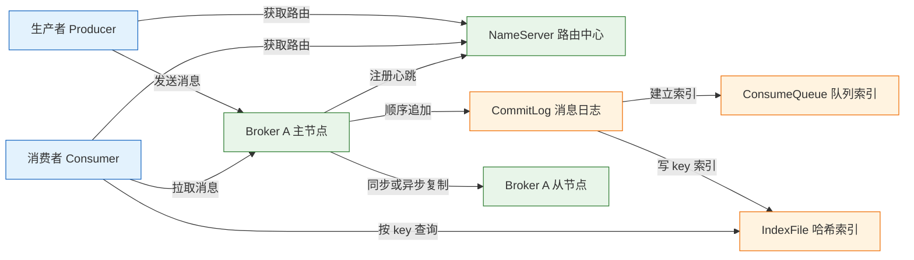
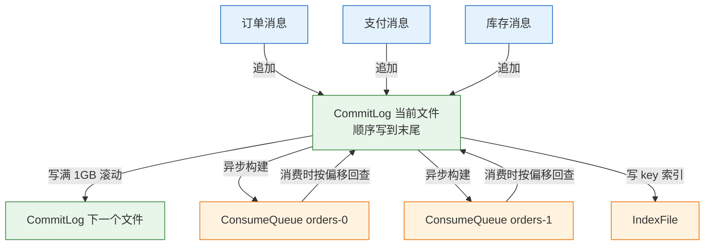
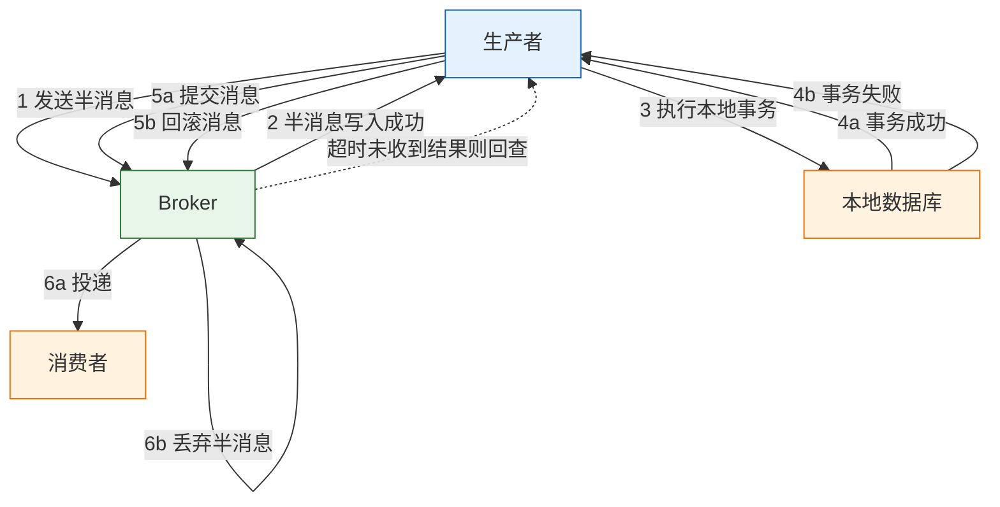
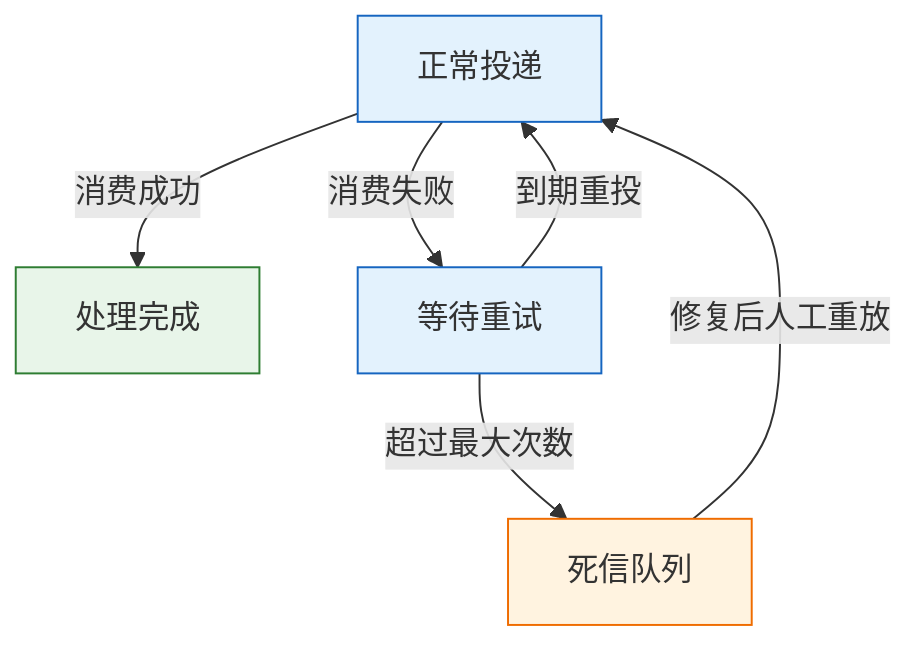

# RocketMQ 消息中间件

---

## 一、RocketMQ 是什么

RocketMQ 是阿里巴巴开源、后进入 Apache 基金会的分布式消息中间件。它把消息顺序追加写入 CommitLog，再为每个 topic 的每个队列建立 ConsumeQueue 索引，用顺序写换取吞吐，用索引换取按主题读取的能力。

从系统设计视角看，它承担四类职责：

- **异步解耦**：上游只负责发出事件，下游按自己的节奏消费，不必在请求链路里串行等待。
- **削峰填谷**：突发流量先进入 Broker，消费者按固定能力拉取，避免数据库被瞬时打穿。
- **最终一致**：事务消息把本地数据库操作与消息发送绑定，失败后通过回查收敛状态。
- **顺序与定时**：原生支持顺序消息、延迟消息和定时消息，减少业务自己实现调度表的成本。

它不解决的问题也要先划清：RocketMQ 不提供端到端 exactly-once，事务消息只保证“本地事务与消息发送最终一致”；它不是流式计算平台，超长保留、窗口聚合、流式生态不如 Kafka；它也不是轻量队列，组件和配置比 NATS、RabbitMQ 更重。

> **版本现状（2026）**：RocketMQ 5.x 是当前稳定线，引入 Proxy、gRPC 客户端和基于时间轮的定时消息；4.x 仍在维护。本文命令以 5.x 为基线，涉及客户端方法差异时会单独说明。

### 1.1 核心概念

RocketMQ 的模型围绕“主题分类、队列并行、消费组广播或分摊”展开。理解下面几个对象，后续的吞吐、顺序、重试问题都能落到具体位置。

| 概念 | 含义 | 关键约束 |
|---|---|---|
| Topic | 一类消息的逻辑分类 | 一个 topic 包含多个队列 |
| Queue | topic 下的并行单元 | 顺序只在同一队列内成立 |
| Tag | 消息的二级分类 | Broker 侧过滤，减少无效投递 |
| Key | 业务唯一标识 | 写入 IndexFile，供排查查询 |
| Producer Group | 生产者分组 | 事务消息回查按组定位生产者 |
| Consumer Group | 消费者分组 | 组内分摊，组间各收全量 |
| Offset | 队列上的消费位置 | 集群模式存 Broker，广播模式存本地 |
| MessageId | 消息的全局标识 | 用于查询单条消息与轨迹 |

Topic 与 Queue 的关系类似“库与分片”：topic 是逻辑名，队列才是实际存储和并行的单位。增加队列能提高并发上限，但队列数在创建后调整需要谨慎，因为已有消息的路由和顺序语义都会受影响。

Tag 在 Broker 侧过滤，消费者只收到匹配的消息；Key 不参与过滤，只写入索引文件，适合按订单号、流水号反查。把本该用 Tag 的粗分类塞进 Key，会让每次消费都多收无用消息。

### 1.2 与相邻技术的关系

消息中间件的选型不是“谁更先进”，而是“谁的错误模型和运维成本更匹配”。RocketMQ 的差异点集中在延迟消息、事务消息、顺序消费和 JVM 生态。

| 技术 | 核心模型 | 优势 | 主要代价 |
|---|---|---|---|
| RocketMQ | CommitLog + ConsumeQueue | 延迟/事务/顺序原生支持 | 组件多，JVM 调优要求高 |
| Kafka | 分区日志 + 消费组 | 吞吐高，流式生态成熟 | 延迟消息需自行实现，事务语义不同 |
| RabbitMQ | AMQP 交换机 + 队列 | 路由灵活，轻量易用 | 大量堆积时性能下降明显 |
| Pulsar | 计算存储分离 | 多租户、分层存储 | 部署复杂，生态相对小 |

如果系统已经在 Kafka 生态里，且只需要普通异步和解耦，再引入 RocketMQ 往往不划算；如果业务明确需要“30 分钟未支付关单”“支付与订单最终一致”“同一订单严格有序”，RocketMQ 的原生能力能省掉大量自研调度表和补偿逻辑。

> **注意**：事务消息不是分布式事务的通用答案。它只覆盖“本地数据库 + 发消息”这一种组合，跨多个服务的强一致仍要依靠业务补偿或专门的分布式事务框架。

### 1.3 架构组成

RocketMQ 的部署单元由 NameServer、Broker、Proxy 和客户端组成。NameServer 管路由，Broker 管存储与投递，Proxy 在 5.x 中为多语言客户端提供 gRPC 入口。



- **NameServer**：无状态路由节点，Broker 每 30 秒注册一次心跳，客户端从任意一台 NameServer 取路由后直连 Broker。NameServer 之间不通信，部署多台只是给客户端提供备用地址，因此不存在“选主”问题。
- **Broker**：负责消息写入、存储、复制和消费进度。主节点处理读写，从节点保存副本；`ASYNC_MASTER` 异步复制，`SYNC_MASTER` 同步复制。
- **Proxy**：5.x 新增的无状态接入层，对外提供 gRPC 协议，兼容 Java、Go、C++ 等多语言客户端；老客户端仍走 remoting 协议直连 Broker。
- **CommitLog**：所有 topic 共享的顺序追加日志，是写入性能的核心。
- **ConsumeQueue**：每个 topic 每个队列的定长索引，记录消息在 CommitLog 的物理位置。
- **IndexFile**：按 message key 建立的哈希索引，服务于查询和排障，不在主消费路径上。

> **运维提示**：NameServer 地址在客户端配置里通常写成 `host1:9876;host2:9876`。只写一台也能运行，但那一台重启期间新客户端无法获取路由，生产环境至少部署两台。

---

## 二、安装与连接

单机实验用容器最快，生产环境则要按磁盘、复制和监控单独规划。下面的编排文件可以直接启动一套 NameServer 加 Broker 的最小集群。

> **注意**：本节命令与端口基于官方 `apache/rocketmq` 镜像的常见行为，镜像 tag 和日志措辞会随版本变化；执行前确认宿主机已安装 Docker 与 Compose。

### 2.1 单机容器部署

```yaml
services:
  # ---------- 路由中心 ----------
  namesrv:
    image: apache/rocketmq:5.3.2
    command: sh mqnamesrv
    ports:
      - "9876:9876"                 # 客户端与 Broker 获取路由的端口

  # ---------- 存储与投递节点 ----------
  broker:
    image: apache/rocketmq:5.3.2
    command: sh mqbroker -n namesrv:9876 -c /home/rocketmq/broker.conf
    depends_on:
      - namesrv                      # 只保证启动顺序，不保证 NameServer 已就绪
    ports:
      - "10909:10909"                # 主节点监听端口
      - "10911:10911"                # 客户端连接与消息传输端口
    volumes:
      - ./broker.conf:/home/rocketmq/broker.conf
      - broker-data:/home/rocketmq/store

volumes:
  broker-data:                       # 命名卷，删除容器不丢消息
```

启动并观察日志：

```bash
# ========== 启动编排 ==========
# 后台启动 NameServer 与 Broker
docker compose up -d

# 持续查看 Broker 日志，等待启动完成
docker compose logs -f broker

# ========== 确认进程与端口 ==========
# 查看容器状态
docker compose ps

# 确认宿主机端口已监听
ss -lntp | grep -E '9876|10911'
```

日志出现 `boot success` 一类字样，说明 Broker 已完成注册。若容器反复重启，先看日志里的磁盘路径、配置文件解析和 NameServer 连接错误，不要急着重装镜像。

### 2.2 Broker 核心配置

```properties
# ========== 集群标识 ==========
brokerClusterName=DefaultCluster
brokerName=broker-a
brokerId=0                              # 0 表示主节点，大于 0 表示从节点

# ========== 路由与地址 ==========
namesrvAddr=namesrv:9876
brokerIP1=127.0.0.1                     # 对外公布地址，客户端必须能连到

# ========== 复制与刷盘 ==========
brokerRole=ASYNC_MASTER                 # 异步复制，延迟低但故障可能丢消息
flushDiskType=ASYNC_FLUSH               # 异步刷盘，吞吐高但断电可能丢少量

# ========== 文件保留 ==========
deleteWhen=04                           # 每天 04:00 清理过期文件
fileReservedTime=48                     # 文件保留 48 小时

# ========== topic 管理 ==========
autoCreateTopicEnable=true              # 开发方便；生产建议关闭并预建
```

| 配置项 | 作用 | 生产建议 |
|---|---|---|
| `brokerIP1` | Broker 向客户端公布的地址 | 填客户端可达的网卡地址 |
| `brokerRole` | 主从复制方式 | 交易类用 `SYNC_MASTER` |
| `flushDiskType` | 刷盘方式 | 可靠性优先用 `SYNC_FLUSH` |
| `fileReservedTime` | CommitLog 保留小时数 | 按磁盘容量和回放需求定 |
| `autoCreateTopicEnable` | 是否允许自动建 topic | 生产关闭，改为预建 |

`brokerIP1=127.0.0.1` 只适合“客户端在宿主机”的单机实验。其他容器或远程机器访问时，NameServer 会把 `127.0.0.1` 返回给客户端，客户端随后连接自己的回环地址，表现为“路由拿到了但发送超时”。此时应改成容器网络内或宿主机网卡上可达的地址。

### 2.3 连接验证与管理命令

`mqadmin` 是 Broker 镜像自带的管理工具，所有子命令都需要 `-n` 指定 NameServer。下面按“确认集群、建 topic、发消息、查消息”的顺序验证整条链路。

```bash
# ========== 确认集群注册 ==========
# 查看 Broker 地址、角色和集群名
docker exec -it broker sh -c \
  'cd /home/rocketmq/rocketmq-*/bin && sh mqadmin clusterList -n namesrv:9876'

# ========== 创建 topic ==========
# -c 指定集群，-t 指定 topic 名，-r/-w 指定读写队列数
docker exec -it broker sh -c \
  'cd /home/rocketmq/rocketmq-*/bin && sh mqadmin updateTopic -n namesrv:9876 -c DefaultCluster -t orders -r 8 -w 8'

# ========== 查看 topic ==========
# 列出所有 topic，确认 orders 已存在
docker exec -it broker sh -c \
  'cd /home/rocketmq/rocketmq-*/bin && sh mqadmin topicList -n namesrv:9876'

# ========== 发送测试消息 ==========
# -k 写业务 key，-p 写消息体
docker exec -it broker sh -c \
  'cd /home/rocketmq/rocketmq-*/bin && sh mqadmin sendMessage -n namesrv:9876 -t orders -k A100 -p "{\"orderId\":\"A100\"}"'

# ========== 按 key 查询 ==========
# 走 IndexFile，刚写入的消息可能延迟几毫秒才可见
docker exec -it broker sh -c \
  'cd /home/rocketmq/rocketmq-*/bin && sh mqadmin queryMsgByKey -n namesrv:9876 -t orders -k A100'
```

| 命令 | 用途 | 常见失败原因 |
|---|---|---|
| `clusterList` | 查看 Broker 注册状态 | NameServer 地址错、Broker 未启动 |
| `updateTopic` | 创建或更新 topic | 集群名错、Broker 无写权限 |
| `topicList` | 列出 topic | 连到了错误的 NameServer |
| `sendMessage` | 发送测试消息 | topic 不存在、Broker 磁盘满 |
| `queryMsgByKey` | 按业务 key 查询 | key 未写入、索引尚未可见 |

`sendMessage` 的返回通常包含 `sendResult=`、`msgId=`、`queueId=`。`queueId` 很重要：它说明消息落在哪个队列，顺序问题和消费堆积都要结合队列来看。按 key 查询能看到 `Topic`、`Keys`、`QueueId`、`QueueOffset`，这些字段是后续排查的坐标。

---

## 三、存储模型

RocketMQ 的吞吐来自“所有消息写一个日志”，读取能力来自“为每个队列单独建索引”。这套读写分离的存储结构，是理解堆积、清理和故障恢复的基础。

### 3.1 CommitLog 顺序写

CommitLog 是 Broker 上所有 topic 共享的消息日志，默认每个文件 1GB，写满后滚动到下一个文件。生产者发来的消息不分主题，全部追加到当前文件末尾，因此写入是纯顺序 I/O，能充分利用磁盘带宽和操作系统页缓存。



每条 CommitLog 记录包含消息体长度、消息体、topic、queueId、产生时间、存储时间、消息 ID、key、tag，以及事务、延迟等属性。消息体是变长的，所以 CommitLog 不能像 ConsumeQueue 那样定长索引，只能顺序扫描定位。

写入完成后，Broker 异步把消息的位置信息分发到对应的 ConsumeQueue。这个“先写日志、再建索引”的顺序决定了：消息写成功但索引短暂落后时，消费会稍晚看到它，但不会丢。

### 3.2 ConsumeQueue 与 IndexFile

ConsumeQueue 是“索引的索引”。每个 topic 的每个队列对应一个目录，目录下按顺序存放定长条目，每条 20 字节：

- 8 字节：消息在 CommitLog 中的物理偏移。
- 4 字节：消息总大小。
- 8 字节：tag 的哈希值。

消费者先读 ConsumeQueue 拿到物理偏移，再按偏移到 CommitLog 读取完整消息。索引条目小且定长，整个队列的索引可以常驻页缓存，消费时几乎不产生额外磁盘寻址。

IndexFile 解决另一类问题：按 message key 反查。它以固定大小的哈希结构组织，key 的哈希值定位槽位，槽位再指向索引条目，条目记录消息的 CommitLog 偏移和时间。`queryMsgByKey`、控制台的消息查询都走它。

| 文件 | 记录内容 | 写入方式 | 典型用途 |
|---|---|---|---|
| CommitLog | 完整消息 | 顺序追加 | 消息本体存储 |
| ConsumeQueue | 偏移、大小、tag 哈希 | 按队列顺序追加 | 消费者读取主路径 |
| IndexFile | key 哈希与消息位置 | 哈希写入 | 按 key 排查与回溯 |

> **注意**：key 不是必填项。没有 key 的消息仍能正常消费，但无法用 `queryMsgByKey` 定位。交易、支付类消息应把业务单号写入 key，否则线上排障只能靠 msgId 或时间范围扫描。

### 3.3 位点管理与文件清理

集群消费的位点保存在 Broker 的 `ConsumerOffsetManager` 中，键为 `group@topic@queueId`；广播消费的位点保存在消费者本地。位点提交有定时持久化机制，进程崩溃可能造成少量重复消费，因此消费端必须幂等。

重置位点用于回放或跳过坏消息：

```bash
# ========== 重置到最早位置 ==========
# -s 0 表示从队列最早的消息开始；先停消费者再执行
docker exec -it broker sh -c \
  'cd /home/rocketmq/rocketmq-*/bin && sh mqadmin resetOffsetByTime -n namesrv:9876 -g billing -t orders -s 0'

# ========== 重置到指定时间 ==========
# 时间戳格式以 mqadmin 帮助为准，执行前先看 -h
docker exec -it broker sh -c \
  'cd /home/rocketmq/rocketmq-*/bin && sh mqadmin resetOffsetByTime -h'
```

重置前必须停止消费者。在线消费者会继续提交新位点，重置结果很快被覆盖，表现为“执行成功但消费位置没变”。

消息删除以文件为单位：CommitLog 文件超过 `fileReservedTime` 后，在 `deleteWhen` 指定的时间点被整体删除，不会逐条删除。磁盘使用量因此呈现阶梯式下降，而不是随消费进度线性下降。

| 参数 | 作用 | 调整影响 |
|---|---|---|
| `fileReservedTime` | 文件保留小时数 | 越长越占磁盘，回放窗口越大 |
| `deleteWhen` | 每日清理时间点 | 应避开业务高峰 |
| `diskMaxUsedSpaceRatio` | 磁盘使用率上限 | 超过后触发保护，可能拒绝写入 |

> **安全警告**：不要为了腾空间直接删除 `store` 目录下的文件。Broker 的运行状态、索引和位点都依赖这些文件，手工删除会导致启动失败或消息不可读，正确做法是调整保留时间并等待清理。

---

## 四、消息类型与生产

RocketMQ 的消息类型不是“语法糖”，每一种都对应不同的存储路径和消费约束。选错类型的代价通常体现在顺序错乱、重复消费或磁盘膨胀上。

| 类型 | 实现机制 | 主要代价 |
|---|---|---|
| 普通消息 | 追加到队列，消费者并发拉取 | 不保证顺序 |
| 顺序消息 | 按业务键选同一队列，消费加队列锁 | 队列并发降为 1 |
| 延迟消息 | 4.x 固定级别，5.x 时间轮 | 到期前持续占存储 |
| 事务消息 | 半消息 + 本地事务 + 回查 | 实现复杂，只保证最终一致 |
| 批量消息 | 多条打包一次发送 | 受总大小限制，失败整批重试 |

### 4.1 普通消息与批量消息

普通消息是最常用的形态。生产者只需配置 NameServer 地址和生产者组，构造消息后发送。同步发送能拿到明确结果，适合订单、支付等不能静默失败的场景；异步发送吞吐更高，但要在回调里处理失败。

```java
// ========== 普通消息生产者 ==========
// 指定生产者组，同一组内实例名要唯一
DefaultMQProducer producer = new DefaultMQProducer("order_producer_group");
// NameServer 地址，多个地址用分号分隔
producer.setNamesrvAddr("namesrv1:9876;namesrv2:9876");
// 发送超时，避免线程被长时间挂住
producer.setSendMsgTimeout(3000);
producer.start();

try {
    Message msg = new Message(
        "orders",                       // topic
        "ORDER_CREATED",                // tag，消费者可按 tag 过滤
        "A100",                         // key，写入 IndexFile
        "{\"orderId\":\"A100\"}".getBytes(StandardCharsets.UTF_8)
    );
    // 同步发送，返回 SendResult 才代表 Broker 已接收
    SendResult result = producer.send(msg);
    System.out.println(result.getSendStatus() + " " + result.getMsgId());
} finally {
    // 应用关闭时释放资源，避免连接泄漏
    producer.shutdown();
}
```

批量消息把多条消息合并成一次网络请求，能显著降低小消息的发送开销。批量发送的限制是总大小不能超过 Broker 配置的上限，且一批里只要有一条失败，整批都会按失败处理。批量适合日志、埋点这类可整批重试的数据，不适合彼此独立的交易指令。

### 4.2 顺序消息

顺序只在同一队列内成立。生产端必须把同一业务键的消息路由到同一队列，消费端再用顺序监听器串行处理该队列。

```java
// ========== 顺序消息生产 ==========
// 按订单号哈希选队列，保证同一订单进入同一队列
producer.send(msg, new MessageQueueSelector() {
    @Override
    public MessageQueue select(List<MessageQueue> queues, Message message, Object arg) {
        int index = Math.abs(arg.hashCode()) % queues.size();
        return queues.get(index);
    }
}, orderId);
```

消费端使用 `MessageListenerOrderly`，Broker 会对队列加锁，同一队列同一时刻只有一个消费者线程在处理。代价很直接：该队列的并发度降为 1；一条消息处理慢，后面的消息全部等待；失败重试也阻塞在当前队列，不会跳到其他队列。

因此顺序消息只用于“同一业务键必须有序”的场景，例如订单状态流转、账户余额变动。把全站消息都设成顺序消费，等于把整个 topic 的并行能力压成单线程。

> **注意**：扩消费者实例不一定能提高顺序消费的吞吐。顺序消费的上限由队列数决定，队列数少于消费者数时，多出来的实例分不到队列，只会空转。

### 4.3 延迟与定时消息

4.x 的延迟消息只支持固定级别，发送时指定级别编号，Broker 到期后把消息投递到目标 topic。默认级别共 18 级，从 1 秒到 2 小时：

```text
1s 5s 10s 30s 1m 2m 3m 4m 5m 6m 7m 8m 9m 10m 20m 30m 1h 2h
```

```java
// ========== 4.x 延迟消息 ==========
Message msg = new Message("orders", "ORDER_TIMEOUT", orderId, body);
// 级别 3 对应 10 秒，级别编号从 1 开始
msg.setDelayTimeLevel(3);
producer.send(msg);
```

5.x 支持任意时间的定时消息，底层用时间轮管理到期时间，投递精度和可设置范围以 Broker 配置为准。不同客户端 SDK 设置投递时间的方法名不完全一致，使用前以官方示例为准。

延迟消息不是免费的定时器。消息在到期前始终占用 CommitLog 和索引空间，几百万条“七天后执行”的消息会显著推高磁盘和内存占用。长周期、大批量的定时需求，应评估数据库调度表是否更合适。

### 4.4 事务消息

事务消息解决“本地数据库操作”和“发消息”两个动作的原子性。它把消息先写成对消费者不可见的半消息，再执行本地事务，根据结果提交或回滚；如果 Broker 迟迟收不到结果，就反查生产者的本地事务状态。



```java
// ========== 事务消息生产者 ==========
TransactionMQProducer producer = new TransactionMQProducer("payment_tx_group");
producer.setNamesrvAddr("namesrv1:9876");
// 回查线程池，避免回查请求堆积
producer.setExecutorService(Executors.newFixedThreadPool(4));
producer.setTransactionListener(new TransactionListener() {
    @Override
    public LocalTransactionState executeLocalTransaction(Message msg, Object arg) {
        try {
            // 本地事务：更新订单状态，与业务表在同一个数据库事务里
            orderService.markPaid((String) arg);
            return LocalTransactionState.COMMIT_MESSAGE;
        } catch (BizException e) {
            // 明确的业务失败才回滚
            return LocalTransactionState.ROLLBACK_MESSAGE;
        } catch (Exception e) {
            // 超时、连接中断等状态不明，交给回查
            return LocalTransactionState.UNKNOW;
        }
    }

    @Override
    public LocalTransactionState checkLocalTransaction(MessageExt msg) {
        // 按业务 key 查本地事务表，查不到明确结果时返回 UNKNOW
        Boolean paid = orderService.queryPaid(msg.getKeys());
        if (paid == null) {
            return LocalTransactionState.UNKNOW;
        }
        return paid ? LocalTransactionState.COMMIT_MESSAGE
                    : LocalTransactionState.ROLLBACK_MESSAGE;
    }
});
producer.start();
```

几个关键约束：

- 半消息写入成功后才执行本地事务，顺序反了会丢消息。
- 回查接口必须能根据消息里的业务键查到明确的本地事务结果，不能长期返回“未知”。
- 回查有次数上限，默认 `transactionCheckMax=15`，间隔约 60 秒，具体以版本配置为准；超过上限仍未确认，消息可能被丢弃或进入异常流程。
- 消费者看到的只是已提交消息，仍可能重复，必须幂等。

事务消息保证的是“本地事务与消息发送最终一致”，不保证消费者处理成功。消费者失败仍走重试和死信，链路末端依旧要靠幂等和补偿兜底。

---

## 五、消费模型

消费端决定消息以什么粒度分摊、从哪里开始读、失败后怎么重来。同一个 topic 换一种消费模式，吞吐和可靠性都会变。

### 5.1 集群消费与广播消费

| 模式 | 投递行为 | 位点存储 | 适用场景 |
|---|---|---|---|
| `CLUSTERING` | 同组内一条消息只给一个实例 | Broker | 常规业务，水平扩容 |
| `BROADCASTING` | 同组每个实例都收到全量 | 消费者本地 | 本地缓存刷新、配置推送 |

集群模式是默认值，也是绝大多数业务的选择。增加消费者实例时，队列会在实例间重新分配，单个实例故障后其他实例接管队列，消费继续推进。

广播模式的位点存在消费者本地，换机器或清空本地目录后进度丢失，会把历史消息重新消费一遍。它只适合“每条消息都要通知到每个节点”的场景，不适合需要断点续传的业务。

### 5.2 推模式与拉模式

RocketMQ 的“推模式”本质上是客户端封装的长轮询：消费者向 Broker 拉取消息，没有新消息时请求挂起一段时间，有消息立即返回。这样既保留了拉模式的流量控制能力，又避免了空轮询。

| 模式 | 控制方 | 实时性 | 使用建议 |
|---|---|---|---|
| 推模式 | 客户端自动拉取并回调 | 高 | 业务消费默认选择 |
| 拉模式 | 应用自己控制偏移 | 取决于轮询间隔 | 批量、离线回放 |

推模式下，消费者通过 `setConsumeThreadMin`、`setConsumeThreadMax` 控制并发线程数，通过 `setConsumeMessageBatchMaxSize` 控制单次回调的消息条数。线程数不是越大越好：下游数据库连接池、第三方限流才是真正的瓶颈。

### 5.3 重试与死信

消费失败返回 `RECONSUME_LATER` 后，Broker 把消息投递到 `%RETRY%<consumerGroup>`，按延迟级别逐步重投。并发消费默认最多重试 16 次，顺序消费默认不设上限，必须由业务自己限制；超过次数后进入 `%DLQ%<consumerGroup>`。



顺序消费的重试策略不同：失败后暂停当前队列一小段时间再重试，避免跳过前面的消息。代价是该队列整体被阻塞，所以顺序消息的处理逻辑必须快且稳定，不能在里面做远程调用链。

死信队列不会自动重放。正确做法是配置告警、查看失败原因、修复后手动重放，并在重放前确认消费端幂等。把 DLQ 当归档目录，只会让磁盘和风险一起增长。

重试队列和死信队列本质也是普通 topic，同样占用磁盘、同样需要监控。它们不是“系统自动兜底”，而是需要人处理的异常堆积。

> **注意**：重试次数和重试间隔由 Broker 的 `messageDelayLevel` 与消费者组配置共同决定。调整前先确认当前版本的实际默认值，不要照搬其他环境的参数。

---

## 六、可靠性与幂等

“消息不丢”是三个环节的组合：生产者确认收到、Broker 持久化并复制、消费者处理完再提交位点。任何一环缺失，都只能做到“大概率不丢”。

### 6.1 刷盘与主从复制

| 组合 | 写入延迟 | 故障时可能丢失 | 适用场景 |
|---|---|---|---|
| `ASYNC_MASTER + ASYNC_FLUSH` | 最低 | 断电或主节点故障时最近消息 | 日志、埋点、可重放数据 |
| `ASYNC_MASTER + SYNC_FLUSH` | 中 | 主节点故障时未复制的消息 | 一般业务 |
| `SYNC_MASTER + ASYNC_FLUSH` | 较高 | 断电时最近消息 | 交易、支付常用折中 |
| `SYNC_MASTER + SYNC_FLUSH` | 最高 | 理论最少 | 极少数强可靠场景 |

`SYNC_FLUSH` 表示每条消息都要等刷盘完成才返回，吞吐下降明显；`SYNC_MASTER` 表示主节点要等从节点复制成功才确认，主从网络抖动会直接反映为发送延迟。生产环境要根据业务对“丢一条”的容忍度选择，而不是一律拉满。

### 6.2 消息不丢的配置组合

生产者侧要处理发送结果：同步发送检查 `SendStatus`，异步发送在回调里记录失败并重试；批量发送失败时整批重发，消费端必须能承受重复。

Broker 侧要保证磁盘空间和副本健康。磁盘使用率超过阈值会触发保护，表现为发送变慢或直接失败；从节点落后太多时，`SYNC_MASTER` 的写入会被拖住。

消费者侧要“处理成功后再提交位点”。推模式默认在回调返回成功后才更新位点，但如果业务把消息丢进内存队列就返回成功，进程崩溃后这部分消息就丢了。正确做法是业务落库或写入可靠存储后再返回成功。

| 环节 | 关键动作 | 失败后果 |
|---|---|---|
| 生产 | 检查发送结果并重试 | 消息未进入 Broker |
| 存储 | 刷盘与主从复制 | 断电或主节点故障丢消息 |
| 消费 | 处理完成再确认 | 提前确认导致消息丢失 |
| 补偿 | 对账与重放 | 长期不一致无人发现 |

### 6.3 消费端幂等设计

RocketMQ 的投递语义是“至少一次”，重复不可避免：生产者重试、位点未及时提交、消费者扩缩容、Broker 主从切换都可能造成重复。幂等不能靠“消息只会来一次”的假设。

| 方案 | 实现 | 注意事项 |
|---|---|---|
| 数据库唯一索引 | `(biz_id, event_type)` 唯一 | 与业务写入同一事务 |
| 去重表 | 消费前插入去重记录 | 记录要设过期清理 |
| 状态机 | 只允许合法状态迁移 | 依赖业务状态设计 |
| Redis 标记 | `SET NX` 加过期时间 | 主从切换可能失效 |

数据库唯一索引最可靠：把“业务效果”和“去重记录”放在同一个本地事务里，插入冲突就说明已经处理过，直接返回成功。Redis 标记胜在快，但过期时间、主从切换和内存淘汰都可能让去重失效，只适合作为第一道防线。

> **安全警告**：重放死信队列前必须确认消费端幂等。没有幂等保护的重放会把扣款、发货、积分等副作用执行两次，造成直接资金损失。

---

## 七、完整示例：支付结果通知

场景：支付服务完成扣款后，需要通知订单、积分、仓库三个下游；任何下游失败不能影响支付结果；同一订单的通知必须按顺序处理；下游可能重复收到消息。

### 7.1 模型设计

| 设计项 | 取值 | 原因 |
|---|---|---|
| Topic | `payment_result` | 支付结果独立分类 |
| Tag | `PAY_SUCCESS` | 下游按事件类型过滤 |
| Key | `orderId` | 支持按订单反查 |
| 队列数 | 8 | 兼顾顺序与并发 |
| 消费组 | 积分组、仓库组各自独立 | 组间各收全量 |
| 消费模式 | 集群消费 + 顺序监听 | 组内分摊，同单有序 |

`payment_result` 创建时用 `-r 8 -w 8` 显式指定读写队列数，避免依赖 Broker 的默认值。队列数一旦确定，后续扩容只能增加消费者，不能改变同一 key 的历史路由。

生产端采用 outbox 模式：支付服务在本地事务里更新支付单、订单状态，并写入 outbox 表；relay 进程按顺序读取未投递记录，按 `orderId` 选择队列后发送。消息 key 使用 `orderId`。这样既保证业务写入与待发消息同事务，又保证同一订单进入同一队列。

事务消息适合单条发送的最终一致，但发送接口不接收队列选择器，无法直接按业务键指定队列。需要“事务一致 + 按 key 有序”同时成立时，outbox 加 relay 更直接；只用事务消息时，则要在消费端用状态机处理乱序。

### 7.2 事务写入与可靠投递

```sql
CREATE TABLE outbox (
  id bigint GENERATED ALWAYS AS IDENTITY PRIMARY KEY,
  topic text NOT NULL,
  tag text NOT NULL,
  msg_key text NOT NULL,                    -- 业务键，这里放 orderId
  payload jsonb NOT NULL,
  status text NOT NULL DEFAULT 'pending',   -- pending/sent
  created_at timestamptz NOT NULL DEFAULT now()
);

CREATE INDEX idx_outbox_pending ON outbox (id) WHERE status = 'pending';
```

```java
// ========== 本地事务：业务写入与 outbox 同事务 ==========
@Transactional
public void confirm(Payment payment) {
    // 更新支付单与订单状态
    paymentMapper.markSuccess(payment.getId());
    orderMapper.markPaid(payment.getOrderId());
    // 同一事务写入待投递事件，避免“库成功、消息失败”
    outboxMapper.insert(OutboxEvent.of(
        "payment_result", "PAY_SUCCESS", payment.getOrderId(), payment.toJson()));
}
```

```java
// ========== relay：按 orderId 选队列并投递 ==========
DefaultMQProducer producer = new DefaultMQProducer("payment_relay_group");
producer.setNamesrvAddr("namesrv1:9876;namesrv2:9876");
producer.start();

while (running) {
    // 领取待投递记录，多实例用 SKIP LOCKED 避免抢同一条
    List<OutboxEvent> events = outboxMapper.lockPending(100);
    if (events.isEmpty()) {
        Thread.sleep(1000);              // 没有待投递记录时避免空转
        continue;
    }
    for (OutboxEvent event : events) {
        Message msg = new Message(event.getTopic(), event.getTag(),
            event.getMsgKey(), event.getPayload().getBytes(StandardCharsets.UTF_8));
        // 用业务键选队列，保证同一 orderId 进入同一队列
        producer.send(msg, (queues, m, arg) -> {
            int index = Math.abs(arg.hashCode()) % queues.size();
            return queues.get(index);
        }, event.getMsgKey());
        // 发送成功后再标记，失败则留待下一轮重试
        outboxMapper.markSent(event.getId());
    }
}
```

relay 发送成功后才把记录标记为已投递；如果发送超时但 Broker 实际已写入，重试会产生重复消息，因此消费端仍要幂等。relay 本身可以多实例部署，用 `FOR UPDATE SKIP LOCKED` 领取记录，避免多个实例发送同一条 outbox。

### 7.3 幂等消费者

```java
// ========== 积分消费者：顺序 + 幂等 ==========
DefaultMQPushConsumer consumer = new DefaultMQPushConsumer("points_consumer_group");
consumer.setNamesrvAddr("namesrv1:9876;namesrv2:9876");
consumer.setConsumeFromWhere(ConsumeFromWhere.CONSUME_FROM_FIRST_OFFSET);
consumer.subscribe("payment_result", "PAY_SUCCESS");

consumer.registerMessageListener((MessageListenerOrderly) (msgs, context) -> {
    for (MessageExt msg : msgs) {
        String orderId = msg.getKeys();
        try {
            // 唯一索引 (order_id, event_type) 保证只加一次积分
            pointsService.addOnce(orderId, "PAY_SUCCESS", 10);
        } catch (DuplicateKeyException e) {
            // 已处理过，视为成功，继续下一条
        } catch (Exception e) {
            // 可重试异常：稍后重投当前队列
            return ConsumeOrderlyStatus.SUSPEND_CURRENT_QUEUE_A_MOMENT;
        }
    }
    return ConsumeOrderlyStatus.SUCCESS;
});
consumer.start();
```

仓库组使用另一个消费组，消费同一 topic 的全量消息，各自维护位点。组之间互不影响：积分消费失败不会阻塞仓库，反之亦然。

### 7.4 验证与观测

```bash
# ========== 查看消费进度 ==========
# 关注 Diff 字段，它表示当前堆积量
docker exec -it broker sh -c \
  'cd /home/rocketmq/rocketmq-*/bin && sh mqadmin consumerProgress -n namesrv:9876 -g points_consumer_group'

# ========== 查看 topic 路由 ==========
# 确认队列数与 Broker 地址
docker exec -it broker sh -c \
  'cd /home/rocketmq/rocketmq-*/bin && sh mqadmin topicRoute -n namesrv:9876 -t payment_result'

# ========== 按消息 ID 查询 ==========
# msgId 从发送结果或应用日志中获取
docker exec -it broker sh -c \
  'cd /home/rocketmq/rocketmq-*/bin && sh mqadmin queryMsgById -n namesrv:9876 -i <msgId>'
```

需要完整轨迹（生产、存储、消费）时，Broker 开启 `traceTopicEnable=true`，客户端开启消息轨迹，数据写入 `RMQ_SYS_TRACE_TOPIC`。轨迹有额外存储和性能开销，生产按需开启，不要全量长期保留。

| 观测项 | 指标来源 | 告警建议 |
|---|---|---|
| 消费堆积 | `consumerProgress` 的 Diff | 持续增长超过阈值 |
| 发送失败 | 生产者日志与 SendStatus | 出现即告警 |
| 重试队列 | `%RETRY%` 消息量 | 突增说明下游异常 |
| 死信数量 | `%DLQ%` 消息量 | 大于 0 即需处理 |
| 磁盘使用 | Broker 日志与系统监控 | 超过 70% 预警 |

---

## 八、常见故障与排查

| 现象 | 最可能原因 | 处理 |
|---|---|---|
| `No route info of this topic` | topic 未创建、NameServer 地址错、自动建 topic 关闭 | 预建 topic，核对 `-n` 与路由 |
| 客户端连不上 Broker | `brokerIP1` 返回了不可达地址 | 改为容器或宿主可达 IP，检查 10911 |
| 发送超时 | 磁盘满、同步刷盘慢、从节点异常 | 查磁盘、刷盘耗时、主从状态 |
| 消费重复 | 重试、位点未提交、扩缩容 | 业务幂等，检查消费进度 |
| 顺序错乱 | 未按 key 选队列、用了并发监听 | 顺序消息 + 同一 key 同一队列 |
| 延迟消息不投递 | 级别设置错、定时消息用法不符版本 | 核对级别表与 SDK 用法 |
| 事务消息持续回查 | 本地事务状态不明、回查接口异常 | 修回查逻辑，限制次数并告警 |
| 消息堆积 | 消费慢、消费者掉线、队列数不足 | 扩消费者或队列，优化下游 |
| DLQ 持续增长 | 下游长期失败、消息格式不兼容 | 告警、暂停、修复后重放 |
| 磁盘满 | 保留时间过长、延迟消息过多、副本占空间 | 调 `fileReservedTime`，清理扩容 |

排查顺序按“集群、路由、存储、消费”逐层收敛：

1. 执行 `mqadmin clusterList`，确认 Broker 已注册、角色和地址正确。
2. 执行 `mqadmin topicRoute`，确认 topic 存在、队列分布在预期 Broker 上。
3. 查看 Broker 日志中的 CommitLog、刷盘、主从复制错误，排除存储层问题。
4. 查看消费组进度、重试队列和死信队列，判断是消费慢还是业务失败。
5. 最后结合应用日志中的 msgId、orderId 和消费耗时，定位到具体消息与代码路径。

> **排障提示**：不要一上来就重置位点或删 topic。先确认消息是否真的写入、消费者是否真的收到，再决定回放还是修复。删除 topic 会连同消息和位点一起清掉，属于不可逆操作。
