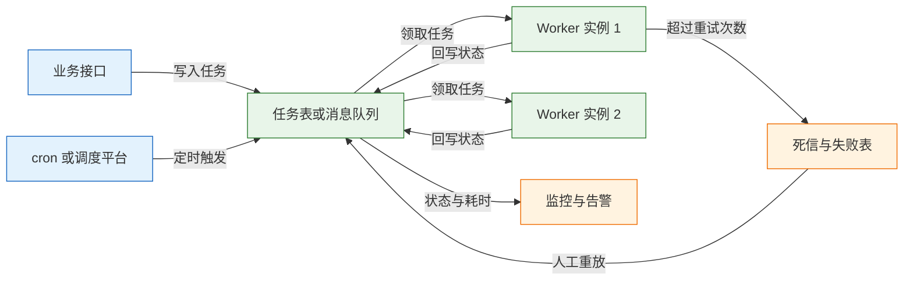
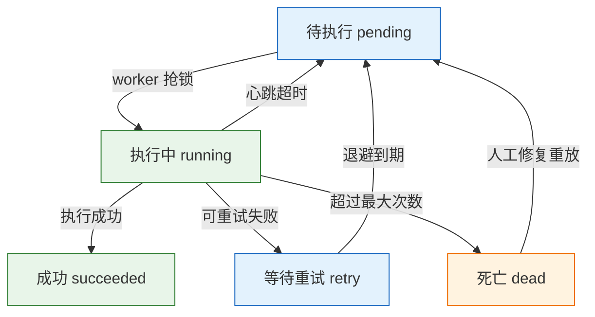
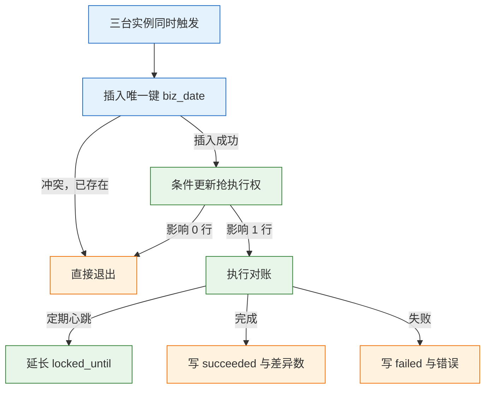

# 异步与定时任务

---

## 一、异步与定时任务是什么

异步任务把“接收请求”和“完成工作”分开：接口只写入一条任务记录或发出一条消息，立即返回；后台 worker 按自己的能力取任务、执行、重试。定时任务则在此基础上增加时间维度，到点触发一次执行。

两者解决的是不同问题，却共享同一套失败模型：

- **异步**：发邮件、生成报表、转码、调用不稳定的第三方，不必让用户在主请求里等待。
- **定时**：凌晨对账、每小时聚合、每天清理临时数据，不依赖“第一个访问的人顺便触发”。
- **共同风险**：重复执行、漏执行、执行到一半进程消失、任务无限堆积。

它们不解决的问题也要提前划清：异步不保证业务正确，下游不幂等时重试就是灾难；定时不保证只跑一次，cron 只是触发器；一个必须同步返回结果的查询，硬改成异步只会让前端多一轮轮询。

### 1.1 核心概念

任务系统的最小模型由五部分组成：任务定义、触发源、执行器、状态存储、失败处理。理解这五个对象的边界，才能判断该用线程池、任务表还是消息队列。

| 概念 | 含义 | 设计要点 |
|---|---|---|
| 任务定义 | 做什么、参数是什么 | 参数要可序列化，避免依赖请求上下文 |
| 触发源 | 谁在什么时间提交任务 | 接口、cron、消息、人工重放 |
| 执行器 | 真正干活的进程 | 独立部署，按队列隔离 |
| 状态存储 | 记录待执行、执行中、成功、失败 | 必须持久化，支持查询与重放 |
| 幂等键 | 判断“这件事是否已做过” | 来自业务，全局唯一且稳定 |

任务的生命周期里，最容易忽略的是“可见性超时”：worker 取走任务后，系统认为它会在一定时间内完成；超过这个时间没有心跳，任务要重新变为可领取。没有这一条，worker 被 kill 后任务会永远停在“执行中”，只能人工改状态。

### 1.2 与相邻技术的关系

异步与定时不是某一个框架的功能，而是一组能力的组合。线程池、任务表、消息队列、调度平台分别覆盖不同规模。

| 技术 | 持久性 | 适用规模 | 主要边界 |
|---|---|---|---|
| 线程池 / 协程 | 进程内，重启即丢 | 单机轻量任务 | 不能跨实例，不能断点续传 |
| 数据库任务表 | 落库，可查可重放 | 每天几千到几十万 | 吞吐受数据库写入限制 |
| 消息队列 | Broker 持久化 | 每秒上万 | 入队与业务写入需额外保证一致 |
| 调度平台 | 平台持久化 | 多应用、多租户 | 多一个组件要运维 |

判断标准是“任务丢了会不会有人受损”。刷新本地缓存、写一条访问日志，丢了可以接受，线程池足够；扣款、发货、对账结果，丢了必须能发现并补回，就要落库或进 Broker。

### 1.3 架构组成

一个可运维的任务系统通常由“触发、存储、执行、观测”四层组成。触发层只负责产生任务，存储层负责持久化与排队，执行层负责领取和完成，观测层负责发现堆积与失败。



- **触发层**：接口在业务事务里写入任务，cron 负责周期性提交，人工入口负责重放。
- **存储层**：任务表用行锁和状态字段排队，消息队列用分区和位点排队。
- **执行层**：多个 worker 无状态部署，按并发上限领取任务，失败后按策略重试。
- **观测层**：队列深度、最老任务年龄、成功率、执行耗时、死信数量。

> **运维提示**：触发层和执行层必须解耦。让 Web 进程直接跑长任务，会把请求线程、数据库连接和任务生命周期绑在一起，发布一次就丢一批任务。

---

## 二、运行环境与任务接入

任务系统依赖的三样基础设施是：可靠的时钟、可靠的状态存储、可观测的执行进程。单机实验可以只用 cron 加 PostgreSQL，生产环境再按规模替换存储层。

### 2.1 运行环境准备

```bash
# ========== 系统调度器 ==========
# Debian / Ubuntu 安装 cron
sudo apt update && sudo apt install -y cron
sudo systemctl enable --now cron

# RHEL / CentOS 安装 cronie
sudo dnf install -y cronie
sudo systemctl enable --now crond

# ========== 文件锁工具 ==========
# flock 来自 util-linux，绝大多数发行版已预装
command -v flock

# ========== 数据库客户端 ==========
# 以 PostgreSQL 为例，安装客户端与服务端
sudo apt install -y postgresql-client postgresql

# 验证连接与版本，用户与库名按实际环境替换
psql -h 127.0.0.1 -U app -d jobs -c 'select version();'

# ========== 运行时 ==========
# 以 Python 3 为例，确认解释器路径，cron 中要写绝对路径
command -v python3
python3 --version
```

| 组件 | 作用 | 验证方式 |
|---|---|---|
| cron / cronie | 提供分钟级触发 | `systemctl status cron` |
| flock | 单机防任务重叠 | `command -v flock` |
| PostgreSQL | 任务状态与行锁 | `psql -c 'select 1'` |
| Python / JVM | 执行任务逻辑 | 输出版本号 |

> **注意**：cron 执行时的 `PATH` 很短，通常只有 `/usr/bin:/bin`。脚本里调用 `python3`、`psql`、业务程序时一律写绝对路径，否则会出现“手工能跑、cron 跑不了”。

### 2.2 任务表结构设计

任务表不是简单的 `id + payload`。要把状态、重试次数、锁定信息、下次执行时间都落成字段，worker 才能在崩溃后接管，运维才能按状态排查。

```sql
CREATE TABLE jobs (
  id bigint GENERATED ALWAYS AS IDENTITY PRIMARY KEY,
  type text NOT NULL,                         -- 任务类型，决定用哪个处理器
  payload jsonb NOT NULL,                     -- 任务参数，必须可序列化
  status text NOT NULL DEFAULT 'pending',     -- pending/running/succeeded/retry/dead
  run_at timestamptz NOT NULL DEFAULT now(),  -- 最早可执行时间
  attempts int NOT NULL DEFAULT 0,            -- 已尝试次数
  max_attempts int NOT NULL DEFAULT 5,        -- 最大尝试次数
  locked_by text,                             -- 持有锁的 worker
  locked_until timestamptz,                   -- 锁过期时间，崩溃后由他人接管
  last_error text,                            -- 最近一次失败原因
  created_at timestamptz NOT NULL DEFAULT now()
);

-- 只索引待执行任务，减少无关数据进入索引
CREATE INDEX idx_jobs_ready ON jobs (run_at) WHERE status = 'pending';
```

| 字段 | 作用 | 常见错误 |
|---|---|---|
| `status` | 驱动状态机 | 用布尔字段，无法表达执行中 |
| `run_at` | 控制延迟与退避 | 失败后立即改回 pending，造成忙循环 |
| `attempts` | 限制重试次数 | 只记日志，不落库，重启后归零 |
| `locked_until` | 回收崩溃任务 | 不设过期，任务永久卡住 |
| `last_error` | 排障依据 | 只存“失败”，没有堆栈与上下文 |

`payload` 使用 `jsonb` 便于查询和扩展，但不要把大文件、二进制内容塞进去。任务参数应只包含业务键和必要配置，执行时再按需查询最新数据。

### 2.3 调度入口配置

单机场景用 crontab 触发。命令行里写绝对路径，输出重定向到日志，便于确认是否执行。

```bash
# ========== 编辑当前用户 crontab ==========
crontab -e

# ========== 每天 01:30 触发对账 ==========
# 输出追加到日志，2>&1 把错误输出一并收集
30 1 * * * /usr/local/bin/settle.sh >> /var/log/settle.log 2>&1

# ========== 每 5 分钟扫描一次待执行任务 ==========
*/5 * * * * /usr/local/bin/job-worker.sh >> /var/log/job-worker.log 2>&1

# ========== 查看已安装的定时任务 ==========
crontab -l
```

```bash
# ========== 确认 cron 是否真的执行 ==========
# 查看系统日志中的 CRON 记录
journalctl -u cron --since "10 min ago"

# 查看任务自己的输出
tail -n 50 /var/log/settle.log
```

日志要按天轮转并限制保留天数，否则单次输出过大或长期运行会占满磁盘。

容器化环境则把同样的入口写进镜像的启动脚本，或交给 Kubernetes CronJob。无论哪种方式，调度器只负责“到点叫人”，不负责“只叫一次”。

---

## 三、任务模型与生命周期

任务模型决定故障时的行为。进程内队列追求低延迟，进程外队列追求可恢复；选择哪一种，取决于任务丢失的代价。

### 3.1 进程内与进程外模型

| 维度 | 进程内 | 进程外 |
|---|---|---|
| 典型实现 | 线程池、`asyncio.create_task` | 任务表、Celery、BullMQ、Kafka |
| 持久性 | 进程退出即丢 | 落盘或 Broker 保留 |
| 扩容 | 跟随应用实例 | worker 独立扩缩容 |
| 延迟 | 最低 | 多一次入队与领取 |
| 复杂度 | 低 | 要处理重试、幂等、监控 |

进程内任务适合“可丢、可重算、极短”的工作，例如请求结束后刷新一次本地缓存。只要任务涉及资金、库存、通知，或者执行时间超过几秒，就应该离开请求进程。

### 3.2 任务状态机

一个可恢复的任务至少有五种状态：待执行、执行中、成功、等待重试、死亡。状态迁移必须由数据库条件更新驱动，不能只靠内存标志。



设计状态机时先定五件事：

1. **幂等键**：同一业务只允许成功一次，例如 `(job_type, biz_id, run_date)` 唯一。
2. **单次超时**：一次执行最多多久，超时后任务要被收回。
3. **重试策略**：哪些错误可重试、最多几次、退避曲线是什么。
4. **可见性超时**：worker 取走任务后多久没心跳，就认为它已死亡。
5. **失败归宿**：超过次数后进死信表还是失败队列，谁来看，怎么重放。

缺少可见性超时，worker 被 kill 后任务永远停在 `running`；缺少幂等键，重试就会重复扣款。

### 3.3 任务表与消息队列的取舍

| 维度 | 任务表 | 消息队列 |
|---|---|---|
| 入队与业务写入 | 同一事务，天然原子 | 需要 outbox 或事务消息 |
| 查询与后台管理 | SQL 直接查 | 需要额外索引或接口 |
| 吞吐 | 中低，受数据库写入限制 | 高 |
| 延迟 | 轮询间隔加抢锁 | 毫秒级 |
| 重试与延迟 | 自己实现 `run_at/attempts` | Broker 通常自带 |
| 运维成本 | 复用现有数据库 | 多一个 Broker |

任务量每天几千到几十万、且要与业务数据同事务提交，任务表更简单；每秒上万、需要削峰和多个消费组，选消息队列。两者也能组合：业务事务写任务表，relay 进程把任务投递到 Broker，Broker 负责高吞吐分发。

这种组合常被称为 outbox 模式：业务数据和“待投递消息”写在同一张表、同一个事务里，relay 按顺序读取未投递记录并发送到 Broker，发送成功后再标记。它避免了“数据库提交成功、消息发送失败”的缺口，代价是 relay 要处理重复投递，消费端仍然要幂等。

---

## 四、任务调度

调度的核心不是“写出 cron 表达式”，而是“在多点触发、进程崩溃、时钟跳变的情况下，仍然只产生一次有效执行”。

### 4.1 cron 表达式与语义

cron 的五个字段依次是分、时、日、月、周：

```text
分 时 日 月 周
0  2  *  *  *    每天 02:00
*/5 * * * *      每 5 分钟
0  9  *  *  1-5  工作日 09:00
```

两个容易忽略的语义：

- “日”和“周”都有限制时，Vixie cron 取**或**，不是与。`0 0 1 * 1` 表示“每月 1 号或每周一”，不是“每月 1 号且是周一”。
- 时区取决于系统和 `CRON_TZ`。容器默认 UTC，业务按北京时间写 `0 2 * * *`，实际会在北京时间 10:00 执行。

另外，cron 的最小粒度是分钟，秒级触发要在脚本内部循环，或改用调度平台。修改 crontab 后无需重启服务，cron 会重新加载配置。

| 表达式 | 实际含义 | 常见误解 |
|---|---|---|
| `0 2 * * *` | 每天 02:00 | 以为一定是北京时间 |
| `0 0 1 * 1` | 每月 1 号或每周一 | 以为是两者同时满足 |
| `*/5 * * * *` | 每 5 分钟 | 以为从整点开始对齐 |
| `0 9 * * 1-5` | 周一到周五 09:00 | 忽略节假日 |

> **注意**：夏令时切换当天，本地时间可能出现重复或缺失。对账、结算类任务应把调度时区固定为业务时区，并在数据库里用带时区的时间类型记录实际执行时间。

### 4.2 单机防重叠

同一台机器上，上一次任务没跑完、下一次又被 cron 拉起，会造成并发写同一批数据。最轻量的做法是用目录锁或 `flock`。

```bash
mkdir -p /tmp/cron-demo

cat > /tmp/cron-demo/job.sh <<'SH'
#!/bin/sh
LOCK=/tmp/cron-demo/job.lock
# mkdir 在本地文件系统上是原子操作，成功即拿到锁
if ! mkdir "$LOCK" 2>/dev/null; then
  echo "already running"
  exit 1
fi
# 无论正常退出还是出错，都尝试释放锁
trap 'rmdir "$LOCK"' EXIT
echo "start $(date '+%F %T') pid=$$"
sleep 5
echo "done  $(date '+%F %T') pid=$$"
SH

chmod +x /tmp/cron-demo/job.sh

# 第一次执行：拿到锁并运行
/tmp/cron-demo/job.sh

# 5 秒内另开终端再执行：应输出 already running
/tmp/cron-demo/job.sh
```

也可以直接用文件锁：

```bash
# -n 表示拿不到锁立即失败，不等待
flock -n /tmp/cron-demo/job.lock /tmp/cron-demo/job.sh
```

| 方式 | 原子性来源 | 崩溃后是否自动释放 |
|---|---|---|
| `mkdir` 目录锁 | 目录创建原子 | 否，可能留下锁目录 |
| `flock` 文件锁 | 内核文件锁 | 是，进程退出即释放 |
| PID 文件 | 写入加检查 | 否，需要额外判活 |

目录锁的缺点是进程被 `kill -9` 时 `trap` 不一定执行，可能留下锁目录。脚本启动时应把 PID 写进锁目录，发现锁存在但进程已死就清理；或者直接用 `flock`，文件锁随进程退出自动释放。

> **安全警告**：锁只能防止同一台机器上的重叠。多实例部署时，每台机器都有自己的 `/tmp`，目录锁和 `flock` 都不会跨机器生效，必须使用数据库行锁、Redis 锁或选主。

### 4.3 多实例抢锁

三台机器都装了 crontab，任务就会跑三次。常见方案对比如下：

| 方案 | 机制 | 优点 | 风险 |
|---|---|---|---|
| 数据库行锁 | `UPDATE ... WHERE status='pending'` | 事务明确、可审计 | 锁要设过期 |
| `SKIP LOCKED` | 跳过已被锁定的行 | 多 worker 高效领取 | 长事务占锁 |
| Redis 锁 | `SET NX PX` | 快、实现简单 | 过期与主从切换会失效 |
| 选主 | 只有 leader 调度 | 适合大量定时任务 | 选主本身要可靠 |
| 调度平台 | XXL-Job、Quartz 集群 | 有界面、失败告警 | 多一个组件 |

数据库抢锁的完整写法：

```sql
UPDATE jobs
SET status = 'running',
    locked_by = 'worker-3',
    locked_until = now() + interval '10 minutes'
WHERE id = (
  SELECT id FROM jobs
  WHERE status = 'pending'
    AND run_at <= now()
  ORDER BY run_at
  FOR UPDATE SKIP LOCKED
  LIMIT 1
)
AND status = 'pending'
RETURNING id, type, payload;
```

返回 1 行表示抢到，返回 0 行表示当前没有可执行任务。`locked_until` 是兜底：worker 崩溃后，过期任务能被其他实例重新领走。执行成功的 `UPDATE` 必须带上 `locked_by` 条件，防止超时后另一个 worker 已接管、自己又把状态改回去。

定时调度还可以用唯一键防重：

```sql
INSERT INTO job_runs (job_type, biz_date, status)
VALUES ('settlement', '2026-10-28', 'pending')
ON CONFLICT (job_type, biz_date) DO NOTHING;
```

插入 0 行说明当天已有人创建过，直接退出。这比“先查再插”可靠，因为唯一约束在并发下仍然成立。

### 4.4 分布式调度平台

当任务数量、应用数量和多租户需求上来后，单靠 crontab 加 SQL 会难以管理。调度平台把触发、分片、失败告警和界面集中起来。

| 工具 | 模型 | 适合场景 | 注意事项 |
|---|---|---|---|
| cron + flock | 系统级单机 | 简单脚本 | 无重试、无界面、多机重复 |
| Celery Beat | Python 任务队列 | Python 异步与定时 | Beat 单点，多实例要选主 |
| Quartz | Java 应用内调度 | Java 单体或集群 | 集群靠数据库锁，配置偏重 |
| XXL-Job | 调度中心加执行器 | 多语言、需要界面 | 多一个中心组件 |
| K8s CronJob | 集群级 Job | 容器化批处理 | 并发策略、时区、错过补偿要配 |

Quartz 用 misfire 策略处理“到点没跑”：立即补一次、丢弃、或只补最后一次。K8s CronJob 用 `startingDeadlineSeconds` 控制错过多久之内还允许启动。选型时把“漏了怎么办”作为必问项，而不是上线后再补。

K8s CronJob 的关键字段：

```yaml
apiVersion: batch/v1
kind: CronJob
metadata:
  name: settlement
spec:
  schedule: "30 1 * * *"          # 每天 01:30，按 timeZone 解释
  timeZone: "Asia/Shanghai"       # 较新版本支持；老版本按控制器本地时区
  concurrencyPolicy: Forbid       # 上一次未结束则跳过本次，避免重叠
  startingDeadlineSeconds: 600    # 错过 10 分钟内仍允许补跑
  successfulJobsHistoryLimit: 3   # 保留最近 3 次成功记录
  failedJobsHistoryLimit: 3       # 保留最近 3 次失败记录
  jobTemplate:
    spec:
      backoffLimit: 3             # Pod 失败后的重试次数
      template:
        spec:
          restartPolicy: Never    # 批处理任务失败后重建 Pod，不原地重启
          containers:
            - name: settle
              image: registry.example.com/settle:v1
```

`concurrencyPolicy` 可取 `Allow`、`Forbid`、`Replace`：`Forbid` 跳过重叠的那一次，`Replace` 杀掉旧 Job 再启动新的。`startingDeadlineSeconds` 太短，集群繁忙时会直接跳过；太长，恢复后补跑会集中爆发。CronJob 只保证“发起 Job”，不保证业务只执行一次，任务内部仍要唯一键和幂等。

---

## 五、执行、重试与超时

执行阶段的目标是“失败可恢复、重试不放大、超时可回收”。三者互相牵制：重试太激进会压垮下游，超时太短会误杀正常任务，回收太慢会长期占用并发。

### 5.1 重试分类与退避

重试前先区分错误类型：

- **瞬时错误**：连接超时、503、锁冲突、临时限流，退避后重试有意义。
- **永久错误**：参数非法、记录不存在、schema 不兼容，重试多少次都不会成功，应直接失败并告警。

| 错误类型 | 例子 | 处理方式 |
|---|---|---|
| 瞬时 | 网络超时、数据库死锁 | 指数退避后重试 |
| 永久 | 参数缺失、数据格式错 | 直接失败，人工修复 |
| 部分成功 | 批量中部分记录失败 | 记录失败项，单独重试 |
| 未知 | 下游返回无法解释的错误 | 有限重试后进死信 |

退避曲线示例：

```text
第 1 次：10s + 随机 0–5s
第 2 次：30s + 随机 0–10s
第 3 次：2min + 随机 0–30s
第 4 次：10min + 随机 0–2min
超过 4 次：进死信，告警
```

随机抖动很重要。1000 个任务同时失败，固定间隔会让它们在下一秒一起重试，把刚恢复的下游再次打挂。抖动把重试分散到一个时间窗口内。

### 5.2 超时与进程回收

超时必须是硬超时，不能只靠任务自己检查标志位。任务卡在阻塞 I/O 或死循环时，软检查不会生效。

```bash
# 超过 300 秒直接杀掉，退出码 124
timeout 300s /usr/local/bin/settle.sh

# 发送 TERM 后 30 秒仍未退出，再发 KILL
timeout -k 30s 300s /usr/local/bin/settle.sh
```

macOS 默认没有 GNU `timeout`，安装 coreutils 后调用 `gtimeout`，或写一个“后台启动加定时 kill”的包装脚本。

退出码 124 表示命令被 `timeout` 终止，不是业务自己返回的失败。包装脚本应把 124 与普通失败分开记录：前者说明执行时长超限，要查慢查询、下游阻塞或死循环；后者才是业务逻辑错误。把两者混在一个 `failed` 状态里，会掩盖真正的性能问题。

| 机制 | 行为 | 局限 |
|---|---|---|
| `timeout` | 到点向进程发信号 | 子进程可能残留 |
| 软超时 | 抛异常给任务清理 | 阻塞调用中不一定生效 |
| 硬超时 | 直接杀进程 | 未提交的中间状态要能恢复 |
| 心跳续租 | 执行中定期延长锁 | 心跳线程本身可能卡住 |

Celery 的 `task_time_limit` 是硬超时，`task_soft_time_limit` 是软超时；Python 的 `signal.alarm` 只能中断主线程的阻塞调用，遇到 C 扩展或死循环不一定生效。worker 崩溃后的回收依赖 `task_acks_late=True`（执行完才确认）和 `task_reject_on_worker_lost=True`（worker 丢失时拒绝消息、重新入队），同时 `visibility_timeout` 要大于最长任务时间，否则任务还在跑就被重新投递。

### 5.3 漏执行与补跑

调度器停机、发布、时钟跳变都会导致“到点没跑”。恢复后必须有明确策略，而不是靠人回忆。

- **只跑一次**：适合对账、日报，补最新一天，历史缺口人工确认。
- **逐次补跑**：适合按小时聚合，缺几个小时补几个小时，但要设上限。
- **跳过**：适合每分钟采样的监控数据，补跑没有意义。

策略要写进代码：

```text
if now - scheduled_at > 6h:
    record_skip(reason="too_late")
else:
    enqueue(run_date=scheduled_date)
```

> **注意**：补跑任务要携带原始计划时间，而不是“当前时间”。用当前时间补跑，会把历史数据写到错误的日期分区，且很难事后发现。

---

## 六、可靠性与幂等

任务系统的可靠性不取决于“worker 有多稳定”，而取决于“worker 崩溃后系统能否收敛”。收敛依赖三件事：任务可重新领取、副作用可去重、异常可被发现。

### 6.1 至少一次与幂等键

绝大多数任务队列提供“至少一次”语义：任务可能执行两次，但不会无声消失。既然重复不可避免，就必须让重复执行不产生额外副作用。

好的幂等键满足四个条件：

- 来自业务，不依赖执行次数，例如 `order_id + event_type`、`biz_date + job_type`。
- 全局唯一且稳定，不要每次重试都生成新的 UUID。
- 长度可控，能建唯一索引；太长就哈希，但保留原值便于排查。
- 与业务写入在同一事务里落库，成功后才标记完成。

| 幂等方案 | 实现 | 适用场景 |
|---|---|---|
| 唯一索引 | `(biz_id, event_type)` 唯一 | 数据库写入类任务 |
| 去重表 | 执行前插入记录 | 跨库、跨服务副作用 |
| 状态机 | 只允许合法状态迁移 | 订单、支付状态流转 |
| 外部幂等键 | 调用下游时传 `request_id` | 第三方支付、短信 |

> **安全警告**：不要用“任务执行 ID”做幂等键。每次重试都是新 ID，等于没有去重；也不要用精确到秒的时间戳，重试跨秒就失效。

### 6.2 任务堆积与隔离

长任务和短任务放在同一个队列，短任务会被长任务堵住。隔离不是“多开几个线程”，而是把资源配额分开：

- 按任务类型拆队列和 worker：导出、转码、通知各自独立。
- 按租户拆配额：大租户不能占满全部 worker。
- 优先级只设 2 到 3 档，档位太多会饿死低优先级任务。
- 长任务设独立并发上限，避免占满数据库连接。

| 资源 | 隔离手段 | 目的 |
|---|---|---|
| 队列 | 按类型拆分 | 防止互相阻塞 |
| 并发 | 每类任务独立上限 | 保护下游连接池 |
| 租户 | 配额与限流 | 防止单租户独占 |
| 下游 | 独立连接池 | 避免慢查询拖垮全站 |

拆分任务时还要保证子任务可独立重试。把一万条记录拆成十个批次，每批有自己的幂等键和状态，单批失败只重跑该批；如果整批共用一个状态，任何一条失败都会让已经成功的部分重复执行。

> **安全警告**：队列深度持续增长时不要只加 worker。下游容量没变，盲目扩并发只会把数据库或第三方接口打挂；先限流、再扩容量。

### 6.3 执行框架的关键配置

以 Celery 为例，几项配置直接决定 worker 崩溃后的行为：

```python
app.conf.update(
    task_acks_late=True,                    # 执行完成才确认，崩溃后重投
    task_reject_on_worker_lost=True,        # worker 丢失时拒绝消息
    worker_prefetch_multiplier=1,           # 长任务不囤消息
    task_time_limit=300,                    # 硬超时，直接杀进程
    task_soft_time_limit=240,               # 软超时，给清理机会
    broker_connection_retry_on_startup=True,
)
```

`acks_late` 与 `reject_on_worker_lost` 要一起用，才能让 worker 崩溃后的任务重新入队；`prefetch_multiplier=1` 避免一个 worker 囤积大量消息，崩溃后集中重投。硬超时会杀进程，任务必须能从事务或检查点恢复。

Beat 是单点：多实例同时跑 Beat 会重复投递。用单副本加重启策略，或 RedBeat 之类的分布式锁方案；worker 可以水平扩，Beat 不行。

### 6.4 可观测性

任务系统最危险的故障是“静默不执行”：没有报错，也没有人发现。监控要覆盖“有没有积压、有没有变慢、有没有失败”。

| 指标 | 含义 | 告警建议 |
|---|---|---|
| 队列深度 | 待执行任务数量 | 持续增长超过阈值 |
| 最老任务年龄 | 最久未执行任务的等待时长 | 超过业务容忍时间 |
| 成功率 | 成功任务占比 | 低于基线即告警 |
| 执行耗时 P95/P99 | 长尾延迟 | 接近超时阈值 |
| 最后成功时间 | 最近一次成功执行 | 对账类超过 24 小时告警 |
| 死信数量 | 超过重试次数的任务 | 大于 0 即需处理 |

日志里必须带 `job_id`、`job_type`、`biz_key`、`attempt`。只打“任务失败”没有上下文，等于没打；有了这四个字段，才能从告警直接定位到某一次执行。

---

## 七、完整示例：每日对账任务

需求：每天 01:30 对前一天的订单和支付流水对账；三台应用实例都可能触发；失败要重试；结果要能查询；任务不能重复执行。

### 7.1 需求与表设计

| 设计项 | 取值 | 原因 |
|---|---|---|
| 触发时间 | 每天 01:30 | 避开业务高峰 |
| 幂等键 | `biz_date` 唯一 | 同一天只允许一次有效执行 |
| 锁过期 | 30 分钟 | 崩溃后可被接管 |
| 批大小 | 每批 1000 条 | 控制事务与内存 |
| 重试 | 瞬时错误 3 次 | 避免无限重试 |
| 结果 | 状态、差异数、耗时 | 支持页面查询与告警 |

```sql
CREATE TABLE settlement_runs (
  id bigint GENERATED ALWAYS AS IDENTITY PRIMARY KEY,
  biz_date date NOT NULL,
  status text NOT NULL CHECK (status IN ('pending','running','succeeded','failed')),
  locked_until timestamptz,
  attempts int NOT NULL DEFAULT 0,
  diff_count int NOT NULL DEFAULT 0,
  last_error text,
  started_at timestamptz,
  finished_at timestamptz,
  UNIQUE (biz_date)
);

CREATE TABLE settlement_diffs (
  run_id bigint NOT NULL REFERENCES settlement_runs(id),
  order_id text NOT NULL,
  expected numeric(18,2),
  actual numeric(18,2),
  PRIMARY KEY (run_id, order_id)      -- 同一批次重复写入不翻倍
);
```

### 7.2 调度与抢锁

每台机器的 cron 都在 01:30 触发，但只有插入唯一键成功的那台继续执行。随后用条件更新抢执行权，影响 1 行才真正开始。

```sql
-- ========== 创建当天的执行记录 ==========
-- 并发下只有一台能插入成功，其余直接退出
INSERT INTO settlement_runs (biz_date, status)
VALUES (DATE '2026-10-28', 'pending')
ON CONFLICT (biz_date) DO NOTHING;

-- ========== 抢占执行权 ==========
-- 先回收过期锁和可重试的失败记录，处理上次崩溃或失败留下的状态
UPDATE settlement_runs
SET status = 'pending', locked_until = NULL
WHERE biz_date = DATE '2026-10-28'
  AND (
    (status = 'running' AND locked_until < now())
    OR (status = 'failed' AND attempts < 3)
  );

-- 只有 pending 的记录能被抢到，并发下条件更新只会命中一行
UPDATE settlement_runs
SET status = 'running',
    locked_until = now() + interval '30 minutes',
    attempts = attempts + 1,
    started_at = now()
WHERE biz_date = DATE '2026-10-28'
  AND status = 'pending'
RETURNING id;
```



### 7.3 执行与心跳

执行阶段分页读取订单和流水，按批次比对，差异写入 `settlement_diffs`。每批提交，避免一个大事务锁住整张表。

```python
# ========== 对账执行主循环 ==========
import psycopg

BATCH = 1000
run_id = None

with psycopg.connect("postgresql://app@db/jobs") as conn:  # 连接串按实际环境替换
    with conn.transaction():
        # 7.2 已抢到执行权，这里按 held 状态取回 run_id
        cur = conn.execute(
            "SELECT id FROM settlement_runs "
            "WHERE biz_date=%s AND status='running' AND locked_until > now()",
            ("2026-10-28",),
        )
        row = cur.fetchone()
        if row is None:
            raise SystemExit("lock not held")
        run_id = row[0]

    offset = 0
    while True:
        with conn.transaction():
            # 每批读取固定窗口，避免一次加载全量数据
            orders = conn.execute(
                "SELECT order_id, amount FROM orders "
                "WHERE biz_date=%s ORDER BY order_id LIMIT %s OFFSET %s",
                ("2026-10-28", BATCH, offset),
            ).fetchall()
            if not orders:
                break

            for order_id, amount in orders:
                paid = conn.execute(
                    "SELECT amount FROM payments WHERE order_id=%s",
                    (order_id,),
                ).fetchone()
                if paid is None or paid[0] != amount:
                    # 差异是业务结果，不是异常，记录后继续
                    conn.execute(
                        "INSERT INTO settlement_diffs (run_id, order_id, expected, actual) "
                        "VALUES (%s, %s, %s, %s) ON CONFLICT DO NOTHING",
                        (run_id, order_id, amount, paid[0] if paid else None),
                    )
            offset += BATCH

        # 每处理完一批延长锁，告诉其他实例“我还活着”
        with conn.transaction():
            conn.execute(
                "UPDATE settlement_runs SET locked_until=now()+interval '30 minutes' "
                "WHERE id=%s",
                (run_id,),
            )

    # 全部批次完成后再标记成功，并汇总差异数
    with conn.transaction():
        conn.execute(
            "UPDATE settlement_runs SET status='succeeded', "
            "diff_count=(SELECT count(*) FROM settlement_diffs WHERE run_id=%s), "
            "finished_at=now() WHERE id=%s",
            (run_id, run_id),
        )
```

如果任务在中间崩溃，`locked_until` 到期后其他实例可以接管。接管前要先清理该 `run_id` 下未完成的差异记录，或让差异表以 `(run_id, order_id)` 唯一，保证重复写入不会翻倍。

执行出现异常时，在最外层捕获并将状态改为 `failed`、写入 `last_error`，再由调度层根据 `attempts` 决定是否重试。不要让异常直接冒泡而不落状态，否则记录会一直停在 `running`，只能等锁过期。

### 7.4 验证与回归

```bash
# ========== 手工触发一次 ==========
/usr/local/bin/settle.sh

# ========== 查看执行记录 ==========
psql -d jobs -c \
  "SELECT biz_date, status, diff_count, attempts, started_at, finished_at
   FROM settlement_runs ORDER BY biz_date DESC LIMIT 5;"

# ========== 模拟并发触发 ==========
# 同时启动三个进程，预期只有一个进入 running
for i in 1 2 3; do /usr/local/bin/settle.sh & done
wait
```

| 验证项 | 预期结果 | 失败含义 |
|---|---|---|
| 并发触发 | 只有一个实例执行 | 唯一键或抢锁失效 |
| 中途 kill | 锁过期后可接管 | 心跳或回收逻辑缺失 |
| 重复执行 | 差异数不翻倍 | 幂等约束缺失 |
| 下游超时 | 有限重试后标记失败 | 重试策略未生效 |
| 结果查询 | 状态与耗时可见 | 观测字段未落库 |

---

## 八、常见故障与排查

| 现象 | 最可能原因 | 处理 |
|---|---|---|
| 任务重复执行 | 多实例都触发、重试无幂等 | 唯一键、抢锁、消费端幂等 |
| 到点没执行 | 时区错、cron 环境变量、调度器挂了 | 查系统时区与调度器日志 |
| 任务一直执行中 | worker 崩溃、没设可见性超时 | 加 `locked_until` 或 `acks_late` |
| 任务堆积 | worker 少、单任务慢、下游限流 | 扩 worker、拆任务、加限流 |
| 同一时刻全部重试 | 固定间隔无抖动 | 指数退避加随机抖动 |
| 定时任务重叠 | 上一次没跑完下一次又来了 | `flock`、`Forbid`、行锁 |
| 进程被 kill 后丢任务 | 先确认后执行、无持久化 | 先落库、执行成功再确认 |
| 夏令时跑两次或不跑 | 本地时区跳变 | 用 UTC 存储，固定调度时区 |
| 超时但进程还在 | 只做软超时 | 硬超时加进程级 kill |
| 重放后数据翻倍 | 副作用不幂等 | 重放前确认唯一键与幂等 |

排查顺序按“调度、状态、执行、下游”逐层收敛：

1. 确认调度器是否触发，系统时区与业务时区是否一致。
2. 查任务表或队列状态，区分待执行、执行中、失败和重试。
3. 查 worker 日志与超时记录，判断是卡住、被杀还是业务异常。
4. 最后检查下游依赖、数据库锁和连接池，确认瓶颈位置。

> **排障提示**：先看“最老待执行任务的年龄”，再看队列深度。深度可能因为批量导入瞬间升高，但最老任务年龄持续增长，说明消费能力真的不足。
