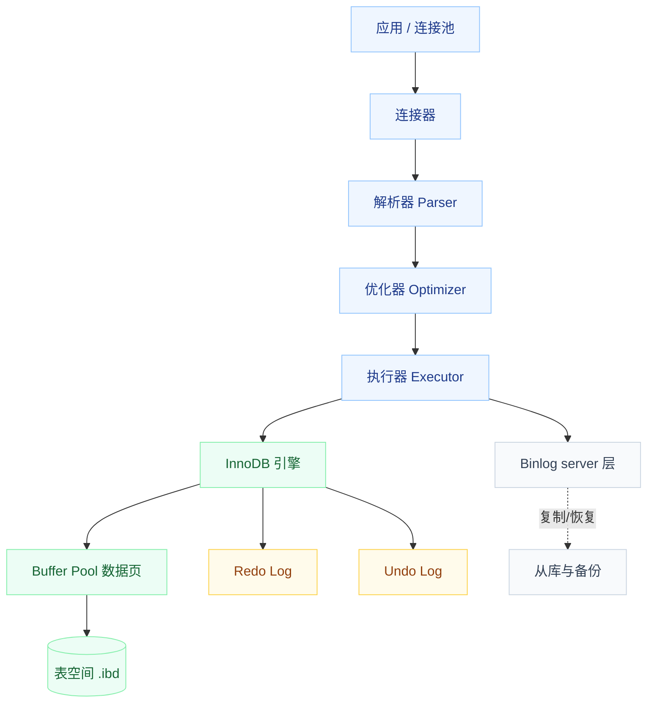
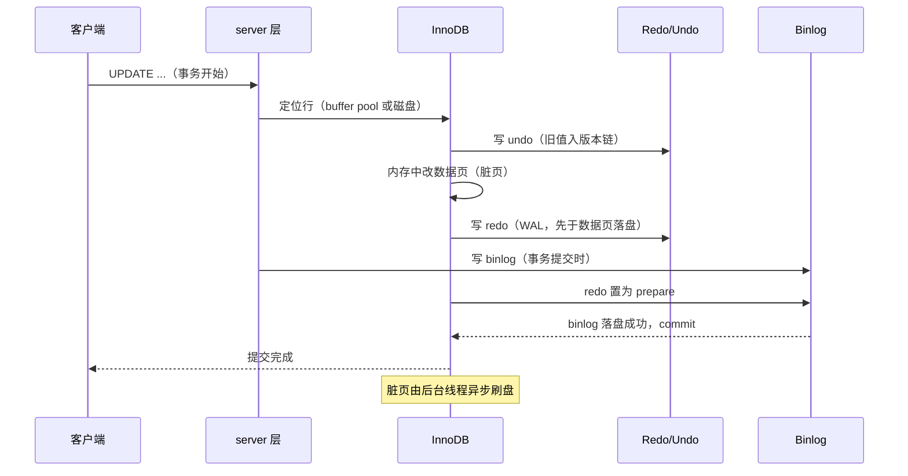

# MySQL关系数据库

> 这篇从 MySQL 8.4 的分层架构讲起，经过安装与初始化、InnoDB 存储结构、数据类型与字符集、事务与锁、日志与崩溃恢复、GTID 复制与高可用、备份与 PITR，最后落到性能参数、排障手册和一个"主从半同步加误删恢复"的完整演练。
>
> 学完能独立部署并配置一个 MySQL 8.4 实例，解释一条 UPDATE 在存储层的完整路径，处理事务与死锁，搭建 GTID 复制，并完成一次基于全量备份加 binlog 的时间点恢复。

## 一、MySQL 8.4 的体系结构

MySQL 分成 server 层和存储引擎层：连接、解析、优化、内置函数在 server 层；数据的存取、索引、事务和锁在引擎层，InnoDB 是 8.x 唯一的默认事务引擎。分层的意义在于排障：连接数、慢 SQL、执行计划的问题在 server 层查，锁等待、崩溃恢复、页损坏的问题在引擎层查。



图中的"查询缓存"不在图里：它在 8.0 已被移除，写多读少的场景下它是纯负资产。2026-11 的基线上，内存查询加速全部交给应用层缓存（Redis）或 InnoDB 缓冲池。

一条 UPDATE 的完整路径：



8.4 LTS 相对 8.0 的关键变化直接影响运维决策，升级前必须逐项核对：

| 变化 | 8.0 | 8.4 | 运维影响 |
|---|---|---|---|
| 认证插件 | mysql_native_password 可用 | 默认禁用 | 旧客户端连不上，驱动要升级 |
| 复制语法 | SHOW SLAVE STATUS 等 | 全部改为 REPLICA 术语 | 老脚本必须改造 |
| innodb_io_capacity | 200 | 10000 | 适配 SSD，小盘要调低 |
| innodb_log_buffer_size | 16M | 64M | 写密集场景默认即合理 |
| innodb_flush_method | fsync | O_DIRECT | 避免双缓冲 |
| innodb_adaptive_hash_index | ON | OFF | 高并发场景更稳 |
| innodb_change_buffering | all | none | 写性能回归需评估 |

8.0 已于 2026-04 结束维护，9.x 是创新版（每季度一个，支持期短）；生产系统的选择只有 8.4 LTS（社区支持到 2029-04，云厂商的延长支持到 2032）。

> 边界：5.7 不能直接升级到 8.4，官方路径是先到 8.0 再到 8.4；升级前用 MySQL Shell 的 `util.checkForServerUpgrade()` 做全量兼容检查。

## 二、安装与最小验证

Linux 上推荐用官方仓库装 8.4（发行版自带的往往是 8.0 或更旧）；所有平台的安装都遵循"装 → 初始化 → 启动 → 安全加固 → 验证"五步。

| 环境 | 安装（2026-11） | 服务管理 |
|---|---|---|
| Ubuntu 24.04 | 官网装 `mysql-apt-config`，选 8.4，`sudo apt install mysql-community-server` | `systemctl start mysqld` |
| Rocky/CentOS 9 | 官网装 mysql84-community 源，`sudo dnf install mysql-community-server` | `systemctl start mysqld` |
| macOS | `brew install mysql@8.4` | `brew services start mysql@8.4` |
| Windows 10/11 | MySQL Installer 8.4，Server only + Configurator | 服务面板 `MySQL84` |

Ubuntu 上包安装会自动初始化数据目录并把临时 root 密码写进错误日志；手动初始化则用 `--initialize`：

```bash
sudo mysqld --initialize --user=mysql --datadir=/var/lib/mysql 2>&1 | tail -1
sudo systemctl enable --now mysqld
sudo grep 'temporary password' /var/log/mysqld.log
```

预期输出（节选）：

```text
2026-11-13T09:00:00.123456Z 6 [Note] [MY-010454] [Server] A temporary password is generated for root@localhost: xK8#mQz!p9wT
```

安全加固与首次登录：

```bash
mysql_secure_installation   # 设 root 密码、删匿名用户、禁远程 root
mysql -uroot -p
```

生产实例的最小配置写在 `/etc/my.cnf`（Ubuntu 在 `/etc/mysql/conf.d/`），每个参数都有明确理由：

```ini
[mysqld]
# ---- 身份与网络 ----
bind-address            = 0.0.0.0     # 只对内网开放，外网用防火墙收口
port                    = 3306
mysql_native_password   = OFF          # 8.4 默认禁用，旧应用迁移完再开

# ---- 内存 ----
innodb_buffer_pool_size = 16G          # 专用服务器 50%~75% 物理内存
innodb_buffer_pool_instances = 8       # 减少内部锁竞争
max_connections         = 2000        # 按 (应用峰值连接数) 估算，不是越大越好
thread_cache_size       = 100          # 复用线程，避免高并发下反复创建

# ---- 日志 ----
slow_query_log          = ON
long_query_time         = 0.5
log_error_verbosity     = 2            # 错误日志带警告

# ---- 复制 ----
server_id               = 1            # 同一复制域内必须唯一
gtid_mode               = ON
enforce_gtid_consistency = ON
```

最小验证用四条命令确认版本、引擎、字符集和认证插件：

```sql
SELECT VERSION() AS version, @@default_storage_engine AS engine,
       @@character_set_server AS charset, @@authentication_policy AS auth;
SHOW DATABASES;
```

预期输出：

```text
version   engine  charset  auth
8.4.13    InnoDB  utf8mb4  *,,*
```

`authentication_policy` 显示 `*,,` 表示仅允许 caching_sha2_password。创建应用账号时显式写插件与授权，不给超级权限：

```sql
CREATE USER 'order_app'@'10.0.%' IDENTIFIED BY 'App@123456';
GRANT SELECT, INSERT, UPDATE, DELETE ON shop.* TO 'order_app'@'10.0.%';
FLUSH PRIVILEGES;
```

> 边界：`SET PERSIST` 可以在线改参并写入 `mysqld-auto.cnf`，重启不丢；但 `innodb_buffer_pool_size` 这类重启才生效的参数，仍要同步改 `my.cnf`，避免两处配置漂移。生产上坚持"配置文件是唯一事实来源，SET PERSIST 只做临时观察"。

## 三、InnoDB 存储结构

InnoDB 以页（page）为单位管理数据，默认 16 KB；理解页与索引的关系，才能解释"为什么这个 SQL 扫了 1 万行"。

| 概念 | 大小/含义 | 说明 |
|---|---|---|
| 页 page | 默认 16 KB | 磁盘 IO 的最小单位 |
| 区 extent | 64 页 = 1 MB | 分配单位，减少碎片 |
| 段 segment | 聚集/唯一/普通索引 | B+ 树的物理归属 |
| 表空间 tablespace | 独立 `.ibd` 文件 | 8.0 起每表一个文件 |

### 3.1 聚集索引与二级索引

每张 InnoDB 表按主键组织成一棵 B+ 树，叶子节点就是整行数据；这就是聚集索引（clustered index）。二级索引的叶子节点只存索引列和主键值，查到后还要回聚集索引取整行（回表）：

```sql
CREATE TABLE orders (
  id BIGINT UNSIGNED AUTO_INCREMENT PRIMARY KEY,  -- 聚集索引
  customer_id BIGINT UNSIGNED NOT NULL,
  order_no CHAR(20) NOT NULL,
  amount DECIMAL(10,2) NOT NULL,
  created_at DATETIME NOT NULL,
  UNIQUE KEY uk_order_no (order_no),             -- 二级唯一索引
  KEY idx_customer (customer_id)                  -- 二级索引，叶子存 id
) ENGINE=InnoDB;
```

三条直接推论：

- 主键要短且单调递增：随机主键（如 UUID v4）会让页分裂、缓存命中下降；需要无序全局 ID 时用 UUID v7 或雪花算法存 `BINARY(16)`；
- 二级索引越多，写入越慢：每个索引一棵树都要维护；
- 覆盖索引（查询列都在索引里）消掉回表，是索引优化的主要手段，见《SQL基础与查询优化》。

### 3.2 Buffer Pool 与脏页

Buffer Pool 是数据页的内存缓存，读命中不落盘，写只改内存页并记 redo；被修改的页叫脏页（dirty page），由后台线程按"最旧 redo 之后"的规则异步刷盘。崩溃时脏页丢失没关系，redo 重放会把它们找回来，这就是 WAL（Write-Ahead Logging）。

```sql
-- 观察缓冲池命中率，生产健康线在 99% 以上
SHOW GLOBAL STATUS LIKE 'Innodb_buffer_pool_read%';
```

```text
+----------------------------------+-----------+
| Variable_name                    | Value     |
+----------------------------------+-----------+
| Innodb_buffer_pool_read_requests | 128435712 |
| Innodb_buffer_pool_reads         |   1203567 |
+----------------------------------+-----------+
```

命中率 = 1 - reads / read_requests ≈ 99.06%。低于 95% 说明内存不足或扫描过多。

刷脏速度跟不上时出现"抖动"：一条快 SQL 偶尔几百毫秒，就是 redo 空间逼近上限触发强制刷脏。8.4 的 `innodb_redo_log_capacity` 支持在线调整，写密集业务先按"每小时写入量的 1/2"起步：

```sql
SET PERSIST innodb_redo_log_capacity = 4294967296;  -- 4G，8.0.30+ 动态生效
```

> 边界：Doublewrite Buffer 用于防止页断裂（partial write），8.4 默认 `innodb_doublewrite_pages=128`，为性能关掉它是拿数据完整性换速度，不允许。自适应哈希索引在 8.4 已默认关闭，高并发下它自身的锁竞争常常得不偿失。

## 四、数据类型与字符集

类型选错是"上线后改不动"的问题：改类型要重建大表，锁与耗时都受影响。选型按"够用、可扩展、好比较"三条走。

| 类别 | 推荐 | 边界与理由 |
|---|---|---|
| 整数 | `BIGINT UNSIGNED` 主键、`INT` 计数 | 金额不用整数分以外的浮点 |
| 金额 | `DECIMAL(10,2)` | 精确十进制，`DOUBLE` 有二进制误差 |
| 短字符串 | `VARCHAR(64)` | 长度按真实上限，不写 `VARCHAR(255)` 习惯值 |
| 定长编码 | `CHAR(20)` | 单号、哈希这类定长值，省长度字节 |
| 长文本 | `TEXT` / `MEDIUMTEXT` | 不进索引，需检索另建生成列 |
| 时间 | `DATETIME(3)` | 范围到 9999 年；`TIMESTAMP` 受 2038 上限且带时区语义 |
| 布尔 | `TINYINT(1)` | 别名 BOOL，0/1 语义 |
| JSON | `JSON` 类型 | 弹性字段，索引要靠生成列或函数索引 |

```sql
CREATE TABLE events (
  id          BIGINT UNSIGNED AUTO_INCREMENT PRIMARY KEY,
  title       VARCHAR(128)   NOT NULL,
  occurred_at DATETIME(3)    NOT NULL,
  attrs       JSON           NULL,
  -- 生成列：把 JSON 里的字段物化出来建索引
  attrs_level TINYINT GENERATED ALWAYS AS (attrs->>'$.level') STORED,
  KEY idx_level_time (attrs_level, occurred_at)
) ENGINE=InnoDB;
```

字符集统一 `utf8mb4`：`utf8` 是 `utf8mb3` 的别名（最长 3 字节），存不下 emoji 和部分生僻字；8.0 起默认排序规则是 `utf8mb4_0900_ai_ci`（Unicode 9.0、忽略大小写）。

```sql
-- 8.4 默认值，无需再显式指定
SHOW VARIABLES LIKE 'character_set_server';
SHOW VARIABLES LIKE 'collation_server';
```

```text
utf8mb4
utf8mb4_0900_ai_ci
```

两个高频坑：

- 库、表、列的字符集不一致时，连接查询会导致索引失效，创建库表时统一到 `utf8mb4`；
- `TIMESTAMP` 存的是 UTC 时间戳并受时区转换影响，跨时区系统统一用 `DATETIME` 存"业务墙上时间"，时区由应用层处理。

> 边界：`AUTO_INCREMENT` 在 8.0 后持久化重启不重置；`innodb_autoinc_lock_mode=2`（交错）是默认值，基于语句的复制要求 1，GTID+ROW 复制保持默认即可。

## 五、事务与锁

事务是 InnoDB 的 ACID 实现：原子性靠 undo 回滚，持久性靠 redo，隔离性靠 MVCC 加锁，一致性由前三者与应用约束共同保证。这一章解决两个生产问题：为什么"读到了不存在的数据"，以及死锁怎么处理。

### 5.1 隔离级别与异常现象

```sql
SELECT @@transaction_isolation;   -- 默认 REPEATABLE-READ
```

| 隔离级别 | 脏读 | 不可重复读 | 幻读 | 说明 |
|---|---|---|---|---|
| READ UNCOMMITTED | 有 | 有 | 有 | 生产不用 |
| READ COMMITTED | 无 | 有 | 有 | Oracle/PG 默认 |
| REPEATABLE-READ | 无 | 无 | 基本避免 | MySQL 默认，间隙锁防幻读 |
| SERIALIZABLE | 无 | 无 | 无 | 加锁读，吞吐低 |

MySQL 的 RR 与标准不同：靠 MVCC 让普通读看到事务开始时的快照，靠 next-key lock 阻止其他事务在范围内插入，幻读只在"先快照读后锁定读"混用时会观察到。

### 5.2 MVCC：一行数据的多个版本

每行有两个隐藏列：`DB_TRX_ID`（最后修改事务）与 `DB_ROLL_PTR`（指向 undo 日志里的旧版本）。读时按"ReadView"判断哪个版本对自己可见：RC 每条语句生成一个 ReadView，RR 整个事务用第一个 ReadView。

```sql
-- 会话 A（RR）
START TRANSACTION;
SELECT amount FROM orders WHERE id = 1;         -- 100

-- 会话 B
UPDATE orders SET amount = 200 WHERE id = 1;   -- 提交

-- 会话 A 再读
SELECT amount FROM orders WHERE id = 1;         -- 仍是 100，快照读
SELECT amount FROM orders WHERE id = 1 FOR UPDATE;  -- 200，锁定读读最新版
COMMIT;
```

长事务的风险由此而来：ReadView 必须能看到它开始之后的所有旧版本，undo 链不能清理， purge 滞后、回滚段膨胀。生产上第一检查项就是长事务：

```sql
-- 查找运行超过 60 秒的事务
SELECT trx_id, trx_started, trx_rows_modified, trx_mysql_thread_id
FROM information_schema.innodb_trx
WHERE trx_started < NOW() - INTERVAL 60 SECOND;
```

### 5.3 锁的种类与死锁处理

InnoDB 行锁加在索引记录上；没有索引可用时退化为全表扫描锁全表。RR 下的 next-key lock = 记录锁 + 间隙锁，锁住记录及其前部区间，防止插入造成幻读。

```sql
-- 锁定读的三种姿态
SELECT * FROM orders WHERE id = 1 FOR UPDATE;             -- 排他锁，写前占位
SELECT * FROM orders WHERE id = 1 FOR SHARE;              -- 共享锁
SELECT * FROM orders WHERE status = 0 FOR UPDATE SKIP LOCKED;  -- 队列消费，跳过被锁行
```

`SKIP LOCKED` 是任务队列的标准解法：多个消费者互不阻塞，各拿各的行。

死锁是必然事件而不是事故：两个事务以相反顺序拿锁就会发生，InnoDB 主动回滚代价小的一方。处理方式是"让 InnoDB 自己解决，应用把死锁当可重试错误"：

```sql
-- 会话 A
START TRANSACTION;
UPDATE accounts SET balance = balance - 10 WHERE id = 1;  -- 先锁 1
UPDATE accounts SET balance = balance + 10 WHERE id = 2;  -- 再要 2

-- 会话 B（并发）
START TRANSACTION;
UPDATE accounts SET balance = balance + 5 WHERE id = 2;   -- 先锁 2
UPDATE accounts SET balance = balance - 5 WHERE id = 1;   -- 再要 1 → 死锁
```

账户表的最小定义（演练前建好）：

```sql
CREATE TABLE accounts (
  id      BIGINT UNSIGNED PRIMARY KEY,
  balance DECIMAL(12,2) NOT NULL
) ENGINE=InnoDB;
INSERT INTO accounts VALUES (1, 1000.00), (2, 1000.00);
```

第二个拿锁的会话报错：

```text
ERROR 1213 (40001): Deadlock found when trying to get lock; try restarting transaction
```

用 `SHOW ENGINE INNODB STATUS\G` 的 `LATEST DETECTED DEADLOCK` 段定位：

```text
------------------------
LATEST DETECTED DEADLOCK
------------------------
*** (1) TRANSACTION: UPDATE accounts ... WHERE id = 1 ...
*** (1) HOLDS THE LOCK(S): ... lock mode X locks rec but not gap
*** (2) TRANSACTION: UPDATE accounts ... WHERE id = 2 ...
*** (2) WAITING FOR THIS LOCK TO BE GRANTED: ... lock mode X
*** WE ROLL BACK TRANSACTION (2)
```

判读方法：`(1) HOLDS` 与 `(2) WAITING FOR` 相同资源即互相持有，把两条 SQL 的加锁顺序对齐（都先锁小 id）即可消除大部分死锁。日常监控看锁等待：

```sql
SELECT object_name, index_name, lock_type, lock_mode, lock_data
FROM performance_schema.data_locks;    -- 8.0 起替代 information_schema.innodb_locks
```

> 边界：死锁不可能通过"调大锁超时"解决，`innodb_lock_wait_timeout`（默认 50 秒）只决定等多久报错。可串行化的关键路径（转账）用"按主键排序后依次加锁"或单条 SQL 完成；无法重试的场景用 `NOWAIT` 立即失败。

## 六、日志体系与崩溃恢复

InnoDB 的事务安全性由三份日志共同完成：redo 保证已提交的丢不了，undo 保证未提交的能回滚，binlog 在 server 层提供复制与时间点恢复。

| 日志 | 层 | 内容 | 用途 |
|---|---|---|---|
| redo log | 引擎 | 物理页修改 | 崩溃恢复、WAL |
| undo log | 引擎 | 逻辑旧版本 | 回滚、MVCC |
| binlog | server | 逻辑变更（ROW） | 复制、PITR |
| 慢日志/错误日志 | server | 诊断信息 | 排障 |

### 6.1 两阶段提交

redo 与 binlog 必须一致，否则主库崩溃后从库可能多出或少一段事务。两阶段提交（2PC）把顺序固定为：redo prepare → 写 binlog → redo commit：

```sql
-- 观察 2PC 的协调状态
SHOW GLOBAL STATUS LIKE 'Binlog_cache%';
```

崩溃恢复规则：redo 处于 prepare 时查对应 binlog——binlog 完整则提交，否则回滚。检查持久化配置是否真的落在"双 1"：

```sql
SHOW VARIABLES WHERE Variable_name IN ('innodb_flush_log_at_trx_commit', 'sync_binlog');
```

```text
+--------------------------------+-------+
| Variable_name                  | Value |
+--------------------------------+-------+
| innodb_flush_log_at_trx_commit | 1     |
| sync_binlog                    | 1     |
+--------------------------------+-------+
```


| 参数 | 取值 | 语义 |
|---|---|---|
| innodb_flush_log_at_trx_commit | 1 | 每次提交刷 redo 到磁盘 |
| sync_binlog | 1 | 每次提交刷 binlog 到磁盘 |
| 两者同时=1 | 最安全 | 最多丢 1 个事务的崩溃窗口之外的数据 |

金融类实例坚持"双 1"；可容忍秒级丢失的分析类实例可以放宽到 2/100 换取两到三倍写入吞吐，并且要在容量规划里写清楚 RPO。

binlog 格式固定 ROW：`binlog_format` 自 8.0.34 起弃用，8.4 仍接受但会告警，新部署直接不设置、使用默认 ROW；ROW 记录行镜像，复制一致性与 PITR 都最好。按 GTID 管理日志位点：

```sql
SHOW BINARY LOGS;                       -- 日志文件列表
SHOW BINLOG EVENTS LIMIT 5;             -- 事件预览
PURGE BINARY LOGS BEFORE '2026-11-07 00:00:00';  -- 按时间清理
```

> 边界：binlog 与 redo 是两套独立的写入与保留策略：redo 容量固定（滚动覆盖），binlog 按时间/空间保留（用于恢复）。binlog 保留过短会让 PITR 窗口不足，保留过长要算磁盘预算；一般保留 7 天并监控 `binlog_expire_logs_seconds`。

## 七、GTID 复制与高可用

单实例实例的可用性上限是一台机器的可用性；复制把数据冗余到多台机器，读写分离与故障切换都建立在它之上。8.4 全部使用 REPLICA 术语的命令。

### 7.1 异步复制搭建

源库创建复制账号（8.4 默认认证插件，复制通道要取公钥）：

```sql
-- 在源库执行
CREATE USER 'repl'@'10.0.%' IDENTIFIED BY 'Repl@123456';
GRANT REPLICATION SLAVE ON *.* TO 'repl'@'10.0.%';
SET PERSIST gtid_mode = ON;
SET PERSIST enforce_gtid_consistency = ON;
```

从库配置复制通道并启动：

```sql
-- 在从库执行（server_id 与源不同）
CHANGE REPLICATION SOURCE TO
  SOURCE_HOST            = '10.0.0.11',
  SOURCE_PORT            = 3306,
  SOURCE_USER            = 'repl',
  SOURCE_PASSWORD        = 'Repl@123456',
  SOURCE_AUTO_POSITION   = 1,          -- GTID 自动定位，不再手工记位点
  GET_SOURCE_PUBLIC_KEY  = 1;          -- caching_sha2 认证取公钥
START REPLICA;
SHOW REPLICA STATUS\G
```

预期输出（关键字段）：

```text
Replica_IO_Running: Yes
Replica_SQL_Running: Yes
Seconds_Behind_Source: 0
Auto_Position: 1
Retrieved_Gtid_Set: 3d8f2a1e-9b3c-11ef-...:1-152341
Executed_Gtid_Set: 3d8f2a1e-9b3c-11ef-...:1-152341
```

两个线程分工：IO 线程拉 binlog 到中继日志（Relay Log），SQL 线程重放。`Seconds_Behind_Source` 非零表示重放滞后，持续增长时优先检查从库上的大事务与单线程重放瓶颈。

### 7.2 半同步与高可用方案

异步复制的风险是主库崩溃时从库未收到最新事务，切换即丢数据。半同步（semisynchronous）要求至少一个从库确认收到 binlog 后主库才提交：

```sql
-- 主库
INSTALL PLUGIN rpl_semi_sync_source SONAME 'semisync_source.so';
SET GLOBAL rpl_semi_sync_source_enabled = 1;
SET GLOBAL rpl_semi_sync_source_timeout = 3000;   -- 3 秒内无确认则退回异步

-- 从库
INSTALL PLUGIN rpl_semi_sync_replica SONAME 'semisync_replica.so';
SET GLOBAL rpl_semi_sync_replica_enabled = 1;
STOP REPLICA IO_THREAD; START REPLICA;            -- 重启 IO 线程生效
```

| 方案 | 一致性 | 切换方式 | 适用 |
|---|---|---|---|
| 异步复制 | 最终一致 | 手工 | 内部测试、读扩展 |
| 半同步 | 至少一个从库确认 | 手工/脚本 | 中小生产库 |
| InnoDB Cluster (MGR) | 多数派 | 自动 | 强一致与自动切换 |
| 两节点 + Orchestrator | 按拓扑 | 半自动 | 大规模多主读写 |

MGR（Group Replication）基于 Paxos 变种做多数派提交，配合 MySQL Router 提供自动读写分离与故障切换；部署复杂度高于半同步，节点数建议 3 或 5。

读写分离的两个一致性补丁：写后立即读的业务走主库（会话级 `source` 标签），从库延迟敏感的页面查 `Seconds_Behind_Source` 做降级。

> 边界：GTID 模式下不允许 `CREATE TABLE ... SELECT` 这类语句（binlog 记录为两个独立事务），迁移脚本要先拆成建表加插入。从库建议开启 `super_read_only=ON`，防止误写破坏复制。

## 八、备份与时间点恢复

备份策略由两个指标倒推：RPO（最多丢多少数据）决定 binlog 保留与备份频率，RTO（多久能恢复）决定全量与增量的组合。演练不是可选项，没恢复过的备份不算备份。

| 方式 | 命令 | RTO | 适用 |
|---|---|---|---|
| mysqldump 逻辑备份 | `--single-transaction` | 慢（逐行重建） | 小于 100 GB 库 |
| Clone Plugin 物理克隆 | `CLONE INSTANCE` | 快（文件级） | 从库搭建、大库备份 |
| XtraBackup 增量 | 企业第三方 | 中 | 巨型库与增量 |
| binlog | 归档 | — | PITR 的增量部分 |

### 8.1 逻辑备份

```bash
mysqldump -uroot -p --single-transaction --source-data=2 \
  --routines --triggers --set-gtid-purged=OFF \
  --databases shop > shop_20261113.sql
```

`--single-transaction` 用一致性快照读导出 InnoDB，不锁业务；`--source-data=2` 把 binlog 位点写成注释，恢复后接 binlog 时用；`--databases` 让导出文件自带 `CREATE DATABASE` 与 `USE`，恢复时不需要手工选库。检查备份有效性看首尾：

```bash
head -20 shop_20261113.sql    # 确认版本与字符集设置
tail -5  shop_20261113.sql    # 确认以完成性注释结束
grep -c 'INSERT INTO' shop_20261113.sql   # 行数作为完整性参考
```

### 8.2 时间点恢复（PITR）

误操作（如 DROP TABLE）发生在 10:23，全量备份是当天 06:00。恢复路径 = 全量恢复 + 重放 binlog 到误操作之前：

```bash
# 1. 恢复全量（备份带 --databases，恢复自动建库）
mysql -uroot -p -e "SET sql_log_bin=0; SOURCE /backup/shop_20261113.sql;"
# sql_log_bin=0：恢复过程本身不产生 binlog，避免污染 GTID

# 2. 找到误操作前的事务终点（起点位点来自备份文件头的注释）
mysqlbinlog --no-defaults \
  --start-position=157 --stop-position=<DROP前最后一个事务> \
  /archive/binlog.000123 /archive/binlog.000124 | mysql -uroot -p
```

GTID 模式下可以按事务集合精确排除：

```sql
-- 从库或恢复实例上，跳过误操作所在的单个 GTID
SET GTID_NEXT = '3d8f2a1e-9b3c-11ef-...:152341';
BEGIN; COMMIT;                     -- 注入空事务，占掉这个 GTID
SET GTID_NEXT = AUTOMATIC;
START REPLICA;                     -- 复制继续，跳过被占用的位点
```

| 场景 | RPO | RTO（示例） |
|---|---|---|
| 全量 + binlog 双 1 | 0（最多 1 事务窗口） | 全量 30 分钟 + 重放 20 分钟 |
| 每日全量、binlog 保留 7 天 | 最多 1 天前的全量 + binlog | 同上 |
| 仅每周全量 | 最坏 7 天 | 不可接受 |

> 边界：`SET sql_log_bin=0` 需要 SESSION 级权限且不能在事务中执行；恢复演练每季度做一次，重点验证"备份文件可恢复、binlog 可衔接、耗时在承诺 RTO 内"。备份文件与数据库必须异机存放，主机盘坏时备份不能跟着丢。

## 九、性能参数与排障手册

性能问题的入口永远是"先看哪里在等"，而不是先调参数；这一章给出现场第一分钟要跑的命令。

### 9.1 基线参数

```ini
# 专用服务器（64G 内存示例）的起步配置
innodb_buffer_pool_size       = 40G    # 内存的 60%
innodb_redo_log_capacity      = 8G     # 高峰每小时写入量的一半
innodb_flush_method           = O_DIRECT
innodb_io_capacity            = 2000   # SSD 按实测 IOPS 调
innodb_io_capacity_max         = 4000
max_connections               = 2000
table_open_cache              = 4000
binlog_expire_logs_seconds    = 604800  # 7 天
```

### 9.2 现场排障表

| 现象 | 第一条命令 | 定位方向 |
|---|---|---|
| 连接数打满 | `SHOW PROCESSLIST;` | 看Sleep数量与应用连接池 |
| CPU 突增 | `SHOW GLOBAL STATUS LIKE 'Questions';` | 慢 SQL 扫描，见 SQL 篇 |
| 毛刺抖动 | `SHOW ENGINE INNODB STATUS\G` | 刷脏、redo 强制刷盘 |
| 锁等待堆积 | `SELECT * FROM performance_schema.data_locks;` | 长事务或索引缺失 |
| 主从延迟 | `SHOW REPLICA STATUS\G` | 大事务、从库单线程重放 |
| 磁盘涨满 | `SELECT file_name, total_extents FROM information_schema.files;` | binlog 保留与碎片 |
| 表打不开 | `SHOW OPEN TABLES WHERE In_use = 1;` | 元数据锁（MDL） |

元数据锁（MDL）是"表打不开"的常见元凶：一个未提交的事务持着该表的 MDL 读锁，后续 DDL 排队，所有新查询跟着排队。第一命令是查长事务（5.2 的 `innodb_trx`），处理方式是 kill 掉挂起事务，而不是重启。

### 9.3 空间回收与版本升级

删除不会把空间还给操作系统：InnoDB 只把行标记删除复用，空洞需要重建表回收：

```sql
OPTIMIZE TABLE orders;   -- InnoDB 等价 ALTER TABLE ... FORCE，会重建整表
-- 或指定算法，在线执行但需要额外磁盘空间
ALTER TABLE orders ENGINE=InnoDB, ALGORITHM=INPLACE, LOCK=NONE;
```

大表碎片治理要在低峰执行，并评估 binlog 流量对从库的冲击。

8.0 → 8.4 升级检查清单：

```bash
mysqlsh -- util checkForServerUpgrade root@localhost:3306 --output-format=JSON
```

核对四类项：`mysql_native_password` 账号、被移除语句（`SHOW SLAVE STATUS`、`CHANGE MASTER`、`FLUSH HOSTS`）、被移除参数（`expire_logs_days`）、驱动版本。演练环境升级后跑完整回归，再按"从库先行、滚动升级"推进。

> 边界：`kill` 只在明确影响面后使用；`KILL QUERY` 断当前语句不断连接，`KILL` 断连接并回滚事务。误 kill 会让大事务回滚数小时，先看 `trx_rows_modified` 再动手。

## 十、最佳实践案例

### 10.1 案例背景

一个订单系统的 MySQL 8.4 单实例运行三年：写入高峰每小时 12 GB，binlog 只留 1 天，备份是每天一次的 mysqldump，从未做过恢复演练，也没有从库。两周内发生两件事促成本项目：一次主库主机维护停机 40 分钟，业务全程不可写；开发误执行 `DROP TABLE shop.coupons`，团队发现没有从库可以顶上，也没有演练过的恢复流程，最终靠前一天的全量备份找回数据，丢失 6 小时变更。

目标：搭建 GTID 主从半同步复制，把 RPO 压到"最多 1 个事务"，RTO 压到 15 分钟；并把误删场景的 PITR 流程做成手册。约束：不能长时间停机，切换演练要在业务低峰完成，全程使用社区版能力。

### 10.2 案例实操

第一步，核对升级遗留与基线配置。确认 8.4 的复制术语与认证插件要求先落地：

```sql
-- 源库：确认没有 mysql_native_password 账号残留
SELECT user, host, plugin FROM mysql.user WHERE plugin = 'mysql_native_password';
-- 空结果，否则先迁移这些账号
SET PERSIST gtid_mode = ON;
SET PERSIST enforce_gtid_consistency = ON;
SET PERSIST binlog_expire_logs_seconds = 604800;   -- binlog 从 1 天延长到 7 天
```

第二步，用 Clone Plugin 搭从库，避免手工导出导入大表。克隆账号在两侧都要有对应权限：

```sql
-- 源库：供体账号需要 BACKUP_ADMIN（克隆数据）
CREATE USER 'clone_user'@'10.0.%' IDENTIFIED BY 'Clone@123456';
GRANT BACKUP_ADMIN ON *.* TO 'clone_user'@'10.0.%';
-- 从库：先创建同名账号并授予克隆权限（克隆从从库本地发起）
CREATE USER 'clone_user'@'10.0.%' IDENTIFIED BY 'Clone@123456';
GRANT CLONE_ADMIN, BACKUP_ADMIN ON *.* TO 'clone_user'@'10.0.%';
```

```sql
-- 从库先安装组件（8.4 内置 clone 插件）
INSTALL PLUGIN clone SONAME 'mysql_clone.so';
SET GLOBAL clone_valid_donor_list = '10.0.0.11:3306';

-- 从库执行：把源库整体克隆过来（含数据与 GTID 执行集）
CLONE INSTANCE FROM clone_user@10.0.0.11:3306 IDENTIFIED BY 'Clone@123456';
```

克隆完成后，在从库配置复制通道（GTID 自动定位，不需要手工记位点）：

```sql
CHANGE REPLICATION SOURCE TO
  SOURCE_HOST           = '10.0.0.11',
  SOURCE_PORT           = 3306,
  SOURCE_USER           = 'repl',
  SOURCE_PASSWORD       = 'Repl@123456',
  SOURCE_AUTO_POSITION  = 1,
  GET_SOURCE_PUBLIC_KEY = 1;
START REPLICA;
SHOW REPLICA STATUS\G
```

预期输出（关键字段）：

```text
Replica_IO_Running: Yes
Replica_SQL_Running: Yes
Seconds_Behind_Source: 0
```

第三步，开启半同步，把"主库提交成功"与"至少一个从库收到"绑定：

```sql
-- 主库
INSTALL PLUGIN rpl_semi_sync_source SONAME 'semisync_source.so';
SET PERSIST rpl_semi_sync_source_enabled = 1;
SET PERSIST rpl_semi_sync_source_timeout = 3000;
-- 从库
INSTALL PLUGIN rpl_semi_sync_replica SONAME 'semisync_replica.so';
SET PERSIST rpl_semi_sync_replica_enabled = 1;
STOP REPLICA; START REPLICA;
```

第四步，验证半同步真的生效（而不是退化）：

```sql
-- 主库：写一条数据后立刻看状态
SHOW GLOBAL STATUS LIKE 'Rpl_semi_sync_source_status';   -- ON
SHOW GLOBAL STATUS LIKE 'Rpl_semi_sync_source_yes_tx';  -- 每次确认后 +1
SHOW GLOBAL STATUS LIKE 'Rpl_semi_sync_source_no_tx';    -- 持续增长 = 已退化异步
```

预期输出：

```text
Rpl_semi_sync_source_status    ON
Rpl_semi_sync_source_yes_tx    1532
Rpl_semi_sync_source_no_tx     0
```

第五步，备份与 binlog 就位。全量改在低峰执行并压缩归档：

```bash
mysqldump -uroot -p --single-transaction --source-data=2 \
  --routines --triggers --databases shop | gzip > /backup/shop_20261113.sql.gz
```

第六步，在演练库上复现误删并做 PITR。演练库用 06:00 的全量恢复，再重放 binlog 到 DROP 之前：

```bash
# 恢复全量（演练库，sql_log_bin=0 防止污染演练库 GTID）
gunzip < /backup/shop_20261113.sql.gz | mysql -uroot -p
mysql -uroot -p -e "SHOW BINARY LOGS;"     # 确认 binlog 链覆盖到 DROP 时点
# 从全量位点重放到 DROP 之前的位置（位置来自全量文件头的注释）
mysqlbinlog --start-position=157 --stop-position=284510932 \
  /archive/binlog.000127 /archive/binlog.000128 | mysql -uroot -p
```

恢复后核对：

```sql
SELECT COUNT(*) FROM shop.coupons;       -- 应等于 DROP 前的行数
SELECT MAX(updated_at) FROM shop.coupons; -- 应早于误操作时间 10:23:41
```

第七步，把流程写成切换与恢复两条值班手册，并做一次真实切换演练：低峰 `STOP REPLICA`、应用切到从库写入 15 分钟、回切并核对 GTID 集合一致。

### 10.3 案例结果

| 指标 | 改造前 | 改造后（示例） |
|---|---|---|
| RPO | 最多 24 小时 | 1 个事务窗口（半同步 ON） |
| RTO（实例故障） | 40 分钟以上 | 15 分钟内切从库 |
| binlog 保留 | 1 天 | 7 天，PITR 窗口完整 |
| 恢复演练 | 无 | 每季度一次，演练耗时 22 分钟 |
| 误删恢复路径 | 重灌全量，丢 6 小时 | 全量 + binlog 重放到位 |

失败模式与复盘：第一次克隆失败，报错 "Donor MySQL server does not support CLONE"，原因是源库 8.4 上未给克隆账号 `BACKUP_ADMIN` 权限；补权限后重试成功。半同步上线后第一周观察到 `no_tx` 增长，是从库 IO 线程一次重启没有恢复半同步标志，重启 IO 线程后归零——半同步必须同时监控"状态 ON"与"no_tx 为 0"两个信号。PITR 演练中最大耗时不是恢复，而是确定 `stop-position`：此前的 binlog 是按默认保留清理的，接缝处两个文件需要手工拼接，此后规定全量备份文件头的位点注释必须归档保存。结论：可用性是"复制 + 切换 + 演练"三件事的乘积，任何一件没做过，故障时的表现都会回到改造前。
