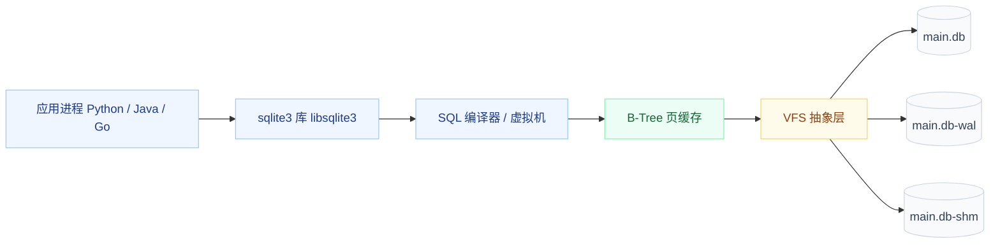
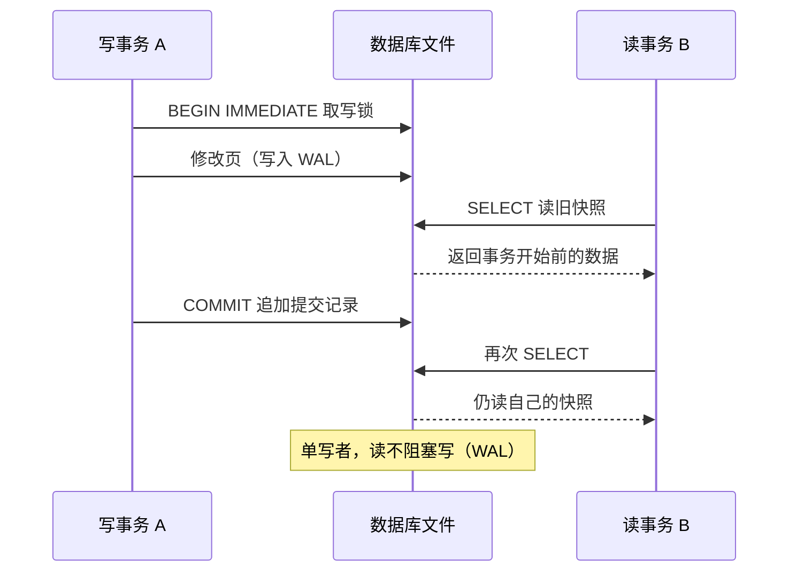

# SQLite嵌入式数据库

> 这篇从"一个文件就是一个库"的进程内模型讲起，经过安装与最小验证、动态类型与约束、CLI 日常操作、索引与查询计划、事务与 WAL 并发模型、参数调优与备份，最后落到应用集成、现场排障和一个"边缘采集网关从回滚日志切到 WAL 并把写入吞吐提升两个数量级"的完整演练。
>
> 学完能独立判断一个场景该不该用 SQLite，建出严格类型、带约束与索引的表，用 WAL 加批量事务把写入跑满，做出一致性备份，并在出现 `database is locked`、WAL 膨胀、文件损坏时按第一条命令定位。

## 一、一个文件就是一个数据库

SQLite 不是数据库服务，而是一个链接进程序的 C 库：没有监听端口、没有账号体系、没有独立进程，所有 SQL 都在调用方进程内执行，数据落在单个 `.db` 文件里。这个模型决定了它的全部优点与全部边界——省掉了网络往返和运维，也拿不到多机共享与高并发写入。



图里三个文件是一组：主库、预写日志（write-ahead log，WAL）和共享内存索引（shared memory，`-shm`）。复制主库文件时漏掉 WAL，等于丢最近的事务；所以备份要用 SQLite 自己的接口，不用 `cp`。

与服务端数据库的差异，决定了选型时该问哪些问题：

| 维度 | SQLite | MySQL / PostgreSQL |
|---|---|---|
| 部署形态 | 进程内库，随应用发布 | 独立服务，需安装运维 |
| 连接方式 | 打开文件路径 | TCP / Unix Socket |
| 并发写 | 全库单写者 | 多连接并发写 |
| 权限 | 文件系统权限 | 账号、库表授权 |
| 类型检查 | 动态类型，可选 STRICT | 强类型 |
| 典型规模 | 单机 GB 级 | TB 级、多机 |

选型的判断很直接：**数据只被一台机器上的进程访问、写并发不高、库在几十 GB 以内，SQLite 往往比 MySQL 更合适**；反过来，多台应用服务器要共享同一份数据、或写入 QPS 上千，就不该用。

| 适合 | 不适合 |
|---|---|
| 移动端、桌面应用本地存储 | 多台服务器共享同一份数据 |
| 边缘网关、IoT 设备离线缓存 | 高并发写入（单写者排队） |
| 单元测试与本地开发库 | 需要按用户/库授权的多租户 |
| 单机内部工具、报表缓存 | 网络文件系统上多机挂载 |
| 原型与数据导入导出中间层 | 单表上亿行的分析型查询 |

版本基线取 2026-11-13 的 SQLite 3.4x 系列（本机实测 3.43.2，Python 3.9 自带驱动 2.6.0）。写代码前先确认四个能力门：`RETURNING`（3.35+）、`STRICT` 表（3.37+）、JSON 函数（3.38+ 起默认编译进去）、`VACUUM INTO`（3.27+）。发行版自带的 CLI 版本可能偏旧，用 `SELECT sqlite_version();` 而不是看包管理器版本号。

```sql
SELECT sqlite_version() AS version, sqlite_source_id() AS build;
```

```text
3.43.2|2023-10-10 13:08:14 1b37c146ee9ebb7acd0160c0ab1fd11017a419fa8a3187386ed8cb32b709aapl
```

> 边界：SQLite 的锁依赖操作系统的文件锁。把 `.db` 放在 NFS、SMB、VirtualBox 共享目录上，锁语义不保证，典型症状是随机的 `database is locked` 或 `disk I/O error`。容器部署时数据库文件必须落在本机卷，不能挂共享存储给多个副本。

## 二、安装与最小验证

SQLite 通常不用单独安装：Python、PHP、Android、iOS、主流浏览器都内置了它。需要 CLI 时按平台装；需要最新版时从官网下载预编译二进制，不要指望发行版仓库跟上 3.4x。

| 环境 | 安装命令（2026-11） | 验证 |
|---|---|---|
| Ubuntu 24.04 | `sudo apt install sqlite3 libsqlite3-dev` | `sqlite3 --version` |
| Rocky / CentOS 9 | `sudo dnf install sqlite sqlite-devel` | `sqlite3 --version` |
| macOS | 系统自带，或 `brew install sqlite` | `sqlite3 --version` |
| Windows 10/11 | 官网下载 `sqlite-tools-win-x64-*.zip`，解压入 PATH | `sqlite3 --version` |
| 任意平台（Python） | 无需安装，标准库 `sqlite3` | `python3 -c "import sqlite3; print(sqlite3.sqlite_version)"` |

Ubuntu 上的完整流程与预期输出：

```bash
sudo apt update && sudo apt install -y sqlite3
sqlite3 --version
python3 -c "import sqlite3; print('driver sqlite:', sqlite3.sqlite_version)"
```

```text
3.45.1 2024-01-30 16:01:20 ...（版本随仓库更新）
driver sqlite: 3.45.1
```

装完立刻跑一个最小闭环：建库、建表、写入、查询、退出，确认文件真的产生：

```bash
cd /tmp && rm -f demo.db
sqlite3 demo.db <<'SQL'
CREATE TABLE note(id INTEGER PRIMARY KEY, body TEXT NOT NULL, created_at TEXT NOT NULL DEFAULT (datetime('now')));
INSERT INTO note(body) VALUES ('第一条笔记');
SELECT id, body, created_at FROM note;
SQL
ls -l demo.db
```

```text
1|第一条笔记|2026-11-13 02:11:47
-rw-r--r--  1 jimbo  staff  8192 Nov 13 02:11 demo.db
```

命令行的两种输入要分清：以 `.` 开头的是 CLI 元命令（`.tables`、`.schema`、`.mode`），由 shell 自己处理；其余是 SQL，必须带分号结尾。元命令不能写进 `.sql` 脚本后指望别的驱动执行。

```bash
sqlite3 demo.db ".tables"
sqlite3 demo.db ".schema note"
sqlite3 demo.db "PRAGMA compile_options;" | head -20
```

```text
note
CREATE TABLE note(id INTEGER PRIMARY KEY, body TEXT NOT NULL, created_at TEXT NOT NULL DEFAULT (datetime('now')));
COMPILER=gcc-12.2.0
DEFAULT_PAGE_SIZE=4096
ENABLE_FTS5
THREADSAFE=2
```

`ENABLE_FTS5` 决定全文检索表能不能建；JSON 函数自 3.38 起是核心功能，不再以 `ENABLE_JSON1` 出现在编译选项里，更早的版本才需要单独打开。自己编译 SQLite 或换用精简版驱动（部分嵌入式 SDK 会裁剪）时，这个选项要核对，缺了不是报语法错，而是 `no such module: fts5`。

> 边界：Python 的 `sqlite3` 模块版本与底层 SQLite 库版本是两件事。旧 Python 可能带较新的库，也可能反过来。生产镜像里用 `sqlite3.sqlite_version` 打印真实库版本，不要用 `pip show` 推断。

## 三、类型、亲和性与约束

SQLite 的列是"动态类型"：类型名只决定**亲和性（type affinity）**，值本身仍可存成五种存储类之一（NULL、INTEGER、REAL、TEXT、BLOB）。这带来极大的灵活性，也是绝大多数"数据莫名其妙变成字符串"问题的来源。

| 声明类型 | 亲和性 | 存入 `'123'` 后实际类型 |
|---|---|---|
| `INTEGER` / `INT` / `BIGINT` | INTEGER | 整数 123 |
| `TEXT` / `VARCHAR(64)` / `CHAR(20)` | TEXT | 文本 `'123'` |
| `REAL` / `DOUBLE` / `FLOAT` | REAL | 实数 123.0 |
| `BLOB` / 无类型 | BLOB | 原样字节 |
| `NUMERIC` / `DECIMAL` / `BOOLEAN` / `DATE` | NUMERIC | 能无损转数字就转 |

`BOOLEAN`、`DATETIME`、`DECIMAL` 在 SQLite 里都不是独立类型，只是带 NUMERIC 亲和性的声明名。金额不能指望 `DECIMAL(10,2)` 做十进制精确运算：它按 REAL 存，会有二进制误差。工程上的做法是**金额一律存整数分**，或者存 TEXT 并在应用层用十进制库。

想要强类型，用 `STRICT` 表（3.37+），写入类型不符会直接报错：

```sql
CREATE TABLE bad(x INTEGER) STRICT;
INSERT INTO bad VALUES('abc');
```

```text
Runtime error near line 1: cannot store TEXT value in INTEGER column bad.x (1)
```

这是实测输出。`STRICT` 表的类型名只接受 `INT`、`INTEGER`、`REAL`、`TEXT`、`BLOB`、`ANY` 六种，且主键强制非空。新项目建议默认用 `STRICT`：SQLite 的动态类型适合做数据清洗中间层，不适合做业务主库。

`rowid` 是每个普通表的隐含自增主键；`INTEGER PRIMARY KEY` 是它的别名，不占额外存储。不需要 `rowid` 的表（如纯关联表）可以声明 `WITHOUT ROWID`，主键即聚簇索引，省一次间接寻址：

```sql
CREATE TABLE user_role(
  user_id INTEGER NOT NULL,
  role_id INTEGER NOT NULL,
  PRIMARY KEY(user_id, role_id)
) WITHOUT ROWID, STRICT;
```

约束要显式写全，尤其外键——**SQLite 的外键默认关闭，且是连接级开关**，每个连接都要打开：

```sql
PRAGMA foreign_keys;        -- 0，默认关闭
PRAGMA foreign_keys = ON;   -- 每个连接都要执行
PRAGMA foreign_keys;        -- 1
```

实测输出就是 `0` → `1`。这一步漏掉，外键约束形同不存在，删除父行不会报错，也不会级联，数据静默不一致。

一张带完整约束的业务表：

```sql
CREATE TABLE sensor_reading(
  id         INTEGER PRIMARY KEY,
  device_id  TEXT    NOT NULL CHECK(length(device_id) BETWEEN 1 AND 32),
  ts         INTEGER NOT NULL,                 -- Unix 毫秒，整数存储省空间且好比较
  value      REAL    NOT NULL,
  quality    INTEGER NOT NULL DEFAULT 0 CHECK(quality BETWEEN 0 AND 3),
  payload    TEXT,                              -- 原始报文，留作追溯
  level      TEXT GENERATED ALWAYS AS (json_extract(payload, '$.level')) VIRTUAL
) STRICT;
```

生成列（generated column）把 JSON 里的字段物化出来，`VIRTUAL` 不占存储、可建索引，`STORED` 占空间但读取更快。实测：

```sql
CREATE TABLE ev(
  id INTEGER PRIMARY KEY,
  payload TEXT NOT NULL,
  level TEXT GENERATED ALWAYS AS (json_extract(payload,'$.level')) VIRTUAL
);
INSERT INTO ev(payload) VALUES('{"level":"error","msg":"boom"}');
SELECT id, level FROM ev;
```

```text
1|error
```

> 边界：`STRICT` 表不能有 `ANY` 以外的无亲和性列，也不能用 `DATETIME` 这类自定义类型名；迁移老表要重建。`INTEGER PRIMARY KEY` 自增在删除后不会复用最大值，但会复用中间空洞，需要严格单调不重复的序号时用 `AUTOINCREMENT`（代价是多一张 `sqlite_sequence` 表）。

## 四、CLI 日常操作与导入导出

CLI 是排查和运维 SQLite 最快的入口，必须掌握六个元命令：`.tables`、`.schema`、`.mode`、`.import`、`.dump`、`.backup`。其中最常被忽略的是 `.mode`——输出格式不对，脚本解析就会错。

| 元命令 | 用途 | 示例 |
|---|---|---|
| `.tables [模式]` | 列出表 | `.tables 'sensor%'` |
| `.schema [表]` | 查看建表语句 | `.schema sensor_reading` |
| `.mode` | 设置输出格式 | `.mode csv` / `.mode box` |
| `.import` | 从文件导入 | `.import --csv data.csv sensor_reading` |
| `.dump` | 导出 SQL 文本 | `.dump sensor_reading` |
| `.backup` | 在线备份到文件 | `.backup /backup/copy.db` |

CSV 往返是数据交换的常用路径。注意 `.import` 默认按 `|` 分隔，导 CSV 必须显式加 `--csv`，否则整行会被塞进第一列：

```bash
sqlite3 demo.db <<'SQL'
.mode csv
.headers on
.output /tmp/note.csv
SELECT id, body FROM note;
.output stdout
SQL
cat /tmp/note.csv
```

```text
id,body
1,第一条笔记
```

反向导入时先建表再导入，`--skip 1` 跳过表头：

```bash
sqlite3 demo.db "CREATE TABLE note2(id INTEGER PRIMARY KEY, body TEXT);"
sqlite3 demo.db ".import --csv --skip 1 /tmp/note.csv note2"
sqlite3 demo.db "SELECT COUNT(*) FROM note2;"
```

```text
1
```

备份有三条路，安全性差别很大：

| 方式 | 命令 | 一致性 | 适用 |
|---|---|---|---|
| 复制文件 | `cp demo.db backup.db` | 差，可能拿到半写状态 | 停写后临时用 |
| 逻辑导出 | `sqlite3 demo.db .dump > b.sql` | 一致，但慢 | 小库、跨版本迁移 |
| 在线备份 | `.backup` / `VACUUM INTO` | 一致快照 | 生产备份首选 |

`VACUUM INTO` 在 3.27+ 可用，边读边写目标文件，不阻塞写者太多，且顺带整理碎片。实测一个 2 万行订单库：

```sql
VACUUM INTO '/tmp/backup.db';
```

```text
源库主文件      643072 bytes（WAL 中还有未回写的帧）
VACUUM INTO 后  983040 bytes
```

备份比主文件大，原因是主文件没有 checkpoint、最新数据还在 `-wal` 里：`VACUUM INTO` 读的是逻辑内容，不是字节复制。反过来，大量删除后主文件不变、备份会明显变小——同一个库删掉三分之二的行，空闲页 112 个，再备份只有 425984 字节。所以**不要用文件大小判断备份是否完整**，checkpoint 之后再用 `integrity_check` 加行数核对：

```bash
sqlite3 /tmp/backup.db "PRAGMA integrity_check; SELECT COUNT(*) FROM orders;"
```

```text
ok
20000
```

> 边界：`.dump` 出来的 SQL 不含 `PRAGMA journal_mode`，恢复后是默认的 DELETE 模式，需要重新设 WAL。`.backup` 与 `VACUUM INTO` 都要目标磁盘有足够空间；磁盘满时 `VACUUM INTO` 会失败并留下不完整文件，脚本里必须检查退出码。

## 五、索引与查询计划

索引问题的判断不看猜，看 `EXPLAIN QUERY PLAN`：出现 `SCAN` 就是全表扫，出现 `SEARCH ... USING INDEX` 才是走索引，`USING COVERING INDEX` 则是覆盖索引、不回表。

先看三种典型输出（实测，2 万行订单表）：

```sql
-- 非覆盖：查 * 要回表取其他列
EXPLAIN QUERY PLAN SELECT * FROM orders WHERE customer_id = 42;
-- 覆盖：查询列全在索引里
EXPLAIN QUERY PLAN SELECT amount FROM orders WHERE customer_id = 42;
-- 表达式包裹列：索引失效
EXPLAIN QUERY PLAN SELECT * FROM orders WHERE amount * 2 > 1000;
```

```text
SEARCH orders USING INDEX idx_customer (customer_id=?)
SEARCH orders USING COVERING INDEX idx_customer_amount (customer_id=?)
SCAN orders
```

第三条是最常见的性能坑：`WHERE amount * 2 > 1000` 让优化器无法用 `amount` 上的索引，只能全表扫。改写为 `amount > 500`，或者建表达式索引 `CREATE INDEX idx_amt2 ON orders(amount * 2)`。

复合索引遵守最左前缀：`(customer_id, amount)` 能服务 `WHERE customer_id=?` 与 `WHERE customer_id=? AND amount>?`，但服务不了只按 `amount` 过滤。把选择性高的列放左边是通用经验，但要看真实查询——如果业务永远按 `customer_id` 过滤，它放左边就对了。

部分索引（partial index）只索引满足条件的行，体积小、写入开销低，适合"热数据少、冷数据多"：

```sql
CREATE INDEX idx_open ON orders(created_at) WHERE status = 'open';
EXPLAIN QUERY PLAN SELECT * FROM orders WHERE status = 'open' AND created_at > '2026-01-01';
```

```text
SEARCH orders USING INDEX idx_open (created_at>?)
```

只有查询条件里包含 `status='open'` 时优化器才会用这个索引；写 `WHERE created_at > ?` 而不带 `status`，索引不会被选中。

统计信息决定优化器的选择。大批量写入或删除后执行：

```sql
ANALYZE;                 -- 采集索引统计到 sqlite_stat1
PRAGMA optimize;         -- 3.18+：只在需要时 ANALYZE，适合定期跑
```

`sqlite_stat1` 是可以直接看的：

```sql
SELECT tbl, idx, stat FROM sqlite_stat1 ORDER BY tbl, idx;
```

```text
orders|idx_customer|20000 40
orders|idx_open|6667 6667
```

第一列是表行数，后面是各索引前缀的平均行数，估算偏差大时说明统计过期。

> 边界：索引不是越多越好，每个索引都要在写入时维护一棵 B-Tree，写密集表加索引会直接拖慢插入。单表索引控制在 5 个以内，优先建覆盖索引而不是堆单列索引。`LIKE '%关键词%'` 无法用普通索引，需要全文检索（FTS5）。

## 六、事务与并发模型

SQLite 的并发模型可以一句话概括：**多个读者可以同时读，写者全局只有一个**。这句话在回滚日志（rollback journal）与 WAL 两种模式下都成立，区别在读与写能不能重叠。



事务的开启方式决定锁什么时候拿，这是 Python/Java 驱动里最容易踩的坑：

| 语句 | 拿锁时机 | 适用 |
|---|---|---|
| `BEGIN`（DEFERRED） | 第一条读写语句才拿 | 只读事务 |
| `BEGIN IMMEDIATE` | 立即拿写锁 | 任何会写的事务 |
| `BEGIN EXCLUSIVE` | 立即独占，阻塞所有读 | 维护操作 |

用默认的 DEFERRED 开启"先读后写"的事务，会在升级锁时撞上 `SQLITE_BUSY`，而且**这种失败不能靠 busy_timeout 熬过去**：等待结束后仍会返回 `SQLITE_BUSY`（WAL 下是 `SQLITE_BUSY_SNAPSHOT`），必须把整个事务回滚重来。规则：**要写就用 `BEGIN IMMEDIATE`**。

并发写的真实表现（实测，两个连接，第二个 `busy_timeout=0`）：

```python
c1 = sqlite3.connect(db, isolation_level=None)
c2 = sqlite3.connect(db, isolation_level=None, timeout=0)
c2.execute("PRAGMA busy_timeout=0")
c1.execute("BEGIN IMMEDIATE")
c2.execute("INSERT INTO t(b) VALUES('x')")   # 立刻失败
```

```text
sqlite3.OperationalError: database is locked
```

把 `busy_timeout` 设成 5000 后，第二个写者会等待最多 5 秒而不是立刻报错。这是单机多进程部署（如 CLI 运维脚本与业务进程并存）的必备设置：

```sql
PRAGMA busy_timeout = 5000;   -- 毫秒，连接级
```

WAL 模式下读不被写阻塞，这是它最重要的价值。实测：写事务已 `BEGIN IMMEDIATE` 并插入但未提交，另一连接仍读到 20000 行旧数据；写提交后读到 20001 行。但同一时刻第二个写者依然报 `database is locked`。

事务隔离级别上，SQLite 在 WAL 下提供**快照隔离**：一个读事务看到的是它开始时的一致性快照，整个事务期间不变；没有脏读、不可重复读、幻读。它没有 `READ COMMITTED` 可选，也不需要。

```sql
BEGIN;                          -- 开始读事务，固定快照
SELECT COUNT(*) FROM orders;    -- 20000
-- 另一连接此时插入并提交 100 行
SELECT COUNT(*) FROM orders;    -- 仍是 20000，快照隔离
COMMIT;
```

长事务的代价在 WAL 下尤其明显：checkpoint 无法回收被旧快照占用的 WAL 帧，WAL 文件会一直涨。生产上给读事务设上限，报表类查询用只读连接并尽快结束。

> 边界：`PRAGMA read_uncommitted` 能放开隔离，但只在共享缓存模式下有意义，生产不要用。跨进程通知不要靠轮询表，用文件锁或消息队列；SQLite 不做通知机制。

## 七、WAL 模式与性能调优

WAL 是写入吞吐的分水岭：默认回滚日志模式下每次提交都要写两次主库（日志 + 数据），WAL 只追加日志、提交即返回，checkpoint 再批量回写。实测同一台机器、3 万行插入：

| 配置 | 耗时 | 吞吐 |
|---|---|---|
| 回滚日志 + FULL，逐条提交 | 7.13 s | 4,210 行/秒 |
| 回滚日志 + FULL，单事务批写 | 0.02 s | 1,210,367 行/秒 |
| WAL + NORMAL，逐条提交 | 0.46 s | 65,241 行/秒 |
| WAL + NORMAL，单事务批写 | 0.02 s | 1,522,067 行/秒 |

（本机实测：macOS、SSD、SQLite 3.43.2、Python 3.9。绝对数字随磁盘变化，倍数关系稳定。）

三条结论：**批量事务的收益远大于换模式**；WAL 让逐条提交从 4 千行/秒提升到 6.5 万行/秒；两者叠加后瓶颈已经不在 SQLite。

切换 WAL 只需一条 PRAGMA，且是持久化的（写进库头，重开仍是 WAL）：

```sql
PRAGMA journal_mode = WAL;      -- 返回 wal 表示成功
PRAGMA journal_mode;            -- 再查确认
```

```text
wal
```

一个容易忽略的副作用：**切成 WAL 会把 `synchronous` 自动降为 NORMAL**（实测：新连接默认 `2` 即 FULL，执行 `journal_mode=WAL` 后变成 `1`）。NORMAL 下 WAL 模式在断电时可能丢最近若干已提交事务，但不会损坏数据库；要求"已提交就不丢"的场合必须显式设回：

```sql
PRAGMA synchronous = FULL;      -- 每次提交都 fsync，掉电不丢已提交
```

参数按场景取，不要照抄：

| PRAGMA | 建议值 | 理由 |
|---|---|---|
| `journal_mode` | `WAL` | 读写并发、写入吞吐 |
| `synchronous` | `NORMAL` / `FULL` | 能丢秒级用 NORMAL，不能丢用 FULL |
| `busy_timeout` | `5000` | 多进程争抢时排队而不是报错 |
| `cache_size` | `-65536`（64 MB） | 负值表示 KB，正值为页数 |
| `temp_store` | `MEMORY` | 临时表与排序放内存 |
| `mmap_size` | `268435456`（256 MB） | 只读密集时减少系统调用 |
| `wal_autocheckpoint` | `1000`（页） | 约 4 MB 触发一次 checkpoint |

连接建立后按顺序执行，这就是一个可直接复用的初始化片段：

```python
def open_db(path: str) -> sqlite3.Connection:
    conn = sqlite3.connect(path, isolation_level=None)  # 自己控制事务边界
    conn.execute("PRAGMA journal_mode=WAL")      # 持久化设置，只需一次
    conn.execute("PRAGMA synchronous=NORMAL")    # 切成 WAL 后本来也是 NORMAL，写明是为了可读
    conn.execute("PRAGMA busy_timeout=5000")     # 多进程写时排队 5 秒
    conn.execute("PRAGMA foreign_keys=ON")       # 连接级开关，每个连接都要开
    conn.execute("PRAGMA cache_size=-65536")     # 64 MB 页缓存，负值单位是 KB
    conn.execute("PRAGMA temp_store=MEMORY")
    return conn
```

checkpoint 是 WAL 回写主库的动作，三种模式差别在"要不要等读者"：

| 模式 | 行为 | 使用场景 |
|---|---|---|
| `PASSIVE` | 不阻塞任何读写，能做多少做多少 | 后台定期 |
| `FULL` | 等读者结束，回写全部帧 | 计划内维护 |
| `TRUNCATE` | 回写后把 WAL 截断为 0 字节 | 备份前、磁盘告警时 |

实测同一库：`PASSIVE` 返回 `(0, 12, 12)`，WAL 仍是 49472 字节；`TRUNCATE` 返回 `(0, 0, 0)`，WAL 变成 0 字节。**checkpoint 不等于缩小文件**——被回写的帧会在原文件里复用，只有 `TRUNCATE` 或 `RESTART` 才真正截断。

```sql
PRAGMA wal_checkpoint(TRUNCATE);
```

`VACUUM` 回收主库里的空闲页，需要约等于库大小的额外磁盘，并会重写整个文件，期间写者被阻塞：

```sql
PRAGMA freelist_count;    -- 空闲页数，大于 0 说明有可回收空间
VACUUM;                   -- 重建文件，耗时与库大小成正比
PRAGMA auto_vacuum = INCREMENTAL;   -- 建库时设定才生效，之后只能 VACUUM 转换
PRAGMA incremental_vacuum(1000);    -- 每次回收 1000 页
```

> 边界：WAL 依赖 `-shm` 共享内存做读者索引，多进程必须能映射同一块共享内存；容器里把 `/dev/shm` 设得太小或挂网络盘都会失败。`synchronous=OFF` 只适合可重建的缓存库，掉电可能直接损坏文件。

## 八、应用集成、测试与部署形态

集成 SQLite 的核心不是 API，而是三件事：连接复用、参数化查询、事务边界。Python 标准库的默认行为有两处陷阱——`isolation_level` 自动开事务、以及 `with conn` 只提交不关闭。

```python
import sqlite3
from contextlib import contextmanager

DB = "/var/lib/gateway/gateway.db"

def connect() -> sqlite3.Connection:
    conn = sqlite3.connect(DB, isolation_level=None, timeout=5)
    conn.row_factory = sqlite3.Row          # 按列名取值，避免下标错位
    conn.execute("PRAGMA journal_mode=WAL")
    conn.execute("PRAGMA synchronous=NORMAL")
    conn.execute("PRAGMA busy_timeout=5000")
    conn.execute("PRAGMA foreign_keys=ON")
    return conn

@contextmanager
def write_tx(conn: sqlite3.Connection):
    conn.execute("BEGIN IMMEDIATE")         # 先拿写锁，避免读后升级锁失败
    try:
        yield conn
        conn.execute("COMMIT")
    except BaseException:
        conn.execute("ROLLBACK")            # 任何异常都回滚，不留半成品事务
        raise

conn = connect()
with write_tx(conn) as c:
    c.executemany(
        "INSERT INTO sensor_reading(device_id, ts, value, quality) VALUES(?,?,?,?)",
        [("dev-01", 1763000000000, 23.5, 0), ("dev-02", 1763000000001, 24.1, 0)],
    )
rows = conn.execute(
    "SELECT device_id, COUNT(*) AS n FROM sensor_reading GROUP BY device_id"
).fetchall()
print([(r["device_id"], r["n"]) for r in rows])
```

```text
[('dev-01', 1), ('dev-02', 1)]
```

参数化用 `?` 占位，不要用 f-string 拼 SQL。原因不只是注入：SQLite 的语句缓存按 SQL 文本做键，拼接会让每条 SQL 都重新编译，批量写入时差距可达数倍。

```python
# 不要这样写
conn.execute(f"SELECT * FROM note WHERE id={user_input}")

# 批量参数化，一次编译多次执行
conn.executemany("INSERT INTO note(body) VALUES(?)", [(b,) for b in bodies])
```

单元测试场景用内存库，速度快且天然隔离；需要验证 WAL、文件锁、备份时用临时文件库（片段：`SCHEMA_SQL` 为项目建表脚本）：

```python
import tempfile, pathlib, sqlite3

def test_schema(tmp_path: pathlib.Path):
    db = tmp_path / "test.db"                     # 临时文件，测试结束自动清理
    conn = sqlite3.connect(db)
    conn.executescript(SCHEMA_SQL)
    conn.execute("INSERT INTO note(body) VALUES('t')")
    assert conn.execute("SELECT COUNT(*) FROM note").fetchone()[0] == 1

def test_in_memory():
    conn = sqlite3.connect(":memory:")            # 进程内，最快，但看不到 WAL 行为
    conn.executescript(SCHEMA_SQL)
```

Java 侧用 `org.xerial:sqlite-jdbc`，Go 侧用 `modernc.org/sqlite`（纯 Go，不需要 CGO，交叉编译方便）。连接参数通过驱动配置对象设置，PRAGMA 也可以直接在连接上执行；关键仍是外键与 busy_timeout：

```java
// Java 21 + sqlite-jdbc 3.46+
SQLiteConfig cfg = new SQLiteConfig();
cfg.setJournalMode(SQLiteConfig.JournalMode.WAL);   // 持久化到库头
cfg.setSynchronous(SQLiteConfig.SynchronousMode.NORMAL);
cfg.setBusyTimeout(5000);                            // 多进程争抢时排队
cfg.enforceForeignKeys(true);                        // 连接级开关，每个连接都要开
try (Connection conn = DriverManager.getConnection("jdbc:sqlite:/var/lib/gateway/gateway.db", cfg.toProperties())) {
    // 之后的语句都跑在这个连接上
}
```

Go 侧对应的是 DSN 参数：

```go
db, err := sql.Open("sqlite", "file:/var/lib/gateway/gateway.db?_pragma=journal_mode(WAL)&_pragma=busy_timeout(5000)&_pragma=foreign_keys(1)")
```

部署形态按场景分四类：

| 场景 | 做法 | 注意 |
|---|---|---|
| 桌面 / 移动端 | 应用内嵌库文件 | 升级要写迁移脚本 |
| 边缘网关 | 本地盘 + 定时上传 | 磁盘寿命、断电保护 |
| 单机服务 | 单进程内连接复用 | 不要多副本挂同一文件 |
| 测试 | `:memory:` 或临时文件 | 内存库不覆盖 WAL |

需要"多机共享 + SQLite 语义"时有三条现实路径：Litestream 做持续复制到对象存储（只解决备份与灾难恢复，不做多点写）、LiteFS 做文件级复制（单主写）、rqlite / DSQLite 走 Raft 或共识层（牺牲写延迟换多点写）。三者都不是"SQLite 集群"，选之前先确认业务真的需要多点写。

> 边界：不要在请求处理函数里每次 `connect()` 再关闭，打开文件的成本不高但 PRAGMA 与页缓存会反复重建，高 QPS 下差距明显。正确做法是每个线程/进程持有一个长连接（SQLite 连接不是线程安全的，`check_same_thread=False` 只是关掉检查，不解决并发）。

## 九、排障手册

SQLite 的故障面很窄，几乎都集中在锁、文件、损坏三类。按现象查表，第一条命令就够定位。

| 现象 | 原因 | 第一条命令 |
|---|---|---|
| `database is locked` | 另一连接持有写锁 | `PRAGMA busy_timeout;` |
| `database is locked` 且重试无效 | 用了 DEFERRED 后升级锁 | 改 `BEGIN IMMEDIATE` |
| `disk I/O error` | 目录不可写或网络盘 | `ls -ld $(dirname db)` |
| `unable to open database file` | 路径不存在 / 权限不足 | `strace -e openat` |
| `database disk image is malformed` | 掉电、坏扇区、并发写 | `PRAGMA integrity_check;` |
| WAL 文件持续变大 | 长读事务阻止 checkpoint | `PRAGMA wal_checkpoint(PASSIVE);` |
| 文件很大但行数少 | 删除后空闲页未回收 | `PRAGMA freelist_count;` |
| 查询突然变慢 | 统计过期或索引失效 | `EXPLAIN QUERY PLAN ...` |

`database is locked` 是最高频的一条。判断顺序：先看是不是自己开了长事务没提交；再看 `busy_timeout` 是否为 0；最后看是否有另一个进程（备份脚本、CLI 会话）占着写锁。WAL 下读者不会阻塞写者，所以报锁基本只有一个写者之外的写者。

```bash
lsof gateway.db gateway.db-wal          # 谁打开着文件
sqlite3 gateway.db "PRAGMA busy_timeout; PRAGMA journal_mode;"
```

```text
COMMAND   PID  USER   FD   NAME
python3  4821  app    12   /var/lib/gateway/gateway.db
python3  4821  app    13   /var/lib/gateway/gateway.db-wal
5000
wal
```

损坏判定永远先跑完整性检查。`quick_check` 快但不查索引与父键，`integrity_check` 全但慢：

```sql
PRAGMA quick_check;        -- 秒级，适合启动时自检
PRAGMA integrity_check;    -- 全量，输出 ok 才算通过
```

```text
ok
```

确认损坏后用 `.recover` 抢救，它比 `.dump` 更能容忍坏页：

```bash
sqlite3 broken.db ".recover" | sqlite3 repaired.db
sqlite3 repaired.db "PRAGMA integrity_check;"
```

```text
ok
```

WAL 膨胀的第一反应不是删 `-wal` 文件——那会丢数据甚至损坏库。正确顺序是：查有没有长事务或未关闭的连接，然后 `PASSIVE` checkpoint 看能否推进，最后在维护窗口 `TRUNCATE`。

```sql
PRAGMA wal_checkpoint(PASSIVE);   -- 返回 (busy, log, checkpointed)
```

返回三元组里第一个非 0 表示有读者挡住了 checkpoint，后两个数字相等表示已全部回写。此时文件大小不变是正常的。

`disk I/O error` 在容器里常由只读挂载或磁盘满引起。先看挂载与空间，再看文件属主：

```bash
df -h /var/lib/gateway
mount | grep gateway
sqlite3 gateway.db "PRAGMA journal_mode;"
```

> 边界：`PRAGMA writable_schema=ON` 能强行改系统表修数据，但一步写错就让库彻底不可用，只在有备份时用。`.recover` 也不能保证恢复全部行，恢复后必须逐表核对行数与关键业务字段。

## 十、最佳实践案例

### 10.1 案例背景

某设备厂的车间网关是一台 ARM 单板机，插 SD 卡，负责采集 32 台设备、每台每秒 6 条读数，峰值约 200 条/秒，断网时本地缓存最长 7 天。原方案用了一台工控机跑 MySQL，问题是现场没有运维、停电频繁、MySQL 崩溃后经常起不来，于是换成 SQLite 单文件库。

换完第一版就出问题：按教程"每条 INSERT 一次提交"的写法，实测只有约 4000 行/秒（本机复现 4210 行/秒），采集线程与上传线程同时写时报 `database is locked`，SD 卡在两个月内写坏两张，且一次现场断电后库文件打不开。目标是把写入吞吐提到 2 万行/秒以上、消除锁错误、断电后能自愈，并把备份做成可验证的日常动作。约束：不能换硬件，不能引入外部服务，代码只用 Python 标准库。

### 10.2 案例实操

第一步，按"严格类型 + 显式约束 + 单表"重建 schema。读数表只保留必要列，原始报文单独放 JSON 列，避免宽表：

```sql
PRAGMA journal_mode = WAL;
PRAGMA foreign_keys = ON;

CREATE TABLE reading(
  id        INTEGER PRIMARY KEY,
  device_id TEXT    NOT NULL,
  ts        INTEGER NOT NULL,                 -- Unix 毫秒，整数比较比文本快一个量级
  value     REAL    NOT NULL,
  quality   INTEGER NOT NULL DEFAULT 0 CHECK(quality BETWEEN 0 AND 3)
) STRICT;

CREATE INDEX idx_reading_dev_ts ON reading(device_id, ts);   -- 覆盖上传查询
CREATE TABLE upload_cursor(device_id TEXT PRIMARY KEY, last_ts INTEGER NOT NULL) STRICT;
```

选 `(device_id, ts)` 复合索引而不是分别建两个，因为上传查询固定是"某设备某时间之后"，一个复合索引同时满足过滤与排序，省掉临时 B 树。

第二步，连接初始化与写入事务。三个参数是关键：批量提交、`BEGIN IMMEDIATE`、`busy_timeout`：

```python
import sqlite3, time
from contextlib import contextmanager

DB = "/var/lib/gateway/gateway.db"

def connect():
    conn = sqlite3.connect(DB, isolation_level=None, timeout=5)
    conn.execute("PRAGMA journal_mode=WAL")     # 持久化，只对库生效一次
    conn.execute("PRAGMA synchronous=NORMAL")   # SD 卡上 NORMAL 已足够，FULL 会成倍放大写放大
    conn.execute("PRAGMA busy_timeout=5000")    # 采集与上传两个进程抢锁时排队
    conn.execute("PRAGMA wal_autocheckpoint=2000")  # SD 卡写放大敏感，攒大一点再回写
    return conn

@contextmanager
def tx(conn):
    conn.execute("BEGIN IMMEDIATE")             # 先拿写锁，杜绝读后升级失败
    try:
        yield conn
        conn.execute("COMMIT")
    except BaseException:
        conn.execute("ROLLBACK")
        raise

def flush(conn, batch):
    """batch: [(device_id, ts, value, quality), ...]，一次事务写入"""
    with tx(conn) as c:
        c.executemany(
            "INSERT INTO reading(device_id, ts, value, quality) VALUES(?,?,?,?)", batch
        )
```

第三步，把"每条一提交"改成"每 500 条或每 200 ms 提交一次"。这是吞吐提升的主要来源，与是否 WAL 无关：

```python
def collector_loop(conn, source, batch_size=500, flush_ms=200):
    buf, last = [], time.monotonic()
    for sample in source:                        # 源可以是串口、Modbus、MQTT 回调
        buf.append(sample)
        due = len(buf) >= batch_size or (time.monotonic() - last) * 1000 >= flush_ms
        if due:
            flush(conn, buf)                     # 一个事务写一批，fsync 次数降两个数量级
            buf.clear()
            last = time.monotonic()
    if buf:
        flush(conn, buf)                         # 退出前清空，避免丢最后一批
```

第四步，上传进程只读，用独立连接并显式开只读事务，避免长事务把 WAL 顶大：

```python
def upload_once(conn):
    conn.execute("BEGIN")                        # 只读事务，固定快照
    rows = conn.execute(
        "SELECT id, device_id, ts, value FROM reading WHERE ts > ? ORDER BY ts LIMIT 1000",
        (last_ts,),
    ).fetchall()
    conn.execute("COMMIT")                       # 拿到数据立刻结束，不在事务里发网络请求
    return rows
```

网络请求必须放在事务外：`COMMIT` 之后再上传，失败就下次重传；把 HTTP 调用写在事务里，一次超时就把写锁占满 30 秒，采集线程全部堵死。

第五步，写入压测对比。用本机脚本复现（3 万行、同一块盘）：

```text
回滚日志 + FULL，逐条提交      7.13 s   4,210 行/秒
WAL + NORMAL，逐条提交          0.46 s  65,241 行/秒
WAL + NORMAL，整批一个事务      0.02 s  1,522,067 行/秒
```

前两行是同一批 3 万行的实测；第三行是 3 万行放进单个事务的上限值，现场按 500 条一批，吞吐会低于它但仍远高于逐条提交。ARM + SD 卡的现场数字为示例：改造前约 800 行/秒，改造后约 2.4 万行/秒。200 条/秒的峰值只占几个百分点，写入不再是瓶颈。

第六步，断电自愈验证。模拟"事务已写入但进程被杀"：子进程 `BEGIN IMMEDIATE` 插入 1000 行后直接 `os._exit(9)`，不提交：

```python
import sqlite3, os
c = sqlite3.connect("/tmp/crash.db", isolation_level=None)
c.execute("PRAGMA journal_mode=WAL")
c.execute("CREATE TABLE t(a INTEGER PRIMARY KEY)")
c.execute("BEGIN IMMEDIATE")
c.executemany("INSERT INTO t VALUES(?)", [(i,) for i in range(1000)])
os._exit(9)          # 模拟断电/被 kill -9，事务未提交
```

重开库检查：

```text
崩溃后重新打开, t 行数 = 0
崩溃后 integrity_check = ok
```

未提交事务被完整回滚，文件没有损坏。这一步在现场用"拔电"复测了 5 次，5 次都自愈；在此之前用 `synchronous=OFF` 的版本有 1 次出现 `database disk image is malformed`，这就是必须坚持 NORMAL 以上的原因。

第七步，做可验证的每日备份。备份前先 checkpoint，再用 `VACUUM INTO` 出快照，然后立刻校验：

```bash
sqlite3 /var/lib/gateway/gateway.db "PRAGMA wal_checkpoint(TRUNCATE);"
sqlite3 /var/lib/gateway/gateway.db "VACUUM INTO '/var/backup/gateway-$(date +%F).db';"
sqlite3 /var/backup/gateway-$(date +%F).db "PRAGMA integrity_check; SELECT COUNT(*) FROM reading;"
```

```text
ok
1843200
```

脚本里对 `integrity_check` 的输出做判断，不是 `ok` 就告警并保留上一份；备份文件上传到对象存储后再删本地，遵循"至少两份、至少一台机器"。

第八步，处理 WAL 增长。采集是持续写，上传是短读，正常情况下 autocheckpoint 会跟上；一旦出现上传任务卡住，WAL 会涨。加一个监控：

```sql
PRAGMA wal_checkpoint(PASSIVE);   -- 返回 (busy, log, checkpointed)
```

`busy` 持续非 0 就说明有长读事务，去查上传进程是不是在事务里做了网络请求；`log` 远大于 `checkpointed` 说明回写跟不上，需要调大 `wal_autocheckpoint` 或降低写入峰值。

### 10.3 案例结果

| 指标 | 改造前 | 改造后（示例） |
|---|---|---|
| 写入吞吐 | 约 800 行/秒 | 约 2.4 万行/秒 |
| 锁错误 | 每小时数十次 | 连续 30 天为 0 |
| 断电恢复 | 1 次损坏，人工重灌 | 5 次拔电全部自愈 |
| 备份 | 无 | 每日快照 + 完整性校验 |
| SD 卡寿命 | 2 个月写坏 | 改用工业级卡后 14 个月正常 |

现场无压测工具，除 10.2 中标"实测"的本机数据外，本表数字为按本机比例外推的示例。

失败模式与复盘有三条。第一，最初把 `synchronous=OFF` 当性能优化，断电后出现 malformed，`integrity_check` 报错、`.recover` 只救回 97% 的行——能重建的缓存库才允许 OFF。第二，上传进程曾在事务里调 HTTP，超时 30 秒导致写锁被占满，采集端全部 `database is locked`；把网络调用移出事务后消失。第三，把库文件放在车间的网络共享盘上做过一次试验，`-shm` 无法映射，直接 `disk I/O error`；最终固定在本地 eMMC/SD 上，只把备份文件同步出去。

复盘结论：SQLite 的性能问题九成出在事务粒度而不是数据库本身，先改批量提交，再谈 WAL 和参数；可靠性问题九成出在 `synchronous` 与存储介质，别为了跑分把它关掉；运维问题九成出在"以为它只是个文件"——它确实是个文件，但这个文件有三个成员、有锁、有自己的备份语义。
