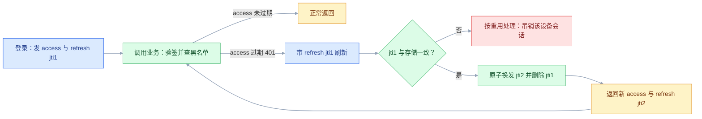
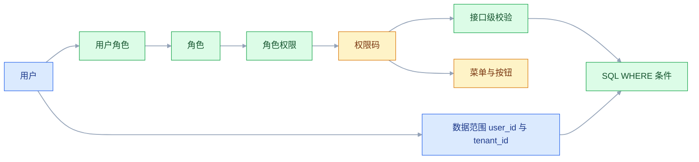
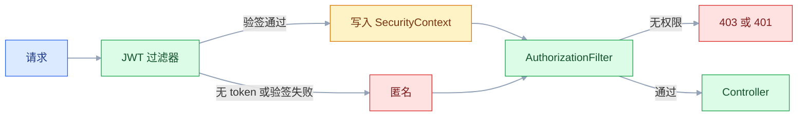

# 认证与授权

## 一、工程案例：给多角色任务后台做登录、刷新、登出与接口级权限

**场景**：一个任务管理后台，两种角色。`ADMIN` 能看全部任务、删任务、查用户列表；`USER` 只能建任务、改自己的任务、看自己的任务。要交付六件事：注册时密码只落哈希、登录发双 token、accessToken 过期能静默刷新、登出后旧 token 立刻作废、接口级权限拦住越权调用、数据级权限让猜 ID 也拿不到别人的数据。最后用 curl 把每条都打一遍。

**为什么必须做**：认证授权属于安全领域，不属于业务领域。手写「登录 + Session 存 userId + 拦截器」看似能用，但容易漏掉密码强哈希、防爆破、会话固定、CSRF、权限判断散落各处。上面六件事漏任何一件，都不是「功能少一点」，而是「数据能被别人拿走」。

**动手前确认**：3306、6379 没被占用；`curl`、`jq` 已装；系统时间准确（偏差会让刚签发的 token 就过期）。技术栈 Spring Boot 3.2 + Spring Security 6.2 + MyBatis + MySQL 8.0 + Redis 7.2 + jjwt 0.12.x（版本以官方当前稳定版为准）。

### 1.1 起环境、建表

```bash
docker run -d --name auth-mysql -p 3306:3306 -e MYSQL_ROOT_PASSWORD=Root@123456 -e MYSQL_ROOT_HOST=% -e MYSQL_DATABASE=appdb mysql:8.0
docker run -d --name auth-redis -p 6379:6379 redis:7.2 redis-server --requirepass Redis@123456
until docker exec auth-mysql mysqladmin -uroot -pRoot@123456 ping >/dev/null 2>&1; do sleep 1; done   # 等 mysqld 就绪
```

`application.yml` 至少要有这些键，密钥换成自己的、不少于 32 字节：

```yaml
spring:
  datasource:
    url: "jdbc:mysql://localhost:3306/appdb?useSSL=false&allowPublicKeyRetrieval=true&serverTimezone=Asia/Shanghai"
    username: root
    password: Root@123456
  data:
    redis:
      host: localhost
      port: 6379
      password: Redis@123456
jwt:
  secret: ${JWT_SECRET:dev-only-change-me-32-bytes-minimum-000}
  access-seconds: 1800
  refresh-seconds: 604800
```

```sql
CREATE TABLE t_user (
  id BIGINT PRIMARY KEY AUTO_INCREMENT,
  username VARCHAR(64) NOT NULL UNIQUE,
  password VARCHAR(100) NOT NULL COMMENT 'bcrypt 哈希，60 字符',
  nickname VARCHAR(64), status TINYINT NOT NULL DEFAULT 1 COMMENT '1=正常',
  token_version INT NOT NULL DEFAULT 0 COMMENT '改密码时 +1',
  created_at DATETIME NOT NULL DEFAULT CURRENT_TIMESTAMP
) ENGINE=InnoDB DEFAULT CHARSET=utf8mb4;

CREATE TABLE t_role (id BIGINT PRIMARY KEY AUTO_INCREMENT, code VARCHAR(64) NOT NULL UNIQUE,
  name VARCHAR(64) NOT NULL) ENGINE=InnoDB DEFAULT CHARSET=utf8mb4;

CREATE TABLE t_permission (id BIGINT PRIMARY KEY AUTO_INCREMENT, code VARCHAR(128) NOT NULL UNIQUE,
  name VARCHAR(64) NOT NULL) ENGINE=InnoDB DEFAULT CHARSET=utf8mb4;

CREATE TABLE t_user_role (user_id BIGINT NOT NULL, role_id BIGINT NOT NULL, PRIMARY KEY (user_id, role_id)) ENGINE=InnoDB;
CREATE TABLE t_role_permission (role_id BIGINT NOT NULL, permission_id BIGINT NOT NULL, PRIMARY KEY (role_id, permission_id)) ENGINE=InnoDB;

CREATE TABLE t_task (
  id BIGINT PRIMARY KEY AUTO_INCREMENT,
  title VARCHAR(128) NOT NULL, content VARCHAR(1024),
  user_id BIGINT NOT NULL COMMENT '归属用户，数据权限靠它',
  status VARCHAR(16) NOT NULL DEFAULT 'TODO',
  created_at DATETIME NOT NULL DEFAULT CURRENT_TIMESTAMP,
  INDEX idx_user_id (user_id)
) ENGINE=InnoDB DEFAULT CHARSET=utf8mb4;

INSERT INTO t_role (id, code, name) VALUES (1, 'ADMIN', '管理员'), (2, 'USER', '普通用户');
INSERT INTO t_permission (id, code, name) VALUES
  (1, 'task:create', '创建任务'), (2, 'task:update', '修改任务'), (3, 'task:delete', '删除任务'),
  (4, 'task:view:all', '查看全部任务'), (5, 'user:list', '查看用户列表');
INSERT INTO t_role_permission (role_id, permission_id) VALUES (1,1),(1,2),(1,3),(1,4),(1,5),(2,1),(2,2);
```

把这段存成 `schema.sql` 再导入，并确认 Redis 可连：

```bash
docker exec -i auth-mysql mysql -uroot -pRoot@123456 appdb < schema.sql
docker exec auth-redis redis-cli -a Redis@123456 ping        # PONG
```

建表和种子数据就绪后启动 `mvn spring-boot:run`，默认监听 8080；后面的 curl 都假设它已经起来。

权限码用 `资源:动作[:范围]`。角色 code 不带 `ROLE_` 前缀——前缀只在 `hasRole()` 里补，两处都加就变成 `ROLE_ROLE_ADMIN`。

### 1.2 注册：明文只在内存里存在一次

密码编码器声明为单例 Bean：`@Bean PasswordEncoder passwordEncoder() { return new BCryptPasswordEncoder(10); }`（cost=10，约 50~100ms）。

```java
@Service
@RequiredArgsConstructor
public class UserService {
    private final UserMapper userMapper;
    private final UserRoleMapper userRoleMapper;
    private final PasswordEncoder encoder;
    @Transactional
    public long register(String username, String raw, String nickname) {
        User u = new User();
        u.setUsername(username);
        u.setPassword(encoder.encode(raw));      // ① 哈希
        u.setNickname(nickname);
        userMapper.insert(u);                    // ② 只存哈希
        userRoleMapper.insert(u.getId(), 2L);    // ③ 默认 USER
        return u.getId();
    }
}
```

请求体用 `@Pattern` 卡住格式：用户名 `^[a-zA-Z0-9_]{4,20}$`，密码 `^(?=.*[a-zA-Z])(?=.*\d).{8,32}$`（message 写「密码需 8~32 位且含字母和数字」，验收第 2 项按它判）。注册接口先查重名，再调上面的方法；并发下靠 `username` 唯一索引兜底，捕获 `DuplicateKeyException` 转成「用户名已存在」。

`t_user.token_version` 先留着：改密码、禁用账号后要让所有旧 access 一起失效，就靠它（见 3.6）。

```bash
curl -s -X POST http://localhost:8080/auth/register -H 'Content-Type: application/json' \
  -d '{"username":"zhangsan","password":"abc12345","nickname":"张三"}'
# {"code":0,"data":1}

docker exec auth-mysql mysql -uroot -pRoot@123456 appdb -e \
  "SELECT username, LEFT(password,7) AS prefix, LENGTH(password) AS len FROM t_user;"
# zhangsan | $2a$10$ | 60      ← 60 字符、$2a$10$ 开头，才是 bcrypt
```

同一密码每次 `encode` 结果都不同，因为盐随机。库里出现两条相同哈希，说明没加盐或根本没哈希。

### 1.3 登录：双 token + 防爆破

```java
@Component
public class JwtUtil {
    private final SecretKey key;
    private final long accessTtl, refreshTtl;

    public JwtUtil(@Value("${jwt.secret}") String secret,
                   @Value("${jwt.access-seconds:1800}") long accessTtl,
                   @Value("${jwt.refresh-seconds:604800}") long refreshTtl) {
        this.key = Keys.hmacShaKeyFor(secret.getBytes(StandardCharsets.UTF_8));  // ≥32 字节
        this.accessTtl = accessTtl;
        this.refreshTtl = refreshTtl;
    }
    public long accessSeconds() { return accessTtl; }
    public String access(long uid, String dev, List<String> roles) {
        return base(uid, "access", dev, UUID.randomUUID().toString(), accessTtl)
            .claim("roles", roles).signWith(key, Jwts.SIG.HS256).compact();
    }
    public String refresh(long uid, String dev, String jti) {
        return base(uid, "refresh", dev, jti, refreshTtl).signWith(key, Jwts.SIG.HS256).compact();
    }
    private JwtBuilder base(long uid, String typ, String dev, String jti, long ttl) {
        Instant now = Instant.now();
        JwtBuilder b = Jwts.builder().subject(String.valueOf(uid)).id(jti).claim("typ", typ)
            .issuedAt(Date.from(now)).expiration(Date.from(now.plusSeconds(ttl)));
        return dev == null ? b : b.claim("dev", dev);      // 按设备分别吊销
    }
    public Claims parse(String token) {
        return Jwts.parser().verifyWith(key).clockSkewSeconds(30)   // 验签，不是只解码
            .build().parseSignedClaims(token).getPayload();
    }
}
```

```java
@Service
@RequiredArgsConstructor
public class LoginAttemptService {
    private final StringRedisTemplate redis;
    public void fail(String u) {
        Long n = redis.opsForValue().increment("login:fail:" + u);
        if (n != null && n == 1) redis.expire("login:fail:" + u, Duration.ofMinutes(15));  // 首次失败才计时
    }
    public boolean locked(String u) {
        String v = redis.opsForValue().get("login:fail:" + u);
        return v != null && Integer.parseInt(v) >= 5;
    }
    public void clear(String u) { redis.delete("login:fail:" + u); }
}
```

```java
// AuthController 的类字段：用 BCryptPasswordEncoder(10) 生成一次，所有「用户不存在」都拿它跑
private static final String DUMMY_BCRYPT =
    "$2a$10$N9qo8uLOickgx2ZMRZoMyeIjZAgcfl7p92ldGxad68LJZdL17lhWy";

@PostMapping("/auth/login")
public Result<TokenResponse> login(@RequestBody @Valid LoginRequest req) {
    if (attempts.locked(req.username())) return Result.fail(429, "失败次数过多，请 15 分钟后再试");
    User u = userService.findByUsername(req.username());
    // 用户不存在也拿一个固定哈希跑一次 matches，两种失败耗时接近，避免用响应时间枚举账号
    String hash = u != null ? u.getPassword() : DUMMY_BCRYPT;
    boolean ok = encoder.matches(req.password(), hash) && u != null;
    if (!ok) { attempts.fail(req.username()); return Result.fail(401, "用户名或密码错误"); }
    if (u.getStatus() != 1) return Result.fail(403, "账号已禁用");
    attempts.clear(req.username());

    String device = req.deviceId() == null ? "web" : req.deviceId();
    String jti = UUID.randomUUID().toString();
    store.saveRefresh(u.getId(), device, jti, Duration.ofDays(7));
    return Result.ok(new TokenResponse(jwt.access(u.getId(), device, roleService.codes(u.getId())),
        jwt.refresh(u.getId(), device, jti), "Bearer", jwt.accessSeconds()));
}
```

### 1.4 过滤器与安全配置

```java
@Component
@RequiredArgsConstructor
public class JwtFilter extends OncePerRequestFilter {
    private final JwtUtil jwt;
    private final TokenStore store;
    private final PermissionCache perms;

    @Override
    protected void doFilterInternal(HttpServletRequest req, HttpServletResponse res,
                                    FilterChain chain) throws ServletException, IOException {
        String h = req.getHeader("Authorization");
        if (h == null || !h.startsWith("Bearer ")) { chain.doFilter(req, res); return; }
        try {
            Claims c = jwt.parse(h.substring(7));
            if (!"access".equals(c.get("typ"))) { chain.doFilter(req, res); return; }
            if (store.denied(c.getId())) { chain.doFilter(req, res); return; }   // 已登出的 jti
            long uid = Long.valueOf(c.getSubject());
            List<String> roles = c.get("roles", List.class);
            List<GrantedAuthority> auths = new ArrayList<>();
            roles.forEach(r -> auths.add(new SimpleGrantedAuthority("ROLE_" + r)));
            perms.get(uid).forEach(p -> auths.add(new SimpleGrantedAuthority(p)));
            var auth = new UsernamePasswordAuthenticationToken(new LoginUser(uid, roles), null, auths);
            SecurityContextHolder.getContext().setAuthentication(auth);
        } catch (JwtException | IllegalArgumentException e) {
            SecurityContextHolder.clearContext();      // 交给后面的过滤器统一出 401
        }
        chain.doFilter(req, res);
    }
}
```

```java
@Configuration
@EnableWebSecurity
@EnableMethodSecurity                     // 没有它，@PreAuthorize 完全不生效
@RequiredArgsConstructor
public class SecurityConfig {
    private final JwtFilter jwtFilter;
    @Bean
    SecurityFilterChain chain(HttpSecurity http) throws Exception {
        http.cors(Customizer.withDefaults())                 // 浏览器跨域时放行，源见下面的 Bean
            .csrf(AbstractHttpConfigurer::disable)          // token 在 header，不在 Cookie
            .sessionManagement(s -> s.sessionCreationPolicy(SessionCreationPolicy.STATELESS))
            .authorizeHttpRequests(a -> a
                .requestMatchers(HttpMethod.OPTIONS, "/**").permitAll()   // 预检不带 token
                .requestMatchers("/auth/login", "/auth/register", "/auth/refresh",
                                 "/actuator/health").permitAll()
                .anyRequest().authenticated())
            .exceptionHandling(e -> e
                .authenticationEntryPoint((q, r, ex) -> json(r, 401, "未登录或登录已过期"))
                .accessDeniedHandler((q, r, ex) -> json(r, 403, "没有该操作权限")))
            .addFilterBefore(jwtFilter, UsernamePasswordAuthenticationFilter.class);
        return http.build();
    }
    @Bean
    CorsConfigurationSource cors() {
        CorsConfiguration c = new CorsConfiguration();
        c.setAllowedOrigins(List.of("http://localhost:5173"));   // 换成前端实际地址，别用 *
        c.setAllowedMethods(List.of("GET", "POST", "PUT", "DELETE", "OPTIONS"));
        c.setAllowedHeaders(List.of("Authorization", "Content-Type"));
        UrlBasedCorsConfigurationSource s = new UrlBasedCorsConfigurationSource();
        s.registerCorsConfiguration("/**", c);
        return s;
    }
    static void json(HttpServletResponse r, int code, String msg) throws IOException {
        r.setStatus(code);
        r.setContentType("application/json;charset=UTF-8");
        r.getWriter().write("{\"code\":" + code + ",\"msg\":\"" + msg + "\"}");
    }
}
```

权限码缓存：`auth:perms:{uid}` 存 30 分钟，未命中就查三表 join。改角色、改权限后必须 `evict`，否则最长 30 分钟内旧权限还在生效。

### 1.5 接口级权限

```java
@RestController
@RequestMapping("/task")
@RequiredArgsConstructor
public class TaskController {
    private final TaskService taskService;
    @GetMapping("/list")
    @PreAuthorize("hasAuthority('task:view:all')")       // 只有 ADMIN 有这个权限码
    public Result<List<Task>> all() { return Result.ok(taskService.listAll()); }

    @GetMapping("/my")
    public Result<List<Task>> mine(@AuthenticationPrincipal LoginUser me) {
        return Result.ok(taskService.listByOwner(me.userId()));
    }

    @GetMapping("/{id}")
    public Result<Task> detail(@PathVariable Long id, @AuthenticationPrincipal LoginUser me) {
        return taskService.findOwned(id, me.userId())            // WHERE id=? AND user_id=?
            .map(Result::ok).orElseGet(() -> Result.fail(404, "任务不存在"));
    }

    @PutMapping("/{id}")
    @PreAuthorize("hasAuthority('task:update')")
    public Result<Void> update(@PathVariable Long id, @RequestBody @Valid TaskDTO dto,
                               @AuthenticationPrincipal LoginUser me) {
        return taskService.updateOwned(id, me.userId(), dto) == 1
            ? Result.ok() : Result.fail(404, "任务不存在");      // 影响 0 行：不存在或不是你的
    }

    @PostMapping
    @PreAuthorize("hasAuthority('task:create')")
    public Result<Long> create(@RequestBody @Valid TaskDTO dto, @AuthenticationPrincipal LoginUser me) {
        return Result.ok(taskService.create(dto, me.userId()));   // 归属取自 token，不取请求体
    }

    @DeleteMapping("/{id}")
    @PreAuthorize("hasAuthority('task:delete')")
    public Result<Void> delete(@PathVariable Long id) { taskService.delete(id); return Result.ok(); }

    @GetMapping("/users")
    @PreAuthorize("hasAuthority('user:list')")
    public Result<List<UserVO>> users() { return Result.ok(taskService.listUsers()); }
}
```

`delete` 只配给 ADMIN（`USER` 角色没有 `task:delete`），所以管理员能删任意任务；普通用户的详情、修改、列表都必须带 `user_id` 条件，SQL 见 1.7。

| 表达式 | 含义 |
|---|---|
| `hasAuthority('task:delete')` | 精确匹配权限码，不补前缀 |
| `hasRole('ADMIN')` | 匹配 `ROLE_ADMIN`，会自动补 `ROLE_` |
| `#dto.ownerId == authentication.principal.userId` | 参数级校验，别把归属交给前端 |

### 1.6 刷新与登出

```java
@PostMapping("/auth/refresh")
public Result<TokenResponse> refresh(@RequestBody RefreshRequest req) {
    Claims c;
    try { c = jwt.parse(req.refreshToken()); }
    catch (JwtException e) { return Result.fail(401, "refreshToken 无效或已过期"); }
    if (!"refresh".equals(c.get("typ", String.class))) return Result.fail(401, "token 类型错误");

    long uid = Long.valueOf(c.getSubject());
    String device = c.get("dev", String.class);
    if (!store.refreshValid(uid, device, c.getId())) return Result.fail(401, "请重新登录");

    String jti = UUID.randomUUID().toString();        // 轮换：旧 refresh 立即作废
    String rt = jwt.refresh(uid, device, jti);
    store.saveRefresh(uid, device, jti, Duration.ofDays(7));
    return Result.ok(new TokenResponse(jwt.access(uid, device, roleService.codes(uid)), rt, "Bearer", jwt.accessSeconds()));
}

@PostMapping("/auth/logout")
public Result<Void> logout(@RequestHeader(value = "Authorization", required = false) String h) {
    if (h == null || !h.startsWith("Bearer ")) return Result.fail(401, "token 无效");
    Claims c;
    try { c = jwt.parse(h.substring(7)); } catch (JwtException e) { return Result.fail(401, "token 无效"); }
    Duration left = Duration.between(Instant.now(), c.getExpiration().toInstant());
    store.revoke(Long.valueOf(c.getSubject()), c.get("dev", String.class), c.getId(), left);
    return Result.ok();
}
```

```java
@Component
@RequiredArgsConstructor
public class TokenStore {
    private final StringRedisTemplate redis;

    public void saveRefresh(long uid, String dev, String jti, Duration ttl) {
        redis.opsForValue().set("auth:refresh:" + uid + ":" + dev, jti, ttl);
    }
    public boolean refreshValid(long uid, String dev, String jti) {
        return jti.equals(redis.opsForValue().get("auth:refresh:" + uid + ":" + dev));
    }
    public void revoke(long uid, String dev, String accessJti, Duration left) {
        redis.delete("auth:refresh:" + uid + ":" + dev);
        if (!left.isNegative() && !left.isZero())
            redis.opsForValue().set("auth:deny:" + accessJti, "1", left);
    }
    public boolean denied(String jti) { return Boolean.TRUE.equals(redis.hasKey("auth:deny:" + jti)); }
}
```

黑名单存 **jti** 而不是整串 token：key 短、不把凭证写进 Redis 和慢日志，同一个 token 的多次请求共用一条记录。

上面 `refreshValid` 再 `saveRefresh` 是两步，生产上要用 `GETDEL` 或 Lua 合成一步，否则两个并发刷新会同时通过（见 3.5）。

这套登出只吊销**当前设备**：`delete auth:refresh:uid:dev` 只清这一台。要「所有设备一起下线」，得把 `token_version` +1（见 3.6），或按 uid 把该用户所有 refresh 一起删掉。案例为了 curl 直测把 refreshToken 放在请求体；若按 3.5 推荐放进 `HttpOnly` Cookie，`/auth/refresh` 就要从 Cookie 取值，并同时打开 CSRF 防护。

刷新接口还要查账号 `status`，并比对 `token_version`（要把它写进两类 token）；禁用或改密码后，旧 refresh 不应再换出新 access（见 2.12）。

### 1.7 数据权限：猜 ID 也拿不到

详情和修改用同一条归属条件：`SELECT * FROM t_task WHERE id = #{id} AND user_id = #{userId}`、`UPDATE t_task SET ... WHERE id = #{id} AND user_id = #{userId}`，查不到或影响 0 行就返回 404；列表同理 `WHERE user_id = #{userId}`，不能查全量再在 Java 里过滤。管理员的 `/task/list` 与删除是显式放开范围，不能变成普通用户接口的默认行为。

### 1.8 验收（10 项全过才算交付）

下面的检查看 HTTP 状态码，所以 `Result.fail(code, msg)` 必须同时设置响应状态（`@ResponseStatus` 或统一异常处理）；只把 code 放进 body、HTTP 永远 200，`curl -w` 一项都验不出来。

| # | 检查项 | 命令或检查 | 通过标准 |
|---|---|---|---|
| 1 | 密码落库为哈希 | `SELECT LEFT(password,7), LENGTH(password) FROM appdb.t_user;` | `$2a$10$` 开头，长度 60 |
| 2 | 弱密码被拦 | 注册 `12345678` | 400，提示含字母和数字 |
| 3 | 登录发双 token | `login lisi \| jq '.data \| keys'` | 同时有 `accessToken`、`refreshToken` |
| 4 | 无凭证拒绝 | `curl -s -o /dev/null -w '%{http_code}' $BASE/task/my` | 401 |
| 5 | 过期可刷新 | 把 `jwt.access-seconds` 改成 60 重启，过期后调 `/auth/refresh` | 拿到新 access，再访问 200；旧 refresh 再用是 401 |
| 6 | 登出即失效 | 登出后用同一个 access 再访问 | 401 |
| 7 | 接口级越权 | USER 调 `/task/list`、`/task/users` | 都是 403 |
| 8 | 数据级越权 | USER 用别人的任务 ID 调 `GET /task/{id}` 和 `PUT /task/{id}` | 都是 404，响应里没有别人的数据 |
| 9 | 防爆破 | 连续 5 次错密码，第 6 次用对的密码 | 429，15 分钟后恢复 |
| 10 | refresh 不能当 access | 用 refreshToken 调 `/task/my` | 401（`typ` 校验拦住） |

```bash
BASE=http://localhost:8080
reg() { curl -s -X POST $BASE/auth/register -H 'Content-Type: application/json' \
  -d "{\"username\":\"$1\",\"password\":\"abc12345\",\"nickname\":\"$1\"}" >/dev/null; }
login() { curl -s -X POST $BASE/auth/login -H 'Content-Type: application/json' \
  -d "{\"username\":\"$1\",\"password\":\"abc12345\"}"; }

# 0) 弱密码被拦：400
curl -s -o /dev/null -w "弱密码注册           → %{http_code}\n" -X POST $BASE/auth/register \
  -H 'Content-Type: application/json' -d '{"username":"weakuser","password":"12345678"}'

# 1) 三个账号；admin 额外挂 ADMIN 角色。先授权再登录，避开权限缓存脏读
reg admin; reg lisi; reg wangwu
docker exec auth-mysql mysql -uroot -pRoot@123456 appdb -e \
  "INSERT IGNORE INTO t_user_role (user_id, role_id) SELECT id, 1 FROM t_user WHERE username='admin';"

ADMIN=$(login admin | jq -r '.data.accessToken')
LISI=$(login lisi | jq -r '.data.accessToken')
WANGWU=$(login wangwu | jq -r '.data.accessToken')
LISI_TASK=$(curl -s -X POST $BASE/task -H "Authorization: Bearer $LISI" \
  -H 'Content-Type: application/json' -d '{"title":"lisi 的任务"}' | jq -r '.data')

# 2) 列表 403、别人的详情/修改 404、admin 200
curl -s -o /dev/null -w "lisi /task/list       → %{http_code}\n" $BASE/task/list -H "Authorization: Bearer $LISI"
curl -s -o /dev/null -w "wangwu 看 lisi 详情   → %{http_code}\n" $BASE/task/$LISI_TASK -H "Authorization: Bearer $WANGWU"
curl -s -o /dev/null -w "wangwu 改 lisi 任务   → %{http_code}\n" -X PUT $BASE/task/$LISI_TASK \
  -H "Authorization: Bearer $WANGWU" -H 'Content-Type: application/json' -d '{"title":"被改"}'
curl -s -o /dev/null -w "admin /task/list      → %{http_code}\n" $BASE/task/list -H "Authorization: Bearer $ADMIN"
# 期望：403 / 404 / 404 / 200

# 3) 刷新轮换：同一账号只取一次登录结果，避免后一次登录覆盖 refresh
LOGIN=$(login lisi)
ACE=$(echo "$LOGIN" | jq -r '.data.accessToken')
REFRESH=$(echo "$LOGIN" | jq -r '.data.refreshToken')
sleep 61                                  # 配合 jwt.access-seconds=60
curl -s -o /dev/null -w "过期 access           → %{http_code}\n" $BASE/task/my -H "Authorization: Bearer $ACE"
NEW=$(curl -s -X POST $BASE/auth/refresh -H 'Content-Type: application/json' \
  -d "{\"refreshToken\":\"$REFRESH\"}")
NEW_ACE=$(echo "$NEW" | jq -r '.data.accessToken')
curl -s -o /dev/null -w "新 access 访问        → %{http_code}\n" $BASE/task/my -H "Authorization: Bearer $NEW_ACE"
curl -s -o /dev/null -w "旧 refresh 再刷       → %{http_code}\n" -X POST $BASE/auth/refresh \
  -H 'Content-Type: application/json' -d "{\"refreshToken\":\"$REFRESH\"}"
# 期望：401（过期）/ 200（新 access）/ 401（旧 refresh 已轮换）
curl -s -o /dev/null -w "refresh 当 access     → %{http_code}\n" $BASE/task/my -H "Authorization: Bearer $REFRESH"
# 期望 401：typ 是 refresh，过滤器不认

# 4) 登出：同一 access 立刻 401
ACE2=$(login lisi | jq -r '.data.accessToken')
curl -s -X POST $BASE/auth/logout -H "Authorization: Bearer $ACE2" >/dev/null
curl -s -o /dev/null -w "登出后旧 access       → %{http_code}\n" $BASE/task/my -H "Authorization: Bearer $ACE2"

# 5) 防爆破：5 次错密码后，第 6 次即使密码正确也 429（放最后，账号会被锁 15 分钟）
for i in 1 2 3 4 5; do curl -s -o /dev/null -X POST $BASE/auth/login \
  -H 'Content-Type: application/json' -d '{"username":"wangwu","password":"wrong123"}'; done
curl -s -o /dev/null -w "锁定后用对密码       → %{http_code}\n" -X POST $BASE/auth/login \
  -H 'Content-Type: application/json' -d '{"username":"wangwu","password":"abc12345"}'
```

> 第 5 项别靠「等 30 分钟」验，把 `jwt.access-seconds` 改成 60 再重启，脚本里的 `sleep 61` 就是配合它。
> 第 8 项要拿**真实存在**的别人任务 ID 测，脚本用 `LISI_TASK` 现建一个，否则 404 可能只是「记录不存在」。
> 重复执行前先清掉 `t_user`、`t_task` 或换用户名，否则注册会因重名返回 400。

---

## 二、高频问答：会卡住你的地方，也是面试最常问的

### 2.1 登录成功，紧接着的请求就 401

**现场**

打印 `request.getHeader("Authorization")`；`curl -v` 看实际发出的 header，没有 `authorization` 这一行就是前端没带。

**要点**

- 401 是「这次请求没有有效凭证」，不是「登录接口失败」。
- 常见原因是没带 `Authorization`、漏了 `Bearer ` 前缀，或网关把 header 丢了。
- 先看请求，再看签发，顺序反了会白查半天。

**追问**

- 浏览器里怎么确认？→ Network 面板的 Request Headers。
- 为什么封装库会漏？→ 很多只在特定条件下注入 header，比如只对某些域名生效。
- 网关为什么会丢？→ 转发规则里没透传这个头。

### 2.2 `@PreAuthorize` 写了完全没生效

**现场**

无权用户调用时看是否直接进方法体；或断点看是否被代理。

**要点**

- 类上缺 `@EnableMethodSecurity`，注解根本不会被解析，改表达式也没用。
- 方法被同一个类内部调用，绕过代理。
- 把校验提到 Controller，或注入自身代理。

**追问**

- 为什么改表达式一直没反应？→ 它压根没被解析，不是表达式写错。
- 非 `public` 方法呢？→ 同样不经过代理，一样失效。
- 怎么最快确认？→ 断点看拿到的对象是不是代理对象。

### 2.3 `hasRole('ADMIN')` 永远判不过

**现场**

打印 `SecurityContextHolder.getContext().getAuthentication().getAuthorities()`。

**要点**

- `hasRole` 会自动补 `ROLE_`，实际比对 `ROLE_ADMIN`；而库里存的是 `ADMIN`，过滤器原样放进了 authorities。
- `hasRole` 和 `hasAuthority` 的差别只在「补不补前缀」。
- 团队统一：库里存不带前缀的 code，过滤器补一次 `ROLE_`。

**追问**

- 两处都加会怎样？→ 变成 `ROLE_ROLE_ADMIN`，永远匹配不上。
- 判权限码用什么？→ `hasAuthority('task:delete')`，不补前缀。
- 权限码怎么命名？→ `资源:动作[:范围]`，全小写、冒号分隔。

### 2.4 前端把按钮藏了，接口照样能调

**现场**

用普通用户 token 直接 curl 管理接口，看是否 200。

**要点**

- 前端隐藏只是「看不见」，`curl` 直接打接口不经过任何前端逻辑。
- 真正的边界只有两处：后端接口校验和数据范围条件。
- 菜单和按钮只负责体验，不是安全边界。

**追问**

- 接口级和数据级都要做吗？→ 都要，两者都过才算没越权。
- 为什么会觉得已经做了权限？→ 只做了菜单级/按钮级。
- 越权时为什么返回 404 而不是 403？→ 403 等于承认这个 ID 存在，配合自增就能枚举。

### 2.5 换个 ID 就能看到别人的数据

**现场**

用 A 的 token 请求 B 的资源 ID，逐个方法试 GET/PUT/DELETE：

```sql
SELECT * FROM t_task WHERE id = #{id};                         -- ✘ 只按主键
SELECT * FROM t_task WHERE id = #{id} AND user_id = #{userId}; -- ✔ 主键 + 归属
```

**要点**

- 这类漏洞叫 IDOR，靠遍历自增 ID 就能命中。
- 列表过滤了，单条详情/修改/删除没过滤，是最常见的漏法。
- 数据权限不是「列表接口的事」，是「每个能定位单条记录的入口的事」。

**追问**

- 还有哪些入口算？→ 导出、批量操作、关联查询、消息详情。
- 批量操作怎么防？→ 每个 ID 都进 WHERE，并校验影响行数。
- 为什么不能在 Java 里过滤？→ 一旦漏一条路径就是泄露，分页总数也对不上。

### 2.6 登出后旧 token 还能用

**现场**

登出后立刻用原 access 请求，200 就说明没校验黑名单。

**要点**

- JWT 无状态，服务端不存 token；删 Redis 里的 refresh 不影响已签发的 access。
- JWT 的「注销」本质是额外维护一份否定列表，或把 access 有效期压到足够短。
- 两条路都要付成本，没有免费的「立即失效」。

**追问**

- 黑名单的 key 存什么？→ 存 jti，不存整串 token。
- TTL 怎么定？→ 等于剩余有效期，过期自动清理。
- 为什么不能只删 refresh？→ 只阻止续期，旧 access 仍活到自然过期。

### 2.7 refresh 接口 401，或 refresh 能直接访问业务

**现场**

解出 payload 看 `typ`；对比 Redis 里的 jti 与请求里的 jti。

**要点**

- 没校验 `typ`，两类 token 用同一套签名，过滤器分不清。
- 光靠有效期长短区分不够——攻击者拿 refresh 当 access 用，有效期更长，危害更大。
- 轮换后旧 refresh 已被覆盖，前端还在用旧的，也会 401。

**追问**

- 刷新失败有几种原因？→ 过期、类型错、已被轮换、设备号对不上。
- 前端并发刷新怎么办？→ 单飞，同一时刻只允许一个刷新请求。
- 为什么 refresh 必须单独存？→ 才能做轮换和重用检测。

### 2.8 浏览器跨域全 401，Postman 却正常

**现场**

Network 面板看有没有红色的 OPTIONS；`curl -X OPTIONS -i` 看响应码。

**要点**

- 跨域先发 `OPTIONS` 预检，预检**不带** `Authorization`，被 `anyRequest().authenticated()` 拦成 401。
- Postman 不发预检，所以「Postman 正常」证明不了浏览器链路正常。
- 预检要放行，同时 `Access-Control-Allow-Headers` 必须包含 `Authorization`。

**追问**

- 预检过了真请求还是被浏览器拦？→ 响应头缺 `Authorization`，预检白过。
- 为什么 OPTIONS 要 `permitAll`？→ 它本来就不带凭证。
- 带 Cookie 的跨域要注意什么？→ 要 `allowCredentials` 且源不能是 `*`。

### 2.9 密码明明对，`matches` 返回 false

**现场**

看库里长度是不是 60、前缀是不是 `$2a$`；写单测直接 `matches("abc12345", 库里的值)`。

**要点**

- `matches` 永远不可能「反解」，它只用同一套参数重算。
- 常见原因是库里存的是明文或二次哈希、注册时 encode 了两次、输入带空格、换过编码器实现。
- 返回 false 时先确认「存进去的到底是什么」，而不是怀疑算法。

**追问**

- 两条相同的哈希说明什么？→ 没加盐，或根本没哈希。
- bcrypt 有长度限制吗？→ 只取前 72 字节，超长要先摘要再交进去。
- 换 MD5 为什么更糟？→ 太快，脱库后暴力枚举成本极低。

### 2.10 扩容到两台后，用户在两台之间反复掉登录

**现场**

对比两台的环境变量；在 A 登录，把同一个 token 直接打到 B，一个 200 一个 401 就是密钥或存储不共享。

**要点**

- 两台 `jwt.secret` 不一致，A 签的 token 到 B 验签失败。
- 或者 refresh 存在本机内存 / 不同 Redis 库。
- JWT 方案不需要会话保持，需要的是**配置一致 + 共享存储**。

**追问**

- 具体比哪三样？→ 密钥、Redis 地址、database 编号。
- 开会话保持能救吗？→ 不能，只是把问题掩盖到下次发布。
- 轮换密钥怎么不全员掉线？→ 先让所有实例配置一致，再切流量。

### 2.11 token 出现在日志、URL 和 Referer 里

**现场**

`grep -r "eyJ" /var/log/nginx/ /var/log/app/`，命中即泄露；token 只放 header，不放 query。

**要点**

- HTTPS 只保护「传输段」，保护不了「落地后的日志」。
- `?token=xxx` 会进 Nginx access log、浏览器历史、Referer。
- 打印整个请求头会把 `Authorization` 写进应用日志。

**追问**

- 排查时怎么定位？→ 用 jti，不要把整串 token 贴进工单。
- 已经泄露了怎么办？→ 轮换密钥并让所有 token 失效。
- access log 怎么改？→ 不打 query 串，或对敏感参数脱敏。

### 2.12 改密码或禁用账号后，旧 token 照样能进

**现场**

改密码或把 `status` 置 0 后，用之前的 access 打 `/task/my`，返回 200 就是没校验。

**要点**

- JWT 无状态，接口只验签不查用户状态；`token_version` 列建了却没写进 claim。
- 只删 refresh 只能阻止续期，旧 access 仍会活到自然过期。
- 禁用账号同理，必须在认证阶段查 `status`，不能只在登录时查一次。

**追问**

- 两条修法是什么？→ `token_version` 写进 claim 比对，或记录 `credentials_changed_at` 拒绝更早的 `iat`。
- 每请求查用户会不会太慢？→ 缓存几十秒，摊掉查询。
- 为什么要两种手段并存？→ 一个管全端下线，一个管凭证变更时间点。

---

## 三、核心知识：从零开始要建立的东西

### 3.1 认证与授权两道门

认证回答「你是谁」，授权回答「你能做什么」。顺序固定：先认证、再授权、最后按数据范围过滤。

| 状态码 | 真实含义 | 客户端该做什么 |
|---|---|---|
| **401** | 未认证 / 凭证失效 | 跳登录或刷新 token |
| **403** | 已认证但无权限 | **不要重试**，提示无权 |
| **404** | 资源不存在，或不想暴露存在性 | 按不存在处理 |

把越权返回 401 会让前端误以为要刷新 token，刷新完再打一次还是 401，陷入死循环。

### 3.2 密码哈希：盐、成本与不可逆

密码只能**单向哈希**，不能加密（加密可逆，密钥泄露就全泄）。哈希函数要慢、要加盐：

| 方案 | 能否用于生产 | 原因 |
|---|---|---|
| 明文 | ❌ | 脱库即全泄 |
| MD5 / SHA-1 | ❌ | 太快，彩虹表和 GPU 暴力枚举成本极低 |
| MD5 + 固定盐 | ❌ | 盐固定就能针对整库预计算 |
| PBKDF2-HMAC-SHA256 | ✅ 可用 | 合规清单里常见，迭代次数按官方建议配；别自创「SHA-256 加随机盐多轮」 |
| **bcrypt** | ✅ 默认选择 | 自带随机盐、成本可调、生态成熟 |
| **Argon2id** | ✅ 高安全场景 | 内存硬，抗 GPU 更强，需额外依赖 |

bcrypt 的输出自带参数和盐，校验时不需要单独存盐：`$2a$10$...` 中 `$2a$` 是版本、`10` 是 cost（2^10 轮）、紧接着 22 个字符是盐、后面是哈希。

「慢」是设计目标：正常登录只算一次，100ms 无感；攻击者拿字典逐条试，每条都要 100ms。cost 选 10（50~100ms）够用，12（200~400ms）适合高安全，14 约 1 秒、要评估登录 QPS，再高容易被打成拒绝服务。

边界：bcrypt 只处理前 **72 字节**，更长会被截断；cost 调高会让登录变成 CPU 密集点，必须配合限流。

> **面试**：常问「密码为什么不能用 MD5 加盐？」答：太快，一张 GPU 就能暴力枚举；要用 bcrypt 这类可调成本的慢哈希。

### 3.3 会话状态的存放位置

HTTP 本身无状态，「登录过」必须由某种状态承载。两种主流做法：

| | Session-Cookie | JWT |
|---|---|---|
| 状态位置 | 服务端（内存/Redis） | 客户端（token 自带） |
| 每请求是否查存储 | 是 | 否（没有吊销名单时只验签） |
| 主动失效 | 删 Session 即可 | 需黑名单/版本号 |
| 水平扩展 | 需共享存储 | 天然支持 |
| 跨域/移动端 | Cookie 限制多 | header 即可 |
| CSRF | 必须防 | 不放 Cookie 就免疫 |
| 体积 | 几十字节 | 几百字节到 1KB+ |

**Session 的分布式问题**：登录落在 A，Session 在 A 的内存；下一个请求被转发到 B，B 查不到 → 用户「莫名掉登录」。三种解法：会话粘滞（一台挂了还是掉）、会话复制（机器一多就同步风暴）、**集中存储（推荐）**，把 Session 放 Redis。
**会话固定攻击**：攻击者先拿到一个 sessionId，诱导受害者用这个 ID 登录，之后攻击者手里的 ID 就成了有效会话。防御是**登录成功后必须换新 sessionId**，Spring Security 默认会做。

Cookie 四个关键属性：`HttpOnly`（禁止 JS 读取，防 XSS 偷）、`Secure`（只走 HTTPS）、`SameSite=Lax`（跨站子请求不带 Cookie，顶级导航的 GET 仍会带）、`Path`/`Domain`（作用域越窄越好）。

### 3.4 JWT 的结构与验签边界

JWT 用两个点分成三段：Header、Payload、Signature。前两段是 **Base64URL 编码，不是加密**，任何人拿到都能解出内容。

```text
eyJhbGciOiJIUzI1NiIsInR5cCI6IkpXVCJ9 . eyJzdWIiOiIxMDAxIiwiZXhwIjoxNzYwMDAzNjAwfQ . 签名
└────────── Header ──────────┘   └──────────── Payload ────────────┘
```

Payload 只放「服务端需要快速判断、泄露也不致命」的字段：`sub`、`exp`、`iat`、`jti`、`typ`、角色列表。**不要放**手机号、身份证、密码、内部备注。

| 坑 | 说明 |
|---|---|
| `alg: none` | 老库接受「无签名」算法，必须显式拒绝；用 `verifyWith(key)` |
| 算法混淆 | 把 RS256 改成 HS256，诱导服务端拿**公钥**当 HMAC 密钥；固定算法白名单 |
| 只解码不验签 | `parseClaimsJwt` 这类 API 不校验签名，等于没有认证 |
| 不校验 `exp` | 过期 token 永久可用；解析器默认校验，别自己关掉 |
| 时钟偏差 | 多机部署用 `clockSkewSeconds(30)` 容忍，别设成几分钟 |

HS256 的密钥必须至少 32 字节且足够随机；把密钥写进 Git、镜像或前端，等于把签发权交给所有人。

> **面试**：常问「JWT 的 Payload 是加密的吗？能放什么？」答：只是 Base64URL 编码，谁都能解开，只放不敏感的标识与过期时间。

### 3.5 双 token 与刷新轮换

accessToken 短命，refreshToken 长命但只用来换新，两者职责分开：

| Token | 有效期 | 用途 | 浏览器里的存放 |
|---|---|---|---|
| accessToken | 5~30 分钟 | 访问业务接口 | 内存（最安全）或 localStorage |
| refreshToken | 7~30 天 | 只调 `/auth/refresh` | `HttpOnly` + `Secure` + `SameSite` Cookie；放请求体则要自己防 XSS |

**轮换（rotation）**：每次刷新都签发新 refresh，旧的立刻作废。这样 refresh 被偷后只能用一次，真正的用户下次刷新会发现自己的 refresh 失效，从而暴露异常。
**重用检测**：收到的 refresh 签名有效、但 jti 与存储不一致，说明它已被轮换过——要么并发刷新，要么被盗用。处置是**吊销该用户该设备的会话**（风险高时连该用户其他设备一起吊销）。前端要做**单飞**：同一时刻只允许一个刷新请求，其余排队等结果。
**原子性**：轮换必须是「比对旧 jti + 写入新 jti」一步完成。Redis 用 `GETDEL` 或 Lua，数据库用 `UPDATE ... WHERE jti = 旧值` 看影响行数；先查再写会让两个并发刷新都成功，重用检测也就失效了。



### 3.6 主动失效的四种手段

JWT 签发后服务端不再持有它，「立即失效」只能靠额外机制：

| 手段 | 做法 | 成本 | 适用 |
|---|---|---|---|
| **短 TTL** | access 5~15 分钟，靠自然过期 | 最低，但有窗口期 | 所有方案的底线 |
| **黑名单（jti）** | Redis 存 `deny:{jti}`，TTL = 剩余有效期 | 每请求一次 Redis 查询 | 登出、单设备踢下线 |
| **token 版本号** | 用户表 `token_version` 写进 claim，校验时比对 | 每请求查一次用户（可缓存） | 改密码、全端强制下线 |
| **会话表** | 每次登录写一条记录，校验时查 | 存储和查询更重 | 设备管理、在线列表 |

黑名单的 key 用 jti 而不是整串 token；TTL 必须等于剩余有效期，过期自动清理，否则 Redis 无限膨胀。版本号一变**所有旧 token 一起失效**，适合「改密码后全端重登」，不适合「只踢掉手机端」。

> **面试**：常问「JWT 签出去之后怎么让它立刻失效？」答：短 TTL 打底，再加黑名单 jti、token 版本号或会话表，没有免费方案。

### 3.7 RBAC 与权限粒度

RBAC 在用户和权限之间插一个「角色」，解决「每来一个人都要配一遍权限」的问题：



| 粒度 | 控制什么 | 实现位置 | 是不是安全边界 |
|---|---|---|---|
| 菜单级 | 侧边栏显示哪些入口 | 前端动态路由 | ❌ 只是体验 |
| 按钮级 | 按钮是否可点 | 前端指令 + 权限码 | ❌ 只是体验 |
| 接口级 | 请求能否通过 | 后端 `@PreAuthorize` | ✅ |
| 数据级 | 能看到哪些行 | SQL 的 WHERE 条件 | ✅ |

权限码建议 `资源:动作[:范围]`，全小写、冒号分隔。不要在代码里到处写 `if (role == ADMIN)`——角色会变，权限码相对稳定。
角色多了会「角色爆炸」（每个特殊组合都要新建角色），这时才考虑 ABAC（按属性动态判断）；ABAC 灵活但难审计，绝大多数后台用 RBAC + 数据范围就够。

### 3.8 数据权限与越权

接口级权限管「能不能调这个接口」，数据级权限管「这次调用能碰哪些行」。两者都过，才算真的没越权。

| 越权类型 | 例子 | 防御 |
|---|---|---|
| 水平越权 | A 改 URL 里的 ID 看到 B 的订单 | WHERE 里带 `user_id` |
| 垂直越权 | 普通用户调管理员接口 | 接口级权限码 |
| 批量越权 | 批量删除只校验了第一个 ID | 每个 ID 都进 WHERE，校验影响行数 |
| 关联越权 | 通过导出/统计接口绕过列表过滤 | 所有查询入口统一走数据范围 |

**能在 SQL 里过滤就不要在 Java 里过滤**：查全量再 `filter`，一旦某条路径忘了筛就是一次泄露；而且分页会在过滤前算总数，页数对不上。
单条资源被越权访问时返回 **404** 而不是 403：403 等于告诉对方「这个 ID 存在，只是你没权限」，配合自增 ID 就能枚举数据规模。多租户还要在 WHERE 里带 `tenant_id`，且只能从 token 取。

> **面试**：常问「接口级权限做了，为什么还有越权？」答：接口级管能不能调，数据级管能碰哪些行，水平越权必须靠 WHERE 里的归属条件。

### 3.9 过滤器链与 SecurityContext

Spring Security 的本质是一串 Servlet Filter，认证信息最终放进 `SecurityContextHolder`：



几个容易踩的机制：

- 自定义过滤器继承 `OncePerRequestFilter`，用 `addFilterBefore(..., UsernamePasswordAuthenticationFilter.class)` 插到授权过滤器之前。
- 过滤器里**不要直接写响应并 return**，除非确定要短路；更稳的是不设置认证，让 `ExceptionTranslationFilter` 统一转 401。
- `SecurityContext` 默认是 `ThreadLocal`。`@Async`、线程池里取不到当前用户，需要 `DelegatingSecurityContextExecutor` 包装，或显式把用户对象当参数传。

### 3.10 CSRF 的成立条件

CSRF 成立需要三个条件同时满足：**浏览器自动携带凭证**、**请求参数可构造**（没有不可预测的随机 token）、**没有二次校验**。所以是否要防，取决于凭证放在哪：

| 凭证位置 | 是否自动携带 | 是否需要防 CSRF |
|---|---|---|
| Cookie（Session 或 JWT） | ✅ 是 | ✅ 必须 |
| `Authorization` header | ❌ 否 | ❌ 天然免疫 |
| URL 参数 | ❌ 否 | ❌ 但会进日志，更糟 |

「JWT 免疫 CSRF」的前提是**放在 header 里**。一旦把 JWT 写进 Cookie，本质还是 Cookie 认证，防护必须打开。`SameSite=Lax` 能挡跨站 POST（Chrome 对刚设置不到 2 分钟的 Cookie 有 Lax+POST 例外），但它允许顶级导航的 GET 携带 Cookie，所以**任何写操作都不能用 GET**。

### 3.11 XSS 与凭证存放位置

XSS 一旦成功，页面里所有 JS 能碰到的凭证都能被读走。几种存放位置的风险完全不同：

| 位置 | XSS 可读 | 持久化 | 说明 |
|---|---|---|---|
| `localStorage` | ✅ 可读 | ✅ 跨标签页 | 最方便，也最容易被偷 |
| 内存变量 | ❌ 不可读 | ❌ 刷新即丢 | 最安全，但要配合 refresh |
| `HttpOnly` Cookie | ❌ 读不到 | ✅ | 防偷，但要防 CSRF |
| URL / `window.name` | ✅ | ⚠️ | 会进日志和历史，不要用 |

常见折中：**accessToken 放内存，refreshToken 放 `HttpOnly` Cookie**。即使 XSS 偷到内存里的 access，也只有十几分钟窗口。Cookie 再加 `__Host-` 前缀（要求 Secure、Path=/、不设 Domain），能防止子域覆盖。
XSS 的根本防御在输出编码和 CSP，不在「把 token 藏起来」——只要脚本能执行，同源的存储都能读。

### 3.12 OAuth2 与 OIDC 的分工

OAuth2 是**授权**协议：让第三方在拿不到用户密码的前提下，获得访问某资源的有限权限。四个角色：资源所有者（用户）、客户端（你的应用）、授权服务器、资源服务器。主流是**授权码 + PKCE**：

```text
① 客户端生成 code_verifier，算出 code_challenge，带 state 跳授权页
② 用户在授权服务器登录并同意
③ 授权服务器重定向回 redirect_uri，带 code 和 state
④ 换 token：机密客户端在后端用 code + code_verifier，公共客户端在本地用 PKCE，都不经过浏览器地址栏
⑤ 拿到 access_token，必要时还有 refresh_token
⑥ 用 access_token 调资源服务器，或调 userinfo 拿用户资料
```

五个安全点：`redirect_uri` 必须与注册值精确匹配（前缀、通配、开放重定向都是漏洞）；`code` 一次性且有效期极短；机密客户端换 token 必须后端发起（`client_secret` 不能进前端）；`state` 防 CSRF；PKCE 防授权码被拦截（公共客户端没有 secret，只能靠它）。

OIDC 在 OAuth2 之上加身份层：额外返回一个 **`id_token`**（JWT），至少带 `sub`，通常还有 `name`、`email` 等声明。它回答「这次登录是谁」，要校验 `iss`、`aud`、`exp`、`nonce`，不能拿它当 access_token 调业务接口。「用微信/Google 登录」用的是 OIDC，不是裸 OAuth2。

| 模式 | 现状 |
|---|---|
| 授权码 + PKCE | ✅ 推荐；Web 与原生 App 的公共客户端必须带 PKCE |
| 客户端凭证 | ✅ 服务间调用（无用户） |
| 隐式（Implicit） | ❌ 不推荐，OAuth 2.1 整理稿已不包含 |
| 密码模式（ROPC） | ⚠️ 仅限第一方迁移期，OAuth 2.1 整理稿已不包含 |

OAuth 2.1 是把 2.0 与多个补丁合并的整理版，**具体条款以官方当前规范为准**；RFC 9700 是 OAuth 2.0 的安全最佳实践，可以当落地检查表。

### 3.13 单点登录与单点登出

SSO 让一次登录在多系统通用。三种实现：共享 Session（Redis，自家系统群最简单）、CAS（中心票据 + 各系统校验，老牌企业内部系统常见）、OIDC（标准协议，id_token 携带身份，现代多端首选）。

**单点登出（SLO）比单点登录难**：登录是「一处签发、多处信任」，登出要「一处注销、多处同时失效」。浏览器重定向式会被第三方 Cookie 策略和弹窗拦截影响；后端直连式要求各系统暴露登出端点，且不保证可达。工程上通常接受「登出后各系统在 access 到期前仍有短窗口」，用短 TTL 兜底。

### 3.14 登录防护与账号枚举

登录接口是典型的「未认证也能大量调用」的入口，必须单独加固：

| 层 | 做法 | 代价 |
|---|---|---|
| 限流 | 按 IP、按账号分别限速 | 共享出口 IP 会误伤 |
| 失败计数 | 连续 5 次锁 15 分钟 | 可被用来锁死别人的账号 |
| 验证码 | 连续失败 3 次后必输 | 影响体验，需防打码平台 |
| 告警 | 失败突增、异地登录 | 需要日志与规则 |
| 统一提示 | 只说「用户名或密码错误」 | 用户无法知道是不是没注册 |

**账号枚举**有两个通道：响应文案和响应时间。文案统一后，如果「用户不存在」立刻返回、「密码错」跑一次 bcrypt，攻击者仍能靠耗时区分。修法是用户不存在时也跑一次固定哈希的 `matches`。
NIST SP 800-63B（以官方当前版本为准）的建议值得记住：**长度优先于复杂度**，比对已泄露密码库，不强制周期性更换（除非怀疑泄露）。强制「大小写+符号+90 天一换」只会逼出 `Password1!` 和 `Password2!`。

### 3.15 密钥、算法与轮换

| | HS256 | RS256 / ES256 |
|---|---|---|
| 密钥 | 共享密钥，签发和验签同一把 | 私钥签发、公钥验签 |
| 多服务验签 | 每处都要拿到密钥，泄露面大 | 公钥可公开分发 |
| 性能 | 快 | 慢一些 |
| 适用 | 单体、服务数少 | 认证中心 + 多个资源服务 |

资源服务从授权服务器元数据里的 `jwks_uri` 取公钥（常见路径 `/.well-known/jwks.json`，以对方实际声明为准），按 JWT header 里的 `kid` 选对应密钥。轮换时先发布新公钥、再用新私钥签发，旧公钥保留到旧 token 全部过期，这样不会出现「换密钥瞬间全员掉线」。
密钥管理三条底线：从环境变量或密钥管理服务注入，不进 Git、不进镜像；不同环境用不同密钥；泄露后的处置是**轮换 + 让所有 token 失效**（改 `token_version` 或换密钥），而不是只改配置。

---

## 四、冷门知识汇总

| 知识点 | 为什么冷门 | 用到时的关键词 |
|---|---|---|
| JWE 与 JWS 的区别 | 多数人只用过签名 JWT，不知道 JWT 还能加密 | JWS 三段只签名；JWE 五段，`enc`/`alg` 分离 |
| JWT header 里的 `jku` / `x5u` | 验签只认本地配置时碰不到 | 忽略外部 `jku`、`kid` 白名单、密钥只从受信 JWKS 取 |
| DPoP（发送方约束令牌） | 多数系统还停在 bearer token | `DPoP` proof、`cnf.jkt`、`jti` 防重放 |
| OIDC 的 `nonce` | 只校验 `state` 就以为够了 | 授权请求带 `nonce`、id_token 里比对、防重放 |
| `at_hash` / `c_hash` | 只在混合流和前端通道出现 | 与 access_token 哈希比对、防 token 替换 |
| OAuth 混合攻击（mix-up） | 单授权服务器场景遇不到 | `iss` 参数、按 issuer 固定端点、拒绝动态选择 |
| 双提交 Cookie | CSRF Token 的一种无状态实现 | `XSRF-TOKEN` + `X-XSRF-TOKEN` 比对 |
| PKCE 的 `plain` 降级 | 只在公共客户端评审时出现 | `code_challenge_method=S256`、拒绝 `plain` |
| `id_token` 不能当 access_token | 两者都是 JWT，容易混用 | `aud`/`iss` 校验、`at_hash`、token 类型 |
| SCIM 目录同步 | 只在企业版出现 | 离职自动禁用、`/scim/v2/Users` |
| WebAuthn / Passkey | 账号密码体系里很少碰 | `navigator.credentials`、RP ID、attestation |
