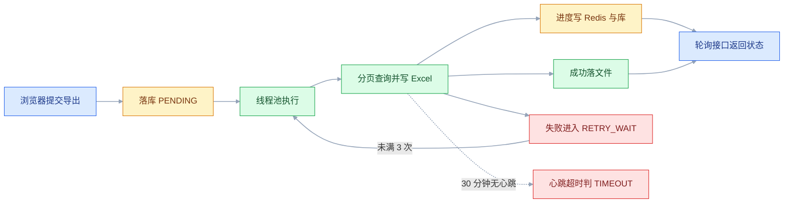
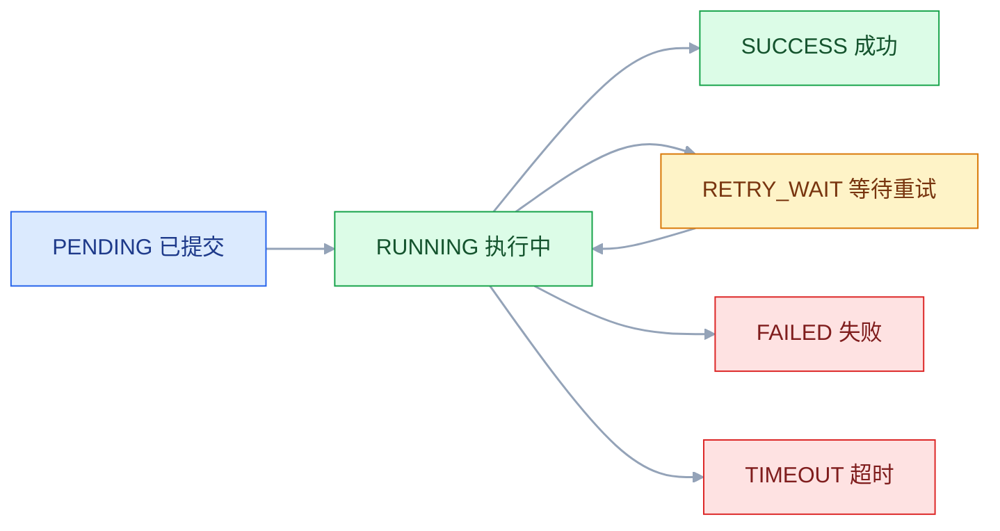
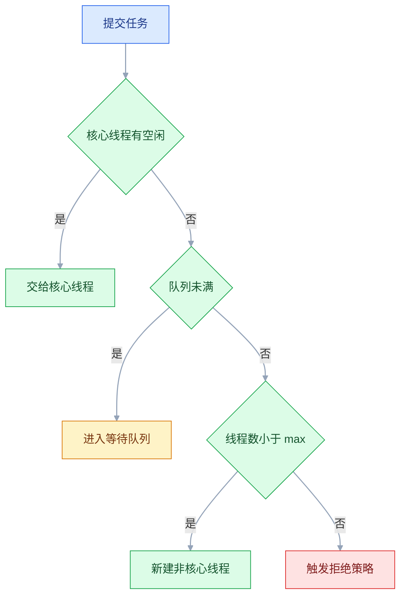

# 异步任务与定时任务

## 一、工程案例：把同步报表导出改成异步任务

**场景**：任务管理系统有一个「导出全部任务」接口 `POST /api/report/export`，同步实现要扫 10 万行、拼 Excel 落文件，实测 4 分 50 秒。Nginx `proxy_read_timeout` 默认 60 秒，网关更短，用户看到的永远是 504；用户重试一次，数据库又被全表扫一遍。

**目标**：接口 500ms 内返回 taskId；后台分页导出；前端轮询进度；失败按 30s / 60s / 120s 退避重试 3 次；超过 30 分钟没有心跳的任务判超时并清理；多实例部署时清理任务只跑一次。技术栈 Spring Boot 3.x + MyBatis-Plus + MySQL 8.0 + Redis 7.x（各组件版本以官方当前稳定版为准）。



### 1.1 任务表

```sql
CREATE TABLE t_report_task (
    id            BIGINT PRIMARY KEY AUTO_INCREMENT,
    user_id       BIGINT       NOT NULL,
    status        VARCHAR(16)  NOT NULL DEFAULT 'PENDING',
    progress      TINYINT      NOT NULL DEFAULT 0,
    retry_count   TINYINT      NOT NULL DEFAULT 0,
    next_retry_at DATETIME     NULL,
    heartbeat_at  DATETIME     NULL,
    file_path     VARCHAR(255) NULL,
    error_msg     VARCHAR(512) NULL,
    expire_at     DATETIME     NULL,
    created_at    DATETIME     NOT NULL DEFAULT CURRENT_TIMESTAMP,
    updated_at    DATETIME     NOT NULL DEFAULT CURRENT_TIMESTAMP ON UPDATE CURRENT_TIMESTAMP,
    KEY idx_status_updated (status, updated_at),
    KEY idx_retry (status, next_retry_at),
    KEY idx_user_created (user_id, created_at)
) ENGINE=InnoDB DEFAULT CHARSET=utf8mb4;
```

`status` 只有六个值：`PENDING`、`RUNNING`、`RETRY_WAIT`、`SUCCESS`、`FAILED`、`TIMEOUT`。**先落库再投递**，任务 id 就是前端轮询的凭据；反过来先投递再落库，一旦落库失败就会出现一个永远查不到的后台任务。

### 1.2 提交接口

线程池 `reportExecutor` 单独定义：核心 8、最大 16、队列 200、线程名前缀 `report-task-`、关闭时等待任务。**不要用容器默认执行器**，它的队列近似无界，等于没有背压。

```java
@Service
@RequiredArgsConstructor
public class ReportTaskService {
    private final ReportTaskMapper mapper;
    private final ThreadPoolTaskExecutor reportExecutor;

    public Long submit(Long userId) {
        ReportTask task = new ReportTask();
        task.setUserId(userId);
        task.setStatus("PENDING");
        mapper.insert(task);                                   // ① 先落库
        try {
            reportExecutor.execute(() -> run(task.getId()));    // ② 再投递
        } catch (TaskRejectedException e) {                     // Spring 把 RejectedExecutionException 包成了它
            mapper.markFailed(task.getId(), "队列已满");         // ③ 投递失败必须回写
            throw new BizException("系统繁忙，请稍后重试");
        }
        return task.getId();
    }
}
```

第 ③ 步最容易漏。队列满时 `ThreadPoolTaskExecutor` 抛的是 `TaskRejectedException`（`org.springframework.core.task` 包），它并不是 `RejectedExecutionException` 的子类，`catch` 写错就漏掉了。不回写 `FAILED`，这条任务会永远停在 `PENDING`，前端一直转圈。

### 1.3 执行与进度

```java
void run(Long taskId) {
    if (mapper.markRunning(taskId) == 0) return;   // 只有 PENDING/RETRY_WAIT 能进 RUNNING
    long lastId = 0;
    int written = 0;
    long total = Math.max(1, reportMapper.countAll());
    String path = "/data/reports/" + taskId + ".xlsx";
    try (ExcelWriter writer = EasyExcel.write(path, TaskRow.class).build()) {
        WriteSheet sheet = EasyExcel.writerSheet("tasks").build();
        while (true) {
            List<TaskRow> page = reportMapper.pageAfter(lastId, 5000);   // 游标分页，不用 offset
            if (page.isEmpty()) break;
            writer.write(page, sheet);
            lastId = page.get(page.size() - 1).getId();
            written += page.size();
            progressCache.put(taskId, written, total);                           // 进度写 Redis，轮询优先读它
            mapper.updateProgress(taskId, Math.min(99, written * 100 / total));  // 顺带刷心跳
        }
        mapper.markSuccess(taskId, path, LocalDateTime.now().plusDays(7));
        progressCache.evict(taskId);                                              // 终态以库为准，别让缓存停在 99
    } catch (Exception e) {
        handleFailure(taskId, e);
    }
}
```

两个细节：**用游标分页**（`WHERE id > #{lastId} ORDER BY id LIMIT 5000`），`OFFSET` 到十万行时会越翻越慢；**进度封顶 99**，100 只在文件真正落盘后由 `markSuccess` 写入，否则用户会看到一个 100% 却下载不到的进度条。

`markRunning` 的 SQL 本身就是幂等闸门：

```sql
UPDATE t_report_task SET status = 'RUNNING', heartbeat_at = NOW(), error_msg = NULL
WHERE id = #{id} AND status IN ('PENDING', 'RETRY_WAIT');
```

### 1.4 失败与重试

```java
private void handleFailure(Long taskId, Exception e) {
    ReportTask t = mapper.selectById(taskId);
    int next = t.getRetryCount() + 1;
    if (next > 3) {
        mapper.markFailed(taskId, truncate(e.getMessage(), 500));
        alertService.send("报表导出失败", "taskId=" + taskId);          // 只在重试耗尽时告警
        return;
    }
    long delay = 30L * (1L << (next - 1));                             // 30s → 60s → 120s
    mapper.markRetryWait(taskId, next, LocalDateTime.now().plusSeconds(delay));
}

@Scheduled(fixedDelay = 30_000)
public void redeliver() {
    for (Long id : mapper.selectRetryDue(100)) {                       // status='RETRY_WAIT' AND next_retry_at <= NOW()
        try {
            reportExecutor.execute(() -> run(id));
        } catch (TaskRejectedException ignore) {
            return;                                                    // 队列满，下一轮再来
        }
    }
}
```

重试**不在工作线程里 `sleep`**。睡 2 分钟等于白占一个线程，100 个失败任务就能把池子占死。把「什么时候重试」写进 `next_retry_at`，由一个 30 秒扫一次的调度器重新投递，线程立刻释放。这个类要开 `@EnableScheduling`，否则扫描方法只是普通方法，永远不会被调用。`markRetryWait` / `markFailed` 都要带 `WHERE status = 'RUNNING'`，否则同一个任务被投递两次时重试计数会被加两遍；线上再给 `delay` 加 ±20% 抖动，避免一批任务在同一秒集体重试。

注意重试记录本身也要写库：如果失败原因是数据库整体不可用，`handleFailure` 自己就写不进去，任务会停在 `RUNNING` 直到心跳超时被判 `TIMEOUT`。所以「重试」只兜得住下游偶发故障，库整体挂掉要靠恢复后的补偿扫描。

### 1.5 轮询接口

```java
@GetMapping("/{id}")
public Result<ReportTaskVO> status(@PathVariable Long id) {
    ReportTask t = mapper.selectById(id);
    if (t == null) return Result.fail(404, "任务不存在");    // 别让 from(null) 变成 500
    ReportTaskVO vo = ReportTaskVO.from(t);                 // id/status/progress/retryCount/errorMsg
    if ("SUCCESS".equals(t.getStatus()) && t.getFilePath() != null) {
        vo.setDownloadUrl("/api/report/task/" + id + "/download");
    }
    return Result.ok(vo);
}
```

同组的下载接口只在文件还在时返回内容，过期清理后同一 URL 给 410，前端据此提示「文件已过期，请重新导出」：

```java
@GetMapping("/{id}/download")
public ResponseEntity<Resource> download(@PathVariable Long id) {
    ReportTask t = mapper.selectById(id);
    if (t == null || !"SUCCESS".equals(t.getStatus()) || t.getFilePath() == null) {
        return ResponseEntity.status(HttpStatus.GONE).build();
    }
    return ResponseEntity.ok()
        .header(HttpHeaders.CONTENT_DISPOSITION, "attachment; filename=report.xlsx")
        .body(new FileSystemResource(t.getFilePath()));
}
```

进度先读 Redis（`report:progress:{id}`，Hash 存 `current/total/percent`，TTL 2 小时），读不到再查库。状态一律以库为准，成功时要把缓存键删掉，否则轮询会一直读到缓存里封顶的 99。Redis 只承担高频读，**终态必须落库**，否则 Redis 一重启，用户的任务就「消失」了。

### 1.6 超时与过期清理

```java
@Scheduled(fixedDelay = 60_000)
public void cleanup() {
    if (!lock.tryLock("report:cleanup", Duration.ofMinutes(5))) return;   // 多实例只跑一个（SET NX PX 加锁，Lua 校验 token 释放）
    log.info("清理开始");                                                   // 验收「只跑一次」看这一行
    try {
        for (ReportTask t : mapper.selectPendingStale(200)) {   // PENDING 且 created_at 超过 30 分钟：落库后、投递前进程挂掉的孤儿
            mapper.markPendingRetry(t.getId());                 // status='RETRY_WAIT', next_retry_at=NOW()，交给 redeliver
        }
        for (ReportTask t : mapper.selectStale(200)) {          // RUNNING 且 heartbeat_at 超过 30 分钟
            deleteQuietly(t.getFilePath());
            mapper.markTimeout(t.getId(), "超过 30 分钟无心跳");
        }
        for (ReportTask t : mapper.selectExpired(200)) {        // SUCCESS 且 expire_at < NOW()
            deleteQuietly(t.getFilePath());
            mapper.clearFile(t.getId());                        // 文件删掉，记录保留
        }
    } finally {
        lock.unlock("report:cleanup");
    }
}
```

第一段扫的是「落库成功但没投递出去」的孤儿：进程在 1.2 的 ① 和 ② 之间崩掉时，`PENDING` 记录没有任何线程会碰它，不补扫就一直挂在页面上。阈值要大于正常排队时长，否则会把还在排队的任务提前改成 `RETRY_WAIT`；转过去之后复用重试通道，`markRunning` 的条件更新保证重复投递不会真的跑两遍。

超时判定用**心跳**而不是创建时间：`updateProgress` 每次都会刷新 `heartbeat_at`，所以「跑了 40 分钟但一直在推进」的任务不会被误杀，只有真正卡死、连进度都不再写的任务才会被判超时。三段清理都带 `LIMIT 200`，避免一次锁住几万行；锁的 TTL 也要大于一轮清理的耗时，否则清理还没跑完锁就过期（见 2.11）。

### 1.7 关键输出

```bash
# ① 提交：立刻返回
time curl -s -X POST http://localhost:8080/api/report/export -H "Authorization: Bearer $TOKEN"
# {"code":0,"data":1024}
# real 0m0.214s

# ② 轮询：进度单调递增
curl -s http://localhost:8080/api/report/task/1024
# {"code":0,"data":{"id":1024,"status":"RUNNING","progress":37,"retryCount":0}}

# ③ 完成后拿到下载地址
# {"code":0,"data":{"id":1024,"status":"SUCCESS","progress":100,
#  "downloadUrl":"/api/report/task/1024/download"}}

# ④ 模拟故障：趁 1024 还在跑，杀掉它正在执行的长查询连接（库本身正常，失败信息才写得回去）
CONN=$(docker exec mysql mysql -uroot -pRoot@123456 -N -e \
  "SELECT id FROM information_schema.processlist WHERE db='appdb' AND info LIKE 'SELECT%' ORDER BY time DESC LIMIT 1")
docker exec mysql mysql -uroot -pRoot@123456 -e "KILL $CONN;"
docker exec mysql mysql -uroot -pRoot@123456 appdb -e \
  "SELECT id,status,retry_count,next_retry_at FROM t_report_task WHERE id=1024;"
# | 1024 | RETRY_WAIT | 1 | 2026-10-21 10:32:30 |

# ⑤ 模拟卡死：把心跳改到 40 分钟前，等下一轮清理
docker exec mysql mysql -uroot -pRoot@123456 appdb -e \
  "UPDATE t_report_task SET status='RUNNING', heartbeat_at = NOW() - INTERVAL 40 MINUTE WHERE id=1025;"
# 一分钟后：| 1025 | TIMEOUT | 0 | 超过 30 分钟无心跳 |
```

### 1.8 验收

| 检查项 | 命令或检查 | 通过标准 |
|---|---|---|
| 提交耗时 | `time curl -X POST .../export` | 小于 500ms，返回 taskId |
| 记录先落库 | 提交后立刻查库 | 有 `PENDING` 记录，id 与返回值一致 |
| 队满回写 | 并发提交超过 16 线程 + 200 队列 | 被拒任务返回「系统繁忙」，记录是 `FAILED` 不是 `PENDING` |
| 进度可见 | 连续三次轮询 | `progress` 单调不减，最终 100 |
| 成功可下载 | `curl -I .../download` | 200，`Content-Length` 大于 0 |
| 失败重试 | 见 1.7 ④，杀掉执行中的连接 | `retry_count` 递增，状态 `RETRY_WAIT` |
| 重试上限 | 连续杀连接 4 次 | 状态 `FAILED`，告警只发 1 次 |
| 超时判定 | 改 `heartbeat_at` 后等清理 | 状态 `TIMEOUT`，临时文件被删 |
| 文件过期 | 改 `expire_at` 后等清理 | `file_path` 为空，下载返回 410 |
| 清理单实例 | 起两个实例看日志 | 同一轮只有一行「清理开始」 |
| 孤儿任务恢复 | 把 `created_at` 改到 40 分钟前 | 下一轮清理转 `RETRY_WAIT` 并被重新执行 |
| 重启可恢复 | 留一条 `next_retry_at` 已到期的 `RETRY_WAIT` 再重启 | 重启后 30 秒内被重新投递 |
| 终态不可逆 | 手动对 `SUCCESS` 记录调用 `run` | `markRunning` 影响行数为 0，不重复执行 |
| 日志可追踪 | 搜线程名 `report-task-` | 每次执行有 taskId、耗时、结果 |

---

## 二、高频问答：会卡住你的地方，也是面试最常问的

### 2.1 加了 `@Async`，接口还是同步返回

**现场**

在方法首行打印 `Thread.currentThread().getName()`，和接口线程名相同就是没异步。

```java
@Service
public class NotifyService {
    @Async
    public void send(String to) { log.info("线程={}", Thread.currentThread().getName()); }

    public void wrong(String to) { this.send(to); }        // ✘ 自调用，代理被绕过
}

@Service
@RequiredArgsConstructor
public class OrderService {
    private final NotifyService notifyService;
    public void right(String to) { notifyService.send(to); }   // ✔ 跨 Bean 调用
}
```

**要点**

- `@Async` 不是语法糖，是「调用方拿到一个代理对象，代理把方法体丢进线程池」。
- `this.send()` 拿的是原始对象，代理根本没参与，注解等于注释。
- 失效的四种：同类自调用、方法 `private/final/static`、类不是 Bean、漏了 `@EnableAsync`。
- 返回类型得是 `void`、`Future` 或 `CompletableFuture`，否则照样异步执行、只是拿不到结果。

**追问**

- 为什么自调用不行？→ 代理只在外部调用时介入，同类内部调用走不到代理。
- 注入自身能解决吗？→ 能，注入进来的仍是代理对象。
- 注解生效了但返回值是 null？→ 返回类型不是那三种，结果被丢弃。

### 2.2 三个实例，凌晨 2 点的邮件发了三封

**现场**

`kubectl get pods` 看副本数；日志里同一秒出现三条「开始执行」。

**要点**

- 单机调度器的语义就是「本进程到点执行」，它不知道别的进程存在。
- 每个实例都注册了同一个 `@Scheduled`，各自到点执行，实例之间没有任何协调。
- 多实例要么加分布式锁、要么用调度框架、要么只让一个实例开调度（`@ConditionalOnProperty`）。
- 核实方式是数日志条数，而不是看 cron 表达式。

**追问**

- `@Scheduled` 配 Redis 锁够用吗？→ 小规模够，锁的 TTL 和续期要单独处理。
- 只让一个实例开调度有什么风险？→ 那个实例挂了就没人触发，得有兜底。
- K8s CronJob 为什么没这问题？→ 触发权在集群层，不由每个副本各自算。

### 2.3 好几个定时任务，只有一个在跑

**现场**

`jstack` 找 `scheduling-1`，看它卡在哪个方法；或给每个任务打印开始时间，观察是否被推迟。

```yaml
spring:
  task:
    scheduling:
      pool:
        size: 4                    # 默认 1，按「可能同时到点的任务数」设
      thread-name-prefix: sched-
```

**要点**

- Spring 的调度线程池默认只有 1 个线程，前一个长任务占着，后面的全部排队。
- 任务确实被触发了，只是没有线程执行。
- `fixedRate` 任务还会因此「补跑」——前一个跑完后连续执行多次。
- 线程数按「可能同时到点的任务数」设，不是拍脑袋调大。

**追问**

- `fixedRate` 和 `fixedDelay` 在这里表现一样吗？→ 前者补跑，后者从结束时间重新计时。
- 线程池调大就能并行同一任务吗？→ 不能，同一个 `@Scheduled` 方法始终只有一条执行序列。
- 怎么确认是排队而不是没触发？→ 打印开始时间，看是否被整体推迟。

### 2.4 异步方法里拿不到当前登录用户

**现场**

异步方法里打印 `SecurityContextHolder.getContext().getAuthentication()` 和 `MDC.get("traceId")`，都是 null。

**要点**

- 异步不是「同一个请求换个地方跑」，而是一个全新线程，没有请求上下文。
- `ThreadLocal`（`SecurityContext`、`RequestContextHolder`、MDC 里的 traceId）绑定在原线程上，换线程就丢了。
- 正确做法是把需要的值**当参数传进去**，或用 `TaskDecorator` 在提交时复制 MDC。
- `TaskDecorator` 只复制 MDC，`SecurityContext` 要另外显式传递。

```java
executor.setTaskDecorator(runnable -> {
    Map<String, String> ctx = MDC.getCopyOfContextMap();
    return () -> {
        if (ctx != null) MDC.setContextMap(ctx);
        try { runnable.run(); } finally { MDC.clear(); }
    };
});
```

**追问**

- traceId 为什么也一起丢了？→ 同样绑在 MDC 上，换线程就没了。
- 复制完为什么还要清？→ 线程池复用线程，不清会污染下一个任务。
- 虚拟线程也一样吗？→ 一样，每个任务新线程，仍需显式传播。

### 2.5 异步任务查不到主线程刚写的数据

**现场**

在异步方法里查一次、在主线程 `commit` 后查一次，对比结果。

**要点**

- 数据库里最终是有数据的，只是「此刻还看不见」：主线程事务还没提交。
- 异步线程用另一个连接，读不到未提交的数据。
- 把调用放到事务提交之后，或直接用 `@TransactionalEventListener(phase = AFTER_COMMIT)`。
- 异步任务本身要写库，它需要自己的事务，别指望继承主线程的。

```java
TransactionSynchronizationManager.registerSynchronization(new TransactionSynchronization() {
    @Override public void afterCommit() { reportExecutor.execute(() -> run(taskId)); }
});
```

**追问**

- 为什么在 `@Transactional` 方法里调 `@Async` 必踩？→ 提交发生在方法返回之后。
- 异步线程能看到未提交的数据吗？→ 不能，隔离级别下读不到。
- 换成 `REQUIRES_NEW` 行不行？→ 解决不了可见性，仍读不到别人未提交的数据。

### 2.6 任务失败了，日志里什么都没有

**现场**

搜日志关键词 `Unexpected exception occurred invoking async method`。

**要点**

- `void` 返回的 `@Async` 方法抛异常时，异常交给 `AsyncUncaughtExceptionHandler`，默认只打一条日志。
- 返回 `Future` 的，不调用 `get()` 就永远看不到异常。
- 异常死在另一个线程里，不会传回调用方，必须显式兜底。
- 更稳的做法是业务代码自己 `try/catch` 并写执行记录，不依赖框架兜底。

```java
@Override
public AsyncUncaughtExceptionHandler getAsyncUncaughtExceptionHandler() {
    return (ex, method, params) -> {
        log.error("异步任务异常 method={} params={}", method.getName(), params, ex);
        alertService.send("异步任务异常", method.getName() + ": " + ex.getMessage());
    };
}
```

**追问**

- 为什么 `catch` 不到？→ 异常发生在另一个线程，不在调用栈上。
- `CompletableFuture` 也一样吗？→ 一样，异常封在 future 里，没人 `join` 就没人看见。
- 默认处理器能改成往外抛吗？→ 不能跨线程抛，只能记录或告警。

### 2.7 队列越积越多，最后 OOM

**现场**

`executor.getThreadPoolExecutor().getQueue().size()`、`getActiveCount()`，配合堆监控看增长曲线。

**要点**

- Spring Boot 默认执行器的队列容量近似无界（`Integer.MAX_VALUE`），任务只进不出。
- 无界队列让 `maxPoolSize` 永远不触发——线程数到 core 之后就只往队列里塞。
- 调大 `maxPoolSize` 只是延后爆掉的时间，真正的解法是**有界队列 + 明确的拒绝策略 + 入口限流**。
- `CallerRunsPolicy` 能形成背压，但它会让提交任务的 Web 线程亲自干活，在接口路径上要慎用。

**追问**

- 为什么调大 `maxPoolSize` 没用？→ 队列没满就不会扩容到 max。
- `AbortPolicy` 拒绝之后怎么办？→ 回写 `FAILED` 并给用户明确提示，不能静默丢。
- 队列长度设多少？→ 按可接受的排队延迟和内存倒推，并把队列长度作为告警指标。

### 2.8 cron 表达式在 Spring 里不生效

**现场**

用 `CronExpression.parse(expr).next(LocalDateTime.now())` 连续打印 5 次触发时间。

**要点**

- Linux crontab 是**五段**（分 时 日 月 周），Spring 是**六段**（秒 分 时 日 月 周）。
- Quartz 的星期还是 1-7，且 1 是周日。
- 两套标准的字段数和取值范围都不同，照抄必然错位。
- 核实方式不是盯表达式看，而是让解析器算出未来几次执行时间。

**追问**

- 日和周能同时写具体值吗？→ Quartz 会直接报错，要求其中一个用 `?`。
- 为什么 Spring 也认 `?`？→ 它支持 Quartz 风格的扩展符号。
- 从 crontab 迁过来最容易错哪？→ 秒被当成分钟，整体左移一段。

### 2.9 明明写了 2 点，任务却在 10 点跑

**现场**

容器里 `date`、`jinfo -sysprops` 看 `user.timezone`、`SELECT @@global.time_zone, NOW()` 三处对比。

**要点**

- `cron = "0 0 2 * * ?"` 只说明「2 点」，没说「哪个时区的 2 点」。
- 容器镜像常是 UTC，JVM、MySQL、cron 注解各用各的时区，差 8 小时。
- 显式指定 `zone`，同时给容器 `TZ`、JVM `-Duser.timezone`、连接串时区三处对齐。
- 差 8 小时的那一处，就是元凶。

```java
@Scheduled(cron = "0 0 2 * * ?", zone = "Asia/Shanghai")
```

**追问**

- 只配容器 `TZ` 够吗？→ 不够，JVM 和数据库连接各有自己的时区来源。
- 为什么容器里默认是 UTC？→ 基础镜像的默认值，和宿主机时区无关。
- 时间该存 UTC 还是本地？→ 存 UTC，展示层再转，跨时区才不会错。

### 2.10 一失败就重试，把下游打挂了

**现场**

对比失败数与重试请求数，看重试 QPS 是否随失败数线性放大。

**要点**

- 同步紧循环重试会放大流量：1000 个任务同时失败，立刻产生 3000 次重试。
- 下游从「慢」变成「死」，重试就成了雪崩加速器。
- 重试的前提是「偶发故障」，不是「下游已经过载」。
- 必须加退避、加抖动、设上限，并且只重试可恢复的错误（超时、503），不重试参数错误（400）。

**追问**

- 重试次数越多越可靠吗？→ 不是，它只是在「偶发故障」和「快速失败」之间买时间。
- 为什么要加抖动？→ 避免一批任务在同一秒集体重试。
- 重试预算怎么定？→ 3 次、总时长不超过 5 分钟，超了进失败队列并告警。

### 2.11 加了 Redis 锁，还是跑了两次

**现场**

日志里对比「加锁时间 + TTL」与「任务结束时间」；`PTTL lock:job:xxx` 看剩余时间。

**要点**

- 分布式锁保证的是「同一时刻只有一个持有者」，不是「整个任务期间只有一个执行者」。
- 锁 TTL 短于任务耗时，任务没跑完锁就过期，第二台拿到锁。
- 释放时没校验 token，会把别人的锁删了。
- 要保证「同一时刻只有一个持有者」，TTL 必须大于最长执行时间，或在执行期间续期；释放必须用 Lua 比对 token 后删除。

**追问**

- TTL 该设多长？→ 大于最长执行时间，估不准就用看门狗续期。
- 为什么释放要用 Lua？→ 比对 token 和删除必须是一个原子操作。
- Redisson 看门狗解决什么？→ 自动续期，省掉人估 TTL。

### 2.12 发布之后，跑到一半的任务全没了

**现场**

`kubectl describe pod` 看退出时间；日志搜 `Shutting down ExecutorService`。

**要点**

- 滚动发布一定会杀进程，问题不是「怎么不杀」，而是「杀了之后任务怎么办」。
- 收到 SIGTERM 后进程退出，线程池里的任务被中断。
- K8s `terminationGracePeriodSeconds` 默认 30 秒，长任务根本等不到。
- 线程池要开 `waitForTasksToCompleteOnShutdown`，K8s 要配 `preStop` 和足够的宽限期，长任务必须做成可恢复。

**追问**

- 宽限期调大就行吗？→ 不行，宽限期不可能无限长，长任务必须可恢复。
- 为什么还要 `preStop`？→ 让负载均衡先摘流量，避免新请求继续进来。
- 可恢复靠什么？→ 幂等重跑，或记录断点（已处理到哪个 id）下次接着跑。

### 2.13 超时重试之后，一笔操作做了两遍

**现场**

按业务号或 `requestId` 数下游流水，看是否两条成功记录；再对比任务日志里两次执行的开始时间。

**要点**

- 网络超时只能证明「没等到结果」，不能证明「没执行」。
- 可能已经成功、只是响应没回来，重试等于把同一件事再做一遍，这是 at-least-once 的必然结果。
- 重试的前提是操作可重复执行，而不是上次失败。
- 正确做法是给每次执行带幂等键——唯一索引、状态机条件更新、下游幂等接口，选一个即可。

**追问**

- 为什么唯一键冲突不该重试？→ 冲突说明已经执行过。
- 状态机条件更新为什么能同时防并发？→ 影响行数为 0 就跳过，只有一个请求能成功。
- 实在做不到幂等怎么办？→ 只对查询类操作自动重试，写操作转人工。

---

## 三、核心知识：从零开始要建立的东西

### 3.1 同步与异步的判定边界

异步不是「性能优化」，是**用一致性换响应时间**。判定顺序只有三步：

| 判定问题 | 是 | 否 |
|---|---|---|
| 用户要立刻看到结果吗 | 同步处理 | 看下一行 |
| 失败会造成资损或数据错乱吗 | 持久化队列（重试、死信、可查） | 看下一行 |
| 是「到点执行」吗 | 定时任务 | 线程池就够 |

异步一旦引入，就多了三个必须自己解决的问题：任务丢了怎么办、重复执行怎么办、出问题怎么查。没有这三样，异步只是把故障从「接口报错」变成「数据悄悄不对」。

### 3.2 任务状态机

任务系统的核心不是线程池，是**状态机**。状态合法，重复执行自然被挡住。



三条规则：

1. 进入 `RUNNING` 必须带条件：`WHERE status IN ('PENDING','RETRY_WAIT')`，影响行数为 0 就放弃。
2. 终态（`SUCCESS`/`FAILED`/`TIMEOUT`）不可再变，任何更新都要带 `WHERE status NOT IN (终态)`。
3. 状态和业务结果在**同一个事务**里改，否则会出现「文件已生成但状态还是 RUNNING」。

> **面试**：常问「任务系统为什么要做状态机？」答：状态合法就挡住了重复执行，进 RUNNING 必须带条件更新。

### 3.3 线程池的资源模型



关键结论：**只有队列满了才会扩容到 `maxPoolSize`**。所以「大队列 + 大 max」的组合实际上很少扩容，任务全在队列里排队。队列容量才是决定延迟和内存的旋钮。

| 参数 | 作用 | 常见取值 |
|---|---|---|
| `corePoolSize` | 常驻线程数 | IO 密集 ≈ 核数 × 2~4 |
| `maxPoolSize` | 上限 | 核心数的 2~4 倍 |
| `queueCapacity` | 等待队列 | 几十到几百，**必须有界** |
| `keepAliveSeconds` | 非核心线程回收 | 60 秒 |
| `RejectedExecutionHandler` | 满了怎么办 | 接口路径用 `AbortPolicy` 自己兜底，内部批处理可用 `CallerRunsPolicy` |

表里是经验起点，不是框架默认值，最终要按压测结果校准。另外，`ThreadPoolExecutor` 是**先入队、队列满了才建线程**；队列无界时，线程数永远停在 core。

> **面试**：常问「线程池为什么必须用有界队列？」答：无界队列让 `maxPoolSize` 永远不触发，任务只进不出，最后 OOM。

### 3.4 Spring 代理与注解生效条件

`@Async` 和 `@Transactional` 一样，靠代理对象在方法调用前后插入逻辑。代理要生效，必须满足「调用方拿到的是代理」。

| 失效写法 | 原因 | 正确写法 |
|---|---|---|
| `this.send()` 同类自调用 | 绕过代理 | 抽到独立 Bean，或注入自身 |
| `private` / `static` / `final` 方法 | 代理无法覆盖 | 改成 `public` 非 final |
| 类不是 Spring Bean | 没有代理对象 | 加 `@Service` 等注解 |
| 漏 `@EnableAsync` | 注解没被处理 | 启动类或配置类加上 |
| 返回类型不是 `void/Future/CompletableFuture` | 注解生效但返回值被丢弃 | 用这三种返回类型 |

### 3.5 三种触发时间语义

| 方式 | 计时起点 | 任务耗时超过间隔时的表现 |
|---|---|---|
| `fixedRate` | 上一次**开始**时间 | 下一次到点就立刻开始（补跑），同一任务不会并发 |
| `fixedDelay` | 上一次**结束**时间 | 永远串行，间隔从结束算 |
| `cron` | 日历时刻 | Spring 直接跳过错过的时间点；Quartz 由 misfire 策略决定 |

举例：任务耗时 15 秒，`fixedRate = 10_000`。第一次结束后，下一次的预定时间已经过点，于是立刻开始，表现为「连续补跑」；`fixedDelay = 10_000` 则是第 25 秒才开始下一次。同一个 `@Scheduled` 方法始终只有一条执行序列，把调度线程池调大只影响不同任务之间能否并行——除非方法内部又把活丢给了别的线程池。

选型：轮询用 `fixedDelay`，要求固定节拍且任务很短用 `fixedRate`，和人有关的时刻用 `cron`。

### 3.6 cron 的字段与标准差异

**标准五段式**（Linux crontab、大多数运维工具）：

```text
分 时 日 月 周
0  2  *  *  *     每天 02:00
*/5 * * * *       每 5 分钟
30 9 * * 1-5      周一到周五 09:30
```

| 实现 | 字段数 | 星期取值 | 特殊符号 |
|---|---|---|---|
| Linux crontab | 5 | 0-7，0 和 7 都是周日 | `*` `,` `-` `/` |
| Spring `@Scheduled` | 6（秒开头） | 0-7，0 和 7 都是周日 | 另支持 `?` `L` `W` `#` |
| Quartz | 6 或 7（可选年） | 1-7，**1 是周日** | 另支持 `?` `L` `W` `#` |

最常踩的三个坑：把 Spring 的六段表达式直接粘进 crontab，秒被当成分钟、整体错位；在「日」和「周」同时写具体值（Quartz 会直接报错，要求其中一个用 `?`，跨框架复制时统一只留一个最稳）；把 Quartz 的 `1` 当成周一（其实是周日）。表达式对不对，让解析器算未来五次最可靠。

表中 Spring 一行是 5.3 及以后的行为，细节以官方当前稳定版文档为准。

### 3.7 分布式单次执行的实现

| 方案 | 机制 | 代价 |
|---|---|---|
| Redis 锁 | `SET key token NX PX ttl`，Lua 比对后删除 | 依赖 Redis，TTL 与任务时长要匹配 |
| 数据库抢占 | 条件更新锁行，影响行数为 1 才执行 | 依赖数据库，锁行有性能成本 |
| 调度框架 | Quartz 集群或 XXL-Job 统一触发 | 多一个组件要运维 |

数据库抢占的 SQL 形态：

```sql
UPDATE t_job_lock
SET owner = #{instance}, locked_until = DATE_ADD(NOW(), INTERVAL 10 MINUTE)
WHERE job_name = #{job} AND (locked_until IS NULL OR locked_until < NOW());
-- 影响行数 = 1 表示抢到
```

Redis 锁的三个必要条件：**加锁原子**（`SET NX PX`，不要 `SETNX` + `EXPIRE` 两步）、**释放校验**（Lua 比对 token）、**TTL 覆盖执行时间**（或执行期间续期）。

> **面试**：常问「多实例定时任务怎么保证只跑一次？」答：Redis 锁、数据库抢占或调度框架，锁的 TTL 必须覆盖执行时间。

### 3.8 Quartz 的对象模型与集群

| 对象 | 职责 |
|---|---|
| `Job` | 任务逻辑，实现 `execute` |
| `JobDetail` | 任务定义与参数，一个 Job 类可以有多个 Detail |
| `Trigger` | 触发规则（cron 或 simple），决定「何时」 |
| `Scheduler` | 把 JobDetail 和 Trigger 关联起来并按时间触发 |

```yaml
spring:
  quartz:
    job-store-type: jdbc
    properties:
      org.quartz.jobStore.isClustered: true
      org.quartz.scheduler.instanceId: AUTO
      org.quartz.jobStore.clusterCheckinInterval: 20000
```

集群模式靠数据库里的 `QRTZ_*` 表加行锁协调，同一触发点只有一个实例抢到。任务定义存在库里，所以支持运行时增删改和重启不丢。代价是要建表、要理解 misfire（错过的触发点怎么补），比 `@Scheduled` 重得多。

### 3.9 队列型框架的通用组件

Celery、BullMQ、XXL-Job 长得不一样，骨架是同一套：

| 角色 | Celery | BullMQ | XXL-Job |
|---|---|---|---|
| 投递方 | `delay()` / `apply_async()` | `queue.add()` | 调度中心 |
| 队列 | Broker（Redis / RabbitMQ） | Redis | 调度中心 + 数据库 |
| 消费方 | Worker 进程 | Worker 进程 | 执行器（嵌在业务应用里） |
| 定时源 | Beat | Job Scheduler | 调度中心 cron |
| 结果 | Result Backend | `job.returnvalue` | 执行日志 |

Celery 的几个关键开关（行为以官方当前稳定版为准）：

```python
app.conf.update(
    task_acks_late=True,             # 执行完才 ack，worker 崩溃会重投
    worker_prefetch_multiplier=1,    # 一次只预取一个，避免分配不均
    task_time_limit=30 * 60,         # 硬超时，超时杀进程
    task_soft_time_limit=25 * 60,    # 软超时，抛异常给任务自己清理
    timezone="Asia/Shanghai",
    enable_utc=False,
)
```

`acks_late` 把「任务不丢」换成了「任务可能重复」——worker 在 ack 之前崩溃，消息会重新投递。所以它必须和幂等一起用，单开这一项等于制造重复执行。

### 3.10 幂等的实现层次

| 层次 | 做法 | 适用 |
|---|---|---|
| 唯一键 | 业务表加唯一索引，重复插入直接失败 | 导入、写流水 |
| 状态机 | `UPDATE ... WHERE status = 'PENDING'`，影响行数为 0 就跳过 | 订单流转、任务执行 |
| 去重表 | `t_idempotent(biz_key UNIQUE)`，先插入再去重 | 通用 |
| 业务令牌 | 每次操作带一个唯一 requestId | 跨服务调用 |

状态机版本最常用，因为它同时解决了「重复执行」和「并发执行」：

```java
int affected = orderMapper.closeIfCreated(orderId);   // UPDATE ... SET status='CANCELLED' WHERE id=? AND status='CREATED'
if (affected == 0) {
    log.info("订单已处理过，跳过: {}", orderId);
    return;
}
```

> **面试**：常问「幂等最常用的做法是什么？」答：状态机条件更新，`WHERE status='PENDING'`，影响行数为 0 就跳过。

### 3.11 重试预算与退避曲线

退避公式：`delay = base × 2^(n-1) + random(0, base)`。加随机抖动是为了避免大批任务在同一毫秒一起重试。

| 错误类型 | 是否重试 | 原因 |
|---|---|---|
| 连接超时、503 | 是 | 偶发，退避后大概率恢复 |
| 400、参数校验失败 | 否 | 重试一万次也一样 |
| 401、403 | 否 | 凭据问题，要人改配置 |
| 唯一键冲突 | 否 | 说明已经执行过 |
| 数据库死锁 | 是，但只重试 1~2 次 | 事务回滚后可重来 |

重试要有**总预算**：3 次、总时长不超过 5 分钟。超过预算就进失败队列并告警，别让一个任务在系统里飘一天。重试次数不是越多越好，它只是在「偶发故障」和「快速失败」之间买时间。

### 3.12 超时与取消机制

| 类型 | 表现 | 用途 |
|---|---|---|
| 软超时 | 抛异常，任务可捕获并清理 | 保存中间结果、释放资源 |
| 硬超时 | 直接杀进程 / 杀线程 | 兜底，防止永久占用 |
| 外部调用超时 | HTTP / DB 客户端自己的超时 | 最常见，必须逐层设置 |

超时必须**逐层放大**：HTTP 客户端 10 秒 < 单条 SQL 30 秒 < 任务总超时 30 分钟。外层大于内层，内层才有机会先报出自己的错误；反过来外层先超时，日志里只剩一句「任务超时」，不知道卡在哪一步。

`Future.cancel(true)` 只是发一个中断信号（`FutureTask` 才会发，`CompletableFuture.cancel` 不会），代码不检查中断就停不下来。所以长循环里要主动检查：

```java
if (Thread.currentThread().isInterrupted()) {
    throw new InterruptedException("任务被取消");
}
```

### 3.13 进度与结果的存储

| 数据 | 存哪 | 生命周期 |
|---|---|---|
| 实时进度 | Redis Hash | 分钟级，带 TTL |
| 任务状态 | 数据库 | 永久，终态必须落库 |
| 结果文件 | 对象存储 / 本地盘 | 按业务定，通常 7 天 |
| 执行日志 | 数据库或日志系统 | 30 天 |

进度写入别太频繁：10 万行每行写一次 Redis，Redis 先扛不住。按批写（每 1000 行或每 2 秒一次）就够前端看了。前端用轮询最简单，2 秒一次；要求实时再上 SSE，WebSocket 对「单向进度」是过度设计。

### 3.14 执行记录与告警指标

每次执行至少记六列：任务名、开始时间、结束时间、状态、耗时、错误摘要。

| 指标 | 含义 | 告警阈值示例 |
|---|---|---|
| 失败率 | 失败次数 / 总次数 | 连续 3 次失败 |
| 耗时 P99 | 慢任务先兆 | 超过历史均值 3 倍 |
| 队列积压 | 消费跟不上生产 | 持续 10 分钟大于 1000 |
| 心跳缺失 | 任务卡死 | 超过 30 分钟无更新 |

告警只在**重试耗尽**时发一次。每次失败都发，一次下游故障能给你几百条消息，真正的事故反而被淹没。

### 3.15 优雅停机与任务恢复

```yaml
spring:
  task:
    execution:
      shutdown:
        await-termination: true
        await-termination-period: 120s
```

停机的顺序是：停止接收新请求 → 关闭线程池入口 → 等已提交任务跑完 → 超时强杀。K8s 上还要配合 `preStop` 睡眠和 `terminationGracePeriodSeconds`，否则宽限期一到，SIGKILL 不会给线程池任何机会。

这段配置只管 Spring Boot 自动装配的 `applicationTaskExecutor`；自己定义的 `reportExecutor` 要显式 `setWaitForTasksToCompleteOnShutdown(true)` 和 `setAwaitTerminationSeconds(120)`，否则关容器时它不会等。

宽限期不可能无限长，所以**长任务必须可恢复**：要么幂等重跑，要么记录断点（已处理到哪个 id）下次接着跑。指望「停机时一定跑完」是不现实的。

### 3.16 任务系统的容量估算

用 Little 定律估算并发：**平均并发 = 到达率 × 平均耗时**。

例：每天 2 万次导出，80% 集中在 9:00-11:00（7200 秒），平均耗时 40 秒。

```text
峰值到达率 = 20000 × 0.8 / 7200 ≈ 2.2 次/秒
平均并发   = 2.2 × 40 ≈ 89
按 P95 耗时 120 秒算 = 2.2 × 120 ≈ 264
```

按平均 40 秒算，1.2 里的 16 个线程每秒只能处理 0.4 个，而峰值到达 2.2 个/秒；按 P95 120 秒算只有 0.13 个/秒。差距不会「排队几分钟」后自行消化，队列会一直涨下去。三个选择：加 worker（成本最高）、入口限流（用户体验变差但系统稳）、把大任务拆小并行（复杂度上升）。**先算清楚再调参**，凭感觉把线程数翻倍只会让数据库先倒下。

---

## 四、冷门知识汇总

| 知识点 | 为什么冷门 | 用到时的关键词 |
|---|---|---|
| Quartz misfire 策略 | 只有集群模式且任务被阻塞时才触发，平时看不到 | `withMisfireHandlingInstructionDoNothing`、`MISFIRE_INSTRUCTION_FIRE_ONCE_NOW` |
| ShedLock | 有 Redis 后很少选它，但没 Redis 的环境很好用 | `@SchedulerLock`、`shedlock` 表、`lockAtMostFor` |
| Spring Batch | 手写循环能跑通时不会想到它 | `Job`、`Step`、`chunk`、重启续跑、`SkipPolicy` |
| Redisson 看门狗 | 自己写 `SET NX PX` 时不涉及，用 Redisson 才自动续期 | `lockWatchdogTimeout`、看门狗、`RLock.tryLock` |
| 线程池指标 | 出过事才会补 | `executor.active`、`executor.queued`、Micrometer |
| DAG 任务编排 | 单任务调度够用时不需要 | Airflow、DolphinScheduler、PowerJob、补数 |
| 延迟消息 | 用 `sleep` 或轮询也能实现，量小看不出差别 | RabbitMQ 延迟插件、RocketMQ 延迟级别、时间轮 |
| 死信队列 | 正常流程永远用不到 | DLQ、`x-dead-letter-exchange`、重试耗尽转人工 |
| `SELECT FOR UPDATE SKIP LOCKED` | 用 MQ 就不会碰，小系统当队列很实用 | 行锁跳过、多消费者抢占、MySQL 8.0 |
| K8s CronJob 的并发策略 | 上 K8s 且用原生 CronJob 才遇到 | `concurrencyPolicy: Forbid`、`startingDeadlineSeconds` |
| BullMQ 的 Job Scheduler | v5 之后 repeatable job 的写法变了 | `upsertJobScheduler`、`repeat`、以官方当前稳定版为准 |
| `@DisallowConcurrentExecution` | 只在同一个 JobDetail 被重复触发时才起作用，平时感知不到 | 禁止并发、Quartz 注解、串行执行 |
| XXL-Job 分片广播 | 只有数据量大到要并行才用 | `getShardIndex`、`getShardTotal`、路由策略 |
| 任务结果的预签名 URL | 小系统直接走应用下载 | S3 `presign`、OSS `generatePresignedUrl`、过期时间 |
