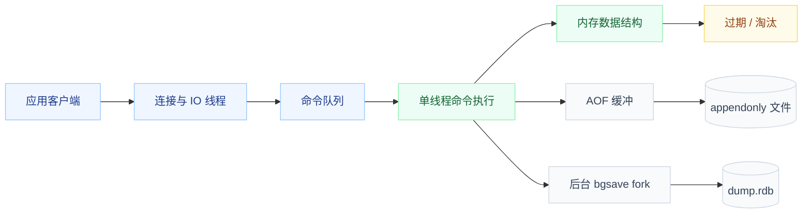
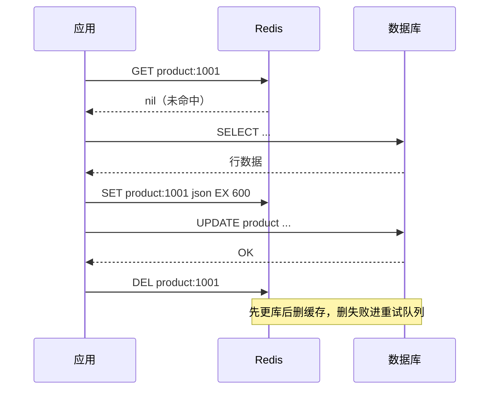

# Redis缓存

> 这篇从 Redis 的单线程内存模型讲起，经过安装配置、数据类型与底层编码、key 与过期管理、内存淘汰、RDB/AOF 持久化、缓存模式与一致性、分布式锁，最后落到上线检查、现场排障和一个"商品详情页从数据库直查改成 Redis 旁路缓存"的完整演练。
>
> 学完能独立部署并加固一个 Redis 实例，按数据特征选对类型与编码，设计不会穿透、击穿、雪崩的缓存链路，写出不会误删别人锁的分布式锁，并在内存告警、bigkey、热 key、主从切换时按第一条命令定位。

## 一、定位与内存模型

Redis 是一个把数据放在内存里的键值数据库，所有命令在单线程里串行执行——这条设计决定了它的一切：单条命令天生原子、没有锁竞争、延迟稳定在微秒级，同时任何一条慢命令都会堵住所有客户端。



"单线程"指的是命令执行。Redis 6.0 起网络读写可以多线程（`io-threads`），7.x 默认仍是 1；真正要关心的不是 IO，而是执行线程上有没有 `KEYS *`、大 `HGETALL`、`DEL` 大 key 这类占住时间片的操作。

| 维度 | Redis | Memcached |
|---|---|---|
| 数据结构 | String/Hash/List/Set/ZSet/Stream 等 | 仅 key-value |
| 持久化 | RDB + AOF | 无 |
| 过期/淘汰 | 惰性 + 定期，8 种策略 | slab 分配 + LRU |
| 分布式能力 | 主从、哨兵（Sentinel）、Cluster | 客户端分片 |
| 单条命令原子性 | 是（含多键 Lua） | 单 key 操作 |

选型边界：需要缓存 + 排行榜 + 计数器 + 简单队列 + 分布式锁，选 Redis；只需要纯粹的 `get/set` 且内存极紧，Memcached 仍有价值；需要强一致、可查询、可事务，回到关系库，Redis 只做加速层。

版本基线为 2026-11-13：**Redis 7.4 LTS 与 Redis 8.x**。两者协议与核心命令兼容；8.0 起把 JSON、时序、搜索、Bloom 等原 Stack 模块内置，采用 AGPLv3 三许可，7.4 仍是 RSALv2/SSPLv1。对许可证敏感的项目可以用 Valkey（BSD 分支），命令层几乎等价。本机没有 Redis 服务，本文所有命令输出均为标注"示例"的预期结果，不是实测。

> 边界：Redis 不是"更快的 MySQL"。它没有事务回滚、没有二级索引、没有约束，持久化有丢数据窗口，内存成本是磁盘的几十倍。把 Redis 当唯一数据源，等于用可用性换延迟；它应该是可重建的加速层。

## 二、安装、配置与最小验证

三端安装都以"官方源 + 配置文件 + systemd"为准，不要用 `apt install redis` 的默认配置直接上生产——它默认只监听本机、无密码，且 `appendonly no`。

| 环境 | 安装（2026-11） | 启动 |
|---|---|---|
| Ubuntu 24.04 | 官方 APT 源装 `redis`，或源码 `make install` | `systemctl enable --now redis-server` |
| Rocky / CentOS 9 | `dnf install redis`（版本偏旧），生产建议源码编译 | `systemctl enable --now redis` |
| macOS | `brew install redis` | `brew services start redis` |
| Windows | 用 WSL2 跑 Linux 版，或 Docker | `wsl -d Ubuntu` 后同上 |
| 容器 | `docker run -d --name redis -p 6379:6379 redis:7.4` | 挂载配置与数据卷 |

源码编译安装 7.4 的完整步骤（生产常用，可控版本与编译选项）：

```bash
sudo apt install -y build-essential pkg-config
sudo useradd -r -s /sbin/nologin redis     # 源码安装不会建用户，先建好再 chown
wget https://download.redis.io/releases/redis-7.4.2.tar.gz
tar xzf redis-7.4.2.tar.gz && cd redis-7.4.2
make -j"$(nproc)" BUILD_TLS=yes      # 需要 TLS 时打开，跨公网必须
sudo make install
sudo mkdir -p /etc/redis /var/lib/redis && sudo chown redis:redis /var/lib/redis
sudo cp redis.conf /etc/redis/redis.conf
sudo sed -i 's/^supervised no/supervised systemd/' /etc/redis/redis.conf
```

systemd 单元补齐守护与文件描述符上限，否则并发一上来就 `Too many open files`：

```ini
# /etc/systemd/system/redis.service
[Unit]
Description=Redis 7.4
After=network-online.target
Wants=network-online.target

[Service]
User=redis
Group=redis
ExecStart=/usr/local/bin/redis-server /etc/redis/redis.conf --supervised systemd
ExecStop=/usr/local/bin/redis-cli shutdown
Restart=always
LimitNOFILE=65535
OOMScoreAdjust=-900

[Install]
WantedBy=multi-user.target
```

```bash
sudo systemctl daemon-reload && sudo systemctl enable --now redis.service
sudo systemctl status redis.service --no-pager
```

最小验证只要四条命令：进程、连通、版本、持久化状态：

```bash
redis-server --version
redis-cli -h 127.0.0.1 -p 6379 ping
redis-cli INFO server | grep -E 'redis_version|os|tcp_port'
redis-cli CONFIG GET appendonly
```

```text
Redis server v=7.4.2 sha=00000000:0 malloc=jemalloc-5.3.0 bits=64 build=...
PONG
redis_version:7.4.2
os:Linux 6.8.0-45-generic x86_64
tcp_port:6379
appendonly
no
```

（示例。`appendonly no` 是默认值，生产要改成 `yes`。）

生产配置逐项有理由，照抄前先确认内存与网络：

```conf
# ---- 网络与安全 ----
bind 10.0.0.21 -::1          # 只监听内网网卡，绝不 bind 0.0.0.0 暴露公网
port 6379
protected-mode yes
requirepass S3cure-Redis-2026   # 密码走配置或环境变量，不进代码仓库
rename-command FLUSHALL ""      # 禁用高危命令，防误操作
rename-command KEYS ""          # 生产禁用 KEYS，用 SCAN 替代

# ---- 内存 ----
maxmemory 8gb                 # 必须设，否则 OOM 会拖垮整台机器
maxmemory-policy allkeys-lfu  # 缓存场景推荐 LFU，见第五章
maxmemory-samples 5

# ---- 持久化 ----
appendonly yes
appendfsync everysec          # 最多丢 1 秒，兼顾性能与安全
aof-use-rdb-preamble yes      # 混合持久化，重写后加载更快

# ---- 慢查询与连接 ----
slowlog-log-slower-than 10000 # 10 ms 以上记录，按业务延迟目标调
slowlog-max-len 256
timeout 300                   # 空闲连接 5 分钟断开，防连接泄漏
tcp-keepalive 300
```

`rename-command` 会影响所有客户端，Redis 7 起更推荐用 ACL 按用户限制命令：`ACL SETUSER app on >pass ~cache:* +get +set -@dangerous`。两者不要同时用来做同一件事，否则排查权限问题时多一层干扰。

启动后做一次"写读过期"的最小闭环，确认密码、持久化、TTL 都生效：

```bash
redis-cli -a 'S3cure-Redis-2026' --no-auth-warning SET demo:hello 'world' EX 60
redis-cli -a 'S3cure-Redis-2026' --no-auth-warning GET demo:hello
redis-cli -a 'S3cure-Redis-2026' --no-auth-warning TTL demo:hello
redis-cli -a 'S3cure-Redis-2026' --no-auth-warning INFO persistence | grep aof_enabled
```

```text
OK
world
59
aof_enabled:1
```

`-a` 会把密码留在 shell 历史里；生产用 `REDISCLI_AUTH` 环境变量或 `--askpass`。客户端同理，密码走密钥管理，不写进连接串日志。

```bash
export REDISCLI_AUTH='S3cure-Redis-2026'
redis-cli --no-auth-warning INFO memory | head -8
```

> 边界：`protected-mode` 只在没有密码且没有 bind 时起作用，有密码不等于安全。公网暴露 6379 且弱密码是被挖矿的最常见入口；云上安全组只放行应用网段，并开 TLS（`tls-port`）。

## 三、数据类型与底层编码

选型的顺序是"先看访问模式，再看内存"。Redis 每种类型在元素少时用紧凑编码（listpack / intset），超过阈值转成指针结构（hashtable / skiplist），内存相差数倍，查询复杂度也不同。

| 类型 | 典型用途 | 关键命令 | 复杂度 |
|---|---|---|---|
| String | 缓存对象、计数器、锁 | `SET` `INCR` `GETEX` | O(1) |
| Hash | 对象字段、部分更新 | `HSET` `HGETALL` `HINCRBY` | O(1) / O(N) |
| List | 队列、最新列表 | `LPUSH` `BRPOP` `LRANGE` | O(1) / O(N) |
| Set | 去重、交并差、标签 | `SADD` `SISMEMBER` `SINTER` | O(1) / O(N) |
| ZSet | 排行榜、延迟队列 | `ZADD` `ZRANGE` `ZRANGEBYSCORE` | O(log N) |
| Bitmap | 签到、布尔标记 | `SETBIT` `BITCOUNT` | O(1) / O(N) |
| HyperLogLog | 去重计数（UV） | `PFADD` `PFCOUNT` | O(1) |
| Stream | 轻量消息流、消费组 | `XADD` `XREADGROUP` | O(1) / O(log N) |

编码阈值直接决定内存，默认值在 7.x 的配置名已经全部从 ziplist 改成 listpack：

| 配置 | 默认值 | 含义 |
|---|---|---|
| `hash-max-listpack-entries` | 128 | Hash 字段数不超过此值用 listpack |
| `hash-max-listpack-value` | 64 | 单字段长度上限 |
| `list-max-listpack-size` | -2 | 负值表示每个节点 8 KB |
| `set-max-intset-entries` | 512 | 全整数 Set 用 intset |
| `zset-max-listpack-entries` | 128 | ZSet 成员数上限 |
| `zset-max-listpack-value` | 64 | 成员长度上限 |

用 `OBJECT ENCODING` 验证，比看文档可靠：

```bash
redis-cli OBJECT ENCODING user:1001        # 小 Hash
redis-cli HSET user:1001 name 'Ann' age 30
redis-cli OBJECT ENCODING user:1001
redis-cli CONFIG SET hash-max-listpack-entries 2
redis-cli HSET user:1001 city 'SH'
redis-cli HSET user:1001 mail 'a@b.c'
redis-cli OBJECT ENCODING user:1001
```

```text
(nil)
(integer) 2
listpack
OK
(integer) 1
(integer) 1
hashtable
```

（示例。第三个字段写入后超过阈值，编码从 listpack 升级为 hashtable，且不可逆——除非删 key 重建。）

由此得到三条实用规则：**小对象用 Hash 而不是多个 String**（少一堆 key 头和 TTL）；**单 key 的字段数控制在 128 以内**（保住 listpack）；**超过阈值的 key 要拆**，比如 `user:1001:profile` 与 `user:1001:stats` 分开。

应用映射表：

| 业务数据 | 推荐结构 | 理由 |
|---|---|---|
| 商品详情 | String（JSON）或 Hash | 整取用 String，单字段改价用 Hash |
| 购物车 | Hash（field=sku） | 增删改单字段，天然去重 |
| 排行榜 | ZSet（score=分值） | 范围查询 O(log N) |
| 点赞/签到 | Bitmap 或 Set | 亿级布尔用 Bitmap 省内存 |
| UV 统计 | HyperLogLog | 0.81% 误差换固定 12 KB |
| 异步任务 | Stream 消费组 | 有 ACK 与 pending 重投 |

几个高频类型的细节。String 存 JSON 时整取整存，改一个字段要读改写，并发下会丢更新；Hash 可以 `HSET` 单字段，但 `HGETALL` 在大 Hash 上是 O(N) 阻塞。计数器用 `INCR`/`INCRBY` 而不是读改写，单线程保证原子。ZSet 做延迟队列用 `ZADD key <到期时间戳> member` + `ZRANGEBYSCORE key 0 now LIMIT 0 10`，取出后 `ZREM`；`ZRANGE` 与 `ZREM` 是两条命令，多消费者并发时会重复取到同一条，要原子取出得用 Lua 或 `ZPOPMIN` 再按分数判断。

7.4 新增 Hash 字段级过期，适合"会话里每个字段独立过期"的场景：

```bash
redis-cli HSET session:abc uid 1001 token t-9f2
redis-cli HEXPIRE session:abc 1800 FIELDS 1 token
redis-cli HTTL session:abc FIELDS 2 uid token
```

```text
(integer) 2
(integer) 1
(integer) -1
(integer) 1798
```

（示例。`HTTL` 对 `uid` 返回 `-1`，表示字段存在但没有过期时间；`-2` 表示字段不存在。`token` 返回剩余秒数。）

> 边界：`HGETALL`、`SMEMBERS`、`LRANGE key 0 -1` 在大 key 上都是 O(N) 阻塞，必须分页或改结构。Stream 可以当轻量队列，但没有 Kafka 的分区、副本与持久化保证，量级上去要换。

## 四、key 设计、过期与遍历

key 的命名就是运维界面：`业务:对象:标识[:字段]`，冒号分层，带版本号便于整体切换。`user:1001:profile:v2` 比 `u1001p` 可读，也让 `SCAN MATCH user:*` 有明确的边界。

| 规则 | 反例 | 正例 |
|---|---|---|
| 冒号分层 | `user1001profile` | `user:1001:profile` |
| 长度可控 | 把整段 JSON 当 key | 用业务 ID |
| 带命名空间版本 | `cart:1001` | `cart:v2:1001` |
| 不用中文与空格 | `用户:1001` | `user:1001` |
| 统一 TTL 后缀 | 有的有 TTL 有的没有 | 见下方约定 |

过期不是"到点就删"：Redis 用**惰性删除 + 定期抽样删除**。读到一个已过期的 key 时顺手删掉（惰性），同时每秒 10 次（`hz` 默认 10）随机抽 20 个带 TTL 的 key，删除其中已过期的，若比例超过 25% 就继续抽。所以过期 key 会短暂占内存，`INFO stats` 的 `expired_keys` 与 `INFO keyspace` 的 key 数能看出规模。

```bash
redis-cli SET cache:sku:1 '{}' EX 30
redis-cli TTL cache:sku:1
redis-cli PERSIST cache:sku:1        # 去掉 TTL，变成永久 key
redis-cli TTL cache:sku:1
redis-cli EXPIRE cache:sku:1 60 NX   # 仅当没有 TTL 时设置
```

```text
OK
30
(integer) 1
(integer) -1
(integer) 1
```

（示例。`-1` 表示永不过期，`-2` 表示 key 不存在。）

几个容易出错的语义：`SET` 不带 `EX` 会清掉原有 TTL；`GETSET` 等价于不带 TTL 的 `SET`，同样清掉 TTL；`APPEND`、`INCR` 保留 TTL；`RENAME` 会把 TTL 一起搬走。用 `SET key val KEEPTTL` 或 `GETEX key EX 60` 才是"改值不动过期时间"的正确写法。

遍历永远用 `SCAN`，不用 `KEYS`。`KEYS *` 在百万 key 上会阻塞数秒，`SCAN` 用游标分批返回，允许重复、不保证完整快照：

```bash
redis-cli --scan --pattern 'cache:sku:*' | head -5
redis-cli SCAN 0 MATCH 'cache:sku:*' COUNT 100
```

```text
cache:sku:1
cache:sku:10
cache:sku:100
1) "17"
2) 1) "cache:sku:37"
   2) "cache:sku:91"
```

（示例。第一次返回的游标 `17` 要作为下一次 `SCAN 17 ...` 的输入，直到游标回到 `0`。）

删除大 key 用 `UNLINK`（后台释放）而不是 `DEL`（同步释放会阻塞）。判断"大"的门槛按业务定，通常 String > 10 KB、集合元素 > 5000、Hash 字段 > 5000 就算：

```bash
redis-cli MEMORY USAGE cache:sku:all
redis-cli UNLINK cache:sku:all
```

```text
(integer) 2458912
(integer) 1
```

> 边界：`SCAN` 的 `COUNT` 是提示不是上限，返回可能为 0 但游标非 0，必须循环到 0 才结束。不要在 `SCAN` 循环里删大量 key，边遍历边删会让部分 key 永远扫不到；先收集再批量 `UNLINK`。

## 五、内存管理与淘汰策略

`maxmemory` 是 Redis 的生命线：不设，Redis 会一直吃到把机器 OOM；设了但策略选错，会出现"刚写进去就被淘汰"或"该淘汰的不淘汰"。

| 策略 | 淘汰范围 | 适用 |
|---|---|---|
| `noeviction` | 不淘汰，写操作报错 | 当数据库用、不能丢数据 |
| `allkeys-lru` | 所有 key，近似 LRU | 通用缓存 |
| `allkeys-lfu` | 所有 key，按访问频率 | 热点集中、长尾明显 |
| `allkeys-random` | 所有 key，随机 | 访问均匀、无热点 |
| `volatile-lru` | 仅带 TTL 的 key | 同一实例混存缓存与持久数据 |
| `volatile-lfu` | 仅带 TTL 的 key | 同上，按频率 |
| `volatile-random` | 仅带 TTL 的 key | 少见 |
| `volatile-ttl` | 仅带 TTL 的 key，先过期先淘汰 | 过期时间即优先级 |

Redis 的 LRU 是**近似实现**：每个对象记录 24 位时钟，淘汰时随机采样 `maxmemory-samples`（默认 5）个 key，挑最久未访问的。采样越多越接近真 LRU，CPU 开销也越大。LFU 维护 8 位计数器（0-255）加衰减，`lfu-log-factor` 控制增长速度（默认 10，越大增长越慢），`lfu-decay-time` 控制多少分钟减 1（默认 1）。

```bash
redis-cli CONFIG SET maxmemory 8gb
redis-cli CONFIG SET maxmemory-policy allkeys-lfu
redis-cli CONFIG GET maxmemory-samples
redis-cli INFO memory | grep -E 'used_memory_human|maxmemory_human|mem_fragmentation_ratio'
```

```text
OK
OK
maxmemory-samples
5
used_memory_human:5.82G
maxmemory_human:8.00G
mem_fragmentation_ratio:1.18
```

（示例。）

三个指标的判读：`used_memory` 是逻辑内存，`used_memory_rss` 是操作系统看到的物理内存，比值 `mem_fragmentation_ratio` 在 1.0–1.5 正常；长期大于 1.5 说明碎片多，重启或开 `activedefrag yes` 整理；小于 1 说明部分内存被换到 swap，性能会崩，必须关 swap。

淘汰是否真的在发生，看这两个计数器：

```bash
redis-cli INFO stats | grep -E 'evicted_keys|expired_keys|keyspace_hits|keyspace_misses'
```

```text
evicted_keys:18422
expired_keys:992310
keyspace_hits:88213420
keyspace_misses:1930441
```

（示例。命中率 = hits / (hits + misses) ≈ 97.9%。`evicted_keys` 持续增长说明内存不够或 TTL 太长。）

`volatile-*` 策略有一个坑：如果所有 key 都没 TTL，等价于 `noeviction`，写操作直接报 `OOM command not allowed when used memory > 'maxmemory'`。所以"混存"实例必须给所有缓存 key 设 TTL。

> 边界：`maxmemory` 不包含 fork 时的写时复制开销与复制缓冲区，主从实例要留 30% 余量。`noeviction` 下的 OOM 报错只影响写命令，读仍可用，可以把它当作降级信号。

## 六、持久化：RDB、AOF 与混合

持久化决定"重启后丢多少"，不决定"会不会丢"。RDB 是某一时刻的全量快照，AOF 是追加的命令日志，生产用 AOF（或混合）拿到秒级 RPO，用 RDB 做冷备与快速复制。

| 方式 | 触发 | 丢失窗口 | 恢复速度 | 体积 |
|---|---|---|---|---|
| RDB | `save` 规则 / `BGSAVE` | 两次快照之间 | 快 | 小 |
| AOF everysec | 每秒刷盘 | 最多 1 秒 | 慢（重放） | 大 |
| AOF always | 每命令刷盘 | 约 0 | 最慢 | 大 |
| 混合（推荐） | AOF 重写时前置 RDB | 最多 1 秒 | 快 | 中 |

```conf
# RDB：保留但降低频率，作为冷备
save 3600 1
save 300 100
save 60 10000
dbfilename dump.rdb
dir /var/lib/redis

# AOF：7.0 起是多部分文件，放在 appendonlydir
appendonly yes
appendfilename "appendonly.aof"
appenddirname "appendonlydir"
appendfsync everysec
auto-aof-rewrite-percentage 100
auto-aof-rewrite-min-size 64mb
aof-use-rdb-preamble yes
```

`BGSAVE` 用 fork 出子进程写快照，父进程继续服务；写时复制（copy-on-write）意味着写入越多，额外内存越多。所以 **Redis 实例的内存水位不要超过物理内存的 60%**，留出 fork 峰值空间。

```bash
redis-cli BGSAVE
redis-cli INFO persistence | grep -E 'rdb_last_bgsave_status|rdb_last_bgsave_time_sec|aof_last_bgrewrite_status'
redis-cli LASTSAVE
```

```text
Background saving started
rdb_last_bgsave_status:ok
rdb_last_bgsave_time_sec:2
aof_last_bgrewrite_status:ok
1763000123
```

（示例。`rdb_last_bgsave_status:err` 表示 fork 失败或磁盘满，先查 `dmesg | grep -i oom` 与 `df -h`。）

AOF 的三种 `appendfsync`：`always` 每条命令 fsync，最安全但吞吐掉一个量级；`everysec` 每秒 fsync，最多丢 1 秒；`no` 交给操作系统，通常 30 秒，不可用于生产。混合持久化下 AOF 文件前半段是 RDB 格式，重写后加载只需读快照再重放尾部命令，重启时间从分钟级降到秒级。

恢复流程要演练，不能只看文件存在：

```bash
redis-cli SHUTDOWN NOSAVE          # 停库，NOSAVE 表示不额外存盘
redis-server /etc/redis/redis.conf --daemonize yes
redis-cli DBSIZE
redis-cli INFO persistence | grep loading
```

```text
(integer) 1843200
loading:0
```

（示例。启动日志里会打印 `DB loaded from append only file` 与耗时。）

> 边界：AOF 与 RDB 都不是备份方案，误删 `FLUSHALL` 会同步写进 AOF。真正的备份是定时把 RDB/AOF 复制到另一台机器或对象存储，并定期做恢复演练。`SHUTDOWN` 会触发一次保存，`SHUTDOWN NOSAVE` 不会。

## 七、缓存模式与一致性

缓存与数据库的一致性问题，本质是"两个存储的写顺序"。工程上最稳的是**旁路缓存（cache-aside）：读时回填，写时先更新数据库、再删除缓存**。删而不是改，避免并发写导致旧值覆盖新值。



读路径的实现如下（片段：`db_query`、`db_tx`、`retry_queue` 是项目内的数据访问与重试封装，Redis 相关部分可直接运行）：

```python
import json, redis

r = redis.Redis(host="10.0.0.21", port=6379, password="...", decode_responses=True)

def get_product(pid: int):
    key = f"product:{pid}"
    cached = r.get(key)                       # 命中直接返回，省一次数据库往返
    if cached is not None:
        return json.loads(cached)
    row = db_query("SELECT id, name, price FROM product WHERE id=%s", pid)
    if row is None:
        r.set(key, "", ex=60)                 # 空值缓存，防止穿透打库，TTL 要短
        return None
    r.set(key, json.dumps(row), ex=600)       # TTL 加随机抖动，见雪崩
    return row

def update_product(pid: int, name: str, price: float):
    with db_tx() as tx:                       # 先落库，成功后再删缓存
        tx.execute("UPDATE product SET name=%s, price=%s WHERE id=%s", name, price, pid)
    try:
        r.delete(f"product:{pid}")
    except redis.RedisError:
        retry_queue.push(f"product:{pid}")    # 删除失败必须补偿，不能静默吞掉
```

三种缓存问题的处理方式不同，混为一谈会做错：

| 问题 | 现象 | 主要手段 |
|---|---|---|
| 穿透 | 查不存在的数据，每次都打库 | 空值缓存、布隆过滤器 |
| 击穿 | 单个热点 key 过期瞬间打库 | 互斥重建、逻辑过期 |
| 雪崩 | 大量 key 同时过期或实例挂 | TTL 抖动、多级缓存、熔断 |

**穿透**：恶意用不存在的 ID 刷接口。空值缓存最简单，但要短 TTL（60 秒）并限制 key 数量；量大会占用内存。布隆过滤器（Bloom filter）把"一定不存在"挡在前面，Redis 8 内置 `BF.ADD`/`BF.EXISTS`，7.4 需要 RedisBloom 模块：

```bash
redis-cli BF.RESERVE product:bloom 0.001 1000000
redis-cli BF.ADD product:bloom 1001
redis-cli BF.EXISTS product:bloom 1002
```

```text
OK
(integer) 1
(integer) 0
```

（示例。误差率 0.1%、容量 100 万，占用约 1.8 MB；`BF.EXISTS` 返回 0 才可直接判不存在。）

**击穿**：热点 key 过期时上千请求同时回源。互斥重建让一个请求去加载，其余等待重试：

```python
import time, uuid

def get_hot_product(pid: int, attempts: int = 3):
    key = f"product:{pid}"
    for _ in range(attempts):
        cached = r.get(key)
        if cached:
            return json.loads(cached)
        lock, token = f"lock:rebuild:{pid}", uuid.uuid4().hex
        if r.set(lock, token, nx=True, px=3000):  # 只让一个请求回源
            try:
                row = db_query("SELECT ... WHERE id=%s", pid)
                r.set(key, json.dumps(row), ex=600)
                return row
            finally:
                unlock(lock, token)                # Lua 比对 token 后删除
        time.sleep(0.05)                           # 其余请求短暂等待后重试
    return db_query("SELECT ... WHERE id=%s", pid)  # 重试耗尽直接回源，保证有结果
```

更强的做法是逻辑过期：value 里带 `expire_at`，物理上不过期，发现过期后异步刷新，读请求永远拿旧值快速返回。代价是短时间数据不新鲜。

**雪崩**：TTL 加随机抖动是最低成本的手段；`ex=600 + random.randint(0, 120)` 把同一批 key 的过期时间打散。再加多级缓存（本地 Caffeine + Redis）与熔断降级，避免 Redis 挂掉时数据库被瞬时打穿。

删除缓存失败是"最终一致"的关键缺口。两种补偿：删除重试（消息队列 + 幂等删除），或订阅数据库变更日志（Canal / Debezium）异步删。后者的好处是不依赖应用代码，坏处是链路更长、延迟更高。

一个常见的错误顺序是"先删缓存、再更新数据库"：两个并发请求下，A 删缓存 → B 读库旧值回填 → A 更新库，缓存里留着旧值且不会再被删。**先更库后删缓存**同样有窗口，但概率小得多，且可以用延迟双删兜底：更新库后删一次，延迟 300–500 ms 再删一次，覆盖读请求回填旧值的窗口。

> 边界：延迟双删的"延迟"无法精确，只能覆盖大概率窗口；对强一致要求高的场景（余额、库存），不要让缓存参与判断，直接读库或用分布式锁串行化。缓存只做展示层加速。

## 八、分布式锁

Redis 锁的正确写法只有一条：`SET key token NX PX ttl` 原子加锁，解锁用 Lua 比对 token 后删除。分两步 `SETNX` + `EXPIRE` 会在两步之间崩溃留下死锁；直接 `DEL` 会误删别人的锁。

```bash
redis-cli SET lock:order:1001 7f3a-... NX PX 30000
redis-cli SET lock:order:1001 other-token NX PX 30000
```

```text
OK
(nil)
```

（示例。第二个 `SET` 返回 `nil` 表示锁已被占用，调用方应放弃或重试。）

解锁必须用 Lua 保证"读 token + 删除"原子：

```python
UNLOCK_LUA = """
if redis.call('get', KEYS[1]) == ARGV[1] then
  return redis.call('del', KEYS[1])
else
  return 0
end
"""

def unlock(key: str, token: str) -> bool:
    return bool(r.eval(UNLOCK_LUA, 1, key, token))
```

`eval` 的第二个参数是 key 的数量，后面依次是 KEYS 与 ARGV。不要用 `GET` 后在 Python 里判断再 `DEL`——中间可能被其他线程抢走锁并重新加锁。

锁的租期是第二个难点：业务执行超过 TTL，锁会自动释放，另一个请求进来，两个请求同时写。解法是看门狗（watchdog）续期：后台线程每隔 TTL/3 检查锁是否仍归自己，是则 `PEXPIRE` 续到完整 TTL。Redisson 的 `RLock` 默认 30 秒租期、10 秒续期一次，就是这个机制。

```python
import threading, time, uuid

RENEW_LUA = """
if redis.call('get', KEYS[1]) == ARGV[1] then
  return redis.call('pexpire', KEYS[1], ARGV[2])
else
  return 0
end
"""

watchdogs: dict[str, threading.Event] = {}

def acquire(key: str, ttl_ms: int = 30000, wait_ms: int = 3000):
    token = uuid.uuid4().hex
    deadline = time.monotonic() + wait_ms / 1000
    while time.monotonic() < deadline:
        if r.set(key, token, nx=True, px=ttl_ms):
            stop = threading.Event()
            watchdogs[token] = stop
            threading.Thread(
                target=_renew_loop, args=(key, token, ttl_ms, stop), daemon=True
            ).start()
            return token
        time.sleep(0.02)                          # 退避重试，避免空转打满 Redis
    return None

def _renew_loop(key: str, token: str, ttl_ms: int, stop: threading.Event):
    while not stop.wait(ttl_ms / 3000):           # 每 ttl/3 秒一次，收到停止信号立即退出
        if not r.eval(RENEW_LUA, 1, key, token, ttl_ms):
            return                                # 锁已过期或已被别人拿走，不能再续

def release(key: str, token: str) -> bool:
    stop = watchdogs.pop(token, None)
    if stop:
        stop.set()                                # 先停看门狗，再删锁，避免删完又被续上
    return unlock(key, token)
```

续期同样要 Lua 比对 token，否则会把别人的锁续期。看门狗只能降低"锁提前释放"的概率，不能消除：进程被 `SIGSTOP`、GC 停顿、虚拟机挂起都会让续期线程停摆，此时锁在 TTL 后失效，另一个持有者进入，两个进程同时操作共享资源。

因此引出分布式锁的适用边界：

| 场景 | 建议 |
|---|---|
| 防重复提交、缓存重建 | Redis 锁足够（效率优先） |
| 库存扣减、余额变更 | 数据库行锁/乐观锁，或 fencing token |
| 跨机房强一致 | etcd / ZooKeeper，不用 Redis |

Redlock 是 Redis 作者提出的多实例方案（N 个独立主节点，多数派加锁成功才算成功），但它的安全性依赖"各节点时钟不回退、进程不停顿"的假设，Martin Kleppmann 对此有著名的反驳。结论不是"Redlock 不能用"，而是**它不能替代需要正确性的场景**；需要正确性时用 fencing token（单调递增的令牌，被保护资源拒绝旧令牌的写入）。

```python
# fencing token：锁服务发放单调递增序号，存储侧拒绝小于已见最大值的写入
token = r.incr("fence:order")       # 1, 2, 3 ...
db.execute("UPDATE stock SET qty=qty-1, last_fence=%s WHERE id=%s AND last_fence < %s",
           token, item_id, token)
```

> 边界：锁的 TTL 不能拍脑袋。先测 P99 执行时间，TTL 取 3–5 倍，并配合看门狗。不要用 `KEYS lock:*` 清理锁，会误删正在使用的锁；让 TTL 自然过期。

## 九、上线检查与排障

上线前把六件事核对完，比出事后再查省一个通宵：

| 检查项 | 合格标准 | 命令 |
|---|---|---|
| 内存上限 | `maxmemory` 已设且留 30% 余量 | `CONFIG GET maxmemory` |
| 淘汰策略 | 缓存实例非 `noeviction` | `CONFIG GET maxmemory-policy` |
| 持久化 | AOF `everysec` 且状态 ok | `INFO persistence` |
| 慢日志 | 阈值符合 P99 目标 | `SLOWLOG GET 10` |
| 大 key | 无超过阈值的 key | `redis-cli --bigkeys` |
| 连接数 | 低于 `maxclients` 的 70% | `INFO clients` |

现场排障按"现象 → 原因 → 第一条命令"查表：

| 现象 | 常见原因 | 第一条命令 |
|---|---|---|
| 整体变慢 | 慢命令、大 key、swap | `SLOWLOG GET 10` |
| 超时突增 | 连接池耗尽、网络 | `INFO clients` |
| 内存持续上涨 | 无 TTL、bigkey、碎片 | `INFO memory` |
| 写入报 OOM | `noeviction` 且内存满 | `INFO stats` 看 `evicted_keys` |
| 缓存命中率下降 | TTL 过短、key 设计错 | `INFO stats` 算 hits/misses |
| 主从延迟 | 大事务、网络、复制缓冲 | `INFO replication` |
| 过期 key 堆积 | `hz` 过低、大量同时过期 | `INFO keyspace` |
| 集群重定向 | 跨 slot 多键操作 | `CLUSTER KEYSLOT` |

慢日志是第一个入口。`slowlog-log-slower-than` 的单位是微秒，默认 10000（10 ms），缓存场景建议调到 1000–5000：

```bash
redis-cli CONFIG SET slowlog-log-slower-than 5000
redis-cli SLOWLOG GET 5
redis-cli SLOWLOG LEN
redis-cli SLOWLOG RESET
```

```text
1) 1) (integer) 128
   2) (integer) 1763000456
   3) (integer) 18234          # 耗时微秒
   4) 1) "HGETALL"
      2) "cart:1001"
   5) "10.0.0.31:52114"
```

（示例。18 ms 的 `HGETALL` 说明这是大 Hash，改 `HSCAN` 分页或拆 key。）

bigkey 用官方工具扫，它按类型采样并报告每种类型最大的 key，不要在高峰期跑：

```bash
redis-cli --bigkeys
redis-cli --bigkeys -i 0.1        # 每 100 条命令休眠 0.1 秒，降低压力
```

```text
[00.00%] Biggest string found so far '"product:1001"' with 51200 bytes
[45.31%] Biggest hash   found so far '"cart:1001"' with 8421 fields
[78.02%] Biggest zset   found so far '"rank:2026-11"' with 120000 members
-------- summary -------
Sampled 1843200 keys in the keyspace!
Total key length in bytes is 41283012 (avg len 22.40)
```

（示例。`--bigkeys` 只报每种类型最大的一个，不等于全部 bigkey；要全量用 `MEMORY USAGE` 配合 `SCAN`。）

热 key 需要 LFU 策略才有 `--hotkeys`：

```bash
redis-cli CONFIG SET maxmemory-policy allkeys-lfu
redis-cli --hotkeys
redis-cli OBJECT FREQ product:1001
```

```text
[00.00%] Hot key '"product:1001"' found so far with counter 214
-------- summary -------
Sampled 1843200 keys in the keyspace!
hot key found with counter: 214  keyname: "product:1001"
```

（示例。`OBJECT FREQ` 需要 LFU 策略，LRU 下返回 0。）

热 key 的处理：本地缓存挡一层、读副本分散、key 拆分成 `product:1001:0..N` 随机读、或对超热数据做静态化。

内存涨的排查顺序：先看 `used_memory` 与 key 数量是否同步涨（业务写入），再看 `mem_fragmentation_ratio`（碎片），最后查无 TTL 的 key：

```bash
redis-cli INFO memory | grep -E 'used_memory_human|used_memory_rss_human|mem_fragmentation_ratio'
redis-cli DBSIZE
redis-cli --scan --pattern '*' | head -1000 | xargs -I{} redis-cli TTL {} | sort | uniq -c
```

```text
used_memory_human:7.94G
used_memory_rss_human:9.61G
mem_fragmentation_ratio:1.21
(integer) 2103442
   412 -1        # 412 个抽样 key 没有 TTL
   588 3600
```

（示例。`-1` 占比高就要查是谁写的无 TTL key。）

高可用按规模三步走：单机 → 主从 + 哨兵 → Cluster。

| 形态 | 容量上限 | 切换 | 适用 |
|---|---|---|---|
| 单机 | 单机内存 | 无 | 开发、可重建缓存 |
| 主从 + Sentinel | 单机内存 | 哨兵自动选主 | 中小生产 |
| Cluster | 水平扩展 | 分片内自动切换 | 大容量、高吞吐 |

主从复制是异步的，故障切换会丢掉未同步的写；`WAIT 1 1000` 可以等待至少 1 个副本确认（最多 1 秒），7.4 的 `WAITAOF` 还能等 AOF 落盘。哨兵部署至少 3 个节点、奇数个，`quorum` 设为 2；Cluster 有 16384 个 slot，多键操作必须落在同一 slot，用 hash tag `{user1001}:cart` 强制同 slot。

> 边界：Cluster 不支持跨 slot 的多键命令与事务，`MGET` 的 key 要同 tag；`SELECT` 只有 db 0。迁移到 Cluster 前先改掉所有跨 slot 用法，否则上线才发现。

## 十、最佳实践案例

### 10.1 案例背景

一个自营商城的商品详情页，日活 40 万，峰值 QPS 约 6000，其中详情页占 70%。原架构是每次请求直查 MySQL：单行查询 3–8 ms，但热点商品把单表 QPS 打到 4000，数据库 CPU 长期 70%，大促前压测一过 8000 QPS 就出现慢查询堆积。团队决定加 Redis 做旁路缓存，约束是：不能改表结构、缓存失效时页面必须能降级、不能出现"缓存与库长期不一致"、变更窗口只有两个迭代。

现状还有三个隐患：商品 ID 是自增的，爬虫遍历不存在的 ID 导致大量空查询；几个爆款商品的 TTL 都设成整 10 分钟，每晚 20:00 同时过期，数据库出现周期性尖峰；详情页有"库存"字段，团队想把库存也放进同一个缓存 key。

### 10.2 案例实操

第一步，容量估算，决定实例规格。单条详情 JSON 约 4 KB，热数据 20 万个商品，加 key 与对象开销按 1.3 倍算：`200000 × 4 KB × 1.3 ≈ 1.04 GB`。留一倍余量和 fork 空间，选 4 GB 实例、`maxmemory 3gb`。

```bash
redis-cli CONFIG SET maxmemory 3gb
redis-cli CONFIG SET maxmemory-policy allkeys-lfu
redis-cli CONFIG SET maxmemory-samples 10
redis-cli CONFIG SET slowlog-log-slower-than 5000
```

```text
OK
OK
OK
OK
```

（示例。LFU 适合"少数爆款 + 大量长尾"的分布；采样从 5 提到 10，用少量 CPU 换更准的淘汰。）

第二步，key 与 TTL 设计。`product:detail:{id}` 只放展示字段，库存不进缓存；TTL 600 秒加 0–120 秒随机抖动：

```python
import json, random, redis

r = redis.Redis(host="10.0.0.21", port=6379, password="...",
                decode_responses=True, socket_timeout=0.2,   # 超时要短，Redis 慢不能拖垮页面
                socket_connect_timeout=0.1, retry_on_timeout=False)

TTL_BASE, TTL_JITTER = 600, 120

def detail_key(pid: int) -> str:
    return f"product:detail:{pid}"

def cache_detail(pid: int, row: dict):
    ttl = TTL_BASE + random.randint(0, TTL_JITTER)   # 打散过期时间，避免整点雪崩
    r.set(detail_key(pid), json.dumps(row, ensure_ascii=False), ex=ttl)

def read_detail(pid: int):
    key = detail_key(pid)
    try:
        cached = r.get(key)
    except redis.RedisError:
        return load_from_db(pid)                     # Redis 故障直接回源，页面不白屏
    if cached is not None:
        return json.loads(cached) if cached else None
    row = load_from_db(pid)
    if row is None:
        r.set(key, "", ex=60)                        # 空值缓存 60 秒，挡住不存在的 ID
        return None
    cache_detail(pid, row)
    return row
```

`decode_responses=True` 省掉 `b'...'` 解码；`socket_timeout=0.2` 是关键——Redis 抖动时不能让 Web 线程陪着等，超时就回源。

第三步，防穿透。空值缓存挡住大部分，但对"随机 ID 遍历"仍会写一堆空 key。加布隆过滤器前置判断，8.x 内置，7.4 用 RedisBloom：

```bash
redis-cli BF.RESERVE product:bloom 0.001 500000
# 预热：把现有商品 ID 全部加进去（示例用管道批量导入）
redis-cli --pipe < product_ids.txt
```

```text
OK
All data transferred. Waiting for the last reply...
Last reply received from server.
errors: 0, replies: 500000
```

（示例。`product_ids.txt` 每行是 `BF.ADD product:bloom <id>`。）

应用侧只对"布隆说不存在"的请求短路，其余照常走缓存与回源。布隆过滤器不能删元素（8.x 可用 `BF.RESERVE ... EXPANSION` 扩容或改用 Cuckoo），下架商品靠空值缓存兜底。

第四步，防击穿。爆款商品过期瞬间会有上千并发回源，用互斥重建：

```python
import uuid, time

REBUILD_LUA = """
if redis.call('set', KEYS[1], ARGV[1], 'NX', 'PX', ARGV[2]) then return 1 else return 0 end
"""
UNLOCK = """
if redis.call('get', KEYS[1]) == ARGV[1] then return redis.call('del', KEYS[1]) else return 0 end
"""

def read_detail_safe(pid: int, attempts: int = 3):
    key = detail_key(pid)
    for _ in range(attempts):
        cached = r.get(key)
        if cached is not None:
            return json.loads(cached) if cached else None
        lock, token = f"lock:detail:{pid}", uuid.uuid4().hex
        if r.eval(REBUILD_LUA, 1, lock, token, 3000):
            try:
                row = load_from_db(pid)
                if row is None:
                    r.set(key, "", ex=60)
                else:
                    cache_detail(pid, row)
                return row
            finally:
                r.eval(UNLOCK, 1, lock, token)
        time.sleep(0.03)                              # 等重建完成，避免惊群
    return load_from_db(pid)                          # 重试耗尽直接回源，保证页面有结果
```

第五步，写路径一致性。后台改价、上下架统一走"先更新库、再删缓存"，删除失败进补偿队列：

```python
def update_detail(pid: int, fields: dict):
    with db_tx() as tx:
        sets = ", ".join(f"{k}=%s" for k in fields)
        tx.execute(f"UPDATE product SET {sets} WHERE id=%s", (*fields.values(), pid))
    try:
        r.delete(detail_key(pid))
    except redis.RedisError:
        r.rpush("queue:cache:evict", detail_key(pid))  # 后台消费者重试删除
```

库存字段单独走数据库读，不进这个缓存：库存变化频繁，缓存必然滞后，展示"有货/无货"可以缓存 5 秒，精确数量必须实查。

第六步，压测与观测。用 `redis-benchmark` 先验证实例能力，再用应用压测验证端到端：

```bash
redis-benchmark -h 10.0.0.21 -a '...' -n 100000 -c 200 -t get,set -q
```

```text
GET: 128205.13 requests per second, p50=1.183 msec
SET: 121951.22 requests per second, p50=1.247 msec
```

（示例。单实例 12 万 QPS 足够覆盖 6000 的应用峰值，瓶颈会在网络与应用侧。）

上线后盯四个数：命中率、`evicted_keys`、慢日志、回源 QPS。命中率低于 90% 先查 TTL 与 key 设计，不要先加内存。

### 10.3 案例结果

| 指标 | 改造前 | 改造后（示例） |
|---|---|---|
| 详情页 P99 | 42 ms | 9 ms |
| MySQL 读 QPS | 4200 | 约 250（回源） |
| 缓存命中率 | 无 | 96.4% |
| 空 ID 打库 | 每秒数百 | 接近 0 |
| 整点尖峰 | 数据库 CPU 85% | 消失（TTL 抖动） |

失败模式与复盘有四个。第一，最初把库存放进缓存，大促时页面显示"有货"但下单失败，客诉集中；改为库存实查、只缓存"是否有货"状态。第二，`socket_timeout` 没设，Redis 一次主从切换导致 Web 线程池全部卡死 30 秒，页面雪崩；设 200 ms 超时并加回源降级后，同类故障只影响少量请求。第三，`--bigkeys` 扫出一个 8 万字段的 Hash（早期把 SKU 列表塞进同一个 key），单次 `HGETALL` 阻塞 18 ms；拆成 `product:skus:{id}:{page}` 后消失。第四，布隆过滤器容量按 20 万建，实际商品 60 万，误差率升到 3%，误判为"不存在"导致正常商品查不到；扩容重建并把容量按 3 倍预估。

复盘结论：缓存的三条主线是**命中率、一致性、故障降级**，三者都要有指标；穿透、击穿、雪崩不是三个技巧，而是同一件事的三个时间尺度——请求不存在、单 key 过期、批量过期；分布式锁只保护"重建"这类可重入操作，业务正确性仍要落回数据库。
