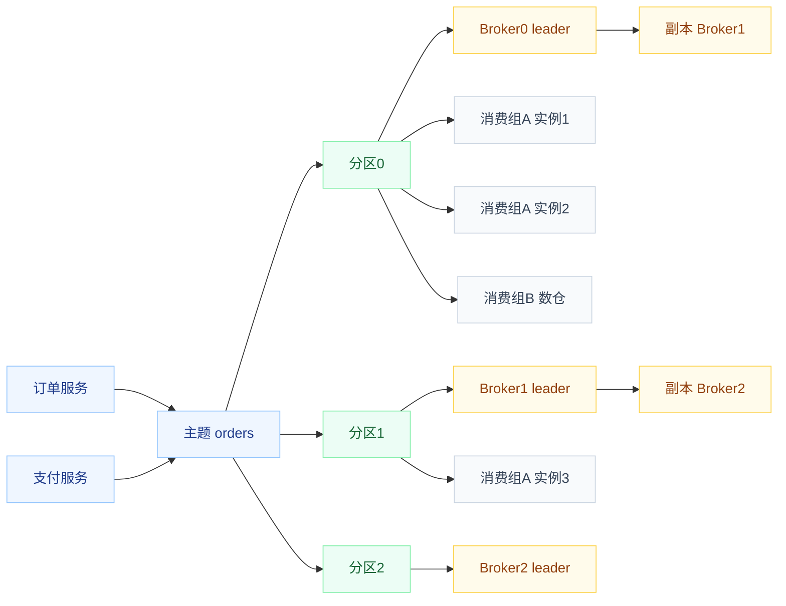
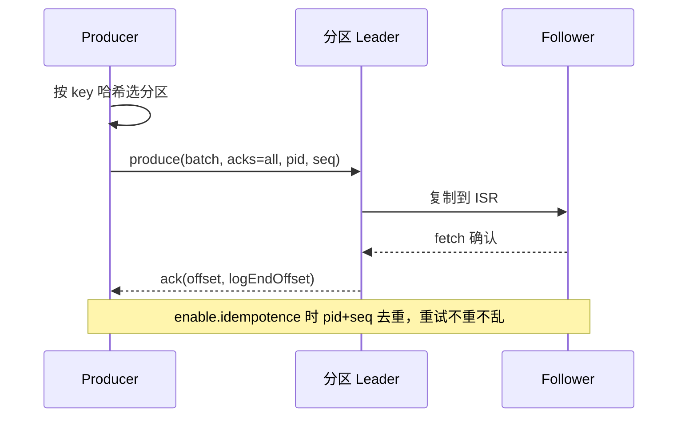
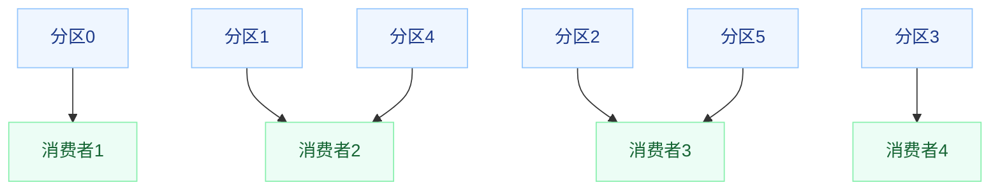

# Kafka消息队列

> 这篇从 Kafka 的日志模型与 4.x 版本边界讲起，经过 KRaft 单机安装与最小收发、主题分区与日志存储、生产者调优、消费者与消费组、复制与投递语义，最后落到 Spring Kafka 集成、运维排障和一个订单事件管道案例。
>
> 学完能独立部署 Kafka 4.x KRaft 集群，按吞吐和顺序要求规划主题与分区，写出不丢不乱的生产者和可重放、可幂等的消费者，并在积压、消费组失衡和消息丢失时定位到具体环节。

## 一、Kafka 的日志模型与版本边界

Kafka 不是"队列"，是分布式提交日志（distributed commit log）：生产者把消息追加到分区（partition）的末尾，消费者各自维护读取位置（offset），消息不因被消费而删除，而是按保留策略过期。这个模型决定了它的强项是**高吞吐、可重放、多消费者独立读**，弱项是服务端不做复杂路由。



| 维度 | Kafka | RabbitMQ |
|---|---|---|
| 存储 | 分区日志，按保留策略过期 | 队列，消费即删除 |
| 路由 | 客户端选分区，无服务端路由 | 交换机 + 绑定 |
| 顺序 | 分区内有序 | 队列内有序（单消费者） |
| 重放 | 任意 offset 重读 | 不支持（stream 除外） |
| 典型场景 | 事件流、数仓、日志聚合 | 任务分发、延迟任务 |

4.x 的版本边界只有一条必须记住：**4.0 起 ZooKeeper 模式被彻底移除，只支持 KRaft（Kafka Raft）**。元数据由内部 Raft 仲裁（controller quorum）管理，没有 ZooKeeper 的连接配置和迁移步骤。

| 版本事实 | 影响 |
|---|---|
| 4.0 起仅 KRaft | 旧集群必须先迁 KRaft 再升 4.x |
| Broker 需要 Java 17+ | 客户端也建议 17+，Java 21 为基线 |
| 新消费组协议 GA | `group.protocol=consumer`，重平衡更快 |
| 4.1 加入 Queues for Kafka 预览 | 任务队列场景先评估，未到生产可用 |

> 版本基线（2026-11）：本文以 Kafka 4.1.x 为基线，4.2–4.4 沿用 KRaft 与同一客户端协议模型；4.0 起只支持 KRaft。环境为 Java 21、Spring Boot 3.5.x（Spring Kafka 3.3.x）。次版本升级前读 release notes 的 KIP 弃用项。

**什么时候不用 Kafka**：需要按消息逐条确认、复杂路由、分钟级延迟任务时，RabbitMQ 更合适；只有几个服务解耦、日消息量万级以下时，RabbitMQ 甚至数据库表都够，不要为了吞吐指标引入 3 节点起的大数据组件。

## 二、KRaft 单机安装与最小验证

安装三步：装 JDK 17+、解压官方二进制包、格式化存储目录。KRaft 模式下 broker 与 controller 可以同进程，单机学习用 `process.roles=broker,controller` 合并部署。

```bash
# Ubuntu / Rocky：先装 JDK 21
sudo apt-get install -y openjdk-21-jdk        # Ubuntu
sudo dnf install -y java-21-openjdk-devel     # Rocky 9

# 下载并解压（任何平台同包；macOS 用 curl，Windows 解压到无空格路径）
curl -LO https://archive.apache.org/dist/kafka/4.1.0/kafka_2.13-4.1.0.tgz
tar -xzf kafka_2.13-4.1.0.tgz
export KAFKA_HOME=$PWD/kafka_2.13-4.1.0

java -version   # 确认 21，Kafka 4.x 启动脚本会强制检查
```

macOS 可以用 Homebrew，Windows 建议在 WSL2 内按 Linux 步骤执行（原生 `.bat` 脚本可用，但排障资料少）：

```bash
brew install kafka          # macOS
# Windows 原生：解压后在 PowerShell 运行 .\bin\windows\kafka-storage.bat 等
```

单机 KRaft 配置（`$KAFKA_HOME/config/server.properties` 关键项）：

```properties
process.roles=broker,controller          # 同进程承担两种角色，单机/学习用
node.id=1
controller.quorum.bootstrap.servers=localhost:9093 # 4.1 默认动态仲裁，单机一个控制节点
listeners=PLAINTEXT://:9092,CONTROLLER://:9093
advertised.listeners=PLAINTEXT://localhost:9092 # 必须写客户端可达地址
controller.listener.names=CONTROLLER
listener.security.protocol.map=CONTROLLER:PLAINTEXT,PLAINTEXT:PLAINTEXT
log.dirs=/var/lib/kafka/data              # 数据目录，磁盘要单独规划
num.partitions=3                          # 新主题默认分区数
default.replication.factor=1              # 单机学习用 1；生产集群必须 3
offsets.topic.replication.factor=1       # 单机改 1；生产集群改 3
transaction.state.log.replication.factor=1
transaction.state.log.min.isr=1
```

格式化存储目录并启动。`format` 只能对空目录执行一次，cluster id 是元数据根标识：

```bash
export LOG_DIR=/var/lib/kafka/data
sudo mkdir -p $LOG_DIR && sudo chown -R "$USER" $LOG_DIR

# 1) 生成 cluster id，并以单机模式格式化（4.1 的 --standalone 会创建单 voter 动态仲裁）
KAFKA_CLUSTER_ID=$($KAFKA_HOME/bin/kafka-storage.sh random-uuid)
$KAFKA_HOME/bin/kafka-storage.sh format --standalone -t $KAFKA_CLUSTER_ID \
  -c $KAFKA_HOME/config/server.properties   # 4.1 的 KRaft 配置就在 config/server.properties

# 2) 前台启动（验证阶段）；生产用 systemd 托管
$KAFKA_HOME/bin/kafka-server-start.sh $KAFKA_HOME/config/server.properties
```

预期输出（示例，截取关键行）：

```text
[2026-11-13 10:12:01,234] INFO Kafka version: 4.1.0 (org.apache.kafka.common.utils.AppInfoParser)
[2026-11-13 10:12:03,456] INFO [BrokerServer id=1] Transition from STARTING to STARTED (kafka.server.BrokerServer)
[2026-11-13 10:12:03,460] INFO [ControllerServer id=1] ... became the active controller ...
```

最小收发闭环：建主题、控制台生产、控制台消费。

```bash
# 建主题：3 分区、单机 RF=1
$KAFKA_HOME/bin/kafka-topics.sh --bootstrap-server localhost:9092 \
  --create --topic demo.orders --partitions 3 --replication-factor 1

# 生产几条带 key 的消息（同 key 进同分区，保证顺序）
$KAFKA_HOME/bin/kafka-console-producer.sh --bootstrap-server localhost:9092 \
  --topic demo.orders --property parse.key=true --property key.separator=:
A1001:{"sku":"SKU-1","qty":2}
A1001:{"sku":"SKU-2","qty":1}
A1002:{"sku":"SKU-3","qty":5}

# 消费，从头读
$KAFKA_HOME/bin/kafka-console-consumer.sh --bootstrap-server localhost:9092 \
  --topic demo.orders --from-beginning --property print.key=true
```

预期输出（示例）：

```text
A1001	{"sku":"SKU-1","qty":2}
A1001	{"sku":"SKU-2","qty":1}
A1002	{"sku":"SKU-3","qty":5}
```

> 边界：`format` 对已有数据的目录会报错并拒绝，防止误格式化；`advertised.listeners` 必须是客户端能解析的地址，容器和虚拟机里写内网 IP，否则客户端会拿到不可达地址。控制台消费者按 Ctrl+C 退出时提交 offset，重跑会接着读，验证"从头读"要加 `--from-beginning` 或换新 group。

## 三、主题、分区与日志存储

主题（topic）是逻辑分类，分区（partition）是并行与顺序的单位：**分区内严格有序，分区间无序**。分区数决定消费者组内最大并行度，也决定单主题的吞吐上限，规划时按"峰值吞吐 ÷ 单分区吞吐"向上取整，再加 30% 余量。

```bash
$KAFKA_HOME/bin/kafka-topics.sh --bootstrap-server localhost:9092 \
  --create --topic orders --partitions 6 --replication-factor 3 \
  --config min.insync.replicas=2 \
  --config retention.ms=604800000        # 7 天

$KAFKA_HOME/bin/kafka-topics.sh --bootstrap-server localhost:9092 \
  --describe --topic orders
```

预期输出（示例）：

```text
Topic: orders  TopicId: 7kR2...  PartitionCount: 6  ReplicationFactor: 3
    Topic: orders  Partition: 0  Leader: 1  Replicas: 1,2,3  Isr: 1,2,3
    Topic: orders  Partition: 1  Leader: 2  Replicas: 2,3,1  Isr: 2,3,1
    ...
```

上述命令要求至少 3 个 broker；单机环境把 `--replication-factor` 改为 1，否则报 `InvalidReplicationFactorException`。

每个分区在磁盘上是一组段文件（segment），当前段写满或达到 `segment.ms` 后滚动，旧段按保留策略整段删除：

```text
/var/lib/kafka/data/orders-0/
├── 00000000000000000000.log      # 消息数据
├── 00000000000000000000.index    # 稀疏 offset 索引
├── 00000000000000000000.timeindex
└── 00000000000005230000.log      # 下一段，文件名是起始 offset
```

| 保留配置 | 语义 | 适用 |
|---|---|---|
| `retention.ms` | 时间过期（默认 7 天） | 大多数业务主题 |
| `retention.bytes` | 分区大小上限 | 磁盘紧张的集群 |
| `cleanup.policy=delete` | 到期整段删除 | 事件流 |
| `cleanup.policy=compact` | 按 key 保留最新值 | 状态表、配置流 |
| `cleanup.policy=compact,delete` | 两者叠加 | 变更日志类主题 |

压实（compaction）按 key 保留每个 key 的最后一条值，写入空值（tombstone）表示删除；适合把主题当"最新状态表"用，比如消费位点主题 `__consumer_offsets` 本身就是 compact 的。

分区扩容只能加不能减；默认分区器按“key 哈希 mod 分区数”选分区，扩容后同一 key 会被映射到新分区，旧顺序不再成立：

```bash
$KAFKA_HOME/bin/kafka-topics.sh --bootstrap-server localhost:9092 \
  --alter --topic orders --partitions 12
```

> 边界：依赖 key 顺序的主题（同一订单的事件流）一旦扩分区，新消息可能进新分区，旧 key 顺序不再全局成立；要么一开始分区数留足，要么用"key 前缀 + 版本"迁移。`min.insync.replicas=2` 配合 `acks=all` 才有容错意义，单配一个等于没配。`__consumer_offsets`、`__transaction_state` 是内部主题，不要手工改动。

## 四、生产者：分区、批量与确认

生产者的核心权衡是延迟与吞吐：批量越大吞吐越高、延迟越高；确认越强可靠性越高、延迟越高。默认参数面向吞吐，业务关键消息要显式收紧。

| 配置 | 默认 | 生产建议 | 作用 |
|---|---|---|---|
| `acks` | all | all | all=Leader+ISR 确认 |
| `enable.idempotence` | true | true | 防重与分区内有序 |
| `retries` | MAX_INT | 保持默认 | 配合 delivery.timeout |
| `delivery.timeout.ms` | 120000 | 120000 | 重试总时限 |
| `linger.ms` | 0 | 5–20 | 等待批量凑满 |
| `batch.size` | 16KB | 32–64KB | 单批字节上限 |
| `compression.type` | none | lz4/zstd | CPU 换带宽 |
| `max.in.flight.requests.per.connection` | 5 | ≤5 | 幂等下保证顺序 |

分区选择规则：有 key 时按 key 哈希到固定分区（同 key 同分区），无 key 时用粘性批（sticky batch）尽量整批复用同一分区。要保证“同一订单的事件有序”，把订单号做 key 是最直接的手段；单分区主题也能保证全局顺序，但会牺牲并行度。



Java 客户端最小配置：

```java
Properties props = new Properties();
props.put(ProducerConfig.BOOTSTRAP_SERVERS_CONFIG, "kafka1:9092,kafka2:9092,kafka3:9092");
props.put(ProducerConfig.KEY_SERIALIZER_CLASS_CONFIG, StringSerializer.class.getName());
props.put(ProducerConfig.VALUE_SERIALIZER_CLASS_CONFIG, StringSerializer.class.getName());
props.put(ProducerConfig.ACKS_CONFIG, "all");           // ISR 全确认才返回，防单点丢
props.put(ProducerConfig.ENABLE_IDEMPOTENCE_CONFIG, "true"); // broker 按 pid+seq 去重
props.put(ProducerConfig.LINGER_MS_CONFIG, "10");       // 凑 10ms 批，吞吐延迟折中
props.put(ProducerConfig.COMPRESSION_TYPE_CONFIG, "lz4");
props.put(ProducerConfig.DELIVERY_TIMEOUT_MS_CONFIG, "120000");

try (KafkaProducer<String, String> producer = new KafkaProducer<>(props)) {
    ProducerRecord<String, String> record =
            new ProducerRecord<>("orders", "A1001", "{\"sku\":\"SKU-1\",\"qty\":2}");
    producer.send(record, (metadata, ex) -> {
        if (ex != null) {
            // 发送在 delivery.timeout 内重试后仍失败，必须落补偿表，不能只打日志
            System.err.println("send failed: " + ex.getMessage());
        } else {
            System.out.printf("partition=%d offset=%d%n",
                    metadata.partition(), metadata.offset());
        }
    });
    producer.flush(); // 关闭前确保回调全部执行
}
```

预期输出（示例）：

```text
partition=1 offset=523
```

> 边界：回调在 IO 线程执行，不要在回调里做重活；`send` 是异步的，进程退出前不 flush/close 会丢已入队未发送的消息。`acks=1` 只保证 Leader 落盘，Leader 宕机且未复制时会丢；`acks=0` 连网络失败都不感知，只用于可丢的埋点。

## 五、消费者与消费组

消费者组（consumer group）是横向扩展的单位：**一个分区在同一时刻只分配给组内一个消费者**，消费者数量超过分区数时多余的空转。不同组之间互不影响，各自维护 offset，这是"发布订阅 + 竞争消费"能同时成立的原因。



消费是一个主动 poll 循环：拉批、处理、提交 offset。两个超时决定组的生死：`session.timeout.ms`（心跳超时，判死消费者）和 `max.poll.interval.ms`（两次 poll 间隔超时，判处理卡死）。

```java
Properties props = new Properties();
props.put(ConsumerConfig.BOOTSTRAP_SERVERS_CONFIG, "kafka1:9092,kafka2:9092,kafka3:9092");
props.put(ConsumerConfig.GROUP_ID_CONFIG, "inventory-service");
props.put(ConsumerConfig.KEY_DESERIALIZER_CLASS_CONFIG, StringDeserializer.class.getName());
props.put(ConsumerConfig.VALUE_DESERIALIZER_CLASS_CONFIG, StringDeserializer.class.getName());
props.put(ConsumerConfig.ENABLE_AUTO_COMMIT_CONFIG, "false"); // 处理完再提交，避免丢/重
props.put(ConsumerConfig.AUTO_OFFSET_RESET_CONFIG, "earliest"); // 无位点时从头读
props.put(ConsumerConfig.MAX_POLL_RECORDS_CONFIG, "200");
props.put(ConsumerConfig.MAX_POLL_INTERVAL_MS_CONFIG, "300000"); // 处理一批的最长时间
props.put(ConsumerConfig.PARTITION_ASSIGNMENT_STRATEGY_CONFIG,
        "org.apache.kafka.clients.consumer.CooperativeStickyAssignor"); // 增量重平衡

try (KafkaConsumer<String, String> consumer = new KafkaConsumer<>(props)) {
    consumer.subscribe(List.of("orders"));
    while (running) {
        ConsumerRecords<String, String> records = consumer.poll(Duration.ofMillis(500));
        for (ConsumerRecord<String, String> r : records) {
            handle(r); // 幂等处理；抛异常要有兜底，否则会卡住整个 poll 循环
        }
        consumer.commitSync(); // 批处理完同步提交；失败恢复时用 seek 重放
    }
}
```

| 配置 | 默认 | 说明 |
|---|---|---|
| `enable.auto.commit` | true | 业务消费建议 false |
| `auto.offset.reset` | latest | 无位点时的起点 |
| `max.poll.records` | 500 | 单批最大条数 |
| `max.poll.interval.ms` | 300000 | 超时被逐出组 |
| `session.timeout.ms` | 45000 | 心跳判死 |
| `group.instance.id` | 无 | 静态成员，重启不重平衡 |

重平衡（rebalance）是消费组重新分配分区的过程：消费者增减、处理超时、订阅变化都会触发。经典协议默认的 eager 策略会先撤销全部分区再重新分配；cooperative-sticky 可以增量迁移；4.0 GA 的新消费组协议（KIP-848）由服务端协调分配，重平衡窗口进一步缩短，新集群用 `group.protocol=consumer` 启用：

```java
props.put(ConsumerConfig.GROUP_PROTOCOL_CONFIG, "consumer"); // KIP-848 新协议
```

提交 offset 的语义就是投递语义：处理后提交是至少一次（崩溃后重读一段），先提交后处理是至多一次（崩溃丢一段）。业务里默认选至少一次，用幂等吸收重复。

```bash
# 查看组内分配与积压（lag）
$KAFKA_HOME/bin/kafka-consumer-groups.sh --bootstrap-server localhost:9092 \
  --describe --group inventory-service
```

预期输出（示例）：

```text
GROUP              TOPIC   PARTITION  CURRENT-OFFSET  LOG-END-OFFSET  LAG
inventory-service  orders  0          5201            5201            0
inventory-service  orders  1          5188            5190            2
inventory-service  orders  2          5320            5320            0
```

> 边界：`max.poll.records` 太大或单条处理太慢，会在 `max.poll.interval.ms` 内回不来，被逐出组并触发重平衡，重平衡又导致重复处理，形成雪崩；先减批量、把重活挪出循环。消费者数量不要超过分区数；扩容消费者前先看分区数。offset 提交失败不会回滚业务，重复消费必须由幂等兜底。

## 六、复制、一致性与投递语义

可靠性由三件套共同保证：`replication.factor=3`（每个分区 3 副本）、`min.insync.replicas=2`（至少 2 个同步副本才接受写入）、`acks=all`（写入要 ISR 确认）。少任何一件，都能构造出丢消息的场景。

| 参数组合 | Leader 宕机时 | 结论 |
|---|---|---|
| RF=1, acks=1 | 分区不可用，数据可能丢 | 学习环境 |
| RF=3, acks=1 | 未复制的消息丢 | 不建议 |
| RF=3, min.isr=2, acks=all | 已确认消息不丢 | 生产基线 |
| RF=3, acks=all, 未设 min.isr | ISR 收缩到 1 时退化为单副本 | 隐患 |

`unclean.leader.election.enable` 必须保持 `false`：允许落后副本当选 Leader 会用旧数据覆盖新数据，换来的可用性以丢消息为代价。

```bash
# 查看副本与 ISR；Isr 列变短就是危险信号
$KAFKA_HOME/bin/kafka-topics.sh --bootstrap-server localhost:9092 \
  --describe --topic orders | head -3
```

```text
Topic: orders  Partition: 0  Leader: 1  Replicas: 1,2,3  Isr: 1,2,3
Topic: orders  Partition: 1  Leader: 2  Replicas: 2,3,1  Isr: 2,3
Topic: orders  Partition: 2  Leader: 3  Replicas: 3,1,2  Isr: 3,1
```

投递语义的选择按"重复和丢失哪个更贵"来定：

| 语义 | 实现 | 业务代价 |
|---|---|---|
| 至多一次 | 先提交 offset 再处理 | 崩溃丢一段 |
| 至少一次 | 处理后提交 offset | 重复需幂等 |
| 恰好一次（Kafka 内） | 事务 + read_committed | 跨外部系统不成立 |

Kafka 事务解决的是"消费 A 主题、写 B 主题 + 提交位移"的原子性，`isolation.level=read_committed` 的消费者读不到未提交消息；但**数据库写库不在事务边界内**，跨 DB 与 Kafka 的原子性要用本地消息表（outbox）加幂等消费实现，和 RabbitMQ 篇的方案一致。

> 边界：幂等生产者只防"网络重试造成的重发+乱序"，防不了业务层重复调用；上游去重键仍要传。事务生产者的 `transactional.id` 必须在应用实例间唯一且稳定，多实例共用一个 id 会互相 fence。

## 七、Spring Kafka 集成

Spring Kafka 把客户端封装为 `KafkaTemplate` 与 `@KafkaListener`；要显式配置的是可靠性参数、手动提交和错误处理链。默认值面向易用，不等于面向不丢消息。

```xml
<dependency>
    <groupId>org.springframework.kafka</groupId>
    <artifactId>spring-kafka</artifactId>
</dependency>
```

```yaml
spring:
  kafka:
    bootstrap-servers: kafka1:9092,kafka2:9092,kafka3:9092
    producer:
      key-serializer: org.apache.kafka.common.serialization.StringSerializer
      value-serializer: org.springframework.kafka.support.serializer.JsonSerializer
      acks: all
      properties:
        enable.idempotence: true
        linger.ms: 10
        compression.type: lz4
    consumer:
      group-id: inventory-service
      key-deserializer: org.apache.kafka.common.serialization.StringDeserializer
      value-deserializer: org.springframework.kafka.support.serializer.JsonDeserializer
      auto-offset-reset: earliest
      enable-auto-commit: false
      properties:
        spring.json.trusted.packages: com.example.order.event
        max.poll.records: 200
    listener:
      ack-mode: manual_immediate   # 每条处理完立即提交，语义最清晰
      concurrency: 3               # 等于分区数才能吃满并行度
```

生产者直接注入模板，回调里只做记录与补偿：

```java
@Service
public class OrderEventPublisher {
    private final KafkaTemplate<String, OrderCreatedEvent> kafkaTemplate;

    public OrderEventPublisher(KafkaTemplate<String, OrderCreatedEvent> kafkaTemplate) {
        this.kafkaTemplate = kafkaTemplate;
    }

    public void publish(OrderCreatedEvent event) {
        kafkaTemplate.send("orders", event.orderId(), event) // key=orderId，保证同订单有序
                .whenComplete((result, ex) -> {
                    if (ex != null) {
                        // delivery.timeout 内重试仍失败；落 outbox 状态，交给补偿任务
                        log.error("send failed, orderId={}", event.orderId(), ex);
                    }
                });
    }
}
```

消费端用 `DefaultErrorHandler` + 指数退避 + 死信主题（DLT），可重试异常走退避，不可重试异常直接进 DLT：

```java
@Configuration
public class KafkaListenerConfig {

    @Bean
    public DefaultErrorHandler errorHandler(KafkaOperations<Object, Object> kafka) {
        // 指数退避：1s 起，倍增，上限 10s
        ExponentialBackOff backOff = new ExponentialBackOff(1000, 2);
        backOff.setMaxInterval(10_000);
        backOff.setMaxElapsedTime(60_000); // 总重试窗口 1 分钟

        // 处理失败的消息发到 orders.DLT，保留现场
        DeadLetterPublishingRecoverer recoverer =
                new DeadLetterPublishingRecoverer(kafka,
                        (rec, ex) -> new ProducerRecord<>("orders.DLT", rec.key(), rec.value()));

        DefaultErrorHandler handler = new DefaultErrorHandler(recoverer, backOff);
        handler.addNotRetryableExceptions(DeserializationException.class, IllegalArgumentException.class);
        return handler;
    }

    @Bean
    public ConcurrentKafkaListenerContainerFactory<String, OrderCreatedEvent> factory(
            ConsumerFactory<String, OrderCreatedEvent> consumerFactory,
            DefaultErrorHandler errorHandler) {
        var factory = new ConcurrentKafkaListenerContainerFactory<String, OrderCreatedEvent>();
        factory.setConsumerFactory(consumerFactory);
        factory.setCommonErrorHandler(errorHandler);
        factory.getContainerProperties().setAckMode(ContainerProperties.AckMode.MANUAL_IMMEDIATE);
        return factory;
    }
}
```

```java
@Component
public class OrderCreatedListener {
    private final OrderService orderService;

    public OrderCreatedListener(OrderService orderService) {
        this.orderService = orderService;
    }

    @KafkaListener(topics = "orders", groupId = "inventory-service")
    public void onMessage(OrderCreatedEvent event, Acknowledgment ack) {
        orderService.handle(event); // 幂等：order_id 唯一索引 + 事务
        ack.acknowledge();          // 处理成功才提交 offset
    }
}
```

> 边界：`ack-mode: manual_immediate` 下忘记 `acknowledge()` 会让消息在下次重启后重读，且位点不前进；异常抛出后由 `DefaultErrorHandler` 决定重试或进 DLT，不要在监听器里自己 catch 后吞掉。`concurrency` 超过分区数没有收益；JSON 反序列化要限制 `trusted.packages`，避免任意类反序列化漏洞。

## 八、运维、监控与故障排查

Kafka 排障的第一手证据是 topic describe 和 consumer group describe：分区有没有 Leader、ISR 是否收缩、lag 是否增长，比看应用日志更快定位。

```bash
# 集群与仲裁状态（KRaft）
$KAFKA_HOME/bin/kafka-metadata-quorum.sh --bootstrap-server localhost:9092 \
  describe --status

# 全组积压一览
$KAFKA_HOME/bin/kafka-consumer-groups.sh --bootstrap-server localhost:9092 \
  --list
$KAFKA_HOME/bin/kafka-consumer-groups.sh --bootstrap-server localhost:9092 \
  --describe --all-groups | awk 'NR==1 || $6>1000'   # LAG 是第 6 列

# 磁盘占用（按 broker）
$KAFKA_HOME/bin/kafka-log-dirs.sh --bootstrap-server localhost:9092 --describe

# 磁盘上真实内容排查
$KAFKA_HOME/bin/kafka-dump-log.sh \
  --files /var/lib/kafka/data/orders-0/00000000000000000000.log --print-data-log | head -5
```

预期输出（示例，quorum status）：

```text
ClusterId:              7kR2xN0Q...
LeaderId:               1
LeaderEpoch:            42
HighWatermark:          3100
CurrentVoters:          [1]
```

| 现象 | 常见原因 | 第一条命令 |
|---|---|---|
| `LEADER_NOT_AVAILABLE` | 主题刚建、controller 未就绪 | `kafka-topics.sh --describe` |
| `NOT_ENOUGH_REPLICAS` | ISR 收缩低于 min.insync.replicas | 看 Isr 列 |
| `INVALID_REPLICATION_FACTOR` | RF 大于 broker 数 | 数 broker，改 RF |
| lag 持续增长 | 消费者慢/挂、重平衡风暴 | `--describe --group` |
| 反复 rebalance | 处理超时 `max.poll.interval` | 查消费者日志 poll 间隔 |
| 磁盘告警 | 保留策略过宽、段堆积 | `kafka-log-dirs.sh --describe` |
| 消息"消失" | 保留期已过、`auto.offset.reset=latest` | `kafka-dump-log.sh` 核对 |

JMX 指标至少盯四类：`UnderReplicatedPartitions`（ISR 收缩）、`ActiveControllerCount`（必须恰好 1）、`RequestHandlerAvgIdlePercent`（请求线程余量）、消费组 lag（业务侧）。Prometheus 用 JMX exporter 暴露，Grafana 官方面板有现成仪表盘。

改保留策略要在线操作，不要停集群：

```bash
# 把 orders 保留期改为 3 天，立即生效（旧段删除有周期，非瞬时）
$KAFKA_HOME/bin/kafka-configs.sh --bootstrap-server localhost:9092 \
  --alter --entity-type topics --entity-name orders \
  --add-config retention.ms=259200000
```

> 边界：KRaft 仲裁多数派失联时集群不可写，宁可停止写入也不要调低 `min.insync.replicas` 换可用性；单 controller 的学习环境宕机即全停。删主题是异步的（`delete.topic.enable` 默认 true），删除中的分区仍占磁盘；`kafka-dump-log` 读的是磁盘真实内容，是"消息到底在不在"的最终证据。

## 九、最佳实践案例

### 9.1 案例背景

一个零售平台要把订单事件同时供给库存服务（扣减、要求强顺序）和数据团队（数仓入湖、要求可重放）。现状是订单服务在事务里同步调库存和数仓接口：库存接口抖动让下单失败率升到 1.8%，数仓批量任务每天凌晨扫全表，数据延迟 4 小时以上。

目标是：订单落库后发一条事件，库存服务秒级消费并保证同一订单有序，数仓重放最近 7 天数据补数；消息不丢、消费幂等、失败有死信可查。约束是 Kafka 4.1（KRaft 三节点）、Spring Boot 3.5、MySQL 8.4，不引入 Flink 和额外 CDC 工具。

### 9.2 案例实操

集群与主题（三节点 KRaft，`orders` 6 分区 RF=3）：

```bash
# 三节点静态仲裁：每个节点的 server.properties 写同一组 voters
# process.roles=broker,controller  node.id=1  controller.quorum.voters=1@kafka1:9093,2@kafka2:9093,3@kafka3:9093
# （4.1 也支持动态仲裁，用 --initial-controllers 引导，见官方 KRaft 文档）

# cluster id 全集群必须一致；每个节点用本机配置执行一次 format
KAFKA_CLUSTER_ID=$($KAFKA_HOME/bin/kafka-storage.sh random-uuid)
for HOST in kafka1 kafka2 kafka3; do
  ssh $HOST "$KAFKA_HOME/bin/kafka-storage.sh format -t $KAFKA_CLUSTER_ID \
    -c /etc/kafka/server.properties"   # 各节点 node.id 与 listeners 不同，cluster id 相同
done

$KAFKA_HOME/bin/kafka-topics.sh --bootstrap-server kafka1:9092 \
  --create --topic orders --partitions 6 --replication-factor 3 \
  --config min.insync.replicas=2 \
  --config retention.ms=604800000 \
  --config cleanup.policy=delete

$KAFKA_HOME/bin/kafka-topics.sh --bootstrap-server kafka1:9092 \
  --create --topic orders.DLT --partitions 6 --replication-factor 3 \
  --config min.insync.replicas=2
```

订单事件与 outbox 表（沿用第七章"同事务落库"的思路，字段按 Kafka 改为 topic/msg_key）：

```sql
CREATE TABLE outbox (
  id BIGINT PRIMARY KEY AUTO_INCREMENT,
  event_id VARCHAR(64) NOT NULL UNIQUE,
  topic VARCHAR(128) NOT NULL,
  msg_key VARCHAR(128) NOT NULL,
  payload JSON NOT NULL,
  status TINYINT NOT NULL DEFAULT 0, -- 0 待发送 1 已确认
  created_at DATETIME(3) NOT NULL DEFAULT CURRENT_TIMESTAMP(3)
);
```

```java
public record OrderCreatedEvent(String eventId, String orderId, String sku,
                                int quantity, Instant createdAt) {
}
```

订单服务在数据库事务里写订单和 outbox，由后台任务扫描发送：

```java
@Service
public class OrderService {
    private final JdbcTemplate jdbc;
    private final ObjectMapper mapper;

    public OrderService(JdbcTemplate jdbc, ObjectMapper mapper) {
        this.jdbc = jdbc;
        this.mapper = mapper;
    }

    @Transactional(rollbackFor = Exception.class) // 序列化失败也要回滚订单写入
    public String create(String sku, int quantity) throws JsonProcessingException {
        String orderId = "ORD-" + System.currentTimeMillis();
        jdbc.update("INSERT INTO orders(order_id, sku, quantity, status) VALUES (?,?,?,?)",
                orderId, sku, quantity, "CREATED");
        OrderCreatedEvent event = new OrderCreatedEvent(
                UUID.randomUUID().toString(), orderId, sku, quantity, Instant.now());
        // 同事务写 outbox：DB 成功则事件必可重发，解决"库成功消息丢"
        jdbc.update("INSERT INTO outbox(event_id, topic, msg_key, payload) VALUES (?,?,?,?)",
                event.eventId(), "orders", event.orderId(), mapper.writeValueAsString(event));
        return orderId;
    }
}
```

```java
@Component
public class OutboxRelay {
    private final JdbcTemplate jdbc;
    private final ObjectMapper mapper;
    private final KafkaTemplate<String, OrderCreatedEvent> kafka;

    public OutboxRelay(JdbcTemplate jdbc, ObjectMapper mapper,
                       KafkaTemplate<String, OrderCreatedEvent> kafka) {
        this.jdbc = jdbc;
        this.mapper = mapper;
        this.kafka = kafka;
    }

    @Scheduled(fixedDelay = 1_000) // 每秒扫描，延迟与吞吐按业务调
    public void relay() {
        jdbc.query("SELECT id, msg_key, payload FROM outbox WHERE status = 0 ORDER BY id LIMIT 100",
                rs -> {
                    try {
                        OrderCreatedEvent event = mapper.readValue(rs.getString("payload"),
                                OrderCreatedEvent.class);
                        long id = rs.getLong("id");
                        kafka.send("orders", rs.getString("msg_key"), event)
                                .whenComplete((result, ex) -> {
                                    if (ex == null) {
                                        jdbc.update("UPDATE outbox SET status = 1 WHERE id = ?", id);
                                    }
                                    // 发送失败不置状态，下一轮重扫；幂等由消费端 event_id 保证
                                });
                    } catch (JsonProcessingException e) {
                        throw new IllegalStateException("outbox payload 损坏", e);
                    }
                });
    }
}
```

启动类需要 `@EnableScheduling`，否则 `@Scheduled` 不会执行：

```java
@SpringBootApplication
@EnableScheduling
public class OrderApplication {
    public static void main(String[] args) {
        SpringApplication.run(OrderApplication.class, args);
    }
}
```

```yaml
spring:
  kafka:
    bootstrap-servers: kafka1:9092,kafka2:9092,kafka3:9092
    producer:
      key-serializer: org.apache.kafka.common.serialization.StringSerializer
      value-serializer: org.springframework.kafka.support.serializer.JsonSerializer
      acks: all
      properties:
        enable.idempotence: true
        linger.ms: 10
        compression.type: lz4
```

库存消费端（关键差异：key 用 orderId，6 分区 + concurrency 6，同一订单事件始终落在同一分区串行处理）：

```java
@Service
public class InventoryService {
    private final JdbcTemplate jdbc;

    public InventoryService(JdbcTemplate jdbc) {
        this.jdbc = jdbc;
    }

    @Transactional
    public void handle(OrderCreatedEvent event) {
        try {
            jdbc.update("INSERT INTO consumed_event(event_id) VALUES (?)", event.eventId());
        } catch (DuplicateKeyException e) {
            return; // 重复消费：上次事务已成功，直接返回，不重复扣减
        }
        int updated = jdbc.update(
                "UPDATE inventory SET reserved = reserved + ? WHERE sku = ? AND available >= ?",
                event.quantity(), event.sku(), event.quantity());
        if (updated == 0) {
            throw new IllegalStateException("库存不足: " + event.sku());
        }
    }
}
```

```java
@Component
public class OrderCreatedListener {
    private final InventoryService inventory;

    public OrderCreatedListener(InventoryService inventory) {
        this.inventory = inventory;
    }

    @KafkaListener(topics = "orders", groupId = "inventory-service",
                   concurrency = "6") // 等于分区数，每线程固定持有分区
    public void onMessage(OrderCreatedEvent event, Acknowledgment ack) {
        inventory.handle(event); // 业务事务提交后才提交 offset
        ack.acknowledge();
    }
}
```

数仓消费端独立成组，按天落湖，需要补数时改 group id 重放：

```java
@Component
public class WarehouseListener {
    private static final Logger log = LoggerFactory.getLogger(WarehouseListener.class);

    @KafkaListener(topics = "orders", groupId = "dw-orders-20261113") // 换组即全量重放
    public void forWarehouse(OrderCreatedEvent event, Acknowledgment ack) {
        // 实际实现调用湖表/对象存储写入；这里用日志替代以便本地跑通
        log.info("append to lake: orderId={}, sku={}", event.orderId(), event.sku());
        ack.acknowledge();
    }
}
```

错误处理链（复用第七章 `DefaultErrorHandler`：指数退避 1s→10s、总量 1 分钟，超限进 `orders.DLT`）。

验证：下单、观察消费与积压、模拟故障：

```bash
# 1) 下单
curl -s -X POST 'http://localhost:18085/api/orders?sku=SKU-1&quantity=2'

# 2) 消费组分配与 lag
$KAFKA_HOME/bin/kafka-consumer-groups.sh --bootstrap-server kafka1:9092 \
  --describe --group inventory-service | head -8

# 3) 故障演练：停掉库存服务 1 分钟再启动，观察 lag 回落
$KAFKA_HOME/bin/kafka-consumer-groups.sh --bootstrap-server kafka1:9092 \
  --describe --group inventory-service | awk 'NR==1 || $6>0'
```

预期输出（示例，数值为演示）：

```text
{"orderId":"ORD-1762992011456","status":"CREATED"}

GROUP              TOPIC   PARTITION  CURRENT-OFFSET  LOG-END-OFFSET  LAG  CONSUMER-ID
inventory-service  orders  0          8712            8712            0    consumer-1-...
inventory-service  orders  1          8690            8693            3    consumer-2-...
inventory-service  orders  2          8817            8817            0    consumer-3-...

GROUP              TOPIC   PARTITION  CURRENT-OFFSET  LOG-END-OFFSET  LAG
inventory-service  orders  1          8690            8840            150
```

```bash
# 4) 数仓重放：换新 group，从 earliest 读，读完即得最近 7 天全量
$KAFKA_HOME/bin/kafka-console-consumer.sh --bootstrap-server kafka1:9092 \
  --topic orders --group dw-replay-20261113 --from-beginning \
  --timeout-ms 10000 | wc -l
```

```text
50172
```

### 9.3 案例结果

库存消费 P95 延迟从同步调用的 1.2s 降到 380ms（示例），下单接口失败率从 1.8% 回落到 0.03%；停止库存服务 1 分钟的演练中 lag 升至 150 后在重启 40 秒内清零，无消息丢失；同一订单的事件因 key 路由到固定分区，扣减顺序与产生顺序一致；数仓重放用新消费组 3 分钟拉完 7 天约 5 万条事件，数据延迟从 4 小时降到分钟级。

复盘三个失败模式：第一，最初没配 `min.insync.replicas=2`，一次 broker 滚动重启时 ISR 收缩、`acks=all` 实际退化为单副本，加配置后演练通过；第二，消费者单条处理超过 `max.poll.interval.ms` 触发连续重平衡，把批量降到 200 并把重活移出监听器后稳定；第三，库存消费一度出现重复扣减，原因是幂等键用了自增 ID 而不是 `event_id`，换成 `consumed_event(event_id)` 唯一索引后重复消失。下一步是把 lag 与 `UnderReplicatedPartitions` 接入 Prometheus 告警，并对 DLT 建立值班重放流程。
