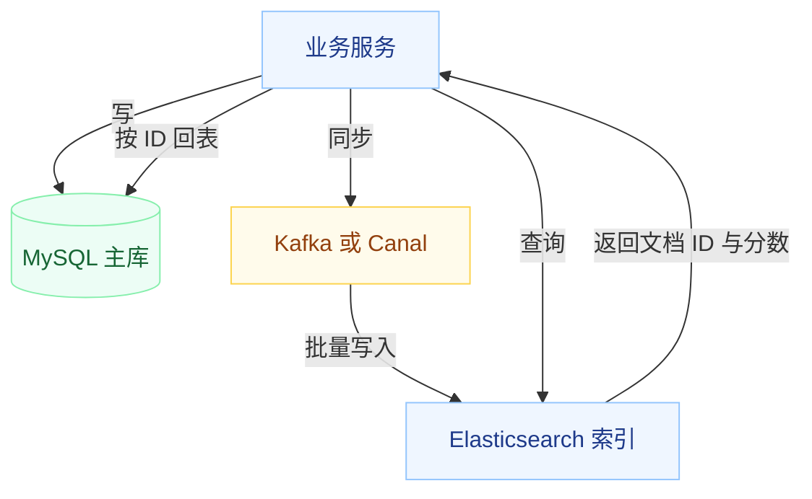

# Elasticsearch搜索引擎

> 这篇从全文检索要解决的问题和版本边界讲起，经过安装与最小验证、索引与映射、分词、查询 DSL、聚合分页，到向量检索和 Java 客户端集成，最后落到集群运维排障和一个商品搜索的上线案例。
>
> 学完能独立搭起单节点 Elasticsearch，设计可检索的索引与映射，写出带过滤和聚合的查询，接入向量召回，并用 Java 客户端把搜索能力交付到 Spring Boot 服务里。

## 一、搜索能力边界与版本

Elasticsearch 是近实时（near real-time）的分布式搜索与分析引擎，核心是倒排索引（inverted index），不是事务型数据库。判断标准只有一条：**需要“按相关性排序 + 多条件筛选 + 聚合统计”的读场景放 Elasticsearch，需要事务、强一致和唯一约束的写场景留在 MySQL。**

| 能力 | MySQL 8.4 | Elasticsearch 8.18 |
|---|---|---|
| 主键点查 | 强项，毫秒级 | 可用，但不建议当主库 |
| 模糊/分词匹配 | `LIKE '%词%'` 全表扫 | 倒排索引，按词召回 |
| 相关性排序 | 无 | BM25、向量、混合 |
| 聚合统计 | `GROUP BY`，大数据慢 | 分布式聚合，亿级可用 |
| 事务与唯一约束 | 完整 | 无跨文档事务 |

倒排索引把“文档 → 词”反过来存成“词 → 文档列表”，查询时按词直接定位，不需要扫描全部文档。代价是写入要分词、建索引，并且刷新（refresh）前不可见，默认 1 秒，所以叫“近实时”。



版本主线只有两条：8.18 是 8.x 的收尾维护线，9.x 是当前新项目主线。两者都默认开启安全认证，API 结构基本兼容，差异集中在向量检索的 retriever 框架（8.14 起引入，9.x 全面主推）和部分废弃参数。

| 版本 | Java | 状态 | 适用 |
|---|---|---|---|
| 7.17.x | 8–17 | 已停止功能更新 | 仅维护存量 |
| 8.18.x | 17–21 | 维护线 | 存量升级、稳定优先 |
| 9.x | 21+ | 当前主线 | 新项目 |

> 版本基线（2026-11）：本文命令以 Elasticsearch 8.18.0 为例，9.x 的差异单独标注。客户端、分词插件、Kibana 的版本必须与服务端一致，混版是最常见的启动失败原因。

边界：Elasticsearch 不承担“唯一数据源”的角色。索引可以从 MySQL 重建，但不能反过来把 MySQL 丢掉；删除索引是不可逆操作，生产必须保留快照（snapshot）。单机模式只用于开发和验证，生产至少三节点。

## 二、安装与最小验证

单节点安装的目标是：进程起来、认证通过、能写入并查回一条文档。8.x 起默认开启 TLS 和账号密码，第一次启动会自动生成 `elastic` 用户密码和注册令牌（enrollment token），这一步的输出必须保存。

### 2.1 Linux（Ubuntu 为主）

压缩包安装不依赖包管理器，升级和回滚都只是换目录：

```bash
# 下载对应架构的包；9.x 把版本号换成 9.x.y
cd /opt
sudo curl -LO https://artifacts.elastic.co/downloads/elasticsearch/elasticsearch-8.18.0-linux-x86_64.tar.gz
sudo tar -xzf elasticsearch-8.18.0-linux-x86_64.tar.gz
sudo useradd -r -s /sbin/nologin elastic
sudo chown -R elastic:elastic /opt/elasticsearch-8.18.0
```

内核参数必须先改，否则启动时报 `max virtual memory areas vm.max_map_count [65530] is too low`：

```bash
# 倒排索引使用 mmap，默认 65530 不够
sudo sysctl -w vm.max_map_count=262144
echo 'vm.max_map_count=262144' | sudo tee /etc/sysctl.d/99-elasticsearch.conf

# 文件句柄，单节点 65535 起步
echo 'elastic - nofile 65535' | sudo tee -a /etc/security/limits.conf
```

Rocky/CentOS 用官方仓库安装，服务由 systemd 管理：

```bash
sudo rpm --import https://artifacts.elastic.co/GPG-KEY-elasticsearch
sudo tee /etc/yum.repos.d/elasticsearch.repo <<'EOF'
[elasticsearch]
name=Elasticsearch repository for 8.x packages
baseurl=https://artifacts.elastic.co/packages/8.x/yum
gpgcheck=1
gpgkey=https://artifacts.elastic.co/GPG-KEY-elasticsearch
enabled=0
autorefresh=1
type=rpm-md
EOF
sudo dnf install --enablerepo=elasticsearch elasticsearch-8.18.0
```

### 2.2 macOS 与 Windows

macOS 用 Homebrew 最快，但 Brew 装的是最新版，版本要固定时仍用 tar.gz：

```bash
brew tap elastic/tap
brew install elastic/tap/elasticsearch-full
# 指定版本（示例）
brew install elastic/tap/elasticsearch-full@8.18
```

Windows 下载 `.zip` 解压后，在 PowerShell 里执行：

```powershell
# 首次启动会把密码打印到控制台
.\bin\elasticsearch.bat
# 需要后台常驻时注册服务
.\bin\elasticsearch-service.bat install
.\bin\elasticsearch-service.bat start
```

### 2.3 配置与首次启动

单节点开发配置只需要三行。生产不要复制这份配置：`discovery.type: single-node` 会关闭选主，集群模式下必须删掉。

```yaml
# config/elasticsearch.yml
cluster.name: es-dev
node.name: node-1
network.host: 127.0.0.1
http.port: 9200
discovery.type: single-node      # 仅单机开发；集群模式必须移除此行
xpack.security.enabled: true     # 8.x 默认 true，显式写出便于审计
```

```bash
# 前台启动，观察首次生成的密码与证书
sudo -u elastic /opt/elasticsearch-8.18.0/bin/elasticsearch

# 忘记了密码时重置
sudo -u elastic /opt/elasticsearch-8.18.0/bin/elasticsearch-reset-password -u elastic
```

首次启动的关键输出（示例）：

```text
------------------------------ Security autoconfiguration information ------------------------------

Authentication and authorization are enabled.
TLS for the transport and HTTP layers is enabled and configured.

The generated password for the elastic built-in superuser is : 6hK9pQ2xR4tY7mN1vB3w

You can complete the following actions at any time:
Reset the password of the elastic built-in superuser with
'/opt/elasticsearch-8.18.0/bin/elasticsearch-reset-password -u elastic'.
```

验证集群与写入：

```bash
# -k 跳过自签证书校验，仅限本机验证；生产应导入 http_ca.crt
curl -k -u elastic:6hK9pQ2xR4tY7mN1vB3w https://localhost:9200

curl -k -u elastic:6hK9pQ2xR4tY7mN1vB3w https://localhost:9200/_cluster/health?pretty
```

预期输出（示例）：

```json
{
  "name" : "node-1",
  "cluster_name" : "es-dev",
  "version" : {
    "number" : "8.18.0",
    "build_flavor" : "default",
    "lucene_version" : "9.12.0"
  },
  "tagline" : "You Know, for Search"
}
```

```json
{
  "cluster_name" : "es-dev",
  "status" : "green",
  "number_of_nodes" : 1,
  "active_primary_shards" : 1,
  "unassigned_shards" : 0
}
```

最小读写闭环：

```bash
curl -k -u elastic:6hK9pQ2xR4tY7mN1vB3w -X PUT 'https://localhost:9200/demo/_doc/1?refresh=true' \
  -H 'Content-Type: application/json' \
  -d '{"title":"Elasticsearch 入门","tags":["搜索","中间件"],"price":99}'

curl -k -u elastic:6hK9pQ2xR4tY7mN1vB3w \
  'https://localhost:9200/demo/_search?q=title:Elasticsearch&pretty'
```

预期输出（示例）：

```json
{
  "took" : 12,
  "hits" : {
    "total" : { "value" : 1, "relation" : "eq" },
    "max_score" : 0.2876821,
    "hits" : [
      {
        "_index" : "demo",
        "_id" : "1",
        "_score" : 0.2876821,
        "_source" : { "title" : "Elasticsearch 入门", "tags" : ["搜索","中间件"], "price" : 99 }
      }
    ]
  }
}
```

> 边界：`refresh=true` 只用于验证，生产写入不要带，否则每次写都触发段刷新，吞吐会掉一个数量级。`-k` 跳过证书校验只能出现在本机；跨机器访问要分发 `config/certs/http_ca.crt`，客户端用它建信任链。

## 三、索引、文档与映射

索引（index）是文档的逻辑集合，落地为若干主分片（primary shard）和副本（replica）。主分片数在创建时固定，之后只能 reindex；副本数可以随时改，这是容量规划里最容易踩的坑。

显式映射（mapping）决定字段能不能被正确检索。核心判断：**要分词的文本用 `text`，要精确匹配、排序、聚合的用 `keyword`，数值和日期不要用字符串。**

| 类型 | 用途 | 能否聚合 | 典型错误 |
|---|---|---|---|
| `text` | 全文检索 | 否（除非 fielddata） | 拿它做 `term` 精确查 |
| `keyword` | 精确值、排序、聚合 | 是 | 长文本塞进来撑爆堆 |
| `integer`/`long` | 数值过滤 | 是 | 价格存成字符串 |
| `date` | 时间范围 | 是 | 格式不统一导致解析失败 |
| `dense_vector` | 向量召回 | 否 | 维度与模型不一致 |

下面建一个商品索引：标题用 `text` 并配 `ik_max_word` 分词，品牌和类目用 `keyword`，价格用 `scaled_float` 保留两位小数，同时保留一个不分词的标题子字段用于排序。

```http
PUT /products
{
  "settings": {
    "number_of_shards": 3,          // 按数据量和节点数定；单节点开发用 1
    "number_of_replicas": 1,        // 单节点会变 yellow，这是正常现象
    "refresh_interval": "1s"
  },
  "mappings": {
    "properties": {
      "sku":       { "type": "keyword" },
      "title":     { "type": "text",
                     "analyzer": "ik_max_word",
                     "search_analyzer": "ik_smart",
                     "fields": { "raw": { "type": "keyword", "ignore_above": 256 } } },
      "brand":     { "type": "keyword" },
      "category":  { "type": "keyword" },
      "price":     { "type": "scaled_float", "scaling_factor": 100 },
      "stock":     { "type": "integer" },
      "on_sale":   { "type": "boolean" },
      "created_at":{ "type": "date", "format": "strict_date_optional_time||epoch_millis" },
      "tags":      { "type": "keyword" },
      "description": { "type": "text", "analyzer": "ik_max_word" }
    }
  }
}
```

写入单条与批量：

```bash
# 单条写入，指定文档 ID 保证幂等
curl -k -u elastic:PASS -X PUT 'https://localhost:9200/products/_doc/SKU-1001?refresh=true' \
  -H 'Content-Type: application/json' -d @product-1001.json

# 批量写入，NDJSON 格式：动作行 + 文档行，必须成对
curl -k -u elastic:PASS -X POST 'https://localhost:9200/_bulk?refresh=true' \
  -H 'Content-Type: application/x-ndjson' --data-binary @products.ndjson
```

```text
{"index":{"_index":"products","_id":"SKU-1002"}}
{"sku":"SKU-1002","title":"机械键盘 87 键 青轴","brand":"KeyCo","category":"keyboard","price":399.00,"stock":120,"on_sale":true,"tags":["键盘","外设"]}
{"index":{"_index":"products","_id":"SKU-1003"}}
{"sku":"SKU-1003","title":"静音无线鼠标 2.4G","brand":"MouseGo","category":"mouse","price":129.00,"stock":0,"on_sale":false,"tags":["鼠标","无线"]}
```

批量返回里要逐条检查 `errors`，不能只看 HTTP 200：

```json
{
  "took": 34,
  "errors": false,
  "items": [
    { "index": { "_index": "products", "_id": "SKU-1002", "result": "created", "status": 201 } },
    { "index": { "_index": "products", "_id": "SKU-1003", "result": "created", "status": 201 } }
  ]
}
```

映射一旦建立，已有字段的类型不能改。需要改结构时走“新索引 + 别名”：

```bash
# 1. 建 v2 索引，写入新映射
# 2. 用 reindex 搬数据
curl -k -u elastic:PASS -X POST 'https://localhost:9200/_reindex?wait_for_completion=false' \
  -H 'Content-Type: application/json' -d '{
    "source": { "index": "products_v1" },
    "dest":   { "index": "products_v2" }
  }'

# 3. 原子切换别名，业务只认 products
curl -k -u elastic:PASS -X POST 'https://localhost:9200/_aliases' \
  -H 'Content-Type: application/json' -d '{
    "actions": [
      { "remove": { "index": "products_v1", "alias": "products" } },
      { "add":    { "index": "products_v2", "alias": "products" } }
    ]
  }'
```

> 边界：`number_of_shards` 只能在建索引时定，别按“以后会涨”盲目开大，分片过多会让集群状态和查询协调变慢；经验值是单分片 10–50 GB。副本数提高读吞吐但成倍占磁盘，单节点设 1 会让集群一直 yellow，开发环境可以设 0。`_reindex` 不复制别名和 ILM 配置，切换前要一并补齐。

## 四、分词与文本分析

分析器（analyzer）由三部分组成：字符过滤器（char filter）→ 分词器（tokenizer）→ 词元过滤器（token filter）。中文检索的效果，八成取决于分词器选得对不对。

`standard` 分词器按 Unicode 规则切分，中文会被切成单字，召回高但精度差；`ik_max_word` 细粒度切分，适合建索引；`ik_smart` 粗粒度切分，适合查询，两者配合能兼顾召回和精度。

安装 IK 插件，版本必须与服务端完全一致：

```bash
# 8.18.0 对应 8.18.0 的插件包
sudo -u elastic /opt/elasticsearch-8.18.0/bin/elasticsearch-plugin install \
  https://github.com/infinilabs/analysis-ik/releases/download/v8.18.0/elasticsearch-analysis-ik-8.18.0.zip

# 重启后确认
curl -k -u elastic:PASS 'https://localhost:9200/_cat/plugins?v'
```

查看分词结果，这是调搜索词的第一条命令：

```bash
curl -k -u elastic:PASS -X POST 'https://localhost:9200/_analyze?pretty' \
  -H 'Content-Type: application/json' -d '{
    "analyzer": "ik_max_word",
    "text": "小米无线蓝牙耳机"
  }'
```

预期输出（示例，只列词元）：

```json
{
  "tokens": [
    { "token": "小米",     "position": 0 },
    { "token": "无线",     "position": 1 },
    { "token": "蓝牙",     "position": 2 },
    { "token": "耳机",     "position": 3 },
    { "token": "无线蓝牙", "position": 4 }
  ]
}
```

自定义分析器可以把同义词、停用词、大小写归一化组合起来。下面的 `product_analyzer` 在建索引时做小写化和同义词扩展，查询时用更粗的 `ik_smart`：

```http
PUT /products_v2
{
  "settings": {
    "analysis": {
      "filter": {
        "product_synonym": {
          "type": "synonym_graph",
          "synonyms": [
            "蓝牙,bluetooth",
            "移动电源,充电宝",
            "笔记本,手提电脑"
          ]
        }
      },
      "analyzer": {
        "product_index": {
          "type": "custom",
          "tokenizer": "ik_max_word",
          "filter": ["lowercase", "product_synonym"]
        },
        "product_search": {
          "type": "custom",
          "tokenizer": "ik_smart",
          "filter": ["lowercase", "product_synonym"]
        }
      },
      "normalizer": {
        "lowercase_normalizer": { "type": "custom", "filter": ["lowercase"] }
      }
    }
  },
  "mappings": {
    "properties": {
      "title": { "type": "text", "analyzer": "product_index", "search_analyzer": "product_search" },
      "brand": { "type": "keyword", "normalizer": "lowercase_normalizer" }
    }
  }
}
```

> 边界：`synonym_graph` 只能用于查询侧或 `search_analyzer`，用在索引侧会让位置信息失真，短语查询失效。停用词不要删得太狠，`的`、`了` 删掉没问题，删掉 `不`、`无` 会把“无线”变成“线”。映射里改分析器必须 reindex，旧文档不会自动重算。

## 五、查询 DSL

查询 DSL（domain-specific language）的本质是“查询上下文 + 过滤上下文”：`query` 里的条件参与打分，`filter` 里的条件只做是/否判断且可缓存。**能用 filter 表达的条件不要放 must，这是搜索性能的第一条规则。**

| 子句 | 是否打分 | 用途 |
|---|---|---|
| `match` | 是 | 分词后按相关性匹配 |
| `match_phrase` | 是 | 要求词序连续 |
| `term` | 否（在 filter 中） | 精确值，仅用于 keyword |
| `range` | 否 | 数值、日期区间 |
| `bool` | 由子句决定 | 组合 must/should/filter/must_not |

最常用的商品搜索查询：标题全文匹配 + 品牌精确过滤 + 价格区间 + 只查在售。

```http
GET /products/_search
{
  "query": {
    "bool": {
      "must": [
        { "multi_match": {
            "query": "无线 蓝牙 耳机",
            "fields": ["title^3", "description"],
            "type": "best_fields",
            "operator": "or"
        } }
      ],
      "filter": [
        { "term":  { "brand": "小米" } },
        { "range": { "price": { "gte": 100, "lte": 800 } } },
        { "term":  { "on_sale": true } }
      ],
      "must_not": [
        { "term": { "category": "accessory" } }
      ],
      "minimum_should_match": 0
    }
  },
  "sort": [ { "_score": "desc" }, { "price": "asc" } ],
  "from": 0,
  "size": 10,
  "_source": ["sku", "title", "brand", "price", "stock"]
}
```

`title^3` 表示标题权重是描述的三倍。`best_fields` 取单个字段的最高分，适合“任一词命中即可”；`cross_fields` 把多个字段当成一个整体，适合“品牌 + 型号”这类必须跨字段拼完整的查询。

短语与前缀：

```http
GET /products/_search
{
  "query": {
    "bool": {
      "should": [
        { "match_phrase": { "title": { "query": "无线 耳机", "slop": 2 } } },
        { "prefix": { "sku": "SKU-10" } }
      ],
      "minimum_should_match": 1
    }
  }
}
```

嵌套对象（nested）用于数组内字段必须整体匹配的场景，例如一个商品有多个规格，要求“颜色=黑 且 容量=256G”落在同一个规格上：

```http
PUT /products/_mapping
{
  "properties": {
    "variants": {
      "type": "nested",
      "properties": {
        "color":   { "type": "keyword" },
        "storage": { "type": "keyword" },
        "price":   { "type": "scaled_float", "scaling_factor": 100 }
      }
    }
  }
}
```

```http
GET /products/_search
{
  "query": {
    "nested": {
      "path": "variants",
      "query": {
        "bool": {
          "filter": [
            { "term": { "variants.color": "black" } },
            { "term": { "variants.storage": "256GB" } }
          ]
        }
      },
      "inner_hits": { "size": 1 }
    }
  }
}
```

> 边界：对 `text` 字段用 `term` 查整句几乎必然查不到，因为索引里存的是分词后的词元；这类错误在 Kibana 里表现为“明明有数据却 0 命中”。`wildcard` 和 `regexp` 会退化为逐词扫描，只用于少量前缀补全，不要放进主查询路径。`minimum_should_match` 在只有 `should` 的 bool 里默认是 1，一旦加了 `must` 或 `filter` 就默认变 0，这个差异最容易漏。

## 六、聚合、排序与分页

聚合（aggregation）分桶（bucket）和指标（metric）两类：`terms`、`date_histogram`、`range` 产生桶，`stats`、`cardinality`、`avg` 在桶内算指标。聚合走的是 doc_values 列存，字段必须是 `keyword`、数值、日期或布尔。

按品牌分桶并统计价格：

```http
GET /products/_search
{
  "size": 0,
  "query": { "term": { "on_sale": true } },
  "aggs": {
    "by_brand": {
      "terms": { "field": "brand", "size": 10, "order": { "avg_price": "desc" } },
      "aggs": {
        "avg_price": { "avg": { "field": "price" } },
        "price_stats": { "stats": { "field": "price" } },
        "sku_count": { "cardinality": { "field": "sku" } }
      }
    },
    "price_ranges": {
      "range": {
        "field": "price",
        "ranges": [
          { "key": "0-100",  "to": 100 },
          { "key": "100-500", "from": 100, "to": 500 },
          { "key": "500+",   "from": 500 }
        ]
      }
    }
  }
}
```

预期输出（示例）：

```json
{
  "hits": { "total": { "value": 128, "relation": "eq" } },
  "aggregations": {
    "by_brand": {
      "buckets": [
        { "key": "KeyCo", "doc_count": 42, "avg_price": { "value": 459.2 }, "sku_count": { "value": 40 } },
        { "key": "MouseGo", "doc_count": 31, "avg_price": { "value": 168.5 }, "sku_count": { "value": 31 } }
      ]
    },
    "price_ranges": {
      "buckets": [
        { "key": "0-100", "doc_count": 18 },
        { "key": "100-500", "doc_count": 76 },
        { "key": "500+", "doc_count": 34 }
      ]
    }
  }
}
```

按时间统计订单量，用 `date_histogram` 并补零：

```http
GET /orders/_search
{
  "size": 0,
  "aggs": {
    "per_day": {
      "date_histogram": {
        "field": "created_at",
        "calendar_interval": "day",
        "time_zone": "+08:00",
        "min_doc_count": 0,
        "extended_bounds": { "min": "2026-11-01", "max": "2026-11-13" }
      },
      "aggs": { "revenue": { "sum": { "field": "amount" } } }
    }
  }
}
```

分页是 Elasticsearch 最容易出事故的地方。`from + size` 默认上限 `10000`，深翻页会每页都重算前 N 条；正确做法是 `search_after` 加时间点（PIT，point-in-time）。

```http
POST /products/_pit?keep_alive=1m
```

```http
GET /_search
{
  "size": 20,
  "query": { "match": { "title": "键盘" } },
  "sort": [ { "price": "asc" }, { "sku": "asc" } ],
  "search_after": [ 129.00, "SKU-1003" ],
  "pit": { "id": "gAoFAWJ...==", "keep_alive": "1m" },
  "track_total_hits": false
}
```

| 方式 | 适用深度 | 代价 |
|---|---|---|
| `from + size` | 前 1 万条 | 越深越慢 |
| `search_after` | 任意深度 | 不能跳页 |
| `scroll` | 导出全量 | 占用资源，不用于在线 |

> 边界：`search_after` 的排序字段必须唯一且稳定，只按 `price` 排会在同价时跳文档或重复；补一个 `sku` 作为第二排序键。`track_total_hits: false` 能省掉精确计数，前端只显示“1 万+”时应该关掉。聚合的 `size` 默认 10，品牌多时会漏，需要显式调大或改用 `composite` 分页聚合。

## 七、向量检索与混合检索

向量检索（vector search）把文本交给嵌入模型（embedding model）编码成定长向量，查询时比较向量距离。判断标准：**语义相似（同义、跨语言、口语化）用向量，精确词匹配和筛选仍靠倒排，两者用混合检索合并。**

```http
PUT /products_semantic
{
  "mappings": {
    "properties": {
      "title":     { "type": "text", "analyzer": "ik_max_word" },
      "brand":     { "type": "keyword" },
      "price":     { "type": "scaled_float", "scaling_factor": 100 },
      "embedding": {
        "type": "dense_vector",
        "dims": 1024,
        "index": true,
        "similarity": "cosine",
        "index_options": { "type": "int8_hnsw", "m": 16, "ef_construction": 100 }
      }
    }
  }
}
```

`dims` 必须与模型输出一致，`cosine` 适合归一化后的文本向量；`index: true` 才会建 HNSW 图，否则只能脚本暴力算。

kNN 查询，`k` 是返回条数，`num_candidates` 是每分片候选数，越大越准越慢：

```http
GET /products_semantic/_search
{
  "knn": {
    "field": "embedding",
    "query_vector": [0.0123, -0.0456, 0.0789],
    "k": 10,
    "num_candidates": 100,
    "filter": {
      "bool": {
        "filter": [
          { "term": { "brand": "小米" } },
          { "range": { "price": { "lte": 800 } } }
        ]
      }
    }
  },
  "size": 10,
  "_source": ["sku", "title", "brand", "price"]
}
```

混合检索用倒数排名融合（RRF，reciprocal rank fusion）合并“BM25 排名”和“向量排名”，不需要人工调权重：

```http
GET /products_semantic/_search
{
  "retriever": {
    "rrf": {
      "retrievers": [
        { "standard": { "query": { "match": { "title": "降噪耳机" } } } },
        { "knn": {
            "field": "embedding",
            "query_vector": [0.0123, -0.0456, 0.0789],
            "k": 50,
            "num_candidates": 200
        } }
      ],
      "rank_window_size": 50,
      "rank_constant": 60
    }
  },
  "size": 10
}
```

> 边界：`retriever` 框架在 8.14 起引入，8.18 可用，9.x 是主推写法；老补丁版本不支持时退回 `knn` 与 `query` 并排的写法。向量维度、模型版本、归一化方式三者必须一起版本化；换模型等于换索引，旧向量不能复用。`num_candidates` 小于 `k` 会被拒绝，通常取 `k` 的 5–10 倍。向量召回不参与 `_score` 的 BM25 语义，阈值调参要用真实样本评估，不能拍脑袋。

## 八、Java 客户端与集成

官方 Java 客户端是 `elasticsearch-java`，底层用 `RestClient` 发请求、Jackson 做序列化。核心判断：**客户端对象是线程安全的，整个应用共用一个；索引名、字段名用常量集中管理，不要把 DSL 拼成字符串。**

```xml
<dependency>
    <groupId>co.elastic.clients</groupId>
    <artifactId>elasticsearch-java</artifactId>
    <version>8.18.0</version>   <!-- 必须与服务端主次版本一致 -->
</dependency>
<dependency>
    <groupId>com.fasterxml.jackson.core</groupId>
    <artifactId>jackson-databind</artifactId>
    <version>2.17.2</version>
</dependency>
<dependency>
    <groupId>org.apache.httpcomponents.client5</groupId>
    <artifactId>httpclient5</artifactId>
    <version>5.4.1</version>   <!-- RestClient 的传输实现，自定义 SSLContext 时需要 -->
</dependency>
```

```java
@Configuration
public class EsConfig {
    @Bean(destroyMethod = "close")
    public ElasticsearchClient elasticsearchClient() throws Exception {
        // httpclient5 的包名是 org.apache.hc.core5.ssl.SSLContextBuilder / org.apache.hc.core5.http.HttpHost
        // 自签证书场景：加载 http_ca.crt，绝不要信任所有证书
        Path ca = Path.of("/etc/elasticsearch/certs/http_ca.crt");
        SSLContext ssl = SSLContextBuilder.create()
                .loadTrustMaterial(ca.toFile(), null)
                .build();

        RestClient transport = RestClient.builder(
                        new HttpHost("es-node-1", 9200, "https"))
                .setHttpClientConfigCallback(b -> b.setSSLContext(ssl))
                .build();

        // Jackson 映射器负责 POJO 与 JSON 的转换
        ElasticsearchTransport t = new RestClientTransport(
                transport, new JacksonJsonpMapper());
        return new ElasticsearchClient(t);
    }
}
```

写入与查询：

```java
@Service
public class ProductSearchService {
    private final ElasticsearchClient es;
    private static final String INDEX = "products";

    public ProductSearchService(ElasticsearchClient es) {
        this.es = es;
    }

    public void save(ProductDoc p) throws IOException {
        es.index(i -> i.index(INDEX).id(p.sku()).document(p));
        // 不做 refresh，交给默认 1s 周期；实时性要求高的读用 get by id
    }

    public SearchResponse<ProductDoc> search(String keyword, String brand, int page, int size)
            throws IOException {
        return es.search(s -> s
                .index(INDEX)
                .from(page * size)
                .size(size)
                .query(q -> q.bool(b -> b
                        .must(m -> m.multiMatch(mm -> mm
                                .query(keyword)
                                .fields("title^3", "description")))
                        // filter 不打分、可缓存，品牌这类精确条件放这里
                        .filter(f -> f.term(t -> t.field("brand").value(brand)))
                )), ProductDoc.class);
    }
}
```

批量写入用 `BulkRequest`，每 500–1000 条一批，逐条校验 `errors()`：

```java
public BulkResponse bulk(List<ProductDoc> docs) throws IOException {
    BulkRequest.Builder br = new BulkRequest.Builder();
    for (ProductDoc d : docs) {
        br.operations(op -> op.index(i -> i.index(INDEX).id(d.sku()).document(d)));
    }
    BulkResponse resp = es.bulk(br.build());
    if (resp.errors()) {
        // 只记录失败项，避免整批重试造成重复覆盖
        resp.items().stream().filter(Item::error).forEach(i ->
                log.warn("bulk failed id={} reason={}", i.id(), i.error().reason()));
    }
    return resp;
}
```

Spring Data Elasticsearch 是另一条路：`ElasticsearchRepository` 提供 CRUD 和派生查询，适合简单场景；复杂 DSL 仍要写 `NativeQuery`。两套客户端不要混用，否则连接池和序列化配置会打架。

> 边界：客户端版本和服务端主版本不一致会在握手时报 `media type` 或 `product verification` 失败，必须锁版本。`from * size` 超过 `max_result_window` 会抛异常，翻页要换成 `search_after`。写入抛 `version_conflict_engine_exception` 说明用了外部版本号且并发更新，重试前先确认业务是否允许覆盖。

## 九、集群运维与排障

排障顺序固定：先看集群健康，再看分片分配，再看节点资源，最后看查询和写入的具体报错。**不要一上来就重启节点，重启会把未分配分片的问题放大。**

```bash
curl -k -u elastic:PASS 'https://localhost:9200/_cluster/health?pretty'
curl -k -u elastic:PASS 'https://localhost:9200/_cat/nodes?v&h=name,heap.percent,cpu,load_1m,disk.avail'
curl -k -u elastic:PASS 'https://localhost:9200/_cat/shards?v&h=index,shard,prirep,state,unassigned.reason'
curl -k -u elastic:PASS 'https://localhost:9200/_cat/indices?v&h=index,health,pri,rep,docs.count,store.size'
```

| 现象 | 常见原因 | 第一条命令 |
|---|---|---|
| 集群 yellow | 副本未分配，单节点 | `_cat/shards` 看 `unassigned.reason` |
| 集群 red | 主分片丢失 | `_cluster/allocation/explain` |
| 写入 429 | 写线程池队列满 | `_cat/thread_pool/write?v` |
| 查询超时 | 深分页、脚本、大聚合 | 开 slowlog 定位 |
| 磁盘只读 | 水位线触发 | `_cat/allocation?v` |

分片不分配时，`allocation/explain` 会直接给原因：

```bash
curl -k -u elastic:PASS -X GET 'https://localhost:9200/_cluster/allocation/explain?pretty' \
  -H 'Content-Type: application/json' -d '{"index":"products","shard":0,"primary":false}'
```

```json
{
  "index": "products",
  "shard": 0,
  "primary": false,
  "current_state": "unassigned",
  "unassigned_info": {
    "reason": "ALLOCATION_FAILED",
    "details": "failed to recover replica, disk watermark exceeded"
  },
  "can_allocate": "no",
  "allocate_explanation": "cannot allocate because allocation is not permitted to any of the nodes"
}
```

磁盘水位默认 85% 低水位、90% 高水位、95% 洪水位；到洪水位相关索引变只读。处理顺序是先删过期索引或加盘，再清只读：

```bash
# 解除只读前必须确认磁盘已降下来，否则会被立刻重新置为只读
curl -k -u elastic:PASS -X PUT 'https://localhost:9200/_all/_settings' \
  -H 'Content-Type: application/json' -d '{"index.blocks.read_only_allow_delete": null}'
```

慢查询日志按索引打开，阈值按业务定：

```bash
curl -k -u elastic:PASS -X PUT 'https://localhost:9200/products/_settings' \
  -H 'Content-Type: application/json' -d '{
    "index.search.slowlog.threshold.query.warn": "2s",
    "index.search.slowlog.threshold.fetch.warn": "1s"
  }'
```

快照是唯一的恢复手段，先注册仓库再建快照：

```bash
curl -k -u elastic:PASS -X PUT 'https://localhost:9200/_snapshot/backup' \
  -H 'Content-Type: application/json' -d '{
    "type": "fs",
    "settings": { "location": "/data/es-backup", "compress": true }
  }'

curl -k -u elastic:PASS -X PUT 'https://localhost:9200/_snapshot/backup/snap-20261113?wait_for_completion=true'
```

> 边界：快照仓库路径必须在 `path.repo` 里预先声明并重启，临时加会报 `repository_exception`。恢复要用 `_restore` 且索引名不能与在线索引冲突，通常恢复到 `-restored` 后缀再切换别名。线程池队列满时不要盲目加线程数，先看是不是批量写入过大或查询用了脚本。

## 十、最佳实践案例

### 10.1 案例背景

一个区域零售电商，商品表在 MySQL 里约 320 万行，搜索页用 `LIKE '%关键词%'`，平均响应 1.8 秒，大促时直接超时；运营要按品牌、价格区间做筛选和计数，SQL 的 `GROUP BY` 在高峰期把主库 CPU 打到 90%。

目标是把搜索读流量从 MySQL 剥出来，做到：关键词召回 + 品牌/价格/在售筛选 + 品牌聚合计数，P95 控制在 200 ms 内；商品改价后 3 秒内可见。约束是现有技术栈为 Java 21 + Spring Boot 3.5，团队没有专职搜索运维，先上三节点自建集群，不做跨机房。

### 10.2 案例实操

第一步，按第 2 节在三台机器上装 8.18，改成分片副本都为 1 的集群：

```yaml
# 每台 config/elasticsearch.yml，node.name 分别改为 node-1/2/3
cluster.name: prod-search
node.name: node-1
network.host: 0.0.0.0
discovery.seed_hosts: ["10.0.1.11:9300", "10.0.1.12:9300", "10.0.1.13:9300"]
cluster.initial_master_nodes: ["node-1", "node-2", "node-3"]
```

第二步，建商品索引，字段按查询方式定，不按数据库列照搬：

```http
PUT /products_v1
{
  "settings": {
    "number_of_shards": 3,
    "number_of_replicas": 1,
    "refresh_interval": "1s",
    "analysis": {
      "filter": {
        "syn": { "type": "synonym_graph", "synonyms": ["蓝牙,bluetooth", "充电宝,移动电源"] }
      },
      "analyzer": {
        "idx_an": { "type": "custom", "tokenizer": "ik_max_word", "filter": ["lowercase", "syn"] },
        "qry_an": { "type": "custom", "tokenizer": "ik_smart",  "filter": ["lowercase", "syn"] }
      }
    }
  },
  "mappings": {
    "properties": {
      "sku":      { "type": "keyword" },
      "title":    { "type": "text", "analyzer": "idx_an", "search_analyzer": "qry_an",
                    "fields": { "raw": { "type": "keyword", "ignore_above": 256 } } },
      "brand":    { "type": "keyword" },
      "category": { "type": "keyword" },
      "price":    { "type": "scaled_float", "scaling_factor": 100 },
      "on_sale":  { "type": "boolean" },
      "stock":    { "type": "integer" },
      "updated_at": { "type": "date" },
      "embedding": { "type": "dense_vector", "dims": 1024, "index": true, "similarity": "cosine" }
    }
  }
}
```

第三步，用 `_bulk` 灌入 320 万条，按 1000 条一批、4 并发执行，避免一次请求过大：

```bash
split -l 1000 products.ndjson chunk_
for f in chunk_*; do
  curl -s -k -u elastic:PASS -X POST 'https://es-node-1:9200/_bulk' \
    -H 'Content-Type: application/x-ndjson' --data-binary @"$f" \
    -o "${f}.resp" &
  while [ "$(jobs -r | wc -l)" -ge 4 ]; do sleep 0.2; done
done
wait
grep -l '"errors":true' *.resp || echo "all batches ok"
```

第四步，搜索接口用第 8 节的客户端，把打分与过滤分开：

```java
public PageResult search(SearchQuery req) throws IOException {
    SearchResponse<ProductDoc> resp = es.search(s -> s
            .index("products")
            .from(Math.min(req.page(), 20) * req.size())  // 限制深翻页，超出走 search_after
            .size(req.size())
            .query(q -> q.bool(b -> {
                if (StringUtils.hasText(req.keyword())) {
                    b.must(m -> m.multiMatch(mm -> mm.query(req.keyword()).fields("title^3")));
                }
                // 所有筛选进 filter：不打分、可缓存，品牌聚合也复用同一份查询
                if (req.brand() != null) {
                    b.filter(f -> f.term(t -> t.field("brand").value(req.brand())));
                }
                b.filter(f -> f.range(r -> r.field("price")
                        .gte(JsonData.of(req.minPrice()))
                        .lte(JsonData.of(req.maxPrice()))));
                b.filter(f -> f.term(t -> t.field("on_sale").value(true)));
                return b;
            }))
            .aggregations("brands", a -> a.terms(t -> t.field("brand").size(20)))
            .sort(so -> so.field(f -> f.field("_score").order(SortOrder.Desc)))
            .sort(so -> so.field(f -> f.field("price").order(SortOrder.Asc))),
            ProductDoc.class);
    return PageResult.of(resp);
}
```

第五步，增量同步用 Canal 订阅 MySQL binlog，按主键 upsert，删除用 `delete` 操作；改价事件只更新 `price` 和 `updated_at` 两个字段，减少写放大：

```http
POST /products/_update/SKU-1002
{ "doc": { "price": 379.00, "updated_at": "2026-11-13T10:00:00+08:00" } }
```

验证查询与聚合：

```bash
curl -s -k -u elastic:PASS -X POST 'https://es-node-1:9200/products/_search?pretty' \
  -H 'Content-Type: application/json' -d '{
    "size": 3,
    "query": { "bool": {
      "must": [ { "multi_match": { "query": "降噪 耳机", "fields": ["title^3"] } } ],
      "filter": [
        { "term": { "on_sale": true } },
        { "range": { "price": { "gte": 100, "lte": 1000 } } }
      ]
    } },
    "aggs": { "brands": { "terms": { "field": "brand", "size": 5 } } }
  }'
```

预期输出（示例）：

```json
{
  "took": 37,
  "hits": {
    "total": { "value": 42, "relation": "eq" },
    "hits": [
      { "_id": "SKU-2041", "_score": 14.32, "_source": { "title": "主动降噪蓝牙耳机", "brand": "AudioX", "price": 699.00 } },
      { "_id": "SKU-2088", "_score": 11.07, "_source": { "title": "入耳式降噪耳机", "brand": "SoundOne", "price": 299.00 } }
    ]
  },
  "aggregations": {
    "brands": { "buckets": [
      { "key": "AudioX", "doc_count": 18 },
      { "key": "SoundOne", "doc_count": 12 }
    ] }
  }
}
```

压测用 `wrk` 或 `hey` 打 5 分钟，观察 P95 与 429：

```bash
hey -z 5m -c 50 -m POST \
  -H 'Content-Type: application/json' \
  -d '{"keyword":"降噪 耳机","brand":null,"minPrice":0,"maxPrice":2000,"page":0,"size":20}' \
  https://es-node-1:9200/products/_search
```

### 10.3 案例结果

上线后搜索页 P95 从 1.8 s 降到 120–180 ms（示例指标，按压测环境口径），MySQL 搜索相关读流量下降约 70%，品牌聚合由 Elasticsearch 直接返回，运营筛选不再压主库。改价通过 binlog 同步，端到端可见时间在 2 秒内；深翻页限制在第 20 页后切换 `search_after`，没有再出现 `max_result_window` 异常。

复盘三个失败模式。第一，最初把 `brand` 建成 `text`，聚合报 `Fielddata is disabled`，改成 `keyword` 并 reindex 才对；教训是映射按查询设计，不按源表列照搬。第二，批量导入时 `refresh=true` 导致段合并跟不上，集群一度 yellow，去掉后写入吞吐恢复。第三，向量字段 `dims` 用了 1536，而实际模型输出 1024，kNN 查询直接报维度不匹配；向量维度必须和模型版本一起登记在配置里，换模型就走新索引。

下一步是把慢查询日志接入告警，并对 `products` 建 ILM 策略：热数据 30 天、冷数据转冻结层，快照保留 14 天。
