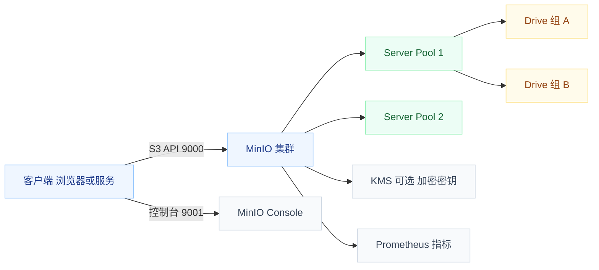
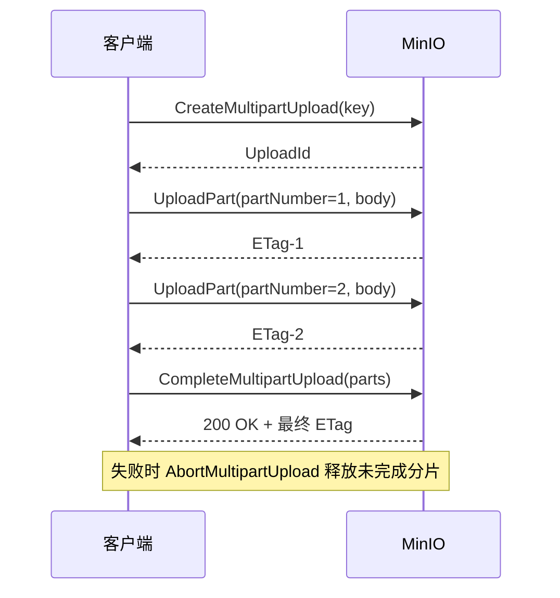
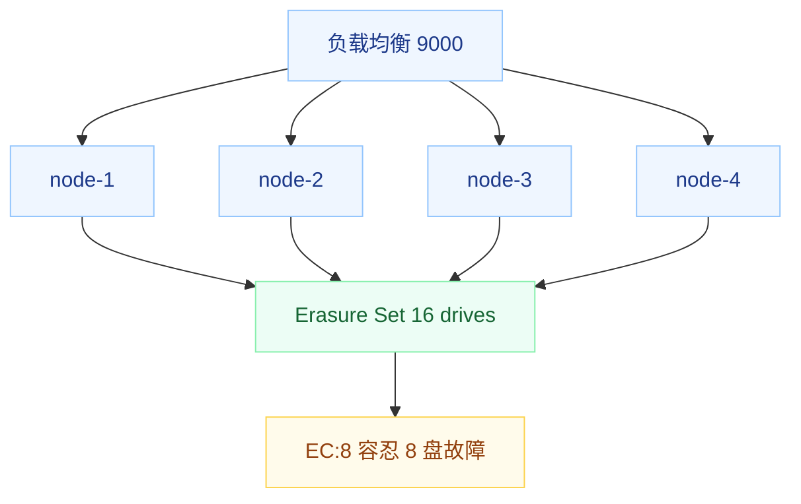

# MinIO对象存储

> 这篇从对象存储与文件系统的分工和版本边界讲起，经过单机安装与最小验证、桶与对象操作、权限与预签名、分片上传，到 Java SDK 集成和分布式部署运维，最后落到一个商品图片与视频迁移的上线案例。
>
> 学完能独立部署 MinIO，按前缀规划桶和对象键，用策略和预签名控制访问，实现大文件分片上传与断点续传，并把上传下载能力接进 Spring Boot 服务。

## 一、对象存储的边界与版本

MinIO 是兼容 S3 API 的对象存储（object storage），把数据按“桶（bucket）→ 对象键（object key）→ 数据 + 元数据”组织，用纠删码（erasure coding）在普通磁盘上做冗余。判断标准只有一条：**存的是整块二进制、按 key 取用、不需要随机修改中间字节，就用对象存储；需要文件锁、随机读写、目录语义，就用 NAS 或本地盘。**

| 维度 | 本地文件系统 | MinIO 对象存储 |
|---|---|---|
| 访问协议 | POSIX | HTTP + S3 API |
| 修改方式 | 随机写 | 整对象覆盖 |
| 扩容 | 加盘、迁数据 | 加服务器池 |
| 冗余 | RAID 卡 | 纠删码 |
| 典型用途 | 应用临时文件 | 图片、视频、备份、日志归档 |

对象存储没有真正的目录，`images/2026/11/a.jpg` 只是一个带斜杠的键，前缀（prefix）查询靠字典序实现。这个模型决定了它适合“一次写入、多次读取”，不适合数据库文件、虚拟机镜像盘这类需要原地更新的数据。



版本策略要单独说清：MinIO 服务端按 `RELEASE.YYYY-MM-DDTHH-MM-SSZ` 发布，没有语义化的“大版本”。社区版不再提供长期支持分支，生产必须锁定一个自己回归过的 RELEASE 并保留二进制，升级靠换二进制回滚。

| 组件 | 版本基线 | 说明 |
|---|---|---|
| MinIO Server | RELEASE.2025-09-07T16-13-09Z（示例） | 以官网下载页最新 RELEASE 为准 |
| MinIO Client `mc` | RELEASE.2025-08-13T08-35-41Z（示例） | 与服务端同批下载 |
| Java SDK | 8.5.x | `io.minio:minio` |
| S3 API | SigV4 | 与 AWS SDK v2 兼容 |

> 版本基线（2026-11）：MinIO 社区版控制台在 2025 年后逐步收缩管理功能，用户、策略、生命周期等操作以 `mc` 和 API 为准，不要依赖控制台点选。生产禁止使用默认的 `minioadmin/minioadmin`。

边界：MinIO 不是网盘，不提供协同编辑和文件锁；单机单盘模式没有冗余，磁盘坏就是数据丢。桶名全局在集群内唯一，创建后不能改名，对象键设计错了只能整桶迁移。

## 二、安装与最小验证

最小闭环是：服务起来、`mc` 能连、建桶、传一个文件、用 HTTP 取回。MinIO 是单个静态二进制，没有运行时依赖，这是它比传统分布式存储省事的地方。

### 2.1 Linux（Ubuntu 为主）

```bash
# 下载服务端与客户端
sudo curl -Lo /usr/local/bin/minio https://dl.min.io/server/minio/release/linux-amd64/minio
sudo curl -Lo /usr/local/bin/mc https://dl.min.io/client/mc/release/linux-amd64/mc
sudo chmod +x /usr/local/bin/minio /usr/local/bin/mc

# 专用用户与数据目录；对象存储目录不要和其它服务共用
sudo useradd -r -s /sbin/nologin minio-user
sudo mkdir -p /data/minio
sudo chown -R minio-user:minio-user /data/minio
```

启动参数用环境变量给凭据，不要写在命令行里，命令行会被 `ps` 看到：

```bash
export MINIO_ROOT_USER=admin
export MINIO_ROOT_PASSWORD='S3cr3t-ChangeMe-2026'   # 至少 8 位
minio server /data/minio --address ":9000" --console-address ":9001"
```

生产用 systemd 托管：

```ini
# /etc/systemd/system/minio.service
[Unit]
Description=MinIO
After=network-online.target
Wants=network-online.target

[Service]
User=minio-user
Group=minio-user
EnvironmentFile=/etc/default/minio
ExecStart=/usr/local/bin/minio server /data/minio --address ":9000" --console-address ":9001"
Restart=always
LimitNOFILE=1048576

[Install]
WantedBy=multi-user.target
```

```bash
# /etc/default/minio，权限设为 600
MINIO_ROOT_USER=admin
MINIO_ROOT_PASSWORD=S3cr3t-ChangeMe-2026
MINIO_VOLUMES=/data/minio
MINIO_OPTS=--address ":9000" --console-address ":9001"
```

```bash
sudo chmod 600 /etc/default/minio
sudo systemctl daemon-reload
sudo systemctl enable --now minio
sudo systemctl status minio --no-pager
```

Rocky/CentOS 除包管理器换成 `dnf` 外步骤相同，注意把数据目录放在 XFS 上并关闭 SELinux 对该目录的限制，或正确打标签：

```bash
sudo dnf install -y policycoreutils-python-utils
sudo semanage fcontext -a -t bin_t /usr/local/bin/minio
sudo restorecon -v /usr/local/bin/minio
```

### 2.2 macOS 与 Windows

```bash
# macOS：Homebrew 安装，数据目录用用户目录下的路径
brew install minio/stable/minio minio/stable/mc
MINIO_ROOT_USER=admin MINIO_ROOT_PASSWORD='S3cr3t-ChangeMe-2026' \
  minio server ~/minio-data --console-address ":9001"
```

```powershell
# Windows PowerShell：下载 minio.exe 与 mc.exe 后
$env:MINIO_ROOT_USER="admin"
$env:MINIO_ROOT_PASSWORD="S3cr3t-ChangeMe-2026"
.\minio.exe server D:\minio-data --address ":9000" --console-address ":9001"
```

### 2.3 最小验证

```bash
# 配置别名，mc 把凭据存在 ~/.mc/config.json
mc alias set local http://127.0.0.1:9000 admin 'S3cr3t-ChangeMe-2026'

# 健康检查：live 只看进程，cluster 看集群是否可服务
curl -s -o /dev/null -w '%{http_code}\n' http://127.0.0.1:9000/minio/health/live
curl -s -o /dev/null -w '%{http_code}\n' http://127.0.0.1:9000/minio/health/cluster
```

预期输出：

```text
200
200
```

建桶、传文件、取回：

```bash
mc mb local/demo
echo 'hello minio' > /tmp/hello.txt
mc cp /tmp/hello.txt local/demo/docs/hello.txt
mc ls local/demo/docs/
mc cat local/demo/docs/hello.txt

# 直接用 HTTP 取，验证 S3 兼容性
curl -s http://127.0.0.1:9000/demo/docs/hello.txt
```

预期输出（示例）：

```text
Bucket created successfully `local/demo`.

/tmp/hello.txt:  12 B / 12 B  ━━━━━━━━━━━━━━━━━━━━━━━━━━━━━━━━  100%  1.2 KiB/s  0s
[2026-11-13 10:02:31 CST]    12B  docs/hello.txt
hello minio
```

```text
<?xml version="1.0" encoding="UTF-8"?>
<Error><Code>AccessDenied</Code><Message>Access Denied.</Message>...</Error>
```

最后一条 `AccessDenied` 是预期结果，不是故障：桶默认私有，匿名 HTTP 请求必须走预签名或桶策略。这一步能确认“服务在跑、桶是私有的”两件事。

```bash
# 预签名后匿名可取，有效期 1 小时
mc share download --expire 1h local/demo/docs/hello.txt
```

> 边界：`MINIO_ROOT_PASSWORD` 少于 8 位服务直接拒绝启动；`mc alias set` 会把明文凭据写入 `~/.mc/config.json`，CI 里用 `--api-key` 或临时配置文件。9000 是数据端口，9001 是控制台端口，只对内网开放 9001，公网只暴露 9000 并加 TLS。

## 三、桶、对象与元数据

桶是权限、版本、生命周期、复制的边界，规划时按“业务域 + 环境”分，不要一个桶装所有东西。对象键用“日期 + 业务 ID”分层，既便于前缀查询，也便于按前缀配生命周期。

| 操作 | 命令 | 说明 |
|---|---|---|
| 建桶 | `mc mb local/media` | 名称 3–63 位小写 |
| 列对象 | `mc ls --recursive local/media` | 递归列出全部键 |
| 看元数据 | `mc stat local/media/a.jpg` | 大小、ETag、Content-Type |
| 复制 | `mc cp --recursive` | 跨桶、跨集群 |
| 镜像 | `mc mirror --watch` | 增量同步，适合迁移 |
| 删除 | `mc rm --recursive --force` | 不可恢复，先确认版本 |

对象写入时元数据比数据更容易出错。`Content-Type` 决定浏览器是预览还是下载，`Content-Disposition` 决定文件名，自定义元数据以 `x-amz-meta-` 前缀存：

```bash
mc cp /tmp/report.pdf local/media/2026/11/report.pdf \
  --attr 'Content-Type=application/pdf' \
  --attr 'Content-Disposition=attachment; filename="2026-11-report.pdf"' \
  --attr 'X-Amz-Meta-Owner=finance'

mc stat local/media/2026/11/report.pdf
```

版本控制打开后，同名覆盖会保留历史版本，误删可以恢复，但磁盘会持续增长：

```bash
mc version enable local/media
mc version list local/media/2026/11/report.pdf
# 恢复到指定版本
mc cp --version-id <VERSION_ID> local/media/2026/11/report.pdf /tmp/report-old.pdf
```

批量列举走 S3 的 ListObjectsV2，单次最多 1000 个，必须用 `continuation-token` 翻页：

```bash
# 按前缀列，只取第一页，观察截断标志
aws --endpoint-url http://127.0.0.1:9000 s3api list-objects-v2 \
  --bucket media --prefix '2026/11/' --max-keys 1000
```

```json
{
  "IsTruncated": true,
  "Contents": [
    { "Key": "2026/11/report.pdf", "Size": 48213, "ETag": "\"9f2c...\"", "StorageClass": "STANDARD" }
  ],
  "NextContinuationToken": "1ueGcxLPRx1Tr/XYExHnhbYLgveDs2J/wm36Hy4vbOwM="
}
```

> 边界：`mc rm` 默认交互确认，脚本里加 `--force` 前必须确认路径；开了版本控制后 `mc rm` 只加删除标记，`--recursive --force` 会连历史版本一起删。对象键区分大小写，`A.jpg` 和 `a.jpg` 是两个对象，客户端生成键时要统一小写。`Content-Type` 不设置会退化成 `application/octet-stream`，浏览器直接下载而不是预览。

## 四、访问控制与预签名

权限模型是“用户/组 → 策略 → 资源与动作”。生产规则：**应用不拿 root 凭据，一个应用一个用户，策略按桶和前缀最小化，前端直传一律用预签名 URL。**

内置策略够覆盖大部分场景，先看再自定义：

```bash
mc admin policy list local
# readonly / writeonly / readwrite / diagnostics / consoleAdmin
```

```bash
# 建用户并只授予 media 桶读写
mc admin user add local app-media 'App-Media-Pass-2026'
mc admin policy attach local readwrite --user app-media

# 组用于批量授权
mc admin group add local svc-media app-media
mc admin policy attach local readonly --group svc-media
```

内置策略粒度太粗时写自定义策略，只允许 `uploads/` 前缀写、`public/` 前缀读：

```json
{
  "Version": "2012-10-17",
  "Statement": [
    {
      "Effect": "Allow",
      "Action": ["s3:PutObject", "s3:AbortMultipartUpload", "s3:ListMultipartUploadParts"],
      "Resource": ["arn:aws:s3:::media/uploads/*"]
    },
    {
      "Effect": "Allow",
      "Action": ["s3:GetObject"],
      "Resource": ["arn:aws:s3:::media/public/*"]
    },
    {
      "Effect": "Allow",
      "Action": ["s3:ListBucket"],
      "Resource": ["arn:aws:s3:::media"],
      "Condition": { "StringLike": { "s3:prefix": ["uploads/*", "public/*"] } }
    }
  ]
}
```

```bash
mc admin policy create local media-app-policy media-app-policy.json
mc admin policy attach local media-app-policy --user app-media
mc admin policy entities local --user app-media
```

预签名（presigned URL）把一次操作的授权编码进查询串，客户端不需要凭据。它适合“浏览器直传、限时下载”，不适合长期分享：

```bash
# 下载链接，最长 7 天（SigV4 上限）
mc share download --expire 24h local/media/public/guide.pdf

# 上传链接，curl 直接 PUT
mc share upload --expire 30m local/media/uploads/a.jpg
```

```bash
curl -X PUT --upload-file /tmp/a.jpg 'http://127.0.0.1:9000/media/uploads/a.jpg?X-Amz-Algorithm=...'
```

桶策略用于公开静态资源，能匿名读整个前缀。除非确实是公开素材，否则不要开：

```bash
mc anonymous set download local/media/public
mc anonymous get local/media/public
# 关闭
mc anonymous set none local/media/public
```

| 方式 | 凭据暴露 | 有效期 | 适用 |
|---|---|---|---|
| 长期 AccessKey | 在客户端 | 永久 | 服务端到服务端 |
| STS 临时凭据 | 短期 | 分钟到小时 | 多租户、联合登录 |
| 预签名 URL | 不暴露 | 最长 7 天 | 浏览器直传/下载 |
| 桶策略匿名 | 无 | 永久 | 公开静态资源 |

> 边界：预签名 URL 一旦发出就无法单独撤销，只能轮换该用户的密钥或删对象；有效期按业务给，下载链接给 7 天等于长期泄露。`mc anonymous set download` 会连列目录一起放开，只想单对象公开时用预签名。策略里的 `Resource` 必须写到对象级 `bucket/prefix/*`，只写桶 ARN 对对象操作不生效，这是 `AccessDenied` 最常见的原因。

## 五、分片上传与断点续传

超过 100 MB 的对象必须用分片上传（multipart upload），否则一次 PUT 失败就要从头再来。S3 的约束是硬性的：单文件最大 5 TiB，单片 5 MiB–5 GiB，最多 10000 片，最后一片可以小于 5 MiB。



`mc cp` 自动分片，日常不用手写协议；只有做浏览器直传或自研客户端时才需要自己拼：

```bash
# 大文件默认按 16 MiB 分片，可显式指定
mc cp --part-size 32MiB /data/big-video.mp4 local/media/video/big-video.mp4
mc stat local/media/video/big-video.mp4
```

```text
Name      : big-video.mp4
Size      : 1.4 GiB
ETag      : 5d41402abc4b2a76b9719d911017c592-45   # 45 片，说明走了分片上传
Type      : video/mp4
```

Java SDK 里 `putObject` 传 `stream(-1, partSize)` 就自动分片；真正的断点续传要自己记录已完成的片号和 ETag：

```java
public String uploadWithResume(String bucket, String key, Path file, int partSize)
        throws Exception {
    String uploadId = client.createMultipartUpload(
            CreateMultipartUploadArgs.builder().bucket(bucket).object(key).build()).uploadId();

    List<Part> parts = new ArrayList<>();
    long size = Files.size(file);
    int partNumber = 1;

    try (RandomAccessFile raf = new RandomAccessFile(file.toFile(), "r")) {
        for (long offset = 0; offset < size; offset += partSize, partNumber++) {
            int len = (int) Math.min(partSize, size - offset);
            byte[] buf = new byte[len];
            raf.seek(offset);
            raf.readFully(buf);

            // 每片独立重试：失败只重传这一片，不从头开始
            String etag = uploadPartWithRetry(bucket, key, uploadId, partNumber, buf, 3);
            parts.add(new Part(partNumber, etag));
        }
    } catch (Exception e) {
        // 失败要显式 abort，否则未完成分片会一直占磁盘
        client.abortMultipartUpload(AbortMultipartUploadArgs.builder()
                .bucket(bucket).object(key).uploadId(uploadId).build());
        throw e;
    }

    client.completeMultipartUpload(CompleteMultipartUploadArgs.builder()
            .bucket(bucket).object(key).uploadId(uploadId).parts(parts).build());
    return key;
}
```

清理未完成分片是上线必做项。MinIO 不会自动回收，未完成的分片按原大小占盘：

```bash
# 列出未完成的分片上传
mc ls --incomplete --recursive local/media
# 删除 7 天前的未完成上传
mc rm --incomplete --recursive --older-than 7d local/media
```

也可以交给生命周期规则，让服务端自动中止：

```bash
# 未完成分片超过 7 天自动中止，避免长期占盘
mc ilm rule add local/media --abort-incomplete-multipart-upload-days 7
# 临时前缀的对象 90 天后过期
mc ilm rule add local/media --expire-days 90 --prefix 'tmp/'
mc ilm rule ls local/media
```

> 边界：分片大小一旦开始上传就不能改，续传必须用同一个 `UploadId` 和相同的分片边界，否则合并会失败。`CompleteMultipartUpload` 的 parts 必须按 `partNumber` 升序，ETag 要带引号原样回传。生命周期规则按天计算，紧急清理仍要手动 `mc rm --incomplete`。

## 六、Java SDK 与业务集成

Java 侧有两条路：MinIO 官方 SDK（API 更贴近 MinIO，异常信息清楚）和 AWS SDK v2 的 S3 客户端（生态更广，换云厂商只改 endpoint）。判断标准：**只对 MinIO，用官方 SDK；要保留迁云可能，用 AWS SDK v2 并开启 path-style。**

```xml
<dependency>
    <groupId>io.minio</groupId>
    <artifactId>minio</artifactId>
    <version>8.5.17</version>
</dependency>
```

```java
@Configuration
public class MinioConfig {

    @Bean
    public MinioClient minioClient(MinioProperties props) {
        return MinioClient.builder()
                .endpoint(props.endpoint())        // http://minio:9000，不要带桶名
                .credentials(props.accessKey(), props.secretKey())
                // 自建集群用自签证书时给自定义 trust，不要关校验
                .build();
    }
}
```

```java
@Service
public class MediaStorageService {
    private final MinioClient client;
    private final String bucket;

    public MediaStorageService(MinioClient client, MinioProperties props) {
        this.client = client;
        this.bucket = props.bucket();
    }

    public void upload(InputStream in, long size, String key, String contentType) throws Exception {
        client.putObject(PutObjectArgs.builder()
                .bucket(bucket)
                .object(key)
                // size 已知就传真实值；未知传 -1 并给分片大小，SDK 自动分片
                .stream(in, size, size > 0 ? -1 : 16 * 1024 * 1024)
                .contentType(contentType)
                .build());
    }

    public String presignedGet(String key, Duration ttl) throws Exception {
        // 返回给前端的地址，TTL 不要超过业务需要
        return client.getPresignedObjectUrl(GetPresignedObjectUrlArgs.builder()
                .method(Method.GET)
                .bucket(bucket)
                .object(key)
                .expiry((int) ttl.toSeconds())
                .build());
    }

    public String presignedPut(String key, Duration ttl) throws Exception {
        return client.getPresignedObjectUrl(GetPresignedObjectUrlArgs.builder()
                .method(Method.PUT)
                .bucket(bucket)
                .object(key)
                .expiry((int) ttl.toSeconds())
                .build());
    }
}
```

错误处理要按 S3 错误码分支，不要笼统 catch：

```java
try {
    storage.upload(in, size, key, "image/jpeg");
} catch (ErrorResponseException e) {
    String code = e.errorResponse().code();
    switch (code) {
        case "NoSuchBucket" -> throw new BizException("存储桶不存在，检查配置");
        case "AccessDenied" -> throw new BizException("无写入权限，检查策略");
        case "XMinioInvalidObjectName" -> throw new BizException("对象键非法");
        case "XMinioAdminBucketQuotaExceeded" -> throw new BizException("桶配额已满");
        default -> throw new BizException("上传失败: " + code);
    }
}
```

Spring Boot 配置与上传接口：

```yaml
minio:
  endpoint: http://127.0.0.1:9000
  access-key: ${MINIO_ACCESS_KEY}
  secret-key: ${MINIO_SECRET_KEY}
  bucket: media
```

```java
@RestController
@RequestMapping("/api/media")
public class MediaController {
    private final MediaStorageService storage;

    @PostMapping("/upload")
    public Map<String, String> upload(@RequestParam MultipartFile file,
                                      @RequestParam(defaultValue = "uploads") String prefix)
            throws Exception {
        // 键里放日期和 UUID：避免同名覆盖，也便于按前缀做生命周期
        String key = prefix + "/" + LocalDate.now() + "/" + UUID.randomUUID()
                + "-" + file.getOriginalFilename();
        storage.upload(file.getInputStream(), file.getSize(), key, file.getContentType());
        return Map.of("key", key, "url", storage.presignedGet(key, Duration.ofMinutes(10)));
    }
}
```

验证：

```bash
curl -s -F 'file=@/tmp/a.jpg' -F 'prefix=uploads' http://localhost:8080/api/media/upload
```

预期输出（示例）：

```json
{"key":"uploads/2026-11-13/3f2b1c9e-a.jpg","url":"http://127.0.0.1:9000/media/uploads/2026-11-13/3f2b1c9e-a.jpg?X-Amz-Algorithm=AWS4-HMAC-SHA256&X-Amz-Expires=600&..."}
```

换成 AWS SDK v2 时关键在 `endpointOverride` 和 `pathStyleAccessEnabled(true)`，否则 SDK 会拼成 `bucket.127.0.0.1` 这种解析不了的域名：

```java
S3Client s3 = S3Client.builder()
        .endpointOverride(URI.create("http://127.0.0.1:9000"))
        .region(Region.US_EAST_1)                 // MinIO 忽略 region，但 SDK 必填
        .credentialsProvider(StaticCredentialsProvider.create(
                AwsBasicCredentials.create(accessKey, secretKey)))
        .forcePathStyle(true)                     // 关键：不用虚拟主机风格
        .build();
```

> 边界：`getPresignedObjectUrl` 的有效期上限是 7 天，超过直接抛异常；`putObject` 的 `size` 传错会导致内容截断或阻塞，未知大小就用 `-1` 加分片大小。Spring 的 `MultipartFile` 默认把文件落临时盘，超过 `spring.servlet.multipart.max-file-size` 会在进 Controller 前就失败，大文件应改成前端拿预签名直传。

## 七、分布式部署、扩容与运维

分布式模式用“服务器池（server pool）”组织：每个池内所有磁盘组成纠删码集合（erasure set），默认校验块为总数的一半，可容忍一半磁盘故障。判断标准：**生产至少 4 节点 4 盘，单池不要跨机房，扩容按整池加。**

```bash
# 4 节点 × 4 盘 = 16 块盘，默认 EC:8，可坏 8 块
export MINIO_ROOT_USER=admin
export MINIO_ROOT_PASSWORD='S3cr3t-ChangeMe-2026'
minio server http://node{1...4}/data{1...4} \
  --address ":9000" --console-address ":9001"
```



扩容只能加新池，新池必须与旧池同规格；不同盘数的池混用会让数据分布倾斜：

```bash
# 在原命令后追加第二个池，重启全部节点
minio server http://node{1...4}/data{1...4} http://node{5...8}/data{1...4}
```

日常运维命令：

```bash
mc admin info local                 # 节点、磁盘、容量
mc admin heal -r local              # 全量自愈，磁盘替换后必做
mc admin trace -v local             # 实时请求追踪，排障用
mc admin scanner status local       # 后台扫描进度
mc admin prometheus generate local  # 生成抓取配置
```

监控至少接四类指标：容量使用率、磁盘离线数、请求错误率、请求延迟。MinIO 暴露 Prometheus 格式：

```yaml
# prometheus.yml 片段
scrape_configs:
  - job_name: minio
    metrics_path: /minio/v2/metrics/cluster
    bearer_token_file: /etc/prometheus/minio-token
    static_configs:
      - targets: ["node-1:9000", "node-2:9000", "node-3:9000", "node-4:9000"]
```

生命周期与分层：

```bash
# 30 天后转冷存储层，365 天后过期删除
mc ilm rule add local/media --transition-days 30 --storage-class COLD
mc ilm rule add local/media --expire-days 365 --prefix 'logs/'
mc ilm rule ls local/media --expanded
```

> 边界：`mc admin heal` 会占大量 IO，业务高峰不要跑全量，按桶或前缀分批。纠删码的冗余靠磁盘数，单节点 1 块盘等于没有冗余，不要用“4 个单盘节点”冒充分布式。升级用滚动替换二进制，一次只停一个节点，等 `mc admin info` 显示该节点恢复再继续。

## 八、故障排查

排障顺序固定：先看进程和端口，再看凭据与时间，再看策略，最后看磁盘与纠删码。**签名类错误九成是时间或密钥，不要先怀疑网络。**

| 现象 | 常见原因 | 第一条命令 |
|---|---|---|
| 连接被拒 | 服务未起、端口错 | `ss -lntp \| grep 900` |
| `AccessDenied` | 策略未授权、前缀不匹配 | `mc admin trace -v local` |
| `SignatureDoesNotMatch` | 密钥错、URL 被改写 | `date -u`，核对 AK/SK |
| `RequestTimeTooSkewed` | 时钟偏差超 15 分钟 | `timedatectl` |
| `SlowDown` | 请求过快触发限流 | `mc admin info local` |
| 磁盘离线 | 挂载丢失、盘坏 | `mc admin info local` |
| 读失败但盘在 | 达不到读仲裁 | `mc admin heal -r` |

签名排查先确认时间，S3 的 SigV4 允许的最大偏差是 15 分钟：

```bash
timedatectl status
sudo timedatectl set-ntp true
```

策略排查用 trace 看服务端实际拒绝的动作和资源：

```bash
mc admin trace -v --status-code 403 local
```

预期输出（示例）：

```text
10:21:33.441 [403 Forbidden] api.PutObject
  bucket=media object=uploads/a.jpg
  error=AccessDenied, message=Access Denied.
```

这条输出直接给出“动作 + 资源”，拿它去对策略里的 `Action` 和 `Resource`，比猜快得多。

磁盘与容量：

```bash
mc admin info local
```

```text
●  node-1:9000
   Uptime: 12 days
   Drives: 4/4 OK
   Capacity: 3.2 TiB / 7.3 TiB (44%)
   Pool: 1

●  node-4:9000
   Drives: 3/4 OK          # 一块盘离线
   Capacity: 2.4 TiB / 5.4 TiB
```

一块盘离线时集群仍可读写（EC:8 容错范围内），但必须尽快换盘并 heal；两块以上同组盘离线会触发读仲裁失败，写入直接返回 503。

对象名与键的常见错误：

```bash
# 键里有连续斜杠、以斜杠结尾、超过 1024 字节，都会被拒
mc cp /tmp/a.jpg 'local/media//a.jpg'
```

```text
mc: <ERROR> Failed to copy `/tmp/a.jpg`. Object name invalid.
```

> 边界：`mc admin trace` 输出包含完整对象键，生产排障时注意脱敏。换盘后不要立刻删旧盘数据，先 heal 到 `Healed` 再下线。容量到 90% 以上时写入会变慢，MinIO 没有自动水位保护，必须靠监控告警提前扩容。

## 九、最佳实践案例

### 9.1 案例背景

一个内容社区把用户上传的图片和短视频放在应用服务器的本地目录，通过 Nginx 直接出静态文件。现状是：三台应用服务器各存一份，用户换机器访问就 404；视频平均 300 MB，用表单上传经常超时；每次发布要同步目录，运维靠 `rsync` 手工做。

目标是迁到 4 节点 MinIO：图片走预签名直传，视频走分片上传，历史 2.1 TB 数据一次性迁移并校验；下载链接限时 15 分钟，公开素材单独开匿名读。约束是 Java 21 + Spring Boot 3.5，客户端不能持有长期密钥，迁移窗口只有一个周末。

### 9.2 案例实操

第一步，按第 7 节部署 4 节点集群，数据盘用 XFS，关闭透明大页：

```bash
# 每台节点执行
sudo mkfs.xfs -f /dev/sdb
sudo mkdir -p /data/1 /data/2 /data/3 /data/4
for i in 1 2 3 4; do
  echo "/dev/sd$i /data/$i xfs defaults,noatime 0 0" | sudo tee -a /etc/fstab
done
sudo mount -a
echo never | sudo tee /sys/kernel/mm/transparent_hugepage/enabled
```

第二步，按业务建桶并定键规范：`media` 放用户图片和视频，`public` 放运营素材，`backup` 放数据库备份。键统一为 `业务/年/月/日/uuid.ext`。

```bash
mc mb local/media local/public local/backup
mc version enable local/media
mc ilm rule add local/media --abort-incomplete-multipart-upload-days 3
mc ilm rule add local/media --expire-days 365 --prefix 'tmp/'
```

第三步，建应用用户与最小策略，只允许 `media` 的 `uploads/` 前缀读写，`public` 只读：

```bash
mc admin user add local svc-community "$(openssl rand -base64 24)"
mc admin policy create local community-app community-app.json
mc admin policy attach local community-app --user svc-community
```

```json
{
  "Version": "2012-10-17",
  "Statement": [
    { "Effect": "Allow",
      "Action": ["s3:PutObject", "s3:GetObject", "s3:AbortMultipartUpload",
                 "s3:ListMultipartUploadParts"],
      "Resource": ["arn:aws:s3:::media/uploads/*"] },
    { "Effect": "Allow", "Action": ["s3:GetObject"],
      "Resource": ["arn:aws:s3:::public/*"] }
  ]
}
```

第四步，迁移历史数据。`mc mirror` 支持增量与校验，先演练一遍统计差异，再正式同步：

```bash
mc alias set old http://10.0.2.10:9000 oldadmin "$OLD_PASS"
mc mirror --overwrite --preserve old/media local/media
mc mirror --overwrite --preserve old/public local/public

# 校验：对比对象数与总字节
mc du old/media; mc du local/media
```

```text
2.1TiB   18342 objects  old/media
2.1TiB   18342 objects  local/media
```

第五步，应用改造：图片由后端签发预签名 PUT，浏览器直传；视频由客户端分片，服务端只负责发 `UploadId` 和合并。

```java
// 签发直传地址，限制前缀与大小由前端校验 + 桶策略双重保证
@PostMapping("/api/media/presign")
public Map<String, String> presign(@RequestBody PresignRequest req) throws Exception {
    String key = "uploads/" + LocalDate.now() + "/" + UUID.randomUUID()
            + "-" + sanitize(req.filename());   // 文件名消毒，防路径穿越
    String url = client.getPresignedObjectUrl(GetPresignedObjectUrlArgs.builder()
            .method(Method.PUT)
            .bucket("media")
            .object(key)
            .expiry(600)                        // 10 分钟，够传一个图片
            .build());
    return Map.of("key", key, "uploadUrl", url);
}
```

```bash
# 模拟浏览器直传
curl -X PUT --upload-file /tmp/cover.jpg \
  'http://node-1:9000/media/uploads/2026-11-13/8c1d-cover.jpg?X-Amz-Algorithm=...'
```

第六步，下载统一走预签名，链接 15 分钟过期，前端不做永久缓存：

```java
public String downloadUrl(String key) throws Exception {
    return client.getPresignedObjectUrl(GetPresignedObjectUrlArgs.builder()
            .method(Method.GET)
            .bucket("media")
            .object(key)
            .expiry(900)
            .build());
}
```

验证：

```bash
# 1. 预签名下载能取到，去掉签名参数应 403
curl -s -o /dev/null -w '%{http_code}\n' "$(curl -s -X POST localhost:8080/api/media/presign \
  -H 'Content-Type: application/json' -d '{"filename":"cover.jpg"}' | jq -r .uploadUrl)"

# 2. 未授权前缀应被拒
mc cp /tmp/a.jpg local/media/other/a.jpg --insecure
```

预期输出（示例）：

```text
200
mc: <ERROR> Failed to copy `/tmp/a.jpg`. Access Denied.
```

### 9.3 案例结果

迁移完成后 2.1 TB、18342 个对象全部校验一致，应用服务器本地盘占用从 2.4 TB 降到 40 GB；图片上传成功率从 92% 提升到 99.6%，视频上传超时投诉归零（示例指标，按上线两周统计）。下载走预签名后，盗链请求下降明显，公开素材仍可被 CDN 回源缓存。

复盘三个失败模式。第一，最初用 root 凭据给应用，密钥泄露后无法定位来源；改成独立用户 + 前缀策略后，`mc admin trace` 能直接看到是哪个用户越权。第二，视频上传没有配 `abort-incomplete-multipart-upload`，一个月后残留分片占了 380 GB；补上生命周期规则并加监控。第三，迁移时先 `mc mirror` 再切流量，但切换前旧集群仍在写入，导致 200 多个新对象丢失；正确做法是切只读、再增量同步一次、校验后再切写。

下一步是把 `media` 桶复制到异地集群（`mc replicate add`），并把容量、磁盘离线、5xx 三个指标接入告警。
