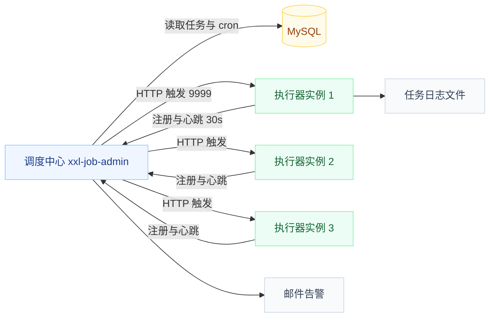
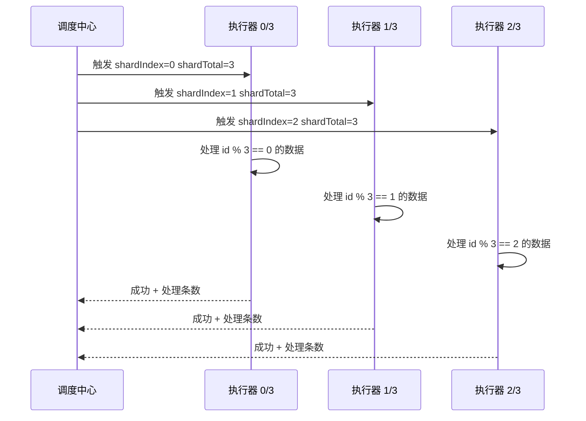
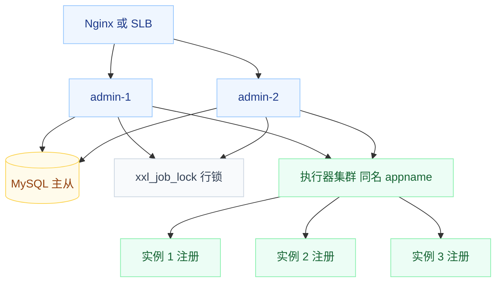

# XXL-Job任务调度

> 这篇从定时任务的边界和 3.x 版本讲起，经过调度中心与执行器的安装、任务开发与注册、调度参数、分片广播和任务治理，到执行器高可用与故障排查，最后落到一个订单关单与对账的调度上线案例。
>
> 学完能独立部署 XXL-Job 调度中心，把 Spring Boot 服务接成执行器，写出可重试、可观测、可分片的定时任务，并在任务不触发或重复执行时快速定位原因。

## 一、调度能力的边界与版本

XXL-Job 是“调度中心 + 执行器”的分布式任务调度平台：调度中心负责按 cron 触发、路由到某台执行器、记录日志和告警；执行器是业务应用里的一个线程池，负责真正跑任务。判断标准只有一条：**需要多实例部署、需要可视化管理、失败要能重试和告警的定时任务，用 XXL-Job；单机一次性的定时逻辑，用 `@Scheduled` 就够。**

| 维度 | `@Scheduled` | XXL-Job 3.x |
|---|---|---|
| 多实例 | 每台都跑，需自己加锁 | 调度中心统一触发 |
| 改 cron | 改代码重启 | 控制台即时生效 |
| 失败重试 | 自己实现 | 内置重试次数 |
| 执行日志 | 散在应用日志 | 按次归档可查 |
| 分片 | 不支持 | 广播 + 分片参数 |
| 告警 | 自己接 | 邮件/自定义 |

调度中心与执行器的关系是“控制面与数据面”：业务代码只依赖 `xxl-job-core`，不依赖调度中心的库；执行器启动后主动向调度中心注册，调度中心从不反向连执行器发起注册，只按注册地址回调。



版本上，3.x 基于 Spring Boot 3 与 JDK 17+，执行器的编程模型与 2.4 基本一致，差异集中在控制台、依赖坐标和部分默认配置。存量 2.x 升级要先在预发验证 GLUE 脚本和自定义告警。

| 版本 | JDK | Spring Boot | 状态 |
|---|---|---|---|
| 2.4.x | 8+ | 2.x | 仅维护存量 |
| 3.0.x | 17+ | 3.x | 过渡版本 |
| 3.1.x | 17+ | 3.x | 当前主线 |

> 版本基线（2026-11）：本文以 XXL-Job 3.1.0、JDK 21、Spring Boot 3.5.6、MySQL 8.4 为例。调度中心与执行器的 `xxl-job-core` 版本必须一致，混版会出现注册成功但触发 404 的情况。

边界：XXL-Job 保证“至少触发一次”，不保证“只执行一次”。网络抖动、执行器重启、重试都会导致重复执行，所以任务必须自己幂等。cron 按调度中心的时钟计算，调度中心和执行器都要开 NTP，否则会出现“配置了 2 点却 3 点跑”。

## 二、调度中心与执行器安装

最小闭环是：建库、起调度中心、起一个执行器、在控制台看到执行器在线、手动触发一次并看到日志。调度中心是标准 Spring Boot 应用，执行器是业务应用里的一个 Starter。

### 2.1 初始化数据库

```sql
CREATE DATABASE xxl_job DEFAULT CHARACTER SET utf8mb4 COLLATE utf8mb4_0900_ai_ci;
CREATE USER 'xxl_job'@'%' IDENTIFIED BY 'Xxl-Job-Pass-2026';
GRANT ALL PRIVILEGES ON xxl_job.* TO 'xxl_job'@'%';
FLUSH PRIVILEGES;
```

```bash
# 表结构在源码 doc/db/tables_xxl_job.sql，8 张表
mysql -h127.0.0.1 -uroot -p xxl_job < doc/db/tables_xxl_job.sql
mysql -h127.0.0.1 -uroot -p -e 'use xxl_job; show tables;'
```

预期输出（示例）：

```text
Tables_in_xxl_job
xxl_job_group
xxl_job_info
xxl_job_lock
xxl_job_log
xxl_job_log_report
xxl_job_logglue
xxl_job_registry
xxl_job_user
```

八张表的分工：`xxl_job_info` 存任务定义，`xxl_job_log` 存每次触发与执行结果，`xxl_job_registry` 存执行器心跳，`xxl_job_lock` 是调度中心集群的分布式锁，`xxl_job_logglue` 存 GLUE 源码。

### 2.2 启动调度中心

```properties
# application.properties
server.port=8080
server.servlet.context-path=/xxl-job-admin

spring.datasource.url=jdbc:mysql://127.0.0.1:3306/xxl_job?useUnicode=true&characterEncoding=UTF-8&serverTimezone=Asia/Shanghai
spring.datasource.username=xxl_job
spring.datasource.password=Xxl-Job-Pass-2026
spring.datasource.driver-class-name=com.mysql.cj.jdbc.Driver

# 执行器与调度中心共享的令牌，必须一致；生产改成随机长串
xxl.job.accessToken=ChangeMe-3f9a2c
xxl.job.i18n=zh_CN
```

```bash
# 二进制启动
java -jar xxl-job-admin-3.1.0.jar --spring.config.location=/etc/xxl-job/application.properties

# 或源码构建
mvn -B -DskipTests clean package -pl xxl-job-admin -am
java -jar xxl-job-admin/target/xxl-job-admin-3.1.0.jar
```

验证：

```bash
curl -s -o /dev/null -w '%{http_code}\n' http://127.0.0.1:8080/xxl-job-admin/
```

预期输出：

```text
302
```

302 表示控制台起来了并跳转登录页。默认账号 `admin/123456`，第一次登录必须改密码。

### 2.3 接入执行器

```xml
<dependency>
    <groupId>com.xuxueli</groupId>
    <artifactId>xxl-job-core</artifactId>
    <version>3.1.0</version>
</dependency>
```

```yaml
xxl:
  job:
    admin:
      addresses: http://127.0.0.1:8080/xxl-job-admin   # 多个用逗号分隔
    accessToken: ChangeMe-3f9a2c                       # 必须与调度中心一致
    executor:
      appname: order-service                           # 执行器名，控制台按它分组
      address: ""                                      # 留空自动取本机 IP
      ip: ""
      port: 9999                                       # 执行器内嵌 HTTP 端口
      logpath: /data/applogs/xxl-job/jobhandler
      logretentiondays: 30
```

```java
@Configuration
public class XxlJobConfig {

    @Value("${xxl.job.admin.addresses}")
    private String adminAddresses;
    @Value("${xxl.job.accessToken}")
    private String accessToken;
    @Value("${xxl.job.executor.appname}")
    private String appname;
    @Value("${xxl.job.executor.address}")
    private String address;
    @Value("${xxl.job.executor.ip}")
    private String ip;
    @Value("${xxl.job.executor.port}")
    private int port;
    @Value("${xxl.job.executor.logpath}")
    private String logPath;
    @Value("${xxl.job.executor.logretentiondays}")
    private int logRetentionDays;

    @Bean
    public XxlJobSpringExecutor xxlJobExecutor() {
        XxlJobSpringExecutor executor = new XxlJobSpringExecutor();
        executor.setAdminAddresses(adminAddresses);
        executor.setAccessToken(accessToken);
        executor.setAppname(appname);
        executor.setAddress(address);
        executor.setIp(ip);
        executor.setPort(port);
        executor.setLogPath(logPath);
        executor.setLogRetentionDays(logRetentionDays);
        // 容器化部署时自动取 IP 常拿到 172.17.0.x，调度中心回连不到，
        // 此时显式配置 EXECUTOR_IP 或可路由的 address
        return executor;
    }
}
```

启动后确认注册：

```sql
SELECT registry_group, registry_key, registry_value, update_time
FROM xxl_job.xxl_job_registry ORDER BY update_time DESC LIMIT 5;
```

预期输出（示例）：

```text
registry_group   registry_key    registry_value              update_time
EXECUTOR         order-service   http://10.0.1.21:9999/      2026-11-13 10:31:12
```

控制台里对应执行器会显示“在线机器 1 台”。注册是执行器每 30 秒一次心跳，调度中心 90 秒收不到就摘除，所以下线后最多 90 秒仍可能被路由到，处理见第八章。

> 边界：`appname` 是逻辑分组，多实例必须同名才能被同一任务路由到；`address` 留空时自动探测本机 IP，多网卡或容器里经常探测错，生产建议显式配置。执行器端口 9999 不能被防火墙拦，调度中心要能直连它。

## 三、任务开发与注册

执行器里的一个任务就是一个带 `@XxlJob` 的方法，方法名对应控制台里的 JobHandler 名称。任务方法返回 `void`，用 `XxlJobHelper` 写日志和标记结果，这是 2.3 之后的标准写法。

```java
@Component
public class OrderJobHandler {

    private final OrderService orderService;

    public OrderJobHandler(OrderService orderService) {
        this.orderService = orderService;
    }

    @XxlJob("closeExpiredOrderHandler")
    public void closeExpiredOrder() {
        // 参数在控制台“任务参数”里配，这里取到的是原始字符串
        String param = XxlJobHelper.getJobParam();
        int batch = StringUtils.hasText(param) ? Integer.parseInt(param) : 500;

        XxlJobHelper.log("开始关单，batch={}", batch);
        int closed = orderService.closeExpired(batch);

        // 不写这行，日志里只有框架的“执行成功”，看不到业务量
        XxlJobHelper.log("本次关闭 {} 单", closed);
        XxlJobHelper.handleSuccess("closed=" + closed);
    }
}
```

`XxlJobHelper` 的常用方法：

| 方法 | 作用 | 注意 |
|---|---|---|
| `log(fmt, args)` | 写任务日志文件 | 控制台“执行日志”可见 |
| `getJobParam()` | 取控制台任务参数 | 空串不是 null |
| `getShardIndex()` | 当前分片序号 | 从 0 开始 |
| `getShardTotal()` | 分片总数 | 等于执行器实例数 |
| `handleSuccess(msg)` | 标记成功 | 不调用也会默认成功 |
| `handleFail(msg)` | 标记失败 | 才会触发重试与告警 |
| `handleTimeout()` | 标记超时 | 一般不用手写 |

异常处理是第一个坑：**捕获异常后不 `handleFail`，任务会显示成功，重试永远不会发生。**

```java
@XxlJob("syncProductHandler")
public void syncProduct() {
    try {
        productSync.run();
        XxlJobHelper.handleSuccess("ok");
    } catch (Exception e) {
        // 记录完整堆栈，控制台只看得到 message
        XxlJobHelper.log(e);
        XxlJobHelper.handleFail("同步失败: " + e.getMessage());  // 缺这行就不会重试
    }
}
```

控制台新建任务时必须填的字段：

| 字段 | 示例 | 说明 |
|---|---|---|
| 执行器 | order-service | 先选执行器再填 Handler |
| 任务描述 | 关闭超时未支付订单 | 便于检索 |
| 调度类型 | CRON | 或固定速度、无 |
| Cron | `0 0/15 * * * ?` | Quartz 六位，含秒 |
| 运行模式 | BEAN | GLUE 用于在线脚本 |
| JobHandler | closeExpiredOrderHandler | 与注解值一致 |
| 任务参数 | 500 | 传给 `getJobParam()` |

cron 是六位：秒 分 时 日 月 周。常用表达式：

```text
0 0/15 * * * ?      每 15 分钟
0 0 2 * * ?         每天 02:00
0 30 1 * * ?        每天 01:30
0 0 9 ? * MON-FRI   工作日 09:00
0 0 0 1 * ?         每月 1 日 00:00
```

> 边界：`JobHandler` 名字写错不会在保存时校验，要等触发时在日志里报 `job handler not found`；改名必须同步改控制台。Bean 模式的任务方法不能有参数、不能返回值，需要参数就用 `getJobParam()`。同一个 Handler 可以被多个任务复用，但日志和重试配置按任务独立。

## 四、调度配置：路由、阻塞、重试、超时

默认配置只适合单实例。多实例上线前必须逐项确认路由策略、阻塞处理、重试次数和超时时间，这四项决定了任务在异常时的行为。

| 路由策略 | 行为 | 适用 |
|---|---|---|
| FIRST | 固定第一台 | 单实例或需固定节点 |
| ROUND | 轮询 | 均摊负载 |
| RANDOM | 随机 | 无状态任务 |
| CONSISTENT_HASH | 按参数哈希 | 同一参数落同一台 |
| LEAST_FREQUENTLY_USED | 最少使用 | 长任务 |
| FAILOVER | 失败换一台重试 | 幂等任务 |
| BUSYOVER | 忙则换空闲 | 避免排队 |
| SHARDING_BROADCAST | 广播到所有实例 | 分片任务 |

阻塞处理策略决定“上一次没跑完，下一次到点怎么办”：

| 策略 | 行为 | 风险 |
|---|---|---|
| 单机串行 | 排队，依次执行 | 堆积会延迟 |
| 丢弃后续调度 | 直接跳过本次 | 可能漏跑 |
| 覆盖之前调度 | 终止上一次再跑 | 任务必须可中断 |

```text
# 订单关单：每 15 分钟一次，单次通常 20 秒
路由策略：ROUND
阻塞处理：丢弃后续调度
失败重试：2 次
超时时间：300 秒
```

```text
# 日终对账：必须跑完，不能丢
路由策略：SHARDING_BROADCAST
阻塞处理：单机串行
失败重试：3 次
超时时间：1800 秒
```

重试是“重新触发一次”，不是“从断点继续”。所以重试次数给 2–3 次就够，幂等靠唯一键或状态机，不靠重试。

超时时间到点后，XXL-Job 会中断执行线程：

```java
@XxlJob("exportReportHandler")
public void exportReport() {
    try {
        reportService.export();
    } catch (InterruptedException e) {
        // 超时中断会走到这里，必须恢复中断标记并让出
        Thread.currentThread().interrupt();
        XxlJobHelper.log("导出被超时中断，已生成的部分文件需清理");
        XxlJobHelper.handleFail("timeout interrupted");
    }
}
```

> 边界：超时中断依赖线程响应 `interrupt`，纯计算循环或阻塞在不可中断 IO 上的任务不会立刻停，仍会继续跑，所以任务内部要自己检查中断标记。`COVER_EARLY` 会杀上一次线程，若任务在写数据库可能留下半成品，必须配合事务或临时表。重试次数不是越大越好，下游故障时重试会放大压力。

## 五、分片广播与大数据量任务

分片广播把一次调度拆给所有执行器实例，每台拿到 `shardIndex` 和 `shardTotal`，各自处理一部分数据。它解决的是“单机跑不完”，不是“任务要并发”——分片数等于在线实例数，不能超过实例数。



```java
@XxlJob("reconcileHandler")
public void reconcile() {
    int index = XxlJobHelper.getShardIndex();
    int total = XxlJobHelper.getShardTotal();
    String bizDate = XxlJobHelper.getJobParam();   // 形如 2026-11-12

    XxlJobHelper.log("分片 {}/{} 开始对账，账期 {}", index, total, bizDate);

    long lastId = 0;
    int handled = 0;
    while (true) {
        // 按主键游标翻页，不用 OFFSET：大表 OFFSET 越翻越慢
        List<Order> batch = orderMapper.selectByIdGtAndMod(lastId, index, total, 1000);
        if (batch.isEmpty()) {
            break;
        }
        for (Order o : batch) {
            // 幂等：唯一键 (biz_date, order_id)，重复执行只更新不插入
            reconcileService.upsert(bizDate, o);
            lastId = o.getId();
            handled++;
        }
        XxlJobHelper.log("分片 {} 进度 lastId={} handled={}", index, lastId, handled);
    }

    XxlJobHelper.handleSuccess("shard=" + index + " handled=" + handled);
}
```

对应 SQL 用取模分片，注意 `mod` 的列要有索引或至少是主键，否则每台都全表扫：

```sql
SELECT id, order_no, amount, status
FROM t_order
WHERE id > #{lastId}
  AND MOD(id, #{total}) = #{index}
  AND created_at >= #{bizDate}
ORDER BY id
LIMIT #{limit};
```

分片数不是越多越好：实例扩容后 `shardTotal` 变化，取模的分配会整体漂移，正在跑的任务可能重复处理。处理办法是给账期加状态位，或者用“分片键范围”而不是取模。

> 边界：分片广播只在“路由策略”选 `SHARDING_BROADCAST` 时生效，选错策略只会有一台执行。实例数为 0 时任务直接失败，不会退化成单机跑。分片任务不要依赖内存里的累计状态，每台只看到自己那份。

## 六、任务日志、告警与生命周期

日志分两层：控制台的“执行日志”是每次调度的摘要（触发时间、结果、耗时），点进去是执行器写在磁盘上的详细日志。排障先看摘要的 `handleCode`，再看详细日志的最后 50 行。

```bash
# 执行器日志按任务 ID 和日期分目录
ls /data/applogs/xxl-job/jobhandler/2026-11-13/
tail -n 50 /data/applogs/xxl-job/jobhandler/2026-11-13/12.log
```

预期输出（示例）：

```text
2026-11-13 10:15:00 [com.example.job.OrderJobHandler#closeExpiredOrder]
----------- xxl-job job execute start -----------
----------- Param: 500
开始关单，batch=500
本次关闭 37 单
----------- xxl-job job execute end(finish) -----------
----------- Result: handleCode=200, handleMsg=closed=37
```

`handleCode` 的含义要背下来：200 成功、500 失败、502 超时、0 未完成。重试只对非 200 生效。

告警默认走邮件，在“任务告警”里填收件人，触发条件是失败或超时。邮件之外更实用的是把失败事件打到自己的告警通道：任务里 `handleFail` 前调用内部告警客户端，或在 `xxl_job_log` 上做巡检。

```sql
-- 巡检：近 1 小时失败的任务
SELECT job_id, executor_address, trigger_time, handle_code, handle_msg
FROM xxl_job.xxl_job_log
WHERE trigger_time > DATE_SUB(NOW(), INTERVAL 1 HOUR)
  AND handle_code <> 200
ORDER BY trigger_time DESC;
```

生命周期操作有五个，别混：

| 操作 | 作用 | 影响 |
|---|---|---|
| 启动 | 恢复按 cron 调度 | 到点自动触发 |
| 停止 | 暂停调度 | 已触发的继续跑 |
| 执行一次 | 立即触发，不影响 cron | 常用于补数 |
| 终止 | 中断正在跑的线程 | 依赖任务响应中断 |
| 删除 | 删除任务定义 | 日志保留 |

GLUE 模式允许在控制台直接写脚本，适合临时修复和运维脚本，不适合核心业务：脚本没有版本管理、没有单元测试、改错无法回滚。

```python
# GLUE(Python) 示例：清理 7 天前的临时文件
import os, time, glob
base = "/data/tmp"
cutoff = time.time() - 7 * 86400
removed = 0
for f in glob.glob(base + "/**/*", recursive=True):
    if os.path.isfile(f) and os.path.getmtime(f) < cutoff:
        os.remove(f)
        removed += 1
print("removed", removed)
```

> 边界：日志保留天数由执行器的 `logretentiondays` 控制，调度中心只保留数据库里的摘要，磁盘日志删了就无法回看详细堆栈。GLUE 脚本以执行器进程权限运行，能删库也能删盘，生产要限制谁能编辑。`执行一次` 也会占用阻塞队列，长任务期间点多次会按阻塞策略处理。

## 七、调度中心与执行器高可用

调度中心可以多实例，靠数据库里的 `xxl_job_lock` 表做分布式锁，同一时刻只有一个实例在调度；执行器多实例靠同名注册，由路由策略选一台。两端的可用性要分开设计。



调度中心多实例的要点：

```properties
# 两个实例配置相同的数据库和 accessToken，只改端口
server.port=8080
xxl.job.accessToken=ChangeMe-3f9a2c
```

```nginx
upstream xxl_admin {
    server 10.0.1.11:8080;
    server 10.0.1.12:8080;
}
server {
    listen 80;
    location /xxl-job-admin/ {
        proxy_pass http://xxl_admin;
        proxy_set_header Host $host;
    }
}
```

执行器多实例的要点：`appname` 必须相同，`port` 每台都是 9999 不冲突（各自机器），`logpath` 用本地盘不要用共享盘。注册地址必须能被调度中心访问：

```yaml
xxl:
  job:
    executor:
      appname: order-service
      # 容器里自动探测会拿到 Pod IP，跨节点不可达时显式指定宿主机地址
      address: http://10.0.1.21:9999/
```

时钟同步是硬要求，调度中心按自己的时钟算 cron，日志时间按执行器时钟记：

```bash
sudo timedatectl set-ntp true
timedatectl status | grep -E 'System clock|NTP'
```

> 边界：调度中心多实例不要共用同一个 `server.port` 在同一台机器；Nginx 必须支持长连接和足够的 `proxy_read_timeout`，否则控制台触发会 504。执行器滚动发布时，先等旧实例从注册表摘除（约 90 秒）再停，否则在途触发会连到已停端口。

## 八、故障排查

排障顺序固定：先确认执行器在线，再看任务是否到点，再看日志的 `handleCode`，最后看业务代码。**“任务没跑”九成是注册或 cron，不是业务异常。**

| 现象 | 常见原因 | 第一条命令 |
|---|---|---|
| 执行器显示离线 | 地址不可达、token 不一致 | `curl http://ip:9999/` |
| 到点不触发 | cron 写错、任务已停止 | 看任务状态与下次触发时间 |
| 触发报 404 | JobHandler 名不匹配 | 对比注解值 |
| 一直失败 | 业务异常、下游不可用 | 看详细日志堆栈 |
| 重复执行 | 重试、多实例、超时重跑 | 查 `xxl_job_log` 同任务多次 |
| 分片只跑一台 | 路由策略不是广播 | 看任务配置 |
| 日志为空 | logpath 无权限 | `ls -ld /data/applogs` |
| 时间不对 | 时区或 NTP | `timedatectl` |

先确认执行器端口通不通，这一步能排掉一半问题：

```bash
curl -s -o /dev/null -w '%{http_code}\n' http://10.0.1.21:9999/
ss -lntp | grep 9999
```

token 不一致的表现是注册请求被拒，调度中心日志里能看到：

```bash
grep -i 'accessToken' /data/applogs/xxl-job/xxl-job-admin.log | tail -n 20
```

```text
xxl-job registry fail, registryValue:http://10.0.1.21:9999/,
msg:The access token is wrong.
```

cron 写错不会报错，只会“永不触发”，用调度中心显示的“下次触发时间”核对：

```text
Cron: 0 0/15 * * * ?     下次触发：2026-11-13 10:45:00
Cron: 0 0/15 * * *       （五位，少了秒）→ 解析失败或永不触发
```

重复执行先查日志表，确认是同一次触发被重试，还是两次独立触发：

```sql
SELECT id, job_id, executor_address, trigger_time, trigger_code, handle_code, handle_msg
FROM xxl_job.xxl_job_log
WHERE job_id = 12 AND trigger_time > '2026-11-13 00:00:00'
ORDER BY id DESC LIMIT 10;
```

```text
id      job_id  executor_address        trigger_time          trigger_code  handle_code
9012    12      http://10.0.1.21:9999/  2026-11-13 10:15:00   200           500
9013    12      http://10.0.1.22:9999/  2026-11-13 10:16:10   200           200   # 重试成功
```

如果 `trigger_time` 相差 15 分钟，那是两次独立调度，说明上一次没跑完或阻塞策略是“丢弃后续”；相差几十秒到几分钟，才是重试。

> 边界：执行器日志里的时间是 JVM 时区，容器默认 UTC 时会比控制台少 8 小时，排查前先统一 `-Duser.timezone=Asia/Shanghai`。`trigger_code=500` 表示调度中心连不上执行器，`handle_code=500` 才是业务失败，两者别混。

## 九、最佳实践案例

### 9.1 案例背景

一个订单中心有三台应用实例，原来用 `@Scheduled` 做两件事：每 15 分钟关闭超时未支付订单，每天 02:00 对账。问题是三台都跑，靠数据库行锁去重，锁等待导致关单延迟到 40 分钟；对账单机跑 80 万单要 26 分钟，超过财务要求的 02:30 出表；失败只打日志，没人知道。

目标是接入 XXL-Job 3.1：关单延迟控制在 1 分钟内，对账在 10 分钟内完成，失败自动重试并告警，所有执行可追溯。约束是 JDK 21、Spring Boot 3.5.6、MySQL 8.4，发布窗口只有一个晚上。

### 9.2 案例实操

第一步，按第 2 节建库并启动调度中心，两个实例挂在 Nginx 后面，`accessToken` 用随机串：

```bash
openssl rand -hex 16
# 输出示例：9f3c1a7b2e4d6c8a0b1d3f5e7a9c2b4d
```

第二步，订单服务接入执行器，配置显式注册地址，日志目录挂载到宿主机：

```yaml
xxl:
  job:
    admin:
      addresses: http://xxl-job-admin.internal:8080/xxl-job-admin
    accessToken: 9f3c1a7b2e4d6c8a0b1d3f5e7a9c2b4d
    executor:
      appname: order-service
      address: http://${POD_IP}:9999
      port: 9999
      logpath: /data/applogs/xxl-job/jobhandler
      logretentiondays: 30
```

第三步，写关单任务。分片用“主键取模 + 游标翻页”，每批 500，单次最多处理 5000 单，避免一次跑太久：

```java
@XxlJob("closeExpiredOrderHandler")
public void closeExpiredOrder() {
    int index = XxlJobHelper.getShardIndex();
    int total = XxlJobHelper.getShardTotal();
    int maxBatch = 5000;
    int closed = 0;

    try {
        while (closed < maxBatch) {
            // 15 分钟前创建且未支付；按主键取模分片，三台各扫三分之一
            List<Long> ids = orderMapper.selectExpiredIds(
                    index, total, 500);
            if (ids.isEmpty()) {
                break;
            }
            for (Long id : ids) {
                // 状态机 CAS：只有 待支付 -> 已关闭 成功才计数，
                // 重复执行或用户刚支付都不会误关
                if (orderMapper.closeIfUnpaid(id) == 1) {
                    closed++;
                    orderEventPublisher.publishClosed(id);
                }
            }
            XxlJobHelper.log("shard={}/{} closed so far={}", index, total, closed);
        }
        XxlJobHelper.handleSuccess("closed=" + closed);
    } catch (Exception e) {
        XxlJobHelper.log(e);
        // 标记失败，交给 XXL-Job 重试；任务本身幂等，重试安全
        XxlJobHelper.handleFail("close failed: " + e.getMessage());
    }
}
```

```sql
-- 取待关单，走 (status, created_at, id) 联合索引
SELECT id FROM t_order
WHERE status = 0
  AND created_at < DATE_SUB(NOW(), INTERVAL 15 MINUTE)
  AND MOD(id, #{total}) = #{index}
ORDER BY id
LIMIT #{limit};

-- 幂等关单：影响行数为 1 才真正关闭
UPDATE t_order
SET status = 2, closed_at = NOW(), version = version + 1
WHERE id = #{id} AND status = 0;
```

第四步，写对账任务，账期从任务参数传入，支持补跑：

```java
@XxlJob("reconcileHandler")
public void reconcile() {
    String bizDate = XxlJobHelper.getJobParam();
    if (!StringUtils.hasText(bizDate)) {
        bizDate = LocalDate.now().minusDays(1).toString();  // 默认昨天
    }
    int index = XxlJobHelper.getShardIndex();
    int total = XxlJobHelper.getShardTotal();

    try {
        long lastId = 0;
        int handled = 0;
        while (true) {
            List<Order> batch = orderMapper.selectForReconcile(
                    bizDate, lastId, index, total, 1000);
            if (batch.isEmpty()) {
                break;
            }
            for (Order o : batch) {
                // 唯一键 (biz_date, order_id)：补跑覆盖写，不产生重复账单
                reconcileMapper.upsert(bizDate, o);
                lastId = o.getId();
                handled++;
            }
            XxlJobHelper.log("shard={}/{} date={} lastId={} handled={}",
                    index, total, bizDate, lastId, handled);
        }
        XxlJobHelper.handleSuccess("date=" + bizDate + " shard=" + index + " handled=" + handled);
    } catch (Exception e) {
        XxlJobHelper.log(e);
        XxlJobHelper.handleFail("reconcile failed: " + e.getMessage());
    }
}
```

第五步，在控制台建两个任务并配置策略：

```text
任务 1：关闭超时订单
  JobHandler : closeExpiredOrderHandler
  Cron       : 0 0/15 * * * ?
  路由策略   : ROUND
  阻塞处理   : 丢弃后续调度
  失败重试   : 2
  超时时间   : 300 秒

任务 2：日终对账
  JobHandler : reconcileHandler
  Cron       : 0 0 2 * * ?
  路由策略   : SHARDING_BROADCAST
  阻塞处理   : 单机串行
  失败重试   : 3
  超时时间   : 1800 秒
  任务参数   : 2026-11-12
```

第六步，触发验证。先用“执行一次”跑对账，再查日志与账单表：

```bash
# 登录拿会话（默认口令，上线前已改）
curl -s -c /tmp/xxl.cookie -X POST 'http://127.0.0.1:8080/xxl-job-admin/login' \
  -d 'userName=admin&password=NewPass-2026'

# 手动触发一次，id 为任务 ID（示例 12）
curl -s -b /tmp/xxl.cookie -X POST 'http://127.0.0.1:8080/xxl-job-admin/jobinfo/trigger' \
  -d 'id=12&executorParam=2026-11-12&addressList='
```

预期输出（示例，接口返回结构以实际版本为准）：

```json
{"code":200,"msg":null,"content":null}
```

```bash
tail -n 20 /data/applogs/xxl-job/jobhandler/2026-11-13/12.log
```

```text
----------- xxl-job job execute start -----------
----------- Param: 2026-11-12
分片 0/3 开始对账，账期 2026-11-12
shard=0/3 date=2026-11-12 lastId=268431 handled=268431
----------- Result: handleCode=200, handleMsg=date=2026-11-12 shard=0 handled=268431
```

```sql
SELECT COUNT(*) AS total, SUM(amount) AS amount
FROM t_reconcile WHERE biz_date = '2026-11-12';
```

```text
total    amount
802143   58213904.50
```

第七步，验证重试与告警：把下游地址临时改错，触发一次，观察 `handle_code=500` 且按 2 次重试后发邮件，再改回。

### 9.3 案例结果

关单任务从三台重复执行改为轮询单台执行，P99 关单延迟从 40 分钟降到 45 秒（示例指标，按一周监控口径）；对账用 3 分片并行，80 万单从 26 分钟降到 6 分 40 秒，02:10 前出表。失败任务在 3 次重试后发告警，值班能在 5 分钟内看到；所有执行在控制台可追溯到任务、机器、参数和耗时。

复盘三个失败模式。第一，最初把 `handleFail` 写在 catch 外面，异常被吞掉，任务显示成功，重试从未触发；改成 catch 内显式标记后才有告警。第二，执行器跑在容器里，自动探测到 Pod IP，调度中心跨节点连不上，注册显示在线但触发超时；改成显式 `address` 后恢复。第三，对账按 `id % total` 分片，扩容到 4 台后分片数变化，同一账期被两台各算了一部分；后来改成按账期状态位加唯一键 upsert，补跑也安全。

下一步是把 `xxl_job_log` 的非 200 记录接入统一告警，并对长任务加“执行中”指标，避免阻塞策略掩盖慢任务。
