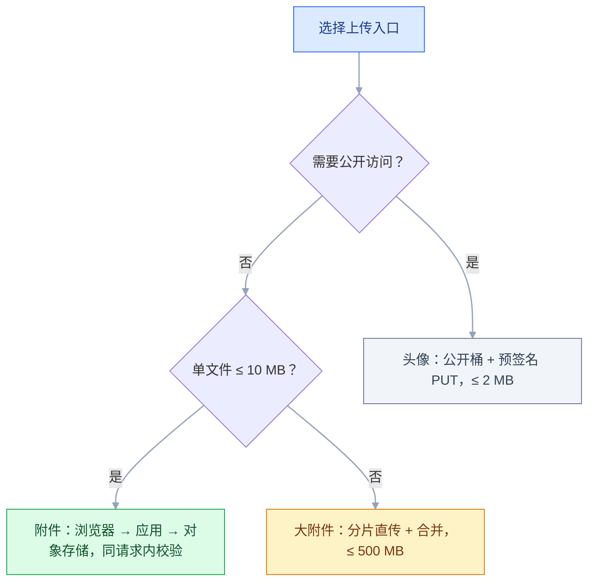
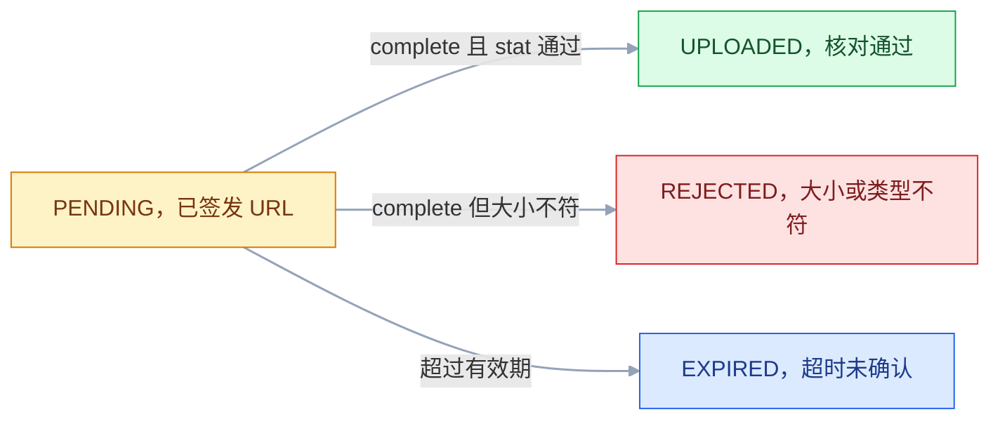

# 文件与对象存储

## 一、工程案例：给任务系统做一套附件上传与私有下载

**场景**：任务管理系统要支持三类文件——用户头像（≤2MB，公开）、任务附件（≤10MB，仅任务参与人可见）、大附件（≤500MB，要能断点续传）。现有代码把文件 `transferTo` 到应用服务器的 `/data/upload`，两台机器做负载均衡后经常 404，同事之间同名文件还会互相覆盖。

**目标产出**：一个私有 bucket、一个公开 bucket、两张表、四个接口（转发上传 / 直传初始化 / 直传完成 / 签名下载）、一条分片上传链路，以及一张能逐条打勾的验收表。

**动手前确认**：本地 9000/9001 没被占用；`docker` 可用；应用能访问到 `127.0.0.1:9000`。应用如果跑在容器里，`localhost` 指向容器自己，要换成宿主机地址或容器网络别名——这一条会让第一次联调卡半小时。

### 1.1 三类文件的处理边界

| 场景 | 入口 | 单文件上限 | 可见性 | 字节走哪 |
|---|---|---|---|---|
| 用户头像 | 预签名 PUT 直传 | 2 MB | 公开读 | 浏览器 → 对象存储 |
| 任务附件 | 后端转发上传 | 10 MB | 私有 | 浏览器 → 应用 → 对象存储 |
| 大附件 / 视频 | 分片直传 | 500 MB | 私有 | 浏览器 → 对象存储（分片） |

判断顺序是**先看要不要公开访问，再看大小**：头像虽然小，但量大、要公开、要挂 CDN，单独放一个公开桶；私有文件 ≤10MB 走后端转发，代码最简单、能在同一次请求里完成校验；更大的走分片直传。500MB 走转发时，流式写不会把整个文件读进内存，但应用带宽和临时磁盘照样会被占满。



### 1.2 起一个本地对象存储

```bash
docker run -d --name minio \
  -p 9000:9000 -p 9001:9001 \
  -e MINIO_ROOT_USER=minioadmin \
  -e MINIO_ROOT_PASSWORD=minioadmin123 \
  -v minio-data:/data --restart=always \
  minio/minio:latest server /data --console-address ":9001"

docker logs --tail 5 minio
# API: http://127.0.0.1:9000
# WebUI: http://127.0.0.1:9001
# 日志里还会列容器内网地址（172.x）；宿主机上的应用用 127.0.0.1，容器里的应用要换成宿主机地址
```

```bash
# 用官方客户端建桶，比点控制台快，也方便写进初始化脚本
docker exec minio mc alias set local http://127.0.0.1:9000 minioadmin minioadmin123
docker exec minio mc mb --ignore-existing local/task-attachments
docker exec minio mc mb --ignore-existing local/task-avatars
docker exec minio mc anonymous set download local/task-avatars
docker exec minio mc ls local
# [2026-10-21 09:12:03 CST]     0B task-attachments/
# [2026-10-21 09:12:03 CST]     0B task-avatars/
```

| Bucket | 权限 | 用途 | 备注 |
|---|---|---|---|
| `task-attachments` | private | 任务附件、大附件 | 只能签名访问 |
| `task-avatars` | public-read | 头像 | key 带随机串，靠不可枚举保证隐私 |

`mc anonymous set download` 让整个桶可匿名读。头像文件名必须是随机串，不能是 `avatar/1001.jpg`——否则任何人按用户 ID 就能遍历。真要防盗链，前面挂 CDN 做 Referer 或签名。

应用侧只认一组配置，本地与线上换值不换代码（SDK 用 MinIO 官方 Java 客户端，S3 兼容，依赖版本以厂商当前文档为准）：

```yaml
storage:
  endpoint: http://127.0.0.1:9000
  access-key: minioadmin
  secret-key: minioadmin123
  bucket: task-attachments
  avatar-bucket: task-avatars

spring:
  servlet:
    multipart:
      max-file-size: 12MB        # 略大于 10MB 业务上限
      max-request-size: 15MB     # 整个请求累加，见 2.3
```

### 1.3 两张表

```sql
CREATE TABLE t_file (
    id            BIGINT PRIMARY KEY AUTO_INCREMENT,
    original_name VARCHAR(255)  NOT NULL COMMENT '原始文件名，只用于展示和下载',
    object_key    VARCHAR(512)  NOT NULL COMMENT '对象存储里的 key',
    bucket        VARCHAR(64)   NOT NULL,
    size          BIGINT        NOT NULL COMMENT '字节数',
    content_type  VARCHAR(128)  NULL,
    sha256        CHAR(64)      NULL COMMENT '内容指纹，用于秒传与去重',
    scene         VARCHAR(32)   NOT NULL COMMENT 'AVATAR / TASK_ATTACHMENT',
    status        VARCHAR(16)   NOT NULL DEFAULT 'PENDING' COMMENT 'PENDING/UPLOADED/REJECTED/EXPIRED',
    uploader_id   BIGINT        NOT NULL,
    task_id       BIGINT        NULL COMMENT '所属任务，私有附件靠它追溯权限',
    created_at    DATETIME      NOT NULL DEFAULT CURRENT_TIMESTAMP,
    UNIQUE KEY uk_bucket_key (bucket, object_key),
    KEY idx_sha256 (sha256),
    KEY idx_task (task_id)
) ENGINE=InnoDB DEFAULT CHARSET=utf8mb4;

CREATE TABLE t_upload_session (
    id             BIGINT PRIMARY KEY AUTO_INCREMENT,
    file_hash      CHAR(64)      NOT NULL,
    file_name      VARCHAR(255)  NOT NULL COMMENT '原始文件名，合并后落库用',
    bucket         VARCHAR(64)   NOT NULL COMMENT '合并后写回哪个桶',
    object_key     VARCHAR(512)  NOT NULL,
    task_id        BIGINT        NULL COMMENT '所属任务，合并后写回 t_file',
    content_type   VARCHAR(128)  NULL COMMENT '按扩展名反查，不取请求头',
    upload_id      VARCHAR(255)  NOT NULL COMMENT '对象存储返回的 uploadId',
    total_parts    INT           NOT NULL,
    part_size      INT           NOT NULL,
    total_size     BIGINT        NOT NULL,
    status         VARCHAR(16)   NOT NULL DEFAULT 'UPLOADING' COMMENT 'UPLOADING/COMPLETED/REJECTED/EXPIRED',
    uploader_id    BIGINT        NOT NULL,
    expires_at     DATETIME      NOT NULL,
    UNIQUE KEY uk_hash_user (file_hash, uploader_id),
    KEY idx_upload_id (upload_id)
) ENGINE=InnoDB DEFAULT CHARSET=utf8mb4;
```

`t_upload_session` 里必须有 `bucket` 和 `task_id`：合并时才知道对象写进哪个桶、记录挂到哪个任务上。只存 `uploadId` 是最常见的漏字段方式，写回时只能靠猜。

已上传的分片号**不写进表**。分片是否成功，以对象存储的 `ListParts` 为准；数据库只保存 `uploadId` 和总片数。这样即使应用在“分片传完、还没更新数据库”的瞬间崩掉，续传也不会算错。

### 1.4 小文件：转发上传

校验链只有一条，所有入口都调它，避免某个新接口漏掉一步：

```java
public record UploadPolicy(long maxSize, Set<String> allowedExt) {
    public static final UploadPolicy AVATAR =
            new UploadPolicy(2L << 20, Set.of("jpg", "jpeg", "png", "webp"));
    public static final UploadPolicy ATTACHMENT =
            new UploadPolicy(10L << 20, Set.of("jpg", "jpeg", "png", "webp", "pdf", "docx", "xlsx", "zip"));
}

public final class FileGuard {
    /** 返回校验通过的扩展名；不通过直接抛业务异常 */
    public static String check(MultipartFile file, UploadPolicy policy) throws IOException {
        if (file == null || file.isEmpty()) throw new BizException("文件不能为空");
        if (file.getSize() > policy.maxSize())
            throw new BizException("文件不能超过 " + (policy.maxSize() >> 20) + "MB");
        String ext = extension(file.getOriginalFilename());
        if (!policy.allowedExt().contains(ext))
            throw new BizException("不支持的文件类型：" + ext);
        byte[] head = new byte[12];
        try (InputStream in = file.getInputStream()) {
            if (in.readNBytes(head, 0, 12) < 4) throw new BizException("文件内容异常");
        }
        if (!Magic.matches(ext, head)) throw new BizException("文件内容与扩展名不符");
        return ext;
    }

    public static String extension(String name) {
        if (name == null || name.isBlank()) throw new BizException("文件名不能为空");
        int dot = name.lastIndexOf('.');
        if (dot < 0 || dot == name.length() - 1) throw new BizException("文件必须有扩展名");
        String ext = name.substring(dot + 1).toLowerCase();
        if (!ext.matches("[a-z0-9]{1,10}")) throw new BizException("非法扩展名");
        return ext;
    }
}
```

魔数只看文件头几个字节，成本极低，能拦掉“把 `.sh` 改名成 `.jpg`”这一类：

| 类型 | 魔数（十六进制） | ASCII |
|---|---|---|
| JPEG | `FF D8 FF` | 不可读 |
| PNG | `89 50 4E 47 0D 0A 1A 0A` | `.PNG....` |
| GIF | `47 49 46 38` | `GIF8` |
| WebP | `52 49 46 46` + 偏移 8 处 `57 45 42 50` | `RIFF....WEBP` |
| PDF | `25 50 44 46` | `%PDF` |
| ZIP / docx / xlsx | `50 4B 03 04` | `PK..` |
| ELF | `7F 45 4C 46` | `.ELF` |
| Windows PE | `4D 5A` | `MZ` |

WebP 的 `52 49 46 46` 只说明它是 RIFF 容器，必须再看第 8~11 字节是不是 `WEBP`，所以头部要读到 12 字节。docx / xlsx 本质是 ZIP，三者头四个字节完全一样：要区分就继续读 ZIP 目录里的 `[Content_Types].xml` 和 `word/`、`xl/` 前缀，光靠魔数做不到。

落库与上传：

```java
@Transactional
public FileVO upload(Long taskId, MultipartFile file) throws IOException {
    Task task = taskMapper.selectById(taskId);
    if (task == null || !canRead(task, currentUser.id()))
        throw new BizException("任务不存在");          // 不泄露资源存在性
    String ext = FileGuard.check(file, UploadPolicy.ATTACHMENT);

    // key 完全由服务端生成：用户传来的文件名一个字符都不参与
    String key = "task/" + taskId + "/" + LocalDate.now() + "/"
               + UUID.randomUUID().toString().replace("-", "") + "." + ext;
    String contentType = MediaTypes.of(ext);           // 按扩展名反查，不信请求头
    try (InputStream in = file.getInputStream()) {
        storage.put(in, file.getSize(), key, contentType);
    }
    FileRecord r = new FileRecord();
    r.setOriginalName(file.getOriginalFilename());
    r.setObjectKey(key);
    r.setBucket(storage.bucket());
    r.setSize(file.getSize());
    r.setContentType(contentType);
    r.setScene("TASK_ATTACHMENT");
    r.setStatus("UPLOADED");
    r.setUploaderId(currentUser.id());
    r.setTaskId(taskId);
    fileMapper.insert(r);
    return new FileVO(r.getId(), r.getOriginalName(), r.getSize(), contentType);
}
```

`original_name` 原样存下来是对的——它只用于页面展示和下载时的文件名，永远不参与路径拼接。中文、空格、`../`、超长名字都不会造成问题。

`storage.put` 成功而 `insert` 失败会留下孤儿对象，靠桶的生命周期规则兜底（见 3.13）。转发上传这一路没有算 sha256，所以 `t_file.sha256` 只在分片链路里由客户端上报，不能当完整性凭证（见 2.11）。

### 1.5 头像：预签名直传

直传分两步，第二步是很多人省掉、然后被伪造请求打穿的地方：

```java
@PostMapping("/uploads/avatar/init")
public PresignVO initAvatar(@RequestBody @Valid InitReq req) {
    if (req.size() > 2L << 20) throw new BizException("头像不能超过 2MB");
    String ext = FileGuard.extension(req.fileName());
    if (!Set.of("jpg", "jpeg", "png", "webp").contains(ext))
        throw new BizException("头像只支持 jpg/png/webp");

    String key = "avatar/" + LocalDate.now() + "/"
               + UUID.randomUUID().toString().replace("-", "") + "." + ext;
    String contentType = MediaTypes.of(ext);       // 同样按扩展名反查
    FileRecord r = new FileRecord();
    r.setOriginalName(req.fileName());
    r.setObjectKey(key);
    r.setBucket(AVATAR_BUCKET);
    r.setSize(req.size());
    r.setContentType(contentType);
    r.setScene("AVATAR");
    r.setStatus("PENDING");                 // 关键：先落 PENDING
    r.setUploaderId(currentUser.id());
    fileMapper.insert(r);

    String url = storage.presignPut(AVATAR_BUCKET, key, Duration.ofMinutes(10));
    return new PresignVO(r.getId(), key, url, 600);
}

@PostMapping("/uploads/avatar/complete")
public FileVO completeAvatar(@RequestBody @Valid CompleteReq req) {
    FileRecord r = fileMapper.selectById(req.fileId());
    if (r == null)
        throw new BizException("上传记录不存在");
    if (!r.getUploaderId().equals(currentUser.id()))
        throw new AccessDeniedException("无权操作该上传");
    if ("UPLOADED".equals(r.getStatus()))   // 幂等：重复 complete 返回同一结果
        return new FileVO(r.getId(), r.getOriginalName(), r.getSize(), r.getContentType());
    if (!"PENDING".equals(r.getStatus()))
        throw new BizException("上传已失败，请重新发起");

    // 不信前端：自己去存储核对存在性与大小
    StatObject stat = storage.stat(r.getBucket(), r.getObjectKey());
    if (stat == null) throw new BizException("文件尚未上传成功");
    if (stat.size() != r.getSize()) {
        storage.delete(r.getBucket(), r.getObjectKey());   // 大小不符，可能被替换
        r.setStatus("REJECTED");
        fileMapper.updateById(r);
        throw new BizException("文件校验失败，请重新上传");
    }
    r.setStatus("UPLOADED");
    fileMapper.updateById(r);
    return new FileVO(r.getId(), r.getOriginalName(), r.getSize(), r.getContentType());
}
```

前端用 XHR 而不是 `fetch`，因为只有 XHR 能拿到上传进度：

```javascript
async function uploadAvatar(file) {
  const init = await postJSON('/api/uploads/avatar/init',
      { fileName: file.name, size: file.size, contentType: file.type });
  const { id: fileId, url: uploadUrl } = init.data;

  await new Promise((resolve, reject) => {
    const xhr = new XMLHttpRequest();
    xhr.open('PUT', uploadUrl, true);
    xhr.setRequestHeader('Content-Type', file.type || 'application/octet-stream');
    xhr.upload.onprogress = e => {
      if (e.lengthComputable) setProgress(Math.round(e.loaded / e.total * 100));
    };
    xhr.onload = () => (xhr.status >= 200 && xhr.status < 300)
        ? resolve() : reject(new Error('直传失败 HTTP ' + xhr.status));
    xhr.onerror = () => reject(new Error('网络错误'));
    xhr.send(file);
  });

  return postJSON('/api/uploads/avatar/complete', { fileId });
}
```

直传必须在 bucket 上配 CORS，且 `ExposeHeaders` 要带 `ETag`，否则前端拿不到响应头、分片流程也读不到 ETag。`mc cors set` 收的是 S3 CORS 格式的 XML：

```bash
cat > /tmp/cors.xml <<'EOF'
<CORSConfiguration>
  <CORSRule>
    <AllowedOrigin>https://app.example.com</AllowedOrigin>
    <AllowedMethod>GET</AllowedMethod>
    <AllowedMethod>PUT</AllowedMethod>
    <AllowedMethod>POST</AllowedMethod>
    <AllowedHeader>*</AllowedHeader>
    <ExposeHeader>ETag</ExposeHeader>
    <MaxAgeSeconds>3000</MaxAgeSeconds>
  </CORSRule>
</CORSConfiguration>
EOF

docker cp /tmp/cors.xml minio:/tmp/cors.xml
docker exec minio mc cors set local/task-attachments /tmp/cors.xml
docker exec minio mc cors get local/task-attachments
```

本地开发时 `AllowedOrigin` 要写成页面实际地址（如 `http://localhost:5173`），带 Cookie 的场景不能用 `*`。

预签名 PUT 只绑定 method、host、路径和签过名的头，**不限制上传体积**：为 2MB 头像签的 URL，对方照样能 PUT 200MB 上去，只是 complete 时会因大小不符被删。要在传输前就卡住，用 POST policy 的 `content-length-range`（字段名以厂商当前文档为准）。

### 1.6 私有附件：签名下载

```java
@GetMapping("/tasks/{taskId}/attachments/{fileId}/download")
public ResponseEntity<Void> download(@PathVariable Long taskId, @PathVariable Long fileId) {
    Task task = taskMapper.selectById(taskId);
    if (task == null || !canRead(task, currentUser.id()))
        throw new BizException("附件不存在");

    FileRecord r = fileMapper.selectById(fileId);
    // 不但文件要存在，还要确实挂在这个任务上
    if (r == null || !taskId.equals(r.getTaskId()) || !"UPLOADED".equals(r.getStatus()))
        throw new BizException("附件不存在");

    String url = storage.presignGet(r.getBucket(), r.getObjectKey(),
            Duration.ofMinutes(5), r.getOriginalName());
    return ResponseEntity.status(HttpStatus.FOUND)
            .header(HttpHeaders.LOCATION, url)
            .build();
}
```

302 到签名 URL，字节不经过应用。文件要强制下载而不是浏览器内打开，`Content-Disposition` 必须**在签名时**作为参数带上（S3 是 `response-content-disposition`），事后往 URL 上追加会让签名失效。

### 1.7 大文件：分片、续传、秒传

五个接口，职责分别是“查进度”“开会话”“传一片”“合并”“放弃”：

```text
POST /api/multipart/check     {hash, fileName, size}  → INSTANT / RESUME / NEW
POST /api/multipart/init      {hash, fileName, size}  → uploadId, partSize, totalParts
POST /api/multipart/part      uploadId, partNumber, chunk → etag
POST /api/multipart/complete  {uploadId}              → fileId
POST /api/multipart/abort     {uploadId}
```

```java
private static final int PART_SIZE = 5 << 20;          // 5MiB，S3 协议的片下限
private static final long MAX_TOTAL = 500L << 20;

/** 查：秒传命中就直接返回；有未完成会话就返回续传参数与已传片号 */
public CheckVO check(String hash, String fileName, long size) {
    if (size > MAX_TOTAL) throw new BizException("单文件不能超过 500MB");
    Long uid = currentUser.id();
    FileRecord done = fileMapper.selectByHash(hash, uid);
    if (done != null && "UPLOADED".equals(done.getStatus())
            && storage.stat(done.getBucket(), done.getObjectKey()) != null) {
        return CheckVO.instant(done.getId());
    }
    UploadSession s = sessionMapper.selectByHash(hash, uid);
    if (s != null && "UPLOADING".equals(s.getStatus()) && s.getExpiresAt().isAfter(now())) {
        // 已传片号实时问存储，不读数据库
        List<Integer> uploaded = storage.listParts(s.getBucket(), s.getObjectKey(), s.getUploadId())
                .stream().map(Part::number).sorted().toList();
        return CheckVO.resume(s.getUploadId(), s.getObjectKey(), s.getPartSize(),
                s.getTotalParts(), uploaded);
    }
    return CheckVO.fresh(PART_SIZE, (int) Math.ceil((double) size / PART_SIZE));
}

/** 合并：以存储里真实存在的分片为准，编号必须 1..N 连续 */
public FileVO complete(String uploadId) {
    UploadSession s = sessionMapper.selectByUploadId(uploadId);
    if (s == null || !s.getUploaderId().equals(currentUser.id()))
        throw new AccessDeniedException("无权操作该上传");
    if ("COMPLETED".equals(s.getStatus()))   // 双击或重试：返回已有记录
        return toVO(fileMapper.selectByBucketAndKey(s.getBucket(), s.getObjectKey()));

    List<Part> parts = storage.listParts(s.getBucket(), s.getObjectKey(), uploadId)
            .stream().sorted(Comparator.comparingInt(Part::number)).toList();
    if (parts.size() != s.getTotalParts())
        throw new BizException("分片不完整：已传 " + parts.size() + " / 共 " + s.getTotalParts());
    for (int i = 0; i < parts.size(); i++)   // 片数够但编号有洞，合并出来的字节是错的
        if (parts.get(i).number() != i + 1)
            throw new BizException("分片编号不连续：" + parts.get(i).number());

    storage.completeMultipart(s.getBucket(), s.getObjectKey(), uploadId, parts);
    StatObject stat = storage.stat(s.getBucket(), s.getObjectKey());
    if (stat == null || stat.size() != s.getTotalSize()) {   // 合并结果不信客户端声明
        storage.delete(s.getBucket(), s.getObjectKey());
        s.setStatus("REJECTED");
        sessionMapper.updateById(s);
        throw new BizException("合并后大小不符");
    }

    FileRecord r = new FileRecord();
    r.setOriginalName(s.getFileName());
    r.setObjectKey(s.getObjectKey());
    r.setBucket(s.getBucket());
    r.setSize(s.getTotalSize());
    r.setContentType(s.getContentType());
    r.setSha256(s.getFileHash());
    r.setScene("TASK_ATTACHMENT");
    r.setStatus("UPLOADED");
    r.setUploaderId(currentUser.id());
    r.setTaskId(s.getTaskId());
    fileMapper.insert(r);
    s.setStatus("COMPLETED");
    sessionMapper.updateById(s);
    return new FileVO(r.getId(), r.getOriginalName(), r.getSize(), r.getContentType());
}
```

`init` 要幂等：同一用户同一 hash 已有 `UPLOADING` 会话时直接返回旧的 `uploadId`，不要新建——用户刷新页面就会重复建会话，最后留下一堆永远合并不了的分片。`init` 时把 `bucket`、`task_id`、`content_type` 一起写进会话，合并时直接取，不要再从对象名反推。`ListParts` 单页最多返回 1000 条，片数超过 1000 时必须翻页取全，否则 `parts.size()` 永远凑不齐；`complete` 提交的 ETag 一律用 `ListParts` 返回的值，不要自己算。

用 curl 验证续传。先造一个 15MiB 的文件并按 5MiB 切片（`/tmp/p1`~`/tmp/p3`）：

```bash
dd if=/dev/zero of=/tmp/resume.zip bs=1048576 count=15 2>/dev/null
for n in 1 2 3; do
  dd if=/tmp/resume.zip of=/tmp/p$n bs=5242880 skip=$((n-1)) count=1 2>/dev/null
done
```

示例里的 hash 是假值，服务端在这条链路里只把它当会话索引，不做完整性校验（见 2.11）：

```bash
curl -s -X POST localhost:8080/api/multipart/init -H "Authorization: Bearer $TOKEN" \
  -H 'Content-Type: application/json' -d '{"hash":"9f2c...","fileName":"resume.zip","size":15728640}'
# {"code":0,"data":{"uploadId":"2~a1b2...","partSize":5242880,"totalParts":3}}

# 只传第 1、2 片后关掉页面
for n in 1 2; do curl -s -X POST localhost:8080/api/multipart/part -H "Authorization: Bearer $TOKEN" \
  -F uploadId=2~a1b2... -F partNumber=$n -F chunk=@/tmp/p$n; done

# 重新打开页面问进度
curl -s -X POST localhost:8080/api/multipart/check -H "Authorization: Bearer $TOKEN" \
  -H 'Content-Type: application/json' -d '{"hash":"9f2c...","fileName":"resume.zip","size":15728640}'
# {"code":0,"data":{"mode":"RESUME","uploadId":"2~a1b2...","uploadedParts":[1,2]}}
```

`uploadedParts` 来自 `ListParts` 的实时结果，不是数据库里记的字符串。少传一片就合并：

```bash
curl -s -X POST localhost:8080/api/multipart/complete -H "Authorization: Bearer $TOKEN" \
  -H 'Content-Type: application/json' -d '{"uploadId":"2~a1b2..."}'
# {"code":500,"message":"分片不完整：已传 2 / 共 3"}
```

放弃上传后，已传分片占的空间要立刻释放：

```bash
curl -s -X POST "localhost:8080/api/multipart/abort?uploadId=2~a1b2..." -H "Authorization: Bearer $TOKEN"
docker exec minio mc ls --incomplete local/task-attachments
# 无输出
```

### 1.8 验收（10 项全过才算交付）

| # | 检查项 | 命令或检查 | 通过标准 |
|---|---|---|---|
| 1 | 私有桶不可匿名读 | `curl -s -o /dev/null -w '%{http_code}' http://127.0.0.1:9000/task-attachments/task/1001/x.png`（key 换成实际存在的对象） | `403`，不是 `404` |
| 2 | 头像桶可匿名读 | 浏览器打开头像 key 的直链 | 正常显示图片 |
| 3 | 小文件上传 | `curl -H "Authorization: Bearer $TOKEN" -F file=@a.pdf /api/tasks/1001/attachments` | `code:0`，返回 fileId |
| 4 | 类型拦截 | 传 `shell.sh`、传改名成 `.jpg` 的文本 | 均返回“不支持的类型”或“内容与扩展名不符” |
| 5 | 越权下载 | 用非参与人 token 请求下载 | 返回“附件不存在”，不是 403 |
| 6 | 签名下载 | `curl -i .../download` | `302` + `Location` 带 `X-Amz-Signature` |
| 7 | 签名过期 | 签发 1 秒有效期的 URL，等 2 秒再访问 | `403 AccessDenied` |
| 8 | 直传完成校验 | 只调 init 不 PUT，直接调 complete | 返回“文件尚未上传成功”，状态仍为 PENDING |
| 9 | 断点续传 | 传 2/3 片后重新 check | `mode:RESUME`，`uploadedParts` 为 `[1,2]` |
| 10 | 分片清理 | abort 后 `mc ls --incomplete` | 无输出 |

第 5 项容易被写成 403。403 等于告诉攻击者“这个文件存在，只是你没权限”，配合自增 ID 就能枚举；统一返回“不存在”才是正确姿势。

---

## 二、高频问答：会卡住你的地方，也是面试最常问的

### 2.1 浏览器控制台报 CORS，但 Network 里 PUT 是 200

**现场**

Network 面板按 `Fetch/XHR` 过滤，找到发往对象存储域名的请求，看它前面有没有一条 `OPTIONS` 预检；再用 `mc cors get` 看 bucket 规则。

**要点**

- 跨域发生在**浏览器到对象存储**这一段，后端 CORS 管不到。
- bucket 没配 CORS 规则，或 `ExposeHeaders` 没给 `ETag`，都会让前端读不到响应。
- 另一种变体是「文件传上去了但前端报错」，因为读响应头时被 CORS 拦了。
- 请求根本没经过应用，改 Spring 的 `CorsConfiguration` 是改错了地方。

**追问**

- 为什么 PUT 是 200 还报错？→ 请求成功了，失败的是读响应头。
- `AllowedMethods` 要包含什么？→ `PUT`，以及实际用到的 `GET`、`POST`。
- 带 Cookie 的场景能用 `*` 吗？→ 不能，必须写页面实际地址。

### 2.2 上线一周，历史附件全部 404

**现场**

从库里取一条 URL，看 `X-Amz-Date` 和 `X-Amz-Expires`；再用 `mc stat` 看对象是否还在。

**要点**

- 数据库里存的是**预签名 URL**，签名过期后永久失效；对象本身好好的。
- 预签名 URL 是有时效的凭证，不是文件地址。
- 把「链接失效」误判成「文件丢失」，是这一类问题的共同起点。
- 修法是库里只存 `object_key`，每次访问现签。

**追问**

- `mc stat` 能查到说明什么？→ 对象还在，只是 URL 过期了。
- 签名 URL 能单独撤销吗？→ 不能，只能轮换密钥或删对象。
- 为什么不能把 URL 落库？→ 有效期一过就是死链，换域名也全废。

### 2.3 传 30MB 报 413，日志里是 `MaxUploadSizeExceededException`

**现场**

看异常类型是不是 `MaxUploadSizeExceededException` 而不是业务异常；再核对 `spring.servlet.multipart` 配置。

**要点**

- Spring Boot 默认 `max-file-size` 是 1MB，请求在进入 Controller 之前就被容器拒了。
- 业务层的 `if (size > max)` 根本没机会执行，这是两道独立的闸门，配置层在前。
- `max-request-size` 管的是整个请求（多文件累加），只调 `max-file-size` 时一次传多张图仍会 413。
- 把 `max-file-size` 调到略大于业务上限，并在全局异常处理里接住这个异常，否则用户看到的是 500。

**追问**

- 413 和业务校验失败怎么区分？→ 异常类型不同，413 是框架在进方法前抛的。
- 网关会不会也拦？→ 会，Nginx 的 `client_max_body_size` 是另一道闸门。
- 只调配置就够了吗？→ 不够，异常没接住照样是 500。

### 2.4 多实例部署后，一半的图片裂开

**现场**

看 404 是否与实例相关；`ssh` 到两台机器分别 `ls /data/upload`。

**要点**

- 文件写在应用服务器的本地磁盘上，请求落到另一台机器就是 404。
- 单机开发永远复现不了，因为只有一台机器。
- 粘性会话（`ip_hash`）只是把问题藏起来，扩容和故障转移时照样爆。
- 正解是换对象存储，临时方案是共享 NAS。

**追问**

- 为什么要在响应头打实例 ID？→ 连续请求十次，能看出 404 是否集中在某一台。
- `ip_hash` 能救吗？→ 只能暂时藏住，扩容或宕机就暴露。
- 共享 NAS 有什么代价？→ 网络 IO 延迟，容量与并发有上限。

### 2.5 合并分片报 `EntityTooSmall` 或 `InvalidPart`

**现场**

打印每片的 `partNumber`、字节数、ETag，与 `ListParts` 的结果逐条比对。

**要点**

- 除最后一片外，每片必须 ≥ 5MiB，这是协议约束，不是建议值。
- `InvalidPart` 多半是 ETag 对不上，或 parts 没按 `partNumber` 升序提交。
- `ListParts` 返回的 ETag 才是权威值，不要用自己算的 MD5 代替。
- 片数对上但编号有洞（1、2、4）会拼出错误字节，要逐个校验编号从 1 连续到 N。

**追问**

- 片数上限是多少？→ 10000 片，大文件要按 `size / 10000` 反算最小片大小。
- `ListParts` 一次能列完吗？→ 单页最多 1000 条，片数多时必须翻页。
- 为什么 1MB 分片必挂？→ 除最后一片外全部低于 5MiB 下限。

### 2.6 预签名 PUT 报 `SignatureDoesNotMatch`

**现场**

对比签名时的 host 与实际请求的 host；再看前端有没有额外设置签名里没有的头。

**要点**

- 密钥错会报 `InvalidAccessKeyId`，不是 `SignatureDoesNotMatch`。
- 签名覆盖了 method、host、路径和部分请求头；换域名、多加 `x-amz-*` 头都会让签名对不上。
- 最常见的是把 `127.0.0.1:9000` 签出来的 URL 换成局域网 IP 再发出去。
- 签名 URL 不要做任何字符串替换。

**追问**

- URL 被二次编码会怎样？→ 同样报这个错，编码改变了被签名的字符串。
- 内网签、公网用行吗？→ 不行，host 参与签名计算。
- 怎么定位是哪个头的问题？→ 对比 `X-Amz-SignedHeaders` 与实际发送的头。

### 2.7 下载 PDF 直接在浏览器打开，中文文件名变成乱码

**现场**

`curl -I` 看响应头；看签名时有没有带 `response-content-disposition`。

**要点**

- 下载行为由响应头决定，不是前端 `a[download]` 能完全控制的，跨域时 `download` 属性还会被忽略。
- 默认 `inline` 就直接在浏览器打开；中文名要按 RFC 5987 编码成 `filename*=UTF-8''<percent-encoded>`。
- 签名 URL 场景下这个头必须参与签名，签完再往 URL 后面拼参数会让签名失效。

**追问**

- 为什么跨域时 `a[download]` 无效？→ 浏览器会忽略非同源响应的 `download` 属性。
- `filename` 和 `filename*` 有什么区别？→ 后者才能带非 ASCII 字符。
- 为什么追加参数会 403？→ 签名覆盖了查询参数。

### 2.8 同名文件互相覆盖

**现场**

看两个用户的 `object_key` 是否相同；看 `original_name` 相同但 `size` 变了。

**要点**

- 落盘名用了原始文件名，或用了固定 key（如 `avatar/{userId}.jpg`）。
- 对象存储的 PUT 本身就是覆盖语义，不报错，覆盖是静默的。
- 只有用户发现「我的文件变成别人的了」，才会有人来查。
- key 必须由服务端生成，原始名只用于页面展示和下载。

**追问**

- 加了唯一索引为什么还会覆盖？→ 唯一索引拦的是插记录，拦不住对象被覆盖。
- CDN 上为什么还是旧内容？→ 缓存要主动刷新。
- 覆盖后能恢复吗？→ 开了版本控制才可以。

### 2.9 上传的「图片」其实是 webshell 或图片马

**现场**

检查上传目录是否在 Web 根目录下、是否被配成可执行；用图片库解码再编码，看附加段是否被丢弃。

**要点**

- 加了扩展名白名单不等于安全：双扩展名、大小写、`%00` 截断都能绕。
- 图片马是把脚本藏在 JPEG 注释段里，文件头仍是合法图片，魔数挡不住。
- 真正的边界不是「文件名像不像图片」，而是「这个目录能不能执行」。
- 上传目录和代码目录必须分开，且 Nginx 对该路径禁止任何脚本解析。

**追问**

- 魔数校验够吗？→ 不够，它只证明头部合法，不证明整个文件合法。
- 怎么彻底清掉附加段？→ 重新解码再编码，解不出来就拒。
- 还有哪道保险？→ `Content-Disposition: attachment` 加 `X-Content-Type-Options: nosniff`。

### 2.10 账单里出现大量没见过的存储占用

**现场**

`mc ls --incomplete <bucket>`；云控制台看「未完成分片」统计。

**要点**

- 未完成的分片上传会一直占空间，且**不计入对象列表**，控制台按对象看根本看不到。
- 只看对象数量和总容量，就会漏掉分片这个隐藏账目。
- 给 bucket 配「清理过期未完成分片」的生命周期规则（例如 7 天）。
- `abort` 接口里要真正调用 `AbortMultipartUpload`。

**追问**

- 为什么对象数对得上、账单还对不上？→ 分片不算对象，单独计费。
- 生命周期规则设几天？→ 要短于会话保留期，否则会出现会话还在、分片已清。
- abort 之后空间立刻释放吗？→ 是，分片删掉就释放。

### 2.11 秒传把别人传过的文件「传」过来了

**现场**

看秒传查询是否带 `uploader_id` 或租户条件；看返回的 fileId 归属谁。

**要点**

- 只按 hash 命中就返回 fileId，等于把另一个用户的对象引用给了当前用户。
- 秒传省的是流量，不是授权；命中后仍要为当前用户建一条记录，指向同一个物理对象。
- 攻击者还能用它探测服务器上是否存在某个已知文件。
- hash 由客户端上报、服务端从不验证时，知道某个文件的 SHA-256 就能白拿内容。

**追问**

- 怎么兼顾性能和隔离？→ 同租户内才允许秒传。
- 服务端要校验 hash 吗？→ 要，合并后从存储读回流式算一遍再确认。
- 引用计数什么时候减？→ 删除时先减，归零才删对象。

---

## 三、核心知识：从零开始要建立的东西

### 3.1 四种存储形态的边界

| 方案 | 做法 | 适合 | 代价 |
|---|---|---|---|
| 本地磁盘 | 写应用服务器目录 | 单机、内部工具、文件量小 | 与机器绑死，多实例不同步，扩容要停机 |
| 网络文件系统 | NFS / NAS 挂到多台机器 | 已有 NAS、改造成本敏感 | 网络 IO 延迟，容量与并发有上限 |
| 对象存储 | HTTP API 读写 | 绝大多数对外业务 | 多一个外部依赖，不能用 `File` 类操作 |
| 数据库 BLOB | 字节存表字段 | 极小、极低频、要求与业务同事务 | 库体积和备份压力暴涨 |

判断顺序：**会不会多实例部署 → 文件总量会不会超过单盘 → 要不要 CDN → 要不要与业务数据同事务**。前两个任意一个为“是”，本地磁盘就出局。

### 3.2 对象模型：桶、键、前缀

| 概念 | 含义 | 容易误解的点 |
|---|---|---|
| Bucket | 对象的容器，名字全局唯一 | 不是目录，不能嵌套 |
| Key | 对象的完整标识，一整个字符串 | 里面的 `/` 只是普通字符 |
| Prefix | 按 key 前缀过滤 | 是查询条件，不是真实层级 |
| Object | 数据本体 + 元数据 | 元数据有大小上限，别塞大 JSON |

对象存储**没有目录**。写入 `task/1001/2026-10-21/abc.jpg` 时，系统不会创建任何文件夹；控制台看起来像目录，只是把带 `/` 的 key 按前缀分组展示。因此“重命名目录”等于逐个复制对象，成本很高——key 设计要在写之前想好。列举是**按字典序**返回的，不是按时间；想按时间倒序，要么在客户端排序，要么把时间放进 key 前缀。

### 3.3 S3 兼容接口的边界

S3 的 HTTP API 已是事实标准，主流厂商都提供兼容层：

| 服务 | 兼容方式 | 备注 |
|---|---|---|
| AWS S3 | 原生 | 语义基准 |
| 阿里云 OSS | 兼容 S3，另有原生 API | 原生 API 功能更全 |
| 腾讯云 COS | 兼容 S3 | 兼容层细节有差异 |
| MinIO | 原生兼容 | 本地开发首选 |

“兼容”不等于完全一致。签名默认版本、分片返回字段、特殊字符编码、错误码文案都可能有差别。**换厂商前跑一遍回归，重点测分片上传和预签名 URL**，具体差异以厂商当前文档为准。

### 3.4 key 的设计规则

key 一旦写进数据库就很难改，几条硬规则：

- 不用用户文件名，扩展名从白名单取，主体用 UUID 或内容 hash
- 前缀按 `业务/租户或任务/日期/` 分层，便于按前缀做生命周期和批量清理；S3 已按请求自动分区，不必再为 QPS 手工打散
- 不放手机号、身份证号、真实姓名——key 会出现在 URL、日志、浏览器历史里
- 只用小写字母、数字、`-`、`_`、`/`，避免空格和中文带来的编码问题

反例是 `upload/2026/10/21/报告.pdf`：中文要编码、同名会覆盖、还泄露了内容主题。

### 3.5 校验的四个层次

| 层 | 看什么 | 强度 | 作用 |
|---|---|---|---|
| 扩展名 | 文件名后缀 | 弱 | 拦掉绝大多数误传 |
| MIME | 请求头 `Content-Type` | 很弱 | 客户端随便写，只能做辅助 |
| 魔数 | 文件头固定字节 | 较强 | 拦掉改名伪装 |
| 解码 | 真正用图片库解析 | 最强 | 能发现截断、畸形、图片马 |

魔数只读前几个字节，不能证明整个文件合法。ZIP 头合法的文件可以是压缩炸弹；JPEG 头合法的文件可以在注释段塞脚本。高安全场景的兜底是**重新解码再编码**：解不出来就拒，解出来重写一遍，附加段自然丢失。

### 3.6 预签名 URL 的构造

签名放在后端做（需要 SecretKey），传输放在浏览器做（不接触密钥）。URL 里的签名参数就是一次性凭证：

| 参数 | 含义 |
|---|---|
| `X-Amz-Algorithm` | 签名算法，通常是 `AWS4-HMAC-SHA256` |
| `X-Amz-Credential` | 哪个 AccessKey、哪一天、哪个区域 |
| `X-Amz-Date` / `X-Amz-Expires` | 签发时间 / 有效秒数 |
| `X-Amz-SignedHeaders` | 参与签名的请求头，改了就不匹配 |
| `X-Amz-Signature` | 用 SecretKey 对上述内容算出的摘要 |

三条性质决定了用法：**URL 在有效期内谁拿到都能用**，所以要短；**签名与 host、路径、方法绑定**，换域名就失效；**SecretKey 永远不出现在 URL 里**。

有效期建议：直传 5~15 分钟，点击下载 5~30 分钟。邮件里的链接受 SigV4 的 `X-Amz-Expires` 上限约束（604800 秒，即 7 天，具体以厂商文档为准）。签名 URL 无法单独撤销，泄露后只能轮换密钥或删对象。

> **面试**：常问「预签名 URL 的安全边界是什么？」答：有效期内谁拿到都能用，且签名与 host、路径、方法绑定，所以只能短时效。

### 3.7 直传的信任边界与状态机



浏览器说“我传完了”不能直接信。它可能根本没传，也可能传了一个大小不同的文件。后端必须自己 `stat`，核对存在性与字节数，通过后才把状态改成 `UPLOADED`。没有这一步，攻击者可以只调 init 和 complete，就在数据库里登记一个不存在的文件。`stat` 为空时保持 `PENDING`，让用户还能继续传；大小不符则删对象、置 `REJECTED`。`complete` 还要做幂等：重复调用返回同一结果；`EXPIRED` 的记录由定时任务按 `created_at` 扫出来，连同对象一起清掉。

> **面试**：常问「直传为什么不能信前端说传完了？」答：后端必须自己 `stat` 核对存在性与字节数，通过后才改成 `UPLOADED`。

### 3.8 分片上传的三个阶段

| 阶段 | 动作 | 关键返回 |
|---|---|---|
| 初始化 | `CreateMultipartUpload` | `uploadId` |
| 传片 | `UploadPart`，带 `partNumber` 与 `uploadId` | 每片的 `ETag` |
| 合并 | `CompleteMultipartUpload`，提交编号与 ETag 列表 | 最终对象 |

约束是协议级的：除最后一片外每片 ≥ 5MiB，最多 10000 片，单对象上限 5TiB。片数上限意味着 500GB 的文件不能再用 5MiB 切片，得按 `size / 10000` 反算最小片大小。

一个常被忽略的事实：**分片对象的 ETag 不是文件 MD5**，S3 语义下是各片摘要再摘要，通常还带 `-N` 后缀（兼容实现的算法可能不同，以厂商当前文档为准）。用它做秒传判重会永远不命中，也校验不了完整性。

### 3.9 断点续传的会话设计

会话表需要存“这次上传是谁、写到哪个桶哪个对象、挂哪个任务、一共几片”，已传片号向存储查询：

| 字段 | 作用 |
|---|---|
| `file_hash` + `uploader_id` | 唯一键，跨页面刷新找回同一会话 |
| `bucket` / `object_key` | 合并后写回的位置，也用于查分片 |
| `task_id` | 合并后落到 `t_file` 的归属，漏了就只能猜 |
| `upload_id` | 合并与查询分片的凭据 |
| `part_size` / `total_parts` | 前端切片依据，必须前后一致 |
| `expires_at` | 过期会话由定时任务 abort |

`part_size` 一旦确定就不能变，否则已传分片的偏移全错；续传时前端只补缺失的编号，不要从头重传。会话过期时间要短于存储侧的分片保留期，否则会出现“会话还在、分片已被生命周期清掉”的情况，合并时才发现缺片。

### 3.10 内容寻址与秒传

同一份字节只存一次，用内容 hash 做标识：

| 做法 | 收益 | 风险 |
|---|---|---|
| 按 hash 判重，命中即秒传 | 省流量、省存储 | 跨用户命中会泄露“文件是否存在” |
| 引用计数，多业务共用对象 | 存储成本最低 | 删除逻辑变复杂，计数错了会误删 |
| 同租户内才允许秒传 | 兼顾性能与隔离 | 跨租户重复文件仍存多份 |

实现上，命中后**仍要为当前用户新建一条文件记录**，指向同一个 `object_key`；删除时先减引用计数，归零才删对象。只按 hash 直接返回别人的 fileId，是把授权一起送出去了。

### 3.11 私有访问的授权模型

一次私有访问要过三关，缺一关都等于公开：

1. **身份**：请求里带着有效登录态
2. **权限**：这份文件挂载的业务对象，当前用户能不能看
3. **凭证**：通过后签发短时效 URL，而不是把长期地址交出去

第 2 关最容易漏。只校验“文件存在”不校验“文件属于这个任务”，换个 fileId 就能读到别人的附件。校验失败统一返回“不存在”，避免用 403 泄露资源存在性。

审计要记在**签发**这一步：谁、什么时候、为哪个文件签了 URL。真实下载发生在对象存储侧，应用看不到，这一点要在设计时接受。

> **面试**：常问「私有文件下载要过哪几关？」答：身份、权限、短时效凭证，缺一关都等于公开。

### 3.12 下载链路的两种形态

| | 302 到签名 URL | 应用代理下载 |
|---|---|---|
| 流量经过应用 | 否 | 是 |
| 响应头控制 | 受存储侧参数限制 | 完全可控 |
| 能确认“真的下载了” | 只能确认“签发了链接” | 能 |
| 适合 | 大文件、高并发 | 小文件、强审计 |

代理下载要用流式写出（如 `StreamingResponseBody`），不能把整个文件读进 `byte[]`——1GB 的文件会直接把堆打满。

### 3.13 生命周期与成本

计费不止“存储单价”一项：

| 维度 | 说明 |
|---|---|
| 存储量 | 按 GB 按月，不同存储级别单价不同 |
| 请求次数 | PUT / GET / LIST 分别计价，LIST 单价不高但轮询和清理脚本容易失控 |
| 流出流量 | 公网下行通常单独计费，走 CDN 另算 |
| 取回费用 | 归档类存储读之前要先取回，有延迟和费用 |

生命周期规则能自动做三件事：到期转低频或归档、到期删除、清理未完成分片。最后一项最容易被忘，也最容易产生“看不见的账单”。分片上传的临时数据、隔离区里的待扫描文件、用户删了但对象还在的孤儿，都应该有对应的过期规则，而不是靠人写脚本巡。

### 3.14 一致性、版本与缓存

S3 自 2020 年底起对 GET / PUT / LIST / DELETE 都提供强一致（覆盖写与删除也一致），老教程里的“最终一致”已经过时。但 S3 兼容实现、跨区域复制和 CDN 缓存不保证同样的语义，跑在非 AWS 的实现上时，别把 `list` 或缓存结果当实时真相。

| 机制 | 作用 | 副作用 |
|---|---|---|
| 版本控制 | 误覆盖、误删可恢复 | 旧版本继续计费，删除只是加删除标记 |
| CDN 缓存 | 降低回源与延迟 | 覆盖同名文件后仍返回旧内容，要主动刷新 |
| 对象锁定 | 一次写入不可改，合规留存 | 到期前谁也删不掉 |

开了版本控制后，“删除文件”不会释放空间，必须连旧版本一起清。头像这类会被覆盖的场景，最好用新 key 而不是覆盖旧 key，天然绕开缓存与版本问题。

### 3.15 存储抽象层与迁移

业务代码只依赖自己定义的接口，厂商 SDK 关在实现类里。接口按动作划分：`put` / `stat` / `delete` 管单个对象，`presignPut` / `presignGet` 管临时凭证，`initiateMultipart` / `uploadPart` / `listParts` / `completeMultipart` / `abortMultipart` 管分片，参数里一律用 `bucket + key`，不透出任何厂商类型。

实现按配置装配（`storage.type=minio` / `oss`），换厂商只改配置和实现类。迁移时的检查清单：分片字段命名、签名默认版本、特殊字符编码、错误码映射、预签名有效期上限、CORS 配置方式。**先在测试环境把分片和签名两条链路跑通，再切流量。**

---

## 四、冷门知识汇总

| 知识点 | 为什么冷门 | 用到时的关键词 |
|---|---|---|
| 分片对象的 ETag 不是 MD5 | 单文件上传时 ETag 恰好等于 MD5，容易形成错误直觉 | `-N` 后缀；`ListParts` 的 ETag |
| `x-amz-checksum-*` 系列校验头 | 多数 SDK 默认不开启，出问题才查 | `ChecksumSHA256`、`Content-MD5` |
| 预签名 URL 无法单独撤销 | 大家都以为删了链接就安全了 | 轮换 AccessKey；缩短有效期 |
| 签名 URL 的 host 参与计算 | 内网签、公网用，必失败 | `X-Amz-SignedHeaders=host` |
| S3 强一致的覆盖范围 | 老资料说 LIST 最终一致，实际 2020 年底起已强一致 | 兼容实现；跨区复制；覆盖写 |
| 版本控制下的删除标记 | 删了文件容量不降 | `DeleteMarker`；列旧版本 |
| Bucket 名全局唯一 | 建桶失败常是这个原因 | 3~63 字符；小写；加项目前缀 |
| `If-None-Match: *` 条件写 | 以为 PUT 只有覆盖语义 | `If-None-Match`；`412 PreconditionFailed` |
| `x-amz-copy-source` 要 URL 编码 | key 带中文或空格时复制报 `InvalidArgument` | `x-amz-copy-source`；`encodeURIComponent` |
| `ListObjectsV2` 单页 1000 条 | 以为一次能列完，清理脚本漏删 | `continuation-token`；`max-keys` |
| 图片处理参数 | 各厂商语法不同，容易写错 | `x-oss-process`；`image/resize` |
| CDN 缓存键与签名参数 | 签名进缓存键会导致命中率归零 | 忽略查询参数；缓存键配置 |
| 中文文件名的 RFC 5987 编码 | 只在下载时暴露 | `filename*=UTF-8''`；`URLEncoder` 后替换 `+` |
| 图片 EXIF 中的 GPS | 重编码时才想起 | `ImageIO` 重写；元数据剥离 |
| 大文件代理下载的堆内存 | 小文件测不出来 | `StreamingResponseBody`；背压 |
| `mc mirror` / rclone 迁移 | 换厂商时才用 | `--remove`；校验和比对 |
