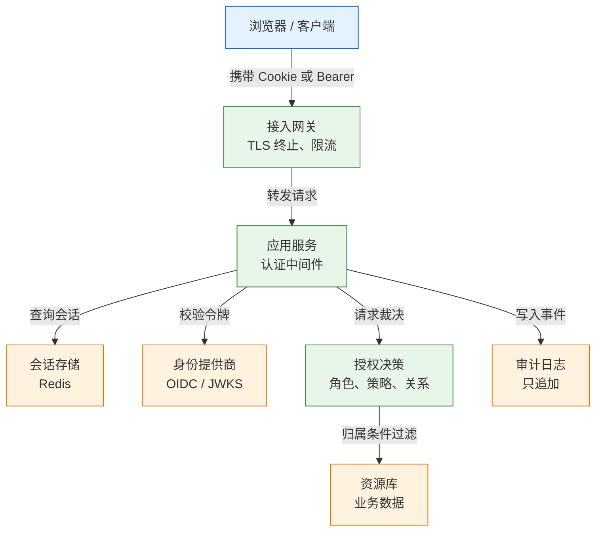
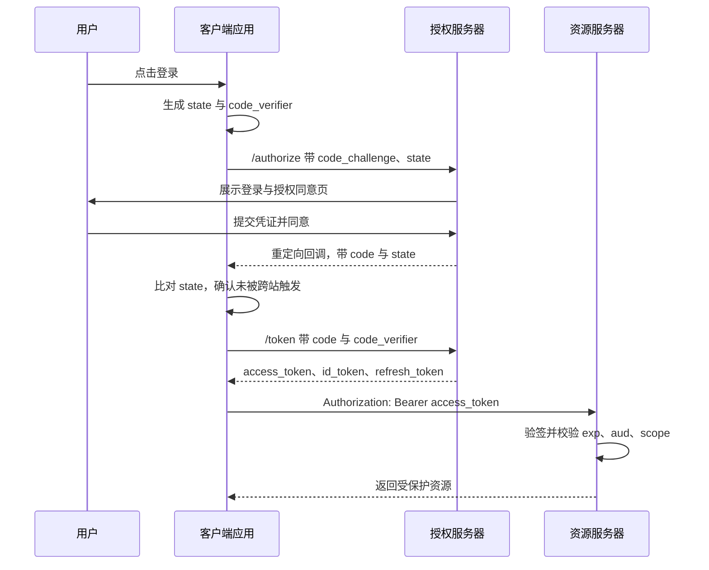
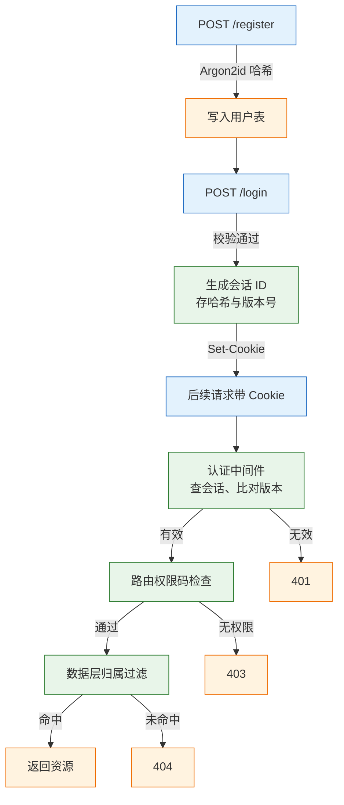
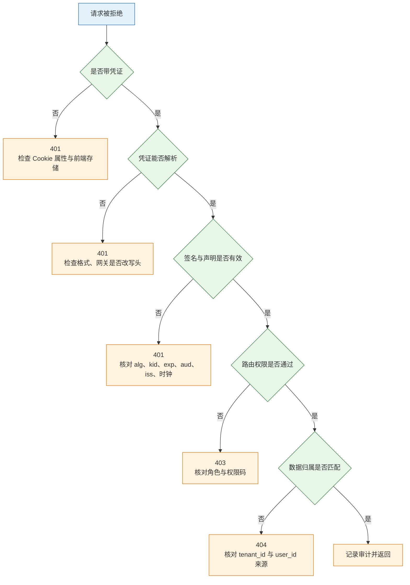

# 认证与授权

---

## 一、认证与授权是什么

认证（Authentication）回答"当前请求是谁发出的"，授权（Authorization）回答"这个主体能否对这份资源执行这个动作"。两者经常写在同一个中间件里，但输入、失败语义和审计要求完全不同。混在一起的直接后果是：登录成功被当成"什么都能做"，于是出现"登录了就能看别人订单"这类越权。

认证解决**主体识别**，授权解决**动作裁决**。识别错了，裁决再细也没有意义；裁决缺失，识别再强也挡不住横向移动。一套可用的身份体系，必须让这两件事在代码里各有明确位置，而不是靠一组 `if` 散落在各接口中。

它不解决的问题也要提前划清：认证不负责传输保密，那是 TLS 的职责；授权不负责数据脱敏，字段级可见性要单独设计；审计不参与裁决，它只记录事实，用于事后追责和异常检测。

### 1.1 核心概念

先建立一组词汇。**主体**是发起动作的实体，可以是人、服务或设备；**凭证**是证明身份的证据；**会话**是认证成功后服务端保存的短期状态；**令牌**是自包含的、由签发方背书的声明集合；**权限**是对"动作加资源类型"的抽象；**策略**是权限到主体的映射规则；**归属**是具体某条数据与主体的关系。

| 概念 | 本质 | 判定依据 |
|---|---|---|
| 主体 subject | 发起请求的实体 | 用户 ID、服务名、设备证书 |
| 凭证 credential | 证明身份的证据 | 口令、私钥签名、一次性码 |
| 会话 session | 服务端保存的登录状态 | 随机 ID 加存储中的记录 |
| 令牌 token | 签发方背书的声明集合 | 签名、有效期、受众 |
| 权限 permission | 动作与资源类型的组合 | 权限码 `order:refund` |
| 策略 policy | 主体到权限的映射 | 角色绑定、属性规则、关系图 |
| 归属 ownership | 具体资源属于谁 | 表中的 `user_id`、`tenant_id` |

两个状态码的语义必须固定下来：`401` 表示没有有效身份，响应应带 `WWW-Authenticate` 头；`403` 表示身份有效但无权。前端据此决定跳登录还是提示无权限。把未登录返回 403，会让前端无法区分两种情况，这是接口契约问题，不是前端问题。

### 1.2 与相邻技术的关系

认证授权常与会话管理、审计、加密混为一谈。它们回答的问题不同，缺失后的后果也不同：

| 技术 | 回答的问题 | 缺失后的后果 |
|---|---|---|
| 认证 | 请求是谁 | 匿名访问、身份伪造 |
| 授权 | 能做什么 | 越权读取、提权 |
| 会话管理 | 登录状态维持多久 | 注销无效、会话固定 |
| 审计 | 谁在何时做了什么 | 事件无法追溯、无法定责 |
| 加密 | 传输与存储是否保密 | 凭证被窃听、数据泄露 |

认证不等于加密。HTTPS 保护传输，但服务端仍要自己校验口令和令牌；TLS 客户端证书只证明链路两端，不说明这个身份能读哪条数据。认证也不等于审计：日志记录事实，不参与裁决，但它是事后追责和异常检测的唯一依据。

与身份提供商（IdP）的关系同样要分清。自建账号体系里，应用同时承担签发与校验；接入 OIDC 后，签发交给 IdP，应用只做校验和本地授权。这个边界决定了排障方向：令牌有问题先找 IdP，权限有问题先找本地策略。

### 1.3 架构组成



各组件职责与常见实现：

| 组件 | 职责 | 常见实现 |
|---|---|---|
| 接入网关 | 终止 TLS、限流、粗粒度拒绝 | Nginx、Envoy、云负载均衡 |
| 认证中间件 | 解析凭证、建立请求上下文 | 框架中间件、过滤器 |
| 会话存储 | 保存登录状态与版本号 | Redis、数据库 |
| 授权决策 | 角色、属性、关系的裁决 | 应用内策略、OPA、关系服务 |
| 审计日志 | 记录认证与权限事件 | 独立日志库、消息队列 |

认证放在网关还是应用，需要明确。网关适合做粗粒度判断：是否带凭证、签名是否有效、来源 IP 是否在黑名单。应用必须做细粒度判断：这个用户能否读这条记录、这个字段是否可见。只在前端隐藏按钮，或只在网关校验路径前缀，都会留下可直接调用的绕过路径。

---

## 二、凭证与令牌模型

口令、会话、令牌是三种不同形态的凭证。选型决定了撤销能力、扩容方式和泄露后的损失范围，不能只看"哪种更流行"。

### 2.1 口令存储

口令不能明文存，也不能用 SHA-256 直接哈希。通用哈希追求速度，正好方便离线爆破；口令哈希追求慢和占内存，用可控成本拖住攻击者。

| 算法 | 参数建议 | 说明 |
|---|---|---|
| Argon2id | 内存 64 MiB、迭代 3、并行 4 | 首选，抗 GPU 与 ASIC |
| bcrypt | cost 12 起 | 成熟，输入上限 72 字节 |
| scrypt | N=2^15、r=8、p=1 | 可用，参数需实测 |
| PBKDF2 | SHA-256、60 万次以上 | 合规兜底，抗 GPU 较弱 |

参数不是越大越好。单次校验 200 ms 意味着单核每秒只能处理 5 次登录，这个数字要写进容量规划，并在登录接口前置限流。每个用户独立盐，盐与参数都编码在哈希串里，所以同一个密码每次生成的串都不同，但都能验证通过。

比较必须用库提供的恒定时间函数，不要自己写字符串相等。校验失败时对外统一返回"邮箱或密码错误"，不区分"用户不存在"和"密码错误"，否则登录接口就成了账号枚举工具。注册、找回密码、邀请成员同样会泄露账号是否存在，需要一并处理。

> **注意**：哈希参数升级后不要批量重算。登录成功时用 `check_needs_rehash` 判断，命中就用新参数重算并更新，用户无感知，也避免一次全表写入把数据库打满。

口令策略可以落到几条可执行规则：最小长度 12（或 8 位加 MFA），同时限制最大长度，防止超长输入拖垮哈希；用泄露口令库比对，代替"大小写数字符号"的复杂度要求；不强制 90 天轮换，只在有泄露迹象时要求修改；允许粘贴与密码管理器自动填充。复杂度规则通常只会逼出 `Password1!` 这类可预测组合。

### 2.2 会话与令牌的取舍

| 维度 | 服务端会话 | JWT |
|---|---|---|
| 状态 | 服务端保存 | 客户端持有 |
| 注销 | 删除记录立即生效 | 到期前需黑名单或版本号 |
| 扩容 | 需要共享存储 | 无状态，易横向扩展 |
| 泄露面 | Cookie 可设 HttpOnly | 放 localStorage 可被 XSS 读取 |
| 体积 | 一个随机 ID | 随声明增长，可能超头部限制 |
| 适用 | 同源 Web、后台系统 | 服务间调用、短时令牌 |

同源 Web 应用优先用 `HttpOnly` Cookie 承载会话：

```text
Set-Cookie: __Host-session=<random>; Path=/; Secure; HttpOnly; SameSite=Lax
```

`__Host-` 前缀强制要求 `Secure`、`Path=/` 且不能带 `Domain`，可以防止子域写入同名 Cookie 覆盖主域。会话 ID 至少 128 位随机，服务端只存它的哈希，登录成功和权限变更时轮换，同时设置空闲超时与绝对超时。

JWT 适合"短命、跨服务、调用方不需要主动注销"的场景。它不是默认更先进：载荷只做 Base64URL 编码，任何人可解码，不能放密码、身份证号、内部地址。把 JWT 当会话用，就得自己补上撤销机制，最后往往又回到服务端存状态，只是多了一层复杂度。

### 2.3 JWT 的结构与校验

JWT 的紧凑序列化由三段组成，用点分隔：头部、载荷、签名。头部声明算法与密钥标识，载荷是声明集合，签名覆盖前两段的编码结果。签名保证内容未被篡改，不保证内容不可读。

| 声明 | 含义 | 校验要求 |
|---|---|---|
| `iss` | 签发方 | 与预期 Issuer 完全匹配 |
| `aud` | 受众 | 必须是本服务标识，防令牌挪用 |
| `exp` / `nbf` | 过期与生效时间 | 校验并允许少量时钟偏差 |
| `sub` | 主体标识 | 用于查本地用户，不直接当权限 |
| `jti` | 令牌唯一 ID | 黑名单与重放检测 |
| `scope` | 授权范围 | 与接口要求的权限比对 |

校验顺序固定：先按 `kid` 选密钥并验签，再确认 `alg` 在允许列表内，然后校验时间、签发方、受众，最后才读取声明。反过来先读声明再验签，等于信任了未经校验的输入。

三类典型攻击对应三条防线：

- **算法混淆**：把 `RS256` 改成 `HS256`，用公钥充当 HMAC 密钥。防线是服务端固定算法，不接受头部自称的算法。
- **`alg: none`**：直接去掉签名。防线是显式算法白名单，任何 `none` 一律拒绝。
- **密钥混用**：多环境共用密钥，测试令牌能打生产。防线是环境隔离，配合 `kid` 轮换。

> **安全警告**：HS256 的共享密钥泄露等于全部令牌可伪造，且无法区分签发方。跨团队、跨组织、公开客户端一律用 RS256 或 ES256，私钥只留在授权服务器，公钥通过 JWKS 端点发布并缓存。

### 2.4 令牌的存放位置

| 位置 | XSS 可读 | CSRF 风险 | 适用场景 |
|---|---|---|---|
| `HttpOnly` Cookie | 否 | 有，需 SameSite 或 Token | 同源 Web |
| 内存变量 | 否 | 无 | SPA 短时访问令牌 |
| `localStorage` | 是 | 无 | 不放长期令牌 |
| URL 查询串 | 是，会进日志与 Referer | 有 | 仅一次性下载签名 |

存放位置决定攻击面，不存在"最安全的位置"。放 Cookie 挡 XSS 但要防 CSRF；放内存挡 CSRF 但刷新即丢；放 localStorage 两者都不挡。SPA 的常见组合是访问令牌放内存（15 分钟），刷新令牌放 `HttpOnly` Cookie（7 天并轮换），刷新接口同时校验 `Origin` 与 CSRF Token。

> **注意**：`SameSite=Lax` 能挡住大部分跨站 POST，但挡不住同站子域发起的请求，也挡不住带顶层导航的 GET。状态变更接口不要用 GET，且应额外校验 `Origin` 或双提交 Token。

---

## 三、OAuth 2.0 与 OIDC 授权流程

### 3.1 角色与授权类型

OAuth 2.0 是授权框架，不是认证协议；OIDC 在它之上加身份层，用 ID Token 声明"用户是谁"。四个角色分别是资源所有者（用户）、客户端（接入应用）、授权服务器（签发令牌）、资源服务器（校验令牌并返回数据）。

| 授权类型 | 适用客户端 | 是否需要 secret | 现状 |
|---|---|---|---|
| Authorization Code + PKCE | Web、SPA、移动端 | 机密客户端需要 | 推荐 |
| Client Credentials | 服务间调用 | 是 | 推荐 |
| Device Code | 无浏览器的设备 | 否 | 特定场景 |
| Implicit | 浏览器 | 否 | 已不推荐 |
| Resource Owner Password | 受信第一方 | 视情况 | 已不推荐 |

OAuth 2.0 安全最佳实践要求所有使用授权码流程的客户端启用 PKCE，并淘汰隐式流程与密码模式。判断标准很简单：令牌是否经过浏览器地址栏。经过的就有被日志、插件、Referer 拿走的可能。

### 3.2 授权码加 PKCE 流程



四个参数各有明确用途，缺一个就有一类攻击成立：

| 参数 | 防御目标 | 常见错误 |
|---|---|---|
| `state` | 跨站请求伪造登录 | 生成后不校验，或固定值 |
| `code_verifier` | 授权码被拦截后重放 | 明文存 Cookie，或长度不足 |
| `nonce` | ID Token 重放 | 只在隐式流程用，代码流程漏掉 |
| `redirect_uri` | 授权码被送到攻击者站点 | 用通配符或子串匹配 |

PKCE 的 `code_challenge` 由 `code_verifier` 做 SHA-256 后 Base64URL 编码得到，授权请求只带 challenge，换令牌时才提交 verifier。授权码即使被截获，没有 verifier 也换不到令牌。

### 3.3 令牌校验的检查项

资源服务器不能"看到 Bearer 就放行"。校验分两类：本地验签适合 JWT，远程内省适合不透明令牌。

| 检查项 | 错误后果 | 做法 |
|---|---|---|
| 签名与算法 | 伪造令牌通过 | 固定算法，按 `kid` 取公钥 |
| `exp` / `nbf` | 过期令牌继续可用 | 允许 60 秒偏差，统一 NTP |
| `aud` | 给 A 服务的令牌打 B 服务 | 每个服务校验自己的受众 |
| `iss` | 伪造签发方 | 白名单比对 |
| `scope` | 越权调用接口 | 每接口声明所需 scope |
| 令牌类型 | ID Token 被当访问令牌 | 校验 `typ` 或用途声明 |

远程内省（RFC 7662）每次都要问授权服务器，延迟高但撤销即时；本地验签延迟低，但撤销有延迟。混合做法是本地验签加短 TTL，敏感操作再内省一次。

> **注意**：JWKS 要缓存，但不能永久缓存。密钥轮换后旧缓存会导致大量验签失败，通常按 `Cache-Control` 的 `max-age` 刷新，并在遇到未知 `kid` 时强制刷新一次。

---

## 四、授权模型与决策

### 4.1 RBAC 的数据模型

RBAC 把权限授予角色，再把角色授予用户，判断时查"角色是否拥有该权限"，而不是查"用户是不是某个角色名"。后者会把角色名硬编码进业务代码，加一个角色就要改一圈判断。

```sql
-- 用户、角色、权限三张主表加两张关联表
CREATE TABLE users (
    id          BIGSERIAL PRIMARY KEY,
    tenant_id   BIGINT NOT NULL,
    email       TEXT NOT NULL,
    pwd_hash    TEXT NOT NULL,
    token_ver   INT NOT NULL DEFAULT 1,
    UNIQUE (tenant_id, email)          -- 唯一约束必须带租户
);

CREATE TABLE roles (
    id        BIGSERIAL PRIMARY KEY,
    tenant_id BIGINT NOT NULL,
    name      TEXT NOT NULL
);

CREATE TABLE permissions (
    id   BIGSERIAL PRIMARY KEY,
    code TEXT NOT NULL UNIQUE         -- 全局权限码：order:read
);

CREATE TABLE user_roles (
    user_id BIGINT NOT NULL REFERENCES users(id),
    role_id BIGINT NOT NULL REFERENCES roles(id),
    PRIMARY KEY (user_id, role_id)
);

CREATE TABLE role_permissions (
    role_id       BIGINT NOT NULL REFERENCES roles(id),
    permission_id BIGINT NOT NULL REFERENCES permissions(id),
    PRIMARY KEY (role_id, permission_id)
);

-- 判断用户是否拥有某权限，一次查询完成
SELECT 1
FROM user_roles ur
JOIN role_permissions rp ON rp.role_id = ur.role_id
JOIN permissions p       ON p.id = rp.permission_id
WHERE ur.user_id = $1 AND p.code = $2;
```

权限码建议用"资源:动作"两段式，必要时加范围，如 `order:read:own`、`order:read:tenant`。范围写进权限码，可以让"本人"和"全租户"走同一套检查逻辑，而不是在每个接口里再写一次 `if`。

| 模型 | 判断依据 | 适合 | 缺点 |
|---|---|---|---|
| RBAC | 用户到角色到权限 | 后台系统、权限稳定 | 角色爆炸，难表达"本人" |
| ABAC | 主体、资源、环境属性 | 细粒度、动态策略 | 策略复杂，难审计 |
| ReBAC | 主体与资源的关系 | 文档共享、组织层级 | 需要关系存储与遍历 |
| ACL | 资源上的用户列表 | 单文件共享 | 资源多时难管理 |

### 4.2 ABAC 与 ReBAC 的边界

ABAC 用属性表达式裁决，例如"部门相同且资源未归档且当前时间在工作时段"。它表达力强，代价是策略本身成为需要测试和评审的代码。策略数量超过几十条后，没有人能说清某次拒绝是哪条规则造成的，必须配套决策日志。

ReBAC 把权限建模成关系图，典型断言是"文档的编辑者继承评论权限"。它适合层级深、共享关系频繁变化的场景，但每次判断需要遍历，必须做缓存和批量检查，否则列表接口会退化成 N 次图查询。

选型不看先进程度，看权限判断的**主语**：

- 主语是"岗位"：用 RBAC，角色数量可控。
- 主语是"属性组合"：用 ABAC，但要限制策略语言的能力。
- 主语是"与资源的关系"：用 ReBAC，先确认有图存储。
- 主语是"某几个人的名单"：用 ACL，别过度设计。

### 4.3 对象级授权与多租户隔离

角色只能回答"能不能读订单"，回答不了"能不能读**这一张**订单"。后者必须靠资源归属，而且归属条件要写进查询语句，不能查出来再在内存里判断。

```sql
-- 详情接口：归属条件进 WHERE，查不到就是 404
SELECT id, amount, status
FROM orders
WHERE id = $1 AND tenant_id = $2 AND user_id = $3;

-- 列表接口：同样的条件，不能只在分页后过滤
SELECT id, amount, status
FROM orders
WHERE tenant_id = $2 AND user_id = $3
ORDER BY id DESC
LIMIT $4 OFFSET $5;
```

多租户场景的 `tenant_id` 必须来自会话或令牌，不能来自请求体、查询参数或前端传来的 Header。用户属于多个租户时，切换租户要重新签发会话，或在服务端校验成员关系后写入请求上下文。

| 漏洞形态 | 表现 | 修复 |
|---|---|---|
| 列表过滤、详情不过滤 | 遍历 ID 可读他人数据 | 详情查询补归属条件 |
| 信任前端角色 | 改请求体即提权 | 角色只从会话读取 |
| 批量接口只验首个 ID | 混入他人 ID 即越权 | 逐条校验或按归属批量查 |
| 导出接口漏检 | 导出全表数据 | 复用同一套查询条件 |
| 管理端复用用户端查询 | 靠前端隐藏入口 | 独立路由与独立权限码 |

> **安全警告**：对象级授权缺失是最常见的越权来源，且被测出来时往往已经泄露。所有按 ID 取单条资源的接口，都必须把 `tenant_id` 与 `user_id` 写进 `WHERE`，并对无权访问返回 404 而不是 403，避免通过状态码探测资源是否存在。

### 4.4 策略执行点与默认拒绝

策略执行点（PEP）是真正拦截请求的地方，策略决策点（PDP）负责算出结果。小系统可以把两者写在一个中间件里，大系统会把 PDP 拆成独立服务，便于多语言复用和统一审计。

| 层次 | 检查内容 | 失败返回 |
|---|---|---|
| 网关 | 凭证存在性、签名、限流 | 401 或 429 |
| 路由 | 权限码是否匹配 | 403 |
| 服务 | 业务状态是否允许该动作 | 409 或 422 |
| 数据 | 归属与租户是否匹配 | 404 |
| 字段 | 该角色能否看到此字段 | 脱敏后返回 |

默认拒绝意味着新增接口时"忘记加注解"应当是拒绝，而不是放行。实现上给路由加统一前缀鉴权，白名单只列登录、健康检查、回调三类；新增接口默认继承鉴权，需要公开时显式声明。

---

## 五、配置与实现

### 5.1 环境准备

```bash
# 建立独立虚拟环境，避免污染系统 Python
python3 -m venv /tmp/auth-demo/.venv
source /tmp/auth-demo/.venv/bin/activate

# 口令哈希、JWT、Web 框架
pip install "argon2-cffi>=23" "PyJWT>=2.8,<3" "fastapi>=0.110" "uvicorn>=0.29"

# 确认版本，排障时先核对这里
python -c "import argon2, jwt, fastapi; print(argon2.__version__, jwt.__version__, fastapi.__version__)"
```

依赖要锁版本。口令哈希与 JWT 库的行为在跨大版本时会变，例如异常类型改名、默认算法收紧，生产环境用锁文件固定。

### 5.2 口令哈希与升级

```python
# /tmp/auth-demo/password.py
from argon2 import PasswordHasher
from argon2.exceptions import VerifyMismatchError

# 参数与 2.1 节一致：64 MiB 内存、3 次迭代、4 路并行
ph = PasswordHasher(time_cost=3, memory_cost=65536, parallelism=4)

hashed = ph.hash("correct horse battery staple")
print(hashed)

# 校验成功返回 True，失败抛 VerifyMismatchError
print(ph.verify(hashed, "correct horse battery staple"))

# 参数升级后据此判断是否需要重算
print(ph.check_needs_rehash(hashed))

try:
    ph.verify(hashed, "wrong password")
except VerifyMismatchError:
    print("mismatch")
```

```bash
python /tmp/auth-demo/password.py
```

输出类似：

```text
$argon2id$v=19$m=65536,t=3,p=4$c29tZXNhbHQ$...
True
False
mismatch
```

同一个密码两次 `hash` 得到的串不同，因为盐随机；`verify` 从串里解析出盐和参数，所以两者都能通过。数据库只存这个串，不存明文，也不存盐的单独字段。

### 5.3 JWT 签发与校验

```python
# /tmp/auth-demo/jwt_demo.py
import time
import jwt
from jwt import ExpiredSignatureError, InvalidAudienceError

secret = "dev-only-secret-at-least-32-bytes-long"
claims = {
    "sub": "42",
    "aud": "orders-api",
    "iss": "auth.example.com",
    "iat": int(time.time()),
    "exp": int(time.time()) + 60,
    "jti": "3f6c1a9e",
    "scope": "order:read",
}

token = jwt.encode(claims, secret, algorithm="HS256", headers={"kid": "dev-1"})
print(token.count(".") + 1)                     # 三段

# 校验必须显式给出算法、受众、签发方，并强制要求关键声明
payload = jwt.decode(
    token, secret,
    algorithms=["HS256"],                        # 白名单，不接受头部自称的算法
    audience="orders-api",
    issuer="auth.example.com",
    leeway=60,                                   # 容忍 60 秒时钟偏差
    options={"require": ["exp", "iat", "aud", "iss", "sub"]},
)
print(payload["sub"])

expired = jwt.encode({**claims, "exp": int(time.time()) - 120},
                     secret, algorithm="HS256")
try:
    jwt.decode(expired, secret, algorithms=["HS256"],
               audience="orders-api", issuer="auth.example.com", leeway=60)
except ExpiredSignatureError:
    print("expired")

try:
    jwt.decode(token, secret, algorithms=["HS256"],
               audience="billing-api", issuer="auth.example.com")
except InvalidAudienceError:
    print("wrong audience")
```

```bash
python /tmp/auth-demo/jwt_demo.py
```

输出类似：

```text
3
42
expired
wrong audience
```

脚本不要命名为 `token.py`、`json.py`、`types.py`，它们会遮蔽标准库同名模块，报出看起来毫不相关的循环导入错误。生产密钥用 `openssl rand -base64 32` 生成，放秘密管理器，不写进代码与镜像。

### 5.4 会话存储与撤销

会话放 Redis 时，除了 `session:<id>`，还要维护"用户到会话集合"的索引，否则"踢掉某用户全部设备"只能全库扫描。

```text
# 会话记录：只存必要字段，值为哈希后的会话 ID
SET session:<sha256> '{"uid":42,"tenant":"t42","ver":3}' EX 1800

# 用户到会话的反向索引，用于批量撤销
SADD user:42:sessions <sha256>
EXPIRE user:42:sessions 86400

# 注销单个会话
DEL session:<sha256>
SREM user:42:sessions <sha256>

# 注销全部：版本号加一，旧会话校验时版本不匹配即失效
INCR user:42:token_ver
```

| 机制 | 生效速度 | 成本 | 适用 |
|---|---|---|---|
| 删除单条会话 | 立即 | 一次 DEL | 单设备退出 |
| 遍历集合删除 | 立即 | 与设备数成正比 | 强制下线 |
| 版本号自增 | 立即 | 一次 INCR | 改密后全端失效 |
| 仅靠 TTL 过期 | 最长一个 TTL | 无 | 兜底，不可单独依赖 |

会话 ID 存哈希而不是明文，Redis 泄露时攻击者不能直接拿去登录。空闲 TTL 与绝对过期都要有，滑动续期只延长空闲时间，不能突破绝对上限。

---

## 六、完整示例：同源 Web 登录闭环

### 6.1 接口与状态设计

示例实现一个最小闭环：注册、登录、读取当前用户、读取订单、改密、注销。会话存内存字典，便于本地跑通；生产替换为 Redis，代码结构不变。



| 接口 | 方法 | 认证 | 成功返回 |
|---|---|---|---|
| `/register` | POST | 无 | 201 |
| `/login` | POST | 无 | 200 加 Set-Cookie |
| `/me` | GET | 必需 | 200 加用户信息 |
| `/orders/{id}` | GET | 必需 | 200 或 404 |
| `/password` | POST | 必需 | 204 |
| `/logout` | POST | 必需 | 204 |

### 6.2 服务端实现

```python
# /tmp/auth-demo/app.py
import hashlib
import secrets
import time
from dataclasses import dataclass, field

from argon2 import PasswordHasher
from argon2.exceptions import VerifyMismatchError
from fastapi import Cookie, Depends, FastAPI, Header, HTTPException, Response
from pydantic import BaseModel

app = FastAPI()
ph = PasswordHasher(time_cost=3, memory_cost=65536, parallelism=4)

IDLE_TTL = 30 * 60          # 空闲 30 分钟失效
ABS_TTL = 12 * 3600         # 无论活跃与否，12 小时必须重新登录
APP_ORIGIN = "https://app.example.com"


@dataclass
class User:
    id: int
    email: str
    pwd_hash: str
    token_ver: int = 1
    roles: set[str] = field(default_factory=set)


USERS: dict[str, User] = {}          # email 到用户
BY_ID: dict[int, User] = {}
SESSIONS: dict[str, dict] = {}       # 会话 ID 的 SHA-256 到会话数据


def sid_key(sid: str) -> str:
    """只把会话 ID 的哈希落库，降低存储泄露的影响。"""
    return hashlib.sha256(sid.encode()).hexdigest()


def issue_session(user: User) -> str:
    sid = secrets.token_urlsafe(32)              # 256 位随机
    now = time.time()
    SESSIONS[sid_key(sid)] = {
        "uid": user.id, "ver": user.token_ver,
        "created": now, "seen": now,
    }
    return sid


def current_user(session: str | None = Cookie(default=None)) -> User:
    """认证：只负责确认身份，不做任何权限判断。"""
    if not session:
        raise HTTPException(401, "no session")
    data = SESSIONS.get(sid_key(session))
    now = time.time()
    if not data:
        raise HTTPException(401, "invalid session")
    if now - data["seen"] > IDLE_TTL or now - data["created"] > ABS_TTL:
        SESSIONS.pop(sid_key(session), None)
        raise HTTPException(401, "session expired")
    user = BY_ID.get(data["uid"])
    if not user or user.token_ver != data["ver"]:
        raise HTTPException(401, "session revoked")
    data["seen"] = now                            # 只延长空闲时间
    return user


def require(scope: str):
    """授权：路由级检查权限码，缺省拒绝。"""
    def dep(user: User = Depends(current_user)) -> User:
        if scope not in user.roles:
            raise HTTPException(403, "forbidden")
        return user
    return dep


def check_origin(origin: str | None) -> None:
    """状态变更请求校验来源，配合 SameSite 抵挡 CSRF。"""
    if origin and origin != APP_ORIGIN:
        raise HTTPException(403, "bad origin")


class Credentials(BaseModel):
    email: str
    password: str


class NewPassword(BaseModel):
    old: str
    new: str


@app.post("/register", status_code=201)
def register(body: Credentials):
    if body.email in USERS:
        raise HTTPException(409, "email exists")   # 演示可区分，生产应统一话术
    uid = len(USERS) + 1
    user = User(uid, body.email, ph.hash(body.password))
    USERS[body.email] = user
    BY_ID[uid] = user
    return {"id": uid}


@app.post("/login")
def login(body: Credentials, response: Response,
          origin: str | None = Header(default=None)):
    check_origin(origin)
    user = USERS.get(body.email)
    # 账号不存在时也执行一次哈希，避免响应时间泄露账号是否存在
    stored = user.pwd_hash if user else ph.hash("dummy-password-for-timing")
    try:
        ok = ph.verify(stored, body.password)
    except VerifyMismatchError:
        ok = False
    if not user or not ok:
        raise HTTPException(401, "invalid credentials")
    sid = issue_session(user)                      # 登录成功即轮换，防会话固定
    response.set_cookie(
        "demo-session", sid, httponly=True, samesite="lax",
        secure=False,                              # 本地 HTTP 调试；生产必须 True
        path="/",
        max_age=ABS_TTL,                           # Cookie 存活到绝对上限，空闲由服务端判定
    )
    return {"uid": user.id}


@app.get("/me")
def me(user: User = Depends(current_user)):
    return {"id": user.id, "email": user.email, "roles": sorted(user.roles)}


@app.get("/orders/{order_id}")
def get_order(order_id: int, user: User = Depends(current_user)):
    # 演示数据；真实实现把 tenant_id、user_id 写进 WHERE
    row = {"id": 1, "tenant": "t42", "owner": 7, "amount": 100}
    if order_id != row["id"] or row["owner"] != user.id:
        raise HTTPException(404, "not found")      # 不暴露资源是否存在
    return row


@app.post("/password", status_code=204)
def change_password(body: NewPassword, user: User = Depends(current_user)):
    try:
        ph.verify(user.pwd_hash, body.old)
    except VerifyMismatchError:
        raise HTTPException(403, "wrong password")
    user.pwd_hash = ph.hash(body.new)
    user.token_ver += 1                            # 旧会话立即失效
    for key, data in list(SESSIONS.items()):
        if data["uid"] == user.id:
            SESSIONS.pop(key, None)


@app.post("/logout", status_code=204)
def logout(response: Response, session: str | None = Cookie(default=None)):
    if session:
        SESSIONS.pop(sid_key(session), None)
    response.delete_cookie("demo-session", path="/")
```

```bash
# 启动服务，绑定本地回环
uvicorn app:app --app-dir /tmp/auth-demo --host 127.0.0.1 --port 8000
```

### 6.3 验证过程

```bash
# 注册
curl -s -X POST http://127.0.0.1:8000/register \
  -H 'Content-Type: application/json' \
  -d '{"email":"a@example.com","password":"correct horse battery staple"}'
# {"id":1}

# 登录并把 Cookie 存到文件
curl -s -i -c /tmp/c.txt -X POST http://127.0.0.1:8000/login \
  -H 'Content-Type: application/json' \
  -d '{"email":"a@example.com","password":"correct horse battery staple"}'
# HTTP/1.1 200 OK
# set-cookie: demo-session=...; HttpOnly; Path=/; SameSite=lax

# 带 Cookie 读取身份
curl -s -b /tmp/c.txt http://127.0.0.1:8000/me
# {"id":1,"email":"a@example.com","roles":[]}

# 访问不属于自己的订单，应得 404 而不是 403
curl -s -o /dev/null -w '%{http_code}\n' -b /tmp/c.txt \
  http://127.0.0.1:8000/orders/1
# 404

# 不带 Cookie 访问，应得 401
curl -s -o /dev/null -w '%{http_code}\n' http://127.0.0.1:8000/orders/1
# 401

# 注销后同一 Cookie 立即失效
curl -s -b /tmp/c.txt -X POST http://127.0.0.1:8000/logout
curl -s -o /dev/null -w '%{http_code}\n' -b /tmp/c.txt http://127.0.0.1:8000/me
# 401
```

四个状态码分别对应四层：`401` 是认证失败，`404` 是数据层归属不匹配，`403` 是路由级权限不足，`204` 是成功且无响应体。把这四层混成一个 `500`，排障时就无法判断问题出在哪。

### 6.4 生产替换点

| 演示实现 | 生产替换 | 原因 |
|---|---|---|
| 内存字典 | Redis 加数据库 | 多实例共享、重启不丢 |
| `secure=False` | `Secure` 加 `__Host-` 前缀 | 只走 HTTPS，防子域覆盖 |
| 无失败计数 | IP 加账号双维度限流 | 挡撞库，且不锁死账号 |
| 无审计 | 独立审计日志 | 事后追溯与告警 |
| 单角色集合 | 角色表加权限表 | 权限可配置、可审计 |
| 无 MFA | TOTP 或 WebAuthn | 口令泄露后的第二道门 |

> **注意**：`__Host-` 前缀在本地 HTTP 环境下不会被浏览器回传，所以示例用普通名字并关闭 `Secure`。上线前必须同时改名字、开 `Secure`、保持 `Path=/`，三者缺一前缀即失效。

---

## 七、多因素认证与密码重置

### 7.1 第二因素的选择

口令泄露后，第二因素能挡住大部分撞库。选择依据是抗钓鱼能力，而不是用户熟悉的程度。

| 方式 | 体验 | 抗钓鱼 | 说明 |
|---|---|---|---|
| TOTP | 好 | 弱 | 30 秒验证码，共享密钥 |
| 短信或邮件 | 一般 | 弱 | 有 SIM 劫持与邮箱接管风险 |
| WebAuthn 或 Passkey | 好 | 强 | 公私钥绑定源站，推荐 |
| 恢复码 | 一次性 | 中 | 离线保存，哈希存储 |

TOTP 密钥要加密存储，校验允许前后一个时间窗（如正负 1 个 30 秒），防止时钟轻微漂移。恢复码只在生成时展示一次，数据库存哈希，用一次作废。敏感操作（改密码、改邮箱、提现、查看审计日志）要求 step-up：即使已登录，也重新验证一次第二因素，而不是只验密码。

### 7.2 密码重置流程

1. 用户提交邮箱，无论账号是否存在都返回同一句"如果账号存在，已发送邮件"。
2. 生成至少 128 位随机令牌，数据库只存哈希，带过期时间与一次性标记。
3. 邮件链接携带令牌，打开后校验并允许设置新密码。
4. 设置成功后删除令牌、撤销该用户全部会话、通知用户、写审计。
5. 旧链接再次使用必须失败。

| 参数 | 建议值 | 理由 |
|---|---|---|
| 令牌长度 | 128 位以上随机 | 不可预测，抗枚举 |
| 有效期 | 15 到 30 分钟 | 缩短泄露窗口 |
| 使用次数 | 一次 | 防重放 |
| 存储形式 | 哈希 | 库泄露也不能直接用 |
| 失败响应 | 统一话术 | 防账号枚举 |

不要用 `user_id` 加时间戳做重置令牌，也不要把它放进日志、Referer 或分析脚本。重置链接一旦被邮件网关的链接预取访问，就会提前消耗一次性令牌，这时需要允许"打开页面不消费、提交新密码才消费"。

### 7.3 审计事件与异常检测

| 事件 | 必记字段 | 用途 |
|---|---|---|
| 登录成功 | 用户、IP、UA、时间、方式 | 建立基线 |
| 登录失败 | 账号、IP、原因码 | 撞库检测 |
| 权限变更 | 操作者、目标、角色、工单号 | 追责与复核 |
| 会话撤销 | 用户、范围、触发原因 | 确认下线生效 |
| 密码重置 | 用户、IP、令牌 ID | 盗号排查 |

审计日志要单独存储、只追加、限制访问权限，保留期按合规要求。不要记录完整令牌、密码、身份证号；需要关联时记哈希或尾号。审计日志本身也是敏感数据，读取它的接口应当要求更高权限，并再次记一条审计。

---

## 八、安全边界

### 8.1 越权的常见形态

| 形态 | 触发条件 | 防线 |
|---|---|---|
| 水平越权 | 改资源 ID 读他人数据 | 归属条件进查询 |
| 垂直越权 | 普通用户调用管理接口 | 路由级权限码 |
| 租户越权 | 改 `tenant_id` 跨租户 | 租户取自会话 |
| 批量越权 | 批量接口只校验首条 | 逐条校验或按归属批查 |
| 字段越权 | 返回未脱敏的敏感字段 | 输出 DTO 白名单 |
| 状态越权 | 已退款订单再次退款 | 业务状态机校验 |

前五种是权限问题，最后一种是业务状态问题，两者常被混为一谈。状态校验不能替代权限校验：有权退款的人也不能对已关闭的订单退款，这是两个独立判断。

### 8.2 密钥与令牌管理

| 对象 | 存放 | 轮换 | 泄露后 |
|---|---|---|---|
| 口令哈希盐 | 哈希串内 | 随参数升级 | 无需单独处理 |
| JWT 签名私钥 | 秘密管理器 | 按 `kid` 双密钥过渡 | 立即吊销并全量重签 |
| 会话 ID | 客户端 Cookie | 登录与提权时 | 删除对应会话 |
| 刷新令牌 | HttpOnly Cookie | 每次刷新轮换 | 撤销整条令牌链 |
| API Key | 服务端配置 | 定期 | 吊销并审计调用记录 |

> **安全警告**：密钥写进代码、镜像、前端包、CI 日志，都视为已泄露。发现泄露的第一步是吊销并轮换，不是删提交；删除历史不能撤回已经复制出去的内容。

### 8.3 自建与采购的判断

| 需求 | 建议 | 理由 |
|---|---|---|
| 社交登录、企业 SSO | 接 OIDC 提供商 | 协议细节多，自写易错 |
| 细粒度文档共享 | 评估 ReBAC 引擎 | 角色数量会爆炸 |
| 内部服务互调 | mTLS 或工作负载身份 | 不复制用户凭证 |
| 单机后台 | 反向代理加 Basic 认证 | 但必须 HTTPS |
| 面向公众的账号体系 | 自建加成熟库 | 可控，但要承担合规 |

自建不是错，错在低估工作量。口令找回、MFA、风控、审计、合规报告，任何一项做浅了都会成为入口。判断标准是：团队能否持续维护这套东西两年以上。

---

## 九、常见故障与排查

| 现象 | 最可能原因 | 处理 |
|---|---|---|
| 登录后立刻 401 | Cookie 未种上，Domain、Path、Secure、SameSite 不匹配 | 看 `Set-Cookie` 与后续请求的 Cookie 头 |
| 刷新页面掉登录 | 令牌只放内存，刷新即丢 | 改 HttpOnly Cookie 或安全持久化 |
| 一直 401 循环 | 拦截器把刷新请求也拦了 | 刷新接口排除拦截，失败才跳登录 |
| 令牌过期时间不准 | 客户端与服务端时钟偏差 | 允许 60 秒偏差，统一 NTP |
| JWT 被伪造 | 用了 `none`、弱密钥、未校验 `alg` | 固定算法白名单，校验签名与声明 |
| XSS 后账号被盗 | 令牌放 localStorage | 改 HttpOnly Cookie，补输出编码与 CSP |
| CSRF 生效 | 只靠 Cookie，未校验来源 | SameSite 加 Token 加 Origin 校验 |
| 能看别人订单 | 详情接口缺归属校验 | 查询条件带 `user_id`、`tenant_id` |
| 普通用户变管理员 | 信任前端传的 role，或批量赋值 | 角色从会话取，DTO 白名单 |
| 注销后令牌还能用 | JWT 无状态且未撤销 | 缩短 TTL、版本号或 `jti` 黑名单 |
| 刷新令牌被重放 | 刷新令牌长期有效且可重复使用 | 轮换刷新令牌，检测复用后撤销整条链 |
| 改密后旧设备仍在线 | 未失效旧会话 | 改密时删除该用户全部会话 |
| 登录接口被撞库 | 无失败计数与限流 | IP 加账号双维度限流，加 MFA |



排查顺序按"先确认凭证，再确认身份，最后确认权限"推进：

1. 看请求是否携带凭证，Cookie 是否被浏览器回传，Authorization 头是否被网关剥掉。
2. 看状态码：401 查认证链路，403 查路由权限，404 查数据归属，不要把三者混为一谈。
3. 解码 JWT（只用于观察，不作为信任依据）核对 `exp`、`aud`、`iss`、`alg`、`kid`，并比对服务器时间。
4. 查会话存储：键是否存在、TTL 是否正常、版本号是否被改密操作递增。
5. 查网关与反向代理：是否改写 `Host`、`X-Forwarded-*`，是否缓存了带 `Set-Cookie` 的响应。
6. 最后才怀疑代码逻辑，并优先复现"列表能看、详情不能看"这类差异，它通常指向归属条件漏写。

> **运维提示**：认证类故障优先在浏览器开发者工具的 Network 面板看完整请求与响应头，比在服务端猜快得多。Cookie 的 `Domain`、`Path`、`Secure`、`SameSite` 四个属性任一不匹配，表现都是"登录成功但下一个请求又是 401"。

> **运维提示**：三句话收束全篇——认证定身份，授权定动作；401 与 403 不能混，对象级归属不能省；口令用 Argon2id，会话用 HttpOnly Cookie，JWT 短命、可校验、能撤销再谈无状态。
