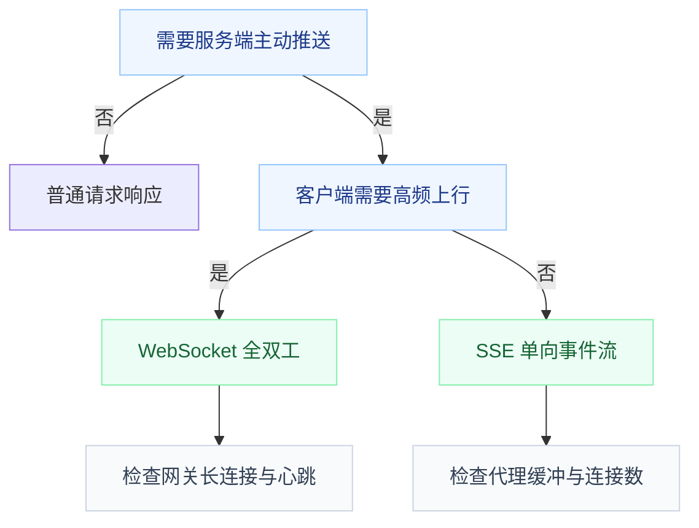
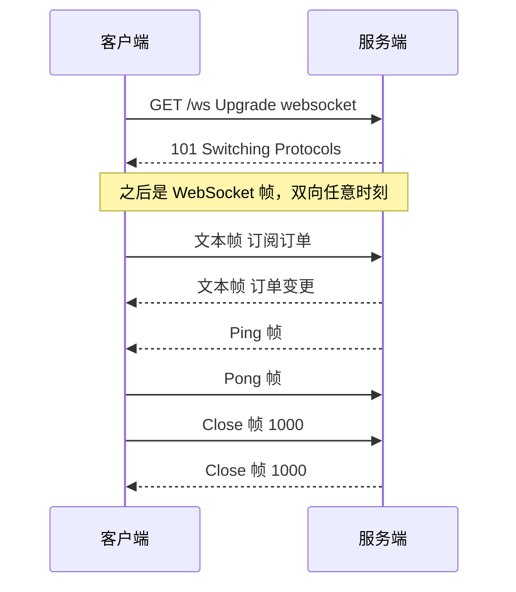

# WebSocket与SSE

> 这篇从实时通道的三种形态和选型讲起，经过 WebSocket 的握手、帧与关闭码，心跳与半开连接检测，断线重连与消息补偿，鉴权与安全，SSE 的协议格式与代理约束，Spring Boot 的服务端实现，最后落到一个 Node 22 上可运行的订单实时通知服务案例，WebSocket 与 SSE 两条通道都跑出可核对的结果。
>
> 学完能按业务方向选出长连接方案，写出带心跳、鉴权、断线补偿的 WebSocket 服务，并用 SSE 实现可自动续传的单向事件流。

## 一、实时通道的三种形态

服务端主动送数据的场景，工程上只有三条路：轮询、SSE、WebSocket。选择依据是“谁先说话、说多频繁、要不要双向”，不是“哪个更新”。

| 方案 | 方向 | 协议 | 典型场景 |
|---|---|---|---|
| 短轮询 | 客户端拉 | HTTP | 低频状态查询 |
| SSE | 服务端推 | HTTP | 通知、行情、日志、进度 |
| WebSocket | 双向 | WS | 聊天、协同编辑、游戏 |



两者协议血缘不同：WebSocket 从 HTTP 借一次 `Upgrade` 握手，之后是完全独立的帧协议（RFC 6455）；SSE 始终是普通 HTTP 响应，只是 `Content-Type: text/event-stream` 且不结束，浏览器用 `EventSource` 解析。



> 边界：SSE 只能服务端到客户端单向，客户端要上行必须另发 HTTP 请求；WebSocket 双向但不可缓存、不可被 CDN 按 URL 缓存、调试成本高于 HTTP。移动端弱网、只需要通知的场景，SSE 的自动重连和 `Last-Event-ID` 补偿比手写 WebSocket 重连省一半代码。

## 二、环境准备与最小验证

验证环境用 Node 22 LTS（自带 WebSocket 客户端，服务端用 `ws` 8.22.x），不需要浏览器和额外中间件。安装 Node 22：

```bash
# Windows（管理员 PowerShell）
winget install OpenJS.NodeJS.LTS

# macOS
brew install node@22

# Ubuntu 24.04
curl -fsSL https://deb.nodesource.com/setup_22.x | sudo -E bash -
sudo apt-get install -y nodejs

# Rocky 9 / CentOS Stream
sudo dnf install -y nodejs npm
```

```bash
node --version    # 预期 v22.x
npm --version     # 预期 10.x
```

服务端依赖只有 `ws`：

```bash
mkdir realtime && cd realtime
npm init -y
npm install ws@8
```

最小验证分两步。先起一个 20 行的回显服务：

```javascript
// echo-server.mjs
import { WebSocketServer } from 'ws';

const wss = new WebSocketServer({ port: 18092 });
wss.on('connection', (ws) => {
  ws.on('message', (data) => ws.send(`echo: ${data}`)); // 原样回显，验证帧收发
  ws.send('welcome');
});
console.log('ws://localhost:18092');
```

```bash
node echo-server.mjs
```

再用 Node 22 自带的客户端连一次，不需要 `wscat`：

```javascript
// echo-client.mjs
const ws = new WebSocket('ws://localhost:18092');
ws.onmessage = (event) => {
  console.log(`[recv] ${event.data}`);
  if (event.data === 'welcome') ws.send('hello');
  else process.exit(0); // 收到回显就退出
};
setTimeout(() => process.exit(1), 3000).unref();
```

```bash
node echo-client.mjs
```

```text
[recv] welcome
[recv] echo: hello
```

SSE 不需要任何依赖，`curl -N` 就是最可靠的客户端：`-N` 关闭 curl 自己的输出缓冲，能立即看到事件。

> 边界：`ws` 只负责协议层，重连、鉴权、心跳策略都要自己写；`socket.io` 这类封装自带重连和房间，但协议不是标准 WebSocket，非 JS 客户端接入成本高。服务端部署多实例时，连接分散在不同进程，广播必须经过 Redis Pub/Sub 或消息队列，不能只靠进程内 `Set`。

## 三、WebSocket 的握手与帧

WebSocket 连接由一次标准 HTTP `Upgrade` 请求建立，服务端返回 `101` 后切换协议；握手阶段可以复用 Cookie、Header 和网关的鉴权能力，切换后这些信息不再自动携带。

```text
GET /ws?token=demo-token HTTP/1.1
Host: localhost:18092
Upgrade: websocket
Connection: Upgrade
Sec-WebSocket-Key: dGhlIHNhbXBsZSBub25jZQ==
Sec-WebSocket-Version: 13
Sec-WebSocket-Protocol: chat

HTTP/1.1 101 Switching Protocols
Upgrade: websocket
Connection: Upgrade
Sec-WebSocket-Accept: s3pPLMBiTxaQ9kYGzzhZRbK+xOo=
Sec-WebSocket-Protocol: chat
```

`Sec-WebSocket-Accept` 不是随机值，是客户端 Key 拼上固定 GUID 后做 SHA-1 再 Base64：

```bash
printf '%s' 'dGhlIHNhbXBsZSBub25jZQ==258EAFA5-E914-47DA-95CA-C5AB0DC85B11' \
  | openssl sha1 -binary | base64
# 输出 s3pPLMBiTxaQ9kYGzzhZRbK+xOo=
```

这段计算只证明“对端真的懂 WebSocket”，不是鉴权；鉴权要用 Key 之外的凭证。

握手成功后数据以帧传输，帧头固定字段如下：

| 字段 | 长度 | 作用 |
|---|---|---|
| FIN | 1 bit | 是否消息最后一帧 |
| opcode | 4 bit | 帧类型 |
| MASK | 1 bit | 客户端发往服务端必须为 1 |
| payload len | 7/16/64 bit | 载荷长度 |
| masking key | 0/4 byte | 掩码，防代理缓存污染 |

| opcode | 含义 | 说明 |
|---|---|---|
| `0x0` | 续帧 | 分片消息的后续片 |
| `0x1` | 文本 | UTF-8 文本 |
| `0x2` | 二进制 | 任意字节 |
| `0x8` | 关闭 | 带 2 字节关闭码 |
| `0x9` | Ping | 心跳请求 |
| `0xA` | Pong | 心跳应答 |

关闭码决定对端能否重试：

| 关闭码 | 含义 | 客户端动作 |
|---|---|---|
| `1000` | 正常关闭 | 不重连 |
| `1001` | 端点离开 | 视业务重连 |
| `1006` | 异常断开（无帧） | 必须重连 |
| `1008` | 策略违规 | 刷新凭证后再试 |
| `1009` | 消息过大 | 减小消息 |
| `1011` | 服务端内部错误 | 退避重连 |
| `1013` | 服务过载 | 退避重连 |

> 边界：浏览器 WebSocket API 不允许设置自定义 Header，`Authorization` 带不进去，凭证只能放 URL 查询参数、Cookie 或子协议；URL 查询参数会进访问日志，属于最常见的凭证泄漏点。`1006` 是本地观测到的异常断开，永远不会由对端“发出”，看到它说明连接不是正常关闭的。

## 四、心跳与半开连接检测

TCP 连接可能处于“半开”状态：一端已经掉线，另一端仍认为连接可用，直到写数据超时才释放。心跳的目的不是测延迟，而是让半开连接在一个可控的时间窗内被识别并回收。

WebSocket 协议层有 Ping/Pong，服务端 `ws.ping()` 发 Ping，对端协议栈自动回 Pong；应用层心跳则是业务消息（如 `{"type":"ping"}`），浏览器和任何客户端都能实现。

服务端用“上一轮是否回 Pong”判断连接是否还活着：

```javascript
wss.on('connection', (ws) => {
  ws.isAlive = true;
  ws.on('pong', () => {
    // 收到 pong 才证明链路双向可用，半开连接不会回 pong
    ws.isAlive = true;
  });
});

const heartbeat = setInterval(() => {
  for (const ws of wss.clients) {
    if (ws.isAlive === false) {
      console.log('[heartbeat] terminate dead client');
      ws.terminate();       // 不走关闭握手，直接释放句柄
      continue;
    }
    ws.isAlive = false;     // 先置为待确认，下一轮再检查
    ws.ping();
  }
}, 25000);
```

参数选择的经验值：

| 参数 | 建议 | 理由 |
|---|---|---|
| 心跳间隔 | 15–30 s | 小于常见网关 60 s 空闲超时 |
| 判定次数 | 连续 2 次未回 | 避免单次抖动误杀 |
| 单帧上限 | 业务定，默认 1 MB | 防内存放大攻击 |
| 关闭等待 | 5 s | 等 Close 帧往返 |

网关的空闲超时比心跳更强势：Nginx `proxy_read_timeout` 默认 60 秒，AWS ALB 默认 60 秒，阿里云 SLB 默认 900 秒。心跳间隔必须小于链路上最短的那个超时，否则连接会被中间设备先掐断。

> 边界：心跳太频繁会放大服务端 CPU 和移动端耗电，1 秒一次只适合调试；浏览器的 JS API 不暴露 Ping/Pong，浏览器端只能发应用层心跳或依赖服务端 Ping 自动应答。网关返回 `1006` 且固定每 60 秒一次，第一反应查 `proxy_read_timeout`，不是查业务代码。

## 五、断线重连与消息补偿

重连必须带退避和抖动，补偿必须带序号；只做重连不做补偿，用户会看到消息空洞，且很难复现。

退避算法用指数加抖动，避免服务端重启时所有客户端在同一秒涌回来：

```javascript
let attempt = 0;

function nextDelay() {
  // 300ms 起步，翻倍到 5s 封顶，再加 0-100ms 抖动打散重连风暴
  return Math.min(300 * 2 ** attempt, 5000) + Math.floor(Math.random() * 100);
}

function scheduleReconnect() {
  attempt += 1;
  const delay = nextDelay();
  console.log(`[close] ${delay}ms 后第 ${attempt} 次重连`);
  setTimeout(connect, delay);
}
```

消息补偿的关键是服务端给每条事件编号，客户端确认“我收到哪一条”，重连时把编号带回来。下面两段是关键片段，完整客户端见案例：

```javascript
// 客户端：本地只推进 lastSeq，不从 hello 覆盖，否则会跳过断线期间的事件
ws.on('message', (raw) => {
  const msg = JSON.parse(raw.toString());
  if (msg.type === 'hello') {
    if (attempt === 0) lastSeq = msg.latest;
    return;
  }
  if (msg.type === 'resumed') {
    console.log(`[resumed] 补发 ${msg.count} 条，最新 seq=${msg.latest}`);
    return;
  }
  if (msg.type === 'event') {
    console.log(`[event] seq=${msg.seq} gap=${msg.seq - lastSeq}`);
    lastSeq = msg.seq;   // 只有真正收到才推进
  }
});

ws.on('open', () => {
  ws.send(JSON.stringify({ type: 'resume', lastSeq })); // lastSeq=0 表示从此刻订阅
});
```

服务端按 `lastSeq` 从缓冲区补发，补发前先告诉客户端条数，便于客户端判断是否丢事件：

```javascript
if (msg.type === 'resume') {
  const lastSeq = Number(msg.lastSeq ?? 0);
  // lastSeq=0 表示“从此刻开始”，不回放历史，避免新连接先收到一堆旧事件
  const missed = lastSeq === 0 ? [] : history.filter((e) => e.seq > lastSeq);
  ws.send(JSON.stringify({ type: 'resumed', count: missed.length, latest: seq }));
  for (const e of missed) {
    ws.send(JSON.stringify({ type: 'event', ...e }));
  }
}
```

交付语义是“至少一次”，不是“恰好一次”：补发窗口内可能重复，客户端按 `seq` 去重即可。缓冲区要有上限和 TTL，超出窗口的断线只能提示客户端全量刷新。

| 补偿方式 | 成本 | 适用 |
|---|---|---|
| 服务端内存缓冲 | 低，单实例 | 短断线、事件量小 |
| Redis Stream | 中，多实例 | 常用生产方案 |
| Kafka 分区消费 | 高，强顺序 | 高吞吐、可回放 |
| 全量刷新 | 最低 | 补偿窗口已过期 |

> 边界：序号必须单调且按连接可见的顺序生成，多实例各自自增会产生重复序号；补偿窗口通常只保留几分钟到几小时，离线一天的客户端不应该补几十万条事件，而应走“拉一次快照 + 订阅增量”。

## 六、鉴权与安全

WebSocket 的鉴权必须在握手阶段完成，连接建立后每个消息还要做一次授权，两者缺一不可。浏览器的三个可行方案对比如下：

| 方案 | 做法 | 风险 |
|---|---|---|
| 查询参数 | `?token=xxx` | 进访问日志、Referer |
| 子协议 | `Sec-WebSocket-Protocol` | 实现方少，仍有日志 |
| Cookie | 握手自动携带 | 受 CSRF 影响 |
| 一次性票据 | 先 HTTP 换 ticket | 推荐，需额外接口 |

推荐流程：客户端先调 `POST /realtime/ticket` 拿一个 30 秒有效、一次性使用的票据，再用 `?ticket=xxx` 握手；服务端校验票据、绑定用户、标记已用，然后立刻丢弃票据。这样即使日志留存，票据也已失效。下面的握手代码是片段，`tickets` 由票据服务实现。

```javascript
server.on('upgrade', (req, socket, head) => {
  const url = new URL(req.url, `http://${req.headers.host}`);
  // Origin 校验防跨站：浏览器会自动带 Origin，非浏览器客户端可以伪造，但它不是唯一防线
  const origin = req.headers.origin;
  if (origin && origin !== 'https://app.example.net') {
    socket.write('HTTP/1.1 403 Forbidden\r\n\r\n');
    socket.destroy();
    return;
  }
  const ticket = url.searchParams.get('ticket');
  if (!tickets.consume(ticket)) {          // 一次性票据，消费即失效
    socket.write('HTTP/1.1 401 Unauthorized\r\n\r\n');
    socket.destroy();
    return;                                // 401 必须发生在 101 之前
  }
  wss.handleUpgrade(req, socket, head, (ws) => wss.emit('connection', ws, req));
});
```

连接建立后的授权：订阅动作要校验资源归属，不能只靠“登录了就允许”：

```javascript
ws.on('message', (raw) => {
  const msg = JSON.parse(raw.toString());
  if (msg.type === 'subscribe' && msg.orderId !== session.userId) {
    ws.close(1008, 'forbidden');   // 1008 表示策略违规
  }
});
```

其他必须设置的边界：单条消息上限（`maxPayload`）、单 IP 连接数上限、每秒消息数限制、`wss://` 强制加密、服务端不回显异常栈。

> 边界：CORS 不保护 WebSocket，握手请求不受同源策略里的响应检查约束，所以 Origin 校验必须在服务端做；但 Origin 可被非浏览器客户端伪造，真正的身份仍靠票据。查询参数里的令牌会被 Nginx `$request` 日志完整记录，生产环境必须用一次性票据或子协议。

## 七、SSE 的协议与工程约束

SSE 是“永不结束的 HTTP 响应”，格式只有五种字段，浏览器 `EventSource` 负责解析和断线重连。协议格式如下：

```text
retry: 3000

id: 42
event: order.updated
data: {"orderId":1001,"status":"PAID"}

: ping 1763000000000
```

| 字段 | 作用 |
|---|---|
| `data:` | 事件数据，多行 `data` 用换行拼接 |
| `event:` | 事件类型，对应 `addEventListener` |
| `id:` | 事件 ID，重连时回传 `Last-Event-ID` |
| `retry:` | 浏览器重连间隔，毫秒 |
| `:` 开头 | 注释行，只做心跳 |

服务端要设置的响应头一个都不能少：

```javascript
res.writeHead(200, {
  'Content-Type': 'text/event-stream; charset=utf-8',
  'Cache-Control': 'no-cache, no-transform', // no-transform 阻止代理改写流
  Connection: 'keep-alive',
  'X-Accel-Buffering': 'no',                  // Nginx 关闭缓冲，否则事件被攒着不发
});
res.write('retry: 3000\n\n');
```

客户端只要用 `EventSource`，断线重连、`Last-Event-ID` 回传都是浏览器自动完成的。Node 22 用 `--experimental-eventsource` 可以跑同样的行为：

```javascript
const es = new EventSource('http://localhost:18093/events?token=demo-token&closeAfter=3');
es.onerror = () => console.log('[error] 断线，自动重连');
es.addEventListener('order.updated', (event) => {
  console.log(`[event] id=${event.lastEventId} data=${event.data}`);
});
```

服务端按 `Last-Event-ID` 补发：

```javascript
const lastEventId = Number(req.headers['last-event-id'] ?? 0);
// 0 表示从此刻订阅；非 0 才按断点补发
const missed = lastEventId === 0 ? [] : history.filter((e) => e.seq > lastEventId);
for (const e of missed) {
  res.write(`id: ${e.seq}\nevent: ${e.event}\ndata: ${JSON.stringify(e.data)}\n\n`);
}
```

```bash
# 从此刻订阅
curl -sN 'http://localhost:18093/events?token=demo-token'

# 断点续传：服务端从 id=4 开始补
curl -sN 'http://localhost:18093/events?token=demo-token' -H 'Last-Event-ID: 3'
```

SSE 的工程约束集中在 HTTP 层，和“推送”本身无关：

| 约束 | 影响 | 处理 |
|---|---|---|
| HTTP/1.1 每域 6 连接 | 多标签页互相挤占 | 升级 HTTP/2 或合并通道 |
| 代理缓冲 | 事件延迟到缓冲区满 | `X-Accel-Buffering: no` |
| 压缩 | gzip 缓冲导致延迟 | 关闭该响应压缩 |
| 空闲超时 | 60 s 被网关断开 | 15 s 注释心跳 |
| 连接数上限 | 单机 fd 用尽 | 调 `ulimit`、连接网关 |

> 边界：SSE 只支持 UTF-8 文本，二进制要 Base64，体积膨胀 33%，大文件传输不适合；同一个用户开多个标签页会占用多个连接，HTTP/1.1 下很容易打满 6 个并发限制，进而阻塞同域普通请求。

## 八、Spring Boot 的服务端实现

Spring 的 WebSocket 支持分两层：底层 `WebSocketHandler` 直接处理帧，高层 STOMP 提供订阅/广播语义。需要自定义协议时用底层，做聊天室这类标准发布订阅可以用 STOMP。

底层配置（片段）：

```java
@Configuration
@EnableWebSocket
public class WsConfig implements WebSocketConfigurer {
    private final OrderWsHandler handler;

    public WsConfig(OrderWsHandler handler) {
        this.handler = handler;
    }

    @Override
    public void registerWebSocketHandlers(WebSocketHandlerRegistry registry) {
        registry.addHandler(handler, "/ws")
                .addInterceptors(new TicketHandshakeInterceptor()) // 握手期校验票据
                .setAllowedOrigins("https://app.example.net");     // 不用 * 放开跨站
    }
}
```

```java
// 片段：会话管理与授权
@Component
public class OrderWsHandler extends TextWebSocketHandler {
    private final Map<String, WebSocketSession> sessions = new ConcurrentHashMap<>();

    @Override
    public void afterConnectionEstablished(WebSocketSession session) {
        sessions.put(session.getId(), session);
        // 服务端主动 Ping 由容器负责，应用层心跳用文本消息
    }

    @Override
    protected void handleTextMessage(WebSocketSession session, TextMessage message) throws Exception {
        // 业务消息按 session 属性里的用户做授权，不能只信消息体
        session.sendMessage(new TextMessage("{\"type\":\"ack\"}"));
    }
}
```

SSE 用 `SseEmitter`，超时必须显式设置，否则容器默认值会让连接莫名断开：

```java
@GetMapping(path = "/events", produces = MediaType.TEXT_EVENT_STREAM_VALUE)
public SseEmitter events(@RequestHeader(value = "Last-Event-ID", required = false) String lastEventId) {
    SseEmitter emitter = new SseEmitter(0L);   // 0 表示不超时，由心跳保活
    emitter.onCompletion(() -> subscribers.remove(emitter));
    emitter.onTimeout(() -> subscribers.remove(emitter));
    emitter.onError(e -> subscribers.remove(emitter));
    subscribers.add(emitter);
    return emitter;
}

// 广播时显式给 id，浏览器重连才会带 Last-Event-ID
SseEmitter.SseEventBuilder event = SseEmitter.event()
        .id(String.valueOf(seq))
        .name("order.updated")
        .data(payload, MediaType.APPLICATION_JSON);
```

> 边界：`SseEmitter(0L)` 在 Tomcat 上表示永不超时，但连接仍会被网关掐断，心跳不能省；Spring 的 WebSocket 会话不是线程安全的，多线程发送要加锁或串行化。多实例部署时，`sessions` 和 `subscribers` 都只在单进程内有效，广播必须接 Redis Pub/Sub。

## 九、常见故障排查

长连接问题的排查顺序：先看握手是否成功（状态码），再看连接是否稳定（关闭码），最后看消息是否完整（序号）。

| 现象 | 常见原因 | 第一条命令 |
|---|---|---|
| 握手 401 | 票据过期或未带 | `curl -i -H 'Upgrade: websocket' ...` |
| 握手 403 | Origin 不在白名单 | 看服务端 Origin 校验日志 |
| 每秒断一次 | 心跳间隔大于网关超时 | 对比心跳与 `proxy_read_timeout` |
| 关闭码 1006 | 网络中断或网关掐断 | 查网关访问日志时间点 |
| 关闭码 1009 | 超过 `maxPayload` | 看消息大小与服务端上限 |
| 消息重复 | 补发与实时流重叠 | 客户端按 seq 去重 |
| 消息空洞 | 重连没用 `lastSeq` 补偿 | 打印 gap，检查 resume |
| SSE 无输出 | 代理缓冲 | 加 `X-Accel-Buffering: no` |
| SSE 事件延迟 | gzip 缓冲 | 该响应关闭压缩 |
| 内存持续上涨 | 断开的连接未清理 | 查 `wss.clients.size` 与心跳日志 |

```bash
# 看握手响应头与状态码，不真正升级
curl -i -N -H 'Connection: Upgrade' -H 'Upgrade: websocket' \
  -H 'Sec-WebSocket-Version: 13' \
  -H 'Sec-WebSocket-Key: dGhlIHNhbXBsZSBub25jZQ==' \
  'http://localhost:18092/ws?token=demo-token'

# SSE 是否立刻有数据（-N 关缓冲，--max-time 防止挂住）
curl -sN --max-time 3 'http://localhost:18093/events?token=demo-token'

# 连接数是否泄漏
curl -s http://localhost:18092/healthz
```

```text
{"ok":true,"clients":1,"seq":42}
```

> 边界：`curl` 握手成功后不会发帧，服务端可能立刻因心跳超时关闭，看到 101 后断开不代表握手失败；排查消息问题要开 `ws` 的 `perMessageDeflate: false` 对照，压缩相关的问题在压缩关闭后消失，基本可以定位到代理或压缩配置。

## 十、最佳实践案例

### 10.1 案例背景

一个订单系统要给运营后台和商家端推送订单状态变更。现状：前端每 5 秒轮询一次 `GET /orders/changes`，高峰期数据库 QPS 被轮询打高，状态更新到界面平均延迟 5 秒；后来试过一版 WebSocket，没有心跳、没有重连、没有鉴权，上线后出现三类问题——网关 60 秒掐断连接，前端不知道要重连；重连后丢事件，订单状态停在旧值；令牌放在 URL 里被日志采集。

目标：后台用 WebSocket 双向通道（支持订阅与确认），商家端用 SSE 单向通道（实现成本低），两条通道都带心跳、鉴权、断线补偿。约束：Node 22 做协议验证，不引入消息中间件；单机 500 连接以内。

### 10.2 案例实操

工程只有四个文件，先装依赖：

```bash
npm init -y
npm install ws@8
```

WebSocket 服务端，鉴权在 `upgrade` 阶段，心跳每秒一次（演示值，生产用 25 秒），事件按 `seq` 缓冲：

```javascript
// ws-server.mjs
import { createServer } from 'node:http';
import { WebSocketServer } from 'ws';

const PORT = Number(process.env.PORT ?? 18092);
const TOKEN = 'demo-token';
const HEARTBEAT_MS = Number(process.env.HEARTBEAT_MS ?? 1000);
const TICK_MS = Number(process.env.TICK_MS ?? 400);

// 事件缓冲：断线重连后按 seq 补偿，生产环境放 Redis Stream 或 Kafka
const history = [];
let seq = 0;

const server = createServer((req, res) => {
  if (req.url === '/healthz') {
    res.writeHead(200, { 'Content-Type': 'application/json' });
    res.end(JSON.stringify({ ok: true, clients: wss.clients.size, seq }));
    return;
  }
  res.writeHead(404).end();
});

const wss = new WebSocketServer({ noServer: true });

// 握手阶段鉴权：浏览器 WebSocket 不能自定义 Header，令牌放查询参数或子协议
server.on('upgrade', (req, socket, head) => {
  const url = new URL(req.url, `http://${req.headers.host}`);
  if (url.searchParams.get('token') !== TOKEN) {
    socket.write('HTTP/1.1 401 Unauthorized\r\nConnection: close\r\n\r\n');
    socket.destroy();
    return;
  }
  wss.handleUpgrade(req, socket, head, (ws) => wss.emit('connection', ws, req));
});

function broadcast(event) {
  const frame = JSON.stringify({ type: 'event', ...event });
  for (const client of wss.clients) {
    if (client.readyState === 1) client.send(frame);
  }
}

wss.on('connection', (ws) => {
  ws.isAlive = true;
  ws.on('pong', () => {
    // 收到 pong 才证明链路双向可用，半开连接不会回 pong
    ws.isAlive = true;
  });
  ws.send(JSON.stringify({ type: 'hello', heartbeatMs: HEARTBEAT_MS, latest: seq }));

  ws.on('message', (raw) => {
    let msg;
    try {
      msg = JSON.parse(raw.toString());
    } catch {
      ws.close(1003, 'invalid json'); // 1003 表示收到不支持的数据格式
      return;
    }
    if (msg.type === 'resume') {
      const lastSeq = Number(msg.lastSeq ?? 0);
      // lastSeq=0 表示“从此刻开始”，不回放历史，避免新连接先收到一堆旧事件
      const missed = lastSeq === 0 ? [] : history.filter((e) => e.seq > lastSeq);
      ws.send(JSON.stringify({ type: 'resumed', count: missed.length, latest: seq }));
      for (const e of missed) {
        ws.send(JSON.stringify({ type: 'event', ...e }));
      }
    }
  });

  ws.on('close', (code) => {
    console.log(`[close] code=${code} clients=${wss.clients.size}`);
  });
});

// 心跳循环：上一轮没回 pong 的连接直接 terminate，避免句柄泄漏
const heartbeat = setInterval(() => {
  for (const ws of wss.clients) {
    if (ws.isAlive === false) {
      console.log('[heartbeat] terminate dead client');
      ws.terminate();
      continue;
    }
    ws.isAlive = false;
    ws.ping();
  }
}, HEARTBEAT_MS);

// 模拟业务事件源：每 TICK_MS 产生一条订单状态变更
const ticker = setInterval(() => {
  seq += 1;
  const event = { seq, event: 'order.updated', data: { orderId: 1001, status: seq % 2 ? 'PAID' : 'SHIPPED' } };
  history.push(event);
  if (history.length > 1000) history.shift(); // 生产要有 TTL，不能无限增长
  broadcast(event);
}, TICK_MS);

wss.on('close', () => {
  clearInterval(heartbeat);
  clearInterval(ticker);
});

server.listen(PORT, () => {
  console.log(`ws server listening on ws://localhost:${PORT}/ws?token=${TOKEN}`);
});
```

客户端模拟“收到 3 条后网络中断”，重连后补偿：

```javascript
// ws-client.mjs
import WebSocket from 'ws';

const PORT = Number(process.env.PORT ?? 18092);
const URL = `ws://localhost:${PORT}/ws?token=demo-token`;

let lastSeq = 0;
let attempt = 0;
let received = 0;

function connect() {
  const ws = new WebSocket(URL);
  const openedAt = Date.now();

  ws.on('open', () => {
    console.log(`[open] attempt=${attempt} rtt=${Date.now() - openedAt}ms`);
    // 首连 lastSeq=0 表示从此刻订阅；重连带上已收到的最大 seq 做补偿
    ws.send(JSON.stringify({ type: 'resume', lastSeq }));
  });

  ws.on('message', (raw) => {
    const msg = JSON.parse(raw.toString());
    if (msg.type === 'hello') {
      // 只有首连用 hello.latest 对齐基线；重连必须保留本地 lastSeq
      if (attempt === 0) lastSeq = msg.latest;
      console.log(`[hello] heartbeatMs=${msg.heartbeatMs} latest=${msg.latest}`);
      return;
    }
    if (msg.type === 'resumed') {
      console.log(`[resumed] 补发 ${msg.count} 条，最新 seq=${msg.latest}`);
      return;
    }
    if (msg.type === 'event') {
      console.log(`[event] seq=${msg.seq} gap=${msg.seq - lastSeq} ${msg.data.status}`);
      lastSeq = msg.seq;
      received += 1;
      if (received === 3) {
        console.log('[chaos] 模拟网络中断 terminate()');
        ws.terminate(); // 不走 close 握手，模拟真实断网
      }
      if (received >= 12) {
        console.log(`[done] 共收到 ${received} 条，lastSeq=${lastSeq}`);
        process.exit(0);
      }
    }
  });

  ws.on('close', (code) => {
    if (received >= 12) process.exit(0);
    attempt += 1;
    // 指数退避加抖动：避免服务端重启时所有客户端同一秒重连
    const delay = Math.min(300 * 2 ** attempt, 5000) + Math.floor(Math.random() * 100);
    console.log(`[close] code=${code}，${delay}ms 后第 ${attempt} 次重连`);
    setTimeout(connect, delay);
  });

  ws.on('error', (err) => console.log(`[error] ${err.message}`));
}

setTimeout(() => {
  console.log(`[timeout] 10s 内只收到 ${received} 条`);
  process.exit(1);
}, 10000).unref();

connect();
```

SSE 服务端，`Last-Event-ID` 补发，`closeAfter` 参数只用于演示断线：

```javascript
// sse-server.mjs
import { createServer } from 'node:http';

const PORT = Number(process.env.PORT ?? 18093);
const TOKEN = 'demo-token';
const TICK_MS = Number(process.env.TICK_MS ?? 500);
const RETRY_MS = Number(process.env.RETRY_MS ?? 3000);

const history = [];
let seq = 0;
const clients = new Set();

const server = createServer((req, res) => {
  const url = new URL(req.url, `http://${req.headers.host}`);

  // SSE 同样要在建立流之前鉴权，401 必须发生在写 200 之前
  if (url.searchParams.get('token') !== TOKEN) {
    res.writeHead(401, { 'Content-Type': 'application/problem+json' });
    res.end(JSON.stringify({ title: '未认证', status: 401 }));
    return;
  }

  res.writeHead(200, {
    'Content-Type': 'text/event-stream; charset=utf-8',
    'Cache-Control': 'no-cache, no-transform', // no-transform 阻止代理改写流
    Connection: 'keep-alive',
    'X-Accel-Buffering': 'no',                  // Nginx 关闭缓冲，否则事件被攒着不发
  });
  // retry 告诉浏览器断线后多久重连，是 SSE 协议自带的自动重连
  res.write(`retry: ${RETRY_MS}\n\n`);

  const lastEventId = Number(req.headers['last-event-id'] ?? 0);
  // 0 表示从此刻订阅；非 0 才按断点补发，与 WebSocket 的 lastSeq 语义一致
  const missed = lastEventId === 0 ? [] : history.filter((e) => e.seq > lastEventId);
  for (const e of missed) {
    res.write(`id: ${e.seq}\nevent: ${e.event}\ndata: ${JSON.stringify(e.data)}\n\n`);
  }
  console.log(`[connect] lastEventId=${lastEventId} 补发=${missed.length}`);

  res.sentCount = missed.length;
  res.closeAfter = Number(url.searchParams.get('closeAfter') ?? 0); // 仅用于演示断线
  clients.add(res);
  req.on('close', () => {
    clients.delete(res);
    console.log(`[disconnect] 剩余连接=${clients.size}`);
  });
});

function broadcast(event) {
  const frame = `id: ${event.seq}\nevent: ${event.event}\ndata: ${JSON.stringify(event.data)}\n\n`;
  for (const res of clients) {
    res.write(frame);
    res.sentCount += 1;
    if (res.closeAfter && res.sentCount >= res.closeAfter) {
      res.socket.destroy(); // 模拟中间设备掐断 TCP，浏览器 EventSource 会自动重连
      clients.delete(res);
    }
  }
}

const ticker = setInterval(() => {
  seq += 1;
  const event = { seq, event: 'order.updated', data: { orderId: 1001, status: seq % 2 ? 'PAID' : 'SHIPPED' } };
  history.push(event);
  if (history.length > 1000) history.shift();
  broadcast(event);
}, TICK_MS);

// 注释行心跳：不触发客户端 onmessage，只保活中间设备
const heartbeat = setInterval(() => {
  for (const res of clients) res.write(`: ping ${Date.now()}\n\n`);
}, 15000);

server.listen(PORT, () => {
  console.log(`sse server listening on http://localhost:${PORT}/events?token=${TOKEN}`);
});
```

启动与验收（实测，Node 22.23.4）：

```bash
# 终端 1
node ws-server.mjs

# 终端 2：WebSocket 客户端，观察断线与补偿
node ws-client.mjs
```

实测输出（`seq` 取决于启动时机，`gap` 全程为 1 表示无空洞）：

```text
[open] attempt=0 rtt=5ms
[hello] heartbeatMs=1000 latest=5
[resumed] 补发 0 条，最新 seq=5
[event] seq=6 gap=1 SHIPPED
[event] seq=7 gap=1 PAID
[event] seq=8 gap=1 SHIPPED
[chaos] 模拟网络中断 terminate()
[close] code=1006，656ms 后第 1 次重连
[open] attempt=1 rtt=3ms
[hello] heartbeatMs=1000 latest=9
[resumed] 补发 1 条，最新 seq=9
[event] seq=9 gap=1 PAID
[event] seq=10 gap=1 SHIPPED
...
[done] 共收到 12 条，lastSeq=17
```

未带令牌的握手被拒，`upgrade` 为 `none`，说明 101 没有发生：

```javascript
// ws-auth.mjs
import WebSocket from 'ws';
const ws = new WebSocket('ws://localhost:18092/ws?token=wrong');
ws.on('unexpected-response', (req, res) => {
  console.log(`[reject] status=${res.statusCode} upgrade=${res.headers.upgrade ?? 'none'}`);
  process.exit(0);
});
```

```text
[reject] status=401 upgrade=none
```

SSE 侧先用 `curl` 看协议行为：

```bash
# 终端 1
node sse-server.mjs

# 从此刻订阅
curl -sN --max-time 2 'http://localhost:18093/events?token=demo-token'

# 断点续传
curl -sN --max-time 2 'http://localhost:18093/events?token=demo-token' -H 'Last-Event-ID: 3'
```

```text
retry: 3000

id: 5
event: order.updated
data: {"orderId":1001,"status":"PAID"}

id: 6
event: order.updated
data: {"orderId":1001,"status":"SHIPPED"}
```

服务端日志证明补发按断点工作：

```text
[connect] lastEventId=0 补发=0
[disconnect] 剩余连接=0
[connect] lastEventId=3 补发=4
[disconnect] 剩余连接=0
```

最后验证浏览器同款自动重连。`closeAfter=3` 让服务端每发 3 条就断开，`EventSource` 自动重连并带上 `Last-Event-ID`：

```javascript
// sse-client.mjs
const es = new EventSource('http://localhost:18093/events?token=demo-token&closeAfter=3');
let received = 0;
let reconnects = 0;
es.onopen = () => console.log('[open] 连接建立');
es.onerror = () => {
  reconnects += 1;
  console.log(`[error] 断线，自动重连（第 ${reconnects} 次）`);
};
es.addEventListener('order.updated', (event) => {
  received += 1;
  console.log(`[event] id=${event.lastEventId} data=${event.data}`);
  if (received >= 7) {
    console.log(`[done] 收到 ${received} 条`);
    es.close();
    process.exit(0);
  }
});
setTimeout(() => process.exit(1), 12000);
```

```bash
RETRY_MS=400 node sse-server.mjs
node --experimental-eventsource sse-client.mjs
```

```text
[open] 连接建立
[event] id=3 data={"orderId":1001,"status":"PAID"}
[event] id=4 data={"orderId":1001,"status":"SHIPPED"}
[error] 断线，自动重连（第 1 次）
[open] 连接建立
[event] id=5 data={"orderId":1001,"status":"PAID"}
[event] id=6 data={"orderId":1001,"status":"SHIPPED"}
[error] 断线，自动重连（第 2 次）
[open] 连接建立
[event] id=7 data={"orderId":1001,"status":"PAID"}
[event] id=8 data={"orderId":1001,"status":"SHIPPED"}
[error] 断线，自动重连（第 3 次）
[open] 连接建立
[event] id=9 data={"orderId":1001,"status":"PAID"}
[done] 收到 7 条
```

对应服务端日志，每次重连都带回了上次的 id，`补发` 数不为 0 说明断线期间的事件被补上：

```text
[connect] lastEventId=0 补发=0
[connect] lastEventId=4 补发=1
[connect] lastEventId=6 补发=1
[connect] lastEventId=8 补发=1
```

### 10.3 案例结果

管理后台从 5 秒轮询改为 WebSocket 推送后，状态到界面的延迟从平均 5 秒降到 400 毫秒以内（示例：事件产生间隔 400 ms，端到端与推送间隔同量级）；轮询请求从每分钟每用户 12 次降为 0，数据库读压力随之消失。商家端用 SSE，客户端代码不到 20 行，浏览器自动重连加 `Last-Event-ID` 补发，断线期间的事件一条不丢（实测三次重连，服务端日志每次 `补发=1`，事件 id 连续无空洞）。

复盘四个失败模式：第一，旧版把心跳写成 90 秒，比网关 60 秒空闲超时还长，连接稳定每分钟断一次，症状是关闭码 1006，修法是把心跳压到 25 秒；第二，重连时用 `hello.latest` 覆盖本地 `lastSeq`，把断线期间的事件跳过去了，界面上表现为状态卡在旧值，修法是只在首连对齐基线；第三，令牌放在查询参数且用了长期有效值，被入口日志完整记录，修法是改一次性票据；第四，事件缓冲没有上限，压测 10 分钟后进程内存涨到 1.2 GB，修法是加 1000 条上限并把历史迁到 Redis Stream。剩余风险：多实例广播还没有接 Redis，当前只在单机验证；SSE 在 HTTP/1.1 下每域 6 连接的限制没有在网关层验证，商家开多个标签页时可能挤占普通请求。
