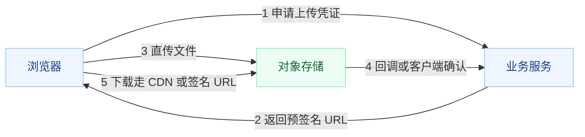
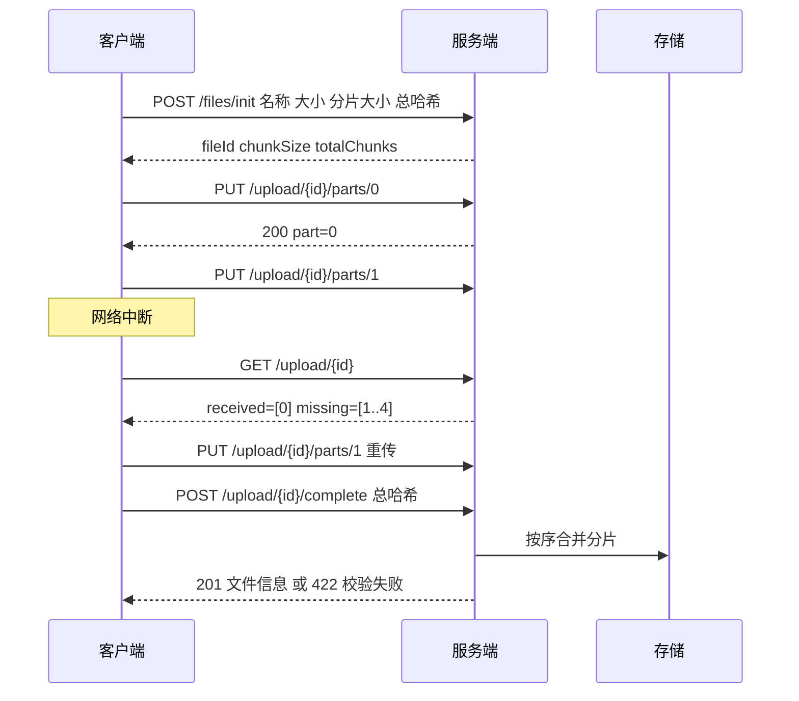
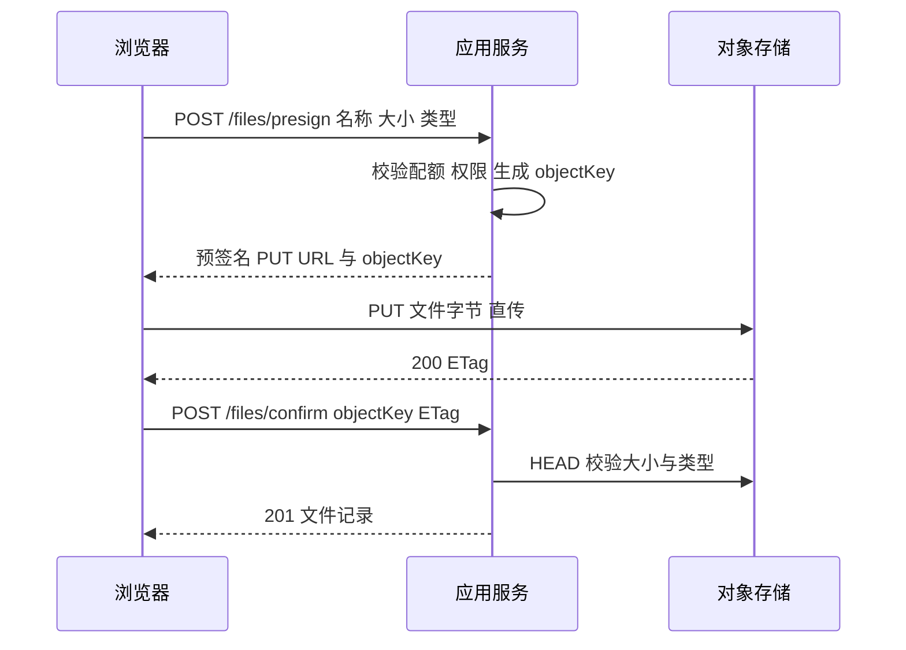

# 文件与对象存储

> 这篇从文件传输的三种存储形态讲起，经过 multipart 与流式上传、分片上传与断点续传、Range 下载与缓存、签名 URL 与临时授权、S3 对象存储接入，最后落到一个 Node 22 上可运行的分片上传服务案例，用 5 MiB 文件实测续传、校验、限速与签名下载。
>
> 学完能设计一套支持大文件、可断点续传、带校验和临时授权的上传下载链路，并能把本地实现平滑迁到 S3 兼容对象存储。

## 一、三种存储形态与传输边界

文件存放只有三种形态：本地磁盘、共享文件系统、对象存储；选择依据是“谁扩容、谁备份、谁提供 URL”，不是“哪个体积小”。

| 形态 | 扩容方式 | 典型实现 | 适用 |
|---|---|---|---|
| 本地磁盘 | 换大盘、挂盘 | ext4 / XFS | 单机、临时文件 |
| 共享文件系统 | 加节点、加卷 | NFS / CephFS | 传统应用迁移 |
| 对象存储 | 无限水平扩展 | S3 / OSS / MinIO | 互联网业务默认选择 |

对象存储的核心模型只有四层：桶（Bucket）装对象，对象由键（Key）定位，值是字节流，元数据是 HTTP Header。所有操作都是 HTTP：`PUT` 上传、`GET` 下载、`DELETE` 删除、`HEAD` 取元数据。S3 API 已成为事实标准，阿里云 OSS、腾讯云 COS、MinIO、Cloudflare R2 都提供兼容接口。



关键概念先对齐：分片上传（Multipart Upload）把大对象拆成多个 part 并行传，最后合并；预签名 URL（Presigned URL）是把签名放进查询参数、带有效期的临时地址；断点续传（Resumable Upload）是客户端记住已传分片，重试时只补缺口。

> 边界：本地磁盘只适合单实例、可丢的临时文件，不能作为用户上传的最终存储——容器重启、多副本调度都会让文件消失。对象存储不适合频繁改写的文件（每次改都要整体重传），也不适合需要 POSIX 语义的场景（锁、随机写、目录遍历）。

## 二、环境准备与最小验证

验证只需要 Node 22 和 curl，不需要 Docker、MinIO 或云账号；协议行为在本地服务上验证完，迁到 S3 只换实现，不换交互。

```bash
node --version   # 预期 v22.x
curl --version   # 预期 8.x
```

三端安装 Node 22：

```bash
# Windows（管理员 PowerShell）
winget install OpenJS.NodeJS.LTS

# macOS
brew install node@22

# Ubuntu 24.04
curl -fsSL https://deb.nodesource.com/setup_22.x | sudo -E bash -
sudo apt-get install -y nodejs

# Rocky 9 / CentOS Stream
sudo dnf install -y nodejs npm
```

最小文件服务用 30 行实现“流式落盘 + 边收边算哈希”，这就是所有上传服务的骨架：

```javascript
// minimal-upload.mjs
import { createServer } from 'node:http';
import { createHash } from 'node:crypto';
import { createWriteStream, createReadStream } from 'node:fs';
import { mkdir, stat } from 'node:fs/promises';
import { pipeline } from 'node:stream/promises';
import path from 'node:path';

const DIR = '/tmp/min-upload';
await mkdir(DIR, { recursive: true });

createServer(async (req, res) => {
  const name = path.basename(decodeURIComponent(req.url.slice(1))); // 只取 basename 防穿越
  const file = path.join(DIR, name);
  if (req.method === 'PUT') {
    const hash = createHash('sha256');
    req.on('data', (c) => hash.update(c));            // 边收边算，不占内存
    await pipeline(req, createWriteStream(file));      // 流式落盘，大文件不 OOM
    const info = await stat(file);
    res.writeHead(201, { 'Content-Type': 'application/json' });
    res.end(JSON.stringify({ name, size: info.size, sha256: hash.digest('hex') }));
    return;
  }
  if (req.method === 'GET') {
    const info = await stat(file).catch(() => null);
    if (!info) return res.writeHead(404).end();
    res.writeHead(200, { 'Content-Length': info.size, 'Accept-Ranges': 'bytes' });
    createReadStream(file).pipe(res);
    return;
  }
  res.writeHead(405).end();
}).listen(18095, () => console.log('http://localhost:18095'));
```

```bash
node minimal-upload.mjs
printf 'hello object storage\n' > /tmp/min.txt
curl -s -X PUT --data-binary @/tmp/min.txt http://localhost:18095/min.txt
shasum -a 256 /tmp/min.txt
curl -s http://localhost:18095/min.txt
```

实测输出：

```text
{"name":"min.txt","size":21,"sha256":"d15ab86e6247a3bba46494d76723997ca7e7103a73cb055f52f2fe73276f32c2"}
d15ab86e6247a3bba46494d76723997ca7e7103a73cb055f52f2fe73276f32c2  /tmp/min.txt
hello object storage
```

客户端与服务端的哈希一致，说明字节没有被改写；这一步是所有后续校验的基础。

> 边界：`pipeline(req, writeStream)` 已经处理背压，不要用 `req.on('data') + write()` 手工拼，后者在慢盘上会把内存打满。`path.basename` 只能挡住 `../`，挡不住符号链接和大小写绕过，生产还要加白名单和存储层隔离。

## 三、上传协议：multipart 与流式

表单上传的标准格式是 `multipart/form-data`，每个字段用 boundary 分隔，文件字段带自己的 `Content-Type`；它比 Base64 塞 JSON 省 33% 体积，也比 URL 编码可靠。

```text
POST /api/files HTTP/1.1
Content-Type: multipart/form-data; boundary=----X

------X
Content-Disposition: form-data; name="bizType"

avatar
------X
Content-Disposition: form-data; name="file"; filename="photo.png"
Content-Type: image/png

<PNG 二进制>
------X--
```

服务端用流式解析器逐个字段处理，文件字段直接写盘，不把整个请求读进内存：

```javascript
// 片段：需要 npm install busboy
import Busboy from 'busboy';

function handleMultipart(req, res) {
  const busboy = Busboy({ headers: req.headers, limits: { fileSize: 20 * 1024 * 1024 } });
  busboy.on('file', (name, stream, info) => {
    // 文件名不可信：只取 basename，再拼服务端生成的 id
    const target = `/data/upload/${randomUUID()}`;
    stream.pipe(createWriteStream(target));
    stream.on('limit', () => stream.destroy(new Error('file too large'))); // 超限立刻中断
  });
  busboy.on('finish', () => res.writeHead(201).end());
  req.pipe(busboy);
}
```

三种上传方式的取舍：

| 方式 | 体积开销 | 断点续传 | 适用 |
|---|---|---|---|
| `multipart/form-data` | 低 | 不支持 | 表单、头像、小文件 |
| 原始 `PUT` 字节流 | 最低 | 需自己实现 | 分片、SDK 直传 |
| Base64 塞 JSON | +33% | 不支持 | 极小文件、配置 |

大文件上传必须过三道闸：`Content-Length` 提前拒绝、流式过程中的字节计数、写盘后的实际大小校验。只信 `Content-Length` 会被分块传输（chunked）绕过。

> 边界：`multipart/form-data` 一次请求只能整体成功或重传，2 GB 文件传到 99% 断网就全部作废；超过 100 MB 的文件应该走第四章的分片协议。表单上传的 `filename` 参数来自客户端，含 `../`、NUL、超长 UTF-8 的样本都要在解析前清洗。

## 四、分片上传与断点续传

分片上传把“一次大请求”拆成“多次小请求 + 一次合并”，断网只影响一个分片，重试成本从 GB 级降到 MB 级。协议固定四步：初始化拿会话、逐片上传、查询已传分片、合并并整体校验。



各字段的取值有工程依据，不能随手定：

| 参数 | 建议 | 原因 |
|---|---|---|
| 分片大小 | 1–8 MiB | 太小请求多，太大重传贵 |
| 并发分片 | 3–5 | 兼顾带宽与内存 |
| 会话有效期 | 24 h | 覆盖移动端断点隔夜重试 |
| 单片校验 | MD5 或 SHA-256 | 定位坏片，避免整体重传 |
| 整体校验 | SHA-256 | 合并后比对，防拼接错位 |

服务端保存每个会话的元数据和已收到的分片。分片文件按序号命名，重传同一片直接返回成功，保证幂等：

```javascript
// 片段：分片落盘，已存在则幂等返回
const index = Number(parts[4]);
const target = path.join(BASE, 'parts', session.id, String(index));
try {
  await stat(target);
  return json(res, 200, { part: index, duplicate: true }); // 重传同一片直接成功
} catch { /* 不存在才写 */ }

const buf = await readBody(req, MAX_PART);
const expectedSize = index === session.totalChunks - 1
  ? session.size - session.chunkSize * (session.totalChunks - 1)  // 最后一片是余数
  : session.chunkSize;
if (buf.length !== expectedSize) {
  return json(res, 400, { title: '分片大小不符', expected: expectedSize, actual: buf.length });
}
await writeFile(target, buf);
```

合并阶段按序号串行写同一个文件句柄，最后整体校验；校验失败要删除半成品，不能让坏文件进入可下载状态：

```javascript
const out = createWriteStream(finalPath);
for (const i of files) {
  // 逐片串行写入，避免并发写同一个 fd 造成乱序
  await pipeline(createReadStream(path.join(dir, String(i))), out, { end: false });
}
await new Promise((resolve, reject) => out.end((err) => (err ? reject(err) : resolve())));
const actual = await sha256File(finalPath);
if (session.sha256 && session.sha256 !== actual) {
  await unlink(finalPath); // 校验失败不留半成品
  return json(res, 422, { title: '整体校验失败', expected: session.sha256, actual });
}
```

S3 的分片上传是同一套模型的托管版，字段可以一一映射：

| 本案例 | S3 API | 说明 |
|---|---|---|
| `init` | `CreateMultipartUpload` | 返回 `UploadId` |
| `PUT parts/{n}` | `UploadPart` | 返回 part 的 `ETag` |
| `GET /upload/{id}` | `ListParts` | 查已上传分片 |
| `complete` | `CompleteMultipartUpload` | 提交 part 列表 |
| 放弃 | `AbortMultipartUpload` | 清理未完成分片 |

> 边界：分片上传的会话状态必须持久化，放进程内存会在重启后全部丢失，用户只能从头传；S3 的每个 part 至少 5 MiB（最后一片除外），小于这个值的分片无法合并。合并失败或客户端放弃时必须调 `AbortMultipartUpload`，否则存储侧会一直计费。

## 五、下载：Range 与缓存

下载的关键是 `Range`：客户端只取需要的字节，播放器拖动进度条、断点续传、并行下载都依赖它。服务端必须返回 `Accept-Ranges: bytes`，按请求返回 `206` 和 `Content-Range`。

| 请求/响应 | 含义 |
|---|---|
| `Accept-Ranges: bytes` | 声明支持按字节取 |
| `Range: bytes=0-15` | 取前 16 字节 |
| `Range: bytes=100-` | 从 100 到结尾 |
| `Range: bytes=-100` | 最后 100 字节 |
| `206 Partial Content` | 部分内容 |
| `Content-Range: bytes 0-15/5242880` | 本次范围与总大小 |
| `416 Range Not Satisfiable` | 范围越界 |

实现要点是范围解析与边界收敛，任何越界都返回 `416` 并带 `Content-Range: bytes */总大小`：

```javascript
const range = req.headers.range;
if (!range) {
  res.writeHead(200, { 'Content-Type': contentType, 'Content-Length': info.size,
    'Accept-Ranges': 'bytes', ETag: etag });
  return createReadStream(full).pipe(res);
}
const m = /^bytes=(\d*)-(\d*)$/.exec(range);
if (!m) return json(res, 416, { title: 'Range 不合法' }, { 'Content-Range': `bytes */${info.size}` });
let start = m[1] === '' ? info.size - Number(m[2]) : Number(m[1]);
let end = m[1] !== '' && m[2] !== '' ? Number(m[2]) : info.size - 1;
if (start < 0 || start >= info.size || end < start) {
  return json(res, 416, { title: 'Range 越界' }, { 'Content-Range': `bytes */${info.size}` });
}
end = Math.min(end, info.size - 1);
res.writeHead(206, {
  'Content-Type': contentType,
  'Content-Length': end - start + 1,
  'Content-Range': `bytes ${start}-${end}/${info.size}`,
  'Accept-Ranges': 'bytes', ETag: etag,
});
return createReadStream(full, { start, end }).pipe(res);
```

`ETag` 配合 `If-Range` 可以避免“文件已更新但客户端续传旧数据”：客户端带上次的 `ETag` 请求续传，服务端比对不一致就返回整个文件（200）而不是 206。案例为了聚焦 Range 本身没有实现 `If-Range`，生产必须补上，否则断点续传可能把新旧文件拼在一起。

```bash
# 206 + Content-Range
curl -s -D - -o /tmp/part.bin http://localhost:18094/api/files/<id> \
  -H 'Authorization: Bearer demo-token' -H 'Range: bytes=0-15'
```

```text
HTTP/1.1 206 Partial Content
Content-Type: application/octet-stream
Content-Length: 16
Content-Range: bytes 0-15/5242880
Accept-Ranges: bytes
ETag: "445e3cc75cd0a41b"
```

> 边界：`Content-Length` 必须是本次范围的长度，不是文件总长，写错会让客户端一直等；`HEAD` 请求要返回同样的头但没有响应体。对视频等大文件，生产应由 CDN 或对象存储直接服务，应用服务器只做签名和 302，避免占满应用带宽。

## 六、签名 URL 与临时授权

签名 URL 解决“客户端要直接下载，但不能把长期凭证发给它”的问题：业务服务用密钥对“资源 + 过期时间”签名，客户端拿到的地址自带授权，过期即失效。

签名串必须包含资源和过期时间，并绑定到具体的下载动作：

```javascript
function sign(id, expires) {
  // 把资源标识和过期时间一起签名，换文件或延期都会导致签名失效
  return createHmac('sha256', SIGN_SECRET).update(`${id}\n${expires}`).digest('base64url');
}

function authOk(req, url) {
  const auth = req.headers.authorization;
  if (auth === `Bearer ${TOKEN}`) return { ok: true, via: 'bearer' };
  const expires = Number(url.searchParams.get('expires'));
  const sig = url.searchParams.get('sig');
  if (!expires || !sig) return { ok: false };
  if (Date.now() > expires) return { ok: false, reason: 'expired' };
  const expected = sign(url.pathname.split('/')[3], expires);
  // 定长比较，避免按字节比较泄漏签名前缀
  const a = Buffer.from(expected);
  const b = Buffer.from(sig);
  return { ok: a.length === b.length && timingSafeEqual(a, b), via: 'signature' };
}
```

常见的签名实现错误：

| 错误 | 后果 |
|---|---|
| 签名不含过期时间 | 地址永久有效 |
| 签名只覆盖路径 | 可换文件复用 |
| 用 `===` 比较签名 | 时序侧信道 |
| 密钥写在前端 | 任何人都能伪造 |
| 过期时间由客户端给 | 可无限延期 |

签发接口本身必须鉴权，且限制有效期上限：

```javascript
if (req.headers.authorization !== `Bearer ${TOKEN}`) return json(res, 401, { title: '未认证' });
const ttl = Math.min(Number(body.expiresIn ?? 300), 3600) * 1000; // 上限 1 小时
const expires = Date.now() + ttl;
const sig = sign(id, expires);
return json(res, 200, {
  url: `/api/files/${id}?expires=${expires}&sig=${sig}`,
  expiresAt: expires,
});
```

```bash
# 换签名地址
curl -s -X POST http://localhost:18094/api/files/<id>/sign \
  -H 'Authorization: Bearer demo-token' \
  -H 'Content-Type: application/json' -d '{"expiresIn":300}'
```

```text
{"url":"/api/files/8ef71b56-...?expires=1794516655030&sig=IkxgpYYxOf55BumXgudk3e9vxw38U-4_yjUiGuWGMOk","expiresAt":1794516655030}
```

> 边界：签名 URL 一旦发出就无法撤回，只能等过期，所以有效期要短（下载 5–15 分钟）；同一 URL 可以被多人转发使用，涉及敏感文件时还要绑定用户或 IP。把签名 URL 写进页面源码、日志、Referer 都会泄漏，日志里要脱敏 `sig` 参数。

## 七、对象存储接入

对象存储把第四章的四步托管掉，应用只负责“签发凭证 + 记录元数据”，文件字节不经过应用服务器，这是大文件上传的标准架构。



S3 API 的常用操作：

| 操作 | API | 用途 |
|---|---|---|
| 单次上传 | `PutObject` | 小于 100 MB |
| 分片上传 | `CreateMultipartUpload` | 大文件 |
| 预签名 | `GeneratePresignedUrl` | 客户端直传直下 |
| 取元数据 | `HeadObject` | 校验大小类型 |
| 删除 | `DeleteObject` | 软删或硬删 |

Java 21 + AWS SDK v2 的预签名（示例，需要真实存储端点）：

```java
// 片段：S3 SDK v2 依赖 software.amazon.awssdk:s3
S3Presigner presigner = S3Presigner.builder()
        .endpointOverride(URI.create("https://oss.example.net"))
        .region(Region.of("cn-east-1"))
        .credentialsProvider(StaticCredentialsProvider.create(
                AwsBasicCredentials.create(accessKey, secretKey)))
        .build();

PutObjectRequest put = PutObjectRequest.builder()
        .bucket("orders")
        .key("upload/2026/11/" + fileId + ".pdf")
        .contentType("application/pdf")
        .contentLength(size)          // 预签名必须带长度，否则可被塞入超长内容
        .build();

PresignedPutObjectRequest signed = presigner.presignPutObject(r -> r
        .signatureDuration(Duration.ofMinutes(10))  // 与业务有效期一致
        .putObjectRequest(put));

System.out.println(signed.url());
```

命令行验证（示例，MinIO 或云厂商均可）：

```bash
# 配置别名后创建桶
aws --endpoint-url http://localhost:9000 s3 mb s3://orders
aws --endpoint-url http://localhost:9000 s3 cp ./payload.bin s3://orders/2026/11/payload.bin
aws --endpoint-url http://localhost:9000 s3 presign s3://orders/2026/11/payload.bin --expires-in 600
```

| 存储选型 | 一致性 | 成本 | 适用 |
|---|---|---|---|
| S3 标准 | 强一致读后写 | 高 | 核心业务 |
| 低频访问 | 强一致 | 中 | 备份、归档 |
| 归档 | 强一致，取回慢 | 低 | 合规留存 |
| 本地 MinIO | 强一致 | 自建 | 私有化部署 |

> 边界：预签名 URL 的权限来自签发者，签发时要限定 `Content-Length`、`Content-Type` 和 key 前缀，否则客户端可以传任意大小、任意类型的文件；直传后必须由服务端 `HeadObject` 复核大小和类型，不能信客户端回报。跨域直传要在桶上配置 CORS，允许 `PUT` 与需要的 Header。

## 八、安全与合规

文件上传是外部输入里最危险的一类：内容不可信、体积无上限、文件名可构造。防线按顺序是“文件名 → 大小 → 类型 → 内容 → 存储位置”。

文件名只保留 basename，并拒绝控制字符：

```javascript
function safeName(raw) {
  const base = path.basename(String(raw ?? 'file.bin')).replace(/[\\/:*?"<>|\x00-\x1f]/g, '_');
  return base.slice(0, 120) || 'file.bin';   // 限长，防超长名打爆文件系统
}
```

类型不能只信 `Content-Type` 和扩展名，要读文件头做魔数校验：

```javascript
function sniff(buf) {
  if (buf.length >= 8 && buf.subarray(0, 8).equals(
      Buffer.from([0x89, 0x50, 0x4e, 0x47, 0x0d, 0x0a, 0x1a, 0x0a]))) return 'image/png';
  if (buf.length >= 5 && buf.subarray(0, 5).toString('latin1') === '%PDF-') return 'application/pdf';
  if (buf.length >= 3 && buf[0] === 0xff && buf[1] === 0xd8 && buf[2] === 0xff) return 'image/jpeg';
  return 'application/octet-stream';
}
```

| 攻击 | 防御 |
|---|---|
| 路径穿越 | 只取 basename，存储用服务端 id |
| 超大文件 | `Content-Length` + 流式计数 + 配额 |
| 伪装类型 | 魔数校验，白名单 |
| 图片木马 | 重编码图片，剥离 EXIF |
| XSS（SVG/HTML） | 下载时 `Content-Disposition: attachment` |
| 公开桶遍历 | 桶私有，只走签名 URL |
| 恶意文件传播 | 上传后异步杀毒，隔离区 |

下载响应要显式声明处置方式，避免浏览器把上传的 HTML 当页面执行：

```text
Content-Type: application/octet-stream
Content-Disposition: attachment; filename="report.pdf"
X-Content-Type-Options: nosniff
```

> 边界：魔数校验只能挡住“扩展名伪装”，挡不住利用解析器漏洞的畸形文件，图片要走解码重编码，文档要走杀毒引擎。`Content-Disposition: inline` 只对可信类型开放，SVG 必须按附件下载，否则内嵌脚本会在同源下执行。

## 九、常见故障排查

文件问题的排查顺序：先看状态码，再看长度，最后看哈希；三者能覆盖八成故障。

| 现象 | 常见原因 | 第一条命令 |
|---|---|---|
| 上传 413 | 反向代理 `client_max_body_size` 太小 | `curl -i -X POST` 看响应头 |
| 上传 100 Continue 后卡住 | 服务端没读请求体 | 检查流式解析是否消费 `req` |
| 上传成功但文件 0 字节 | 先返回响应后写盘 | 查是否漏 `await pipeline` |
| 下载 200 但内容截断 | `Content-Length` 写成总长 | `curl -sI` 对比实际大小 |
| Range 请求返回 200 | 未处理 `Range` | `curl -r 0-15 -i` |
| 续传后哈希不符 | 合并顺序错或坏片 | 比对分片序号与总哈希 |
| 签名 URL 403 | 密钥不一致或参数被改写 | 本地重算签名对比 |
| 中文文件名乱码 | 未按 RFC 5987 编码 | 看 `Content-Disposition` |
| 上传慢且 CPU 高 | 同步加密或全量读内存 | 看 `top` 与堆占用 |

```bash
# 看服务端是否声明支持 Range
curl -sI http://localhost:18094/api/files/<id> -H 'Authorization: Bearer demo-token'

# 只取前 16 字节，验证 206 与 Content-Range
curl -s -D - -o /dev/null -r 0-15 http://localhost:18094/api/files/<id> \
  -H 'Authorization: Bearer demo-token'

# 对比下载文件与服务端哈希
curl -s http://localhost:18094/api/files/<id> -H 'Authorization: Bearer demo-token' -o /tmp/download.bin
shasum -a 256 /tmp/download.bin
```

> 边界：`curl -I` 发的是 `HEAD`，有些框架不实现 `HEAD` 会返回 405，这不代表 `GET` 有问题；排查上传卡住时用 `curl -v` 看是否发出 `Expect: 100-continue`，服务端不回 `100 Continue` 时客户端会等 1 秒才发 body。

## 十、最佳实践案例

### 10.1 案例背景

一个在线教育平台要让讲师上传课程视频和课件，单个文件最大 2 GB。旧方案是表单直传：Nginx 限制 1 MB，调到 2 GB 后应用内存经常被打满；讲师在酒店网络上传到 90% 断线要重来；下载没有 Range，视频不能拖动进度条；课件链接发给学员后永久有效，离职讲师的资料仍可被访问。

目标是：分片上传支持断点续传、整体 SHA-256 校验、Range 下载、签名 URL（默认 5 分钟）、文件名与类型校验。约束：先用 Node 22 在本地把协议跑通，不引入对象存储和 Docker；单机存储上限 100 MB（演示用 5 MiB 文件）。

### 10.2 案例实操

服务端一个文件，六个端点：初始化、传分片、查进度、合并、下载、签发。先准备测试文件：

```bash
dd if=/dev/urandom of=/tmp/payload.bin bs=1m count=5 2>/dev/null
shasum -a 256 /tmp/payload.bin
# ff0ccdec29efaef742a04d42ab8e042ff93a182617da4f67cc13e5614c1def3a（一次实测值，重跑会不同）
```

下面的哈希、`fileId` 都来自这一次实测，重跑时把命令里的值换成上一步的实际输出。

服务端是一个单文件应用，六个端点：初始化、传分片、查进度、合并、下载、签发。完整实现如下（与实测同一份代码，直接可运行）：

```javascript
// file-server.mjs
import { createServer } from 'node:http';
import { createHmac, createHash, randomUUID, timingSafeEqual } from 'node:crypto';
import { createReadStream, createWriteStream } from 'node:fs';
import { mkdir, readFile, readdir, rm, stat, writeFile, unlink } from 'node:fs/promises';
import { pipeline } from 'node:stream/promises';
import path from 'node:path';

const PORT = Number(process.env.PORT ?? 18094);
const TOKEN = 'demo-token';
const SIGN_SECRET = 'sign-secret-change-me';
const BASE = path.resolve(process.env.BASE ?? '/tmp/file-case/storage');
const MAX_FILE = 100 * 1024 * 1024;      // 单文件上限，防磁盘打满
const MAX_PART = 8 * 1024 * 1024;        // 单分片上限
const TTL_MS = 24 * 3600 * 1000;         // 上传会话 24 小时过期

const sessions = new Map();              // 生产放 Redis，进程重启不能丢

await mkdir(path.join(BASE, 'parts'), { recursive: true });
await mkdir(path.join(BASE, 'files'), { recursive: true });

const json = (res, status, body, headers = {}) => {
  res.writeHead(status, { 'Content-Type': 'application/json; charset=utf-8', ...headers });
  res.end(JSON.stringify(body));
};

async function readBody(req, limit) {
  let size = 0;
  const chunks = [];
  for await (const chunk of req) {
    size += chunk.length;
    if (size > limit) {                  // 流式计数，不能只信 Content-Length
      const err = new Error('payload too large');
      err.status = 413;
      throw err;
    }
    chunks.push(chunk);
  }
  return Buffer.concat(chunks);
}

// 文件名只保留 basename，去掉路径分隔符和控制字符，防目录穿越
function safeName(raw) {
  const base = path.basename(String(raw ?? 'file.bin')).replace(/[\\/:*?"<>|\x00-\x1f]/g, '_');
  return base.slice(0, 120) || 'file.bin';
}

const MIME = { png: 'image/png', jpg: 'image/jpeg', pdf: 'application/pdf' };

// 魔数嗅探：不能只信客户端的 Content-Type 和扩展名
function sniff(buf) {
  if (buf.length >= 8 && buf.subarray(0, 8).equals(
      Buffer.from([0x89, 0x50, 0x4e, 0x47, 0x0d, 0x0a, 0x1a, 0x0a]))) return 'image/png';
  if (buf.length >= 5 && buf.subarray(0, 5).toString('latin1') === '%PDF-') return 'application/pdf';
  if (buf.length >= 3 && buf[0] === 0xff && buf[1] === 0xd8 && buf[2] === 0xff) return 'image/jpeg';
  return 'application/octet-stream';
}

async function sha256File(file) {
  const hash = createHash('sha256');
  for await (const chunk of createReadStream(file)) hash.update(chunk);
  return hash.digest('hex');
}

function sign(id, expires) {
  // 把资源标识和过期时间一起签名，换文件或延期都会导致签名失效
  return createHmac('sha256', SIGN_SECRET).update(`${id}\n${expires}`).digest('base64url');
}

function authOk(req, url) {
  const auth = req.headers.authorization;
  if (auth === `Bearer ${TOKEN}`) return { ok: true, via: 'bearer' };
  const expires = Number(url.searchParams.get('expires'));
  const sig = url.searchParams.get('sig');
  if (!expires || !sig) return { ok: false };
  if (Date.now() > expires) return { ok: false, reason: 'expired' };
  const expected = sign(url.pathname.split('/')[3], expires);
  // 定长比较，避免按字节比较泄漏签名前缀
  const a = Buffer.from(expected);
  const b = Buffer.from(sig);
  return { ok: a.length === b.length && timingSafeEqual(a, b), via: 'signature' };
}

const server = createServer(async (req, res) => {
  const url = new URL(req.url, `http://${req.headers.host}`);
  const parts = url.pathname.split('/').filter(Boolean);

  try {
    // 第一步：初始化上传会话，服务端决定分片大小
    if (req.method === 'POST' && url.pathname === '/api/files/init') {
      const body = JSON.parse((await readBody(req, 64 * 1024)).toString() || '{}');
      const size = Number(body.size);
      const chunkSize = Number(body.chunkSize ?? 1024 * 1024);
      if (!Number.isInteger(size) || size <= 0 || size > MAX_FILE) return json(res, 400, { title: 'size 非法' });
      if (chunkSize < 256 * 1024 || chunkSize > MAX_PART) return json(res, 400, { title: 'chunkSize 非法' });

      const id = randomUUID();
      const totalChunks = Math.ceil(size / chunkSize);
      sessions.set(id, {
        id, name: safeName(body.name), size, chunkSize, totalChunks,
        sha256: body.sha256 ?? null, expiresAt: Date.now() + TTL_MS,
      });
      await mkdir(path.join(BASE, 'parts', id), { recursive: true });
      return json(res, 201, { fileId: id, chunkSize, totalChunks, expiresAt: sessions.get(id).expiresAt });
    }

    // 第二步：上传单个分片，已存在则幂等返回
    if (req.method === 'PUT' && parts[1] === 'upload' && parts[3] === 'parts') {
      const session = sessions.get(parts[2]);
      if (!session) return json(res, 404, { title: '上传会话不存在或已过期' });
      const index = Number(parts[4]);
      if (!Number.isInteger(index) || index < 0 || index >= session.totalChunks) {
        return json(res, 400, { title: '分片序号越界' });
      }
      const dir = path.join(BASE, 'parts', session.id);
      const target = path.join(dir, String(index));
      try {
        await stat(target);
        return json(res, 200, { part: index, duplicate: true }); // 重传同一片直接成功
      } catch { /* 不存在才写 */ }
      const buf = await readBody(req, MAX_PART);
      const expectedSize = index === session.totalChunks - 1
        ? session.size - session.chunkSize * (session.totalChunks - 1)  // 最后一片是余数
        : session.chunkSize;
      if (buf.length !== expectedSize) {
        return json(res, 400, { title: '分片大小不符', expected: expectedSize, actual: buf.length });
      }
      await writeFile(target, buf);
      return json(res, 200, { part: index, duplicate: false, received: buf.length });
    }

    // 第三步：查询已上传分片，用于断点续传
    if (req.method === 'GET' && parts[1] === 'upload' && parts.length === 3) {
      const session = sessions.get(parts[2]);
      if (!session) return json(res, 404, { title: '上传会话不存在或已过期' });
      const files = await readdir(path.join(BASE, 'parts', session.id));
      const received = files.map(Number).sort((a, b) => a - b);
      const missing = Array.from({ length: session.totalChunks }, (_, i) => i).filter((i) => !received.includes(i));
      return json(res, 200, { fileId: session.id, totalChunks: session.totalChunks, received, missing });
    }

    // 第四步：合并分片并校验整体 SHA-256
    if (req.method === 'POST' && parts[1] === 'upload' && parts[3] === 'complete') {
      const session = sessions.get(parts[2]);
      if (!session) return json(res, 404, { title: '上传会话不存在或已过期' });
      const dir = path.join(BASE, 'parts', session.id);
      const files = (await readdir(dir)).map(Number).sort((a, b) => a - b);
      if (files.length !== session.totalChunks) {
        return json(res, 409, { title: '分片未传完', missingCount: session.totalChunks - files.length });
      }
      const finalPath = path.join(BASE, 'files', `${session.id}_${session.name}`);
      const out = createWriteStream(finalPath);
      for (const i of files) {
        // 逐片串行写入，避免并发写同一个 fd 造成乱序
        await pipeline(createReadStream(path.join(dir, String(i))), out, { end: false });
      }
      await new Promise((resolve, reject) => out.end((err) => (err ? reject(err) : resolve())));
      const actual = await sha256File(finalPath);
      if (session.sha256 && session.sha256 !== actual) {
        await unlink(finalPath); // 校验失败不留半成品
        return json(res, 422, { title: '整体校验失败', expected: session.sha256, actual });
      }
      const firstChunk = await readFile(path.join(dir, '0'));
      const contentType = sniff(firstChunk);
      await rm(dir, { recursive: true, force: true });
      sessions.delete(session.id);
      return json(res, 201, {
        fileId: session.id, name: session.name, size: session.size,
        sha256: actual, contentType, url: `/api/files/${session.id}`,
      });
    }

    // 第五步：下载，支持 Range 与签名 URL
    if (req.method === 'GET' && parts[1] === 'files' && parts.length === 3) {
      const id = parts[2];
      // 只允许 UUID 形态的 id，杜绝 ../ 之类的路径拼接
      if (!/^[0-9a-f-]{36}$/.test(id)) return json(res, 400, { title: '非法文件 id' });
      const auth = authOk(req, url);
      if (!auth.ok) return json(res, 401, { title: auth.reason === 'expired' ? '签名已过期' : '未认证' });
      const entries = await readdir(path.join(BASE, 'files'));
      const file = entries.find((name) => name.startsWith(`${id}_`));
      if (!file) return json(res, 404, { title: '文件不存在' });
      const full = path.join(BASE, 'files', file);
      const info = await stat(full);
      const contentType = MIME[path.extname(file).slice(1)] ?? 'application/octet-stream';
      const etag = `"${createHash('sha256').update(file + info.size + info.mtimeMs).digest('hex').slice(0, 16)}"`;

      const range = req.headers.range;
      if (!range) {
        res.writeHead(200, {
          'Content-Type': contentType, 'Content-Length': info.size,
          'Accept-Ranges': 'bytes', ETag: etag,
        });
        return createReadStream(full).pipe(res);
      }
      const m = /^bytes=(\d*)-(\d*)$/.exec(range);
      if (!m) return json(res, 416, { title: 'Range 不合法' }, { 'Content-Range': `bytes */${info.size}` });
      let start = m[1] === '' ? info.size - Number(m[2]) : Number(m[1]);
      let end = m[1] !== '' && m[2] !== '' ? Number(m[2]) : info.size - 1;
      if (start < 0 || start >= info.size || end < start) {
        return json(res, 416, { title: 'Range 越界' }, { 'Content-Range': `bytes */${info.size}` });
      }
      end = Math.min(end, info.size - 1);
      res.writeHead(206, {
        'Content-Type': contentType,
        'Content-Length': end - start + 1,
        'Content-Range': `bytes ${start}-${end}/${info.size}`,
        'Accept-Ranges': 'bytes', ETag: etag,
      });
      return createReadStream(full, { start, end }).pipe(res);
    }

    // 第六步：签发临时下载 URL
    if (req.method === 'POST' && parts[1] === 'files' && parts[3] === 'sign') {
      if (req.headers.authorization !== `Bearer ${TOKEN}`) return json(res, 401, { title: '未认证' });
      const id = parts[2];
      const body = JSON.parse((await readBody(req, 4096)).toString() || '{}');
      const ttl = Math.min(Number(body.expiresIn ?? 300), 3600) * 1000; // 上限 1 小时
      const expires = Date.now() + ttl;
      const sig = sign(id, expires);
      return json(res, 200, { url: `/api/files/${id}?expires=${expires}&sig=${sig}`, expiresAt: expires });
    }

    return json(res, 404, { title: 'not found' });
  } catch (err) {
    const status = err.status ?? 500;
    console.error(`[error] ${req.method} ${url.pathname} ${err.message}`);
    return json(res, status, { title: status === 413 ? '请求体过大' : '服务端错误' });
  }
});

server.listen(PORT, () => {
  console.log(`file server listening on http://localhost:${PORT}`);
});
```

| 端点 | 方法 | 关键点 |
|---|---|---|
| `/api/files/init` | POST | 校验大小与分片，生成会话 |
| `/api/upload/{id}/parts/{n}` | PUT | 幂等写片，校验片长 |
| `/api/upload/{id}` | GET | 返回 received / missing |
| `/api/upload/{id}/complete` | POST | 串行合并，整体哈希 |
| `/api/files/{id}` | GET | Bearer 或签名，支持 Range |
| `/api/files/{id}/sign` | POST | 签发短时 URL |

启动并初始化会话，服务端决定分片大小并返回总分片数：

```bash
node file-server.mjs
```

```bash
curl -s -X POST http://localhost:18094/api/files/init \
  -H 'Content-Type: application/json' \
  -d '{"name":"payload.bin","size":5242880,"chunkSize":1048576,
       "sha256":"ff0ccdec29efaef742a04d42ab8e042ff93a182617da4f67cc13e5614c1def3a"}'
```

```text
{"fileId":"dcfcfe9a-d062-4bff-96ac-71fdc65f6c24","chunkSize":1048576,"totalChunks":5,"expiresAt":1794602741998}
```

传前 3 片，查询进度，模拟断点后再补后 2 片：

```bash
mkdir -p chunks && split -b 1048576 /tmp/payload.bin chunks/part-
ID=dcfcfe9a-d062-4bff-96ac-71fdc65f6c24

# 传前 3 片：i 是分片序号，文件名由 split 生成（part-aa、part-ab……）
i=0
for f in chunks/part-*; do
  [ "$i" -ge 3 ] && break
  curl -s -X PUT "http://localhost:18094/api/upload/$ID/parts/$i" \
    --data-binary "@$f" -H 'Content-Type: application/octet-stream'
  echo
  i=$((i + 1))
done

# 客户端重启后先查进度，只补 missing
curl -s "http://localhost:18094/api/upload/$ID"
```

```text
{"part":0,"duplicate":false,"received":1048576}
{"part":1,"duplicate":false,"received":1048576}
{"part":2,"duplicate":false,"received":1048576}
{"fileId":"dcfcfe9a-d062-4bff-96ac-71fdc65f6c24","totalChunks":5,"received":[0,1,2],"missing":[3,4]}
```

补传 3、4，重复传 1 验证幂等，然后合并并校验整体哈希：

```bash
i=3
for f in $(ls chunks/part-* | tail -n +4); do
  curl -s -X PUT "http://localhost:18094/api/upload/$ID/parts/$i" \
    --data-binary "@$f" -H 'Content-Type: application/octet-stream'
  echo
  i=$((i + 1))
done

# 重传第 1 片：服务端已存在，返回 200 而不是覆盖
curl -s -o /dev/null -w 'duplicate:%{http_code}\n' -X PUT \
  "http://localhost:18094/api/upload/$ID/parts/1" --data-binary @chunks/part-ab

curl -s -X POST "http://localhost:18094/api/upload/$ID/complete" \
  -H 'Content-Type: application/json' \
  -d '{"sha256":"ff0ccdec29efaef742a04d42ab8e042ff93a182617da4f67cc13e5614c1def3a"}'
```

```text
duplicate:200
{"fileId":"dcfcfe9a-d062-4bff-96ac-71fdc65f6c24","name":"payload.bin","size":5242880,
 "sha256":"ff0ccdec29efaef742a04d42ab8e042ff93a182617da4f67cc13e5614c1def3a",
 "contentType":"application/octet-stream","url":"/api/files/dcfcfe9a-d062-4bff-96ac-71fdc65f6c24"}
```

上传时文件名故意写成 `../../etc/payload.bin`，服务端只保留 basename：

```bash
curl -s -X POST http://localhost:18094/api/files/init \
  -H 'Content-Type: application/json' \
  -d '{"name":"../../etc/payload.bin","size":5242880,"chunkSize":1048576}'
```

```text
{"fileId":"8ef71b56-3de8-497d-b30b-44e08f130b62","chunkSize":1048576,"totalChunks":5,...}
# complete 时返回的 name 是 payload.bin，路径前缀被剥掉
```

下载分三步验证：全量校验、Range、签名。

```bash
ID=dcfcfe9a-d062-4bff-96ac-71fdc65f6c24

# 1. 无凭证被拒
curl -s -o /dev/null -w '%{http_code}\n' "http://localhost:18094/api/files/$ID"

# 2. 全量下载后比对哈希
curl -s "http://localhost:18094/api/files/$ID" -H 'Authorization: Bearer demo-token' -o /tmp/download.bin
shasum -a 256 /tmp/download.bin

# 3. Range 取前 16 字节
curl -s -D - -o /tmp/range.bin "http://localhost:18094/api/files/$ID" \
  -H 'Authorization: Bearer demo-token' -H 'Range: bytes=0-15'
```

```text
401
ff0ccdec29efaef742a04d42ab8e042ff93a182617da4f67cc13e5614c1def3a  /tmp/download.bin

HTTP/1.1 206 Partial Content
Content-Type: application/octet-stream
Content-Length: 16
Content-Range: bytes 0-15/5242880
Accept-Ranges: bytes
ETag: "445e3cc75cd0a41b"
```

签名下载的四种结果都要覆盖：

```bash
SIGNED=$(curl -s -X POST "http://localhost:18094/api/files/$ID/sign" \
  -H 'Authorization: Bearer demo-token' -H 'Content-Type: application/json' \
  -d '{"expiresIn":300}' | python3 -c 'import json,sys;print(json.load(sys.stdin)["url"])')

curl -s -o /dev/null -w 'signed:%{http_code}\n' "http://localhost:18094$SIGNED"
curl -s -o /dev/null -w 'tampered:%{http_code}\n' "http://localhost:18094${SIGNED%?}X"
curl -s -o /dev/null -w 'traversal:%{http_code}\n' \
  "http://localhost:18094/api/files/..%2F..%2Fetc%2Fpasswd" -H 'Authorization: Bearer demo-token'
```

```text
signed:200
tampered:401
traversal:400
```

失败路径同样要可核对：分片未传完返回 409，分片大小不符返回 400，超过单分片上限返回 413，整体哈希不符返回 422 且不留下半成品。下面用 `SESSION` 表示一个重新初始化的会话，`ID4` 表示只传了 1 片就合并的会话。

```bash
# 只传 1 片就合并（2 片会话，missingCount=1）
curl -s -i -X POST "http://localhost:18094/api/upload/$ID4/complete" \
  -H 'Content-Type: application/json' -d '{}'
```

```text
HTTP/1.1 409 Conflict
{"title":"分片未传完","missingCount":1}

HTTP/1.1 400 Bad Request
{"title":"分片大小不符","expected":524288,"actual":1048576}

HTTP/1.1 413 Payload Too Large

HTTP/1.1 422 Unprocessable Entity
{"title":"整体校验失败","expected":"aaaa...","actual":"ff0c..."}
```

服务端完整实现的端点与关键逻辑已在上面列出，下载与失败路径的验收如下。

### 10.3 案例结果

5 MiB 文件按 1 MiB 分 5 片，断点续传只补 2 片，上传流量从“整文件重传”降为 40%；合并后的 SHA-256 与客户端一致，坏片在 422 阶段被拦下，不会进入下载区；Range 请求返回 16 字节与正确的 `Content-Range`，视频拖动进度条不再需要重下整个文件；签名 URL 5 分钟内可用，篡改一个字符即 401；路径穿越样本被剥成 basename，越界 id 返回 400。

复盘四个失败模式：第一，最初把会话放在进程内存，服务重启后客户端拿着旧 `fileId` 续传全部 404，生产必须落 Redis 并设 TTL；第二，合并时并发写同一个文件句柄，哈希对不上且偶发内容错位，改成逐片串行写后稳定；第三，`Content-Length` 一开始写成了文件总长，Range 响应让客户端一直等待超时；第四，签名只覆盖了文件 id 没带过期时间，测试时把 `expires` 改大仍然通过，修复后签名串必须同时包含 id 与 expires。剩余风险：分片没有做单片 MD5，坏片只能靠整体校验发现；杀毒与图片重编码未接入；对象存储迁移还没在真实桶上验证，预签名参数需要按厂商再核对一遍。
