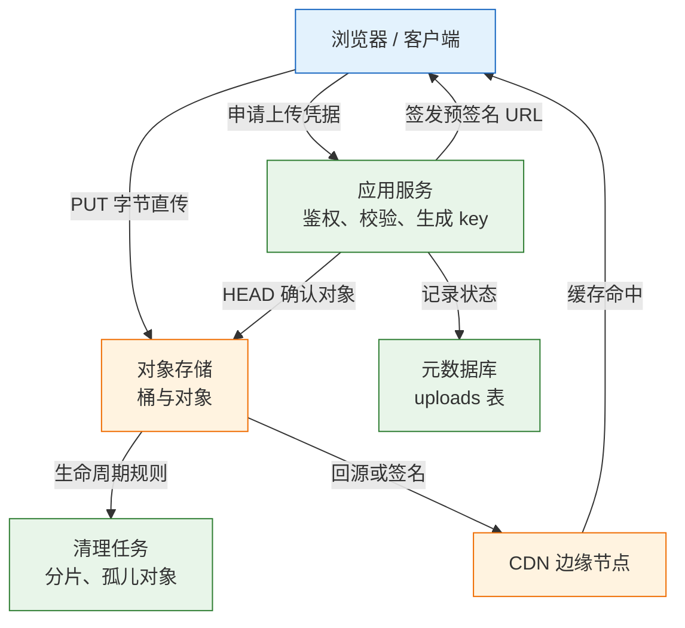
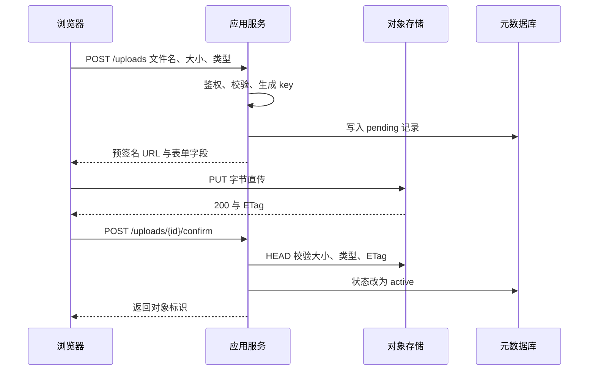
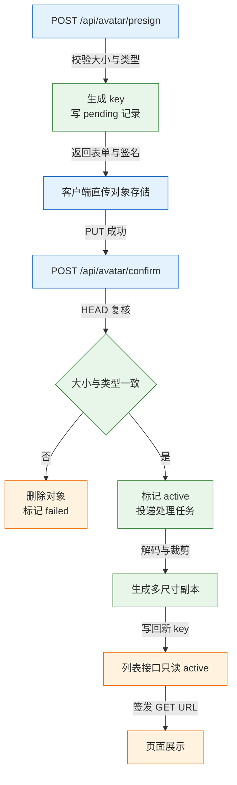
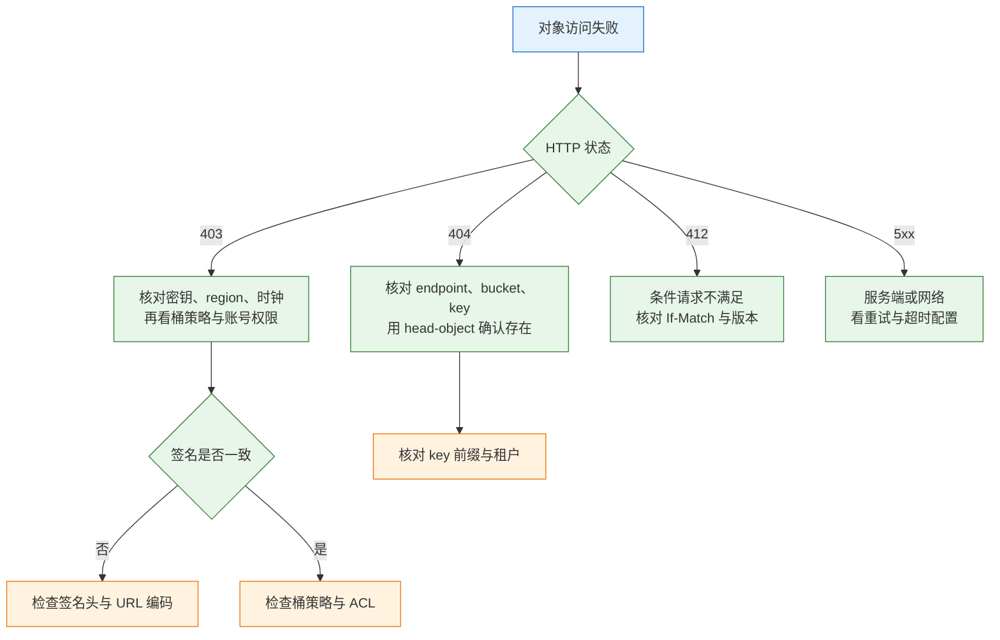

# 文件与对象存储

---

## 一、文件与对象存储是什么

本地磁盘能存文件，但存不住"多实例、扩容、备份、CDN"这四件事。应用从一台扩到五台，用户上传的头像在另一台上就是 404；容器重建时挂载目录没同步，文件连同容器一起消失；图片要经 CDN 加速，本地盘却没有可回源的公网地址。

对象存储把文件变成 `bucket + key`，用 HTTP 读写，容量近似无限，天然支持多副本、生命周期和临时授权。它的代价同样明确：没有真正的目录，没有原子重命名，没有文件锁，权限模型与文件系统完全不同。理解这些代价，比记住几个 SDK 方法更重要。

它不解决的问题要提前划清：对象存储不适合当数据库，不支持随机写与事务；不适合需要 POSIX 语义的共享目录，那属于 NFS 或分布式文件系统；也不适合频繁读写的小文件，元数据开销会超过数据本身。

### 1.1 核心概念

| 概念 | 本质 | 说明 |
|---|---|---|
| bucket | 命名空间与权限边界 | 云上名字全局唯一，创建后难改名 |
| key | 对象的完整路径字符串 | `/` 只是普通字符，不是目录分隔符 |
| object | 字节加元数据 | 整体写入、整体覆盖，不支持局部修改 |
| ETag | 对象内容的标识 | 单段上传通常是 MD5，分片上传是复合值 |
| metadata | 系统与自定义元数据 | `Content-Type`、`Content-Length`、自定义键值 |
| prefix | 按 key 前缀筛选 | 控制台据此模拟目录，本质是字符串匹配 |

`bucket` 是权限与计费的基本单位，跨桶操作没有原子性。`key` 是完整字符串，`2026/10/avatar.webp` 与 `2026-10-avatar.webp` 对存储引擎没有区别，只是前者在控制台里看起来像目录。

`object` 一旦写入就不可变。修改一个字节等于写入一个新对象，覆盖同 key 是原子替换。这个特性让对象存储天然适合存图片、视频、备份、日志归档，但不适合存需要频繁追加的文件。

### 1.2 与相邻技术的关系

| 存储形态 | 访问协议 | 随机写 | 扩容方式 | 典型用途 |
|---|---|---|---|---|
| 本地磁盘 | 文件系统调用 | 支持 | 换盘或加盘 | 单机临时文件 |
| NAS | NFS、SMB | 支持 | 换更大设备 | 共享目录、老系统 |
| 块存储 | 块设备协议 | 支持 | 挂载到单机 | 数据库数据盘 |
| 对象存储 | HTTP API | 不支持 | 近乎无限 | 图片、备份、归档 |

块存储给虚拟机当磁盘，NAS 给多台机器共享目录，对象存储给应用通过 HTTP 读写海量对象。三者不是替代关系：数据库跑在块存储上，共享配置放 NAS，用户上传放对象存储，是常见组合。

对象存储与 CDN 的关系也常被误解。CDN 缓存对象存储的内容，但缓存键、回源鉴权、签名有效期都要单独设计。把私有桶直接挂到 CDN 而不做签名，等于把桶公开。

### 1.3 架构组成



| 组件 | 职责 | 常见实现 |
|---|---|---|
| 客户端 | 申请凭据、直传字节、上报完成 | 浏览器、移动端、SDK |
| 应用服务 | 鉴权、校验、生成 key、确认 | 后端服务 |
| 对象存储 | 保存字节、版本、生命周期 | S3、MinIO、OSS、COS |
| 元数据库 | 记录业务归属与状态 | 关系库 |
| CDN | 边缘缓存与就近分发 | 云 CDN、自建缓存 |

关键设计点是**应用不转发字节**。应用只负责签发有边界的凭据和确认结果，字节从客户端直接进对象存储。这样应用的内存、带宽、连接数都不随文件大小增长，扩缩容也简单。

---

## 二、对象模型与一致性

### 2.1 桶与键的语义

桶名在云上全局唯一，命名有长度与字符限制，通常只允许小写字母、数字、连字符。桶名会出现在 URL 里，所以不能用下划线，也不要包含公司名之外的敏感信息。

键是完整字符串，最长可达 1024 字节。几个直接后果：

- 列"目录"是前缀查询，按 key 字典序返回，不是文件系统遍历。
- 列表接口的 `delimiter` 参数只把公共前缀折叠成"目录"，底层仍是字符串匹配。
- 重命名是复制加删除，大对象改名要重传全部字节。
- 以 `/` 结尾的零字节对象可以被创建，控制台会把它显示成空目录，但它没有特殊语义。
- 键的字典序决定列表顺序，用时间戳做前缀会把写入热点集中到同一分区。

> **注意**：高并发写入时不要用单一递增前缀（如 `log-000001`、`log-000002`），历史版本的分区机制会因此产生热点。用哈希前缀或日期加随机段打散，是通用做法。

### 2.2 元数据与 ETag

对象元数据分两类：系统元数据由存储维护，如 `Content-Type`、`Content-Length`、`Last-Modified`；自定义元数据由客户端写入，键名通常带 `x-amz-meta-` 前缀。

ETag 是最容易被误用的字段：

| 上传方式 | ETag 取值 | 能否当整体校验和 |
|---|---|---|
| 单段 PUT，未加密 | 内容的 MD5 十六进制 | 可以 |
| 分片上传 | 各分片 MD5 再取摘要，后接分片数 | 不可以 |
| 服务端加密或特殊编码 | 非内容 MD5 | 不可以 |
| 带校验和上传 | 与校验和字段并存 | 以校验和字段为准 |

自定义元数据有总大小上限，键名会被加上服务商前缀，值按 ASCII 传输，中文与特殊字符要先编码。它适合放业务 ID、上传者、来源渠道这类短字段，不适合放整段 JSON，更不能作为权限判断依据，因为拥有写权限的客户端可以覆盖它。

把分片上传的 ETag 当文件 MD5 去比对，会得到永远不相等的结果。需要完整性校验时，上传前算 SHA-256 并通过 `x-amz-checksum-sha256` 提交，读取时用 `ChecksumMode: ENABLED` 取回比对。

### 2.3 一致性与版本控制

主流对象存储现在提供强一致的读写：新对象写入成功后立即可读，覆盖与删除也立即反映到后续请求。跨区域复制仍是异步的，读异地副本可能看到旧数据，这个边界要在业务上接受。

开启版本控制后，覆盖同 key 不会丢失旧内容，而是产生新版本；删除当前版本会写入一个删除标记，对象在列表里消失但历史版本仍在。

| 操作 | 未开版本控制 | 已开版本控制 |
|---|---|---|
| 覆盖同 key | 旧内容立即丢失 | 保留为历史版本 |
| 删除对象 | 内容立即删除 | 写入删除标记 |
| 读取对象 | 返回当前内容 | 默认返回最新非删除版本 |
| 彻底删除 | 一次删除即可 | 需按 `versionId` 逐个删除 |

> **运维红线**：开启版本控制后，普通 `DELETE` 只是加删除标记，存储空间不会释放。清理必须按版本删除，或配置"非当前版本 30 天后过期"的生命周期规则，否则账单会持续增长。

---

## 三、上传链路与签名协议

### 3.1 应用转发与客户端直传

| 维度 | 应用转发 | 客户端直传 |
|---|---|---|
| 带宽 | 经过应用，成为瓶颈 | 不占应用带宽 |
| 内存 | 大文件需流式处理，易打满 | 应用只处理元数据 |
| 超时 | 受应用与网关双重限制 | 只受对象存储限制 |
| 安全 | 应用可完整校验字节 | 只能事后 HEAD 复核 |
| 复杂度 | 低 | 需要签名与确认流程 |

小文件走应用转发最简单，几十 MB 以上必须直传。直传的核心是**先授权、后传输、再确认**：应用先签发一个只对特定 key、特定方法、特定时段有效的签名，客户端拿签名直接传，传完再回调应用确认。



直传带来的三个新问题必须处理：客户端拿到 URL 后可以绕过应用，所以 key 前缀、大小、类型、有效期都要在签名时锁死；上传成功不等于业务确认，必须有 `pending` 到 `active` 的状态流转；`Content-Type` 由客户端决定，服务端要复核。

### 3.2 预签名 URL 的签名要素

预签名 URL 把签名放在查询串里，常见参数包括算法、凭证范围、时间戳、有效期、已签名头部和签名值。它签的是**一个请求**，不是发放了一个临时账号。

| 要素 | 作用 | 设计要点 |
|---|---|---|
| 方法 | 绑定 GET、PUT 等动作 | 上传与下载用不同签名 |
| 桶与键 | 锁定目标对象 | 不允许客户端拼接 key |
| 有效期 | 限制可用时间 | 上传几十秒到几分钟 |
| 已签名头部 | 锁定 `Content-Type` 等 | 头部不一致即签名失败 |
| 凭证范围 | 限定权限来源 | 用最小权限账号签发 |

由此得到几条硬约束：

- 不能限制"只上传一次"，有效期内可以重复 PUT 覆盖同一 key。
- 不能单独撤销某一个 URL，只能轮换密钥、删除对象或改桶策略。
- 有效期上限由签名版本决定，SigV4 最长 7 天，业务上不应接近这个上限。
- 签名时不要用通配前缀，否则一个 URL 可能覆盖整个目录。

签名值由规范化请求计算得出：方法、路径、排序后的查询参数、参与签名的头部、载荷哈希逐项拼接后做 HMAC。调换查询参数的顺序通常不影响结果，但增删已签名头部一定会导致签名不匹配，这也是"本地能传、线上 403"的常见原因。

> **安全警告**：预签名 URL 泄露等于对应权限泄露，任何拿到链接的人都能在有效期内读写该对象。不要把 URL 写进访问日志、Referer、前端埋点或客服工单；日志脱敏要覆盖查询串中的签名参数。

### 3.3 POST Policy 与条件约束

预签名 PUT 无法限制请求体大小，因为大小不在签名覆盖的头部里。浏览器直传需要"限大小、限类型"时，用 POST Policy：服务端把策略与签名一起下发，对象存储在接受表单时逐条校验条件。

```json
{
  "expiration": "2026-10-29T02:10:00Z",
  "conditions": [
    ["content-length-range", 1, 2097152],
    ["starts-with", "$Content-Type", "image/"],
    ["eq", "$key", "uploads/t42/avatar/9f2c.webp"]
  ]
}
```

| 条件写法 | 含义 | 常见用途 |
|---|---|---|
| `eq` | 字段必须完全相等 | 锁定 key、锁定 ACL |
| `starts-with` | 字段以指定前缀开头 | 限制类型、限制租户前缀 |
| `content-length-range` | 请求体大小区间 | 限制上传体积 |
| `{"key": "..."}` | 精确匹配表单字段 | 简化固定 key 的写法 |

策略由服务端用密钥签名后随表单下发，客户端只负责原样提交字段和文件。任何条件不满足，对象存储直接拒绝，不产生对象。

### 3.4 分片上传协议

大于几十 MB 的文件用分片上传，把一次大传输拆成可独立重试的小请求。整个过程分四步：发起时拿到上传标识，逐片上传并收集每片的 ETag，全部完成后提交分片清单，任一步失败则主动终止并清理。提交之前对象不可见，提交成功后才原子出现，因此不会出现"半个文件"被读到的情况。

| 约束 | 取值 | 说明 |
|---|---|---|
| 单片大小 | 除最后一片外不小于 5 MiB | 小于下限会被拒绝 |
| 分片数量 | 最多 10000 片 | 决定单对象上限 |
| 分片编号 | 1 到 10000，连续 | 缺号提交失败 |
| 可见性 | 完成后才原子出现 | 上传中不可读 |

断点续传要保存 `UploadId` 与已完成的 `partNumber` 和 `ETag`。只存在内存里，刷新即丢；可以存 localStorage，也可以存服务端的上传会话表并设过期。客户端直传时，每个分片的预签名 URL 单独生成，且限制相同的 key 与 uploadId。`UploadId` 本身不是权限凭证，不能代替签名。

---

## 四、下载、缓存与 CDN

### 4.1 私有对象的三种下载方式

| 方式 | 适用 | 注意 |
|---|---|---|
| 应用代理下载 | 小文件、需强鉴权 | 占应用带宽，要支持 Range |
| 预签名 GET | 私有对象临时分享 | URL 泄露即权限泄露，TTL 要短 |
| CDN 签名 URL | 大流量图片与视频 | 密钥管理、缓存键、回源鉴权 |

默认不要开公共读。公共读桶一旦被搜索引擎或爬虫发现，内容会长期留在第三方缓存里，删除源对象也未必能立刻消失。

代理下载适合合同、发票这类必须逐次审计的文件。应用校验权限后流式转发，同时支持 `Range`，否则大文件无法拖动进度条。代理的代价是带宽全部压在自己身上，必须配合限速与超时。

### 4.2 Range 请求与断点续传

```bash
# 请求前 1 MiB，验证服务端是否支持分段
curl -s -D - -o /dev/null -H 'Range: bytes=0-1048575' \
  "http://127.0.0.1:9000/uploads/2026/10/demo/hello.txt"
# HTTP/1.1 206 Partial Content
# Accept-Ranges: bytes
# Content-Range: bytes 0-1048575/20971520

# 从断点继续下载
curl -s -C - -o ./video.mp4 "<预签名 URL>"
```

服务端返回 `206` 与 `Content-Range` 才说明支持分段；返回 `200` 表示忽略了 Range，客户端会从头重下。Range 的单位是字节、区间闭合，起点超过文件大小时返回 `416`；多段并发下载时各段范围不能重叠，否则拼接结果会多出重复内容。分片下载的并发数不宜过高，超过带宽后只会增加重试。

### 4.3 缓存头与签名 URL 的关系

| 响应头 | 取值 | 适用 |
|---|---|---|
| `Cache-Control` | `public, max-age=31536000, immutable` | 带内容哈希的静态资源 |
| `Cache-Control` | `private, max-age=300` | 用户私有文件 |
| `Cache-Control` | `no-store` | 合同、证件等敏感文件 |
| `Content-Disposition` | `attachment` | 强制下载，防内联执行 |

带哈希的 URL 内容变了链接就变，可以长期缓存；同一个 URL 内容会变的资源不能设长缓存。私有文件即使加了签名，也不应设 `public`，否则中间代理可能缓存给其他用户。

> **注意**：CDN 刷新有延迟，删除源对象不等于边缘节点立即失效。敏感文件的撤回要靠短 TTL 加签名校验，不能只依赖"删了就没了"。

---

## 五、MinIO 与 AWS CLI 配置

### 5.1 本地 MinIO 部署

```bash
# 启动单节点 MinIO，9000 为 S3 API，9001 为控制台
docker run -d --name minio \
  -p 9000:9000 -p 9001:9001 \
  -e MINIO_ROOT_USER=app \
  -e MINIO_ROOT_PASSWORD=change-me-please \
  -v minio-data:/data \
  quay.io/minio/minio:RELEASE.2025-04-22T22-12-26Z \
  server /data --console-address ":9001"

# 查看启动日志，确认 API 与控制台端口
docker logs -f minio

# 健康检查，返回 200 表示就绪
curl -s -o /dev/null -w '%{http_code}\n' http://127.0.0.1:9000/minio/health/live
```

控制台地址 `http://127.0.0.1:9001`，用上面设置的用户名密码登录。数据卷必须挂载，否则容器删除后对象全部丢失。

> **注意**：MinIO 社区版以 AGPLv3 发布，控制台功能与许可条款随版本调整，生产选型前先确认当前版本的功能矩阵与合规要求。上面固定了镜像 tag，不要用 `latest`，否则重建时可能拿到行为不同的版本。

### 5.2 AWS CLI 配置与基本操作

```bash
# 用 profile 隔离环境，避免把测试密钥带到生产
aws configure --profile minio
# AWS Access Key ID: app
# AWS Secret Access Key: change-me-please
# Default region name: us-east-1
# Default output format: json

# S3 兼容服务需要显式指定 endpoint
export AWS_PROFILE=minio
EP="--endpoint-url http://127.0.0.1:9000"

# 创建桶
aws $EP s3 mb s3://uploads
# make_bucket: uploads

# 上传
printf 'hello object storage\n' > /tmp/hello.txt
aws $EP s3 cp /tmp/hello.txt s3://uploads/2026/10/demo/hello.txt
# upload: /tmp/hello.txt to s3://uploads/2026/10/demo/hello.txt

# 列表
aws $EP s3 ls s3://uploads/2026/10/demo/
# 2026-10-29 02:00:00         21 hello.txt

# 查看对象元数据，不下载内容
aws $EP s3api head-object --bucket uploads --key 2026/10/demo/hello.txt
```

生成 5 分钟有效的下载链接：

```bash
aws $EP s3 presign s3://uploads/2026/10/demo/hello.txt --expires-in 300
```

输出是一长串 URL，含 `X-Amz-Algorithm`、`X-Amz-Expires=300`、`X-Amz-Signature`。直接取回：

```bash
curl -s "<上一步的 URL>"
# hello object storage
```

过期后访问返回 `403 Request has expired`。报 `SignatureDoesNotMatch` 时，先核对本机时钟、region 与 endpoint，再检查签名时的头部是否和实际请求一致。

### 5.3 桶策略与最小权限

桶策略是 JSON，声明"谁在什么条件下能对哪些资源做什么"。生产原则是：桶保持私有，只给应用账号所需的最小动作，且资源范围限定到前缀。

```json
{
  "Version": "2012-10-17",
  "Statement": [
    {
      "Sid": "AppWriteUploadsOnly",
      "Effect": "Allow",
      "Principal": {"AWS": ["arn:aws:iam::000000000000:user/uploader"]},
      "Action": ["s3:PutObject", "s3:AbortMultipartUpload"],
      "Resource": "arn:aws:s3:::uploads/t42/avatar/*"
    },
    {
      "Sid": "AppReadOwnPrefix",
      "Effect": "Allow",
      "Principal": {"AWS": ["arn:aws:iam::000000000000:user/uploader"]},
      "Action": ["s3:GetObject"],
      "Resource": "arn:aws:s3:::uploads/t42/*"
    }
  ]
}
```

| 动作 | 用途 | 风险 |
|---|---|---|
| `s3:PutObject` | 上传与覆盖 | 范围过宽可写全桶 |
| `s3:GetObject` | 读取对象 | 配合公开策略即成公开桶 |
| `s3:DeleteObject` | 删除对象 | 误删与勒索风险 |
| `s3:ListBucket` | 列前缀 | 泄露对象清单 |
| `s3:*` | 全部动作 | 不应出现在应用账号上 |

> **注意**：上面是云上 S3 的写法，MinIO 的策略主体（`Principal`）格式与云厂商不同，通常用其管理客户端或控制台生成，再按最小权限收敛。直接套用云上 ARN 会得到"策略已保存但不生效"的结果。

> **安全警告**：桶策略里出现 `"Principal": "*"` 且动作为 `s3:GetObject`，就是公开桶。即使是"只读"，也意味着全互联网可枚举、可下载、可盗刷流量。上线前用云厂商的公开访问分析工具或 `aws s3api get-bucket-policy-status` 核对一次。

### 5.4 生命周期规则

生命周期按前缀匹配，所以 key 设计要能把"临时""正式""日志"分开。

```json
{
  "Rules": [
    {
      "ID": "abort-incomplete-multipart",
      "Status": "Enabled",
      "Filter": {"Prefix": "uploads/"},
      "AbortIncompleteMultipartUpload": {"DaysAfterInitiation": 7}
    },
    {
      "ID": "expire-pending",
      "Status": "Enabled",
      "Filter": {"Prefix": "tmp/"},
      "Expiration": {"Days": 1}
    },
    {
      "ID": "expire-old-versions",
      "Status": "Enabled",
      "Filter": {"Prefix": "uploads/"},
      "NoncurrentVersionExpiration": {"NoncurrentDays": 30}
    }
  ]
}
```

| 规则 | 作用 | 漏配的后果 |
|---|---|---|
| 清理未完成分片 | 删除残留分片 | 空间持续占用并计费 |
| 清理临时前缀 | 删除孤儿上传 | 大量零引用对象 |
| 非当前版本过期 | 限制版本数量 | 版本无限增长 |
| 转低频或归档 | 降低存储单价 | 冷数据占用高价存储 |

删除规则先在测试桶验证。生产桶上一条前缀写错，可能把正式对象整批清掉，而生命周期删除不进回收站。

---

## 六、服务端实现：预签名上传与确认

### 6.1 依赖与客户端配置

```bash
python3 -m venv /tmp/upload-demo/.venv
source /tmp/upload-demo/.venv/bin/activate
pip install "boto3>=1.34" "fastapi>=0.110" "uvicorn>=0.29" "requests>=2.31"
```

```python
# /tmp/upload-demo/storage.py
import os
import boto3
from botocore.client import Config

# MinIO 用 path-style 寻址，云上 S3 通常用 virtual-hosted
s3 = boto3.client(
    "s3",
    endpoint_url=os.environ.get("S3_ENDPOINT", "http://127.0.0.1:9000"),
    aws_access_key_id=os.environ["S3_ACCESS_KEY"],
    aws_secret_access_key=os.environ["S3_SECRET_KEY"],
    region_name=os.environ.get("S3_REGION", "us-east-1"),
    config=Config(signature_version="s3v4", s3={"addressing_style": "path"}),
)

BUCKET = os.environ.get("S3_BUCKET", "uploads")
```

签名版本必须显式指定 `s3v4`。默认值随 botocore 版本变化，跨环境不一致时会出现"本地能传、线上签名失败"。

### 6.2 生成预签名请求

```python
# /tmp/upload-demo/presign.py
import uuid
from storage import s3, BUCKET

ALLOWED = {"image/jpeg": "jpg", "image/png": "png", "image/webp": "webp"}
MAX_BYTES = 2 * 1024 * 1024


def make_upload(tenant: str, content_type: str) -> dict:
    # 扩展名从白名单映射取，不使用客户端文件名
    if content_type not in ALLOWED:
        raise ValueError("unsupported content type")
    key = f"uploads/{tenant}/avatar/{uuid.uuid4().hex}.{ALLOWED[content_type]}"

    # POST Policy 才能约束请求体大小；预签名 PUT 不能
    post = s3.generate_presigned_post(
        Bucket=BUCKET,
        Key=key,
        Fields={"Content-Type": content_type},
        Conditions=[
            ["content-length-range", 1, MAX_BYTES],
            ["eq", "$Content-Type", content_type],
            ["eq", "$key", key],
        ],
        ExpiresIn=120,
    )
    return {"key": key, "url": post["url"], "fields": post["fields"]}
```

`generate_presigned_post` 返回的 `fields` 里已包含签名相关字段，客户端必须原样提交，多一个少一个都会导致条件校验失败。

### 6.3 上传确认与内容校验

```python
# /tmp/upload-demo/confirm.py
from storage import s3, BUCKET


def confirm(key: str, declared_size: int, declared_type: str) -> dict:
    # HEAD 只取元数据，不下载字节
    head = s3.head_object(Bucket=BUCKET, Key=key, ChecksumMode="ENABLED")

    actual_size = head["ContentLength"]
    actual_type = head.get("ContentType", "")

    if actual_size != declared_size:
        s3.delete_object(Bucket=BUCKET, Key=key)
        raise ValueError(f"size mismatch: {actual_size}")
    if actual_type != declared_type:
        s3.delete_object(Bucket=BUCKET, Key=key)
        raise ValueError(f"type mismatch: {actual_type}")

    # 自定义元数据可用于回传业务 ID，值只能是 ASCII
    return {"size": actual_size, "etag": head["ETag"].strip('"')}
```

`HEAD` 只能证明"对象存在且大小、声明类型符合预期"，不能证明内容真的是图片。`Content-Type` 是客户端提交的声明，不是服务端探测的结果。真正的类型判断要下载前若干字节看魔数，并做一次解码。

### 6.4 上传会话表

```sql
CREATE TABLE uploads (
    id            UUID PRIMARY KEY,
    tenant_id     BIGINT NOT NULL,
    owner_id      BIGINT NOT NULL,
    object_key    TEXT NOT NULL UNIQUE,
    original_name TEXT NOT NULL,
    declared_size BIGINT NOT NULL,
    declared_type TEXT NOT NULL,
    status        TEXT NOT NULL DEFAULT 'pending',
    etag          TEXT,
    created_at    TIMESTAMPTZ NOT NULL DEFAULT now(),
    confirmed_at  TIMESTAMPTZ,
    CONSTRAINT uploads_status CHECK (status IN ('pending', 'active', 'failed'))
);

-- 按租户和时间清理孤儿上传
CREATE INDEX uploads_tenant_created_idx ON uploads (tenant_id, created_at);
```

| 字段 | 作用 | 注意 |
|---|---|---|
| `object_key` | 与存储中的对象一一对应 | 加唯一约束防重复确认 |
| `status` | 控制可见性 | 只有 `active` 能对外展示 |
| `declared_size` | 确认时比对 | 与策略上限双重限制 |
| `etag` | 记录服务端返回值 | 不作为整体校验和 |
| `created_at` | 清理任务依据 | 超 24 小时的 `pending` 删除 |

状态字段是直传流程的核心。没有它，客户端只要猜到一个 key 就能让未确认的对象出现在列表里；有了它，所有读接口都只查 `status = 'active'`。

---

## 七、完整示例：头像上传闭环

### 7.1 流程设计

需求：用户上传头像，限制 2 MiB，只允许 JPEG、PNG、WebP，桶私有，页面通过短时签名访问，上传后异步生成缩略图。



### 7.2 服务端实现

```python
# /tmp/upload-demo/app.py
import os
import uuid

from fastapi import Depends, FastAPI, HTTPException
from pydantic import BaseModel

from presign import MAX_BYTES, make_upload
from confirm import confirm as confirm_object
from storage import BUCKET, s3

app = FastAPI()
TENANT = "t42"          # 演示固定值；生产从会话或令牌取


class PresignIn(BaseModel):
    filename: str
    size: int
    content_type: str


class ConfirmIn(BaseModel):
    key: str
    size: int
    content_type: str


@app.post("/api/avatar/presign")
def presign(body: PresignIn):
    if body.size <= 0 or body.size > MAX_BYTES:
        raise HTTPException(413, "file too large")
    try:
        info = make_upload(TENANT, body.content_type)
    except ValueError as exc:
        raise HTTPException(415, str(exc))
    upload_id = uuid.uuid4().hex
    # 演示省略数据库写入；生产在此插入 pending 记录
    return {"upload_id": upload_id, **info, "max_bytes": MAX_BYTES}


@app.post("/api/avatar/confirm")
def confirm(upload_id: str, body: ConfirmIn):
    # 生产：先按 upload_id 查记录，校验 owner_id 与 tenant_id
    try:
        meta = confirm_object(body.key, body.size, body.content_type)
    except s3.exceptions.ClientError:
        raise HTTPException(404, "object not found")
    except ValueError as exc:
        raise HTTPException(422, str(exc))

    # 生产：更新 uploads 表 status=active，并投递异步任务
    return {"upload_id": upload_id, "key": body.key,
            "size": meta["size"], "status": "active"}


@app.get("/api/avatar/url")
def signed_url(key: str):
    # 只允许读本租户前缀，防止拼 key 越权
    if not key.startswith(f"uploads/{TENANT}/avatar/"):
        raise HTTPException(403, "forbidden")
    url = s3.generate_presigned_url(
        "get_object",
        Params={"Bucket": BUCKET, "Key": key},
        ExpiresIn=300,
    )
    return {"url": url, "expires_in": 300}
```

```bash
# 加载密钥后启动
export S3_ACCESS_KEY=app
export S3_SECRET_KEY=change-me-please
uvicorn app:app --app-dir /tmp/upload-demo --host 127.0.0.1 --port 8000
```

### 7.3 验证过程

```bash
# 申请上传凭据，服务端返回 key、url 与表单字段
curl -s -X POST http://127.0.0.1:8000/api/avatar/presign \
  -H 'Content-Type: application/json' \
  -d '{"filename":"avatar.webp","size":1024,"content_type":"image/webp"}'
```

输出类似：

```json
{
  "upload_id": "5f1c...",
  "key": "uploads/t42/avatar/9f2c....webp",
  "url": "http://127.0.0.1:9000/uploads",
  "fields": {"Content-Type": "image/webp", "key": "...", "policy": "...", "x-amz-signature": "..."},
  "max_bytes": 2097152
}
```

用返回的字段提交表单，字段必须原样带上：

```python
# /tmp/upload-demo/put.py
import requests

info = requests.post(
    "http://127.0.0.1:8000/api/avatar/presign",
    json={"filename": "avatar.webp", "size": 1024, "content_type": "image/webp"},
).json()

with open("/tmp/avatar.webp", "rb") as fh:
    resp = requests.post(info["url"], data=info["fields"], files={"file": fh})

print(resp.status_code, info["key"])      # 204 或 200 表示成功
```

```bash
# 确认对象
curl -s -X POST "http://127.0.0.1:8000/api/avatar/confirm?upload_id=5f1c..." \
  -H 'Content-Type: application/json' \
  -d '{"key":"uploads/t42/avatar/9f2c....webp","size":1024,"content_type":"image/webp"}'
# {"upload_id":"5f1c...","key":"...","status":"active"}

# 获取短时下载链接
curl -s "http://127.0.0.1:8000/api/avatar/url?key=uploads/t42/avatar/9f2c....webp"
# {"url":"http://127.0.0.1:9000/uploads/...?X-Amz-Expires=300&...","expires_in":300}

# 试探越权 key，应得 403
curl -s -o /dev/null -w '%{http_code}\n' \
  "http://127.0.0.1:8000/api/avatar/url?key=uploads/t99/avatar/x.webp"
# 403
```

上传超过 2 MiB 的文件应在对象存储侧就被 `content-length-range` 拒绝，请求根本到不了确认接口。这正是把限制写进策略而不是只写在应用里的价值。

### 7.4 异步处理与清理

| 任务 | 触发 | 幂等要求 |
|---|---|---|
| 解码校验 | 确认后投递 | 按 `upload_id` 去重 |
| 生成缩略图 | 解码通过 | 输出 key 固定，可重复覆盖 |
| 写回状态 | 处理完成 | 只在 `processing` 到 `active` 时更新 |
| 清理 `pending` | 定时任务 | 按 `created_at` 加状态筛选 |
| 清理未完成分片 | 生命周期规则 | 由存储侧执行 |

图片解码要放在受限进程或独立服务中，限制 CPU、内存和执行时间。恶意构造的图片可能触发解析库漏洞，解码器一旦被攻破，等同于在应用进程里执行代码。

数据库记录与对象之间不存在原子性：先删对象后删记录，可能留下指向空对象的记录；先删记录后删对象，可能留下无引用的孤儿对象。工程上的做法是记录先标记删除、对象删除异步重试，再靠生命周期规则兜底清理孤儿。

---

## 八、安全与成本边界

### 8.1 公开桶与权限边界

| 配置 | 实际效果 | 风险等级 |
|---|---|---|
| 桶策略允许 `Principal: *` 读 | 全互联网可读 | 高 |
| 对象 ACL 设为 public-read | 单对象公开 | 高 |
| 桶允许匿名列前缀 | 对象清单泄露 | 高 |
| 应用账号拥有 `s3:*` | 泄露后可清空桶 | 高 |
| 预签名 TTL 24 小时 | 链接长期有效 | 中 |
| 仅靠 key 不可猜 | 无鉴权 | 高 |

> **安全警告**：公开桶是最常见的对象存储事故。上传目录、备份桶、日志桶一旦公开，内容会被爬虫抓取并长期留存在第三方缓存，删除源文件也无法收回。默认私有、默认拒绝匿名访问，需要公开时用 CDN 加签名，而不是改桶策略。

权限边界还有一层常被忽略：签发预签名 URL 的凭证决定了 URL 的能力上限。用管理员密钥签发，等于把管理员权限临时外包给任何一个拿到链接的人。应用账号只应拥有目标前缀的 `PutObject`、`GetObject`。

### 8.2 内容校验与恶意文件

| 检查项 | 手段 | 不能替代什么 |
|---|---|---|
| 大小 | 策略区间加网关限制 | 不能替代内容解码 |
| 类型 | 白名单加魔数检测 | 不能保证文件安全 |
| 图片 | 解码成功并重编码 | 不能防解析库漏洞 |
| 压缩包 | 限制解压后大小与层数 | 不能防逻辑炸弹 |
| 文档 | 沙箱转换、隔离存储 | 不能防宏与脚本 |
| 病毒 | 异步扫描、隔离桶 | 不能保证零误报 |

类型校验要三层：客户端声明、服务端魔数、解码器验证。只看扩展名等于没校验；只看 `Content-Type` 等于信任了攻击者。图片重编码不仅能去除多余元数据，也能让伪装成图片的 HTML 失去载荷。

SVG 可以内嵌脚本，HTML 与 JS 在 `inline` 返回时等同于同源执行，这两类文件必须强制 `attachment` 下载，或放在独立域名并加 CSP，不能与主站共用源。

### 8.3 成本结构

成本大头通常不是存储单价，而是这几个隐蔽项：

| 成本项 | 产生原因 | 控制手段 |
|---|---|---|
| 未完成分片 | 上传失败未 Abort | 生命周期 7 天清理 |
| 历史版本 | 开了版本控制不清理 | 非当前版本 30 天过期 |
| 跨区域流量 | 跨区复制与回源 | 就近写入、减少复制 |
| CDN 回源 | 缓存命中率低 | 合理缓存键与 TTL |
| 频繁 LIST | 全量扫描对账 | 用清单任务替代轮询 |
| 小文件请求 | 每次请求都有固定开销 | 合并、打包、减少元数据操作 |

账单异常时先看请求次数与流量，再看存储容量。存储容量增长缓慢，请求次数可能因为一个轮询脚本在一夜之间翻十倍。

### 8.4 适用边界

| 需求 | 建议 | 原因 |
|---|---|---|
| 随机写、文件锁 | 文件系统或数据库 | 对象不可局部修改 |
| 原子重命名 | 文件系统 | 对象改名是复制加删除 |
| 低延迟小文件 | 本地 SSD 或内存缓存 | 每次请求有网络与元数据开销 |
| POSIX 共享目录 | NFS 或分布式文件系统 | 对象存储无 POSIX 语义 |
| 海量图片与备份 | 对象存储 | 容量与耐久性优势明显 |
| 单机临时文件 | 本地磁盘 | 引入对象存储反而增加故障点 |

---

## 九、常见故障与排查

| 现象 | 最可能原因 | 处理 |
|---|---|---|
| `403 SignatureDoesNotMatch` | 密钥错、区域错、时钟偏差、签名头不一致 | 校准时间，核对 region、endpoint 与签名头 |
| `403 Request has expired` | 预签名 TTL 已过 | 重新生成，检查客户端时间 |
| `403 AccessDenied` | 桶策略或账号权限不足 | 用 `get-bucket-policy` 与最小权限核对 |
| 上传成功但下载 404 | key 拼错、桶错、读的 region 不对 | 打印完整 key，用 `ls` 与 `head-object` 确认 |
| 大文件上传中断 | 单次 PUT 太大、网关超时 | 改分片上传，分片重试，延长超时 |
| 分片上传残留 | 失败后未 Abort | 配生命周期清理未完成分片 |
| 图片打不开 | `Content-Type` 错、扩展名与内容不符 | 服务端检测类型，写入正确头部 |
| 预签名 URL 泄露 | 写进日志、前端、Referer | 缩短 TTL，改代理下载，日志脱敏 |
| 删除后还能访问 | 开了版本控制，只删了当前版本 | 删除全部版本或清理删除标记 |
| 列表很慢 | 前缀太大、对象太多 | 按日期与租户分前缀，用清单任务 |
| 账单异常 | 版本、分片、跨区流量 | 开成本标签与生命周期，定期审计 |
| `EntityTooSmall` | 分片小于 5 MiB 且不是最后一片 | 调整分片大小后重传 |



排查顺序按"先定位请求，再定位权限，最后怀疑数据"推进：

1. 打印完整 endpoint、bucket、key、region 与 HTTP 方法，确认四者完全一致。
2. 看状态码与错误码：403 查签名与权限，404 查 key，412 查条件请求，5xx 查服务与网络。
3. 用 `head-object` 确认对象是否存在、大小与元数据是否符合预期，避免下载整份文件。
4. 用同一套凭证在命令行复现，排除应用 SDK 的配置差异与代理改写。
5. 检查时钟与签名有效期，预签名问题一半来自时间偏差。
6. 最后才查 CDN 缓存与客户端本地缓存，尤其是"删除了还能访问"这类现象。

> **运维提示**：对象存储的问题几乎都能用三条命令分开：`head-object` 判断对象是否存在，`get-bucket-policy` 判断权限来源，`ls` 判断 key 是否拼错。先分清是"没有这个对象"还是"没有这个权限"，能省掉大量猜测。

> **运维提示**：三句话收束全篇——对象存储是 bucket 加 key 加字节，不是目录，rename 是复制加删除；大文件让客户端直传，应用只发短时签名并做确认；默认私有、服务端校验类型与大小、定期清理分片与孤儿对象。
