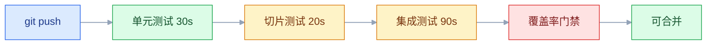
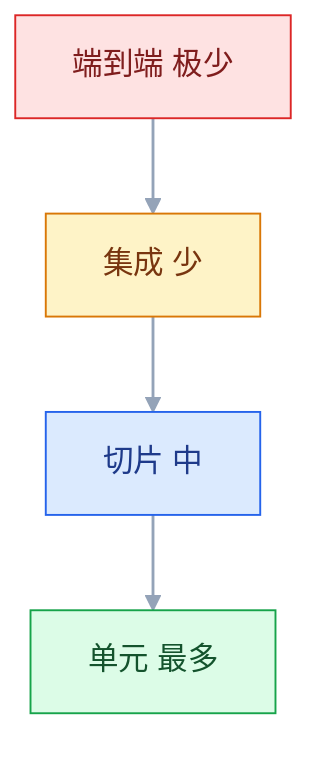
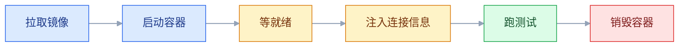

# 后端测试

## 一、工程案例：给订单服务搭测试金字塔并接进 CI

**场景**：订单服务只有一个 300 行的 `OrderService`，折扣规则（满 5000 减 5%、满 10000 减 10%、会员再减 20、保底 0.01）散在几层 `if` 里。每次改规则靠 Postman 点 20 分钟，上周把「满 10000」写成「大于 10000」，上线三天后才发现。目标是把这块逻辑拆出可测边界，搭四层测试，接进 CI，让「改完三分钟内知道有没有坏」成为默认动作。

**产出**：一个纯函数 `PriceCalculator`、四个测试类（8 + 3 + 4 + 2 个用例）、一份 JaCoCo 门禁、一条 GitHub Actions 流水线。本地 `mvn verify` 与 CI 结果一致。

### 1.1 先拆出可测的边界

```java
public class PriceCalculator {
    private static final BigDecimal RATE_10 = new BigDecimal("0.10");
    private static final BigDecimal RATE_5 = new BigDecimal("0.05");
    private static final BigDecimal MEMBER_CUT = new BigDecimal("20.00");
    private static final BigDecimal FLOOR = new BigDecimal("0.01");

    /** 满减 + 会员立减 + 保底。纯函数：不碰库、不碰时间、不碰随机 */
    public BigDecimal finalAmount(BigDecimal subtotal, boolean member) {
        if (subtotal == null || subtotal.signum() <= 0) {
            throw new BizException("金额必须大于 0");
        }
        BigDecimal rate = BigDecimal.ZERO;
        if (subtotal.compareTo(new BigDecimal("10000")) >= 0) {
            rate = RATE_10;
        } else if (subtotal.compareTo(new BigDecimal("5000")) >= 0) {
            rate = RATE_5;
        }
        BigDecimal amount = subtotal.multiply(BigDecimal.ONE.subtract(rate));
        if (member) {
            amount = amount.subtract(MEMBER_CUT);
        }
        return amount.max(FLOOR).setScale(2, RoundingMode.HALF_UP);
    }
}
```

```java
@Service
public class OrderService {
    private final UserMapper userMapper;
    private final OrderMapper orderMapper;
    private final PriceCalculator calculator;
    private final IdGenerator idGenerator;          // 订单号来自这里，不在方法里 new Random
    private final ApplicationEventPublisher publisher;

    @Transactional
    public OrderVO createOrder(OrderCreateReq req, Long userId) {
        if (req.getItems() == null || req.getItems().isEmpty()) {
            throw new BizException("订单不能为空");
        }
        User user = userMapper.selectById(userId);
        if (user == null) {
            throw new BizException("用户不存在");
        }
        if (orderMapper.countByRequestId(req.getRequestId()) > 0) {
            throw new BizException("重复下单");
        }
        Order order = new Order();
        order.setOrderNo(idGenerator.next());
        order.setUserId(userId);
        order.setAmount(calculator.finalAmount(req.getSubtotal(), user.isMember()));
        order.setStatus(OrderStatus.CREATED);
        orderMapper.insert(order);
        publisher.publishEvent(new OrderCreatedEvent(order.getId(), userId));
        return OrderVO.from(order);
    }
}
```

**拆分的意义**：`finalAmount` 是纯函数，边界值可以毫秒级穷尽；`createOrder` 只剩协作与顺序，用 Mockito 验证「该调的调了、不该调的没调」；SQL 与事务交给真实 MySQL。三层回答不同问题，谁也不能替代谁。

### 1.2 依赖

```xml
<dependency>
  <groupId>org.springframework.boot</groupId>
  <artifactId>spring-boot-starter-test</artifactId>
  <scope>test</scope>
</dependency>
<dependency>
  <groupId>org.testcontainers</groupId>
  <artifactId>mysql</artifactId>
  <scope>test</scope>
</dependency>
<dependency>
  <groupId>org.testcontainers</groupId>
  <artifactId>junit-jupiter</artifactId>
  <scope>test</scope>
</dependency>
```

> 版本交给 Spring Boot 的平台 BOM 统一管理。JUnit、Mockito、AssertJ、Testcontainers 的具体版本以官方当前稳定版为准，不要手写一个记忆中的数字。

### 1.3 第一层：纯逻辑的边界穷举

```java
class PriceCalculatorTest {
    private final PriceCalculator calc = new PriceCalculator();

    @ParameterizedTest(name = "小计 {0} 会员={1} → {2}")
    @CsvSource({
        "100.00,  false, 100.00",
        "4999.99, false, 4999.99",
        "5000.00, false, 4750.00",
        "9999.99, false, 9499.99",
        "10000.00,false, 9000.00",
        "10000.00,true,  8980.00",
        "20.00,   true,  0.01"
    })
    void finalAmount_boundaries(BigDecimal subtotal, boolean member, BigDecimal expected) {
        assertThat(calc.finalAmount(subtotal, member)).isEqualByComparingTo(expected);
    }

    @Test
    void finalAmount_zeroOrNegative_throws() {
        assertThatThrownBy(() -> calc.finalAmount(BigDecimal.ZERO, false))
                .isInstanceOf(BizException.class).hasMessage("金额必须大于 0");
    }
}
```

关键在**阈值两侧各取一个值**：4999.99 与 5000.00、9999.99 与 10000.00。只测 100 和 20000 这种「正常值」，恰好漏掉边界写错的情况。`isEqualByComparingTo` 比较数值而非 `BigDecimal` 的 scale，避免 `100.0` 与 `100.00` 误报。

```bash
mvn -q -Dtest=PriceCalculatorTest test
# Tests run: 8, Failures: 0, Errors: 0, Skipped: 0, Time elapsed: 0.312 s
```

### 1.4 第二层：协作与调用顺序

```java
@ExtendWith(MockitoExtension.class)
class OrderServiceTest {
    @Mock UserMapper userMapper;
    @Mock OrderMapper orderMapper;
    @Mock IdGenerator idGenerator;
    @Mock ApplicationEventPublisher publisher;
    private OrderService service;

    @BeforeEach
    void setUp() {
        service = new OrderService(userMapper, orderMapper,
                new PriceCalculator(), idGenerator, publisher);
    }

    @Test
    void createOrder_userMissing_throwsAndSkipsWrite() {
        when(userMapper.selectById(9L)).thenReturn(null);

        assertThatThrownBy(() -> service.createOrder(req("r-1", "100.00"), 9L))
                .isInstanceOf(BizException.class).hasMessage("用户不存在");
        verifyNoInteractions(orderMapper, publisher);
    }

    @Test
    void createOrder_duplicateRequest_throwsAndSkipsInsert() {
        when(userMapper.selectById(1L)).thenReturn(new User(1L, "alice", true));
        when(orderMapper.countByRequestId("r-1")).thenReturn(1);

        assertThatThrownBy(() -> service.createOrder(req("r-1", "10000.00"), 1L))
                .isInstanceOf(BizException.class).hasMessage("重复下单");
        verify(orderMapper, never()).insert(any());
        verifyNoInteractions(publisher);
    }

    @Test
    void createOrder_member_appliesDiscountAndPublishes() {
        when(userMapper.selectById(1L)).thenReturn(new User(1L, "alice", true));
        when(orderMapper.countByRequestId("r-1")).thenReturn(0);
        when(idGenerator.next()).thenReturn("NO-1");
        doAnswer(inv -> {
            inv.getArgument(0, Order.class).setId(100L);
            return 1;
        }).when(orderMapper).insert(any(Order.class));

        OrderVO vo = service.createOrder(req("r-1", "10000.00"), 1L);

        ArgumentCaptor<Order> captor = ArgumentCaptor.forClass(Order.class);
        verify(orderMapper).insert(captor.capture());
        assertThat(captor.getValue().getAmount()).isEqualByComparingTo("8980.00");
        assertThat(captor.getValue().getStatus()).isEqualTo(OrderStatus.CREATED);
        verify(publisher).publishEvent(any(OrderCreatedEvent.class));
        assertThat(vo.getId()).isEqualTo(100L);
    }
}
```

三个用例分别回答：参数非法时**有没有提前返回**、重复请求时**有没有写库**、正常路径**落库的对象长什么样**。`verifyNoInteractions` 比只断言异常更有价值——它证明副作用没有发生。

### 1.5 第三层：Controller 切片

```java
@WebMvcTest(OrderController.class)
@Import({AuthInterceptor.class, WebMvcConfig.class})
class OrderControllerTest {
    @Autowired MockMvc mockMvc;
    @MockitoBean OrderService orderService;   // 新版本用 @MockitoBean，旧版本是 @MockBean（以官方当前稳定版为准）

    @Test
    void create_emptyItems_returnsFieldErrorAndSkipsService() throws Exception {
        mockMvc.perform(post("/api/orders")
                        .header("X-User-Id", "1")
                        .contentType(MediaType.APPLICATION_JSON)
                        .content("{\"requestId\":\"r-1\",\"items\":[]}"))
                .andExpect(status().isBadRequest())
                .andExpect(jsonPath("$.errors[0].field").value("items"));
        verifyNoInteractions(orderService);
    }

    @Test
    void create_missingUserHeader_returns401() throws Exception {
        mockMvc.perform(post("/api/orders")
                        .contentType(MediaType.APPLICATION_JSON).content("{}"))
                .andExpect(status().isUnauthorized());
    }

    @Test
    void create_bizException_returnsBusinessCode() throws Exception {
        when(orderService.createOrder(any(), eq(1L)))
                .thenThrow(new BizException("重复下单"));

        mockMvc.perform(post("/api/orders")
                        .header("X-User-Id", "1")
                        .contentType(MediaType.APPLICATION_JSON)
                        .content("{\"requestId\":\"r-1\",\"items\":[{\"sku\":\"A\",\"qty\":1}]}"))
                .andExpect(status().isOk())
                .andExpect(jsonPath("$.code").value(1001))
                .andExpect(jsonPath("$.message").value("重复下单"));
    }

    @Test
    void create_valid_returnsOrderNo() throws Exception {
        when(orderService.createOrder(any(), eq(1L)))
                .thenReturn(new OrderVO(100L, "NO-1", new BigDecimal("8980.00")));

        mockMvc.perform(post("/api/orders")
                        .header("X-User-Id", "1")
                        .contentType(MediaType.APPLICATION_JSON)
                        .content("{\"requestId\":\"r-1\",\"items\":[{\"sku\":\"A\",\"qty\":1}]}"))
                .andExpect(status().isOk())
                .andExpect(jsonPath("$.data.orderNo").value("NO-1"));
    }
}
```

切片只加载 MVC 相关 Bean（Controller、`@RestControllerAdvice`、参数解析、拦截器），**不加载 Service 和数据源**。所以 Service 必须由 `@MockitoBean` 补上，认证拦截器要显式 `@Import`。这一层专门拦「JSON 字段名写错、校验注解漏了、状态码不对」这类只在 HTTP 边界出现的问题。

### 1.6 第四层：真实 MySQL

```java
@Testcontainers
@SpringBootTest
class OrderMapperIT {
    @Container
    static MySQLContainer<?> mysql = new MySQLContainer<>("mysql:8.4")
            .withDatabaseName("orderdb")
            .withUsername("test")
            .withPassword("test")
            .withInitScript("schema.sql");

    @DynamicPropertySource
    static void datasource(DynamicPropertyRegistry registry) {
        registry.add("spring.datasource.url", mysql::getJdbcUrl);
        registry.add("spring.datasource.username", mysql::getUsername);
        registry.add("spring.datasource.password", mysql::getPassword);
    }

    @Autowired OrderMapper orderMapper;
    @Autowired JdbcTemplate jdbc;

    @AfterEach
    void clean() {
        jdbc.execute("DELETE FROM t_order_item");
        jdbc.execute("DELETE FROM t_order");
    }

    @Test
    void countByStatus_groupsWithOnlyFullGroupBy() {
        orderMapper.insert(order("A", OrderStatus.CREATED));
        orderMapper.insert(order("B", OrderStatus.PAID));
        orderMapper.insert(order("C", OrderStatus.PAID));

        assertThat(orderMapper.countByStatus(1L))
                .extracting(StatusCount::getStatus, StatusCount::getCount)
                .containsExactlyInAnyOrder(tuple(OrderStatus.CREATED, 1L),
                                           tuple(OrderStatus.PAID, 2L));
    }

    @Test
    void uniqueRequestId_rejectsDuplicate() {
        orderMapper.insert(order("r-1", OrderStatus.CREATED));
        assertThatThrownBy(() -> orderMapper.insert(order("r-1", OrderStatus.CREATED)))
                .isInstanceOf(DuplicateKeyException.class);
    }
}
```

镜像 tag 写具体小版本（`mysql:8.4`），不要用 `latest`——某天上游一更新，CI 会在与你无关的提交上变红。容器启动是主要成本，`@Container` 用 `static` 让一个类只启一次。

### 1.7 覆盖率门禁

```xml
<plugin>
    <groupId>org.jacoco</groupId>
    <artifactId>jacoco-maven-plugin</artifactId>
    <version>${jacoco.version}</version>   <!-- 以官方当前稳定版为准 -->
    <executions>
        <execution>
            <id>prepare-agent</id>
            <goals><goal>prepare-agent</goal></goals>
        </execution>
        <execution>
            <id>report</id>
            <phase>verify</phase>
            <goals><goal>report</goal></goals>
        </execution>
        <execution>
            <id>check</id>
            <phase>verify</phase>
            <goals><goal>check</goal></goals>
            <configuration>
                <excludes>
                    <exclude>**/dto/**</exclude>
                    <exclude>**/vo/**</exclude>
                    <exclude>**/*Application.class</exclude>
                    <exclude>**/generated/**</exclude>
                </excludes>
                <rules>
                    <rule>
                        <element>BUNDLE</element>
                        <limits>
                            <limit><counter>LINE</counter><value>COVEREDRATIO</value><minimum>0.70</minimum></limit>
                            <limit><counter>BRANCH</counter><value>COVEREDRATIO</value><minimum>0.60</minimum></limit>
                        </limits>
                    </rule>
                    <rule>
                        <element>PACKAGE</element>
                        <includes><include>com.acme.order.service.*</include></includes>
                        <limits><limit><counter>LINE</counter><value>COVEREDRATIO</value><minimum>0.85</minimum></limit></limits>
                    </rule>
                </rules>
            </configuration>
        </execution>
    </executions>
</plugin>
```

```bash
mvn -B verify
# Tests run: 17, Failures: 0, Errors: 0, Skipped: 0
# Analyzed bundle 'order-service' with 42 classes
# All coverage checks have been met.
# BUILD SUCCESS
```

门禁绑在 `verify`，所以日常 `mvn test` 不受影响，CI 必须跑 `mvn verify`。设了门禁就要**故意删一个断言验证它会红**——没红过的门禁等于没有。

### 1.8 CI 流水线

先让 `*IT` 真的被执行。surefire 默认只认 `*Test`、`*Tests`、`Test*`，集成测试必须交给 failsafe，否则这些类从头到尾没有被加载：

```xml
<plugin>
    <groupId>org.apache.maven.plugins</groupId>
    <artifactId>maven-failsafe-plugin</artifactId>
    <executions>
        <execution>
            <goals><goal>integration-test</goal><goal>verify</goal></goals>
        </execution>
    </executions>
</plugin>
```

> 版本由 Spring Boot 父 POM 管理；没有父 POM 就显式写版本，以官方当前稳定版为准。

```yaml
name: ci
on: [push, pull_request]
jobs:
  test:
    runs-on: ubuntu-latest
    steps:
      - uses: actions/checkout@v4
      - uses: actions/setup-java@v4
        with:
          java-version: '21'
          distribution: 'temurin'
          cache: maven
      - name: 测试与覆盖率门禁
        run: mvn -B verify
      - name: 上传报告
        if: always()
        uses: actions/upload-artifact@v4
        with:
          name: reports
          path: |
            target/surefire-reports/
            target/failsafe-reports/
            target/site/jacoco/
```

`*IT` 在 `integration-test` 阶段执行、`verify` 阶段汇总失败，surefire 不碰它们；`if: always()` 保证失败时报告也能上传，而失败时的报告恰恰最有用。



### 1.9 验收

| 检查项 | 命令或检查 | 通过标准 |
|---|---|---|
| 纯逻辑分支 | `mvn -Dtest=PriceCalculatorTest test` | 8 个用例全绿，耗时小于 1 秒 |
| 边界两侧 | 同上，看参数化数据 | 4999.99 与 5000.00、9999.99 与 10000.00 都有断言 |
| 提前返回 | `mvn -Dtest=OrderServiceTest test` | 用户不存在时 `orderMapper` 零交互 |
| 幂等校验 | 同上 | 重复 requestId 时 `insert` 从未被调用 |
| 参数校验 | `mvn -Dtest=OrderControllerTest test` | 空 items 返回 400 且不进 Service |
| 认证 | 同上 | 缺 `X-User-Id` 返回 401 |
| 真实 SQL | `mvn verify -Dit.test=OrderMapperIT` | `failsafe-reports` 里 2 条用例都执行且全绿（不是 `Tests run: 0`） |
| 类内复用 | 同上，看容器日志 | 两个用例共用一次启动，`Creating container` 只出现一行 |
| 覆盖率 | `mvn verify` | 行 70%、分支 60%、service 包 85% |
| 门禁有效 | 临时删一个断言再跑 | `verify` 失败并指出违反的 rule |
| CI 一致 | push 后看 Actions | test job 绿，artifact 里有 jacoco 与 failsafe 报告 |
| 无生产依赖 | 搜测试目录的域名与密钥 | 没有生产地址、没有真实凭证 |

---

## 二、高频问答：会卡住你的地方，也是面试最常问的

### 2.1 加了 `any()` 之后抛 `InvalidUseOfMatchersException`

**现场**

看异常信息里的 `2 matchers expected, 1 recorded`；把每个参数都换成 `eq(...)` 后消失。

**要点**

- 同一次调用里混用了匹配器和原始值，例如 `verify(mapper).insert(any(), 1L)`。
- 匹配器靠栈计数配对，混用后数量对不上。
- 升级版本不会修好，因为这是调用方违反契约，不是框架缺陷。
- 把该次调用的参数全部改成匹配器，或全部改成原始值，只保留一种风格。

**追问**

- 为什么 `any()` 不能和具体值混用？→ 配对是按调用顺序从栈里取的，多一个少一个就错位。
- `eq(1L)` 和直接写 `1L` 有区别吗？→ 有，前者登记了一个匹配器。
- 静态导入 `any` 最容易踩什么？→ 忘了同一次调用的所有参数都得用匹配器。

### 2.2 打桩明明写了，方法还是返回 null

**现场**

`verify(mock).method(...)` 同样失败；在 `thenAnswer` 里打印 `invocation.getArguments()` 看实际值。

**要点**

- 注解生效了，桩也注册了，只是键对不上，返回默认值 null。
- 常见原因：对象没实现 `equals`、`BigDecimal` 的 scale 不同、调到了重载的另一个方法。
- 也可能方法本身打不了桩：旧 subclass mock maker 下的 `final` 方法、未用 `mockStatic` 的静态方法。
- 先打印实际入参，再用 `argThat` 或 `eq` 精确匹配；值对象补 `equals`，或直接比较业务主键。

**追问**

- `BigDecimal` 为什么匹配不上？→ `equals` 连 scale 一起比，`100.0` 和 `100.00` 不相等。
- 怎么快速定位？→ 看 `getArguments()` 的实际值，而不是盯着打桩代码。
- 值对象怎么处理？→ 补 `equals`，或改用业务主键做匹配。

### 2.3 `@WebMvcTest` 下所有请求都是 401

**现场**

启动日志里看 Bean 列表；异常栈指向 `UsernameNotFoundException` 或空指针。

**要点**

- 切片只加载 MVC 相关 Bean，安全过滤器链在，但它依赖的 `UserDetailsService`、`TokenService` 没有加载。
- 认证组件根本没被创建，问题不在 token 内容。
- 用 `@MockitoBean` 补上缺失的依赖，或 `@Import` 引入安全配置。
- **不要用 `addFilters = false` 图省事**——那会把本该验证的 401 用例一起关掉。

**追问**

- 为什么过滤器链还在？→ 安全自动配置属于 MVC 切片加载的范围。
- 补了依赖还是 401？→ 查过滤器顺序和放行路径。
- 切片里能测真实鉴权吗？→ 只能测 HTTP 边界，真实鉴权交给集成测试。

### 2.4 H2 上全绿，换 MySQL 就报错

**现场**

看错误码 1055（GROUP BY 不合规）、1267（排序规则混用）；把同一条 SQL 在真实 MySQL 跑一遍。

**要点**

- 方言差异：`ONLY_FULL_GROUP_BY`、字符集与排序规则、日期函数、锁与隔离级别。
- H2 的 MySQL 模式只兼容一部分，SQL 本身在严格模式下就是错的，H2 只是没拦住。
- 涉及复杂 SQL、事务、字符集的测试一律用 Testcontainers 起同版本 MySQL。
- H2 只留给不写 SQL 的切片测试。

**追问**

- 1055 是什么？→ GROUP BY 里有非聚合列，严格模式不允许。
- 1267 是什么？→ 排序规则混用，比较时无法统一。
- 为什么本地一直没暴露？→ H2 默认更宽松，把错误 SQL 放过去了。

### 2.5 单个测试绿，一起跑就红

**现场**

`mvn test -Dtest=A,B` 能稳定复现；调换顺序后失败的用例跟着变。

**要点**

- 共享可变状态：静态字段、单例缓存、数据库残留、MDC、系统属性、固定端口。
- 框架按类隔离实例，但静态状态和外部资源不会自动复位。
- 每个测试自建数据并在 `@AfterEach` 清理，静态缓存提供 reset 方法，端口用 0 让系统分配。

**追问**

- 为什么调换顺序就能定位？→ 失败跟着顺序走，说明有跨用例污染。
- 数据库残留怎么防？→ 唯一前缀加清理，或每个用例自建数据。
- 并行执行会放大什么？→ 共享资源和固定端口冲突。

### 2.6 `@Transactional` 的测试里，提交后逻辑从不执行

**现场**

在监听器里打日志，测试输出中完全没有。

**要点**

- 测试方法本身在一个事务里，最后回滚。
- `AFTER_COMMIT` 监听器永远不会触发，`REQUIRES_NEW` 会被挂起，异步线程也看不到未提交数据。
- 监听器注册正常，是测试的事务边界让它没有机会跑。
- 这类用例去掉 `@Transactional`，改用 `@AfterEach` 手工清理，或用 `TestTransaction` 显式提交。

**追问**

- 为什么监听器一直不触发？→ 外层测试事务从不提交。
- 去掉事务有什么代价？→ 要自己清数据，测试也变慢。
- `REQUIRES_NEW` 为什么也被挂起？→ 外层事务没结束，内层只能等。

### 2.7 Testcontainers 在 CI 报 Docker 不可用

**现场**

在 CI 里加一步 `docker info`，看是否能连上 daemon。

**要点**

- 代码没变，变的是执行环境的能力。
- runner 没有 Docker socket、用了 DinD 却没配 `DOCKER_HOST`、或者拉镜像被限流。
- 托管 runner 自带 Docker；自建 runner 要挂载 `/var/run/docker.sock`。
- 镜像预热或走私有 registry 规避限流。

**追问**

- 为什么本地能跑 CI 不能？→ 本地有 daemon，CI 是干净容器。
- DinD 和挂 socket 怎么选？→ DinD 隔离好但慢，挂 socket 快但共享宿主。
- 拉镜像被限流怎么看出来？→ 看 pull 的错误码和日志。

### 2.8 覆盖率门禁配了却从不生效

**现场**

日志里搜 `All coverage checks have been met` 或 `Rule violated`，两者都没有就是没执行。

**要点**

- 只跑 `mvn test`，而 `check` 绑在 `verify`。
- `report` 没绑定阶段，或 `excludes` 写宽了，把要统计的包也排除了。
- 配置本身没错，是执行的生命周期阶段没到。
- CI 固定用 `mvn verify`，并故意让覆盖率掉下去确认构建会失败。

**追问**

- 为什么本地从没红过？→ 从没跑到 `verify` 阶段。
- 门禁设多少合适？→ 行 70%、分支 60% 是起点，核心包单独更高。
- 覆盖率高就安全吗？→ 不，它统计执行痕迹，不代表断言有效。

### 2.9 本地绿，CI 红

**现场**

看 CI 第一个失败用例，是否与日期、文件路径、编码相关。

**要点**

- 时区、locale、绝对路径、环境变量、JDK 小版本、并行度，任一不同都会让断言漂移。
- 超时只是表象，根因多是环境假设被写进了测试。
- 在容器里跑一遍；显式固定 `-Duser.timezone=UTC`、`-Duser.language=en`，资源文件走 classpath。

**追问**

- 为什么日期相关最容易漂？→ 月初、跨年、时区边界都会变。
- 路径怎么写才稳？→ 用 classpath 或 `@TempDir`，别写绝对路径。
- JDK 小版本也会影响？→ 会，默认 locale、排序、正则实现都可能变。

### 2.10 偶发失败，重跑就过

**现场**

同一用例连跑 20 次，统计失败率；失败时保存现场日志。

**要点**

- `sleep` 等异步、依赖当前时间、随机数据、测试顺序、端口冲突，本质都是不确定性。
- 重试把偶发变成常态，问题仍在，只是被藏起来了。
- 异步用 Awaitility 轮询条件而不是睡固定时长，时间通过 `Clock` 注入，随机数据固定 seed。

**追问**

- 为什么不能加个重试注解了事？→ 掩盖问题，还会拖长流水线。
- 怎么证明修好了？→ 连跑 20 次全绿，而不是重跑一次过。
- 并发类偶发怎么稳定复现？→ 用闩锁控制时序，不用 `sleep`。

### 2.11 想 Mock 的工具类报 `Cannot mock/spy final class`

**现场**

异常信息明确写出类名；查 `mockito-core` 的版本，以及 `mockito-extensions/org.mockito.plugins.MockMaker` 有没有被改成 subclass。

**要点**

- 这条报错来自 subclass mock maker：它靠生成子类实现，`final` 类没法继承。
- 较新的 Mockito 默认已换成 inline mock maker，能直接 mock `final` 类。
- 所以先怀疑版本或 mock maker 配置，而不是「框架不支持」。
- 换框架同样受限，真正要做的是换设计或换 mock maker。

**追问**

- 为什么换框架也解决不了？→ 大多数 mock 框架都靠字节码生成。
- `mockStatic` 有什么坑？→ 要放 try-with-resources，否则污染同线程其他测试。
- 更好的做法是什么？→ 把 `final` 工具类包一层接口注入。

### 2.12 测试连到了生产库

**现场**

启动时打印 `spring.datasource.url`；在测试里断言 host 属于本机或容器。

**要点**

- 测试配置缺失时会回落到主配置的默认数据源。
- 本地 shell 里的环境变量可能正指向生产。
- 测试会建表、清表、跑迁移，读也可能拖垮生产；一次误操作就够。
- 测试配置显式覆盖 URL，加一条前置断言，CI 使用独立实例。

**追问**

- 只是查询，为什么也危险？→ 大查询会拖垮生产，还可能把敏感数据带回本地。
- 加什么保险最有效？→ host 不含生产域名才允许继续。
- 测试凭证能复用生产的吗？→ 不能，测试代码会进 Git，日志会进采集系统。

### 2.13 写了 `*IT`，CI 里却从没执行

**现场**

`mvn verify` 后看 `target/failsafe-reports/` 有没有生成；日志里 IT 类的 `Tests run` 数量是否为 0。

**要点**

- surefire 默认只匹配 `*Test`、`*Tests`、`Test*`，`*IT` 归 failsafe。
- pom 里没绑定 failsafe，或者 CI 只跑 `mvn test`，这些类根本没进入执行计划。
- 「绿」是因为跳过，不是通过，所以也没有报告可上传。
- pom 里显式绑定 `integration-test` 与 `verify`，CI 固定 `mvn verify`。

**追问**

- 为什么失败要到 `verify` 才汇总？→ failsafe 的设计是先跑完再判定。
- 怎么确认真的执行了？→ 看 `failsafe-reports` 里的用例数和耗时。
- 故意让一条 IT 失败能证明什么？→ 证明流水线真的会红。

---

## 三、核心知识：从零开始要建立的东西

### 3.1 测试金字塔的分层依据

分层的依据不是「重要程度」，而是**反馈速度与定位精度的乘积**。越靠下越快、越能指出具体哪一行；越靠上越接近真实，但慢且失败信息模糊。



| 层 | 依赖 | 单次耗时 | 失败时能指出 | 数量 |
|---|---|---|---|---|
| 单元（纯逻辑） | 无 | 毫秒 | 具体分支与入参 | 最多 |
| 单元（协作） | Mock | 毫秒 | 哪个依赖没被正确调用 | 多 |
| 切片 | 框架的一部分 | 百毫秒 | 序列化、校验、状态码 | 中 |
| 集成 | 真实中间件 | 秒 | SQL、事务、字符集 | 少 |
| 端到端 | 全部真实 | 秒到分钟 | 链路是否通 | 极少 |

倒过来（大量端到端、少量单元）叫冰淇淋筒，症状是 CI 跑一小时、失败后不知道去哪找。**判断标准**：一个用例失败，你能不能只看名字就知道去哪看代码。

> **面试**：常问「测试金字塔为什么单元测试最多？」答：反馈快、定位准，越往上越接近真实但越慢越模糊。

### 3.2 测试替身的形态与边界

| 形态 | 行为 | 典型用途 |
|---|---|---|
| Dummy | 只为填参数，从不使用 | 构造函数里的无关依赖 |
| Stub | 固定返回，不校验调用 | 让被测代码走进某个分支 |
| Spy | 真实对象，部分方法被打桩 | 只想替换其中一个耗时方法 |
| Mock | 记录调用，可验证交互 | 断言「有没有发通知」 |
| Fake | 有真实逻辑的轻量实现 | 内存版 Repository |

**取舍**：Mock 验证交互，会让测试和实现细节耦合——重构方法名就红。纯逻辑优先断言**结果**，只有「副作用是否发生」无法从返回值观察时才用 `verify`。一个测试里 Mock 的对象比真实执行的代码还多，通常说明边界划错了。

### 3.3 断言的信息密度

```java
// 信息少：失败只说 expected true
assertTrue(list.size() == 3);

// 信息多：失败会打印实际集合
assertThat(list).hasSize(3);
```

| 写法 | 失败时告诉你 |
|---|---|
| `assertEquals(5, r)` | `expected: <5> but was: <3>` |
| `assertThat(r).isEqualTo(5)` | 同上，但可链式加语境 |
| `assertThat(list).extracting(User::getName).containsExactly("a","b")` | 实际列表全部内容 |
| `assertAll(a, b, c)` | 一次跑完所有断言，看到全部差异 |

**边界**：一个测试只验证一个行为，但可以有多个断言描述这个行为。把「创建成功」和「通知已发」拆成两个用例，失败时名字就说明了问题；硬塞在一起，第一个断言失败后面的根本不执行。

### 3.4 测试隔离的三个层次

| 层次 | 手段 | 隔离什么 | 代价 |
|---|---|---|---|
| 进程 | `forkCount`、`reuseForks=false` 时每个类新 JVM | 静态状态、内存 | 启动慢 |
| 事务 | `@Transactional` 回滚 | 数据库行 | 测不到提交后行为 |
| 数据 | 唯一前缀、`@AfterEach` 清理 | 同一张表里的行 | 要写清理代码 |

真正难隔离的是**进程外的共享资源**：同一个 Redis、同一个 MQ topic、同一个测试账号。并行跑时给每个测试加随机前缀，比事后清库可靠。静态单例（缓存、计数器）要在 `@BeforeEach` 重置，否则顺序一变结果就变。

### 3.5 测试数据的构造策略

| 方式 | 优点 | 缺点 |
|---|---|---|
| 直接 new | 一眼看懂 | 字段一多就淹没重点 |
| Builder | 只写与默认值不同的字段 | 需要维护一个类 |
| Fixture 文件 | 适合复杂嵌套结构 | 改动影响面大 |
| 随机生成 | 能发现意外组合 | 失败不可复现 |

推荐组合：**核心字段固定，非关键字段随机**。随机必须固定 seed，并把 seed 打进失败信息，否则「偶发失败」会变成长期悬案。

### 3.6 切片测试的上下文边界

| 注解 | 加载 | 不加载 | 适用 |
|---|---|---|---|
| `@WebMvcTest` | Controller、Advice、MVC 基础设施 | Service、Repository、数据源 | 参数绑定、校验、状态码 |
| `@DataJpaTest` | JPA、数据源 | Service、Controller | Repository 查询 |
| `@MybatisTest` | MyBatis、数据源 | Service、Controller | Mapper SQL |
| `@SpringBootTest` | 整个应用上下文（默认不起真实端口） | 无 | 多 Bean 协作、事务 |

`@DataJpaTest` 默认把数据源换成内嵌库，要连真实 MySQL 得加 `@AutoConfigureTestDatabase(replace = Replace.NONE)`，再接 Testcontainers——不换就永远测不到方言差异。

Spring 会按「配置组合」缓存上下文，配置不同就新建一个。给每个测试类加一点不同的 `properties`，会让容器反复启动，测试时间成倍增长。切片测试共用一套最小配置，是速度的关键。

### 3.7 容器化依赖的启动语义

Testcontainers 的生命周期是一条固定流水线：



三个容易忽略的点：

- **就绪判断**：镜像自带的 healthcheck 不一定可靠，等日志关键字或 JDBC 可连更稳。
- **镜像 tag**：写具体小版本，`latest` 会让 CI 在无关提交上突然变红。
- **复用**：`withReuse(true)` 需要本机 `~/.testcontainers.properties` 里开启，且复用的容器会保留数据，测试必须自己清理。

| 策略 | 首次 | 之后 | 风险 |
|---|---|---|---|
| 每类一个静态容器 | 10 秒 | 10 秒 | 类多时资源紧张 |
| 全局单例 + 复用 | 10 秒 | 小于 1 秒 | 数据残留、状态漂移 |
| 每方法一个容器 | 10 秒 | 10 秒 | 最干净也最慢 |

### 3.8 事务传播与回滚语义

| 传播行为 | 行为 | 测试里的表现 |
|---|---|---|
| `REQUIRED` | 加入现有事务 | 随测试事务一起回滚 |
| `REQUIRES_NEW` | 挂起外层，新开一个 | 内层提交后**不会**被测试回滚 |
| `NESTED` | 保存点 | 回滚到保存点，外层仍在 |

`NESTED` 靠 JDBC 保存点实现，JPA 或驱动不提供保存点时会抛 `NestedTransactionNotSupportedException`，别假设它到处可用。

`@Transactional` 的测试是在「永不提交」的前提下跑的，所以它验证不了提交之后才发生的事：发消息、写缓存、`AFTER_COMMIT` 监听器。异步线程用的是另一个连接，也看不到未提交的数据。遇到这三类，去掉测试事务，改用清理脚本。

> **面试**：常问「`@Transactional` 的测试为什么测不到提交后逻辑？」答：测试事务最后回滚，`AFTER_COMMIT` 和异步线程都等不到提交。

### 3.9 覆盖率指标的物理含义

| 指标 | 统计对象 | 容易误导的地方 |
|---|---|---|
| 指令覆盖 | 字节码指令 | 数字最高，但没人直接看 |
| 行覆盖 | 源码行是否执行 | 一行里有多个分支时仍然算「执行过」 |
| 分支覆盖 | `if` / `switch` 的每条边 | 最能反映逻辑漏洞 |
| 方法覆盖 | 方法是否被调用 | 调了不等于验证了 |

`if (a && b)` 在字节码里算 4 条分支边。只测 `a=true,b=true`，行覆盖可能 100%，分支覆盖只有 50%；补一个 `a=false` 也只到 75%，因为短路之后 `b` 的那条边永远走不到。JaCoCo 在字节码里插探针，所以它统计的是**执行痕迹**，不是**断言有效性**——一个只调用不断言的测试同样能刷到高覆盖率。

> **面试**：常问「覆盖率高就说明测试好吗？」答：不，它只证明代码被执行过，不证明断言有效。

### 3.10 测试确定性的来源

| 不确定性 | 表现 | 处理 |
|---|---|---|
| 当前时间 | 月初、跨年、时区边界失败 | 注入 `Clock`，测试给固定时刻 |
| 随机数 | 偶尔主键冲突、偶尔排序不同 | 固定 seed，或注入 `IdGenerator` |
| 并发 | 本机绿、CI 红 | 用闩锁控制时序，不用 `sleep` |
| 网络 | 第三方超时 | 一律 Mock，测试不出网 |
| 执行顺序 | 单独绿、一起红 | 每个测试自建前置状态 |

确定性不是「多跑几次就稳」，而是**把外部变量变成入参**。时间、随机、ID、时钟全部注入，测试才能重复。

> **面试**：常问「偶发失败的测试怎么修？」答：把时间、随机、ID 变成注入的入参，异步用轮询而不是 `sleep`。

### 3.11 契约测试的适用面

消费者驱动契约的做法：消费方把「我期望的请求与响应」写成契约，提供方在 CI 里验证自己满足所有契约。

| 场景 | 是否值得 |
|---|---|
| 两个团队、独立发布、接口频繁变 | 值得，能在联调前发现不兼容 |
| 单体应用内部调用 | 不值得，编译器和集成测试已覆盖 |
| 第三方外部 API | 不适用，对方不参与契约验证 |

契约测试补的是「集成测试覆盖不到的跨团队边界」，它不替代集成测试，也不验证业务逻辑。

### 3.12 测试执行的分层编排

| 插件 | 匹配 | 阶段 | 放什么 |
|---|---|---|---|
| surefire | `*Test`、`*Tests`、`Test*` | `test` | 单元、切片 |
| failsafe | `*IT`、`IT*`、`*ITCase` | `integration-test`（失败在 `verify` 汇总） | 集成、端到端 |

常用命令：`mvn test -Dtest=类名#方法名` 只跑一个；`-Dgroups=slow` 按标签筛选；`-Dsurefire.failIfNoSpecifiedTests=false` 防止筛选后无匹配而报错。CI 里先跑快的，再跑慢的，失败时能早停；本地开发只跑相关类，提交前跑全量。

### 3.13 测试代码的维护成本

测试代码和产品代码一样要读、要改、要删。

| 症状 | 后果 | 处理 |
|---|---|---|
| 每个测试复制 30 行准备代码 | 改一个字段要改几十处 | 抽 Builder 或 `@BeforeEach` |
| 断言依赖实现细节 | 重构就红，团队开始无视红灯 | 断言结果而非内部调用顺序 |
| 过度 Mock | 测试通过但线上仍坏 | 只 Mock 边界，逻辑用真实对象 |
| 失效测试长期 `@Disabled` | 变成假绿 | 要么修，要么删，不留僵尸 |

一条实用标准：**测试失败时，团队的第一反应应该是「代码坏了」，而不是「又是这个测试」。** 一旦变成后者，这套测试已经失去价值。

### 3.14 生产数据的使用边界

用生产数据复现问题很有效，但直接拷贝整库到开发机是事故。

| 做法 | 风险 |
|---|---|
| 整库 dump 到本地 | 个人信息落地，无法追溯 |
| 只脱敏姓名 | 手机号、地址、身份证仍在 |
| 保留真实 ID 关联 | 仍可反查到个人 |
| 子集 + 全字段脱敏 | 相对安全，需评估 |

合规做法是「最小子集 + 结构性脱敏 + 访问审批」。测试环境用的账号、密钥必须是独立的，**不能复用生产凭证**——测试代码会进 Git，日志会进采集系统。

### 3.15 测试环境的资源模型

CI 上的测试是有限资源里的并发任务。

| 资源 | 约束 | 对策 |
|---|---|---|
| CPU | 并行容器互相抢核 | 限制 fork 数，按模块并行 |
| 内存 | 多个 Spring 上下文叠加 | 减少不同配置，及时关闭容器 |
| 端口 | 固定端口冲突 | 用 0 让系统分配 |
| 磁盘 | 镜像与日志堆积 | 定期清理，镜像层复用 |
| 时间 | 集成测试拖长反馈 | 分层执行，慢的放夜间 |

测试策略的终点不是「覆盖所有情况」，而是**在可接受的反馈时间内，把最可能出错的地方拦住**。超出这个时间预算的测试，最终会被绕过。

---

## 四、冷门知识汇总

| 知识点 | 为什么冷门 | 用到时的关键词 |
|---|---|---|
| `@TestFactory` 动态测试 | 多数项目用例是静态的，只有按文件或数据集生成时才用 | `DynamicTest`、`Stream<DynamicTest>` |
| JUnit Extension | 项目里通常直接用现成注解，很少自己写扩展 | `@ExtendWith`、`InvocationInterceptor` |
| `@TempDir` | 文件相关测试少，且常被随手写到 `/tmp` | `@TempDir Path`、自动清理 |
| Awaitility | 异步测试多靠 `sleep` 蒙混，知道它的人不多 | `await().atMost(...).untilAsserted(...)` |
| WireMock / MockWebServer | 有 Mock 框架后很少真起 HTTP 服务 | `stubFor`、`takeRequest` |
| ArchUnit | 架构约束通常靠评审，很少写成测试 | `noClasses().that().resideInAPackage(...)` |
| PIT 变异测试 | 跑得慢，通常只在核心模块开启 | `mutationThreshold`、`targetClasses` |
| `@Sql` 脚本准备数据 | 多数项目用手写 `@BeforeEach` 建数据，脚本化只有复杂 SQL 场景才划算 | `@Sql("/fixtures/order.sql")`、`executionPhase` |
| `@Timeout` 单用例超时 | 平时想不起来，CI 卡住才发现缺它 | `@Timeout(value = 5, unit = SECONDS)` |
| 数据库迁移纳入测试 | 手工建表能跑就不管迁移脚本 | Flyway `migrate`、`withInitScript` |
