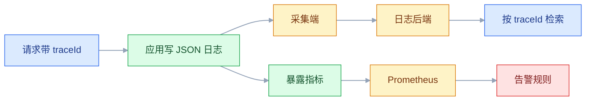
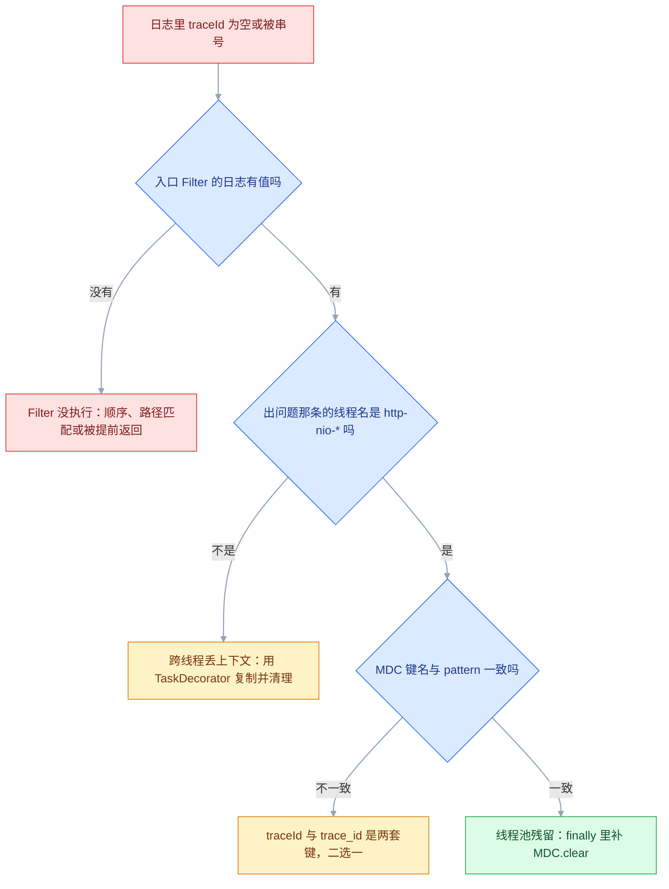

# 应用日志与指标

## 一、工程案例：用 traceId 把一次下单的日志、指标、链路串起来并定告警

**场景**：下单接口偶发失败，前端只显示「系统繁忙，请稍后重试」。用户截图里没有任何可用信息，本地用同样参数试十次都成功。当前代码用 `System.out.println` 打日志，没有请求标识，也没有任何指标。目标是把一次失败请求变成**可检索的证据链**：用 traceId 找到那一次的全部日志，用指标判断是个别还是系统性，最后落成一条能在 5 分钟内叫人的告警。

**产出**：统一 JSON 日志、traceId 全链路贯穿、访问日志切面、一组低基数指标（一个按 `result` 分成功与失败的 Counter，一个 Timer）、Prometheus 抓取配置、三条告警规则。全部落地后，同样的故障从「猜两天」变成「查三分钟」。

### 1.1 统一日志字段

```xml
<!-- logback-spring.xml 片段（以下元素位于 configuration 根节点内） -->
<springProperty scope="context" name="APP_NAME" source="spring.application.name" defaultValue="order-service"/>
<springProperty scope="context" name="LOG_PATH" source="logging.file.path" defaultValue="logs"/>

<appender name="JSON" class="ch.qos.logback.core.rolling.RollingFileAppender">
    <file>${LOG_PATH}/${APP_NAME}.json</file>
    <encoder class="net.logstash.logback.encoder.LogstashEncoder">
        <customFields>{"app":"${APP_NAME}"}</customFields>
        <timeZone>Asia/Shanghai</timeZone>         <!-- 与业务时间对齐；跨时区团队改成 UTC -->
        <includeMdc>true</includeMdc>              <!-- traceId 自动进 JSON -->
        <includeCallerData>false</includeCallerData> <!-- 关掉类名行号，省开销 -->
        <throwableConverter class="net.logstash.logback.stacktrace.ShortenedThrowableConverter">
            <maxDepthPerThrowable>30</maxDepthPerThrowable>
            <rootCauseFirst>true</rootCauseFirst>
        </throwableConverter>
    </encoder>
    <rollingPolicy class="ch.qos.logback.core.rolling.SizeAndTimeBasedRollingPolicy">
        <fileNamePattern>${LOG_PATH}/archive/${APP_NAME}-%d{yyyy-MM-dd}.%i.json.gz</fileNamePattern>
        <maxFileSize>100MB</maxFileSize>
        <maxHistory>30</maxHistory>
        <totalSizeCap>5GB</totalSizeCap>
    </rollingPolicy>
</appender>

<appender name="ASYNC" class="ch.qos.logback.classic.AsyncAppender">
    <appender-ref ref="JSON"/>
    <queueSize>4096</queueSize>
    <discardingThreshold>0</discardingThreshold>   <!-- 队列满也不丢 INFO -->
    <neverBlock>false</neverBlock>                 <!-- 宁可阻塞，不静默丢 -->
</appender>

<root level="INFO"><appender-ref ref="ASYNC"/></root>
```

> `logstash-logback-encoder` 的版本以官方当前稳定版为准。容器化部署时把 appender 换成 `ConsoleAppender`，JSON 直接写 stdout，由采集端统一收走。

一条日志长这样，每行都是合法 JSON，可以直接被采集器解析：

```json
{"@timestamp":"2026-10-21T16:20:31.412+08:00","level":"INFO","logger_name":"c.a.order.OrderService","thread_name":"http-nio-8080-exec-3","traceId":"3f2a1b4c5d6e7f80","message":"订单已创建 orderId=2001 amount=8980.00","app":"order-service"}
```

### 1.2 traceId 的入口、透传与线程传递

```java
@Component
@Order(Ordered.HIGHEST_PRECEDENCE)
public class TraceIdFilter extends OncePerRequestFilter {
    private static final Logger log = LoggerFactory.getLogger(TraceIdFilter.class);
    public static final String KEY = "traceId";
    public static final String HEADER = "X-Trace-Id";

    @Override
    protected void doFilterInternal(HttpServletRequest req, HttpServletResponse resp,
                                    FilterChain chain) throws ServletException, IOException {
        String traceId = resolve(req);
        MDC.put(KEY, traceId);
        resp.setHeader(HEADER, traceId);              // 回写给前端，报错时可直接提供
        long start = System.currentTimeMillis();
        try {
            log.info("请求开始 method={} uri={}", req.getMethod(), req.getRequestURI());
            chain.doFilter(req, resp);
        } finally {
            log.info("请求结束 method={} uri={} status={} durationMs={}",
                     req.getMethod(), req.getRequestURI(), resp.getStatus(),
                     System.currentTimeMillis() - start);
            MDC.remove(KEY);                          // 线程池会复用线程，必须清
        }
    }

    private String resolve(HttpServletRequest req) {
        String incoming = req.getHeader(HEADER);
        if (incoming != null && incoming.matches("[A-Za-z0-9\\-_]{8,64}")) {
            return incoming;                          // 上游已生成，沿用它
        }
        return UUID.randomUUID().toString().replace("-", "").substring(0, 16);
    }
}
```

跨服务用 Feign 的 `RequestInterceptor` 把当前 MDC 写进下游请求头；异步任务用 `TaskDecorator` 把提交线程的上下文复制到执行线程：

```java
public class MdcTaskDecorator implements TaskDecorator {
    @Override
    public Runnable decorate(Runnable task) {
        Map<String, String> ctx = MDC.getCopyOfContextMap();
        return () -> {
            try {
                if (ctx != null) MDC.setContextMap(ctx);
                task.run();
            } finally {
                MDC.clear();                          // 不清理会把 traceId 带给下一个任务
            }
        };
    }
}

@Bean
public feign.RequestInterceptor traceIdRelay() {
    return template -> {
        String traceId = MDC.get(TraceIdFilter.KEY);
        if (traceId != null) template.header(TraceIdFilter.HEADER, traceId);
    };
}
```

装饰器必须挂到线程池上才生效，顺带给线程起个可检索的前缀（验收里就是按 `async-` 找日志）：

```java
@EnableAsync
@Configuration
public class AsyncConfig {
    @Bean
    public ThreadPoolTaskExecutor orderExecutor() {
        ThreadPoolTaskExecutor executor = new ThreadPoolTaskExecutor();
        executor.setCorePoolSize(4);
        executor.setMaxPoolSize(8);
        executor.setQueueCapacity(200);
        executor.setThreadNamePrefix("async-");
        executor.setTaskDecorator(new MdcTaskDecorator());
        executor.initialize();
        return executor;
    }
}
```

### 1.3 访问日志切面

```java
@Target(ElementType.METHOD)
@Retention(RetentionPolicy.RUNTIME)
public @interface AccessLog { String value(); }

@Aspect
@Component
public class AccessLogAspect {
    private static final Logger access = LoggerFactory.getLogger("ACCESS");
    private static final long SLOW_MS = 1000;
    private static final int MAX_LEN = 2000;

    @Around("@annotation(accessLog)")
    public Object around(ProceedingJoinPoint pjp, AccessLog accessLog) throws Throwable {
        long start = System.currentTimeMillis();
        String action = accessLog.value();
        String args = truncate(mask(Arrays.toString(pjp.getArgs())));
        try {
            Object result = pjp.proceed();
            long cost = System.currentTimeMillis() - start;
            if (cost > SLOW_MS) {
                access.warn("action={} status=success durationMs={} slow=true args={}", action, cost, args);
            } else {
                access.info("action={} status=success durationMs={} args={}", action, cost, args);
            }
            return result;
        } catch (BizException e) {
            access.warn("action={} status=bizfail durationMs={} reason={} args={}",
                    action, System.currentTimeMillis() - start, e.getMessage(), args);
            throw e;
        } catch (Throwable e) {
            access.error("action={} status=fail durationMs={} args={}",
                    action, System.currentTimeMillis() - start, args, e);
            throw e;
        }
    }

    private String mask(String s) {
        return s.replaceAll("(\\d{6})\\d{8}(\\d{3}[0-9Xx])", "$1********$2")      // 18 位身份证
                .replaceAll("(1[3-9]\\d)\\d{4}(\\d{4})", "$1****$2")              // 手机号
                .replaceAll("(?i)(\"?(?:password|passwd|token|secret|idCard|bankCard)\"?\\s*[:=]\\s*\"?)[^\",}\\s]+", "$1***");
    }

    private String truncate(String s) {
        return s.length() <= MAX_LEN ? s : s.substring(0, MAX_LEN) + "...(truncated)";
    }
}
```

访问日志只记**动作、结果、耗时、脱敏后的参数**，不记完整响应体。慢请求单独打 WARN，这样「找慢接口」不需要写正则。切面依赖 `spring-boot-starter-aop`，用法是在接口方法上标 `@AccessLog("order.create")`；`Arrays.toString` 只能脱敏 `toString()` 里看得见的文本，请求体的完整脱敏仍要靠统一出口。

### 1.4 低基数业务指标

```java
@Component
public class OrderMetrics {
    private final Counter created;
    private final Counter failed;
    private final Timer createTimer;

    public OrderMetrics(MeterRegistry registry) {
        // 逻辑名用点分；Prometheus 侧自动转下划线并给 Counter 补 _total
        this.created = Counter.builder("order.created")
                .description("创建订单总数").tag("result", "success").register(registry);
        this.failed = Counter.builder("order.created")
                .description("创建订单总数").tag("result", "failed").register(registry);
        this.createTimer = Timer.builder("order.create.duration")
                .description("创建订单耗时")
                .publishPercentileHistogram()          // 让 P99 可跨实例聚合
                .slo(Duration.ofMillis(100), Duration.ofMillis(500), Duration.ofSeconds(1))
                .register(registry);
    }

    public void success(long ms) { created.increment(); createTimer.record(Duration.ofMillis(ms)); }
    public void failure(long ms) { failed.increment(); createTimer.record(Duration.ofMillis(ms)); }
}
```

标签只有 `result=success|failed` 这种有限枚举。**userId、orderId、traceId 一律不进标签**——它们每个值都会生成一条新的时间序列。成功与失败必须共用一个指标名、只换 tag 值，否则 PromQL 里连失败率的分母都凑不齐。导出名里的 `_total`、`_seconds` 是命名规约自动补的，代码里不用手写。

埋点放在业务方法里，指标记完异常继续抛：

```java
long start = System.currentTimeMillis();
try {
    Order order = doCreate(req, userId);
    metrics.success(System.currentTimeMillis() - start);
    return OrderVO.from(order);
} catch (RuntimeException e) {
    metrics.failure(System.currentTimeMillis() - start);
    throw e;
}
```

### 1.5 暴露与抓取

```yaml
management:
  server:
    port: 8081                       # 管理端口独立，只在内网开放
  endpoints:
    web:
      exposure:
        include: health,info,prometheus
  endpoint:
    health:
      probes:
        enabled: true
  metrics:
    tags:
      application: ${spring.application.name}
    distribution:
      percentiles-histogram:
        http.server.requests: true
      slo:
        http.server.requests: 100ms,500ms,1s
```

```yaml
# prometheus.yml
scrape_configs:
  - job_name: order-service
    metrics_path: /actuator/prometheus
    scrape_interval: 15s
    static_configs:
      - targets: ['10.0.1.11:8081', '10.0.1.12:8081']
        labels:
          env: prod
```

```bash
curl -s http://10.0.1.11:8081/actuator/prometheus | grep -E '^order_'
# order_created_total{application="order-service",result="success",} 892.0
# order_created_total{application="order-service",result="failed",} 47.0
# order_create_duration_seconds_bucket{application="order-service",le="0.1",} 861.0
# order_create_duration_seconds_count{application="order-service",} 939.0
```

### 1.6 告警规则

```yaml
groups:
  - name: order-service
    rules:
      - alert: OrderCreateFailureRate
        expr: |
          sum(rate(order_created_total{result="failed"}[5m]))
          /
          sum(rate(order_created_total[5m])) > 0.05
        for: 5m
        labels: { severity: critical }
        annotations:
          summary: "下单失败率超过 5%"

      - alert: OrderCreateP99Slow
        expr: |
          histogram_quantile(0.99,
            sum by (le) (rate(order_create_duration_seconds_bucket[5m]))) > 1
        for: 10m
        labels: { severity: warning }
        annotations:
          summary: "下单 P99 超过 1 秒"

      - alert: DbPoolSaturated
        expr: hikaricp_connections_pending > 5
        for: 5m
        labels: { severity: warning }
        annotations:
          summary: "数据库连接池出现排队"
```

`for` 的作用是压掉抖动：条件持续满足 5 分钟才发。没有 `for` 的告警在流量尖峰时会疯狂刷屏，最后所有人都把它静音。完全没流量时分母为 0，比值是 NaN，规则静默——这是期望行为，不要用 `or vector(0)` 把它改成「0% 失败」。

### 1.7 链路的最小接入

```bash
java -javaagent:/opt/otel/opentelemetry-javaagent.jar \
  -Dotel.service.name=order-service \
  -Dotel.exporter.otlp.endpoint=http://otel-collector:4317 \
  -Dotel.traces.sampler=parentbased_traceidratio \
  -Dotel.traces.sampler.arg=0.1 \
  -jar order-service.jar
```

javaagent 以零代码方式给 HTTP 服务端、JDBC、Feign 打 span，版本以官方当前稳定版为准。**关键是对齐 ID**：agent 会通过 logback-mdc 插桩把 `trace_id`、`span_id` 写进 MDC（键名是下划线，以官方当前稳定版为准），而 1.2 的 Filter 自己生成的是 `traceId`——两条编号都会进 JSON，检索时经常搜错一条。二选一：

- 保留 `traceId`：在入口 Filter 里用 `Span.current().getSpanContext().getTraceId()` 覆盖随机值，长度随之变成 32 位十六进制；1.2 里的 `HIGHEST_PRECEDENCE` 要让位给 OTel 的 servlet 插桩，把顺序值调大。
- 改用 `trace_id`：日志检索语句与告警模板都按 `trace_id` 写，1.2 的 Filter 只负责回传 `X-Trace-Id` 响应头。

用 Micrometer 的 exemplar 还能从指标点跳到具体 trace，但需要 tracing 桥接与后端支持。

| 关注点 | 做法 |
|---|---|
| 采样 | 生产按比例（如 10%），错误与慢请求全留 |
| 导出 | 应用只发 OTLP 给 Collector，不直连后端 |
| 关联 | 日志 traceId 与 span 的 trace_id 同源 |

### 1.8 一次真实排错

用户截图里的错误码是 `3f2a1b4c5d6e7f80`（实际就是响应头回传的 traceId）。

**第一步：按 traceId 取出这条请求的全部日志。**

```bash
grep '3f2a1b4c5d6e7f80' logs/order-service.json | jq -c '{t:."@timestamp",level,logger:.logger_name,msg:.message}'
```

```json
{"t":"2026-10-21T16:20:31.412+08:00","level":"INFO","logger":"c.a.web.TraceIdFilter","msg":"请求开始 POST /api/orders"}
{"t":"2026-10-21T16:20:31.415+08:00","level":"INFO","logger":"c.a.order.OrderService","msg":"订单已创建 orderId=2001"}
{"t":"2026-10-21T16:20:34.421+08:00","level":"ERROR","logger":"c.a.web.GlobalExceptionHandler","msg":"未处理异常 uri=/api/orders"}
```

**第二步：看第三条的异常堆栈。**

```text
com.acme.BizException: 通知服务不可用
    at com.acme.order.OrderService.create(OrderService.java:61)
Caused by: java.net.SocketTimeoutException: Read timed out
    at com.acme.notify.NotificationClient.push(NotificationClient.java:31)
```

**第三步：看访问日志确认耗时。**

```bash
grep '3f2a1b4c5d6e7f80' logs/order-service.json \
  | jq -c 'select(.logger_name=="ACCESS") | {t:."@timestamp",level,msg:.message}'
```

```json
{"t":"2026-10-21T16:20:34.423+08:00","level":"WARN","msg":"action=order.create status=fail durationMs=3011 args=[OrderCreateReq(userId=42, skuId=9001, qty=1)]"}
```

3011 毫秒正好是 HTTP 客户端的读超时。**订单已经入库，但通知超时把整个事务拖回滚了。**

**第四步：用指标判断影响面。**

```bash
curl -s 'http://prometheus:9090/api/v1/query' \
  --data-urlencode 'query=sum(rate(order_created_total{result="failed"}[1h])) / sum(rate(order_created_total[1h]))'
# {"value":[1740000000,"0.0501"]}
```

5% 的失败率，不是偶发。再看 P99：

```text
histogram_quantile(0.5 / 0.95 / 0.99, ...) → 0.042 / 3.021 / 3.045
```

一半请求 42 毫秒，5% 卡在 3 秒——**慢的正好是走了通知服务的那部分**。

**第五步：修复。** 通知不属于下单主流程，改成事务提交后异步发送，并给客户端加超时与熔断：

```java
@Transactional
public OrderVO create(OrderCreateReq req, Long userId) {
    Order order = save(req, userId);
    publisher.publishEvent(new OrderCreatedEvent(order.getId(), userId));  // 只发事件
    return OrderVO.from(order);
}

@TransactionalEventListener(phase = TransactionPhase.AFTER_COMMIT)
@Async
public void onCreated(OrderCreatedEvent event) {
    try {
        notifier.push(event.userId(), "订单已创建");
    } catch (Exception e) {
        log.warn("通知失败，不影响下单 orderId={}", event.orderId(), e);  // 绝不外抛
    }
}
```

**第六步：验证。** 失败计数停止增长，P99 从 3.045 回到 0.148；日志里出现一条 `WARN 通知失败，不影响下单`，但接口返回成功。故障从「整单回滚」降级为「少一条推送」。

### 1.9 验收

| 检查项 | 命令或检查 | 通过标准 |
|---|---|---|
| traceId 回传 | `curl -i` 调一次接口 | 响应头有 `X-Trace-Id`，与日志里的一致 |
| 单请求日志齐全 | `grep <traceId>` | 至少有入口、业务、出口三条 |
| JSON 可解析 | `jq -e . < 一行日志` | 每行都是合法 JSON，无裸文本 |
| 异步上下文 | 搜 `async-` 线程的日志 | traceId 与发起请求相同 |
| 参数脱敏 | 搜 `password`、身份证、手机号 | 只剩 `***` 与掩码 |
| 指标存在 | `curl :8081/actuator/prometheus` | `order_created_total`、`order_create_duration_seconds_bucket` 都在 |
| 标签基数 | `curl :8081/actuator/prometheus` 数序列 | 标签里没有 userId、orderId、traceId |
| 抓取正常 | Prometheus Targets 页面 | 实例状态 UP，无 scrape 错误 |
| 告警可触发 | 人为让下游超时 | 5 到 10 分钟内进入 firing |
| 健康检查 | `curl :8081/actuator/health` | 正常 200，关键依赖挂掉 503 |
| 磁盘可控 | `du -sh logs/` | 总量不超过 `totalSizeCap` |
| 管理端口隔离 | 从外网访问 8081 | 连接被拒绝 |



---

## 二、高频问答：会卡住你的地方，也是面试最常问的

### 2.1 日志里的 traceId 是空的

**现场**

在 Filter 里打一条日志看有没有值；`MDC.getCopyOfContextMap()` 打印当前线程的键。

**要点**

- MDC 是线程绑定的 Map，放和取必须同线程、同键名，框架本身不会丢。
- Filter 没生效：被更早的 Filter 短路、异步线程没有上下文。
- pattern 里写的是 `%X{trace_id}`，而代码放的是 `traceId`，一样是空。
- 先确认请求确实经过了 Filter，再确认异步任务用了 `TaskDecorator`，最后核对键名大小写。

**追问**

- 经过了 Filter 还是空？→ 先怀疑键名，`traceId` 和 `trace_id` 是两套。
- 怎么确认是跨线程问题？→ 看丢值那条日志的线程名是不是 `http-nio-*`。
- 上游传了 traceId 要不要沿用？→ 要，但要校验格式，防止被注入换行。

### 2.2 日志里出现别的请求的 traceId

**现场**

同一线程名（如 `async-1`）连续处理两个请求，第二条日志的 traceId 与第一条相同。

**要点**

- 线程池复用线程，上一个任务结束时没清 MDC，下一个任务直接继承了残留值。
- 采集端只是如实转发了应用写出的内容，去查采集端是查错了地方。
- 在 `finally` 里 `MDC.clear()`；用 `TaskDecorator` 时也要在执行完毕后清理，而不是只 set。

**追问**

- 只在入口清一次够吗？→ 不够，异步线程是另一条执行路径。
- `TaskDecorator` 里 clear 放哪？→ `finally`，任务抛异常也要清。
- 串号和为空怎么区分？→ 串号是重复值，为空是没有值。

traceId 为空和串号是同一链路上的两种故障，按下面的顺序走，通常三步内就能落到具体环节：



### 2.3 改了 `logging.level` 却没有任何变化

**现场**

Actuator 的 `/actuator/loggers` 看 `effectiveLevel`，或启动日志里搜配置加载。

**要点**

- 优先级冲突：`logback-spring.xml` 里硬编码了 `<root level="INFO">`，覆盖了 yml。
- 也可能包名写错，或这个类用了别的 logger 名。
- yml 只是配置来源之一，XML 里的显式 level 优先级更高。
- 统一在一处配置；临时排查用 `--logging.level.你的包=DEBUG`，或调 `/actuator/loggers` 动态改。

**追问**

- 为什么改了 yml 没生效？→ XML 里的显式级别压过它。
- 动态改会持久吗？→ 不会，重启就恢复。
- 多个配置来源谁赢？→ 看加载顺序，显式级别优先。

### 2.4 `log.error` 打了异常，堆栈却没出现

**现场**

日志里只有一行 message，没有 `at com...`。

**要点**

- 把异常转成了字符串：`log.error("失败 {}", e.getMessage())` 或 `e.toString()`。
- SLF4J 只把**最后一个 Throwable 参数**当堆栈，转成字符串后就只是普通参数。
- 改成 `log.error("失败 userId={}", userId, e)`。
- 同时确认没有在多层 catch 里重复打印。

**追问**

- 为什么 `e.getMessage()` 不行？→ 它是字符串，不是 Throwable。
- 多层 catch 重复打印有什么坏处？→ 同一异常记多遍，噪音翻倍。
- 自定义异常要注意什么？→ 别把 cause 丢掉，否则堆栈断链。

### 2.5 `/actuator/prometheus` 返回 404

**现场**

`curl :8081/actuator` 看 `_links` 里有没有 prometheus。

**要点**

- 端点没暴露：`exposure.include` 没写 prometheus。
- 缺少 `micrometer-registry-prometheus` 依赖。
- 管理端口是 8081 却访问了 8080。
- 地址可能完全正确，只是应用没把端点挂出来。

**追问**

- 依赖加了还是 404？→ 查 `include` 列表和管理端口。
- 为什么把管理端口单独开？→ 只在内网开放，缩小暴露面。
- 401 和 404 怎么区分？→ 401 是加了鉴权，404 是端点没挂。

### 2.6 Prometheus 显示 target 是 DOWN

**现场**

Prometheus 页面看 `Error` 列的具体原因：connection refused 还是 404 还是 context deadline。

**要点**

- 抓取路径、端口、网络策略三者之一不通。
- K8s 里还可能是 ServiceMonitor 的标签没匹配上。
- 应用健康检查可能是好的，只是 Prometheus 到不了管理端口。
- 在 Prometheus 所在机器 `curl` 一次目标地址，再查网络策略、安全组、Service 端口映射。

**追问**

- connection refused 说明什么？→ 端口没监听，或进程没起。
- context deadline 说明什么？→ 网络不通，或被安全组拦了。
- 应用正常 target 还是 DOWN？→ 抓取路径或标签不对。

### 2.7 日志文件不滚动，磁盘被写满

**现场**

`ls -lh logs/` 看单文件是否远超 `maxFileSize`；`df -h` 看分区。

**要点**

- `SizeAndTimeBasedRollingPolicy` 的 `fileNamePattern` 漏了 `%i` 会直接初始化失败。
- `totalSizeCap` 没设时只按时间滚，总量无上限。
- 容器里同时写 stdout 和文件，两份都占盘。
- 定时删除只是事后补救，写入速度仍然可能跑赢删除。

**追问**

- 加了 `maxHistory` 为什么还是满？→ 单日量大，没有总量上限。
- 容器里应该写哪？→ 只写 stdout，交给采集端统一收走。
- 怎么验证滚动生效？→ 看归档目录有没有按日期生成的 `.gz`。

### 2.8 异步日志在高峰期丢日志

**现场**

对比同一时间的访问日志条数与业务计数，差额稳定出现。

**要点**

- `AsyncAppender` 默认 `discardingThreshold=20`，队列剩余 20% 时开始丢 INFO 及以下。
- `neverBlock=true` 时队列满直接丢。
- 丢日志是异步队列的设计行为，不是故障。
- 把 `discardingThreshold` 设为 0、`neverBlock` 设为 false，同时评估阻塞对接口延迟的影响。

**追问**

- 为什么默认要丢？→ 保业务线程不被日志拖死。
- 丢了怎么发现？→ 用业务计数和日志条数对账。
- 改成阻塞会不会拖慢接口？→ 会，必须压测确认能接受。

### 2.9 P99 和实际体验对不上

**现场**

看指标名：`_bucket` 才能 `histogram_quantile`，`{quantile="0.99"}` 是客户端算好的。

**要点**

- 用了 Summary 的 `quantile` 再做平均，分位数不可聚合。
- 只开了 `publishPercentiles` 没开直方图，跨实例只能各算各的。
- 分位数不是可加量，三个实例的 P99 平均起来没有意义。
- 开 `percentiles-histogram`，查询用 `histogram_quantile(0.99, sum by (le) (rate(..._bucket[5m])))`。

**追问**

- 为什么两个实例的 P99 不能平均？→ 分位数丢掉了分布信息。
- 直方图有什么代价？→ 桶越多精度越高，序列数也越多。
- 没直方图怎么办？→ 只能加权估算，误差可能很大。

### 2.10 数据库抖一下，所有实例被重启

**现场**

看重启时间点是否与数据库告警重合；`kubectl describe pod` 里 liveness 失败。

**要点**

- `liveness` 探针包含了数据库或 Redis。
- 依赖一抖，所有实例被判定死亡并重启，流量瞬间全丢。
- 探针本身工作正常，是它问错了问题。
- `liveness` 只包含进程自身，依赖检查放 `readiness`。

**追问**

- 为什么依赖检查该放 readiness？→ 失败只是摘流量，恢复后自动回来。
- 探针超时设多少？→ 大于正常抖动，别把慢当成死。
- `startup` 探针解决什么？→ 启动慢时别让 liveness 提前杀。

### 2.11 日志里打出了密码、身份证、完整手机号

**现场**

用关键词扫一遍历史日志：`password`、`token`、`idCard`、`bankCard`、11 位手机号。

**要点**

- 敏感信息藏在请求体、异常 message、SQL 参数、第三方返回体里。
- 脱敏只做了顶层字段，嵌套 JSON 和 `toString()` 会漏掉。
- 泄露往往不在你以为的那个字段，而在异常堆栈和调试输出里。
- 在日志出口做统一脱敏（encoder 层或切面），而不是逐个调用点记得脱。

**追问**

- 为什么黑名单式过滤不够？→ 字段名千变万化，漏一个就泄露。
- 已经打出去的日志怎么办？→ 回收、轮换凭证，按合规流程处理。
- 采集端也能脱敏吗？→ 能，但应用侧先做一层更稳。

### 2.12 指标时间序列暴涨，Prometheus 内存告急

**现场**

Prometheus 查 `count by (__name__)({__name__=~".+"})`，看哪个指标序列数异常。

**要点**

- 高基数标签：`userId`、`orderId`、`traceId`、未收敛的 `uri`（带路径参数）。
- 每个值都是一条独立序列，序列数随用户量线性增长。
- 加内存只是延后崩溃，不解决问题。
- 把动态值从标签里删掉，`uri` 用路由模板（`/api/orders/{id}`）而不是原始路径。

**追问**

- 为什么 `traceId` 必然爆炸？→ 取值无限，每个值一条序列。
- 路由模板从哪来？→ 用框架的匹配模式，不用原始路径。
- 序列多少算多？→ 按 Prometheus 内存倒推，百万级就要警惕。

### 2.13 日志时间与应用时间差 8 小时

**现场**

取一条日志看 `@timestamp` 结尾是 `Z` 还是 `+08:00`；在容器里比对 `date` 与 `date -u`。

**要点**

- 同一时刻的两种表示：`@timestamp` 默认带 `Z`（UTC），业务代码里的 `LocalDateTime` 是本地时间。
- Kibana、Loki、Grafana 各按自己的时区展示，同一条日志在不同工具里差 8 小时。
- 时间没写错，是「UTC 存储 + 本地展示」被当成了两个不同时刻。
- 全链路统一存 UTC，只在展示层转本地时区。

**追问**

- 设 `TZ` 能改已存的日志吗？→ 不能，只影响新写入日志的本地时间格式。
- 检索为什么要用绝对时间？→ 两个工具里的「最近 1 小时」起点不同。
- 业务时间该存哪？→ 存 UTC，展示时再转。

---

## 三、核心知识：从零开始要建立的东西

### 3.1 可观测性的三类信号

| 信号 | 数据形态 | 回答的问题 | 成本 |
|---|---|---|---|
| 日志 | 离散事件，带字段 | 这一次发生了什么 | 高，按条存全文 |
| 指标 | 数值时间序列 | 整体趋势与影响面 | 低，按序列存数值 |
| 链路 | 一次请求的 span 树 | 时间花在哪个环节 | 中，需采样 |

三者的关系是**索引互补**：指标告诉你「有事」，日志告诉你「什么事」，链路告诉你「在哪一段」。只建其中一种，排查时总有一段是黑的。


下钻顺序固定为「指标 → 日志 → 链路」：先用低成本信号缩小范围，再用高成本信号看个体，反过来会又慢又贵。

> **面试**：常问「日志、指标、链路分别解决什么问题？」答：指标告诉你「有事」，日志告诉你「什么事」，链路告诉你「在哪一段」。

### 3.2 日志级别与严重性语义

| 级别 | 语义 | 生产默认 | 典型内容 |
|---|---|---|---|
| TRACE | 逐步追踪 | 关 | 循环中间值 |
| DEBUG | 开发诊断 | 关（可按包开） | 入参、SQL、缓存命中 |
| INFO | 业务事实 | 开 | 下单成功、任务开始结束 |
| WARN | 异常但已被处理 | 开 | 重试成功、降级、慢请求 |
| ERROR | 需要人介入 | 开 | 事务失败、依赖不可用 |

级别表示**严重性**，不是重要性。登录成功很重要，但它是 INFO；参数校验失败是预期内的用户错误，用 WARN 或 INFO，不要用 ERROR。级别用错的直接后果是告警疲劳：真正的 ERROR 被淹没在噪音里。

### 3.3 日志门面与实现的绑定关系

业务代码依赖 `slf4j-api`（门面），运行时绑定一个实现（Logback、Log4j2）。绑定发生在类路径上：SLF4J 1.7 取第一个找到的绑定，2.x 用 ServiceLoader 发现多个时打印告警并选其中一个，结果取决于扫描顺序，不保证是你想要的那个。

| 现象 | 原因 |
|---|---|
| 日志重复输出两遍 | 同时存在两个绑定，或桥接包与实现包共存 |
| 某第三方库的日志不出现 | 它用的是 JCL/JUL，没有桥接到 SLF4J |
| 启动告警 `multiple SLF4J bindings`（2.x 为 `multiple SLF4J providers`） | 依赖树里有多个实现 |

排查入口永远是依赖树：`mvn dependency:tree -Dincludes=org.slf4j,ch.qos.logback,org.apache.logging.log4j`。不要靠猜。

### 3.4 日志事件的字段结构

一条可检索的日志至少包含五类字段：

| 类别 | 例子 | 作用 |
|---|---|---|
| 时间 | `@timestamp` | 排序与关联 |
| 位置 | `logger_name`、`thread_name` | 定位代码与并发 |
| 级别 | `level` | 过滤与告警 |
| 关联 | `traceId`、`span_id`、`userId` | 串起一次请求与其中一段 |
| 事实 | `action`、`orderId`、`durationMs` | 回答具体问题 |

### 3.5 滚动策略与存储成本

| 参数 | 控制什么 | 设错的后果 |
|---|---|---|
| `maxFileSize` | 单文件上限 | 太大则单文件难打开，太小则文件数暴涨 |
| `maxHistory` | 保留天数 | 太长占磁盘，太短查不了历史 |
| `totalSizeCap` | 总占用上限 | 不设会被慢速增长写满盘 |
| 压缩 | 归档体积 | 不压缩通常是 10 倍差距 |

磁盘估算：`日日志量 × 保留天数 ÷ 压缩比`。100GB 原始日志按 10:1 压缩约 10GB，这个数量级决定了要不要上集中式日志。**滚动策略的第一目标是「永不写满磁盘」，第二目标才是「留得够久」。**

### 3.6 异步管道的队列语义

`AsyncAppender` 把日志事件放进 `BlockingQueue`，由独立线程消费。三个参数的组合决定了「丢不丢」和「卡不卡」：

| 配置 | 队列满时 | 适用 |
|---|---|---|
| `discardingThreshold=0`，`neverBlock=false` | 阻塞业务线程 | 日志必须完整，能接受延迟抖动 |
| `discardingThreshold=0`，`neverBlock=true` | 丢弃新日志 | 不能阻塞，能接受丢失 |
| 默认（20，false） | 先丢 INFO 及以下，再阻塞 | 一般场景 |

### 3.7 上下文传播的线程模型

MDC 是 `ThreadLocal` 的封装，只在当前线程有效。请求跨线程时有四种情况：

| 场景 | 上下文是否自动传递 | 处理 |
|---|---|---|
| 同一线程的同步调用 | 是 | 无需处理 |
| 线程池 / `@Async` | 否 | `TaskDecorator` 复制并在结束时清理 |
| 响应式（Reactor） | 否 | 用 Reactor Context，不是 MDC |
| 虚拟线程 | 否（每个任务新线程） | 同样需要显式传播 |

「日志里 traceId 时有时无」几乎都出在这张表的第二行。判断方法很简单：看丢 traceId 的那条日志的线程名，如果不是 `http-nio-*`，就是跨线程问题。

> **面试**：常问「异步线程为什么丢了 traceId？」答：MDC 是 `ThreadLocal`，换线程就没了，要用 `TaskDecorator` 复制并清理。

### 3.8 采样与限流的取舍

| 手段 | 做法 | 适合 | 代价 |
|---|---|---|---|
| 按比例采样 | 每 100 条留 1 条 | 高频、同质日志 | 丢失个体细节 |
| 按级别采样 | INFO 采样，ERROR 全留 | 通用 | 实现稍复杂 |
| 按 key 限流 | 同一 traceId 每分钟最多 N 条 | 防单请求刷屏 | 需要计数窗口 |
| 尾部采样 | 先缓存，出错的全留 | 链路追踪 | 需要缓冲与判定 |

原则：**错误与慢请求不采样，正常的高频日志才采样**。反过来做，出事时恰好没有证据。

### 3.9 指标四种类型的数学性质

| 类型 | 数学性质 | 能做的运算 | 不能做 |
|---|---|---|---|
| Counter | 单调递增 | `rate`、`increase` | 直接比较绝对值（重启会归零） |
| Gauge | 可增可减 | 取瞬时值、最大最小 | 对它求 `rate` |
| Timer | 计数 + 耗时分布 | 平均值、分位数、SLO 桶 | 把分位数相加 |
| DistributionSummary | 计数 + 数值分布 | 同上 | 同上 |

这是 Micrometer 的视角：导出到 Prometheus 后，Timer 与 DistributionSummary 会落成 `histogram`（开了 `publishPercentileHistogram`）或 `summary`（开了 `publishPercentiles`），Prometheus 原生只有 counter、gauge、histogram、summary 四种类型。

### 3.10 分位数与直方图的聚合限制

分位数不可加：两个实例的 P99 分别是 100ms 和 200ms，合起来的 P99 不是 150ms。

| 存储方式 | 能否跨实例聚合 | 查询函数 |
|---|---|---|
| Summary `{quantile="0.99"}` | 否 | 只能单实例看 |
| Histogram `_bucket{le=...}` | 是 | `histogram_quantile(0.99, sum by (le) (rate(...)))` |

直方图的代价是桶的数量：桶越多精度越高，序列数也越多。默认桶对毫秒级接口往往太粗，需要按业务设置 SLO 边界（100ms、500ms、1s）。`histogram_quantile` 在桶内按线性插值估算，桶宽直接决定误差；`le="+Inf"` 的桶缺了会返回 NaN。**没有直方图时，跨实例的 P99 只能靠加权估算，误差可能很大。**

> **面试**：常问「为什么跨实例的 P99 不能直接平均？」答：分位数不可加，必须用直方图 `_bucket` 加 `histogram_quantile`。

### 3.11 标签基数与时间序列成本

一条时间序列由「指标名 + 一组标签值」唯一确定。序列总数约等于各标签取值数的乘积。

| 标签 | 取值数 | 序列影响 |
|---|---|---|
| `status` | 5 | 可接受 |
| `method` | 5 | 可接受 |
| `uri`（路由模板） | 50 | 可接受 |
| `userId` | 100000 | 爆炸 |
| `traceId` | 无限 | 必然爆炸 |

Prometheus 的内存与磁盘大致随活跃序列数线性增长。控制手段：删掉动态标签、把 `uri` 收敛成路由模板、把需要个体追踪的信息放进日志或链路。**标签是维度，不是数据。**

> **面试**：常问「什么标签会把 Prometheus 打爆？」答：`userId`、`orderId`、`traceId` 和未收敛的原始 `uri`，每个值都是一条新序列。

### 3.12 黄金指标与 RED/USE 的适用面

| 方法 | 指标 | 面向 | 适用 |
|---|---|---|---|
| 四大黄金指标 | 延迟、流量、错误、饱和度 | 服务 | 通用起点 |
| RED | Rate、Errors、Duration | 请求型服务 | API、微服务 |
| USE | Utilization、Saturation、Errors | 资源 | CPU、磁盘、连接池 |

后端服务用 RED 起步，资源层用 USE 补充。最容易漏的是**饱和度**：连接池 pending 从 0 变成 8 时，错误率还是 0，但再往前一步就是雪崩。饱和度告警应该设在「快满」而不是「已满」。

### 3.13 拉取模型与推送模型的差异

| | 拉取（Prometheus） | 推送（StatsD、OTLP push） |
|---|---|---|
| 谁发起 | 服务端定时抓 | 应用主动发 |
| 服务发现 | 需要配置或 SD | 应用自己知道地址 |
| 短生命周期任务 | 可能抓不到 | 更合适 |
| 故障判断 | `up == 0` 直接可见 | 需要额外心跳 |

### 3.14 告警规则的时间窗口语义

| 元素 | 作用 | 常见错误 |
|---|---|---|
| `rate(x[5m])` | 5 分钟窗口内平均每秒速率 | 窗口太短，毛刺触发；窗口跨过 `for` 仍可能漏掉短时尖峰 |
| `for: 5m` | 持续满足才 firing | 不设，抖动即告警 |
| `severity` | 路由与升级 | 全部 critical，等于没有优先级 |
| `annotations` | 人读的信息 | 只写「失败了」，不写哪个实例 |
| `sum(rate(...))` 作分母 | 算失败率 | 无流量时 0/0 得 NaN，规则静默；别用 `or vector(0)` 掩盖 |

告警质量的标准不是「能不能发出来」，而是**收到的人知不知道下一步做什么**。每条告警至少写清楚：现象、影响面、建议的第一个排查动作。

### 3.15 健康检查的分级语义

| 探针 | 回答 | 失败后的动作 | 应包含 |
|---|---|---|---|
| liveness | 进程还活着吗 | 重启容器 | 仅进程自身 |
| readiness | 能接流量吗 | 从负载均衡摘除 | 关键依赖 |
| startup | 启动完成了吗 | 继续等待 | 初始化状态 |

把数据库放进 liveness 是最常见的致命配置：数据库抖动会让所有实例同时重启，恢复时间被无限拉长。非关键依赖（推荐服务、报表库）不应进入 overall 状态，单独暴露即可。

### 3.16 脱敏处理的字段边界

| 位置 | 是否容易漏 | 处理 |
|---|---|---|
| 请求体顶层字段 | 否 | 字段名匹配替换 |
| 嵌套 JSON | 是 | 递归处理，不要只 replace 顶层 |
| 异常 message | 是 | 上游拼进 message 的参数同样要脱敏 |
| SQL 参数 | 是 | 关掉参数级日志，或走统一出口 |
| Header（Authorization、Cookie） | 是 | 白名单输出 |
| 文件与对象存储路径 | 是 | 路径里可能含身份证号 |

脱敏应做在**统一出口**（encoder、切面、采集端 processor），而不是每个 `log.info` 前手动处理。手动处理一定会漏，而且新同事不知道有这条规矩。

---

## 四、冷门知识汇总

| 知识点 | 为什么冷门 | 用到时的关键词 |
|---|---|---|
| Micrometer 命名规约 | 代码里写点分名，导出名被改写，和直觉不一致 | `_total`、`_seconds`、`_bucket`、`NamingConvention` |
| OTLP 协议 | 只在接 Collector 时才接触 | `otlp/grpc`、`otlp/http`、`4317`、`4318` |
| 尾部采样 | 全采样太贵，但配置复杂 | `tail_sampling`、错误优先保留 |
| Loki LogQL | 只索引标签，查询语法与 PromQL 不同 | `{app="x"} \|= "error"` |
| Prometheus recording rule | 预计算昂贵查询，减少面板卡顿 | `record:`、`interval:` |
| Alertmanager 的分组与抑制 | 平时不碰，告警风暴时才翻文档 | `group_wait`、`group_interval`、`inhibit_rules` |
| OTel Collector 的 processor 链 | 应用只管发 OTLP，采样、脱敏、批处理都在 Collector 配 | `memory_limiter`、`batch`、`attributes` |
| SLO 与错误预算 | 用预算决定能不能发布，而不是拍脑袋 | `error_budget`、`burn_rate`、`objective` |
| `jvm.gc.pause` 的分位数 | 只看平均值会漏掉长暂停 | `jvm_gc_pause_seconds_max` |
