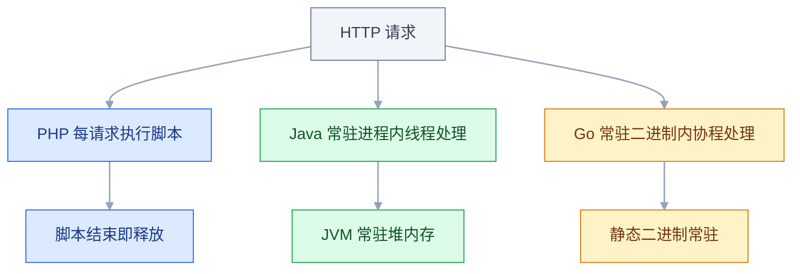
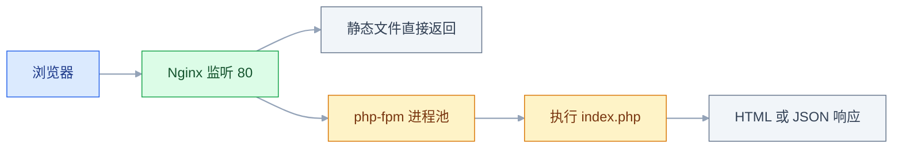
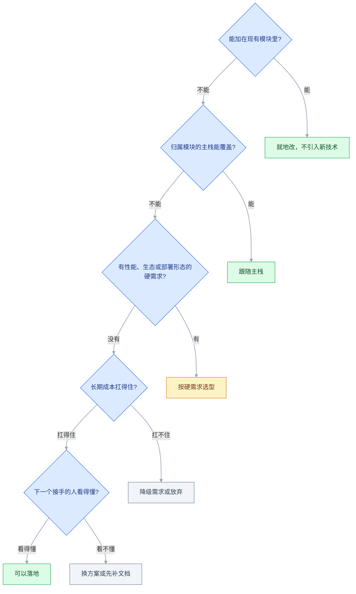

# 常用后端技术（存量与按需）

## 一、工程案例：接手一个四语言混编的老系统，交付三个小需求

**场景**：入职一家电商公司，接手跑了六年的 ShopMax。生产机 `10.0.0.12`，代码在 `/opt/shopmax/`，系统分三拨人做过，技术栈「比较杂」。没有架构文档，没有交接说明，只有一个能登录的 SSH 账号。

**目标**：两周内做到三件事——摸清每个模块是什么技术、改一个线上 PHP 接口、交付三个小需求（Go 健康检查、MongoDB 操作日志、ES 商品搜索）。这三件事覆盖了存量系统里绝大部分「非主栈」工作量。

**动手前确认**：生产机的只读账号、一台能装的测试机、`/opt/shopmax` 的 git 远端可写。改任何文件前先 `git status`，工作区不干净就先 `tar` 备份一份。

```text
/opt/shopmax/
├── web-shop/          # 商城前台：index.php + api/ + lib/
├── crm-service/       # 客户与订单服务：jar + source/
├── data-tools/        # 报表脚本：一堆 .py
└── deploy/            # Nginx 配置、部署脚本
```

### 1.1 盘点：四个观察点定位技术栈

**依赖文件 → 进程 → 端口 → 文件头**，四步交叉验证。依赖描述文件是语言的身份证，任何模块都藏不住。

```bash
# ① 依赖文件（排除 vendor，否则输出几千行）
find /opt/shopmax -maxdepth 3 -type f \
  \( -name "composer.json" -o -name "pom.xml" -o -name "requirements.txt" -o -name "go.mod" \) \
  -not -path "*/vendor/*" -not -path "*/node_modules/*"
# /opt/shopmax/web-shop/composer.json
# /opt/shopmax/crm-service/source/pom.xml

# ② 进程：正在跑什么、用什么跑的
ps -ef | grep -E "php-fpm|java|python|nginx" | grep -v grep
# www-data  1201  1  php-fpm: master process (/etc/php/8.2/fpm/php-fpm.conf)
# deploy    2233  1  java -jar /opt/shopmax/crm-service/crm-service-1.4.0.jar
# deploy    2450  1  /usr/bin/python3 /opt/shopmax/data-tools/report_job.py --loop
# root      1180  1  nginx: master process /usr/sbin/nginx

# ③ 端口：谁在监听、对外还是只给本机（普通用户看不到进程名，前面加 sudo）
ss -lntp | grep -E ":(80|8080)\b"
# LISTEN 0 128 127.0.0.1:8080 java     ← 只给 Nginx 反代，外网连不上

# ④ 文件头与目录结构，确认前面的判断
head -3 /opt/shopmax/web-shop/api/order_detail.php                  # <?php
unzip -l /opt/shopmax/crm-service/crm-service-1.4.0.jar | head -5    # 有 BOOT-INF/ 即 Spring Boot
```

| 模块 | 技术栈 | 入口 | 怎么启动 | 改完怎么生效 |
|---|---|---|---|---|
| web-shop | PHP 8.2 + Nginx | `web-shop/api/*.php` | php-fpm + Nginx | 刷新页面（OPcache 可能要 reload） |
| crm-service | Java 17 / Spring Boot | `crm-service-1.4.0.jar` | `java -jar` | 重新打包 + 重启 |
| data-tools | Python 3.11 | `report_job.py` | crontab / 手动 | 保存即生效，常驻进程要重启 |
| 整站入口 | Nginx | `/etc/nginx/conf.d/` | systemd | `nginx -t && nginx -s reload` |

### 1.2 改一个 PHP 接口：订单详情加「能否退款」

**需求**：订单详情要返回 `can_refund`，规则是**已支付、且支付时间在 7 天以内**。线上直接改是事故的常见起点，先在测试机 `/opt/shopmax` 下用 `php -S 127.0.0.1:8081 -t web-shop` 跑通：接口代码、`lib/db.php` 的连接配置、一份可写的 MySQL 测试库，三样齐了再动线上。

先看数据库封装，这段是读懂所有接口的钥匙：

```php
<?php
// lib/db.php
function getDb(): PDO
{
    static $pdo = null;                 // static：同一次请求内只连一次
    if ($pdo === null) {
        $dsn = 'mysql:host=' . (getenv('DB_HOST') ?: '127.0.0.1')
             . ';dbname=' . (getenv('DB_NAME') ?: 'shopmax') . ';charset=utf8mb4';
        $pdo = new PDO($dsn, getenv('DB_USER') ?: 'shop', getenv('DB_PASS') ?: 'shop123', [
            PDO::ATTR_ERRMODE            => PDO::ERRMODE_EXCEPTION,  // 出错抛异常，不是静默 false
            PDO::ATTR_DEFAULT_FETCH_MODE => PDO::FETCH_ASSOC,        // 结果默认关联数组
        ]);
    }
    return $pdo;
}
```

接口本体（已删掉与本需求无关的分支）：

```php
<?php
// api/order_detail.php   GET /api/order_detail.php?order_id=1
header('Content-Type: application/json; charset=utf-8');
require_once __DIR__ . '/../lib/db.php';

$orderId = isset($_GET['order_id']) ? (int) $_GET['order_id'] : 0;
if ($orderId <= 0) {
    http_response_code(400);
    echo json_encode(['code' => 400, 'msg' => '订单号不合法'], JSON_UNESCAPED_UNICODE);
    exit;
}
$stmt = getDb()->prepare('SELECT id, order_no, user_id, amount, status, pay_time
                          FROM t_order WHERE id = ?');
$stmt->execute([$orderId]);
$order = $stmt->fetch();
if (!$order) {
    http_response_code(404);
    echo json_encode(['code' => 404, 'msg' => '订单不存在'], JSON_UNESCAPED_UNICODE);
    exit;
}
$order['amount_yuan'] = round($order['amount'] / 100, 2);   // 库里存分，对外返回元
$statusMap = [0 => '待支付', 1 => '已支付', 2 => '已发货', 3 => '已完成', 4 => '已取消'];
$order['status_text'] = $statusMap[$order['status']] ?? '未知状态';
// ---- 新增：7 天内已支付可退款 ----
$canRefund = false;
if ($order['status'] == 1 && !empty($order['pay_time'])) {
    $canRefund = (time() - strtotime($order['pay_time'])) <= 7 * 24 * 3600;
}
$order['can_refund'] = $canRefund;
echo json_encode(['code' => 0, 'msg' => 'ok', 'data' => $order], JSON_UNESCAPED_UNICODE);
```

逐段对照 Java 心智：`header()` 是 `@RestController` 自动做的事；`require_once` 是 `import`；`$_GET` 是全局超级变量，不需要注入；`prepare` + `execute` + `fetch` 与 `PreparedStatement` 几乎一致；`json_encode` 是 Jackson；`??` 是空值兜底，键不存在也不报错。

造三条数据覆盖三种分支（空测试表上执行，显式写 `id`，后面的 `order_id=1/2/3` 才对得上）：

```sql
INSERT INTO t_order (id, order_no, user_id, amount, status, pay_time) VALUES
(1, 'SO20261001001', 'u1001', 39900, 1, '2026-10-19 10:20:00'),   -- 3 天前支付：可退
(2, 'SO20261001002', 'u1001', 12900, 0, NULL),                    -- 待支付：不可退
(3, 'SO20261001003', 'u1002', 59900, 1, '2026-09-12 09:00:00');   -- 40 天前支付：不可退
```

```bash
curl -s "http://127.0.0.1:8081/api/order_detail.php?order_id=1"
# {"code":0,"msg":"ok","data":{"id":1,"amount_yuan":399.0,"status_text":"已支付","can_refund":true}}
curl -s "http://127.0.0.1:8081/api/order_detail.php?order_id=2"
# ..."status_text":"待支付","can_refund":false
curl -s "http://127.0.0.1:8081/api/order_detail.php?order_id=3"
# ..."status_text":"已支付","can_refund":false
```

三条都符合规则。这里用 `==` 是刻意的：PDO 取出的 TINYINT 在不同驱动下可能是字符串 `"1"`，`===` 会判 false。**但比较字符串内容一律用 `===`**——PHP 8 收紧了字符串与数字的比较，`0 == "abc"` 在 PHP 7 是 `true`、PHP 8 是 `false`，升级时这类差异会成片暴露。

还有一个会悄悄改变结论的变量：**时区**。`strtotime()` 按 PHP 的 `date.timezone`（或 `date_default_timezone_set()`）解析 MySQL 返回的 `Y-m-d H:i:s` 字符串；PHP 与 MySQL 的时区不一致时（容器默认 UTC、库是 `+08:00` 就是典型），7 天边界会整体偏移。测试数据因此要补两条：第 7 天整、第 8 天整。

### 1.3 Go 健康检查：交叉编译 + systemd

**需求**：运维要一个独立小服务，`/health` 给监控轮询，返回服务名、运行时长、当前时间。

```go
package main

import (
	"net/http"
	"os"
	"time"

	"github.com/gin-gonic/gin"
)

var startTime = time.Now()

func main() {
	r := gin.Default()                       // 自带日志与 panic 恢复
	r.GET("/health", func(c *gin.Context) {
		c.JSON(http.StatusOK, gin.H{
			"status":    "UP",
			"service":   "ops-health",
			"uptime":    time.Since(startTime).Round(time.Second).String(),
			"timestamp": time.Now().Format(time.RFC3339),
		})
	})
	port := os.Getenv("PORT")                // 端口从环境变量取，多环境复用同一份二进制
	if port == "" {
		port = "9100"
	}
	r.Run(":" + port)
}
```

```bash
go mod init ops-health
go get github.com/gin-gonic/gin
CGO_ENABLED=0 GOOS=linux GOARCH=amd64 go build -ldflags="-s -w" -o health-check-linux .
file health-check-linux        # ELF 64-bit LSB executable, statically linked
```

`CGO_ENABLED=0` 产出完全静态链接的二进制，换台机器直接跑；`-ldflags="-s -w"` 去掉调试符号，体积小两成。**交叉编译的 `GOARCH` 必须和生产机 CPU 架构一致**，ARM 服务器上跑 amd64 产物会直接 `exec format error`。

```bash
ssh deploy@10.0.0.12 'mkdir -p /opt/shopmax/ops-health'   # scp 不会自动建目录
scp health-check-linux deploy@10.0.0.12:/opt/shopmax/ops-health/
ssh deploy@10.0.0.12 'chmod +x /opt/shopmax/ops-health/health-check-linux'
# 先手工试跑，看到 Listening and serving HTTP on :9100 再交给 systemd
```

```ini
# /etc/systemd/system/health-check.service
[Unit]
After=network.target

[Service]
WorkingDirectory=/opt/shopmax/ops-health
ExecStart=/opt/shopmax/ops-health/health-check-linux
Environment=PORT=9100
Restart=always
RestartSec=5
User=deploy

[Install]
WantedBy=multi-user.target
```

```bash
sudo systemctl daemon-reload && sudo systemctl enable --now health-check
curl -s http://127.0.0.1:9100/health
# {"service":"ops-health","status":"UP","timestamp":"2026-10-21T09:12:06+08:00","uptime":"5s"}
```

以后更新只有四步：改代码 → `go build` → scp 覆盖 → `systemctl restart health-check`。没有运行时依赖，也就没有「服务器上 JDK 版本不对」这类问题。

### 1.4 MongoDB 存操作日志：TTL 代替定时删除

**需求**：CRM 服务记录用户操作日志，按用户查最近 30 天、按关键词搜详情、只保留 90 天。日志量大、字段还会加、不需要 JOIN——用关系库要频繁改表，用文档库正合适。

```java
@Document(collection = "operation_logs")                    // ≈ @Table
@CompoundIndex(name = "idx_user_time", def = "{'userId': 1, 'createdAt': -1}")
public class OperationLog {
    @Id private String id;                                  // ObjectId 字符串
    private String userId;
    private String action;                                  // LOGIN / CREATE_ORDER / PAY
    private String detail;
    private Instant createdAt;
}
public interface OperationLogRepository extends MongoRepository<OperationLog, String> {
    Page<OperationLog> findByUserIdAndCreatedAtBetween(
            String userId, Instant from, Instant to, Pageable pageable);

    @Query("{ 'detail': { $regex: ?0, $options: 'i' } }")    // ?0 是第一个参数
    List<OperationLog> searchByDetail(String keyword);
}
```

```java
@PostMapping("/api/logs")
public OperationLog create(@RequestBody OperationLog log) {
    log.setCreatedAt(Instant.now());
    return repository.save(log);            // save 兼顾 insert / update
}

@GetMapping("/api/logs")                    // 验收第 6 项查的就是这个接口
public List<OperationLog> list(@RequestParam String userId,
                               @RequestParam(defaultValue = "0") int page) {
    Instant to = Instant.now();
    Instant from = to.minus(30, ChronoUnit.DAYS);            // 需求：只看最近 30 天
    Pageable pageable = PageRequest.of(page, 20, Sort.by(Sort.Direction.DESC, "createdAt"));
    return repository.findByUserIdAndCreatedAtBetween(userId, from, to, pageable).getContent();
}
```

```bash
curl -s -X POST http://localhost:8080/api/logs -H 'Content-Type: application/json' \
  -d '{"userId":"u1001","action":"LOGIN","detail":"用户从 10.0.0.8 登录"}'
# {"id":"6527b3c9...","userId":"u1001","action":"LOGIN","detail":"...","createdAt":"2026-10-21T01:30:12Z"}
```

90 天过期用 TTL 索引，一行配置，不写定时任务：

```javascript
db.operation_logs.createIndex({ createdAt: 1 }, { expireAfterSeconds: 7776000 })
```

MongoDB 的后台线程大约每分钟扫一次过期文档，所以**删除不是精确到秒的**，多留几分钟属于正常现象。`_class` 字段是 Spring Data 自动写进去的，别手动删。

### 1.5 商品搜索：从 LIKE 全表扫到 ES 倒排

**需求**：商城支持「机械键盘」这类关键词搜索。现有 SQL 是 `WHERE name LIKE CONCAT('%','机械键盘','%')`。

```bash
mysql -ushop -p shopmax -e "EXPLAIN SELECT id,name FROM t_product WHERE name LIKE '%机械键盘%' LIMIT 20;"
# | 1 | ALL | t_product | NULL | 998231 | ... | Using where |
time mysql -ushop -p shopmax -e "SELECT COUNT(*) FROM t_product WHERE name LIKE '%机械键盘%';"
# real 0m2.847s
```

`type=ALL`、`rows≈100 万`：开头的 `%` 让 B+ 树索引彻底失效，只能逐行扫。数据再涨一倍就不可用。

建索引时 `text` 与 `keyword` 的分工必须一次定对：

```bash
curl -k -u elastic:PASS -X PUT "https://es-node:9200/product" \
  -H 'Content-Type: application/json' -d '
{ "mappings": { "properties": {
    "id":    { "type": "long" },
    "name":  { "type": "text", "analyzer": "ik_max_word", "search_analyzer": "ik_smart" },
    "brand": { "type": "keyword" },
    "price": { "type": "double" } } } }'
```

`ik_max_word` 依赖 IK 插件，建索引前先确认节点装了它，否则请求直接报 `analyzer [ik_max_word] not found`：

```bash
curl -s -u elastic:PASS "https://es-node:9200/_cat/plugins?v" | grep analysis-ik
```

灌数据时先小批验证 mapping 与分词，再跑全量。`_bulk` 的格式是「一行 action、一行文档」，文件末尾必须有换行：

```bash
# products.ndjson 内容示例：
# {"index":{"_id":"1"}}
# {"id":1,"name":"机械键盘 87 键","brand":"KeyCo","price":399.0}
curl -s -u elastic:PASS -X POST "https://es-node:9200/product/_bulk?refresh=true" \
  -H 'Content-Type: application/x-ndjson' --data-binary @products.ndjson
```

`refresh=true` 只用于验证，全量导入时去掉它、按 5000 条一批灌，日常增量交给同步链路。

Java 侧用 Spring Data ES 的 `NativeQuery` + `multiMatch`（`fields("name^3","brand^2")`）即可，不必手写 JSON DSL。

```bash
time curl -s "http://localhost:8080/api/product/search?keyword=机械键盘&size=20"
# real 0m0.061s
```

| 数据量 | `LIKE '%kw%'` | ES multi_match |
|---|---|---|
| 1 万行 | 约 20ms | 约 15ms |
| 10 万行 | 约 300ms | 约 15ms |
| 100 万行 | 约 2.8s | 约 20–40ms |
| 1000 万行 | 分钟级，不可用 | 约 50ms（多分片并行） |
| 中文分词 | 不支持 | 支持（IK 插件） |
| 相关度排序 / 高亮 | 自己拼代码 | 原生支持 |
| 数据同步链路 | 不需要 | 必须建 |

> 耗时是 4C8G 单机的经验量级，实机用 `EXPLAIN` 和 `time` 自测。规律是确定的：**LIKE 随行数线性增长，ES 基本恒定**。代价是 ES 要吃内存（单节点 8G 起），还要维护 MySQL → ES 的同步链路。

### 1.6 验收（8 项全过才算交付）

| # | 检查项 | 命令或检查 | 通过标准 |
|---|---|---|---|
| 1 | PHP 模块可跑 | `php -S 127.0.0.1:8081 -t web-shop` + curl | 三个订单号的 `can_refund` 依次为 true/false/false |
| 2 | 线上 PHP 已生效 | `curl -H 'Cache-Control: no-cache' https://shop.example.com/api/order_detail.php?order_id=1` | 返回体含 `can_refund` |
| 3 | php-fpm 无错误 | `tail -50 /var/log/php8.2-fpm.log` | 无 `PHP Fatal error`、无 `pool www seems busy` |
| 4 | Go 服务自启 | `systemctl is-enabled health-check` + 重启一次 | `enabled`，重启后 `/health` 仍返回 UP |
| 5 | 二进制架构匹配 | `file health-check-linux` 与 `uname -m` | 两边同为 x86_64 或同为 aarch64 |
| 6 | 日志写入与查询 | `POST /api/logs` 后 `GET /api/logs?userId=u1001` | 新增记录出现在第一页 |
| 7 | TTL 索引存在 | `db.operation_logs.getIndexes()` | 有 `expireAfterSeconds: 7776000` |
| 8 | 搜索可用且分词正确 | 先搜「机械键盘」，再搜「键盘」 | 两次都命中，首条是键盘类商品；直接查 ES 时 `took` 在几十毫秒内 |

> 第 2 项最容易假通过：`curl` 打到了 CDN 缓存或旧容器。核对响应里的 `can_refund` 字段，而不是只看状态码 200。

---

## 二、高频问答：会卡住你的地方，也是面试最常问的

### 2.1 PHP 改完，页面一点变化都没有

**现场**

先用 `md5sum` 确认改的是线上那份文件，再看 OPcache 配置：`php -i | grep validate_timestamps`，值为 `Off` 就是它。

```bash
php -i | grep -E "opcache.enable|validate_timestamps"
sudo systemctl reload php8.2-fpm      # reload 重建 worker，加载新代码
```

**要点**

- 线上开了 OPcache 且 `opcache.validate_timestamps=0`，进程启动时把字节码缓存住，永不回查文件时间。
- 强刷只清浏览器，清不掉服务端进程内存里的字节码。
- 核实顺序：先确认文件，再看 OPcache，最后才怀疑缓存层。
- CLI 与 php-fpm 可能读不同的 ini 目录，`php -i` 看到的不一定是 FPM 的值，以 FPM 页面的 `phpinfo()` 为准。

**追问**

- 为什么 `reload` 就生效？→ 重建 worker，重新编译并加载代码。
- 生产该关 `validate_timestamps` 吗？→ 追求 QPS 的站点关，发布频繁的保持开启。
- OPcache 命中率低说明什么？→ 内存给小了，或缓存被频繁清空。

### 2.2 502 Bad Gateway

**现场**

`systemctl status php8.2-fpm`；`ss -lntp | grep 9000`；`tail /var/log/nginx/error.log`。

```bash
ss -lntp | grep 9000          # 无输出：fpm 没监听 9000，也可能用的是 unix socket
tail -20 /var/log/nginx/error.log   # connect() failed (111: Connection refused)
```

**要点**

- 502 是「网关连不上上游」，问题在上游不在 Nginx，反复改 `nginx.conf` 是改错了地方。
- `Connection refused` 是没起或端口错；`upstream timed out` 才是处理太慢（对应 504）。
- `server reached pm.max_children` 是进程池满了。
- 走 socket 时对应检查 `/run/php/php8.2-fpm.sock` 是否存在、属主是否为 nginx worker 用户。

**追问**

- 502 和 504 怎么分？→ 前者连不上，后者连上了但等不到响应。
- 池满怎么调？→ 按可用内存倒推 `pm.max_children`，不是直接调大。
- 为什么只改 Nginx 没用？→ 它只是转发，上游没起来怎么改都不通。

### 2.3 `Class 'App\Service\OrderService' not found`

**现场**

`composer dump-autoload -o` 后再试；`composer diagnose` 看映射。

```bash
composer dump-autoload -o
# 文件 src/Service/OrderService.php 必须对应命名空间 App\Service
# 目录叫 service（小写）而命名空间写 Service → Linux 上必挂，macOS 上能跑
```

**要点**

- `Class not found` 九成情况下文件就在那儿，是「自动加载器按规则拼出的路径」与实际路径不一致。
- PSR-4 映射与目录大小写不匹配，Linux 区分大小写。
- macOS 默认不区分大小写，本地永远复现不了，这是最典型的「本地好、线上炸」。
- 新增了类但没重新生成 autoload，也会表现成同一个错误。

**追问**

- 为什么 macOS 能跑？→ 文件系统不区分大小写，`service` 和 `Service` 是同一个目录。
- 改完映射要做什么？→ 跑一次 `composer dump-autoload -o`。
- 生产开 `-o` 有什么用？→ 生成 classmap，少做文件查找，但绕不过命名规范。

### 2.4 Go 改了源码，线上行为没变

**现场**

比对构建时间 `stat -c '%y' health-check-linux`（macOS 用 `stat -f '%Sm'`）与 `git log -1 --format=%ci`。

```bash
go build -o health-check-linux . && scp health-check-linux deploy@10.0.0.12:/opt/shopmax/ops-health/
ssh deploy@10.0.0.12 'sudo systemctl restart health-check'
```

**要点**

- Go 是编译型语言，服务器上跑的是旧二进制；只 scp 了源码或忘了重新 build，行为当然不变。
- 源码和进程之间隔着一次编译，Go 没有「热加载」。
- 核实方法：`strings health-check-linux | grep 本次新增的字段名`，搜不到就是没换包。

**追问**

- 为什么不能像 PHP 那样保存即生效？→ 机器码已固化，不重新编译不会变。
- 怎么确认线上跑的是哪一版？→ 构建时注入版本号，启动时打印出来。
- scp 覆盖后为什么还要重启？→ 替换文件不会换掉已在运行的进程。

### 2.5 二进制上传后 `cannot execute binary file`

**现场**

`file ./health-check-linux` 与 `uname -m` 对照。

```bash
uname -m                     # x86_64 → GOARCH=amd64；aarch64 → GOARCH=arm64
file health-check-linux      # 必须与上一行匹配
chmod +x health-check-linux
```

**要点**

- 交叉编译的 `GOARCH` 与服务器 CPU 架构不一致，或忘了 `chmod +x`。
- 文件是好的，只是 CPU 读不懂。
- 另一种更隐蔽的表现是 `no such file or directory`——那不是文件不存在，而是**动态链接器不存在**，说明编译时没关 CGO。

**追问**

- `x86_64` 和 `aarch64` 分别对应什么？→ `GOARCH=amd64` 和 `GOARCH=arm64`。
- 为什么关了 CGO 就能静态链接？→ 不再依赖 glibc。
- 两种报错怎么区分？→ `exec format error` 是架构不符，`no such file` 是缺动态链接器。

### 2.6 ES 中文搜不到，或者搜出来完全不相关

**现场**

`GET /product/_mapping` 看 `analyzer`；`POST /product/_analyze` 看实际切词结果。

```bash
curl -s -X POST "http://es-node:9200/product/_analyze" -H 'Content-Type: application/json' \
  -d '{"analyzer":"standard","text":"机械键盘"}'
# 切成 机/械/键/盘 四个 token，召回乱、评分低
```

**要点**

- mapping 用了 `standard` 分析器，中文被切成单字。
- 字段被动态映射成 `keyword`，整句当一个词。
- 搜不到不一定是没数据，可能是「存进去时切错了词」。
- mapping 一旦建好，已有字段的分析器不能直接改，只能新建索引 + `_reindex` + 别名切换。

**追问**

- `ik_max_word` 和 `ik_smart` 怎么分工？→ 写入用细的，查询用粗的。
- 为什么不能直接改 mapping？→ 倒排已经按旧分词建好了。
- 别名切换解决什么？→ 重建索引时零停机。

### 2.7 MongoDB 查询慢

**现场**

`explain("executionStats")` 看 `stage` 是否 `COLLSCAN`、`docsExamined` 与返回条数的比值。

```javascript
db.operation_logs.find({ userId: "u1001" }).explain("executionStats")
// COLLSCAN → 全集合扫；IXSCAN 且 totalDocsExamined ≈ nReturned → 正常
```

**要点**

- 没建索引、`$regex` 没有前缀锚点，或查询字段类型与存储类型不一致（字符串查数字）。
- 分片解决写入与容量，不解决单条查询没走索引。
- `$regex: "^关键词"` 能用索引，`$regex: "关键词"` 不能，和 `LIKE '%kw%'` 同一个道理。
- 复合索引等值条件在前，范围与排序在后。

**追问**

- `COLLSCAN` 说明什么？→ 全集合扫描，索引没用上。
- 类型不一致怎么发现？→ `docsExamined` 远大于 `nReturned`，且字段存的是字符串却拿数字查。
- 分片键怎么选？→ 高基数、写入分散、查询常带。

### 2.8 gRPC 调用报 `UNAVAILABLE` 或字段值串位

**现场**

`grpcurl -plaintext host:50051 list` 能否列出服务；`git diff` 看编号有无改动。

```bash
grpcurl -plaintext 10.0.0.12:50051 list
grpcurl -plaintext -d '{"text":"这个商品很好用"}' 10.0.0.12:50051 ai.AiService/AnalyzeSentiment
```

**要点**

- `UNAVAILABLE` 多数是连不上或协议不匹配：端口、明文配置不对（缺 `usePlaintext()` 时客户端尝试 TLS）。
- 字段串位根本不报错，只是数据悄悄错。
- 根因是改 `.proto` 时**复用了已有字段编号**，两端按不同定义解析同一段二进制。
- 字段编号是永久契约，只能新增不能改号，删字段用 `reserved` 占位。

**追问**

- 为什么改号不报错？→ 二进制里只有编号，没有字段名。
- 怎么发现串位？→ 对比两端 proto 的编号与类型。
- 兼容性怎么保证？→ 只增不改，删了用 `reserved` 占位。

### 2.9 老依赖的已知漏洞与 JDK 升级后的反射失效

**现场**

`mvn dependency:tree` 找版本；`jdeps --jdk-internals app.jar` 列非法内部依赖；启动日志搜 `IllegalAccessError`。

```bash
mvn dependency:tree -Dincludes=log4j:log4j,org.apache.logging.log4j   # 1.x 与 2.x 的 groupId 不同
jdeps --multi-release 17 --jdk-internals crm-service.jar | head -30
# 临时缓解（不是修复）：--add-opens java.base/java.lang=ALL-UNNAMED
```

**要点**

- 已公告停止维护的组件不再有补丁（Log4j 1.x、PHP 5.x 等，生命周期以官方公告为准）。
- fastjson 1.x 历史上多次出现反序列化漏洞，是否仍在维护以官方公告为准。
- JDK 16 起默认强封装内部 API，JDK 17 移除 `--illegal-access`，老框架靠反射改 `sun.*` 会直接抛 `InaccessibleObjectException`。
- 「没出事」只说明还没被扫到。

**追问**

- `--add-opens` 算修复吗？→ 不算，只是临时缓解。
- 升级顺序怎么排？→ 先换有 CVE 的，再换挡在 JDK 升级路上的，一次只动一层。
- 怎么确认内部依赖？→ `jdeps --jdk-internals` 列出来。

### 2.10 手工能跑，crontab 里就是跑不起来

**现场**

`data-tools/report_job.py` 手工执行正常，挂进 crontab 就报 `ModuleNotFoundError` 或连不上数据库。临时加一条 `* * * * * env > /tmp/cron.env`，与登录 shell 的 `env` 逐项对比。

```bash
crontab -l
# 绝对路径 + 显式 cd + 重定向，三样都要
0 2 * * * cd /opt/shopmax/data-tools && /usr/bin/python3 report_job.py >> /opt/shopmax/logs/report_job.log 2>&1
```

**要点**

- cron 用 `/bin/sh` 执行，不读 `.bashrc` / `.profile`。
- `PATH` 通常只有 `/usr/bin:/bin`，工作目录是用户 home，`export` 的密码与虚拟环境全都不在。
- 交互式 shell 的环境是启动脚本拼出来的，cron 不参与这个过程。
- 解释器、脚本、配置、日志四处都写成绝对路径；密码一类变量放权限 600 的配置文件，或改用 systemd timer 的 `EnvironmentFile`。

**追问**

- 为什么手工跑就正常？→ 手工 shell 有完整的环境变量。
- 用虚拟环境怎么写？→ 写 `/opt/venv/bin/python` 绝对路径。
- systemd timer 比 cron 好在哪？→ 有 `EnvironmentFile`，日志进 journald。

---

## 三、核心知识：从零开始要建立的东西

### 3.1 三种运行模型

同一段业务逻辑，三种语言放在三个不同的位置执行。理解这张图，就能理解「改完为什么没生效」。



| | PHP | Java | Go |
|---|---|---|---|
| 代码形态 | 脚本，请求结束即销毁 | 字节码，JVM 常驻 | 机器码，进程常驻 |
| 改完生效 | 下次请求（受 OPcache 影响） | 重新打包 + 重启 | 重新编译 + 替换二进制 |
| 内存泄漏风险 | 极低（进程回收） | 有，需监控堆 | 有，但通常更慢 |
| 不适合 | 长连接、常驻任务 | 极小工具、冷启动敏感场景 | 复杂业务快速堆功能 |

> **面试**：常问「PHP、Java、Go 的代码什么时候生效？」答：PHP 下次请求，受 OPcache 影响；Java 重新打包重启；Go 重新编译替换二进制。

### 3.2 PHP 的语法骨架

存量项目八成的改动是「加个字段、改个判断」，认识下面这些就够读代码：

```php
<?php
$name = "张三";                            // 变量以 $ 开头，不声明类型
$tags = ["数码", "键盘"];                   // 数组即 List
$user = ["id" => 1, "name" => "张三"];      // 数组即 Map
echo "你好，" . $name;                      // 拼接用点，不是加号
$page = $_GET['page'] ?? 1;                 // 键不存在时取默认值
function calcPrice($price, $discount = 0.9) { return round($price * $discount, 2); }
```

| 概念 | PHP | Java |
|---|---|---|
| 变量 | `$price = 399;` 弱类型 | `double price = 399;` |
| 字符串拼接 | `"a" . $b` | `"a" + b` |
| 列表 / 映射 | `[1,2,3]` / `["id"=>1]` | `List.of` / `Map.of` |
| 取长度 | `count($list)` | `list.size()` |
| 访问属性 | `$user->name` | `user.getName()` |
| 静态方法 | `User::find(1)` | `User.find(1)` |
| 命名空间 | `namespace A\B;` + `use` | `package` + `import` |

三条口诀：`->` 读作「的」（`$order->amount` 就是 `order.getAmount()`）；`::` 是静态成员；`=>` 是键值对应（`["id"=>1]` 就是 `{"id":1}`）。

### 3.3 Composer 与 PSR-4 自动加载

| | Composer | Maven |
|---|---|---|
| 依赖描述 | `composer.json` | `pom.xml` |
| 锁定版本 | `composer.lock`（应用项目**必须进 git**） | 无直接等价物 |
| 依赖目录 | `vendor/`（**不进 git**） | 本地 `.m2` 仓库 |
| 安装 | `composer install`（严格按 lock） | `mvn dependency:resolve` |
| 新增 | `composer require 包名` | 改 pom |

```json
{
  "require": { "monolog/monolog": "^3.5", "php": ">=8.1" },
  "autoload": { "psr-4": { "App\\": "src/" } }
}
```

`psr-4` 是「命名空间前缀 → 目录」的映射：写了 `"App\\": "src/"`，`App\Service\OrderService` 就自动对应 `src/Service/OrderService.php`，不需要手写 `require`。**映射错、大小写错、没跑 `dump-autoload`，都会表现为 `Class not found`**，而文件其实一直在那儿。

### 3.4 php-fpm 与 Nginx 的分工



```nginx
location ~ \.php$ {
    fastcgi_pass  127.0.0.1:9000;        # Docker 里写 php:9000
    fastcgi_param SCRIPT_FILENAME $document_root$fastcgi_script_name;
    include       fastcgi_params;
}
```

php-fpm 存在的理由是**省掉每次 fork 进程的开销**：预启动一批 worker，请求来了分配一个，处理完归还。所以 `pm.max_children` 决定并发上限，配小了排队、配大了吃光内存。Docker 部署时 `fastcgi_pass` 写容器名（如 `php:9000`），代码目录要同时挂给 nginx 和 php 两个容器。

### 3.5 OPcache 与代码生效时机

| 配置 | 作用 | 典型值 |
|---|---|---|
| `opcache.enable` | 是否启用字节码缓存 | `1` |
| `opcache.validate_timestamps` | 是否回查文件修改时间 | 生产常设 `0` |
| `opcache.revalidate_freq` | 回查间隔（秒，仅上一项为 `1` 时生效） | `2` |
| `opcache.memory_consumption` | 缓存可用内存 | `128`（MB） |

`validate_timestamps=0` 换来的是「省掉每次请求的 stat 系统调用」，代价是**改代码必须 reload php-fpm**。这是明确的取舍：追求极致 QPS 的站点关掉它，发布频繁的站点保持开启。命中率看 `opcache_get_status()`，低于 99% 说明内存给小了或缓存被频繁清空。

> **面试**：常问「为什么改了 PHP 代码页面没变？」答：`validate_timestamps=0` 时进程不查文件时间，要 reload php-fpm。

### 3.6 Go 的编译交付与交叉编译

| 行为 | Go | Java |
|---|---|---|
| 交付物 | 单个二进制（10–20MB） | jar + 目标机装 JRE |
| 服务器依赖 | 无（静态链接时） | JDK/JRE |
| 改代码后 | 必须重新编译部署 | 重新打包重启 |
| 内存 / 启动 | 十几 MB / 毫秒级 | 数百 MB / 秒级 |

```bash
CGO_ENABLED=0 GOOS=linux GOARCH=arm64 go build -ldflags="-s -w" -o app .
```

三个变量各管一件事：`CGO_ENABLED=0` 断掉对 glibc 的依赖，`GOOS/GOARCH` 决定目标平台，`-ldflags="-s -w"` 瘦身。**只要有一个不对，产物在服务器上就是「跑不起来」而不是「跑得不对」**，报错还很误导（`no such file or directory` 其实是缺动态链接器）。

### 3.7 Go 的错误返回值与并发

Go 没有 `try/catch`，错误是普通返回值，一层层往上带：

```go
func loadConfig(path string) (string, error) {
	data, err := os.ReadFile(path)
	if err != nil {
		return "", fmt.Errorf("读取配置失败: %w", err)   // %w 保留原始错误链
	}
	return string(data), nil
}
```

看到 `if err != nil { return err }` 就理解成「这里 Java 会 try 一块然后 catch」。`%w` 相当于 `new RuntimeException("...", e)`，用 `errors.Is/As` 判断链上的具体错误。

`go func(){ ch <- "任务完成" }()` 开协程，`<-ch` 阻塞取结果。goroutine 初始栈只有几 KB、按需增长，单进程跑十万级 goroutine 并不罕见；Java 线程一个默认就是 MB 级。channel 相当于语言内置的 `BlockingQueue`，但它解决的是「通信」，不是「共享内存加锁」。

### 3.8 Flask 与 FastAPI 的取参方式

| | Flask | FastAPI |
|---|---|---|
| 定位 | 微框架 | 现代异步 API 框架 |
| 并发模型 | 同步（WSGI） | 异步（ASGI） |
| 路径参数 | `<int:pid>` | `{pid}` + 类型注解 |
| 查询参数 | `request.args.get(...)` | 函数参数 `kw: str = ""` |
| 请求体校验 | `get_json()` + 手写 if | Pydantic 自动校验，失败返回 422 |
| 自动文档 | 无 | 自带 `/docs` |
| 生产运行 | `gunicorn -w 4 app:app` | `uvicorn app:app --workers 4` |

口诀：**Flask 是从请求对象里取东西，FastAPI 是把要的东西声明成函数参数**。Django 是全家桶，自带 ORM、Admin、认证，适合要管理后台的完整站点。

### 3.9 MongoDB 的文档模型

| 维度 | MySQL | MongoDB |
|---|---|---|
| 数据单位 | 行 | 文档（单条上限 16MB） |
| 结构约束 | 建表固定列，改结构要 DDL | 无固定 schema，每条可不同 |
| 关联 | JOIN | 内嵌子文档 / `$lookup` |
| 事务 | 默认强事务 | 支持多文档事务，但一般不靠它 |

| 判断 | 选 MySQL | 选 MongoDB |
|---|---|---|
| 数据结构 | 稳定、字段固定 | 灵活、频繁加字段 |
| 事务 | 转账、库存、账务 | 单文档原子性就够 |
| 查询 | 多表关联、复杂报表 | 按主键或几个字段取整条 |

务实结论：**核心交易放 MySQL，日志/内容/快照放 MongoDB**，两者共存是最常见架构。不适合的场景同样明确：强事务的金融账务、大量 JOIN 的报表、需要严格外键的核心数据。

### 3.10 MongoDB 的索引与 TTL

```javascript
db.operation_logs.createIndex({ userId: 1, createdAt: -1 })        // 复合索引，顺序有讲究
db.operation_logs.createIndex({ createdAt: 1 }, { expireAfterSeconds: 7776000 })

db.operation_logs.find({ userId: "u1001", createdAt: { $gte: ISODate("2026-09-21") } })
  .sort({ createdAt: -1 }).limit(20)
```

复合索引的字段顺序必须匹配查询：**等值条件在前，范围与排序在后**。`{userId:1, createdAt:-1}` 能同时服务「按用户过滤 + 按时间倒序」，反过来建就只能用到一半。

TTL 索引是单字段、后台线程扫描、大约每分钟一轮，所以过期删除有延迟。它只对**日期类型**字段有效，存成字符串的时间不会被清理——这是「TTL 没生效」最常见的原因。

> **面试**：常问「MongoDB 的 TTL 索引为什么不删数据？」答：只认日期类型字段，存成字符串不会被清理，且后台扫描有一分钟级延迟。

### 3.11 Elasticsearch 的倒排索引与分词

`LIKE '%kw%'` 慢的根因是 B+ 树只能按前缀找。ES 换了个方向：先把文本切成词，再建「词 → 文档 id」的表。

| 文档 | 分词结果 |
|---|---|
| 机械键盘 87 键 | 机械 / 键盘 / 87 / 键 |
| 机械键盘轴体 | 机械 / 键盘 / 轴体 |

搜「键盘」直接跳到这两条，不用扫全表，还能按匹配度打分。

| 字段类型 | 是否分词 | 用途 |
|---|---|---|
| `text` | 是 | 全文检索，`name`、`description` |
| `keyword` | 否 | 精确匹配、聚合、排序，`brand`、`status` |

中文必须装 IK 插件：写入用 `ik_max_word`（切得细，召回高），查询用 `ik_smart`（切得粗，精度高）。默认 `standard` 把中文按单字切，召回混乱、评分失真。另一个必须记住的点是**近实时**：写入后默认 1 秒才可搜，`refresh_interval` 调大能提升写入吞吐，代价是可见延迟变长。

### 3.12 GraphQL 的查询与代价

```graphql
query { product(id: "1") { name price brand { name } } }
```

一个端点、客户端声明字段，解决了 REST 的 over-fetching（返回一堆用不上的字段）和 under-fetching（一个页面请求三次）。

| | REST | GraphQL |
|---|---|---|
| 端点 | 每个资源一个 URL | 统一 `/graphql` |
| 返回字段 | 服务端决定 | 客户端精确指定 |
| 多资源 | 多次请求 | 一次嵌套取 |
| 治理成本 | 低 | 高（限流、复杂度限制、N+1） |

核心概念四个：Schema（类型契约）、Query（读）、Mutation（写）、Resolver（每个字段怎么取数）。Resolver 按字段执行，嵌套列表很容易变成 N+1 查询，必须配 DataLoader 批量合并。国内落地主要在「多端 + BFF 聚合层」，新项目没有明确经验不要轻易选。

### 3.13 gRPC 与 Protobuf 的契约

```text
gRPC = HTTP/2（传输） + Protobuf（序列化） + .proto（接口定义 + 代码生成）
```

```proto
syntax = "proto3";
package ai;

service AiService {
  rpc AnalyzeSentiment (AnalyzeRequest) returns (AnalyzeReply);
}
message AnalyzeRequest { string text = 1; }        // 数字是字段编号，永久契约
message AnalyzeReply   { string label = 1; float score = 2; }
```

| 维度 | REST + JSON | gRPC |
|---|---|---|
| 协议 | HTTP/1.1 | HTTP/2（多路复用、流式） |
| 消息 | 文本，可读 | 二进制，体积小 |
| 契约 | OpenAPI 可选 | **必须有 .proto** |
| 客户端 | 手写 | 从 proto 生成 |
| 浏览器 | 原生支持 | 需 grpc-web + 代理 |

适用边界很清楚：**内部服务之间**用 gRPC（性能、强契约、跨语言），**对外 API** 用 REST（浏览器友好、网关兼容、好调试）。字段编号只增不改，删字段用 `reserved` 占位，否则老客户端会把新字段解析成旧含义——这类错误不报异常，只是数据悄悄错位。

> **面试**：常问「gRPC 改 proto 时字段编号能改吗？」答：不能，编号是永久契约，只能新增，删字段用 `reserved` 占位。

### 3.14 技术选型的判断顺序

五个问题按顺序问，前一个能定就不看后面：



1. 能加在现有模块里吗？能，就不引入新技术；
2. 归属模块的主栈是什么？跟随，别用另一门语言重写；
3. 有没有硬需求？性能、生态（AI/搜索）、部署形态（CLI/K8s）；
4. 长期成本扛得住吗？部署、监控、招人、培训；
5. 下一个接手的人看得懂吗？

| 需求类型 | 首选 | 理由 |
|---|---|---|
| 商城前台页面 / 接口 | PHP（跟随现有） | 存量模块改动成本最低 |
| 内部管理后台 | Java / Spring Boot | 团队主栈、权限体系现成 |
| 高并发网关 / 边缘服务 | Go | 内存小、并发强、单文件部署 |
| 运维 CLI 工具 | Go | 编译成单文件，拷贝即用 |
| 数据分析 / 报表 / 爬虫 | Python | 生态最强 |
| 结构化日志存储 | MongoDB | 按用户和时间查，结构灵活 |
| 全文搜索 / 商品搜索 | Elasticsearch | 分词、评分、高亮 |
| 内部服务互调 | gRPC | 强契约、高性能、跨语言 |
| 对外开放 API | REST | 通用、好调试、网关兼容 |
| 多端字段差异大的聚合层 | GraphQL（慎重） | 团队有经验才上 |

三个真实需求走一遍：CMS 后台加「导出订单 Excel」——能加在 PHP 模块里、量小、无硬需求，`composer require phpoffice/phpspreadsheet`，半天完成；日均 500 万条操作日志——写入量单实例轻松、只要结构化查询、90 天保留用 TTL，选 MongoDB；Python 推荐模型给 Java 调用且延迟敏感——跨语言加低延迟是硬需求，选 gRPC，若只是每天凌晨批量跑一次，Python 脚本直接写库即可，连服务都不用起。

---

## 四、冷门知识汇总

这里只放低频、单项成本低、遇到后查关键词就能解决的东西。会造成不可逆后果的少数几项（旧依赖 EOL、Protobuf 改号、TTL 建在字符串字段上）已在对应小节展开，这里只留关键词备查。

| 知识点 | 为什么冷门 | 用到时的关键词 |
|---|---|---|
| PHP-FPM 进程池调参 | 默认配置能跑，只有压测或 502 频发时才回头看 | `pm=dynamic`、`pm.max_children`、`request_terminate_timeout` |
| OPcache 命中率 | 平时不关注，QPS 上不去才查 | `opcache_get_status()`、`memory_consumption` |
| PHP 弱类型比较变更 | 只在跨版本升级时成片爆发 | `==` 与 `===`、PHP 8 字符串数字比较 |
| PHP 8 移除的旧语法 | 老代码升级时才撞上 | `each()`、`$str{0}`、`create_function` |
| PHP 与 MySQL 时区不一致 | 平时一致，容器化后才差 8 小时 | `date.timezone`、`date_default_timezone_set`、`CONVERT_TZ` |
| Go module 代理与私有库 | 一次配好长期不用管 | `GOPROXY`、`GOPRIVATE`、`GONOSUMDB` |
| Go context 传递 | 代码里到处是，但很少人系统理解 | `context.WithTimeout`、取消传播 |
| gunicorn worker 模型 | 部署脚本里一行参数，出事才研究 | `-w`、`-k gthread`、`--timeout` |
| MongoDB 聚合管道 | CRUD 够用，做统计才需要 | `$match`、`$group`、`$lookup`、`$unwind` |
| MongoDB 副本集与分片键 | 单机开发永远遇不到 | `rs.initiate()`、`sh.shardCollection` |
| ES 别名零停机重建 | 只在重建索引时用一次 | `_aliases`、`_reindex`、`refresh_interval` |
| ES 分片规划 | 建索引时一次决定，之后难改 | 单分片 10–50GB、副本数 |
| ES `_bulk` 的 NDJSON 格式 | 手写容易漏末尾换行，报错不直观 | `application/x-ndjson`、一行 action 一行文档 |
| Canal / Debezium | 需要同步链路时才引入 | binlog 订阅、`ROW` 格式 |
| Protobuf 兼容规则 | 改 proto 时最容易忽略 | `reserved`、字段编号只增不改 |
| gRPC 超时与重试 | 默认无超时，出雪崩才发现 | `deadline`、`retryPolicy`、round_robin |
| GraphQL N+1 | 数据量小的时候看不出来 | DataLoader、查询复杂度限制 |
| OpenTelemetry | 新建体系直接选它，老系统还在用私有 agent | OTLP、auto-instrumentation |
| 遗留系统绞杀者模式 | 没人愿意整体重写时才用得上 | Strangler Fig、新老并行、流量切分 |
