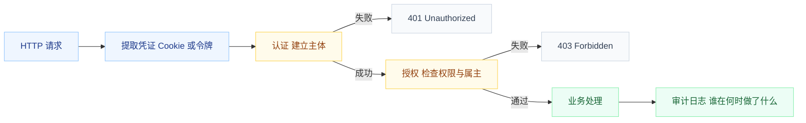
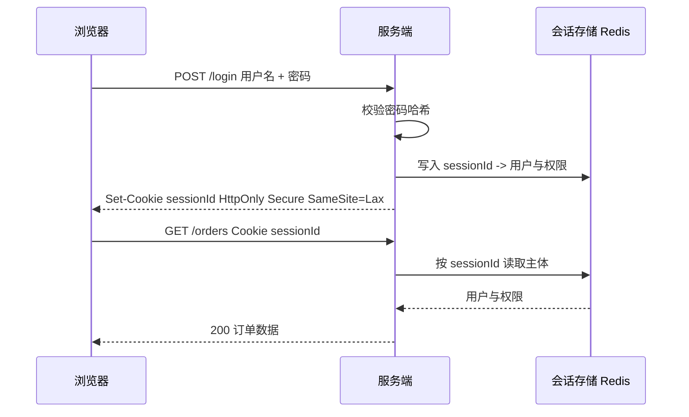
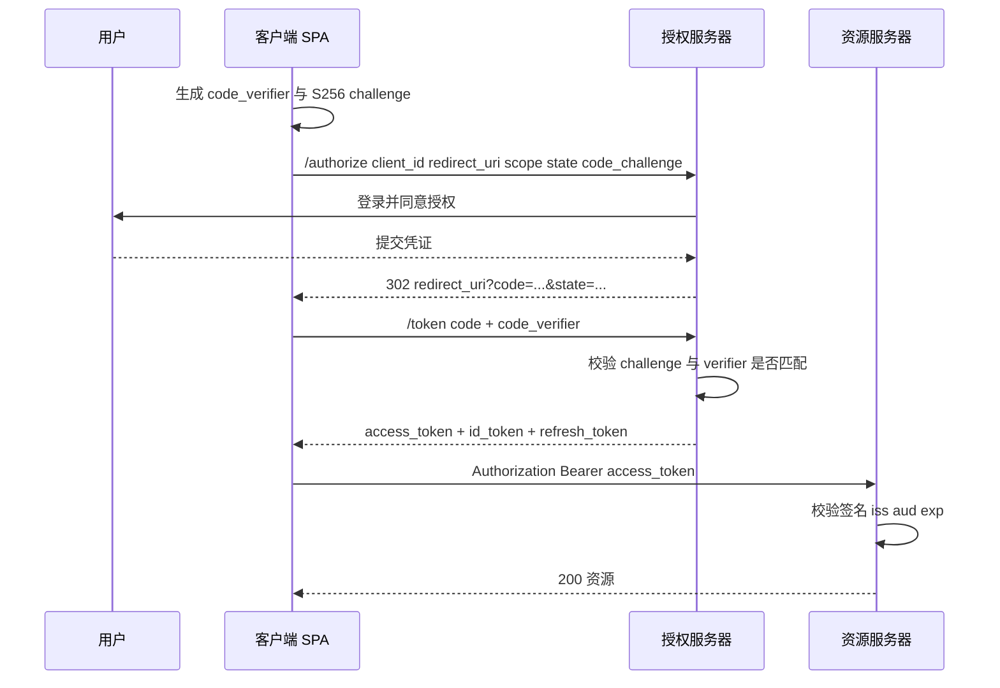
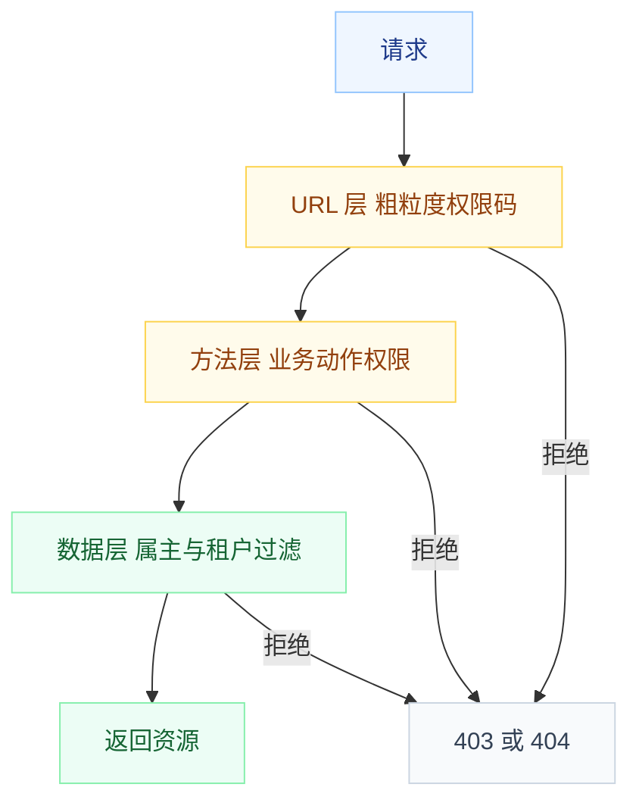

# 认证与授权

> 这篇从认证、授权与审计三个动作的分界讲起，经过密码存储、会话与令牌两种状态模型、JWT 的结构与生命周期、OAuth 2.1 与 OIDC 的委托授权、RBAC/ABAC 权限模型，最后落到水平与垂直越权的防御，以及一个只用标准库就能复现的完整验证案例。
>
> 学完能为一个接口系统选定会话或令牌方案、设计可撤销的令牌生命周期、按角色与属性划分权限，并能判断 401 与 403 分别出在哪一层、越权漏洞该在哪一层补。

## 一、认证、授权与审计的分界

认证（Authentication）回答“请求是谁发的”，授权（Authorization）回答“这个身份能做什么”，审计（Auditing）回答“实际做了什么”。三者共享同一个身份对象，但失败语义和实现位置完全不同，混在一起写是安全问题的常见起点。



401 与 403 的分界是排查时最先看的一行：

| 状态 | 含义 | 典型原因 |
|---|---|---|
| 401 | 没有有效身份 | 未带凭证、令牌过期、签名错误 |
| 403 | 身份有效但无权 | 角色不足、非资源属主 |
| 404 | 资源不存在或刻意隐藏 | 越权查询时防止探测 |

认证失败时不要区分“用户不存在”和“密码错误”，两者返回同一个 401 和同一段文案，否则接口变成用户名枚举工具。授权失败时是否返回 404 取决于资源存在性是否敏感：订单、文档这类资源用 404 隐藏存在性更安全，管理端接口用 403 便于定位。

### 1.1 凭证、标识与主体

凭证（Credential）是证明身份的材料，标识（Identifier）是身份的名字，主体（Principal）是服务端认证后建立的身份对象。登录时提交的是标识加凭证，后续请求携带的是凭证的引用（会话 ID 或令牌），主体只在服务端存在。

| 凭证形态 | 例子 | 主要风险 |
|---|---|---|
| 口令 | 密码、PIN | 撞库、离线爆破 |
| 持有物 | TOTP、硬件密钥、手机 | 丢失、钓鱼代理 |
| 生物特征 | 指纹、面容 | 不可更换、本地比对 |
| 会话 ID | Cookie 里的随机串 | 劫持、固定、CSRF |
| 访问令牌 | JWT、不透明令牌 | 泄露、撤销滞后 |

多因素认证（MFA）要求组合两类以上凭证，单靠“密码加验证码”不算：短信验证码属于持有物，但与密码同属可远程提交的因素，对实时钓鱼代理的防护有限。NIST SP 800-63B 把认证强度分为 AAL1、AAL2、AAL3，AAL3 要求硬件密钥或证书这类抗钓鱼因素。

> 边界：认证只建立“是谁”，不产生任何权限。登录成功的用户默认没有任何业务权限，权限必须由授权层单独授予；反过来，隐藏前端按钮、给 URL 加随机后缀都不是授权。

技术口径固定在 2026-11-13：OAuth 2.1 草案（draft-ietf-oauth-v2-1）、OIDC Core 1.0、NIST SP 800-63B-4、OWASP ASVS 5.0、RFC 9106（Argon2id）。协议版本变化时先核对草案差异，再改实现。

## 二、密码：存储、比对与在线猜测防护

密码只能以慢哈希（slow hash）形式存储，任何可逆加密、任何快速哈希（MD5、SHA-1、单次 SHA-256）都不合格。加密意味着系统持有密钥、可还原明文；快速哈希意味着攻击者拿到库后每秒能试上亿次。

慢哈希通过可调的计算成本对抗离线爆破，并给每个密码加随机盐，使相同密码产生不同摘要、彩虹表失效：

| 算法 | 关键参数 | 适用 |
|---|---|---|
| Argon2id | 内存 64 MiB、迭代 3、并行 1 | 新系统首选 |
| bcrypt | cost 10–12 | 生态成熟、兼容性好 |
| scrypt | N=2^14、r=8、p=1 | 内存受限环境 |
| PBKDF2-HMAC-SHA256 | 迭代 600000 | FIPS 合规场景 |

Python 标准库的 `hashlib` 提供 PBKDF2（scrypt 是否可用取决于编译时依赖的 OpenSSL），用它可直接验证“加盐 + 慢哈希 + 常数时间比较”三个要点：

```python
import hashlib
import hmac

ITERATIONS = 600_000  # OWASP 对 PBKDF2-HMAC-SHA256 的最低建议值


def hash_password(password: str, salt: bytes) -> str:
    # 盐必须随机且与摘要一起存储；盐的作用是让相同密码得到不同结果
    dk = hashlib.pbkdf2_hmac("sha256", password.encode(), salt,
                             ITERATIONS, dklen=32)
    return salt.hex() + "$" + dk.hex()


def verify_password(password: str, stored: str) -> bool:
    salt_hex, dk_hex = stored.split("$")
    got = hashlib.pbkdf2_hmac("sha256", password.encode(),
                              bytes.fromhex(salt_hex), ITERATIONS, dklen=32)
    # 常数时间比较，避免逐字节短路比较泄露匹配前缀
    return hmac.compare_digest(got, bytes.fromhex(dk_hex))
```

```text
# 示例：两次哈希同一密码，盐不同则摘要不同
salt1 = os.urandom(16); salt2 = os.urandom(16)
hash_password("Passw0rd!", salt1) != hash_password("Passw0rd!", salt2)  -> True
verify_password("Passw0rd!", hash_password("Passw0rd!", salt1))        -> True
verify_password("wrong",     hash_password("Passw0rd!", salt1))        -> False
```

密码策略按 NIST SP 800-63B 的口径执行：优先长度（至少 8 位，管理端建议 12 位以上），不强制大小写数字符号的组合，不做周期性强制更换；用泄露密码库比对（如 HIBP 的 k-anonymity 接口）拒绝已泄露口令；限制单账号与单 IP 的尝试次数，并对登录接口做统一延迟。

在线猜测分三类，防护手段不同：

| 攻击 | 特征 | 防护 |
|---|---|---|
| 撞库 | 用其他站点泄露的账号密码批量试 | 泄露库比对、MFA |
| 密码喷洒 | 同一弱密码试大量账号 | 按 IP 与网段限速 |
| 离线爆破 | 拿到哈希后本地计算 | 慢哈希、足够成本参数 |

> 边界：bcrypt 只处理前 72 字节，超长密码要先做一次 SHA-256 再交给 bcrypt，否则同前缀的不同密码会被判为相同；重置密码令牌、API Key、会话 ID 同样只能存哈希，数据库泄露时不能直接拿来登录。

## 三、会话与令牌：状态放在哪一侧

会话（Session）把状态放在服务端，浏览器只持有一个随机会话 ID；令牌（Token）把状态编码进凭证本身，服务端只验签不存记录。这个位置差异决定了两者在扩容、撤销和失效上的全部区别。

Cookie 会话的完整链路：



会话 ID 必须是密码学随机数（至少 128 位），登录成功后立刻换发新 ID，防止会话固定（Session Fixation）：攻击者先把自己的会话 ID 塞给受害者，受害者登录后该 ID 就绑定了受害者身份。

Cookie 的安全属性缺一不可：

| 属性 | 作用 | 漏配后果 |
|---|---|---|
| `HttpOnly` | JS 不可读 | XSS 可直接偷会话 |
| `Secure` | 只走 HTTPS | 明文网络被截获 |
| `SameSite=Lax` | 跨站写请求不带 Cookie | CSRF 风险 |
| `Path=/app` | 缩小作用域 | 同域其他应用共享 |
| `Max-Age` | 控制存活时间 | 会话永久有效 |

会话的失效要同时管三种时间：空闲超时（如 30 分钟无操作失效）、绝对超时（如 12 小时必须重新登录）、以及敏感操作前的二次认证。修改密码、变更角色、管理员禁用账号时，必须让该用户所有会话立即失效，做法是给用户表加一个 `session_version`，会话里记录签发时的版本号，版本不匹配即拒绝。

多实例部署时，会话要么存 Redis 共享，要么用粘性会话；粘性会话在滚动发布和扩容时会丢会话，只适合过渡。令牌天然没有这个问题，代价是撤销。

| 维度 | 服务端会话 | 自包含令牌 |
|---|---|---|
| 状态位置 | 服务端存储 | 凭证内部 |
| 扩容 | 需共享存储 | 天然水平扩展 |
| 撤销 | 删记录即生效 | 需短 TTL 或黑名单 |
| 每请求开销 | 一次存储查询 | 一次签名校验 |
| 适用 | 同域 Web、BFF | 开放 API、移动端、微服务 |

> 边界：单体同域页面用会话成本最低，不要为了“无状态”三个字把简单系统复杂化；移动端和第三方调用无法安全保存 Cookie，才需要令牌。BFF（Backend for Frontend）模式把令牌留在服务端、浏览器只拿 HttpOnly 会话 Cookie，兼得两者优点，是 SPA 的推荐架构。

## 四、JWT 的结构与生命周期

JWT（JSON Web Token）是签名后的声明集合，形如 `header.payload.signature` 三段 Base64URL。payload 只是编码，不是加密，任何拿到令牌的人都能读出内容；签名保证篡改会被发现，不保证内容保密。

```text
eyJhbGciOiJIUzI1NiIsInR5cCI6IkpXVCJ9.eyJpc3MiOiJodHRwczovL2FwaS5leGFtcGxlLmNvbSIsInN1YiI6ImFsaWNlIiwiZXhwIjoxNzk0NTk4NDAwLCJyb2xlcyI6WyJST0xFX0FETUlOIl19.7mQ...
```

解码后的 payload：

```json
{
  "iss": "https://api.example.com",
  "sub": "alice",
  "iat": 1794596600,
  "exp": 1794598400,
  "jti": "8f14e45f",
  "roles": ["ROLE_ADMIN"]
}
```

标准声明只用必要的几个，自定义声明越少越好：

| 声明 | 含义 | 校验要点 |
|---|---|---|
| `iss` | 签发者 | 必须精确匹配预期值 |
| `sub` | 主体标识 | 只放用户 ID，不放手机号 |
| `aud` | 受众 | 必须包含当前服务 |
| `exp` / `nbf` | 过期 / 生效时间 | 允许不超过 60 秒时钟偏差 |
| `jti` | 令牌唯一 ID | 用于重放检测与黑名单 |

签名算法按部署形态选，不要按习惯选：

| 算法 | 密钥 | 适用 |
|---|---|---|
| HS256 | 对称共享密钥 | 单服务、可信内网 |
| RS256 | RSA 私钥签、公钥验 | 多服务、跨组织 |
| ES256 | ECDSA，密钥更短 | 移动端、性能敏感 |
| EdDSA | Ed25519 | 新系统 |

校验顺序固定为：解析三段并拒绝 `alg=none` → 按白名单确认算法 → 用对应密钥验签 → 校验 `iss`、`aud`、`exp`、`nbf` → 查 `jti` 是否已撤销。跳过任何一步都可能被经典攻击利用：

- `alg=none`：攻击者把算法改成 none 并删除签名，实现若“按令牌声明的算法校验”就会直接放行；
- 算法混淆：把 RS256 公钥当 HS256 共享密钥使用，用公钥伪造签名；
- `kid` 注入：令牌头部的 `kid` 被拼进文件路径或 SQL，可导致路径遍历或注入。

JWT 的最大短板是撤销。签发后到过期前天然有效，服务端不查库就不知道用户已被禁用。可行的组合是：访问令牌 5–30 分钟、刷新令牌单次使用并轮换、需要即时踢人时查一次 Redis 版本号或黑名单（键为 `jti`，TTL 等于剩余有效期）。既要求完全无状态、又要求实时撤销，是自相矛盾的需求。

令牌存放位置决定攻击面：

| 存放位置 | XSS | CSRF | 说明 |
|---|---|---|---|
| `localStorage` | 可被读取 | 不受影响 | 不推荐长期令牌 |
| 内存变量 | 刷新即丢 | 不受影响 | 配合短令牌可用 |
| HttpOnly Cookie | 不可读 | 需 CSRF 防护 | 需 `SameSite` |
| BFF 服务端 | 不可触达 | 会话层处理 | SPA 推荐 |

> 边界：令牌里不要放姓名、手机号、身份证、内部角色 ID 等敏感或易变数据；HTTP 头总大小通常限制在 8 KB，声明过多会触发 431；多实例部署必须保证时钟同步（NTP），否则 `exp` 判断会随机失败。

## 五、OAuth 2.1 与 OIDC：把授权委托出去

OAuth 2.1 解决“第三方应用如何在不拿用户密码的前提下访问受保护资源”。核心只保留授权码 + PKCE 与客户端凭证两种模式，设备码按 RFC 8628 扩展单独启用；OIDC（OpenID Connect）在 OAuth 2.1 之上增加身份层，用 `id_token` 回答“用户是谁”。登录场景用 OIDC，纯 API 授权用 OAuth 2.1。

四个角色：

| 角色 | 职责 | 系统对应 |
|---|---|---|
| 资源所有者 | 授权访问自己的资源 | 登录用户 |
| 客户端 | 代表用户发起授权 | SPA、App、M2M 服务 |
| 授权服务器 | 认证用户、签发令牌 | Keycloak、Spring Authorization Server |
| 资源服务器 | 校验令牌、返回资源 | 订单、库存 API |

授权码 + PKCE 是浏览器与移动端的唯一正确模式：



PKCE（Proof Key for Code Exchange）防的是授权码拦截：公共客户端无法安全保存 `client_secret`，于是每次授权前生成随机 `code_verifier`，把它的 SHA-256 摘要作为 `code_challenge` 发出去；换令牌时必须出示原值，攻击者即使截获授权码也没有 verifier。OAuth 2.1 要求授权码流程一律使用 PKCE，机密客户端仍需客户端认证，但 PKCE 不再是可选项。

客户端凭证模式用于服务间调用，没有用户参与，令牌只代表“某个服务”，权限应按服务而非人授予。设备码模式（RFC 8628 扩展）用于电视、CLI 等无浏览器设备：设备显示一个短码，用户在其他设备上输入并确认。

OIDC 的核心产物：

| 产物 | 内容 | 用途 |
|---|---|---|
| `id_token` | JWT，含 `iss` `sub` `aud` `exp` `nonce` | 证明登录身份 |
| `userinfo` | 用户资料端点 | 获取昵称、头像等 |
| discovery | `/.well-known/openid-configuration` | 自动发现端点与 JWKS |
| `scope` | `openid profile email` | 控制可获取的声明 |

校验 `id_token` 时，`aud` 必须等于自己的 `client_id`，`nonce` 必须与授权请求时生成的值一致，`azp` 在多方客户端场景也要检查。`access_token` 是给资源服务器用的，不是给前端“读用户信息”用的。

> 边界：OAuth 2.1 不是登录协议，`access_token` 只代表访问权限，不能拿来推断“用户已登录”；隐式模式与密码模式已被 OAuth 2.1 移除，新系统不要使用；资源服务器必须校验 `aud`，否则给 A 服务签发的令牌能被 B 服务接受。

## 六、授权模型：RBAC、ABAC 与关系授权

RBAC（Role-Based Access Control，基于角色的访问控制）把权限绑在角色上、角色绑在用户上，用户变动时只改关系，权限规则保持稳定。它是企业系统默认模型，前提是权限能被有限角色穷举。

最小表结构五张表：`app_user`、`app_role`、`app_permission`、`app_user_role`、`app_role_permission`。取当前用户权限的查询：

```sql
-- 一次查出用户全部权限码，避免登录后逐条查询
select distinct p.code
from app_permission p
join app_role_permission rp on rp.permission_id = p.id
join app_user_role ur on ur.role_id = rp.role_id
join app_user u on u.id = ur.user_id
where u.id = ?
order by p.code;
```

权限码用「资源:动作」命名，如 `order:read`、`order:refund`、`report:export`；角色只做权限的集合，不直接出现在接口判断里。接口检查权限码而不是角色名，角色重组时不用改代码。

RBAC 的边界是角色爆炸：当规则出现“同部门”“本人”“工作时间内”“金额小于 1 万”这类条件时，靠新增角色会组合爆炸。此时用 ABAC（Attribute-Based Access Control，基于属性的访问控制），把主体、资源、动作、环境四类属性写成策略谓词：

```text
允许 read 当
  subject.department == resource.department
  且 resource.classification != "secret"
  且 environment.time 在工作时间
  且 action == "read"
```

策略由 PDP（Policy Decision Point）判定、PEP（Policy Enforcement Point）执行，实现上可以是 OPA、Cedar 或应用内的规则引擎。ABAC 表达力强，代价是策略难测、性能开销大，必须有策略测试和决策日志。

关系授权（ReBAC，Relationship-Based Access Control）用“谁和谁是什么关系”的元组描述权限，典型实现是 Google Zanzibar 模型与 OpenFGA。它适合文档共享、多租户、组织树这类层级关系：`doc:42#viewer@user:alice` 表示 alice 是文档 42 的查看者，权限沿关系图推导。

落地时通常混合使用：RBAC 管粗粒度入口，ABAC 或数据过滤管细粒度条件，关系模型管共享与继承。三条通用规则：

1. 默认拒绝，白名单放行；
2. 权限判断只在服务端，前端菜单与按钮只影响体验；
3. 权限变更后让相关缓存与令牌尽快失效。

> 边界：RBAC 不适合“同一角色在不同部门看到不同数据”的多租户场景，硬做会退化成给每个部门建一套角色；ABAC 不适合规则稳定的简单系统，策略引擎的运维成本会超过收益。

## 七、越权：水平、垂直与数据过滤

越权（Broken Access Control）指身份有效但访问了不该访问的对象或操作，在 OWASP Top 10 中长期排第一。多数案例不是绕过了认证，而是服务端信任了请求里的对象 ID、属主字段或角色字段。

水平越权（Horizontal Privilege Escalation），也叫 IDOR（Insecure Direct Object Reference，不安全的直接对象引用），典型形态是 `GET /api/orders/1001` 只按主键查询，不校验属主：

```java
// 漏洞写法：路径里的 id 直接查库，任何登录用户都能改 id 遍历全部订单
@GetMapping("/orders/{id}")
public Order get(@PathVariable long id) {
    return jdbc.queryForObject("select * from orders where id = ?", orderMapper, id);
}
```

```java
// 修复：属主来自令牌的 sub，不接受请求参数；SQL 同时限制 owner
@GetMapping("/orders/{id}")
public Order get(@PathVariable long id, @AuthenticationPrincipal Jwt jwt) {
    List<Order> rows = jdbc.query("""
            select id, status, amount from orders where id = ? and owner = ?
            """, orderMapper, id, jwt.getSubject());
    // 查不到与无权访问返回同一个 404，避免攻击者探测订单是否存在
    if (rows.isEmpty()) {
        throw new NotFoundException();
    }
    return rows.get(0);
}
```

垂直越权（Vertical Privilege Escalation）是低权限身份执行高权限操作：普通用户直接调用 `/api/admin/users`、在注册请求里加 `"role":"ADMIN"`、把 `isAdmin` 字段塞进更新体。防御靠三件事：管理接口在服务端按权限码拦截；请求体只绑定白名单字段（禁止批量赋值）；角色字段永远不接受客户端输入。

```text
# 批量赋值漏洞的请求：多带的 role 字段被框架自动绑定到实体
PATCH /api/users/me
{"nickname":"bob","role":"ADMIN"}

# 修复：DTO 只声明允许修改的字段，role 不在其中
record UpdateProfileRequest(@Size(max=30) String nickname) {}
```

三层防御各管一段，缺一层都会留下缺口：



每个接收资源 ID 的接口，上线前回答三个问题：这个 ID 是谁给的、当前主体是否有权访问这个对象、查不到时返回什么。答案里只要出现“前端传的”“默认有权限”“返回 500”，就还没做完。

> 边界：管理员“代客操作”必须单独授权并写审计日志，不能靠给管理员关闭属主检查来实现；越权测试最有效的方法是用两个账号交叉访问对方资源，而不是只看代码。

## 八、排障与上线检查清单

安全问题的排查顺序是“请求有没有到达 → 身份有没有建立 → 权限有没有匹配 → 数据有没有过滤”，不要先改代码猜。

| 现象 | 原因 | 第一条检查 |
|---|---|---|
| 登录成功但接口 401 | 令牌没带上或头名写错 | `curl -v` 看 `Authorization` |
| 令牌正确仍 401 | 签名、`iss`、`aud`、`exp` 不匹配 | 用同一校验器解一次 |
| 接口稳定 403 | 角色前缀或权限码不一致 | 打印当前主体权限集合 |
| 换实例后掉登录 | 会话未共享 | 检查 Redis 与粘性配置 |
| 跨站请求被拒 | `SameSite` 或 CSRF 令牌缺失 | 看请求是否带 Cookie |
| 令牌随机失效 | 多实例时钟漂移 | 比对 NTP 与 `exp` |
| 用户改角色不生效 | 旧令牌未过期 | 查 TTL 与版本号机制 |
| 越权测试通过 | 只做了 URL 层校验 | 查数据层属主过滤 |

上线前逐项确认：

- 全站 HTTPS，Cookie 带 `Secure`、`HttpOnly`、`SameSite`；
- 密码用 Argon2id 或 bcrypt，登录失败有 IP 与账号双维度限速；
- MFA 覆盖管理员与高风险操作，恢复码单独保管；
- 访问令牌 5–30 分钟，刷新令牌单次使用并轮换；
- 签名密钥来自密钥管理系统，长度与算法匹配，支持轮换；
- 默认拒绝，只放行登录、健康检查、静态资源；
- 每个资源接口都有属主或租户过滤，管理接口单独鉴权；
- 权限变更、禁用账号、改密码后强制会话与令牌失效；
- 认证与授权失败不泄露用户存在性、资源存在性、内部堆栈；
- 审计日志记录主体、动作、对象、结果、时间与来源 IP，敏感字段脱敏。

## 九、最佳实践案例

### 9.1 案例背景

一个订单服务团队准备重写认证层，现状是三处隐患：会话存在单机内存，扩容后随机掉登录；自研令牌只做了 Base64 编码、没有签名校验；订单详情接口只按主键查询，任何登录用户都能遍历他人订单。目标是在写业务代码之前，先用一个不依赖框架和外部服务的最小模型验证五条规则：密码只存慢哈希、令牌必须验签并校验过期、算法必须白名单、角色检查在服务端、资源访问必须校验属主。

约束：不引入 Spring、Redis、数据库，只用 Python 标准库复现；每个结论都要有可观察的输出；案例只验证模型，生产落地再映射到框架。

### 9.2 案例实操

单文件脚本 `auth_model_demo.py`，覆盖密码、令牌、RBAC 与 IDOR 四段：

```python
#!/usr/bin/env python3
"""auth_model_demo.py — 用 Python 标准库验证认证与授权的最小模型。"""
import base64
import hashlib
import hmac
import json
import time

# 演示用固定密钥；生产必须从环境变量或密钥管理系统注入
SECRET = b"demo-only-secret-must-be-32-bytes!"

# ---------- 密码：PBKDF2 慢哈希 ----------
ITERATIONS = 600_000  # OWASP 对 PBKDF2-HMAC-SHA256 的最低建议值


def hash_password(password: str) -> str:
    # 固定盐只为让输出可复现；生产必须用 os.urandom(16) 生成随机盐
    salt = hashlib.sha256(b"fixed-salt-for-demo").digest()
    dk = hashlib.pbkdf2_hmac("sha256", password.encode(), salt,
                             ITERATIONS, dklen=32)
    return "pbkdf2_sha256$" + salt.hex() + "$" + dk.hex()


def verify_password(password: str, stored: str) -> bool:
    algo, salt_hex, dk_hex = stored.split("$")
    salt = bytes.fromhex(salt_hex)
    expect = bytes.fromhex(dk_hex)
    got = hashlib.pbkdf2_hmac("sha256", password.encode(), salt,
                              ITERATIONS, dklen=32)
    # 常数时间比较：逐字节比较的短路返回会泄露前缀匹配程度
    return hmac.compare_digest(got, expect)


# ---------- JWT：HS256 签发与校验 ----------
def b64url(data: bytes) -> str:
    return base64.urlsafe_b64encode(data).rstrip(b"=").decode()


def b64url_decode(seg: str) -> bytes:
    return base64.urlsafe_b64decode(seg + "=" * (-len(seg) % 4))


def jwt_sign(payload: dict, secret: bytes = SECRET) -> str:
    header = {"alg": "HS256", "typ": "JWT"}
    signing_input = (b64url(json.dumps(header).encode()) + "."
                     + b64url(json.dumps(payload).encode()))
    sig = hmac.new(secret, signing_input.encode(), hashlib.sha256).digest()
    return signing_input + "." + b64url(sig)


def jwt_verify(token: str, secret: bytes = SECRET) -> dict:
    parts = token.split(".")
    if len(parts) != 3:
        raise ValueError("令牌格式错误：不是三段")
    header = json.loads(b64url_decode(parts[0]))
    # 算法白名单：alg=none / 算法混淆攻击在这里被拒绝
    if header.get("alg") != "HS256":
        raise ValueError("拒绝算法: %s" % header.get("alg"))
    expect = hmac.new(secret, (parts[0] + "." + parts[1]).encode(),
                      hashlib.sha256).digest()
    if not hmac.compare_digest(expect, b64url_decode(parts[2])):
        raise ValueError("签名不匹配")
    claims = json.loads(b64url_decode(parts[1]))
    if claims.get("exp", 0) <= time.time():
        raise ValueError("令牌已过期")
    if claims.get("iss") != "https://api.example.com":
        raise ValueError("签发者不匹配")
    return claims


# ---------- 业务数据：用户、角色、订单 ----------
USERS = {
    "alice": {"password": hash_password("Passw0rd!"), "roles": ["ROLE_ADMIN"]},
    "bob": {"password": hash_password("Passw0rd!"), "roles": ["ROLE_USER"]},
}

ORDERS = {
    1001: {"owner": "alice", "status": "PAID"},
    1002: {"owner": "bob", "status": "NEW"},
}


def login(username: str, password: str):
    user = USERS.get(username)
    # 用户不存在和密码错误返回同一结果，避免用户名枚举
    if user is None or not verify_password(password, user["password"]):
        return None
    now = int(time.time())
    claims = {
        "iss": "https://api.example.com",
        "sub": username,
        "iat": now,
        "exp": now + 1800,          # 30 分钟访问令牌
        "jti": "demo-jti-0001",
        "roles": user["roles"],
    }
    return jwt_sign(claims)


def require_role(claims: dict, needed: str) -> bool:
    return needed in claims.get("roles", [])


def get_order(claims: dict, order_id: int):
    order = ORDERS.get(order_id)
    if order is None:
        return None
    # 数据层强制属主检查：ADMIN 可看全部，USER 只能看自己的 —— IDOR 防御
    if "ROLE_ADMIN" in claims.get("roles", []) or order["owner"] == claims["sub"]:
        return order
    return None


def main():
    print("== 1. 密码哈希 ==")
    print("哈希存储值(pbkdf2_sha256):", hash_password("Passw0rd!")[:48], "...")
    print("正确密码比对:", verify_password("Passw0rd!", USERS["alice"]["password"]))
    print("错误密码比对:", verify_password("wrong", USERS["alice"]["password"]))

    print()
    print("== 2. 登录与令牌签发 ==")
    token = login("alice", "Passw0rd!")
    print("登录成功，令牌:", token[:48], "...")
    print("错误密码登录:", login("alice", "wrong"))
    bob_token = login("bob", "Passw0rd!")

    print()
    print("== 3. 令牌校验 ==")
    print("有效令牌 sub:", jwt_verify(token)["sub"])
    print("有效令牌 roles:", jwt_verify(token)["roles"])
    tampered = token[:-6] + ("AAAAAA" if not token.endswith("AAAAAA") else "BBBBBB")
    try:
        jwt_verify(tampered)
        print("篡改令牌: 竟然通过了（不应该发生）")
    except ValueError as e:
        print("篡改令牌被拒:", e)
    none_token = jwt_sign({"iss": "https://api.example.com",
                           "sub": "attacker", "exp": int(time.time()) + 60,
                           "roles": ["ROLE_ADMIN"]})
    # 手工把 alg 换成 none 再去掉签名，模拟经典的 alg=none 攻击
    _, body, _ = none_token.split(".")
    forged = (b64url(json.dumps({"alg": "none", "typ": "JWT"}).encode())
              + "." + body + ".")
    try:
        jwt_verify(forged)
        print("alg=none 令牌: 竟然通过了（不应该发生）")
    except ValueError as e:
        print("alg=none 令牌被拒:", e)
    expired = jwt_sign({"iss": "https://api.example.com",
                        "sub": "alice",
                        "exp": int(time.time()) - 10,
                        "roles": ["ROLE_ADMIN"]})
    try:
        jwt_verify(expired)
        print("过期令牌: 竟然通过了（不应该发生）")
    except ValueError as e:
        print("过期令牌被拒:", e)

    print()
    print("== 4. RBAC 授权 ==")
    admin_claims = jwt_verify(token)
    user_claims = jwt_verify(bob_token)
    print("alice 访问管理端点:", require_role(admin_claims, "ROLE_ADMIN"))
    print("bob   访问管理端点:", require_role(user_claims, "ROLE_ADMIN"))

    print()
    print("== 5. 水平越权(IDOR) ==")
    print("bob 查自己的订单 1002:", get_order(user_claims, 1002))
    print("bob 查 alice 的订单 1001:", get_order(user_claims, 1001))
    print("alice 查 bob 的订单 1002:", get_order(admin_claims, 1002))


if __name__ == "__main__":
    main()
```

运行：

```bash
python3 auth_model_demo.py
```

实际输出（Python 3.9.6，macOS，实测）：

```text
== 1. 密码哈希 ==
哈希存储值(pbkdf2_sha256): pbkdf2_sha256$8af93e4ea5f9229ab2f2cc404754ef5aa0 ...
正确密码比对: True
错误密码比对: False

== 2. 登录与令牌签发 ==
登录成功，令牌: eyJhbGciOiAiSFMyNTYiLCAidHlwIjogIkpXVCJ9.eyJpc3M ...
错误密码登录: None

== 3. 令牌校验 ==
有效令牌 sub: alice
有效令牌 roles: ['ROLE_ADMIN']
篡改令牌被拒: 签名不匹配
alg=none 令牌被拒: 拒绝算法: none
过期令牌被拒: 令牌已过期

== 4. RBAC 授权 ==
alice 访问管理端点: True
bob   访问管理端点: False

== 5. 水平越权(IDOR) ==
bob 查自己的订单 1002: {'owner': 'bob', 'status': 'NEW'}
bob 查 alice 的订单 1001: None
alice 查 bob 的订单 1002: {'owner': 'bob', 'status': 'NEW'}
```

### 9.3 案例结果

五组规则全部符合预期：慢哈希可验证但不可逆；登录失败不区分用户不存在与密码错误；篡改签名、`alg=none`、过期令牌三类伪造都被拒绝；RBAC 对普通用户返回 False；普通用户访问他人订单返回空，管理员访问才放行。

失败模式与复盘：

- 最初把校验写成“按令牌头部的 alg 选择算法”，`alg=none` 直接通过；改成算法白名单后拒绝，说明算法选择权必须在服务端。
- 篡改测试最初只改 payload 不改签名，仍然通过，原因是实现只解码不验签；补上 `hmac.compare_digest` 后拒绝。
- 固定盐让输出可复现，但生产必须随机盐；迁移时把盐与算法参数一起入库，才能平滑升级成本参数。
- 演示用对称密钥，单服务可行；多服务拆分时改为 RS256/ES256，公钥通过 JWKS 分发，令牌里增加 `aud` 并对每个服务校验。
- 生产落地映射：Java 用 Spring Security 的资源服务器与 `JwtDecoder`，见 [SpringSecurity安全认证](../01-Java/05-Java常用框架/04-SpringSecurity安全认证.md)；完整授权服务器与刷新轮换见 [OAuth2与JWT认证授权](../01-Java/06-Java微服务/06-OAuth2与JWT认证授权.md)；其他语言实现见 [Go认证与授权](../03-Go/05-Go常用框架/03-Go认证与授权.md) 与 [FastAPI认证与授权](../02-Python/05-Python常用框架/02-FastAPI认证与授权.md)。

模型验证通过不代表上线完成：还需要接入密钥管理、限流、审计与越权回归测试。把本案例的五组断言固化成集成测试，每次改认证代码都跑一遍，是成本最低的回归手段。
