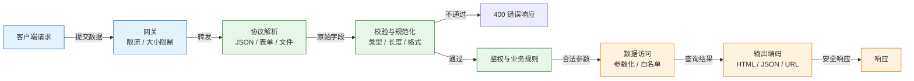
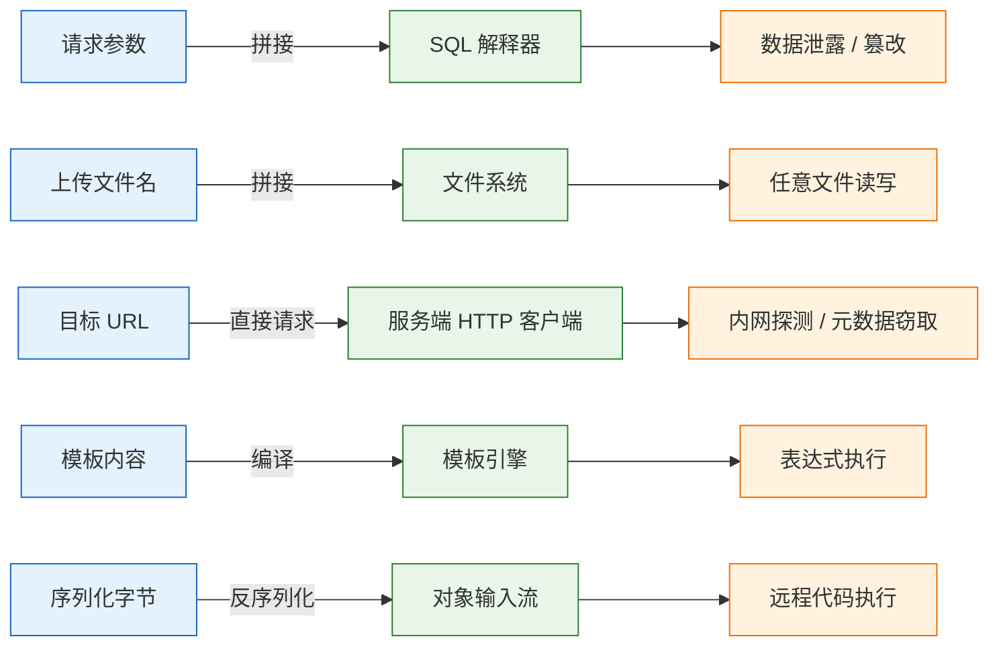
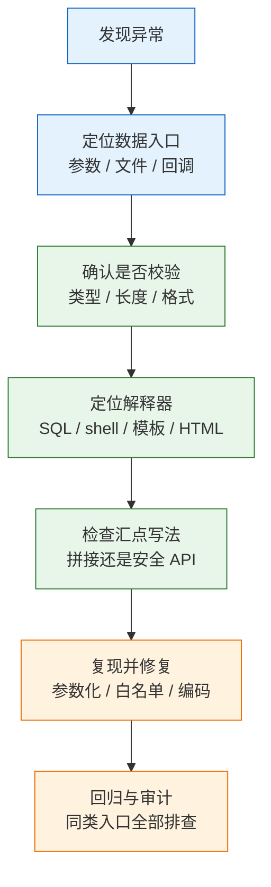

# 输入校验与注入

输入校验是在信任边界上约束数据，让进入业务逻辑的字段符合预期；注入是数据越过值的边界，被解释器当成了指令。两者一体两面：校验缩小合法形态，参数化与输出编码保证数据始终只是数据。

---

## 一、输入校验与注入是什么

### 1.1 核心概念

输入校验在数据进入业务逻辑前判断类型、长度、范围、格式、枚举和跨字段关系，把不合规数据拒绝掉。目标不是过滤危险字符，而是把数据收敛到可枚举、可测试的合法集合。

注入是程序把不可信数据与指令放进同一解析通道，解析器无法区分哪部分是数据、哪部分是指令。SQL 注入、命令注入、模板注入、LDAP 注入、XSS 都遵循这一模式，区别只在解释器和语法。

| 概念 | 含义 | 失效后果 |
|---|---|---|
| 输入校验 | 约束类型、长度、范围、格式 | 脏数据入库、规则绕过 |
| 规范化 | 把等价写法统一 | 黑白名单被绕过 |
| 参数化 | 值走独立通道传给解释器 | 数据变成指令 |
| 输出编码 | 按输出上下文转义 | XSS、日志伪造 |
| 注入 | 数据获得指令语义 | 泄露、篡改、执行 |

用污点分析看，请求参数、文件内容、第三方响应是污点源；SQL 驱动、shell、模板引擎、HTML 渲染器、反序列化器是汇点。数据从源到汇点的路径上，任何一次拼接都可能让污点变成指令。校验只能减少污点，不能替代汇点处的安全 API。

分工因此很明确：**校验决定数据是否合法，参数化决定数据是否被解释，输出编码决定数据在展示上下文里是否安全。** 三者缺一，另外两层都会被绕过。

### 1.2 与相邻技术的关系

输入校验常被和其他安全手段混为一谈。WAF 是网络层模式匹配，前端校验是交互体验，身份认证解决“是谁”，权限控制解决“能做什么”，都不能替代服务端对内容本身的判断。

| 技术 | 职责 | 边界 |
|---|---|---|
| 前端校验 | 即时提示 | 可绕过，不是安全边界 |
| WAF | 拦截常见载荷 | 规则可绕过，不修复代码 |
| 身份认证 | 确认调用方 | 合法用户也会提交恶意数据 |
| 权限控制 | 限制资源访问 | 不判断字段内容 |
| 参数化查询 | 值不被当作 SQL | 不校验业务语义 |
| 输出编码 | 数据在页面不变义 | 不阻止脏数据入库 |

前端校验的价值在体验，局限在所有请求都能手工构造。WAF 的价值在争取处置时间，但编码变形、分块传输、协议差异都能绕过；二次注入发生在内网服务之间，根本不经过公网 WAF。

静态扫描和动态扫描能发现部分拼接点，但误报漏报都高，适合作为回归门禁，不能替代代码评审时对每个汇点的确认。

### 1.3 架构组成

完整的输入处理链路包含网关、解析、校验、规范化、鉴权、数据访问和输出编码七段。每段只做自己的事，失败时快速拒绝，不把半成品往下传。



| 层 | 输入 | 输出 | 失败动作 |
|---|---|---|---|
| 网关 | 原始请求 | 限流后的请求 | 413、429 |
| 解析器 | 字节流 | 结构化字段 | 400 |
| 校验器 | 结构化字段 | 规范化值 | 400 加字段错误 |
| 鉴权 | 身份与资源 | 允许或拒绝 | 401、403 |
| 数据访问 | 合法参数 | 查询结果 | 回滚并记录 |
| 输出层 | 领域对象 | 响应字节 | 编码后输出 |

链路上有两个关键位置。**解析之前**要限制请求体大小、Content-Type、压缩比和嵌套深度，否则解析器本身就会被耗尽内存。**进入解释器之前**要完成参数化或白名单映射，不能指望下游补救。

> **注意**：校验失败必须 fail-closed。捕获异常后返回默认值、跳过字段、继续执行，等于把校验层变成摆设。

---

## 二、信任边界与威胁模型

### 2.1 信任边界划分

信任边界不是“公网和内网”的分界，而是“数据控制权发生转移”的位置。只要数据由外部主体控制，无论来自公网、内网、消息队列还是数据库，都不能默认可信。

| 来源 | 默认可信度 | 典型风险 |
|---|---|---|
| 请求体、query、path | 不可信 | 注入、越权、批量赋值 |
| Header、Cookie | 不可信 | 伪造身份、CRLF |
| 上传文件名与内容 | 不可信 | 路径穿越、恶意文件 |
| Webhook 与回调 | 不可信 | 伪造事件、重放 |
| 第三方 API 响应 | 不可信 | 脏数据、超大响应 |
| 数据库历史数据 | 条件可信 | 二次注入、存储型 XSS |

Webhook 靠签名而不是来源 IP。签名要覆盖原始字节、时间戳和 nonce，并限制时间窗口；只检查 `X-Signature` 是否存在，等于没有校验。数据库里的历史数据同样要按当前规则重新解析和编码，不能假设“已经洗过”。

### 2.2 注入类型分类

注入按**汇点**分类，不按输入形态。同一个字符串进入不同解释器，漏洞和防护手段都不同。

| 类型 | 汇点 | 主要防护 |
|---|---|---|
| SQL 注入 | 数据库驱动 | 绑定参数、标识符白名单 |
| 命令注入 | shell | 参数数组、禁用 shell |
| 模板注入 | 模板引擎 | 模板固定、只传变量 |
| 表达式注入 | SpEL、OGNL | 禁止动态表达式 |
| LDAP 注入 | 目录服务 | 转义、固定查询结构 |
| NoSQL 注入 | 文档数据库 | 类型校验、拒绝操作符键 |
| 路径穿越 | 文件系统 | realpath、目录校验 |
| XSS | 浏览器 | 上下文编码、CSP |
| SSRF | HTTP 客户端 | 目标白名单、出口隔离 |
| 反序列化 | 对象流 | 禁用、白名单类型 |



判断顺序应是：先找数据在哪个汇点被解释，再看该汇点有没有安全 API，最后才考虑输入过滤。反过来先写正则拦 `'`、`;`、`<`，既挡不住编码变形，又会误伤正常内容。

### 2.3 攻击面与后果

后果取决于汇点权限。SQL 注入通常能读写整库；命令注入以应用进程权限执行；SSRF 以服务器网络位置访问内网；反序列化往往直接导致远程代码执行。

| 攻击面 | 控制点 | 后果 | 检测信号 |
|---|---|---|---|
| 登录与查询 | 邮箱、排序字段 | 绕过认证、拖库 | 返回行数突增 |
| 运维接口 | 命令参数 | 命令执行、横向移动 | 异常子进程、外连 |
| URL 抓取 | 目标地址 | 内网探测 | 访问私有网段 |
| 文件下载 | 文件名、路径 | 任意文件读取 | 穿越字符 |
| 富文本 | HTML 内容 | 存储型 XSS | CSP 告警 |
| 日志与响应头 | 换行符 | 日志伪造、响应拆分 | 多行日志 |

检测信号要提前埋：SQL 错误记录错误码、脱敏语句摘要和调用点；出站连接记录目标域名和解析后的 IP；上传目录监控异常后缀和可执行权限。

---

## 三、校验规则与数据模型

### 3.1 五类校验约束

校验按“类型、范围、格式、枚举、关系”的顺序执行。顺序固定，错误信息稳定，测试用例也能按层覆盖。

| 约束 | 规则 | 示例 | 常见错误 |
|---|---|---|---|
| 类型 | 整数必须是整数 | `quantity` 为 `int` | `"1"`、`true` 混用 |
| 长度范围 | 字符串、数组、数值上下界 | 备注不超过 500 字 | 只限最小不限最大 |
| 格式 | 邮箱、UUID、日期 | 明确解析器 | 正则过宽或回溯爆炸 |
| 枚举 | 角色、状态、排序字段 | 显式允许值 | 用黑名单排除 `admin` |
| 关系 | 开始早于结束、金额等于明细 | 跨字段比较 | 只校验单字段 |

类型要严格。JSON 的 `1` 和 `"1"` 是不同类型，弱类型语言尤其容易混。Python 的 `bool("false")` 结果是 `True`，把字符串直接转布尔会得到相反语义。解析后应显式判断类型再转换。

长度和范围要同时设上下界。只限制“至少 1 个字符”而不限上限，几 MB 的备注就能撑爆数据库行、日志和页面。数组要限元素数，Map 要限键数，对象要限深度。

格式优先用解析器而不是正则。日期用 `LocalDate.parse`，UUID 用 `UUID.fromString`，URL 用 URI 解析器。正则要避免嵌套量词，`(a+)+$` 在长输入上会指数级回溯，形成 ReDoS。

枚举用白名单。角色、状态、排序字段、导出格式都显式列出允许值。黑名单永远列不全，今天排除 `admin`，明天新增 `super_admin` 就漏了。关系校验放业务层，依赖数据库状态，需要事务和锁。

### 3.2 规范化与编码

规范化把语义等价的不同写法统一。没有规范化，白名单会被同形字、大小写、全角半角、URL 编码绕过。

| 问题 | 现象 | 处理 |
|---|---|---|
| Unicode 同形字 | 西里尔 `а` 与拉丁 `a` | 限制字符集 |
| 全角半角 | `ａｄｍｉｎ` | NFKC 后比较 |
| 大小写 | `Admin`、`ADMIN` | 统一小写 |
| 前后空白 | `" admin "` | 去除首尾 |
| 路径分隔符 | `..\` 与 `../` | 统一后再解析 |
| 百分号编码 | `%2e%2e%2f` | 解码一次后校验 |

正确顺序是：**按协议解码一次，做 Unicode 规范化，去除无意义空白，再校验，最后把规范化后的值传给下游。** 顺序错了会出现“校验编码前、使用编码后”的缝隙。

> **注意**：只解码一次。部分框架会自动解码多次，攻击者用双重编码 `%252e%252e%252f` 就能在第二次解码后得到 `../`。校验必须针对最终要使用的值。

### 3.3 校验失败的响应模型

校验失败返回 `400`，响应体给出稳定的字段路径和错误码。字段路径让前端定位控件，错误码让程序分支，message 只负责提示。

```json
{
  "code": "VALIDATION_FAILED",
  "errors": [
    {"field": "email", "code": "INVALID_FORMAT", "message": "邮箱格式不正确"},
    {"field": "items[3].quantity", "code": "OUT_OF_RANGE", "message": "数量必须在 1 到 99 之间"}
  ]
}
```

| 字段 | 含义 | 约束 |
|---|---|---|
| 顶层 `code` | 错误类别 | 固定枚举 |
| `field` | 字段路径 | 稳定，数组带下标 |
| 字段 `code` | 错误码 | 与文案解耦 |
| `message` | 提示 | 不回显敏感原值 |

不要回显密码、令牌、完整身份证号；需要提示时只给脱敏尾号。不要只返回“参数错误”，前端无法定位。未知字段默认拒绝并返回 `UNKNOWN_FIELD`，静默忽略会让客户端误以为设置成功。一次返回所有字段错误，不要让用户改一个报一个。

```java
@RestControllerAdvice
public class ValidationExceptionHandler {

    @ExceptionHandler(MethodArgumentNotValidException.class)
    public ResponseEntity<Map<String, Object>> handle(MethodArgumentNotValidException ex) {
        // 只暴露字段名和错误码，不返回拒绝值
        List<Map<String, String>> errors = ex.getBindingResult().getFieldErrors().stream()
                .map(e -> Map.of("field", e.getField(), "code", e.getCode()))
                .toList();
        return ResponseEntity.badRequest()
                .body(Map.of("code", "VALIDATION_FAILED", "errors", errors));
    }
}
```

> **注意**：错误码与文案分离。文案会改、会翻译，程序判断不能依赖中文提示；字段路径也不能随内部类名变化。

---

## 四、校验流程与实现

### 4.1 请求处理流水线

请求进入应用后，处理顺序决定攻击者能在哪一步消耗资源：先限大小，再验媒体类型，然后解析，再校验字段，最后进入业务。

| 阶段 | 动作 | 拒绝条件 |
|---|---|---|
| 接收 | 限制大小、超时 | 超过阈值 413 |
| 媒体类型 | 只接受声明的类型 | 不匹配 415 |
| 解析 | 限深度、数组长度、重复键 | 解析失败 400 |
| 校验 | 类型、长度、格式、枚举 | 任一不通过 400 |
| 规范化 | 统一大小写、空白、Unicode | 仍不合法则拒绝 |
| 业务 | 鉴权、状态、事务 | 403 或 409 |

大小限制要在解析前生效。很多框架先把整个请求体读进内存再交给 JSON 解析器，几十 MB 就能让堆内存紧张。网关限制 `Content-Length`，应用限制实际读取字节数，压缩请求还要限制解压比例。

重复键是容易忽略的缝隙。JSON 规范没有规定同名键的处理方式，不同解析器可能取第一个、最后一个或报错。安全判断和业务读取若用不同解析器，攻击者可以构造两个同名键，让校验看到安全值、业务用到危险值。解析层应开启严格重复键检测。

> **注意**：解析器升级会改变重复键、数字精度、超长字符串的默认行为。升级后要回归校验用例，不能只看接口是否 200。

### 4.2 声明式 schema 校验

声明式校验把规则写在类型定义上，框架统一执行，适合字段级约束。

```java
import jakarta.validation.Valid;
import jakarta.validation.constraints.*;
import java.util.List;

public record CreateOrderRequest(
        @NotNull @Positive Long userId,                 // 必填且为正数
        @NotEmpty @Size(max = 50) List<@Valid OrderItem> items, // 限条目数并校验嵌套
        @Pattern(regexp = "^[A-Z]{3}$") String currency  // 三位大写货币代码
) {
}

record OrderItem(
        @NotNull @Positive Long skuId,
        @Min(1) @Max(99) int quantity
) {
}
```

| 注解 | 作用 | 边界 |
|---|---|---|
| `@NotNull` | 禁止 null | 不限空字符串 |
| `@NotEmpty` | 禁止空集合 | 不限元素内容 |
| `@Size` | 限制长度 | 不限字节数 |
| `@Pattern` | 正则匹配 | 注意回溯 |
| `@Valid` | 级联校验 | 集合元素需显式标注 |

声明式校验只覆盖单字段。跨字段关系、唯一性、状态机流转都要在服务层实现。嵌套对象要显式加 `@Valid`，集合元素上的 `@Valid` 要写在泛型位置。Service 方法参数如果也要校验，需要 `@Validated` 和方法校验拦截器，内部调用绕过 Controller 时不能假设参数已校验。

### 4.3 业务规则与跨字段校验

业务规则分三类：纯字段关系可在校验层做；依赖数据库状态的在事务里做；涉及并发的靠锁或唯一约束。

| 规则 | 示例 | 实现位置 |
|---|---|---|
| 字段关系 | 结束晚于开始 | 校验层 |
| 引用完整性 | 商品存在且上架 | 服务层事务 |
| 唯一性 | 邮箱不可重复 | 数据库唯一索引 |
| 并发控制 | 库存不超卖 | 行锁或乐观锁 |
| 状态流转 | 已取消不能支付 | 领域状态机 |

唯一性不能只靠“先查再插”。两个请求同时查到邮箱不存在，再同时插入，最后仍然重复。数据库唯一索引兜底，捕获唯一键冲突转成业务错误；查询只用于提前提示，不作为一致性保证。

库存扣减同理。先查再更新在并发下会超卖，应使用 `UPDATE ... SET stock = stock - ? WHERE id = ? AND stock >= ?`，按影响行数判断成功，或使用行锁。校验层能挡负数，挡不住并发竞争。

---

## 五、SQL 注入与参数化

### 5.1 注入原理与复现

SQL 注入的成因是把用户输入拼进 SQL 文本，数据库解析时无法区分字符串边界。下面用 SQLite 复现。

```python
# /tmp/injection/sql_demo.py
import sqlite3

con = sqlite3.connect(":memory:")
con.execute("CREATE TABLE users (id INTEGER PRIMARY KEY, email TEXT, role TEXT)")
con.execute("INSERT INTO users (email, role) VALUES ('alice@example.com', 'user')")

email = "' OR '1'='1' --"
sql = f"SELECT id, email, role FROM users WHERE email = '{email}'"
print(sql)
print(con.execute(sql).fetchall())

# 占位符由驱动绑定，整个字符串只作为 email 的值
print(con.execute("SELECT id, email, role FROM users WHERE email = ?", (email,)).fetchall())
```

```bash
python /tmp/injection/sql_demo.py
```

输出类似：

```text
SELECT id, email, role FROM users WHERE email = '' OR '1'='1' --'
[(1, 'alice@example.com', 'user')]
[]
```

第一条语句把输入拼进 SQL。单引号提前结束字符串，`OR '1'='1'` 让条件恒真，`--` 注释掉尾部，查询返回全部用户。第二条用 `?` 占位符，驱动把整个字符串当值绑定，数据库不会重新解析，所以查不到这个“邮箱”。

> **安全警告**：SQL 注入不能靠过滤单引号解决。攻击者可以用数字型注入、编码变形、宽字节、堆叠语句绕过，业务也可能合法包含引号。可靠做法是参数化，标识符位置用白名单。

Java 中使用 `PreparedStatement`：

```java
public List<User> findByEmail(String email) throws SQLException {
    String sql = "SELECT id, email, role FROM users WHERE email = ?";
    try (Connection conn = dataSource.getConnection();
         PreparedStatement ps = conn.prepareStatement(sql)) {
        ps.setString(1, email); // 值走独立通道，不参与 SQL 文本解析
        try (ResultSet rs = ps.executeQuery()) {
            List<User> users = new ArrayList<>();
            while (rs.next()) {
                users.add(new User(
                        rs.getLong("id"), rs.getString("email"), rs.getString("role")));
            }
            return users;
        }
    }
}
```

参数化让 SQL 文本先编译，值之后单独传输。驱动可能在协议层发送绑定参数，也可能在客户端转义后发送，但只要走标准绑定接口，语义都是“这是值，不是语法”。手写转义很难覆盖所有字符集和数据库方言。

### 5.2 参数化的边界

参数化只适用于“值”。表名、列名、排序方向、关键字属于语法，绑定后会被当成字符串常量，导致语法错误或语义错误。

| 位置 | 可否参数化 | 正确做法 |
|---|---|---|
| `WHERE` 值 | 可以 | `?` 或命名参数 |
| `INSERT` 值 | 可以 | 批量绑定 |
| `LIMIT` / `OFFSET` | 多数可以 | 绑定整数并限范围 |
| `LIKE` 模式 | 可以，需转义通配符 | 转义 `%`、`_` |
| 表名、列名 | 不可以 | 服务端白名单 |
| 排序方向 | 不可以 | 只允许 `ASC` / `DESC` |
| `IN` 列表 | 动态占位符 | 按元素数生成 `?` |

`LIKE` 的 `%` 和 `_` 是通配符。用户输入 `%` 会匹配全部记录，既拖慢查询，也可能越权。绑定参数不会转义通配符，需要显式处理：

```java
String escaped = keyword
        .replace("\\", "\\\\")   // 先转义转义符
        .replace("%", "\\%")
        .replace("_", "\\_");
ps.setString(1, escaped + "%");
// SQL 写成：WHERE name LIKE ? ESCAPE '\'
```

> **注意**：`ORDER BY ?` 不会按列名排序，而是按常量排序，所有行顺序不变。把列名当参数绑定，轻则排序失效，重则语法错误。排序必须用白名单。

`IN` 列表要按元素个数生成占位符，不能把整个列表拼成字符串再绑定。元素个数要有上限，空列表提前返回，不要生成 `IN ()`。

### 5.3 标识符白名单

排序列、表名、导出字段这类无法参数化的位置，只能用服务端维护的白名单映射。用户输入逻辑名，代码翻译成固定物理名，未命中就回退默认值或拒绝。

```java
private static final Map<String, String> SORTABLE = Map.of(
        "created", "created_at",
        "amount", "total_cents"
);

public List<Order> listOrders(String sort, String dir) throws SQLException {
    // 只允许白名单中的逻辑名，未命中时使用默认列
    String column = SORTABLE.getOrDefault(sort, "created_at");
    // 方向只有两个合法值，不接受其他字符串
    String direction = "desc".equalsIgnoreCase(dir) ? "DESC" : "ASC";
    String sql = "SELECT id, total_cents FROM orders ORDER BY "
            + column + " " + direction + " LIMIT ?";
    try (Connection conn = dataSource.getConnection();
         PreparedStatement ps = conn.prepareStatement(sql)) {
        ps.setInt(1, 100);
        // 执行查询并映射结果...
        return List.of();
    }
}
```

拼接发生在 `column` 和 `direction` 上，但值来自代码常量，不来自请求。这是白名单与字符串拼接的关键区别：拼接的变量必须是**已验证为固定集合成员**的值，而不是“过滤后的用户输入”。

> **注意**：ORM 不等于安全。JPA 的 `createNativeQuery`、MyBatis 的 `${}`、Hibernate 的 `whereRaw`、Django 的 `extra` 都会直接拼 SQL。审计要看最底层语句，不能只看是否用了 ORM。

存储过程内部如果再用 `EXECUTE IMMEDIATE` 拼接参数，外层参数化就失去意义。视图、触发器、定时任务同样可能成为二次注入点。

---

## 六、命令、模板与反序列化注入

### 6.1 命令注入与参数数组

命令注入的成因是把用户输入拼进 shell 命令行。shell 会解释分号、管道、重定向、命令替换，输入只要含这些字符就能追加命令。

```python
# /tmp/injection/cmd_demo.py
import os
import subprocess

host = "127.0.0.1; echo pwned"

print("--- shell=True ---", flush=True)
os.system(f"echo checking {host}")   # 整串交给 /bin/sh，分号后被执行

print("--- 参数数组 ---", flush=True)
subprocess.run(["echo", "checking", host])  # 不经过 shell，分号只是普通字符
```

输出类似：

```text
--- shell=True ---
checking 127.0.0.1
pwned
--- 参数数组 ---
checking 127.0.0.1; echo pwned
```

`os.system` 把整串交给 `/bin/sh`，分号后的 `echo pwned` 成为第二条命令。参数数组把可执行文件和每个参数分开传递，操作系统直接 `exec`，不经过 shell 解析，分号只是参数内容。

```java
ProcessBuilder pb = new ProcessBuilder(
        "ping", "-c", "1", host);   // 每个参数独立传入，不经过 shell
pb.redirectErrorStream(true);
Process process = pb.start();
```

| 调用方式 | 经过 shell | 风险 | 建议 |
|---|---|---|---|
| `os.system("...")` | 是 | 高 | 禁用 |
| `subprocess.run(..., shell=True)` | 是 | 高 | 禁用 |
| `subprocess.run([...])` | 否 | 低 | 推荐 |
| `Runtime.exec(String)` | 否，按空白切分 | 中 | 改用数组 |
| `ProcessBuilder("sh", "-c", ...)` | 是 | 高 | 禁用 |

> **注意**：Java 的 `Runtime.exec(String)` 不经过 shell，但会按空白切分参数，含空格的参数会被拆错，仍不推荐。执行外部命令统一用 `ProcessBuilder` 数组形式，并给可执行文件写绝对路径。

### 6.2 模板注入

模板注入发生在“用户输入被当成模板源码”的场景。模板引擎通常支持表达式、函数调用、对象属性访问，用户能控制模板内容，就能读取环境变量、执行方法。

| 场景 | 危险写法 | 安全写法 |
|---|---|---|
| 邮件模板 | 用户输入传给模板编译 | 模板固定，输入只作变量 |
| 页面片段 | 动态拼接模板字符串 | 预定义模板加数据模型 |
| 报表导出 | 用户自定义表达式 | 只允许配置字段名 |
| 规则引擎 | 用户输入作为脚本 | 受限 DSL 或白名单函数 |

```java
// 模板来自固定目录，用户输入只进入数据模型
Template template = configuration.getTemplate("welcome.ftl");
Map<String, Object> data = Map.of("name", userInput);
template.process(data, writer);
```

危险写法是 `new Template("welcome", new StringReader(userInput), configuration)`，或把输入拼进模板字符串再编译。即使用户输入只是“变量名”，也可能通过模板语法访问不该暴露的对象。逻辑-less 模板风险较低，但仍有 HTML 转义问题，不能跳过输出编码。

### 6.3 反序列化与表达式

反序列化把字节流还原成对象，很多协议允许在字节流中指定类名、方法、属性。攻击者可以构造利用链，在反序列化过程中触发方法调用，最终执行命令。这类漏洞靠输入校验很难防，因为字节流本身是合法格式。

| 技术 | 危险 API | 替代方案 |
|---|---|---|
| Python | `pickle.loads`、`yaml.load` | JSON、`safe_load` |
| Java | `ObjectInputStream.readObject` | JSON 加明确类型 |
| Java 表达式 | SpEL、OGNL 动态求值 | 固定表达式 |
| .NET | `BinaryFormatter` | 系统文本 JSON |
| PHP | `unserialize` | JSON |

```java
ObjectInputFilter filter = ObjectInputFilter.Config.createFilter(
        "com.example.dto.*;java.base/*;!*");  // 只允许业务 DTO 和基础类
ObjectInputStream ois = new ObjectInputStream(inputStream);
ois.setObjectInputFilter(filter);
```

> **注意**：白名单过滤能提高利用门槛，但不能把不可信反序列化变成安全操作。最彻底的做法是协议层不接受序列化对象，改用 JSON 加显式 schema。依赖库的利用链会随版本变化，过滤规则需要持续维护。

---

## 七、SSRF、路径穿越与文件上传

### 7.1 SSRF 目标校验

SSRF 是服务端按用户提供的地址发起请求。攻击者可以让服务器访问云元数据、内网管理接口、`localhost` 上的其他服务，利用的是服务器的网络位置和凭据。

| 校验点 | 规则 | 常见绕过 |
|---|---|---|
| 协议 | 只允许 `http`、`https` | `file://`、`gopher://` |
| 主机名 | 解析后检查所有 IP | 十进制、八进制、IPv6 映射 |
| 地址段 | 拒绝环回、私网、链路本地 | DNS 重绑定、重定向 |
| 端口 | 只允许 80、443 | 内网 6379、9200 |
| 重定向 | 禁止或逐跳复检 | 302 跳到内网 |

```java
URI uri = URI.create(rawUrl);
String scheme = uri.getScheme();
if (scheme == null || !(scheme.equals("http") || scheme.equals("https"))) {
    throw new IllegalArgumentException("只允许 http/https");
}
String host = uri.getHost();
if (host == null) {
    throw new IllegalArgumentException("主机名不合法");
}
for (InetAddress addr : InetAddress.getAllByName(host)) {
    // 环回、私网、链路本地、组播、任意地址全部拒绝
    if (addr.isAnyLocalAddress() || addr.isLoopbackAddress()
            || addr.isLinkLocalAddress() || addr.isSiteLocalAddress()
            || addr.isMulticastAddress()) {
        throw new IllegalArgumentException("目标地址不允许");
    }
}
```

`isSiteLocalAddress` 覆盖 10/8、172.16/12、192.168/16，但不覆盖 100.64/10 运营商级 NAT、IPv6 唯一本地地址 `fc00::/7` 和保留段。生产环境应维护完整 CIDR 黑名单，或反过来只允许域名白名单。

> **安全警告**：只在字符串层面判断前缀会被绕过。`http://expected.example@evil.example/` 的真实主机是 `evil.example`；`http://evil.example/?url=http://169.254.169.254/` 的前缀检查也会通过。必须用 URI 解析器取 host，再解析成 IP 判断。

DNS 重绑定是另一道难题：校验时域名解析到公网 IP，连接时又解析到内网 IP。防御方式有两种：解析后直接连接该 IP 并把 `Host` 设为原域名；或让所有出站请求走代理，由代理做目标校验和网络隔离。后者更适合生产，因为应用层校验总有遗漏。

### 7.2 路径穿越

路径穿越是用户控制的文件名或路径跳出预期目录，读取或覆盖任意文件。`../` 最常见，编码、反斜杠、绝对路径都能变体。

```python
# /tmp/injection/path_demo.py
import os

base = "/srv/files"
name = "../../etc/passwd"
path = os.path.realpath(os.path.join(base, name))
print(path)
print(os.path.commonpath([base, path]) == base)
```

输出（Linux 为 `/etc/passwd`；macOS 的 `/etc` 是符号链接，`realpath` 后为 `/private/etc/passwd`）：

```text
/etc/passwd
False
```

规则是：只取文件名，解析真实路径，确认仍在基目录内。三步缺一不可。

```java
Path base = Paths.get("/srv/files").toRealPath();
Path target = base.resolve(name).normalize();
if (!target.startsWith(base)) {
    throw new IllegalArgumentException("路径越界");
}
// 文件已存在时解析符号链接，防止链接指向目录外
Path real = target.toRealPath();
if (!real.startsWith(base)) {
    throw new IllegalArgumentException("符号链接越界");
}
```

| 输入 | 风险 | 处理 |
|---|---|---|
| `../../etc/passwd` | 跳出基目录 | 规范化后校验前缀 |
| `/etc/passwd` | 绝对路径 | `resolve` 前拒绝 |
| `..\\..\\win.ini` | Windows 分隔符 | 统一或拒绝反斜杠 |
| `link/secret` | 符号链接外指 | `toRealPath` 后再校验 |
| `%2e%2e%2f` | 编码穿越 | 解码一次再解析 |

> **注意**：`normalize()` 只做字面量化简，不解析符号链接；`toRealPath()` 会解析链接但要求路径存在。新建文件时先对父目录做 `toRealPath()`，再拼接文件名。

更好的做法是服务端生成存储键。上传时用 UUID 或内容哈希作文件名，原文件名只存数据库用于展示。用户输入不参与路径拼接，穿越问题从源头消失。下载按数据库记录取文件，不按请求参数拼路径。

### 7.3 文件上传校验

上传校验要覆盖大小、数量、文件名、扩展名、真实类型、内容和存储位置。只检查 `Content-Type` 或扩展名都不够，两者都能伪造。

| 校验项 | 方法 | 说明 |
|---|---|---|
| 大小 | 读取前查 `Content-Length` 与实际字节 | 防内存耗尽 |
| 数量 | 限制单次文件数 | 防占满磁盘 |
| 文件名 | 只取 basename，拒绝控制字符 | 防穿越和日志注入 |
| 扩展名 | 白名单 | 不信任客户端 |
| 真实类型 | 魔数或解码 | 图片可重编码 |
| 内容 | 病毒扫描、解压炸弹检测 | 限制展开比 |

真实类型看文件头。PNG 以 `89 50 4E 47` 开头，JPEG 以 `FF D8 FF` 开头，PDF 以 `%PDF-` 开头。但魔数也能伪造，图片应解码后重新编码，丢弃 EXIF 和嵌入脚本；SVG 本质是 XML，可能含脚本，允许上传必须严格清洗或直接禁止。

存储要隔离。上传文件放独立域名或存储桶，响应头设置 `Content-Disposition: attachment` 和 `X-Content-Type-Options: nosniff`，避免浏览器把用户内容当 HTML 执行。上传目录不要放在 Web 根目录，不要给执行权限。

---

## 八、XSS 与输出编码

### 8.1 上下文编码

XSS 的成因是数据写进 HTML 或 JavaScript 却没有按上下文编码。输入里出现 `<script>` 不一定有问题，原样放进 HTML 文本节点才是问题。

| 上下文 | 编码 | 示例 |
|---|---|---|
| HTML 文本 | 转义 `& < > " '` | `&lt;script&gt;` |
| HTML 属性 | 值加引号并转义 | `value="a&quot;b"` |
| JavaScript 字符串 | JSON 序列化 | `JSON.stringify(value)` |
| URL 参数 | 百分号编码 | `encodeURIComponent` |
| CSS | 尽量避免用户可控 | 只允许固定类名 |

编码必须和输出位置匹配。把未经 JavaScript 编码的值直接放进 `<script>`，字符串里的 `</script>` 会提前闭合标签；只做 HTML 编码又会在脚本里显示成字面量。正确做法是先把值序列化成 JSON 再嵌入，或用 `data-*` 属性传值。

> **注意**：不要在输入时做 HTML 编码再存库。这样数据会被双重编码，展示时出现 `&amp;lt;`，导出和 API 返回值也被污染。编码应发生在输出时。

### 8.2 富文本与 sanitizer

富文本要保留一部分 HTML，不能全部转义。此时用成熟的白名单 sanitizer，只允许固定标签和属性，并校验 URL 协议。

| 方案 | 适用 | 风险 |
|---|---|---|
| 全部转义 | 评论、昵称 | 无富文本能力 |
| 白名单 sanitizer | 富文本内容 | 配置错误放行危险标签 |
| 服务端渲染加 CSP | 高安全页面 | 改造成本高 |
| iframe 沙箱 | 第三方内容 | 需正确设置 sandbox |

DOMPurify 是浏览器端常用 sanitizer，配置要明确允许的标签、属性和协议。不要允许 `on*` 事件属性、`javascript:` 协议、`data:` 里的 HTML。服务端也要清洗一次，攻击者可以直接调用 API。

自己写正则黑名单几乎一定会漏。HTML 解析规则复杂，大小写、注释、CDATA、命名空间、畸形标签都能绕过简单匹配。用成熟解析器和白名单库更可靠。

### 8.3 安全响应头与 CSP

安全响应头不能修复注入，但能降低 XSS、点击劫持和信息泄露的后果。它们应由网关或应用统一添加，避免每个接口各写一套。

```text
Content-Security-Policy: default-src 'self'; script-src 'self'; object-src 'none'
X-Content-Type-Options: nosniff
Referrer-Policy: strict-origin-when-cross-origin
Strict-Transport-Security: max-age=31536000; includeSubDomains
X-Frame-Options: DENY
```

| 响应头 | 作用 | 常见错误 |
|---|---|---|
| `Content-Security-Policy` | 限制脚本与连接来源 | 直接严格策略打掉内联脚本 |
| `X-Content-Type-Options` | 禁止 MIME 嗅探 | 缺失导致上传文件被当 HTML |
| `Referrer-Policy` | 控制 Referer 泄露 | 设为 `unsafe-url` |
| `Strict-Transport-Security` | 强制 HTTPS | 在 HTTP 站点设置无效 |
| `X-Frame-Options` | 禁止被嵌套 | 与 CSP 重复 |

---

## 九、完整示例：CSV 批量导入

### 9.1 需求与约束

运营上传 CSV 批量创建用户，文件可能几万行，字段包含邮箱、角色、备注。场景同时涉及文件上传、逐行校验、批量写入、重复处理和导出安全。

| 约束 | 取值 | 目的 |
|---|---|---|
| 文件大小 | 不超过 5 MB | 防内存和磁盘耗尽 |
| 行数 | 不超过 50,000 | 控制处理时间 |
| 列 | 仅 `email`、`role`、`remark` | 拒绝未知列 |
| 角色 | `user`、`operator` | 管理角色不走导入 |
| 备注 | 不超过 500 字符 | 限制存储 |
| 事务 | 每 500 行提交 | 失败只回滚当前批 |

### 9.2 实现

数据库层用唯一索引和检查约束兜底，应用层校验负责给出可读错误，两层不能互相替代。

```sql
CREATE TABLE users (
    id      BIGSERIAL PRIMARY KEY,
    email   TEXT NOT NULL UNIQUE,                    -- 唯一索引兜底重复导入
    role    TEXT NOT NULL CHECK (role IN ('user', 'operator')),
    remark  TEXT CHECK (char_length(remark) <= 500)  -- 数据库层再兜一层长度
);
```

```java
import org.apache.commons.csv.CSVFormat;
import org.apache.commons.csv.CSVParser;
import org.apache.commons.csv.CSVRecord;
import org.springframework.stereotype.Service;
import org.springframework.web.multipart.MultipartFile;

import javax.sql.DataSource;
import java.io.*;
import java.nio.charset.StandardCharsets;
import java.sql.*;
import java.util.*;
import java.util.regex.Pattern;

public record ImportResult(int success, int duplicated, int failed, List<String> errors) {
}

@Service
public class UserImportService {

    private static final long MAX_BYTES = 5L * 1024 * 1024;
    private static final int BATCH_SIZE = 500;
    private static final Pattern EMAIL =
            Pattern.compile("^[^@\\s]{1,64}@[^@\\s]{1,190}\\.[A-Za-z]{2,}$");
    private static final Set<String> ROLES = Set.of("user", "operator");
    private static final Set<String> HEADERS = Set.of("email", "role", "remark");

    private final DataSource dataSource;

    public UserImportService(DataSource dataSource) {
        this.dataSource = dataSource;
    }

    public ImportResult importCsv(MultipartFile file) throws IOException, SQLException {
        if (file.isEmpty()) {
            throw new IllegalArgumentException("文件为空");
        }
        if (file.getSize() > MAX_BYTES) {
            throw new IllegalArgumentException("文件超过 5MB");
        }

        int success = 0, duplicated = 0, failed = 0;
        List<String> errors = new ArrayList<>();

        try (Reader reader = new InputStreamReader(file.getInputStream(), StandardCharsets.UTF_8);
             CSVParser parser = CSVFormat.DEFAULT.builder()
                     .setHeader().setSkipHeaderRecord(true).setTrim(true)
                     .build().parse(reader)) {

            // 列名必须完全匹配，未知列和缺失列都拒绝
            if (!parser.getHeaderMap().keySet().equals(HEADERS)) {
                throw new IllegalArgumentException("列名不符合要求");
            }

            try (Connection conn = dataSource.getConnection()) {
                conn.setAutoCommit(false);
                String sql = "INSERT INTO users (email, role, remark) VALUES (?, ?, ?) "
                        + "ON CONFLICT (email) DO NOTHING";  // PostgreSQL 语法
                try (PreparedStatement ps = conn.prepareStatement(sql)) {
                    int pending = 0;
                    for (CSVRecord record : parser) {
                        String email = record.get("email");
                        String role = record.get("role");
                        String remark = record.get("remark");
                        String error = validate(email, role, remark);
                        if (error != null) {
                            failed++;
                            errors.add("第 " + record.getRecordNumber() + " 行: " + error);
                            continue;  // 单行失败不影响其他行
                        }
                        ps.setString(1, email.toLowerCase(Locale.ROOT));
                        ps.setString(2, role);
                        ps.setString(3, remark);
                        ps.addBatch();
                        if (++pending == BATCH_SIZE) {
                            int[] counts = ps.executeBatch();
                            conn.commit();  // 每批独立提交
                            for (int c : counts) {
                                if (c == 0) duplicated++; else success++;
                            }
                            pending = 0;
                            ps.clearBatch();
                        }
                    }
                    if (pending > 0) {
                        int[] counts = ps.executeBatch();
                        conn.commit();
                        for (int c : counts) {
                            if (c == 0) duplicated++; else success++;
                        }
                    }
                } catch (SQLException e) {
                    conn.rollback();  // 只回滚当前批次
                    throw e;
                }
            }
        }
        return new ImportResult(success, duplicated, failed, errors);
    }

    private String validate(String email, String role, String remark) {
        if (email == null || !EMAIL.matcher(email).matches()) {
            return "邮箱格式不正确";
        }
        if (!ROLES.contains(role)) {
            return "角色不在允许范围";
        }
        if (remark != null && remark.length() > 500) {
            return "备注超过 500 字符";
        }
        if (remark != null && remark.chars()
                .anyMatch(c -> c < 0x20 && c != '\t' && c != '\n')) {
            return "备注包含非法控制字符";
        }
        return null;
    }
}
```

导出 CSV 时，对以 `=`、`+`、`-`、`@` 开头的单元格加前缀单引号，防止表格软件当公式执行：

```java
public static String csvCell(String value) {
    String s = value == null ? "" : value;
    if (!s.isEmpty() && "=+-@\t\r".indexOf(s.charAt(0)) >= 0) {
        s = "'" + s;  // 让表格软件按文本处理
    }
    return "\"" + s.replace("\"", "\"\"") + "\"";
}
```

### 9.3 验证与结果

上线前至少覆盖下表用例。导入结果记录成功、重复、失败三类计数，错误明细带行号，便于运营修正后重传。

| 用例 | 输入 | 预期 |
|---|---|---|
| 正常导入 | 100 行合法数据 | 全部成功 |
| 重复邮箱 | 与已有用户相同 | 计入重复，不整体失败 |
| 注入载荷 | 邮箱含 `' OR '1'='1` | 校验拒绝，不进入 SQL |
| 未知列 | 增加 `is_admin` | 整体拒绝 |
| 公式备注 | 以 `=` 开头 | 入库正常，导出加前缀 |
| 超大文件 | 6 MB | 解析前拒绝 |
| 控制字符 | 备注含 NUL | 单行失败，记录行号 |

> **注意**：`ON CONFLICT` 是 PostgreSQL 语法，MySQL 对应 `INSERT IGNORE` 或 `ON DUPLICATE KEY UPDATE`，SQL Server 用 `MERGE`。切换数据库要重写语句，不能假设方言兼容。

---

## 十、其他注入面与防御边界

### 10.1 NoSQL 与 LDAP

MongoDB 的查询条件本身是文档。直接把请求 JSON 当条件，`{"email": {"$ne": null}}` 可以匹配任意用户。防护核心是类型校验：`email` 必须是字符串，不能是对象；以 `$` 开头的键默认拒绝。

| 注入面 | 载荷形态 | 防护 |
|---|---|---|
| MongoDB | `{"$ne": null}` | 类型校验、拒绝操作符键 |
| LDAP | `*)(uid=*` | 转义特殊字符 |
| XPath | `' or '1'='1` | 参数化 API |
| 日志 | `\r\n` 伪造行 | 结构化日志 |

LDAP 过滤器有特殊字符 `* ( ) \ NUL`。输入拼进 `(&(uid=...)(userPassword=...))` 可以改变过滤逻辑。应使用库提供的转义函数，例如 Python 的 `ldap.filter.escape_filter_chars`，Java 用 Spring LDAP 的 `LdapQueryBuilder`。认证时先按用户名查 DN，再用该 DN 做 bind，不要拼整个过滤器。

### 10.2 开放重定向与 CRLF

开放重定向是登录、支付完成后按 `next` 参数跳转，攻击者把目标改成钓鱼站点。防护规则是只允许相对路径：以 `/` 开头且不以 `//` 开头；或维护域名白名单，解析后比较 host，不能用字符串包含判断。

| 场景 | 校验 | 说明 |
|---|---|---|
| 登录跳转 | 只允许站内相对路径 | 拒绝 `//evil.example` |
| 支付回跳 | 域名白名单 | 解析后比较 host |
| 下载地址 | 服务端签名 URL | 不用请求参数 |
| 响应头 | 拒绝控制字符 | 防头注入 |

CRLF 注入发生在把输入写进响应头、Cookie 或日志时。换行符可以插入额外响应头，或伪造日志行。响应头值拒绝所有控制字符；日志用结构化 JSON；下载文件名用 `Content-Disposition: attachment; filename*=UTF-8''...` 并按 RFC 5987 编码。

### 10.3 依赖供应链与 WAF

注入点修住了，依赖漏洞仍能直接拿到服务器。供应链防护的目标是让引入的组件可追溯、可替换、可回滚。

| 措施 | 作用 | 落地 |
|---|---|---|
| 锁定版本 | 构建可复现 | lockfile 进仓库 |
| 镜像摘要 | 防标签漂移 | 用 digest 固定 |
| 依赖扫描 | 发现已知漏洞 | SCA 接入流水线 |
| SBOM | 快速定位受影响镜像 | 构建时生成 |
| 密钥扫描 | 防凭据入库 | 提交钩子加定期扫描 |

依赖扫描不能只看“有没有高危”。要看组件是否真的被调用、是否处理不可信输入、是否有替代。升级依赖要回归测试，序列化、模板、HTTP 客户端这类库的行为变化可能影响安全边界。

WAF 能挡常见扫描载荷，挡不住编码变形、分块传输、协议差异，也挡不住二次注入和内网调用。正确顺序是先修代码里的拼接和权限，再用 WAF 加检测。规则要有人看告警，否则只是日志收集器。

### 10.4 校验的边界

有些字段必须保留原始内容，不能靠删字符解决。防护重点转向输出编码、沙箱和权限隔离。

| 场景 | 原因 | 正确做法 |
|---|---|---|
| 富文本 | 保留 HTML 结构 | 白名单 sanitizer 加 CSP |
| 代码片段 | 保留符号 | 存原文，展示时转义 |
| 文件名 | 保留用户语义 | 只存展示名，存储用 UUID |
| 排序字段 | SQL 语法位置 | 白名单映射 |
| 搜索关键词 | 任意字符 | 参数化加通配符转义 |

历史脏数据是最容易忽略的注入源。早期版本没有校验，数据已经入库；后来某段代码读出来拼接，二次注入就发生了。读取时要重新校验和编码，迁移脚本也要参数化，导出要转义公式前缀，建索引前要清洗。

校验本身也会成为攻击面。正则回溯、超大 JSON、深层嵌套、海量字段都能耗尽 CPU 或内存。请求体按业务设 1–10 MB，JSON 深度不超过 32 层，数组长度设上限，正则应避免嵌套量词并设超时。

> **注意**：正则本身就是攻击面。`(a+)+$`、`(a|aa)+$` 在长输入上会指数级回溯。优先用解析器，必须用正则时选择线性时间引擎或设置匹配超时。

---

## 十一、常见故障与排查

### 11.1 故障表

| 现象 | 最可能原因 | 处理 |
|---|---|---|
| 查询语法错误，输入含引号 | 字符串拼接 SQL | 改绑定参数，审计 raw SQL |
| 登录被 `' OR 1=1 --` 绕过 | 同上 | 参数化认证查询 |
| 服务器执行意外命令 | shell 拼接输入 | 参数数组，禁用 shell |
| 访问了内网地址 | SSRF 未限制目标 | 白名单、IP 校验、出口代理 |
| 读取 `/etc/passwd` | 路径穿越 | realpath 加目录校验 |
| 页面弹出脚本 | 输出未编码 | 上下文编码加 CSP |
| Excel 打开导出文件弹公式 | CSV 注入 | 危险前缀加单引号 |
| XML 读取本地文件 | XXE | 禁用 DOCTYPE 和外部实体 |
| 反序列化代码执行 | 接受不可信序列化字节 | 改 JSON，白名单类型 |
| 合法请求被误拒 | 校验过严或编码不一致 | 规范化后再校验 |
| 日志出现伪造行 | 输入含换行 | 结构化日志，拒绝控制字符 |
| 批量导入整体失败 | 单行错误导致回滚 | 分批提交，单行记录 |

### 11.2 排查顺序



排查按“入口、汇点、同类”三步推进：

1. 找到数据进入代码的入口，确认有没有类型、长度、格式约束。
2. 找到数据进入解释器的位置：SQL、shell、模板、HTML、XML、反序列化。
3. 确认该位置用的是参数化、安全 API 或输出编码，而不是字符串拼接。
4. 用最小载荷复现，确认修复后载荷只作为数据。
5. 审计同类入口，避免只修一个接口。
6. 最后才加 WAF 规则，WAF 不能修复已经存在的拼接。

> **安全警告**：修复注入时不要只删掉攻击载荷里的字符。过滤 `'` 会破坏合法姓名，过滤 `<` 会破坏代码展示，编码变形仍可绕过。修复要落在汇点：SQL 用绑定参数，命令用参数数组，HTML 用上下文编码，路径用 realpath 加目录校验。

> **注意**：修复后要补测试用例，把攻击载荷固化成回归测试。只改代码不加用例，下一次重构很容易把拼接写回来。
