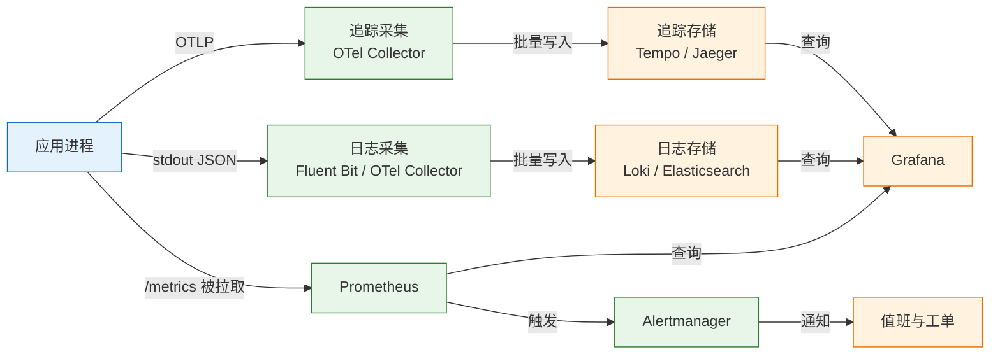
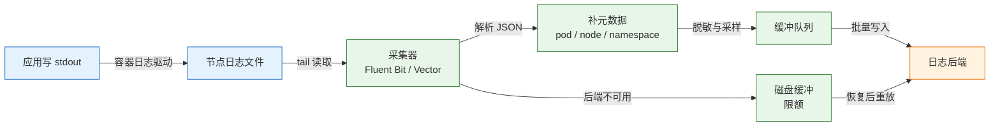
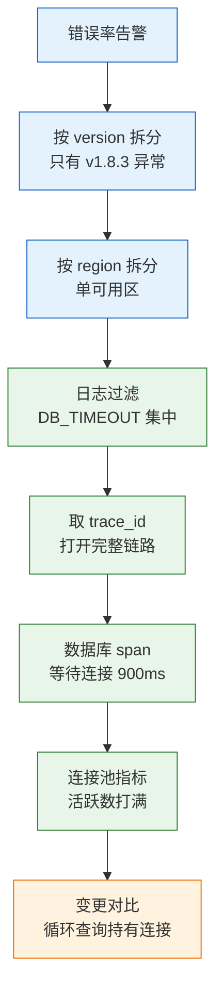
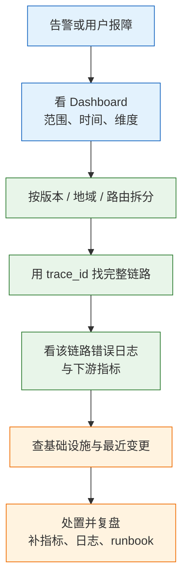

# 日志与指标

日志记录“这一次发生了什么”，指标回答“整体现在怎么样”，追踪说明“这一个请求慢在哪”。三者靠同一个 `trace_id` 与 `request_id` 串起来；缺一个，排障就会退化成猜。
只装日志，能看到错误却看不出趋势；只装指标，能发现异常却不知道原因；只装追踪，能看单条链路却无法判断影响面。可观测性建设的重点不是工具数量，而是三类信号能否在同一个时间轴和同一个请求上下文中互相对齐。

---

## 一、日志与指标是什么

### 1.1 核心概念

日志是按时间追加的离散事件，通常带级别、服务名、请求标识和上下文。它擅长回答“哪一类请求失败、错误码是什么、堆栈停在哪一行”。

指标是按固定周期聚合的数值时间序列，由名称、标签、时间戳和值组成。它擅长回答“错误率是多少、延迟分位是多少、趋势是否异常”。追踪是一次请求跨越多个服务的 span 树，每个 span 记录操作名、耗时、状态和属性，擅长定位调用链中的慢段。

| 信号 | 回答的问题 | 数据形态 | 成本 |
|---|---|---|---|
| 日志 | 这一次发生了什么 | 离散事件 | 高 |
| 指标 | 整体现在怎么样 | 数值时间序列 | 低 |
| 追踪 | 请求慢在哪一段 | 调用树 | 中 |

三者的采样方式不同。日志可以逐条采样，指标天然聚合，追踪按请求采样。采样策略必须保证错误和慢请求被保留，否则出事时恰好没有样本。

三类信号的保留周期也不同。指标可以长期降采样保存，日志通常只保留最近一段时间，追踪按采样率保留。设计时要先确定“事故发生后需要回看多久”，再决定存储和采样。

### 1.2 与相邻技术的关系

日志、指标、追踪是数据模型，不是具体产品。Prometheus 存指标，Loki 与 Elasticsearch 存日志，Jaeger 与 Tempo 存追踪，Grafana 负责展示，Alertmanager 负责告警。OpenTelemetry 提供统一的 API、SDK 和 Collector，让应用只埋一次点，后端可以替换。

| 技术 | 角色 | 与三类信号的关系 |
|---|---|---|
| Prometheus | 指标采集与查询 | 拉取 `/metrics`，本地 TSDB 存储 |
| Loki | 日志聚合 | 只索引标签，正文压缩存储 |
| Elasticsearch | 日志检索 | 全文索引，查询灵活、成本高 |
| Jaeger / Tempo | 追踪后端 | 存 span，按 trace_id 查询 |
| OpenTelemetry | 采集标准 | 统一 SDK、协议与语义约定 |
| Grafana | 展示与告警 | 查询多个数据源，统一面板 |

OpenTelemetry 不是后端，它只负责产生和传输数据。Collector 可以接收 OTLP、批处理、重试、脱敏，再导出到不同后端。采用 OTel 的价值在于避免应用代码绑定某一家厂商。

指标与日志的边界要提前划清。指标适合聚合和告警，标签必须低基数；日志适合单次事实和上下文，可以包含高基数字段。用指标回答“哪个用户失败”，或用日志做实时聚合报表，都会很快遇到成本或性能瓶颈。

### 1.3 架构组成

一条完整的可观测链路包含产生、采集、传输、存储、查询和告警六段。应用只负责产生信号，采集与存储由平台负责，应用不能因为后端故障被阻塞。



| 组件 | 职责 | 故障表现 |
|---|---|---|
| 应用 | 产生日志、指标、span | 无数据或字段缺失 |
| 采集器 | 解析、补元数据、缓冲 | 日志延迟、重复 |
| 传输 | 批处理、重试、压缩 | 丢包、背压 |
| 存储 | 索引、压缩、保留 | 查询慢、写入拒绝 |
| 查询层 | PromQL、日志检索 | 面板超时 |
| 告警 | 规则评估、路由 | 漏报、重复通知 |

应用写 stdout，由容器运行时和采集器收集，不要各自写文件再挂卷。采集器要有磁盘缓冲上限和重试策略，后端故障时不能把节点磁盘写满，也不能反向阻塞应用。

---

## 二、可观测性数据模型

### 2.1 三种信号的分工

三类信号不是替代关系，而是查询粒度和成本不同。排障顺序通常是指标发现范围，日志定位原因，追踪还原链路。

| 维度 | 日志 | 指标 | 追踪 |
|---|---|---|---|
| 查询方式 | 按条件检索 | 按序列聚合 | 按 trace_id 打开 |
| 基数承受 | 高 | 低 | 中 |
| 保留成本 | 高 | 低 | 中 |
| 典型问题 | 错误详情 | 错误率与延迟 | 慢调用位置 |

指标先告诉你“哪个服务、哪个版本、哪个路由异常”，日志再告诉你“异常的具体错误码和堆栈”，追踪补充“这一次请求在哪个下游卡住”。三者都带 `service`、`env`、`version`，才能在同一个维度上对齐。

### 2.2 日志事件模型

一条结构化日志是一个 JSON 对象，字段分为时间、级别、身份、请求上下文、业务上下文和错误六组。字段名要跨服务统一，不能每个团队一套。

| 字段组 | 示例 | 约束 |
|---|---|---|
| 时间 | `ts` | UTC，RFC 3339，带毫秒 |
| 级别 | `level` | 固定枚举，小写 |
| 身份 | `service`、`env`、`version` | 必填，低基数 |
| 请求 | `trace_id`、`span_id`、`request_id` | 入口生成或透传 |
| 业务 | `route`、`status`、`duration_ms` | 模板化路由 |
| 错误 | `error.type`、`error.code`、`stack` | 不拼进 message |

```json
{
  "ts": "2026-10-28T02:00:01.123Z",
  "level": "error",
  "service": "orders-api",
  "env": "prod",
  "version": "v1.8.3",
  "trace_id": "4bf92f3577b34da6a3ce929d0e0e4736",
  "span_id": "00f067aa0ba902b7",
  "request_id": "01J8Z9K3Q7",
  "method": "POST",
  "route": "/orders",
  "status": 500,
  "duration_ms": 842,
  "error": {
    "type": "TimeoutError",
    "code": "DB_TIMEOUT",
    "message": "acquire connection timeout"
  }
}
```

时间用 UTC 加 RFC 3339，带毫秒和 `Z`。本地时间在跨时区排障时会误导，采集器补的接收时间要与应用产生时间分开保留。错误用结构化字段，不要把整段堆栈拼进 message；堆栈单独放 `stack`，保留换行转义。

> **安全警告**：日志里不能写密码、令牌、Cookie、身份证号、完整卡号。需要排查时只记录脱敏后的尾号或哈希。日志平台往往有多人可查、长期保留，一次误打印就等于长期泄露。

### 2.3 指标数据模型

一条时间序列由指标名称和一组标签唯一确定。名称描述“测量什么”，标签描述“属于哪个维度”，样本是时间戳加数值。

| 组成 | 含义 | 示例 |
|---|---|---|
| 名称 | 测量的对象 | `http_requests_total` |
| 标签 | 可枚举维度 | `method`、`route`、`status` |
| 样本 | 时间戳与值 | `1729994400 1024` |
| 序列 | 名称加标签组合 | 一个具体组合 |

Counter 只增不减，进程重启会归零；Gauge 可增可减；Histogram 按桶累计计数并附带总和与总数；Summary 在客户端计算分位数。Histogram 的桶是累积的，`le="0.1"` 表示小于等于 100 毫秒的请求数，分位数由桶估算。

桶边界要按业务定。全用默认桶，可能落在 SLO 边界之外，算出的 P99 没有意义。延迟桶应覆盖 50ms、100ms、300ms、1s、3s 这些关键阈值，并在 SLO 目标附近加密。

### 2.4 追踪上下文模型

追踪由 trace 和 span 组成。trace 表示一次完整请求，span 表示其中一个操作，span 之间有父子关系。上下文传播依赖 `traceparent` 头，格式为 `版本-trace_id-span_id-标志`。

| 字段 | 长度 | 作用 |
|---|---|---|
| `trace_id` | 32 位十六进制 | 标识整条链路 |
| `span_id` | 16 位十六进制 | 标识当前操作 |
| `parent_span_id` | 16 位十六进制 | 指向上级操作 |
| `trace_flags` | 2 位十六进制 | 采样等标志 |

入口服务如果收到合法的 `traceparent` 就复用 `trace_id`，否则新建；下游调用必须继续传递。跨线程、跨消息队列时，上下文要显式注入和提取，否则链路会断在异步边界。

上下文传播要覆盖异步边界。线程池、协程、消息队列、定时任务都可能丢失 `trace_id`；缺少传播时，追踪会在异步调用处断开，日志也无法与上游对齐。

---

## 三、日志采集流程

### 3.1 从进程到后端

推荐链路是：应用写 stdout，容器运行时收集，节点上的采集器解析并补元数据，再批量写入后端。应用不负责轮转、压缩和上传。



| 环节 | 职责 | 失败表现 |
|---|---|---|
| 应用 | 输出单行 JSON | 多行、字段缺失 |
| 运行时 | 落盘或转发 | 日志被截断 |
| 采集器 | 解析、补元数据 | 标签错误、重复 |
| 缓冲 | 吸收后端抖动 | 磁盘写满、丢日志 |
| 后端 | 索引与保留 | 写入拒绝、查询慢 |

采集器要限制磁盘缓冲大小。后端故障时，无限缓冲会把节点磁盘写满，进而拖垮同节点的其他进程。缓冲满了应丢弃低级别日志并计数，而不是阻塞应用。

采集器还要补齐元数据。容器日志本身只有输出内容，pod 名、namespace、节点、镜像版本要从运行时 API 或标签补进去。缺少这些字段，日志虽然能查，却无法按服务聚合，也无法判断影响的是哪个副本。

### 3.2 结构化与多行合并

结构化日志的前提是单行输出。Java 异常、Python traceback 天然跨行，采集器要按时间戳或起始模式把它们合并成一条事件，否则一行一个栈帧，检索时几乎无法还原。

| 问题 | 方案 | 注意 |
|---|---|---|
| 多行堆栈 | 采集器多行解析 | 规则要匹配起始行 |
| 字段类型混乱 | 固定 schema | 数字不要写成字符串 |
| 中文乱码 | UTF-8 输出 | 采集器不要二次编码 |
| 超长日志 | 截断并标注 | 保留哈希或长度 |
| 重复采集 | 幂等键或去重 | 容器重启后尤其明显 |

日志内容不要拼接不可信输入。用户提交的换行会伪造一条新日志，破坏审计。结构化 JSON 会把换行转义在字段值里，比纯文本安全；如果必须输出纯文本，要拒绝控制字符。

采集器解析失败时要有兜底。无法解析为 JSON 的日志应保留原文并打上解析失败标签，而不是直接丢弃；否则应用输出格式出错时，恰好丢掉最需要的启动错误。

### 3.3 采样与脱敏

高流量下不可能全量保留所有日志。采样要按级别和结果区分：成功请求按比例采样，错误和慢请求全量保留。

| 策略 | 适用 | 风险 |
|---|---|---|
| 按比例采样 | 成功访问日志 | 可能丢掉长尾 |
| 按级别采样 | debug 全关，error 全开 | 级别滥用会失效 |
| 按结果采样 | 错误、慢请求全留 | 需要先算耗时 |
| 聚合计数 | 重复异常 | 丢失单次上下文 |
| 尾部采样 | 追踪 | Collector 需要看完整 trace |

脱敏要在采集器做一次，在应用做一次。应用知道哪些字段是敏感字段，采集器能覆盖遗漏的格式。手机号保留前三后四，邮箱保留域名，令牌整体替换为固定标记。

> **注意**：脱敏规则要覆盖嵌套字段、异常堆栈和 URL 查询参数。只在最外层替换，敏感值仍可能藏在 `request.body` 或 `error.message` 里。

---

## 四、指标采集流程

### 4.1 拉取模型

Prometheus 采用拉取模型：服务暴露 `/metrics`，Prometheus 按周期抓取。拉取模型便于判断目标是否存活，`up` 指标直接反映抓取结果；也便于在服务发现后自动增加目标。

| 模型 | 方向 | 适用 | 缺点 |
|---|---|---|---|
| 拉取 | 服务端主动抓 | 长生命周期服务 | 短任务难覆盖 |
| 推送 | 客户端主动推 | 批处理、边缘 | 难以判断目标存活 |
| 网关推送 | 推送到 Pushgateway | 短任务 | 指标生命周期需管理 |

短任务可以用 Pushgateway，但要及时删除过期指标，否则会一直保留最后一次值。Kubernetes 中用 ServiceMonitor 或 PodMonitor 自动发现，不要手写几百个 IP。

抓取失败时 Prometheus 会记录 `up=0`，并在过期窗口后把旧序列标记为陈旧。面板上的“数据中断”可能来自应用崩溃、端口变更、网络策略或抓取超时，不能一律当成应用故障。先看 target 页面的错误信息，再查应用日志。

### 4.2 四种指标类型

| 类型 | 行为 | 示例 | 查询 |
|---|---|---|---|
| Counter | 只增，重启归零 | 请求总数 | `rate()`、`increase()` |
| Gauge | 可增可减 | 连接数、队列长度 | 直接读 |
| Histogram | 按桶累计 | 请求耗时 | `histogram_quantile()` |
| Summary | 客户端算分位 | 耗时分位 | 不能跨实例聚合 |

Counter 不能直接看绝对值，要先 `rate()` 或 `increase()`。进程重启会让 Counter 归零，`rate()` 能处理这种重置，但窗口内多次重启仍可能失真。Gauge 适合看当前状态，不适合长期求和使用。

Histogram 暴露三组序列：`_bucket` 按 `le` 累计，`_sum` 是总值，`_count` 是总数。Summary 直接暴露分位数，但不能把多个实例的分位数平均，聚合后没有意义。

### 4.3 标签基数控制

标签的每个不同组合都是一条时间序列。高基数标签会让 Prometheus 内存、索引和查询全部膨胀。

| 标签 | 基数 | 是否可用 |
|---|---|---|
| `route`（模板化） | 几十 | 可用 |
| `method` | 个位数 | 可用 |
| `status` | 个位数 | 可用 |
| `version` | 几十 | 可用 |
| `user_id` | 十万级 | 禁止 |
| 完整 URL | 无限 | 禁止 |
| `request_id` | 无限 | 禁止 |

`route` 要用模板化路由 `/orders/{id}`，不能用实际路径，否则每个 ID 都是一条序列。原始错误消息、堆栈、IP 也不要做标签，把它们放到日志或追踪里。

指标命名也要稳定。`http_requests_total` 这类名称一旦发布就不要改，改名等同于新指标，历史曲线会断。需要调整语义时新增指标，并保留旧指标一个过渡期。

### 4.4 Prometheus 抓取配置

```yaml
scrape_configs:
  - job_name: orders-api
    metrics_path: /metrics
    scrape_interval: 15s          # 要小于告警窗口，保证 rate 样本足够
    scrape_timeout: 10s
    static_configs:
      - targets: ["orders-api:8000"]
```

| 配置项 | 作用 | 建议 |
|---|---|---|
| `scrape_interval` | 抓取周期 | 15s，按告警窗口调整 |
| `scrape_timeout` | 单次超时 | 小于抓取周期 |
| `metrics_path` | 指标路径 | 独立端口或路径 |
| `static_configs` | 静态目标 | 目标多时改用服务发现 |
| `relabel_configs` | 标签重写 | 保留低基数标签 |

`scrape_interval` 要小于告警窗口。5 分钟窗口至少要有 4 个抓取点，否则 `rate()` 会抖动或出现空值。目标多时用服务发现和 relabel，不要手写 IP 列表。

> **注意**：指标端点不要暴露在公网。至少加网络策略或独立端口，避免指标里的服务名、版本、内部路由被扫描。

---

## 五、日志实现与规范

### 5.1 JSON 字段规范

字段命名要一次定好，跨服务复用。时间统一 `ts`，级别统一 `level`，服务统一 `service`，环境统一 `env`，版本统一 `version`。不要一个服务用 `timestamp`，另一个用 `time`。

| 字段 | 必填 | 说明 |
|---|---|---|
| `ts` | 是 | UTC，RFC 3339 |
| `level` | 是 | debug/info/warn/error/fatal |
| `service` | 是 | 服务名，与指标一致 |
| `env` | 是 | prod/staging/dev |
| `version` | 是 | 构建版本或提交号 |
| `trace_id` | 建议 | 有追踪时必填 |
| `request_id` | 是 | 入口生成，响应回传 |

字段值要控制类型。`status` 用数字，`duration_ms` 用数字，布尔值不要写成字符串。类型混乱会让日志后端的聚合和可视化失效。

字段确定后要写进公共日志库，不能靠每个开发者自觉。公共库负责生成时间、注入请求上下文、按级别过滤、统一异常格式；业务代码只传事件名和键值对。这样升级字段、调整脱敏规则时只改一处。

### 5.2 级别与输出

| 级别 | 用途 | 生产量 |
|---|---|---|
| `debug` | 开发细节、变量 | 默认关闭 |
| `info` | 启动、状态变化、任务完成 | 适量 |
| `warn` | 可恢复异常、降级 | 少量 |
| `error` | 请求失败、依赖不可用 | 可聚合告警 |
| `fatal` | 进程无法继续 | 立即退出并告警 |

不要每个请求都打 info。成功请求可以按 1% 采样，错误和慢请求全量。访问日志由网关统一打，应用只打业务事件。同一异常在短时间内只打第一条加计数，避免日志风暴。

写 stdout，由运行时和采集器收集。不要各自写文件再挂卷，轮转、丢失和权限都难管。如果必须写文件，用 `logrotate`：

```text
/var/log/myapp/*.log {
    daily
    rotate 14
    compress
    missingok
    notifempty
    copytruncate
}
```

`copytruncate` 适合不支持重新打开文件的进程，但复制和截断之间可能丢几行；能发信号重开的程序优先用 `create` 加 `postrotate`。

日志级别要在启动时确定，运行期动态调整只能作为临时手段。把级别调成 debug 排障后，要设置自动恢复时间，避免忘记改回导致磁盘暴涨。

### 5.3 请求关联

入口生成 `request_id`，如果上游带了合法的 W3C `traceparent` 就复用 `trace_id`，否则新建。把两个 ID 放进日志上下文、响应头 `X-Request-Id` 和错误体。用户报障时给出 `request_id`，就能直接定位那一条日志和那条 trace。

| 位置 | 传递方式 | 注意 |
|---|---|---|
| 入口 | 生成或透传 | 校验格式，拒绝超长 |
| 线程内 | 上下文变量 | 线程池要显式传递 |
| 跨服务 | HTTP 头 | 使用 `traceparent` |
| 消息队列 | 消息属性 | 生产端注入、消费端提取 |
| 响应 | `X-Request-Id` | 不暴露内部 trace 细节 |

Python 可以用 `contextvars` 保存请求上下文，日志格式化器统一读取：

```python
import json, logging, sys
from contextvars import ContextVar
from datetime import datetime, timezone

request_id = ContextVar("request_id", default="-")

class JsonFormatter(logging.Formatter):
    def format(self, record):
        payload = {
            "ts": datetime.now(timezone.utc).isoformat(timespec="milliseconds").replace("+00:00", "Z"),
            "level": record.levelname.lower(),
            "service": "orders-api",
            "request_id": request_id.get(),
            "message": record.getMessage(),
        }
        if record.exc_info:
            payload["stack"] = self.formatException(record.exc_info)
        return json.dumps(payload, ensure_ascii=False)

handler = logging.StreamHandler(sys.stdout)
handler.setFormatter(JsonFormatter())
logging.basicConfig(level=logging.INFO, handlers=[handler])

request_id.set("01J8Z9K3Q7")
logging.getLogger("orders").error("acquire connection timeout")
```

> **注意**：线程池和异步任务不会自动继承上下文，提交任务时要显式复制 `contextvars`，否则日志里的 `request_id` 会变成 `-`。

---

## 六、指标实现与 PromQL

### 6.1 /metrics 端点

```bash
python3 -m venv /tmp/metrics-demo/.venv
source /tmp/metrics-demo/.venv/bin/activate
pip install "prometheus-client>=0.21,<1"
```

```python
# /tmp/metrics-demo/metrics.py
import random
import time

from prometheus_client import Counter, Histogram, start_http_server

REQUESTS = Counter(
    "http_requests_total", "Total HTTP requests",
    ["method", "route", "status"],
)
LATENCY = Histogram(
    "http_request_duration_seconds", "HTTP request latency",
    ["route"],
    buckets=(0.01, 0.05, 0.1, 0.25, 0.5, 1.0, 2.5, 5.0),
)

start_http_server(8000)

while True:
    route = random.choice(["/orders", "/users"])
    status = random.choices(["200", "500"], weights=[95, 5])[0]
    with LATENCY.labels(route=route).time():
        time.sleep(random.uniform(0.005, 0.2))
    REQUESTS.labels(method="GET", route=route, status=status).inc()
    time.sleep(0.5)
```

```bash
python /tmp/metrics-demo/metrics.py &
curl -s http://127.0.0.1:8000/metrics | grep '^http_requests_total'
```

输出类似（数值随运行时间变化）：

```text
http_requests_total{method="GET",route="/orders",status="200"} 3.0
http_requests_total{method="GET",route="/users",status="200"} 2.0
http_requests_total{method="GET",route="/users",status="500"} 1.0
```

直方图会展开成多行：

```text
http_request_duration_seconds_bucket{le="0.05",route="/orders"} 2.0
http_request_duration_seconds_bucket{le="0.1",route="/orders"} 3.0
http_request_duration_seconds_bucket{le="+Inf",route="/orders"} 3.0
http_request_duration_seconds_sum{route="/orders"} 0.21
http_request_duration_seconds_count{route="/orders"} 3.0
```

Java 服务常用 Micrometer 对接 Prometheus，指标名和标签要与平台约定一致：

```java
Counter.builder("http.requests")
        .tag("route", route)          // 模板化路由，不是实际路径
        .tag("status", String.valueOf(status))
        .register(meterRegistry)
        .increment();

Timer.builder("http.request.duration")
        .tag("route", route)
        .publishPercentileHistogram()  // 生成可聚合的桶
        .register(meterRegistry)
        .record(java.time.Duration.ofMillis(elapsed));
```

### 6.2 速率与分位计算

错误率：

```promql
sum(rate(http_requests_total{status=~"5.."}[5m]))
/
sum(rate(http_requests_total[5m]))
```

P95 延迟：

```promql
histogram_quantile(
  0.95,
  sum by (le) (rate(http_request_duration_seconds_bucket[5m]))
)
```

| 函数 | 用途 | 常见错误 |
|---|---|---|
| `rate()` | 每秒平均增长率 | 窗口太短，样本不足 |
| `increase()` | 窗口内增量 | 直接用于长期趋势 |
| `histogram_quantile()` | 由桶估算分位 | 先按实例算再平均 |
| `sum by (le)` | 聚合桶 | 漏掉 `le` 标签 |
| `avg_over_time()` | 平滑 Gauge | 用于 Counter |

分位数不能先算每个实例的 P95 再平均，要先按 `le` 聚合桶，再调用 `histogram_quantile`。平均延迟下降不代表体验变好，长尾可能更差，应同时看 P95、P99 和错误率。

`rate()` 只应作用于 Counter。把 `rate()` 用在 Gauge 上，会把可增可减的值当成累计量，结果没有物理意义。`irate()` 用最后两个样本，适合看瞬时变化，但抖动大，不适合告警。`increase()` 是窗口内的估算增量，短窗口同样受抓取间隔影响。

`rate` 的窗口至少包含 4 个抓取点。15 秒抓取周期配 1 分钟窗口只有 4 个点，刚好够用；5 分钟窗口更平滑，但告警会更迟钝。

### 6.3 常用查询

| 目标 | 查询 | 说明 |
|---|---|---|
| 目标消失 | `absent(up{job="orders-api"} == 1)` | 整个 job 无数据时触发 |
| 错误增量 | `sum by (route) (increase(http_requests_total{status=~"5.."}[1h]))` | 按路由看一小时增量 |
| 最慢路由 | `topk(5, histogram_quantile(0.99, ...))` | 先聚合 `le` 和 `route` |
| 队列堆积 | `sum by (queue) (rabbitmq_queue_messages_ready)` | 看绝对值与趋势 |

```promql
topk(5, histogram_quantile(
  0.99,
  sum by (le, route) (rate(http_request_duration_seconds_bucket[5m]))
))
```

查询要带聚合和 `by`，否则图表会炸成几百条线。告警用 `for` 持续时间，避免瞬时抖动。面板查询要限制时间范围，不要把 30 天原始数据直接画成折线。

告警表达式要先聚合再比较。`sum(rate(...)) > 0.05` 与 `rate(...) > 0.05` 的语义不同，后者会对每条序列分别触发，造成大量重复告警。用 `by` 保留必要维度，用 `without` 去掉实例、pod 这类会变化的标签。

---

## 七、告警与 SLO

### 7.1 症状维度

好的告警面向用户感受：错误率、延迟、队列积压、证书到期、磁盘剩余。坏的告警面向内部原因：CPU 高、某个实例 down、某个异常出现一次。

| 类别 | 好告警 | 坏告警 |
|---|---|---|
| 可用性 | 错误率持续超标 | 单实例重启一次 |
| 延迟 | P99 超过阈值 | 平均延迟略升 |
| 容量 | 队列持续增长 | CPU 瞬时 80% |
| 依赖 | 下游错误率上升 | 单个连接超时 |
| 安全 | 证书 14 天后过期 | 扫描器命中一条低危 |

CPU 高不一定影响用户，可能只是批处理；单实例 down 也不等于服务不可用。告警应尽量描述“用户是否受影响”，原因交给 Dashboard 和日志。

### 7.2 SLO 与燃烧率

```text
SLI = 好请求数 / 总请求数
错误预算 = 1 - SLO
```

30 天窗口、SLO 99.9%，允许失败比例是 0.1%。按 100 万请求算，错误预算是 1000 个请求。燃烧率是实际错误率除以允许错误率：燃烧率 1 表示按当前速度刚好在窗口结束用完预算，14.4 表示 1 小时就用掉 30 天预算的 2%。

| 窗口 | 燃烧率 | 含义 |
|---|---|---|
| 1 小时 | 14.4 | 快速大量失败 |
| 6 小时 | 6 | 持续劣化 |
| 3 天 | 1 | 慢性失血 |

多窗口告警能同时抓住“短时抖动”和“缓慢劣化”。只用 1 小时高阈值，会漏掉持续几天的小比例错误；只用 3 天低阈值，又会被短时抖动反复触发。

错误预算不是考核指标，而是决策依据。预算充足时可以提高发布频率，预算快速消耗时应冻结非必要变更，把精力放在稳定性修复上。预算耗尽后再继续发版，等于把风险转嫁给用户。

### 7.3 告警分级与 runbook

| 级别 | 条件 | 响应 |
|---|---|---|
| P1 | 核心链路不可用或错误率大于 10% | 立即叫人 |
| P2 | SLO 燃烧率持续超标 | 工作时间处理 |
| P3 | 容量趋势、证书即将过期 | 工单处理 |

每条告警配 runbook：先看哪个 Dashboard、查哪些日志、能否回滚、找谁升级。没有 runbook 的告警，值班只能重启。告警还要带严重级别、影响范围、开始时间、最近变更版本和静默规则。

告警路由按服务归属和严重级别分流：P1 走电话，P2 走即时消息，P3 进工单。同一根因引发的多条告警要抑制，例如数据库故障时抑制上层应用的超时告警。静默只能用于已知维护窗口，必须设置过期时间，否则会掩盖真实故障。

---

## 八、完整示例：5xx 突增排查

### 8.1 现象与指标定位

假设监控出现如下变化：错误率从 1% 升到 8%，集中在 `orders-api` 的 `POST /orders`，持续 6 分钟。先不急着登机器，按信号顺序拆分。

| 步骤 | 信号 | 观察 |
|---|---|---|
| 1 | 告警 | `HighErrorRate` 触发，错误率 8% |
| 2 | 指标 | 按 `version` 拆分，只有 `v1.8.3` 高 |
| 3 | 指标 | 按 `region` 拆分，只有一个可用区高 |
| 4 | 日志 | 过滤 `service=orders-api AND level=error` |
| 5 | 日志 | 最多的是 `DB_TIMEOUT`，耗时接近 1 秒 |

维度拆分是关键。没有 `version`、`region`、`route` 标签，只能看到“全都坏了”，排查会慢很多。标签要在设计指标时就规划好，事后补代价很高。

时间轴也要对齐。把错误率曲线与发布记录、实例扩缩容、依赖变更画在同一时间轴上，能快速判断异常是否由变更触发。没有变更记录，只能靠猜。

### 8.2 日志与追踪下钻



日志查询按 `service`、`level=error`、`version` 和时间范围过滤，先看错误码分布，再看单条堆栈。拿到 `trace_id` 后打开追踪，确认数据库 span 的耗时是连接等待还是 SQL 执行。

| 查询对象 | 过滤条件 | 目的 |
|---|---|---|
| 日志 | `service=orders-api AND level=error` | 看错误码分布 |
| 日志 | `request_id` 或 `trace_id` | 看单次上下文 |
| 追踪 | `trace_id` | 看各 span 耗时 |
| 指标 | 连接池活跃数、等待数 | 确认池是否打满 |
| 变更 | 最近部署版本与时间 | 关联发布 |

### 8.3 根因与处置

追踪显示数据库 span 等待连接约 900 毫秒，SQL 本身很快；数据库 `max_connections` 没满，应用连接池活跃数打满，等待队列增长。根因是 `v1.8.3` 把某个接口从一次查询改成循环查询，事务持有连接变长。

| 假设 | 验证 | 结论 |
|---|---|---|
| SQL 慢 | 看数据库 span 与慢查询 | SQL 执行很快 |
| 数据库连接满 | 看 `max_connections` | 数据库未满 |
| 应用池太小 | 看池活跃数与等待 | 池打满且排队 |
| 版本引入回归 | 对比版本与调用次数 | 新版本循环查询 |

处置分三步：回滚 `v1.8.3`，临时扩大连接池并重启泄漏实例，观察错误率回落。复盘要补连接池等待指标、慢查询日志和发布期间错误率对比，把“池等待超过 100 毫秒”加入告警。

### 8.4 仪表盘布局

一个服务一页，从上到下按“用户是否受影响、哪个依赖、什么资源、最近变更”排列。

| 区域 | 指标 | 目的 |
|---|---|---|
| 用户视角 | 请求量、错误率、P95/P99、SLO 预算 | 判断影响面 |
| 依赖 | 数据库、缓存、队列的错误率与延迟 | 定位下游 |
| 资源 | CPU、内存、磁盘、网络 | 排除容量问题 |
| 变更 | 版本、实例数、最近部署 | 关联发布 |

不要把所有指标堆在一页。RED（Rate、Errors、Duration）适合请求型服务，USE（Utilization、Saturation、Errors）适合资源和队列。面板要能一键跳到对应日志和追踪，否则排障还要手工复制 ID。

面板要标注数据源和刷新周期。不同面板混用 15 秒和 1 分钟刷新，会让同一时间点的曲线对不上；跨数据源关联时，先对齐时区和时间范围。

---

## 九、存储、保留与成本

### 9.1 存储选型

| 后端 | 适用 | 特点 |
|---|---|---|
| Prometheus TSDB | 单集群指标 | 本地盘，查询快，扩展有限 |
| Thanos / Mimir | 长期指标 | 对象存储，水平扩展 |
| Loki | 日志 | 只索引标签，成本低 |
| Elasticsearch | 日志检索 | 全文索引，灵活但贵 |
| Tempo / Jaeger | 追踪 | 按 trace_id 查询 |

选型先看查询模式。经常按关键词全文检索，Elasticsearch 更合适；主要按服务和标签过滤，Loki 成本更低；指标要长期保留和跨集群聚合，Thanos 或 Mimir 更合适。

Prometheus 本地 TSDB 不适合跨集群长期存储。单机磁盘写满后，最旧的块会被删除，表现为历史数据突然缺失；生产应配置保留时间和远程写，或使用 Thanos、Mimir。

### 9.2 保留策略

| 信号 | 热存 | 冷存 |
|---|---|---|
| 指标 | 15–30 天原始 | 降采样后长期归档 |
| 错误日志 | 30–90 天 | 对象存储 |
| 调试日志 | 数小时到数天 | 一般不保留 |
| 追踪 | 7–30 天 | 采样后归档 |

保留期要和排障需求匹配。事故复盘通常看最近 30 天，合规审计可能要求更久。热存只放最近数据，冷存用对象存储，查询慢但便宜一个数量级。

冷热分层要按查询频率设计。最近 7 天的数据放热存，支持快速检索；更早的数据转对象存储，按需加载。归档格式优先选列式压缩，查询时再导入临时表，避免直接扫描海量原始日志。

### 9.3 成本核算

成本由日增数据量、保留天数、副本数和索引开销决定。先算“每天多少 GB、保留多少天、副本几份”，再选方案。

| 变量 | 影响 | 控制手段 |
|---|---|---|
| 日志条数 | 线性放大 | 采样、降级、聚合 |
| 单条大小 | 线性放大 | 截断、字段白名单 |
| 索引字段 | 存储与写入 | 只索引常用标签 |
| 保留天数 | 线性放大 | 分层保留 |
| 副本数 | 线性放大 | 按重要性设置 |

日志成本最贵，指标最便宜，追踪居中。把“每请求一条 info”改成指标计数，能省一个数量级的存储。没有保留策略，磁盘和账单会替你做决定。

---

## 十、时钟、顺序与边界

### 10.1 时钟同步

多台机器的日志时间不一致，排障会把因果看反。所有节点要用 NTP 或 chrony 同步，容器继承宿主时钟，用 `timedatectl` 查看是否 synchronized。

| 问题 | 现象 | 处理 |
|---|---|---|
| 时区混用 | 日志时间差 8 小时 | 统一 UTC，展示时转换 |
| 时钟漂移 | 同一请求跨节点时间倒序 | NTP/chrony 同步 |
| 墙上时钟跳变 | 耗时出现负数 | 用单调时钟计算 |
| 采集延迟 | 接收时间晚于产生时间 | 两个时间都保留 |

耗时用单调时钟计算，Go 用 `time.Since`，Java 用 `System.nanoTime`，不要用墙上时间相减。系统时间跳变会让耗时变成负数，统计和告警都会失真。

时钟偏差超过几分钟，JWT、TLS、签名 URL 都会失败，指标上表现为突然大量 401 或 403。排障时先看 `timedatectl` 和 NTP 状态，再怀疑鉴权代码。

### 10.2 信号分工边界

| 需求 | 应选信号 | 原因 |
|---|---|---|
| 错误率告警 | 指标 | 聚合快、成本低 |
| 单次错误堆栈 | 日志 | 上下文完整 |
| 跨服务慢调用 | 追踪 | 能看到 span 耗时 |
| 用户行为分析 | 日志或数仓 | 高基数、需明细 |
| 容量趋势 | 指标 | 长期降采样 |

不要用指标回答“哪个用户”，也不要用日志做实时聚合报表。追踪不要塞入所有日志，span 属性只保留低基数的关键字段。

### 10.3 建设节奏

| 阶段 | 建设内容 | 退出条件 |
|---|---|---|
| 起步 | 结构化日志、错误率与延迟指标 | 能查到单次错误 |
| 规范 | 统一字段、请求 ID、基础 Dashboard | 能按版本和路由拆分 |
| 深入 | 追踪、依赖指标、SLO | 能定位慢调用 |
| 优化 | 采样、保留、成本治理 | 成本可预测 |

单机小服务、没有值班时，结构化日志加一个错误率和延迟指标就够，先别搭追踪平台。团队没有人看告警时，先减少告警、写 runbook，而不是加更多 Dashboard。

建设顺序不能反过来。没有统一字段就上追踪，span 属性会和日志对不上；没有稳定指标就上 SLO，预算计算缺少可信分母。

---

## 十一、常见故障与排查

故障排查最怕“没有数据”。日志、指标、追踪的采集链路要单独监控：采集器存活、写入成功率、队列积压、丢弃计数。采集链路本身没有监控，出事时才发现日志早就断了。

### 11.1 故障表

| 现象 | 最可能原因 | 处理 |
|---|---|---|
| 出事时没有日志 | 只写文件、容器重建丢失、级别太高 | 写 stdout，集中采集，错误必留 |
| 日志量大到查不动 | 每请求 info、异常刷屏、保留太久 | 采样、聚合、分级保留 |
| 日志时间对不上 | 本地时区、容器 UTC、采集器改写 | 统一 UTC，保留原始时间 |
| 指标序列爆炸 | 把 `user_id`、URL 当标签 | 删高基数标签 |
| 平均延迟正常但用户感知慢 | 只看平均，忽略长尾 | 看 P95/P99 和桶 |
| 分位数算错 | 先按实例算再平均 | 按 `le` 聚合后再算 |
| Counter 出现下降 | 进程重启归零 | 用 `rate`/`increase` |
| 抓取目标 down | 端口、路径、网络策略 | 查 `up` 和目标状态 |
| 告警太多没人看 | 每个原因都报警 | 聚合、抑制、只报症状 |
| 追踪缺段 | 上下文没传播、采样丢弃 | 统一 `traceparent`，尾部采样 |
| 日志泄露密码 | 直接打印请求体或头 | 脱敏、字段白名单、审计 |

### 11.2 排查顺序



排查按“先范围、再链路、后资源”推进：

1. 看 Dashboard 的范围、时间点和维度，确认是全部还是局部。
2. 按版本、地域、路由拆分，找到异常集中的切片。
3. 用 `trace_id` 或 `request_id` 找一条完整链路。
4. 看该链路的错误日志和下游指标，区分应用错误与依赖故障。
5. 最后查基础设施和最近变更，避免一开始就陷入 CPU、磁盘细节。
6. 处置后补回归用例和监控项，把这次盲区变成下一次的入口。

> **运维提示**：每一条告警都要能回答三个问题：用户是否受影响、先看哪个面板、能不能回滚。回答不了，说明告警或 runbook 还没写完。
