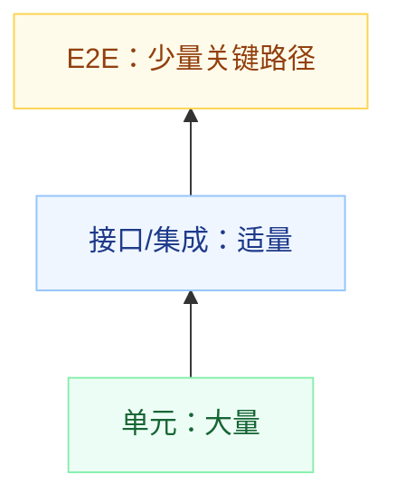
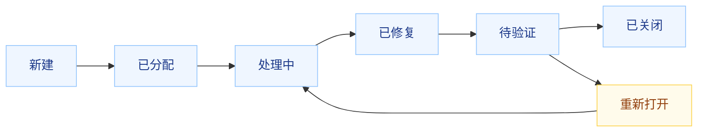

# 测试策略与用例设计

> 这篇从测试目标讲起，经过分层策略、等价类/边界值/判定表、覆盖率、缺陷和回归，最后落到测试计划、准入准出和一个优惠计算的完整用例案例。
>
> 学完能为一个功能写出分层测试策略和可执行用例。

## 一、测试的目标

测试不是“证明没有 bug”，而是**用可接受的成本，发现最重要的风险**。验证（Verification）回答“做得对不对”，确认（Validation）回答“做的是不是用户要的”。

测试的价值在于提前暴露失败，而不是事后记录失败；测试层次越高，反馈越慢、成本越高，能用低层测的不要放到高层；覆盖率是“测了什么”的下限，不是“测得对不对”的证明。

### 1.1 缺陷越晚发现越贵

| 发现阶段 | 典型成本 | 原因 |
|---|---|---|
| 需求评审 | 改文档 | 只改描述和共识 |
| 设计评审 | 改设计 | 影响接口和模块 |
| 编码/单元测试 | 改代码 | 影响局部 |
| 集成/系统测试 | 改代码 + 联调 + 回归 | 跨模块、跨团队 |
| 生产 | 修复 + 客诉 + 数据修复 + 信誉 | 不可逆损失最大 |

> 边界：不是所有缺陷都值得在需求阶段消灭。探索性需求需要尽早用原型验证，而不是写更长的文档。

## 二、测试层次与策略

| 层次 | 测什么 | 速度 | 典型工具 |
|---|---|---|---|
| 单元测试 | 一个类/函数的行为 | 毫秒 | JUnit 5、TestNG |
| 集成测试 | 模块与数据库/消息/外部服务 | 秒 | Testcontainers、Spring Boot Test |
| 接口测试 | API 契约、状态码、边界 | 秒 | RestAssured、Playwright API |
| 端到端测试 | 用户关键路径 | 十秒到分钟 | Playwright、Cypress |
| 探索性测试 | 未知风险和交互 | 人工 | 场景清单、会话式测试 |

### 2.1 金字塔与奖杯

- **测试金字塔**：大量单元测试、适量集成测试、少量 E2E。适合业务逻辑复杂、UI 变化快的系统。
- **测试奖杯**：少量单元、较多集成、少量 E2E。适合以 API/数据库交互为主的后端服务。

| 策略 | 适合 | 风险 |
|---|---|---|
| 金字塔 | 领域逻辑重、纯函数多 | 集成覆盖不足，接口问题漏到高层 |
| 奖杯 | 服务端业务、数据库交互多 | 单元测试不足，定位变慢 |
| 冰淇淋 | 大量 E2E、少量单元 | 慢、脆、维护成本高 |



> 边界：不要迷信某一种形状。关键路径要有 E2E，复杂规则要有单元测试，数据库/消息契约要有集成测试。

## 三、用例设计方法

### 3.1 等价类划分

把输入分成若干类，每类选一个代表值。有效等价类和无效等价类都要覆盖。

以优惠计算为例：

```text
calculateDiscount(userLevel, amount, coupon)
- userLevel: NORMAL / VIP / SVIP
- amount: 金额，必须 > 0
- coupon: null / MINUS_20（满 200 减 20）
- 折扣上限 50 元
```

| 输入 | 有效等价类 | 无效等价类 |
|---|---|---|
| userLevel | NORMAL、VIP、SVIP | null、未知等级 |
| amount | 0 < amount < 200、amount ≥ 200 | amount ≤ 0、非数字 |
| coupon | null、MINUS_20 | 过期券、未知券 |

### 3.2 边界值

边界值是最容易出错的地方。对 `amount` 取：

```text
-1, 0, 0.01, 199.99, 200, 200.01
```

对折扣上限取：

```text
49.99, 50, 50.01
```

### 3.3 判定表

当多个条件组合决定结果时，判定表比一堆 if 更清楚。

| 规则 | 1 | 2 | 3 | 4 |
|---|---|---|---|---|
| 用户是 VIP | 是 | 是 | 否 | 否 |
| 金额 ≥ 200 | 是 | 否 | 是 | 否 |
| 使用优惠券 | 是 | 否 | 是 | 否 |
| 折扣 | 5% + 20 | 5% | 20 | 0 |

> 表只展开 VIP 与普通两档；SVIP 的 10% 是第三档，需要单独补规则。

> 边界：判定表适合条件组合有限的规则；条件超过 5 个时，用 pairwise 或业务优先级裁剪，不要穷举。

### 3.4 状态迁移与成对组合

- 状态迁移：订单待支付 → 已支付 → 待发货 → 已发货 → 已完成；覆盖非法迁移（已取消 → 已发货）。
- 成对组合（pairwise）：浏览器 × 操作系统 × 分辨率，不必做全排列，用工具生成两两组合。

### 3.5 JUnit 5 片段

```java
import org.junit.jupiter.api.Test;
import static org.junit.jupiter.api.Assertions.*;

class DiscountTest {
    @Test
    void vipShouldGetFivePercentDiscount() {
        // VIP 100 元，5% 折扣 = 5 元
        assertEquals(5.0, Discount.calculate("VIP", 100, null), 0.001);
    }

    @Test
    void amountMustBePositive() {
        // 金额 0 是非法输入，应该在入口抛异常
        assertThrows(IllegalArgumentException.class,
            () -> Discount.calculate("NORMAL", 0, null));
    }
}
```

> 边界：单元测试不要依赖真实数据库、网络和时间。外部依赖用 Testcontainers 或 mock 隔离。

## 四、覆盖率与度量

| 指标 | 说明 | 局限 |
|---|---|---|
| 语句覆盖率 | 执行了多少行代码 | 不保证分支都走到 |
| 分支覆盖率 | 每个 if/else 是否都走过 | 不保证组合和边界 |
| 路径覆盖率 | 所有路径组合 | 路径爆炸，通常只对关键模块做 |
| 变异测试 | 人为改代码，看测试能否发现 | 成本高，适合核心模块 |

覆盖率不是越高越好。一个 100% 覆盖的测试可能没有断言，也可能只覆盖了正常路径。

> 边界：把覆盖率当门槛时，先明确“哪些模块必须达到多少”，不要全项目一刀切。

## 五、缺陷与回归

### 5.1 缺陷生命周期



### 5.2 严重程度与优先级

| 维度 | 回答 | 示例 |
|---|---|---|
| 严重程度（Severity） | 对系统/用户的影响 | 崩溃、数据丢失、显示错位 |
| 优先级（Priority） | 多快修 | 立即、本迭代、下迭代 |

严重程度高不代表优先级一定高：一个罕见崩溃可能严重但优先级低；一个文案错误可能不严重但优先级高。

### 5.3 回归范围

回归不是“全部重跑”，而是按影响面选：

- 改动模块的直接测试；
- 依赖该模块的上下游接口；
- 共享组件、公共库、数据库迁移；
- 关键业务路径的冒烟测试；
- 历史上出过问题的区域。

> 边界：只跑“改动附近”的测试会漏掉跨模块影响；只跑全量 E2E 会慢到没人愿意跑。分层回归是折中。

## 六、测试计划与验收

一个可执行的测试计划至少包含：

- 测试范围与不测范围；
- 风险清单和优先级；
- 测试层次与工具；
- 环境、数据、账号；
- 准入/准出标准；
- 缺陷处理与回归策略。

准入/准出示例：

| 阶段 | 准入 | 准出 |
|---|---|---|
| 单元测试 | 代码编译通过 | 核心模块分支覆盖率 ≥ 70% |
| 集成测试 | 依赖服务可用 | 关键接口全部通过 |
| E2E | 主流程可部署 | P0 用例通过，无阻断缺陷 |
| 上线 | 回归通过 | 冒烟通过，监控和回滚就绪 |

## 七、最佳实践案例

### 7.1 案例背景

优惠计算 `Discount.calculate(level, amount, coupon)` 支持 NORMAL/VIP/SVIP 三种用户，VIP 95 折、SVIP 9 折，满 200 可用 `MINUS_20` 券，折扣上限 50 元。需求方要求“规则改了不能把老用例改坏”。

### 7.2 案例实操

```java
public class Discount {
    public static double calculate(String level, double amount, String coupon) {
        // 金额必须为正，边界在入口拦截
        if (amount <= 0) throw new IllegalArgumentException("amount must be positive");
        if (level == null) throw new IllegalArgumentException("level required");
        // 未知券不能静默当成无券，否则用户以为用上了券
        if (coupon != null && !"MINUS_20".equals(coupon)) {
            throw new IllegalArgumentException("unknown coupon");
        }

        double rate = switch (level) {
            case "NORMAL" -> 0.0;
            case "VIP" -> 0.05;
            case "SVIP" -> 0.10;
            // 未知等级直接拒绝，避免静默算错
            default -> throw new IllegalArgumentException("unknown level");
        };

        double result = amount * rate;
        // 满 200 才叠加优惠券
        if ("MINUS_20".equals(coupon) && amount >= 200) result += 20;
        // 折扣上限 50
        return Math.min(result, 50);
    }
}
```

```java
import org.junit.jupiter.api.Test;
import static org.junit.jupiter.api.Assertions.*;

class DiscountTest {
    @Test void normalHasNoDiscount() {
        assertEquals(0, Discount.calculate("NORMAL", 100, null), 0.001);
    }

    @Test void vipGetsFivePercent() {
        assertEquals(5, Discount.calculate("VIP", 100, null), 0.001);
    }

    @Test void svipWithCoupon() {
        // 200 * 10% = 20，再叠加 20 元券 = 40
        assertEquals(40, Discount.calculate("SVIP", 200, "MINUS_20"), 0.001);
    }

    @Test void discountIsCappedAt50() {
        // 1000 * 10% = 100，加券 20，最终被上限截到 50
        assertEquals(50, Discount.calculate("SVIP", 1000, "MINUS_20"), 0.001);
    }

    @Test void amountMustBePositive() {
        assertThrows(IllegalArgumentException.class,
            () -> Discount.calculate("VIP", 0, null));
    }

    @Test void levelMustBeKnown() {
        assertThrows(IllegalArgumentException.class,
            () -> Discount.calculate("UNKNOWN", 100, null));
    }
}
```


运行：

```bash
./gradlew test
# 或 mvn test
```

```text
Tests run: 6, Failures: 0, Errors: 0, Skipped: 0
BUILD SUCCESS
```

### 7.3 案例结果

6 个测试全部通过，覆盖正常路径、边界（200、上限 50）、非法输入和未知枚举。再补集成测试覆盖优惠券服务、E2E 覆盖下单主路径；生产监控折扣异常率和客诉。

复盘：覆盖率不是目的；真正要防的是“规则变了但老用例没覆盖到”的回归。每次规则变更先补用例，再改实现。
