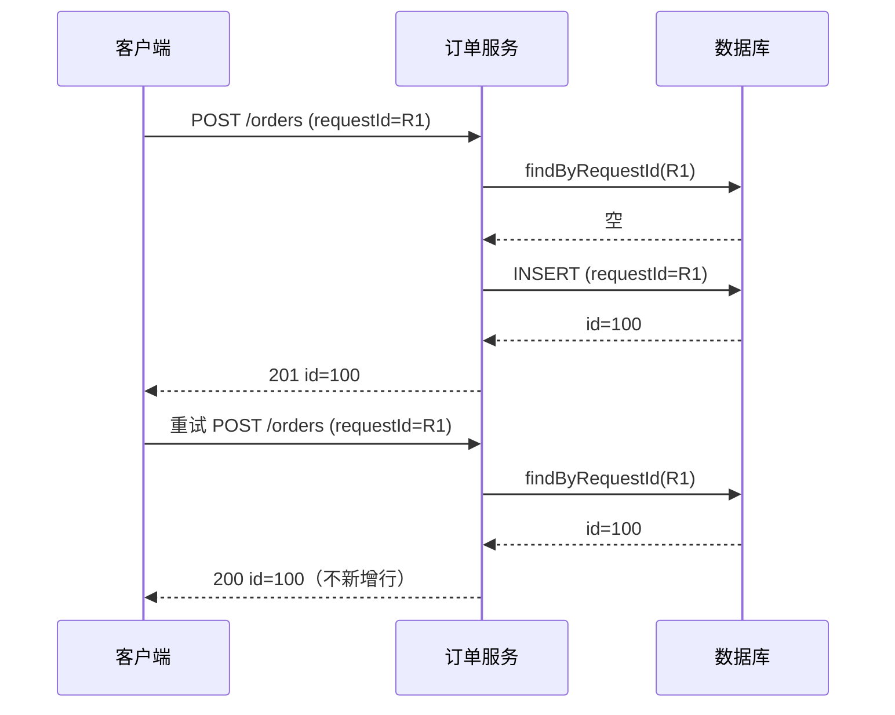

# 测试数据与覆盖率

> 这篇从测试为什么会被数据拖垮讲起，经过测试数据构造、测试替身、夹具生命周期、数据隔离、幂等与重复执行、JaCoCo 覆盖率采集与门槛、覆盖率的局限和变异测试，最后落到一套能重复运行、能卡住底线、能复盘的测试工程与完整案例。
>
> 学完能为一个服务设计隔离的测试数据层，用 JaCoCo 和 PIT 度量覆盖率，并把门槛配到真正该管的代码上。

## 一、测试数据与覆盖率的边界

测试数据决定测试能不能重复，覆盖率决定测试有没有漏；两者都不是质量本身，而是质量的可观察信号。

一个测试用例由四部分组成，任何一部分不受控，测试就会时绿时红：

| 组成 | 内容 | 失控后的典型现象 |
|---|---|---|
| 输入 | 参数、报文、文件 | 同一用例在不同环境结果不同 |
| 期望 | 断言值、快照 | 断言写死生产数据，换环境就失败 |
| 前置状态 | 数据库行、缓存、账号 | 单独跑通过，一起跑失败 |
| 外部响应 | 下游返回值、消息、时间 | 网络抖动或时钟漂移导致偶发失败 |

覆盖率只回答“哪些代码被执行过”，不回答“断言是否正确”“组合是否覆盖”“生产风险是否被测到”。把覆盖率当质量分，和把体温计当药方是同一种错误。

### 1.1 数据导致不稳定的三类根因

测试不稳定的根因可以归到三类，定位时先归类，再改夹具。

| 根因 | 典型写法 | 修法 |
|---|---|---|
| 共享可变状态 | 静态集合、共享账号、同一张表不清理 | 每个测试独立实例或独立 schema |
| 时间与随机 | `LocalDate.now()`、`new Random()`、自增主键 | 注入 `Clock`、固定种子、不依赖具体 ID |
| 外部副作用 | 真发短信、真扣款、真写对象存储 | 测试替身或沙箱，副作用可观测可清理 |

`Thread.sleep(1000)` 不是同步手段，而是把“偶发失败”换成“必然变慢”。等待异步结果用轮询加超时，或直接用同步接口替代。

### 1.2 覆盖率能回答和不能回答的问题

| 能回答 | 不能回答 |
|---|---|
| 哪些类一行都没执行 | 断言是否有效 |
| 哪些分支只走了一半 | 条件组合是否覆盖 |
| 新增代码有没有测试 | 并发与事务是否正确 |
| 测试投入大致落在哪些模块 | 生产配置、SQL、序列化是否正确 |

覆盖率报告是一张地图，不是判决书。地图指出哪里没去过，去不去、怎么去仍要看风险。

## 二、准备：可重复的测试工程

这一章把 JDK、Maven、JUnit、JaCoCo 装好，跑通一个最小测试，后续所有数据与覆盖率实践都建立在这个工程上。

### 2.1 版本基线

| 组件 | 版本 | 用途 |
|---|---|---|
| JDK | 21 LTS | 编译与运行，25 LTS 可按团队节奏升级 |
| JUnit Jupiter | 5.11.4（5.11+/6） | 测试框架，JUnit 6 沿用 Jupiter API |
| Mockito | 5.14.2（5.x） | 测试替身 |
| JaCoCo | 0.8.12 | 覆盖率采集与门槛 |
| Testcontainers | 1.20.6（1.20+） | 真实数据库/中间件夹具 |
| PIT | 1.17.3 | 变异测试 |

JUnit 6 与 5.11 的注解、断言、参数化 API 一致，升级主要是更换 BOM 和少量废弃 API；新项目直接用 6，存量项目留在 5.11+ 也能满足本篇全部示例。

### 2.2 安装

macOS：

```bash
brew install --cask temurin@21
brew install maven
# Temurin 会安装到 /Library/Java/JavaVirtualMachines，java_home 可直接找到
export JAVA_HOME=$(/usr/libexec/java_home -v 21)
```

Ubuntu：

```bash
sudo apt update
sudo apt install -y openjdk-21-jdk maven
```

Rocky Linux / CentOS Stream：

```bash
sudo dnf install -y java-21-openjdk-devel maven
```

Windows（PowerShell）：

```powershell
winget install EclipseAdoptium.Temurin.21.JDK
winget install Apache.Maven
```

验证：

```bash
java -version
mvn -v
```

```text
openjdk version "21.0.13" 2026-10-22 LTS
Apache Maven 3.10.0
Java version: 21.0.13, vendor: Eclipse Adoptium
```

三端只要求“能编译、能跑测试”，不要求安装 Docker；需要 Testcontainers 的测试会单独打标签，普通构建不依赖 Docker。

### 2.3 工程骨架

```text
order-service/
├── pom.xml
└── src/
    ├── main/java/shop/order/          # 生产代码
    └── test/
        ├── java/shop/order/           # 测试与测试数据工厂
        └── resources/
            ├── junit-platform.properties
            └── schema-postgres.sql
```

`pom.xml` 的关键部分：

```xml
<properties>
  <maven.compiler.release>21</maven.compiler.release>
  <junit.version>5.11.4</junit.version>
  <jacoco.version>0.8.12</jacoco.version>
</properties>

<dependencies>
  <dependency>
    <groupId>org.junit.jupiter</groupId>
    <artifactId>junit-jupiter</artifactId>
    <version>${junit.version}</version>
    <scope>test</scope>
  </dependency>
  <dependency>
    <groupId>org.assertj</groupId>
    <artifactId>assertj-core</artifactId>
    <version>3.27.3</version>
    <scope>test</scope>
  </dependency>
  <dependency>
    <groupId>org.mockito</groupId>
    <artifactId>mockito-core</artifactId>
    <version>5.14.2</version>
    <scope>test</scope>
  </dependency>
  <!-- H2 只用于本地快速集成测试，真实 SQL 差异交给 PostgreSQL 容器 -->
  <dependency>
    <groupId>com.h2database</groupId>
    <artifactId>h2</artifactId>
    <version>2.3.232</version>
    <scope>test</scope>
  </dependency>
  <dependency>
    <groupId>org.testcontainers</groupId>
    <artifactId>junit-jupiter</artifactId>
    <version>1.20.6</version>
    <scope>test</scope>
  </dependency>
</dependencies>
```

### 2.4 最小验证

```java
class SmokeTest {
    @Test
    void frameworkIsWired() {
        // 故意断言一个稳定值：先确认 JUnit 与 surefire 真的在跑，而不是编译通过就算数
        assertEquals(2, 1 + 1);
    }
}
```

```bash
mvn -q test
```

```text
Tests run: 1, Failures: 0, Errors: 0, Skipped: 0
BUILD SUCCESS
```

如果这一步失败，先查 `mvn -v` 的 Java 版本和 `pom.xml` 的 `maven.compiler.release`，不要急着写业务测试。

## 三、测试数据的来源与构造

这一章解决“测试数据从哪里来、用什么结构写”，目标是让一个用例只说清它与默认值的差异。

### 3.1 五种数据来源的取舍

| 来源 | 适合 | 风险 |
|---|---|---|
| 测试内字面量 | 单个用例的边界值 | 重复散落，改字段要全仓搜索 |
| Object Mother | 一类对象的常用形态 | 方法膨胀，默认值不透明 |
| Test Data Builder | 需要少量字段差异的对象 | 样板代码多，需要约定默认值 |
| 生产脱敏快照 | 复现真实边界与脏数据 | 体积大、含隐私、会过期 |
| 初始化脚本 | 数据库、消息、配置 | 与生产 schema 漂移 |

选择顺序：能在测试内写清的就写清；一类对象反复出现，升级为 Object Mother 或 Builder；需要真实分布时才用脱敏快照，并设过期时间。

### 3.2 Object Mother 与 Test Data Builder

Object Mother 提供“典型对象”，Builder 负责在典型对象上做局部变化。两者合起来，默认值集中一处，用例只写差异。

```java
public final class Orders {

    private Orders() {
    }

    public static CommandBuilder aCommand() {
        return new CommandBuilder();
    }

    public static final class CommandBuilder {
        // 默认值必须是最小合法输入：用例不关心字段时，测试仍能跑通
        private String requestId = "req-0001";
        private String customerId = "cus-1001";
        private String sku = "SKU-42";
        private int quantity = 1;
        private double unitPrice = 99.00;
        private MemberLevel level = MemberLevel.NORMAL;

        public CommandBuilder requestId(String value) {
            this.requestId = value;
            return this;
        }

        public CommandBuilder customerId(String value) {
            this.customerId = value;
            return this;
        }

        public CommandBuilder sku(String value) {
            this.sku = value;
            return this;
        }

        public CommandBuilder quantity(int value) {
            this.quantity = value;
            return this;
        }

        public CommandBuilder unitPrice(double value) {
            this.unitPrice = value;
            return this;
        }

        public CommandBuilder level(MemberLevel value) {
            this.level = value;
            return this;
        }

        public PlaceOrderCommand build() {
            return new PlaceOrderCommand(requestId, customerId, sku, quantity, unitPrice, level);
        }
    }
}
```

用例只写与本场景相关的字段：

```java
@Test
void silverMemberGetsFivePercentOff() {
    // 只改等级，其余字段沿用默认值，失败时一眼看出是等级规则的问题
    Order order = service.place(Orders.aCommand()
            .level(MemberLevel.SILVER).build());

    assertThat(order.total()).isEqualTo(94.05);
}
```

边界：Builder 的默认值一旦变化，所有未显式赋值的用例都会跟着变。默认值只放“合法且稳定”的值，不要放随机数、当前时间或生产 ID。

### 3.3 测试替身：fake、stub、mock 的选择

替身不是越多越好。能用一个几十行的 fake 解决，就不要用 mock 录制一堆交互。

| 替身 | 行为 | 适合 |
|---|---|---|
| Fake | 有简化实现，如内存仓储 | 仓储、网关的本地替代 |
| Stub | 只返回预设值 | 固定下游响应、异常分支 |
| Mock | 记录并验证调用 | 必须验证“有没有发生”的副作用 |
| Spy | 包住真实对象并记录 | 遗留代码局部替换 |

Mockito 5 的 stub 示例（片段，省略 import 与 `FIXED_CLOCK` 定义）：

```java
@Test
void pricingRuleUsesCommandValues() {
    OrderRepository repository = mock(OrderRepository.class);
    when(repository.findByRequestId(anyString())).thenReturn(Optional.empty());
    // mock 的 insert 默认返回 null；不写 thenAnswer，service 会拿到 null 直接 NPE
    when(repository.insert(any(Order.class))).thenAnswer(inv -> inv.getArgument(0));

    OrderService service = new OrderService(repository, FIXED_CLOCK);
    Order order = service.place(Orders.aCommand().quantity(3).unitPrice(0.125).build());

    assertThat(order.total()).isEqualTo(0.38);
    // 只验证关键交互一次，避免把测试写成调用序列回放
    verify(repository, times(1)).insert(any(Order.class));
}
```

> 边界：对“返回数据”的依赖用 stub 或 fake；只有“必须发生的动作”（发消息、扣库存、写审计）才值得 verify。大量 verify 会让重构寸步难行。

### 3.4 边界与非法数据

参数化测试把同一规则的多组输入压成一个用例，失败时能直接看到是哪组数据。

```java
@ParameterizedTest(name = "{0}")
@MethodSource("invalidCommands")
void rejectsInvalidInput(String reason, PlaceOrderCommand cmd) {
    assertThatThrownBy(() -> service.place(cmd))
            .as(reason)
            .isInstanceOf(InvalidOrderException.class);
}

static Stream<Arguments> invalidCommands() {
    return Stream.of(
            Arguments.of("quantity 0", Orders.aCommand().quantity(0).build()),
            Arguments.of("negative quantity", Orders.aCommand().quantity(-1).build()),
            Arguments.of("unit price 0", Orders.aCommand().unitPrice(0).build()),
            Arguments.of("null level", Orders.aCommand().level(null).build()),
            Arguments.of("blank requestId", Orders.aCommand().requestId(" ").build()));
}
```

数值边界用 `@CsvSource`，把“输入 → 期望”排成表（片段，`calculate` 由被测类提供）：

```java
@ParameterizedTest(name = "{0} 件 × 单价 {1} = {2}")
@CsvSource({
        "1, 99.00, 99.00",
        "2, 99.00, 198.00",
        "3, 0.125, 0.38"
})
void pricingRule(int quantity, double unitPrice, double expectedTotal) {
    // 断言使用精确到分的比较，避免浮点误差把正确结果判成失败
    assertThat(calculate(quantity, unitPrice)).isEqualTo(expectedTotal);
}
```

边界：参数化适合“规则相同、数据不同”；如果每组数据的期望逻辑不同，应拆成独立用例，否则测试名会变成一串无法维护的拼接。

### 3.5 时间、随机与自增

时间、随机数、自增 ID 是“隐性输入”。不注入，测试就只能靠运气。片段（只保留与时间相关的部分）：

```java
// 片段：OrderService 构造与方法体省略，只看时钟如何进入生产代码
public class OrderService {
    private final Clock clock;

    public OrderService(OrderRepository repository, Clock clock) {
        this.repository = repository;
        this.clock = clock;
    }

    public Order place(PlaceOrderCommand cmd) {
        ...
        // 用注入的时钟取日期，测试可以固定到任意一天，不随运行日期漂移
        Order draft = new Order(0, cmd.requestId(), cmd.customerId(), cmd.sku(),
                cmd.quantity(), total, OrderStatus.PLACED, LocalDate.now(clock));
        return repository.insert(draft);
    }
}
```

测试固定时钟：

```java
private static final Clock FIXED_CLOCK = Clock.fixed(
        Instant.parse("2026-11-13T08:00:00Z"), ZoneOffset.UTC);

@Test
void orderDateComesFromClock() {
    Order order = new OrderService(new InMemoryOrderRepository(), FIXED_CLOCK)
            .place(Orders.aCommand().build());

    assertThat(order.placedAt()).isEqualTo(LocalDate.parse("2026-11-13"));
}
```

随机数的规则相同：生产代码注入 `RandomGenerator` 或种子，测试用固定种子；业务键用调用方生成的 UUID 或请求号，不在断言里依赖数据库自增 ID。

> 边界：固定时钟会让“跨天边界”“闰秒”“时区”类缺陷消失。涉及日期规则的模块，至少保留一组使用真实时钟的集成测试，或在用例里显式切到边界时刻。

### 3.6 生产数据脱敏

生产快照能复现真实脏数据，但必须脱敏、限量、限期。

| 字段 | 处理 | 说明 |
|---|---|---|
| 手机号 | 保留前三位后四位，中间掩码 | 仍可按号段分布测试 |
| 邮箱 | 本地部分替换为哈希 | 保留域名用于路由测试 |
| 身份证/银行卡 | 删除或格式保持的假号 | 不保留可逆映射 |
| 地址 | 截断到城市级别 | 不进入测试仓库 |
| 金额 | 保留原值 | 金额分布是测试价值所在 |

约束：快照不进 Git 历史，放受控的对象存储；每次导入生成新库，不覆盖共享库；设置过期时间，避免两年前的 schema 混进今天的测试。

## 四、夹具：建立与清理

这一章解决“测试开始前准备什么、结束后留下什么”，核心原则是每个测试都能独立重跑。

### 4.1 JUnit 生命周期钩子

| 钩子 | 执行次数 | 适合 |
|---|---|---|
| `@BeforeAll` | 每个类一次 | 启动容器、建库、加载只读配置 |
| `@BeforeEach` | 每个方法一次 | 清表、造本用例数据、重置替身 |
| `@AfterEach` | 每个方法一次 | 删除临时文件、关闭客户端 |
| `@AfterAll` | 每个类一次 | 停止容器、释放全局资源 |

默认把可变状态放在 `@BeforeEach`。`@BeforeAll` 只放“启动贵、内容只读”的资源；一旦在 `@BeforeAll` 里造业务数据，方法之间就会互相污染。

### 4.2 数据库夹具：内存库与容器

| 形态 | 速度 | 真实度 | 适合 |
|---|---|---|---|
| H2 内存库 | 毫秒 | 中，SQL 方言有差异 | 本地单元/仓储快速反馈 |
| 本地固定数据库 | 秒 | 高 | 开发联调 |
| Testcontainers | 秒到十秒 | 高，版本可锁 | CI 契约测试 |

H2 夹具的关键是“每个测试类一个独立库”，而不是所有类共享一个库：

```java
public final class TestDatabase {

    public static JdbcDataSource newDataSource() {
        // 名字带 UUID：每个调用方拿到独立内存库，类之间物理隔离
        JdbcDataSource ds = new JdbcDataSource();
        ds.setURL("jdbc:h2:mem:" + UUID.randomUUID() + ";DB_CLOSE_DELAY=-1");
        try (Connection c = ds.getConnection(); Statement st = c.createStatement()) {
            st.execute("""
                    CREATE TABLE orders (
                      id BIGINT AUTO_INCREMENT PRIMARY KEY,
                      request_id VARCHAR(64) NOT NULL,
                      customer_id VARCHAR(64) NOT NULL,
                      sku VARCHAR(64) NOT NULL,
                      quantity INT NOT NULL,
                      total NUMERIC(12,2) NOT NULL,
                      status VARCHAR(16) NOT NULL,
                      placed_at DATE NOT NULL,
                      -- 唯一索引既是业务约束，也是并发幂等的最后防线
                      CONSTRAINT uq_request_id UNIQUE (request_id)
                    )
                    """);
        } catch (SQLException e) {
            throw new IllegalStateException("init schema failed", e);
        }
        return ds;
    }
}
```

真实 PostgreSQL 用 Testcontainers，单例容器、类内共享：

```java
@Tag("docker")
@Testcontainers
class OrderRepositoryPostgresTest {

    // static：每个测试类只启动一次容器；每个方法起一个会把测试时间拖到不可用
    @Container
    static final PostgreSQLContainer<?> POSTGRES =
            new PostgreSQLContainer<>("postgres:16-alpine")
                    .withInitScript("schema-postgres.sql");

    static JdbcOrderRepository repository;

    @BeforeAll
    static void init() {
        PGSimpleDataSource ds = new PGSimpleDataSource();
        ds.setURL(POSTGRES.getJdbcUrl());
        ds.setUser(POSTGRES.getUsername());
        ds.setPassword(POSTGRES.getPassword());
        repository = new JdbcOrderRepository(ds);
    }

    @BeforeEach
    void clean() {
        repository.deleteAll();
    }
}
```

普通构建用标签排除，CI 单独跑。pom 里把排除组做成属性，CI 才能覆盖：

```xml
<properties>
  <excluded.groups>docker</excluded.groups>
</properties>

<plugin>
  <groupId>org.apache.maven.plugins</groupId>
  <artifactId>maven-surefire-plugin</artifactId>
  <version>3.5.2</version>
  <configuration>
    <!-- 默认排除 docker 组：本机没装 Docker 也能跑完 28 个普通用例 -->
    <excludedGroups>${excluded.groups}</excludedGroups>
  </configuration>
</plugin>
```

```bash
mvn verify                                        # 本地：默认排除 docker 组
mvn test -Dgroups=docker -Dexcluded.groups=none   # CI：只跑容器测试
```

`-Dgroups=docker` 与 pom 里的 `excludedGroups` 会同时生效；不清空排除组，容器测试会被自己的标签挡掉，日志里是 `Tests run: 0`。

> 边界：H2 不能替代 PostgreSQL 的锁、JSONB、序列、`ON CONFLICT` 等行为。仓储 SQL 至少有一组在真实数据库上跑；把 H2 全绿当作数据库正确，是最常见的假安全感。

### 4.3 清理策略的取舍

| 策略 | 做法 | 风险 |
|---|---|---|
| 按条件删除 | `DELETE FROM t WHERE ...` | 漏删就污染下个用例 |
| 清空表 | `DELETE FROM t` / `TRUNCATE` | 外键顺序、序列不回退 |
| 事务回滚 | 测试方法包事务，结束回滚 | 跨线程、HTTP 调用不生效 |
| 重建 schema | 每类建库、每方法重建 | 慢，但隔离最彻底 |

删除与清空示例：

```java
@BeforeEach
void clean() {
    // 全表清空比按条件删除可靠：不会因为新增过滤条件漏掉上一轮数据
    repository.deleteAll();
}
```

清空表不会重置自增序列，所以断言不要依赖“第一条记录的 ID 是 1”。需要固定 ID 时，用固定值显式插入，或只断言业务键。

### 4.4 事务回滚夹具的坑

`@Transactional` 加在测试方法上，只能回滚同一线程、同一连接内的 JDBC 操作。

- 测试里通过 HTTP 调服务，服务用自己的连接和事务，测试回滚不到；
- `@Async`、线程池、消息监听器里的写入不在测试事务内；
- 序列、`AUTO_INCREMENT`、DDL 不回滚；
- 有些数据库的 DDL 隐式提交，建表后再回滚也无效。

结论：事务回滚适合“单线程、同数据源、只读为主”的仓储测试；涉及接口、异步、多数据源时，用清表或独立库。

### 4.5 文件与临时目录

文件夹具用 `@TempDir`，由 JUnit 负责创建和删除，测试不往项目目录写文件。

```java
@Test
void exportsOrderCsv(@TempDir Path tempDir) throws IOException {
    Path out = tempDir.resolve("orders.csv");

    exporter.write(List.of(Orders.aCommand().build()), out);

    // 断言文件内容而不是文件存在，避免"写了个空文件"也算通过
    assertThat(Files.readAllLines(out)).containsExactly("requestId,customerId,total",
            "req-0001,cus-1001,99.0");
}
```

> 边界：`@TempDir` 只管生命周期，不管内容。测试要断言文件内容、编码和换行；跨平台换行差异用按行读取，不要整体字符串比较。

### 4.6 外部服务与中间件

HTTP 下游用本地 stub 服务，消息与缓存用容器；不要让测试直连共享沙箱。

```java
// 片段：WireMock 固定下游响应，测试不依赖第三方可用性
WireMockServer downstream = new WireMockServer(options().dynamicPort());
downstream.stubFor(post(urlEqualTo("/inventory/reserve"))
        .willReturn(aResponse().withStatus(200)
                .withHeader("Content-Type", "application/json")
                .withBody("{\"reserved\":true}")));
```

Kafka、Redis、RabbitMQ 的夹具原则相同：容器版本与生产大版本一致，测试结束即销毁，不在容器里留跨用例数据。

## 五、数据隔离

这一章解决“多个测试同时跑时互不看见对方数据”，包括顺序依赖、并行执行和共享环境。

### 5.1 四种隔离级别

| 级别 | 做法 | 成本 | 适用 |
|---|---|---|---|
| 方法级 | 每方法清表/独立事务 | 低 | 绝大多数单元与仓储测试 |
| 类级 | 每类独立库或 schema | 中 | 同一组共享只读基线数据 |
| 进程级 | 每次构建独立数据库实例 | 高 | 集成测试、并行流水线 |
| 环境级 | 每团队/每流水线独立环境 | 最高 | E2E、验收 |

优先方法级；方法级做不到时，先问“为什么这些用例必须共享状态”，再考虑升级隔离级别，而不是直接上独立环境。

### 5.2 测试顺序依赖是缺陷

用例通过 `@TestMethodOrder` 才能过，说明它在依赖上一个用例的副作用。

```java
// 反例：第二个用例依赖第一个用例插入的数据
@TestMethodOrder(MethodOrderer.OrderAnnotation.class)
class BadOrderDependentTest {
    @Test @Order(1) void createOrder() { ... }
    @Test @Order(2) void findOrder() { ... }
}
```

检测方法：把顺序打乱跑。

```properties
# src/test/resources/junit-platform.properties
junit.jupiter.testmethod.order.default=org.junit.jupiter.api.MethodOrderer$Random
```

连续跑两遍，如果失败集合不同，就是顺序依赖或数据残留。修法是每个用例自己造前置数据，而不是调整顺序。

### 5.3 并行执行与隔离约定

JUnit 5 的并行配置：

```properties
junit.jupiter.execution.parallel.enabled=true
junit.jupiter.execution.parallel.mode.default=same_thread
junit.jupiter.execution.parallel.mode.classes.default=concurrent
```

含义：类之间并行，类内方法串行。要方法级并行，把 `mode.default` 改成 `concurrent`，同时满足三条：没有静态可变状态、每个用例用唯一业务键、每个类用独立数据库。

共享同一资源（如一个容器、一个外部账号）时，用 `@ResourceLock` 声明读写锁，而不是靠“应该不会撞”。

```java
@Test
@ResourceLock(value = "shared-account", mode = ResourceAccessMode.READ_WRITE)
void usesSharedSandboxAccount() { ... }
```

### 5.4 并发下的数据隔离验证

隔离不能靠“看代码觉得没问题”，要用并发用例验证。8 个线程同时下单，键各不相同，最终应产生 8 行且键不重复：

```java
@Test
void parallelUniqueRequestsEachCreateOneOrder() throws Exception {
    int workers = 8;
    // 所有线程在同一时刻起跑，尽量放大交错，而不是顺序执行假装并发
    CyclicBarrier start = new CyclicBarrier(workers);
    List<Order> results = runConcurrently(workers, i -> {
        start.await(5, TimeUnit.SECONDS);
        return service.place(Orders.aCommand()
                .requestId("req-parallel-" + i)
                .customerId("cus-" + i)
                .build());
    });

    assertThat(results).hasSize(workers);
    assertThat(repository.countAll()).isEqualTo(workers);
    assertThat(results.stream().map(Order::requestId).distinct()).hasSize(workers);
}
```

同一个键并发提交，最终只能有一行，且所有调用拿到同一个订单 ID：

```java
@Test
void sameRequestIdUnderRaceStillCreatesOneOrder() throws Exception {
    int workers = 4;
    CyclicBarrier start = new CyclicBarrier(workers);
    List<Order> results = runConcurrently(workers, i -> {
        start.await(5, TimeUnit.SECONDS);
        // 同一个业务键，模拟用户连点或网关重试
        return service.place(Orders.aCommand().requestId("req-race").build());
    });

    assertThat(results.stream().map(Order::id).distinct()).hasSize(1);
    assertThat(repository.countAll()).isEqualTo(1);
}
```

两个用例共用的并发夹具（放在测试类内，所有任务同时起跑，统一超时）：

```java
private static <T> List<T> runConcurrently(int workers, ThrowingIntFunction<T> task)
        throws Exception {
    ExecutorService pool = Executors.newFixedThreadPool(workers);
    try {
        List<Callable<T>> calls = new ArrayList<>();
        for (int i = 0; i < workers; i++) {
            int index = i;
            calls.add(() -> task.apply(index));
        }
        List<T> results = new ArrayList<>();
        // 统一超时：单个线程卡死不能拖住整个构建
        for (Future<T> future : pool.invokeAll(calls)) {
            results.add(future.get(10, TimeUnit.SECONDS));
        }
        return results;
    } finally {
        pool.shutdownNow();
    }
}

@FunctionalInterface
interface ThrowingIntFunction<T> {
    T apply(int index) throws Exception;
}
```

> 边界：并发用例能暴露问题，但不能证明没有并发问题。竞态窗口、数据库隔离级别、连接池行为都会影响结果；关键路径仍要在预发环境做压测与故障注入。

### 5.5 共享环境的数据纪律

| 纪律 | 做法 |
|---|---|
| 命名空间 | 每个流水线用固定前缀，如 `ci-1042-` |
| 生命周期 | 数据带创建时间，超过 TTL 自动清理 |
| 账号 | 只给测试库权限，禁止连生产 |
| 清理 | 流水线结束删前缀数据，失败也执行 |

共享环境只用于 E2E 和验收，不用来跑单元测试；单元测试一旦依赖共享环境，反馈速度和稳定性都会崩。

## 六、幂等与可重复执行

这一章解决“同一个请求重复执行，结果是否一致”，既包括业务接口的幂等，也包括测试本身能否重复运行。

### 6.1 两种幂等

| 对象 | 定义 | 验证方式 |
|---|---|---|
| 业务幂等 | 同一业务键重复提交，只产生一次副作用 | 重放、并发同键 |
| 测试幂等 | 同一测试重复运行，结果稳定一致 | 重复运行、随机顺序 |

业务幂等靠设计，测试幂等靠夹具；两者缺一，构建就会时绿时红。

### 6.2 幂等键与唯一索引

幂等键由调用方生成（requestId、订单号、消息 ID），服务端用它判断“这是不是同一次请求”。

```sql
CREATE TABLE orders (
  id BIGSERIAL PRIMARY KEY,
  request_id VARCHAR(64) NOT NULL,
  customer_id VARCHAR(64) NOT NULL,
  sku VARCHAR(64) NOT NULL,
  quantity INT NOT NULL,
  total NUMERIC(12,2) NOT NULL,
  status VARCHAR(16) NOT NULL,
  placed_at DATE NOT NULL,
  -- 唯一索引是并发的最后防线：应用层先查后插存在竞态
  CONSTRAINT uq_request_id UNIQUE (request_id)
);
```

应用层先查再插，能挡住绝大多数重复；并发下仍可能两个请求同时查到“不存在”，此时靠唯一索引兜底（片段，省略入参校验与 `draft` 构造）：

```java
public Order place(PlaceOrderCommand cmd) {
    Optional<Order> existing = repository.findByRequestId(cmd.requestId());
    if (existing.isPresent()) {
        return existing.get();          // 重复请求直接返回原订单
    }
    try {
        return repository.insert(draft);
    } catch (DuplicateRequestException e) {
        // 并发下另一个请求已插入，回读并返回同一订单，客户端看到幂等结果
        return repository.findByRequestId(cmd.requestId())
                .orElseThrow(() -> new IllegalStateException("duplicate but not found", e));
    }
}
```

仓储把数据库的唯一键冲突翻译成业务异常，而不是把 SQL 错误抛给调用方：

```java
} catch (SQLException e) {
    // 23505 = 唯一键冲突；只在这个码上转成幂等信号
    if ("23505".equals(e.getSQLState())) {
        throw new DuplicateRequestException(order.requestId(), e);
    }
    throw new IllegalStateException("insert failed", e);
}
```

> 边界：唯一索引只保证“同键只有一行”，不保证“业务只执行一次”。如果插入前后还有扣库存、发消息，必须把这些副作用纳入同一个事务或补偿流程，否则订单唯一、库存扣了两次。

### 6.3 重放测试

重放是最直接的幂等验证：同一命令执行两次，第二次返回第一次的订单，数据库只有一行。

```java
@Test
void replayingSameRequestIdReturnsTheFirstOrder() {
    PlaceOrderCommand cmd = Orders.aCommand().build();

    Order first = service.place(cmd);
    Order second = service.place(cmd);

    assertThat(second.id()).isEqualTo(first.id());
    assertThat(repository.countAll()).isEqualTo(1);
}
```



### 6.4 重复运行与竞态

`@RepeatedTest` 把同一用例跑多次，专门用来抓“第二次开始失败”的问题。

```java
class RepeatableRunTest {

    @RepeatedTest(value = 5, name = "第 {currentRepetition}/{totalRepetitions} 次")
    void sameRequestIdStaysIdempotentAcrossRuns() {
        // 每次重复都新建仓储与库，模拟"测试重跑"；清理不干净时 count 会逐次累加
        JdbcOrderRepository repository =
                new JdbcOrderRepository(TestDatabase.newDataSource());
        OrderService service = new OrderService(repository, FIXED_CLOCK);

        service.place(Orders.aCommand().requestId("req-repeat").build());
        service.place(Orders.aCommand().requestId("req-repeat").build());

        assertThat(repository.countAll()).isEqualTo(1);
    }
}
```

```text
Tests run: 5, Failures: 0, Errors: 0, Skipped: 0
```

竞态验证已在 5.4 给出：4 个线程同键提交，断言所有返回 ID 相同、表里只有一行。重放与竞态一起，才算把幂等测完整。

### 6.5 消息与批处理的幂等

消息队列通常是“至少一次”投递，消费者必须按消息 ID 去重。

```sql
CREATE TABLE consumed_message (
  message_id VARCHAR(64) PRIMARY KEY,
  consumed_at TIMESTAMP NOT NULL,
  -- 主键即去重键：重复消费插入失败，直接跳过业务处理
  result VARCHAR(32) NOT NULL
);
```

消费流程：开启事务 → 插入去重键 → 若冲突则跳过 → 执行业务 → 提交。测试至少覆盖：同一消息投两次只产生一条业务记录；业务失败时去重记录一并回滚，允许重试；ack 在事务提交之后。

> 边界：端到端的“恰好一次”是幻觉。生产上能做到的是“至少一次投递 + 消费端幂等”，测试要按这个模型写，不要按理想模型写。

## 七、覆盖率：采集与门槛

这一章解决“覆盖率怎么采、怎么看、怎么设门槛”，重点是把数字放回它该在的位置。

### 7.1 JaCoCo 的工作方式

JaCoCo 分三步：测试 JVM 启动时挂 agent 插桩，运行期间把命中数据写入 `.exec` 文件，构建后用 report 目标生成 HTML/XML/CSV。

- agent 参数由 `jacoco:prepare-agent` 写入 `argLine`；
- `jacoco:report` 读取 `.exec` 与 class 文件生成报告；
- `jacoco:check` 按规则读同一份数据，不达标让构建失败。

`.exec` 只记录“哪些探针命中”，不记录断言和业务含义，所以报告必须结合测试代码读。

### 7.2 Maven 配置

```xml
<plugin>
  <groupId>org.jacoco</groupId>
  <artifactId>jacoco-maven-plugin</artifactId>
  <version>0.8.12</version>
  <executions>
    <execution>
      <id>prepare-agent</id>
      <goals><goal>prepare-agent</goal></goals>
    </execution>
    <execution>
      <id>report</id>
      <phase>verify</phase>
      <goals><goal>report</goal></goals>
    </execution>
    <execution>
      <id>check</id>
      <phase>verify</phase>
      <goals><goal>check</goal></goals>
      <configuration>
        <rules>
          <rule>
            <element>CLASS</element>
            <includes>
              <!-- 门槛只压核心域：SQL 适配器的防御分支交给契约测试，不硬凑数字 -->
              <include>shop/order/OrderService</include>
            </includes>
            <limits>
              <limit>
                <counter>BRANCH</counter>
                <value>COVEREDRATIO</value>
                <minimum>0.85</minimum>
              </limit>
            </limits>
          </rule>
        </rules>
      </configuration>
    </execution>
  </executions>
</plugin>
```

运行：

```bash
mvn verify
```

报告在 `target/site/jacoco/index.html`，原始数据在 `target/jacoco.exec`。

### 7.3 指标口径

| 指标 | 含义 | 局限 |
|---|---|---|
| INSTRUCTION | 字节码指令命中比例 | 最细，但和“行”不对应 |
| LINE | 源码行命中比例 | 一行多分支时看不出漏哪支 |
| BRANCH | 分支的 true/false 命中比例 | 不保证条件组合 |
| METHOD | 方法是否至少执行一次 | 一个方法可能大片未测 |
| CLASS | 类是否至少执行一次 | 粒度最粗，容易虚高 |

团队看板优先看 BRANCH；对外汇报可以看 LINE，但不要把 LINE 当验收唯一标准。

### 7.4 读一份真实报告

读一份报告样例的 CSV（示例数据，截取关键列）：

```text
GROUP,PACKAGE,CLASS,INSTRUCTION_MISSED,INSTRUCTION_COVERED,BRANCH_MISSED,BRANCH_COVERED,LINE_MISSED,LINE_COVERED
order-service,shop.order,OrderService,11,169,0,18,0,32
order-service,shop.order,JdbcOrderRepository,99,194,4,4,24,45
order-service,shop.order,MemberLevel,0,35,0,0,0,8
```

读法：

- `OrderService` 分支 18/18，行 32/32，核心规则全命中；
- `JdbcOrderRepository` 分支 4/8，行 45/69，SQL 异常路径没测；
- `MemberLevel` 无分支，行 8/8，枚举构造被执行。

整包分支是 22/26（84.6%）。这个数字低于 85%，但核心类已经 100%，差距全部来自仓储适配器的防御分支。这正是“全局一刀切”会误伤的地方。

HTML 报告的读法：绿色为完全覆盖，黄色为部分覆盖，红色为未覆盖；点进类后，行左侧的颜色条表示该行的指令命中，分支用菱形标记，黄色菱形表示只走了一个方向。

### 7.5 门槛怎么设

先看一个反例配置：

```xml
<rule>
  <element>BUNDLE</element>
  <limits>
    <limit>
      <counter>BRANCH</counter>
      <value>COVEREDRATIO</value>
      <minimum>0.85</minimum>
    </limit>
  </limits>
</rule>
```

同一工程实际运行结果：

```text
[WARNING] Rule violated for bundle order-service: branches covered ratio is 0.84, but expected minimum is 0.85
[ERROR] Failed to execute goal org.jacoco:jacoco-maven-plugin:0.8.12:check (check)
[ERROR] Coverage checks have not been met.
```

0.84 与 0.85 只差一个分支，失败却要全组停下来。原因不是测试差，而是分母里混进了“正常路径不会触发的防御代码”（如 `if (!rs.next()) throw`）。

可执行的设门槛方式：

| 范围 | 建议门槛 | 说明 |
|---|---|---|
| 核心域类 | 分支 ≥ 85% | 订单、计价、风控规则 |
| 适配器/基础设施 | 行 ≥ 60%，不卡分支 | 由契约测试兜底 |
| 生成的 DTO/常量 | 排除 | 没有可测行为 |
| 新增代码 | 增量分支 ≥ 80% | 防止旧债拖累新代码 |

JaCoCo 支持按 `CLASS`、`PACKAGE`、`BUNDLE` 设不同规则，也支持 `<excludes>` 排除生成类。原则是：门槛压在“改坏了会出事”的代码上，不压在数字好看上。

> 边界：`COVEREDRATIO` 的分母是“可测探针”，不是“业务重要性”。排除类之前先写明理由，代码评审时检查，避免把难测的核心逻辑也排除掉。

### 7.6 覆盖率为什么是 0

最常见的四个原因：

1. agent 没挂上：直接跑 `mvn surefire:test` 或在 IDE 里点测试，`prepare-agent` 没执行，`target/jacoco.exec` 不存在；
2. 报告没生成：只跑了 `mvn test`，`report` 绑定在 `verify`，需要 `mvn verify`；
3. `argLine` 被 surefire 配置覆盖：JaCoCo 写入的 `argLine` 被自定义值顶掉，需写成 `<argLine>@{argLine} -Xmx512m</argLine>`；
4. 测试根本没跑：surefire 的 `excludedGroups` 把类排除了，日志里是 `Tests run: 0`。

第一条排查命令：

```bash
mvn -X verify | grep -i jacoco
```

确认 `-javaagent:.../jacocoagent.jar` 出现在测试 JVM 参数里。

### 7.7 多模块与多测试类型合并

多模块先聚合再出报告：

```bash
mvn clean verify
mvn jacoco:report-aggregate -pl report-module -am
```

同一模块有多种测试（单元、集成、容器）时，用追加模式合并 `.exec`：

```bash
mvn test -Djacoco.append=true
mvn verify -Djacoco.append=true
```

边界：合并只解决“数据汇总”，不解决“口径一致”。单元测试和容器测试覆盖的是不同代码，报告里要能分开看，否则一个模块的 90% 会掩盖另一个模块的 30%。

## 八、覆盖率的局限与变异测试

这一章解决“覆盖率看起来很高但测试很弱”的问题，办法是换一种度量：改代码，看测试能不能发现。

### 8.1 覆盖不等于断言

下面这个测试能让 `place` 的行覆盖率达到 100%，却没有验证任何结果：

```java
@Test
void executesWithoutAssertion() {
    // 只调用不 assert：行覆盖满了，断言数为 0
    service.place(Orders.aCommand().build());
}
```

同理，只断言“不抛异常”也无法发现金额算错。检查手段：

- 评审时看断言密度：每个用例至少一个业务断言；
- 用 PIT 看变异杀死率，没断言的代码会留下大量存活变异；
- 关键金额、状态、数量必须精确断言，不用 `isNotNull()` 代替。

### 8.2 分支覆盖不等于组合覆盖

```java
boolean canShip(boolean paid, boolean inStock) {
    if (paid && inStock) {
        return true;
    }
    return false;
}
```

三组用例 `(true, true)`、`(true, false)` 与 `(false, false)` 就能让分支覆盖 100%，但 `(false, true)` 从未验证。条件组合多的规则，用判定表或成对组合补用例，关键模块可要求 MC/DC。

### 8.3 变异测试：PIT

PIT 会生成一批“人为改坏”的代码（把 `>` 改成 `>=`、把 `return true` 改成 `false`、删除方法调用），然后跑测试：测试失败叫“杀死”，测试仍通过叫“存活”。存活变异说明测试没有锁住这条业务规则。

Maven 配置：

```xml
<plugin>
  <groupId>org.pitest</groupId>
  <artifactId>pitest-maven</artifactId>
  <version>1.17.3</version>
  <configuration>
    <!-- 只对核心类做变异，全量跑会把构建时间拉到不可接受 -->
    <targetClasses>
      <param>shop.order.OrderService</param>
    </targetClasses>
    <targetTests>
      <param>shop.order.*Test</param>
    </targetTests>
    <outputFormats>
      <param>HTML</param>
      <param>XML</param>
    </outputFormats>
    <timestampedReports>false</timestampedReports>
  </configuration>
  <dependencies>
    <dependency>
      <groupId>org.pitest</groupId>
      <artifactId>pitest-junit5-plugin</artifactId>
      <version>1.2.2</version>
    </dependency>
  </dependencies>
</plugin>
```

运行与示例输出：

```bash
mvn test-compile org.pitest:pitest-maven:mutationCoverage
```

```text
>> Generated 24 mutations Killed 22 (92%)
>> Mutations with no coverage 2. Test strength 100%
>> Line Coverage (for mutated classes only): 32/32 (100%)
> Ran 39 tests (1.62 tests per mutation)
```

指标读法：

| 指标 | 含义 | 判断 |
|---|---|---|
| Mutation score | 杀死变异 / 生成变异 | 92%，核心规则基本锁住 |
| Test strength | 杀死变异 / 有覆盖的变异 | 100%，有覆盖的都被杀死 |
| No coverage | 变异所在代码没被执行 | 2 个，指向漏测分支 |

存活变异要逐个看：如果变异改变的是业务规则而测试没发现，补断言；如果变异等价于原逻辑（如 `x * 1`），属于等价变异，可以接受。

> 边界：PIT 慢，只对核心类开；测试本身不稳定时，PIT 会把“偶发失败”误判成“杀死”，结果不可信。先在稳定测试集上跑，再进 CI 夜间任务。

### 8.4 覆盖率的盲区

| 盲区 | 例子 | 替代手段 |
|---|---|---|
| SQL 与 schema | 索引、唯一约束、方言差异 | Testcontainers 契约测试 |
| 配置 | 环境变量、功能开关 | 配置矩阵测试 |
| 序列化 | JSON 字段名、日期格式 | 契约测试、快照测试 |
| 并发 | 竞态、死锁、可见性 | 并发用例、压测、故障注入 |
| 异常与超时 | 下游超时、重试 | 故障注入、混沌测试 |

### 8.5 实践立场

覆盖率用来守底线，风险清单用来定投入。可行组合：

1. 核心域类分支覆盖 ≥ 85%，全项目不设统一阈值；
2. 新增代码做增量覆盖检查，旧债不阻塞新需求；
3. 核心规则每季度跑一次 PIT，存活变异进入技术债清单；
4. 高风险路径（金额、库存、权限）用契约测试和故障注入补足。

## 九、现场手册：数据与覆盖率问题排查

这一章按“现象 → 原因 → 第一条命令”组织，供测试挂了或数字异常时直接查。

| 现象 | 原因 | 第一条命令 |
|---|---|---|
| 单独跑过，一起跑挂 | 共享数据或顺序依赖 | `mvn test -Dtest=类名` 复现 |
| 第二次运行失败 | 未清理，固定键冲突 | `grep -n "@BeforeEach" src/test/java/...` |
| `Tests run: 0` | 标签排除或类名不匹配 | `mvn test -Dtest='*Test'` |
| 覆盖率 0% | agent 未挂或 argLine 被覆盖 | `mvn -X verify \| grep jacoco` |
| 覆盖率虚高 | 只执行不断言 | `mvn test-compile org.pitest:pitest-maven:mutationCoverage` |
| 容器测试起不来 | Docker 未启动或未装 | `docker info` |
| 并行偶发超时 | 共享资源竞争 | `mvn test -Djunit.jupiter.execution.parallel.enabled=false` |
| 门槛总差一点 | 全局阈值混入适配器代码 | `cat target/site/jacoco/jacoco.csv` |

几个高频场景的具体做法：

**只跑一个类定位污染**

```bash
mvn test -Dtest=OrderRepositoryJdbcTest
mvn test -Dtest=OrderRepositoryJdbcTest,ConcurrentPlacementTest
```

先单跑，再组合跑；组合才失败，说明两个类共享了状态或资源。

**检测偶发失败**

```bash
mvn test -Dsurefire.rerunFailingTestsCount=2
```

这个参数会把失败用例重跑，报告里标记 `Flakes`。它用于“识别不稳定”，不能用来“让构建变绿”；重跑才过的用例必须建缺陷。

**容器与并行资源**

```bash
docker info
mvn test -Dgroups=docker -Djunit.jupiter.execution.parallel.enabled=false
```

容器测试先串行跑通，再开并行；并行下的端口冲突用动态端口，不用固定端口。

**覆盖率数据没更新**

```bash
rm -rf target/jacoco.exec target/site/jacoco
mvn clean verify
```

旧 `.exec` 会与本次运行合并，出现“删了测试覆盖率不降”的假象。CI 上每次干净构建，本地排查也可以先删。

## 十、最佳实践案例

### 10.1 案例背景

一个订单服务，核心逻辑是下单、会员折扣、取消和按 `requestId` 幂等。改造前只有 `OrderServiceTest` 一个测试类，17 个用例，仓储用内存实现，`mvn test` 全绿。

现状与目标：

- 内存仓储让 17 个用例全部通过，但真实 SQL、唯一约束、日期类型从未被执行；整包行覆盖 38.3%、分支覆盖 69.2%（示例数据）；
- 幂等只靠应用层“先查再插”，并发下两个请求可能都查到空，重复插入；
- 团队给全项目配了 BUNDLE 分支 85% 门槛：17 个用例时只有 69.2%，补完仓储测试也只到 84.6%，差一个防御分支，门槛最终被注释掉；
- 目标：数据层测真实、幂等可验证、覆盖率门槛能执行且不误伤。

约束：本地不一定有 Docker；CI 有 Docker；核心域类必须守住分支 85%。

### 10.2 案例实操

**第一步：被测的订单服务。** 核心类是 `OrderService`，本案例改动的重点是 `place` 里的幂等防线：

```java
public class OrderService {

    private final OrderRepository repository;
    private final Clock clock;

    public OrderService(OrderRepository repository, Clock clock) {
        this.repository = repository;
        this.clock = clock;
    }

    public Order place(PlaceOrderCommand cmd) {
        // 非法输入在入口全部拦下，业务键为空连查库都不必
        if (cmd.requestId() == null || cmd.requestId().isBlank()) {
            throw new InvalidOrderException("requestId required");
        }
        if (cmd.customerId() == null || cmd.customerId().isBlank()) {
            throw new InvalidOrderException("customerId required");
        }
        if (cmd.quantity() < 1) {
            throw new InvalidOrderException("quantity must be >= 1");
        }
        if (cmd.unitPrice() <= 0) {
            throw new InvalidOrderException("unitPrice must be > 0");
        }
        if (cmd.level() == null) {
            throw new InvalidOrderException("level required");
        }

        // 先查幂等键：重复请求直接返回原订单
        Optional<Order> existing = repository.findByRequestId(cmd.requestId());
        if (existing.isPresent()) {
            return existing.get();
        }

        double gross = cmd.quantity() * cmd.unitPrice();
        double total = round2(gross * (1 - cmd.level().discountRate()));
        Order draft = new Order(0, cmd.requestId(), cmd.customerId(), cmd.sku(),
                cmd.quantity(), total, OrderStatus.PLACED, LocalDate.now(clock));
        // 数据库唯一索引是第二道防线：应用层先查后插挡不住并发
        try {
            return repository.insert(draft);
        } catch (DuplicateRequestException e) {
            // 并发下另一个请求已插入，回读并返回同一订单
            return repository.findByRequestId(cmd.requestId())
                    .orElseThrow(() -> new IllegalStateException("duplicate but not found", e));
        }
    }

    public Order cancel(long orderId) {
        Order order = repository.findById(orderId)
                .orElseThrow(() -> new OrderNotFoundException(orderId));
        if (order.status() == OrderStatus.CANCELLED) {
            throw new InvalidOrderException("order already cancelled");
        }
        repository.updateStatus(orderId, OrderStatus.CANCELLED);
        return repository.findById(orderId).orElseThrow(() -> new OrderNotFoundException(orderId));
    }

    private static double round2(double value) {
        return Math.round(value * 100.0) / 100.0;
    }
}
```

**第二步：把测试数据集中到工厂。** 沿用 3.2 的 `Orders` 工厂：默认值是 `quantity=1`、`unitPrice=99.00`、`level=NORMAL` 的最小合法下单，全部 28 个用例只写与本场景相关的差异字段，失败信息只指向被改动的字段。

**第三步：给每个测试类独立的内存库，并把唯一索引写进 schema。** 沿用 4.2 的 `TestDatabase`：H2 库名带 UUID 做类间物理隔离，schema 里显式声明 `CONSTRAINT uq_request_id UNIQUE (request_id)`——这一行是后面并发幂等的最后防线。

**第四步：补仓储集成测试，方法之间清表。**

```java
class OrderRepositoryJdbcTest {

    private final DataSource dataSource = TestDatabase.newDataSource();
    private final JdbcOrderRepository repository = new JdbcOrderRepository(dataSource);

    @BeforeEach
    void clean() {
        // 全表清空，测试不依赖执行顺序；自增序列不回退，断言不依赖具体 ID
        repository.deleteAll();
    }

    @Test
    void insertThenFindByRequestId() {
        Order saved = repository.insert(new Order(0, "req-jdbc-1", "cus-1", "SKU-1",
                2, 198.00, OrderStatus.PLACED, LocalDate.parse("2026-11-13")));

        assertThat(saved.id()).isPositive();
        assertThat(repository.findByRequestId("req-jdbc-1"))
                .get().extracting(Order::total).isEqualTo(198.00);
    }

    @Test
    void requestIdIsUniqueAtDatabaseLevel() {
        repository.insert(new Order(0, "req-dup", "cus-1", "SKU-1", 1, 99.00,
                OrderStatus.PLACED, LocalDate.parse("2026-11-13")));

        assertThatThrownBy(() -> repository.insert(new Order(0, "req-dup", "cus-2",
                "SKU-2", 1, 50.00, OrderStatus.PLACED, LocalDate.parse("2026-11-13"))))
                .isInstanceOf(DuplicateRequestException.class);
    }
}
```

**第五步：把唯一键冲突翻译成幂等信号，并回读。**

```java
} catch (SQLException e) {
    if ("23505".equals(e.getSQLState())) {
        throw new DuplicateRequestException(order.requestId(), e);
    }
    throw new IllegalStateException("insert failed", e);
}
```

```java
try {
    return repository.insert(draft);
} catch (DuplicateRequestException e) {
    // 另一个并发请求已经插入：回读同一订单，保证客户端看到一致结果
    return repository.findByRequestId(cmd.requestId())
            .orElseThrow(() -> new IllegalStateException("duplicate but not found", e));
}
```

**第六步：并发与重复运行用例。** 5.4 的两个并发用例直接用于本案例：8 个不同 `requestId` 并发后表里 8 行；4 个相同 `requestId` 并发后所有返回 ID 相同、表里 1 行。6.4 的 `@RepeatedTest(5)` 再把同一键重放 5 次，每次 `countAll()` 都为 1。三者一起覆盖“重放、竞态、重跑”三种幂等场景。

**第七步：把全局门槛改成核心类门槛，并加 PIT。**

```xml
<rule>
  <element>CLASS</element>
  <includes>
    <!-- 只卡核心域：适配器的防御分支由容器契约测试兜底 -->
    <include>shop/order/OrderService</include>
  </includes>
  <limits>
    <limit>
      <counter>BRANCH</counter>
      <value>COVEREDRATIO</value>
      <minimum>0.85</minimum>
    </limit>
  </limits>
</rule>
```

```xml
<!-- PIT 只扫核心类，避免全量变异把构建时间拉长 -->
<targetClasses>
  <param>shop.order.OrderService</param>
</targetClasses>
```

**执行：**

```bash
mvn clean verify
mvn test-compile org.pitest:pitest-maven:mutationCoverage
```

示例输出（四个测试类分别为 17、4、5、2 个用例）：

```text
Tests run: 28, Failures: 0, Errors: 0, Skipped: 0
BUILD SUCCESS
```

```text
>> Generated 24 mutations Killed 22 (92%)
>> Mutations with no coverage 2. Test strength 100%
>> Line Coverage (for mutated classes only): 32/32 (100%)
```

CI 另跑 PostgreSQL 契约测试（本地无 Docker 时默认按标签跳过）：

```bash
mvn test -Dgroups=docker -Dexcluded.groups=none
```

### 10.3 案例结果

同一工程改造前后的对比（示例数据）：

| 指标 | 改造前 | 改造后 | 说明 |
|---|---|---|---|
| 测试数 | 17 | 28 | 增加仓储、并发、重复运行 |
| 行覆盖 | 38.3% | 78.0% | 85/109 |
| 分支覆盖 | 69.2% | 84.6% | 22/26 |
| 核心类分支 | 100% | 100% | OrderService 18/18 |
| 仓储行覆盖 | 0% | 65.2% | 45/69 |
| 变异杀死率 | 未测 | 92% | 24 个变异杀死 22 |
| 构建状态 | 门槛红、被注释 | 两次 `mvn verify` 均绿 | 门槛按类执行 |

失败模式与复盘：

- **全局门槛会误伤。** 84.6% 与 85% 只差一个防御分支，却让整条流水线红掉。改为核心类门槛后，数字没有变好，但门槛变得可执行。
- **H2 全绿不等于数据库正确。** 唯一索引、日期类型、`BIGSERIAL` 差异只有 PostgreSQL 容器能验证，所以契约测试单独打 `docker` 标签，进 CI 而不是本地必跑。
- **并发用例偶发不等于不稳定。** 同键竞态用例在修复前会间歇性抛唯一键冲突；修复后断言“返回同一 ID、表里一行”，两种调度顺序都能通过。
- **覆盖率差一点时，先看分母。** 仓储的 `if (!rs.next())` 这类防御分支在真实数据库上不可达，硬凑覆盖率只会写无意义测试；把它排除在门槛外，用契约测试兜底更诚实。

最终留下的规则：数据先可重复，再谈覆盖率；门槛按核心类设；核心规则用 PIT 验；容器测试进 CI、按标签隔离。
