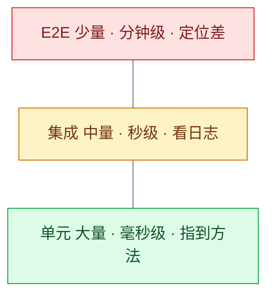
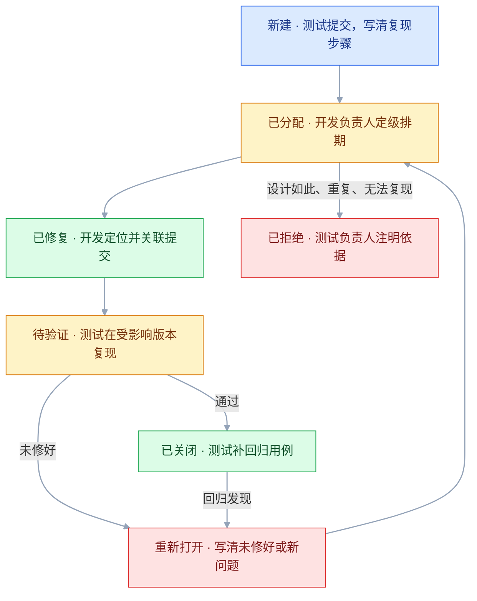

# 测试基础

## 一、工程案例：给订单服务定测试策略并接进 CI

**场景**（示例场景，数字虚构）：一个 6 个接口的订单服务（创建、取消、查询、退款、回调、对账），3 名开发、1 名测试，每周发一次版。上个季度出了两次事故：一次是 VIP 折扣叠加顺序写反，一次是 `dueDate` 为 `null` 时创建订单抛 NPE。现在要把「测什么、谁来测、在哪一层测、什么情况不许合并」落成一套能执行的东西。

**目标**：不追覆盖率数字，先把 P0 路径的自动化、冒烟集、CI 门禁、缺陷回归四件事做实。做完的标准是：任何一次提交在 10 分钟内给出可信的红绿，红灯阻断合并。

**动手前确认**：本地能跑 `mvn -B test`；仓库有分支保护权限；CI 的 runner 能装 JDK 21。

```text
order-service/
├─ pom.xml
├─ src/main/java/com/example/order/service/OrderService.java
├─ src/main/java/com/example/order/dto/OrderRequest.java
├─ src/test/java/com/example/order/service/OrderServiceTest.java
├─ src/test/java/com/example/order/smoke/OrderSmokeTest.java
└─ .github/workflows/test.yml
```

### 1.1 盘功能与风险

按「业务影响 × 出错概率」给功能定级，级别决定投入，不按接口数量平均分配。

| 功能 | 挂了会怎样 | 出错概率 | 级别 | 主测层 |
|---|---|---|---|---|
| 创建订单 | 核心收入中断 | 高（字段多、校验多） | P0 | 单元 + 接口 |
| 取消订单 | 状态错乱、库存不回滚 | 高（状态机） | P0 | 单元 |
| 支付回调 | 重复入账或漏单 | 高（幂等、签名） | P0 | 接口 + 集成 |
| 退款 | 资金损失 | 中 | P0 | 接口 |
| 订单查询 | 用户看不到单 | 中 | P1 | 接口 |
| 对账导出 | 财务对不上账 | 低 | P1 | 单元 + 手工 |

**P0 的判定只有一句**：这个功能挂了，业务还能不能转。不能转就是 P0；能转但用户明显不爽是 P1；几乎无感是 P2。P2 不设自动化指标。

### 1.2 定测试层次与数量

先看现状。下面的数量是示例，不是行业基准；经典金字塔约为 70/20/10，本例只有 6 个接口、一条主链路，目标把 E2E 压到 5%。

| 层 | 现有数量 | 目标占比 | 单次耗时 | 负责的风险 |
|---|---|---|---|---|
| 单元 | 214 | ~70% | 毫秒级 | 折扣、状态机、参数校验、金额取整 |
| 接口/集成 | 38 | ~25% | 秒级 | 鉴权、事务、SQL、序列化 |
| E2E | 6 | ~5% | 分钟级 | 登录→下单→支付→回调主链路 |

当前 214/38/6 约为 83%/15%/2%。往接口层与主链路补用例，占比才会落到 70/25/5 附近；目标不是删单测。

数量不是指标，**分工才是**：纯逻辑压到单元层（便宜、定位准），跨组件规则放接口层（真实链路），只留一条主链路给 E2E（证明整条路通）。同一场景优先放在最低的成本层。

### 1.3 建最小冒烟集

从 P0 里挑 8 条，控制在 3 分钟内跑完。冒烟失败直接打回，不进入后续测试。

```java
@Tag("smoke")
class OrderSmokeTest {
    // api/db/sign 是项目内的测试夹具；空方法体按无效测试处理（见 2.1）
    @Test void 创建订单_最低金额成功() { assertEquals(201, api.create(req(1, "u1", null)).status()); }
    @Test void 创建订单_金额为0被拒() { assertEquals(400, api.create(req(0, "u1", null)).status()); }
    @Test void 取消待支付订单_成功() { assertEquals(200, api.cancel("o-pay").status()); }
    @Test void 取消已支付订单_被拒() { assertEquals(409, api.cancel("o-paid").status()); }
    @Test void 支付回调_签名错误被拒() { assertEquals(401, api.callback(sign("bad")).status()); }
    @Test void 支付回调_重复通知只入账一次() { api.callback(sign("ok")); api.callback(sign("ok")); assertEquals(1, db.ledgerCount("o1")); }
    @Test void 查询订单_只能看到自己的() { assertEquals(403, api.get("o-other", "u1").status()); }
    @Test void 退款_超过实付金额被拒() { assertEquals(400, api.refund("o1", 101).status()); }
}
```

```bash
mvn -B test -Dgroups=smoke
```

示例输出（8 条全过）：

```text
[INFO] Tests run: 8, Failures: 0, Errors: 0, Skipped: 0, Time elapsed: 12.4 s
[INFO] BUILD SUCCESS
```

> 冒烟集的长度是硬约束。加到 30 条、跑 20 分钟，团队就会开始「这次先不跑」，等于没有。超时就往下拆，把细节还给单元层。

### 1.4 接进 CI 并设门禁

```xml
<plugin>
    <groupId>org.jacoco</groupId>
    <artifactId>jacoco-maven-plugin</artifactId>
    <version>0.8.12</version>
    <configuration>
        <excludes>
            <exclude>**/dto/**</exclude>
            <exclude>**/config/**</exclude>
        </excludes>
    </configuration>
    <executions>
        <execution><goals><goal>prepare-agent</goal></goals></execution>
        <execution>
            <id>report</id><phase>verify</phase><goals><goal>report</goal></goals>
        </execution>
        <execution>
            <id>check</id><phase>verify</phase><goals><goal>check</goal></goals>
            <configuration><rules>
                <rule><element>BUNDLE</element>
                    <limits><limit>
                        <counter>BRANCH</counter><value>COVEREDRATIO</value><minimum>0.60</minimum>
                    </limit></limits>
                </rule>
                <rule><element>PACKAGE</element>
                    <includes><include>com.example.order.service</include></includes>
                    <limits><limit>
                        <counter>BRANCH</counter><value>COVEREDRATIO</value><minimum>0.80</minimum>
                    </limit></limits>
                </rule>
            </rules></configuration>
        </execution>
    </executions>
</plugin>
```

```yaml
name: test
on: [push, pull_request]
jobs:
  test:
    runs-on: ubuntu-latest
    steps:
      - uses: actions/checkout@v4
      - uses: actions/setup-java@v4
        with:
          java-version: '21'
          distribution: 'temurin'
          cache: maven
      - run: mvn -B verify
      - if: always()
        uses: actions/upload-artifact@v4
        with:
          name: test-reports
          path: |
            target/surefire-reports
            target/site/jacoco
```

示例失败输出：

```text
[ERROR] Rule violated for bundle order-service:
        branches covered ratio is 0.54, but expected minimum is 0.60
[INFO] BUILD FAILURE
```

**只配阈值不够，还要在仓库设置里把 `test` 设为必需检查**。否则红灯只是「不好看」，大家照样点合并。

> JaCoCo 0.8.11 起支持 JDK 21，0.8.12 覆盖到 JDK 22；项目换更高 JDK 时以官方当前稳定版为准。覆盖率阈值分两档：总体 60%，核心包 `com.example.order.service` 80%；DTO 与配置类排除。

### 1.5 一次缺陷复盘：可选字段的 null

线上报警：示例中约 1% 的创建订单请求返回 500。

```text
java.lang.NullPointerException: Cannot invoke "java.time.LocalDateTime.isBefore(java.time.LocalDateTime)"
because the return value of "com.example.order.dto.OrderRequest.getDueDate()" is null
    at com.example.order.service.OrderService.validate(OrderService.java:88)
```

新增的校验没有考虑字段可选：

```java
if (request.getDueDate().isBefore(LocalDateTime.now())) {   // dueDate 可能为 null
    throw new BizException("截止时间不能早于当前时间");
}
```

修复只加一个判断：

```java
if (request.getDueDate() != null && request.getDueDate().isBefore(LocalDateTime.now())) {
    throw new BizException("截止时间不能早于当前时间");
}
```

配套补一条测试，三行，毫秒级：

```java
@Test void 截止时间为空时_不校验时间先后() {
    assertDoesNotThrow(() -> service.validate(new OrderRequest(100, "u1", null)));
}
```

复盘要产出的是「哪一层本该拦住」：

| 层 | 当时的状态 | 本应拦住的检查 |
|---|---|---|
| 需求评审 | 没写清可选字段为 null 的行为 | 每个新增校验都问一句「字段可能为空吗」 |
| 单元测试 | 只测了带时间的创建 | 加 null、空串、缺字段三类用例 |
| 接口测试 | 只发完整字段的请求 | 每个可选字段补一条「不传」请求 |
| 回归集 | 只用新造的完整数据 | 把历史数据形态纳入标准场景 |
| 代码评审 | 只看逻辑是否合理 | 检查清单加「新增非空假设」 |

**结论**：绝大多数低级线上故障，一条边界单测就能拦住；回归集必须包含历史数据形态，不能只测「漂亮数据」。

### 1.6 验收表

| # | 检查项 | 命令或检查 | 通过标准 |
|---|---|---|---|
| 1 | 单元测试全绿 | `mvn -B test` | `Failures: 0, Errors: 0` |
| 2 | 全量构建通过 | `mvn -B verify` | `BUILD SUCCESS` |
| 3 | 分支覆盖率 | JaCoCo 报告 `target/site/jacoco/index.html` | 总体 ≥ 60%，`service` 包 ≥ 80% |
| 4 | 冒烟集时长 | `mvn -B test -Dgroups=smoke` | 8 条全过，≤ 3 分钟 |
| 5 | P0 可追溯 | 对照 1.1 的 P0 与 1.3 的用例 | 4 个 P0 功能各至少 1 条自动化用例 |
| 6 | 门禁真的会红 | 把任一 P0 校验的 `>=` 改成 `>` 后提 PR | CI 失败且禁止合并 |
| 7 | 无静默跳过 | `grep -rn "@Disabled" src/test/java` | 输出为空，或有原因与到期日 |
| 8 | flaky 治理 | `for i in $(seq 10); do mvn -q test -Dtest=OrderSmokeTest; done` | 10 次结果一致 |
| 9 | 缺陷有回归 | 每个已修 bug 的提交 | 附带一条能复现原问题的测试 |
| 10 | 报告可追溯 | 用例、需求、缺陷三者编号 | 任取一条缺陷能反查到用例 |

> 第 6 项必须真做一次。很多团队的门禁配了但从未验证，实际因为路径写错、job 没触发、分支保护没开而形同虚设。

---

## 二、高频问答：会卡住你的地方，也是面试最常问的

### 2.1 覆盖率 100%，线上仍然出问题

**现场**

抽 10 个绿色测试，逐个删掉断言再跑；仍然绿的，就是无效测试。再看 JaCoCo 报告里绿色但测试方法很短的代码块。

```java
@Test void 创建订单() { orderService.create(request); }   // 执行了，断言 0
```

**要点**

- 行覆盖只证明代码被执行过，不证明结果被断言。
- 无断言测试和只跑 happy path 都能把数字做高，覆盖率低一定是信号，覆盖率高不是证明。
- 判据是「这段代码如果返回错值，哪条断言会红」，答不上来就是没测。

**追问**

- 有比覆盖率更硬的指标吗？→ 变异测试，看注入的 bug 能不能被杀掉。
- 怎么快速识别无效测试？→ 删掉断言重跑，还是绿的就是。
- 分支覆盖 100% 就够了吗？→ 不够，它不检查多条件组合。

### 2.2 测试全绿，但没人跑

**现场**

连续看 20 个合并请求，有几个带了测试改动、有几个 CI 红过。再故意提交一个必然失败的测试，看它能不能拦住合并。

**要点**

- 测试不在提交路径上，就只是仓库里的文本。
- 把「存在」当成「生效」是最常见误判：本地不跑、CI 不阻断，写多少都不产生质量。
- 拦不住合并时，先修流程再谈用例。

**追问**

- 门禁配了为什么还是不生效？→ 路径写错、job 没触发、分支保护没开。
- 门禁可信度靠什么？→ 红灯一定有人处理。
- 测试写了没人维护算什么？→ 测试债，比没有更贵。

### 2.3 改一行代码，几十个测试一起红

**现场**

做一次纯重构：调整内部步骤顺序或提取一个私有方法，外部行为不变，跑测试。

**要点**

- 测试断言了实现细节（私有方法调用、SQL 字符串、内部步骤顺序），重构一改就全红。
- 代价来自「测实现」，不该算到「测试」头上。
- 纯重构后红灯超过 3 个，说明测试绑在了结构上，应改为断言输入输出。

**追问**

- 怎么判断一条测试测的是实现？→ 不改外部行为的重构能让它红。
- Mock 多就一定脆吗？→ 不是数量问题，是断言对象落在内部调用上。
- 重构前要不要先补测试？→ 要，先锁定当前行为再动结构。

### 2.4 预发全过，上线就报错

**现场**

对比两边 `SHOW CREATE TABLE`、镜像 tag、环境变量。

**要点**

- 预发与生产的数据库版本、字段长度、字符集、配置不一致，预发验证的是另一套系统。
- 环境差异不是偶发：把预发的建表语句和生产逐字段 diff，差异项就是覆盖不到的风险。
- 要么补齐同构，要么在预发真跑一次迁移脚本。

**追问**

- 完全同构成本太高怎么办？→ 按风险对齐，数据库版本、字符集、时区、关键中间件必须一致。
- 预发数据从哪来？→ 脱敏生产数据或等量数据。
- 预发能连生产库做写操作吗？→ 不能。

### 2.5 只测了正常流程

**现场**

数一下测试里 `assertThrows` 和异常场景的比例。

```bash
grep -rn "assertThrows\|assertThatThrownBy\|pytest.raises" src/test | wc -l
```

**要点**

- 主流程通了不代表功能完成，线上故障常发生在异常分支。
- 超时、重复提交、并发、字段为空、第三方返回异常，这几类不会自己出现在用例里。
- 给每个写操作列三列——成功、业务拒绝、依赖失败；缺哪列补哪列。

**追问**

- 异常用例断到什么程度？→ 至少断言异常类型与消息，不是只断言抛了。
- 「用户正常操作」等于「系统正常运行」吗？→ 不等于，异常分支才是故障高发区。
- 可选字段怎么补？→ 有值、null、空串三种形态各一条。

### 2.6 偶发失败，重跑一下就好

**现场**

单测连跑 20 次并打乱顺序；失败时保存完整日志而不是只看最后一行。

```bash
for i in $(seq 20); do mvn -q test -Dtest=OrderServiceTest || echo "fail at $i"; done
```

**要点**

- 「重跑就好」是确定的缺陷被当成随机噪声。
- 五类成因：时间依赖（跨零点）、无种子随机、测试间共享状态、异步没等待、端口冲突。
- `pytest -p no:randomly` 与开启随机顺序各跑一遍，只在某个顺序下失败就是隔离问题。

**追问**

- 连跑 20 次都过算稳定吗？→ 只能说明概率降低，并发与时间相关的缺陷要更多轮次。
- 时间依赖怎么根治？→ 注入 `Clock`，不读真实时间。
- flaky 的真实代价？→ 一旦有人说「重跑一下就行」，测试就失去意义。

### 2.7 缺陷单写了，开发说复现不了

**现场**

让另一个人只看报告操作一遍，看能否得到同样结果。

**要点**

- 报告缺环境、账号、数据状态或精确步骤，「登录有问题」不是可执行信息。
- 「我看到了」不等于「别人能重现」，报告要能回答五个问题：哪个环境、哪个账号、什么前置数据、点了什么、期望与实际分别是什么。
- 严重度与优先级是两个维度，要分开写。

**追问**

- 开发说「设计如此」怎么办？→ 回需求确认，需求没写清就是需求缺陷。
- 偶发问题怎么提？→ 附日志、时间点、请求 ID，写清复现概率。
- 报告里能写猜测吗？→ 只写事实，猜测标注「疑似」并附证据。

### 2.8 冒烟集越加越多，最后没人跑

**现场**

统计冒烟集条数与耗时；看最近 10 次发版是否真的全跑。

**要点**

- 没有准入标准，任何出过问题的地方都往里塞，执行时间从 3 分钟涨到 40 分钟。
- 冒烟只保留「挂了业务不可用」的 8~15 条，其余移入回归集。
- 超过 5 分钟就拆，超时就失去「第一时间」的意义。

**追问**

- 冒烟和回归怎么分工？→ 冒烟回答「它坏没坏」，回归按改动影响半径算。
- 冒烟该由谁执行？→ CI 或测试，构建出来第一时间。
- 冒烟挂了怎么处理？→ 直接打回，不进入后续测试。

### 2.9 回归只测新数据，老数据一改就炸

**现场**

从生产脱敏拉一批老数据（如 100 条）跑核心流程；或按字段形态各造一条。

**要点**

- 历史数据里有 null、空串、超长值、已删除关联，新校验往往只考虑了新数据。
- 新造的数据不等于全部数据，回归集必须包含历史数据形态。
- 每个可选字段列三种形态（有值、null、空串），每种至少一条回归用例。

**追问**

- 生产数据不能直接用怎么办？→ 脱敏，格式保留替换。
- 老数据的边界怎么找？→ 先按字段形态枚举，再抽真实样本验证。
- 这类故障哪一层拦最便宜？→ 一条边界单测，毫秒级。

### 2.10 E2E 堆成山，CI 跑一小时

**现场**

统计各层用例数量与总耗时；看失败时平均定位时间。

**要点**

- E2E 慢、脆、定位差，大量细节本可在单元层用毫秒级覆盖。
- 「真实」不等于「有效」：成本随层数上升，定位精度随层数下降。
- 抽 10 条 E2E，问「这条要验证的规则能不能在接口层用一条请求覆盖」，能就下沉。

**追问**

- E2E 留多少合适？→ 只留主链路，本例压到 5%。
- 为什么 E2E 定位差？→ 前端、后端、环境混在一起。
- 下沉之后还要 E2E 吗？→ 要，它证明整条路通，别的层替代不了。

### 2.11 性能指标写进单元测试，CI 经常红

**现场**

同一提交连跑 10 次，记录耗时分布。

**要点**

- CI runner 负载抖动，200ms 的断言在共享机器上不可复现。
- 单元测试的超时只适合防死循环，不适合当性能指标。
- 吞吐、P95 放到独立性能任务，用固定规格机器跑。

**追问**

- 单元层还要不要 `@Timeout`？→ 要，只为防死循环，值给得很宽。
- 性能回归怎么守？→ 独立任务加基线对比，不混在功能测试里。
- 加机器能解决吗？→ 不能，抖动来自机器共享。

### 2.12 新功能挂了开关，只测了「开」

**现场**

把开关关掉，跑一遍核心流程和回滚步骤。

**要点**

- 关闭态走的是老代码路径，长期无人执行。
- 配置、依赖、数据迁移都可能只兼容新路径，回滚时才发现。
- 每个开关至少两条用例——开、关，上线前在预发各跑一次。

**追问**

- 开关关掉后应该是什么行为？→ 回到旧行为，这是验收标准。
- 迁移只做了新路径会怎样？→ 回滚后老代码读不懂新数据。
- 灰度算不算开关测试？→ 算，但灰度还要看指标基线。
---

## 三、核心知识：从零开始要建立的东西

### 3.1 测试活动的信息量

测试的价值来自「能否推翻当前的信心」。一个必然通过的用例，只重复了已知信息；一个能暴露边界错误的用例，才提供新信息。

```java
public boolean isValidAge(int age) { return age >= 1 && age <= 150; }
```

同一段代码，两种测法：

| 测法 | 输入 | 得到的信息 |
|---|---|---|
| 证明没问题 | `25` | 返回 true，符合预期，信息量为零 |
| 主动找错 | `0`、`-1`、`151`、`Integer.MAX_VALUE` | 哪些边界被错误接受，信息量大 |

**边界与取舍**：探索性测试信息量高但不可重复；自动化回归信息量低但可重复。两者不是替代关系，比例按系统成熟度调整。

### 3.2 缺陷成本的阶段曲线

同一个「满 100 减 10」被写成「超过 100 才减」，发现阶段不同，代价差几个数量级。

| 发现阶段 | 处理动作 | 量级 |
|---|---|---|
| 编码时 | 改一个比较符 | 秒 |
| 单元测试 | 改代码 + 补一条边界用例 | 分钟 |
| 集成测试 | 提缺陷、定位、改、回归、重新出包 | 半天 |
| 系统测试 | 多轮回归 + 跨团队协调 | 天 |
| 生产 | 客服、数据修复、紧急发版、复盘、赔偿 | 周 |

**机制**：越往后，参与角色越多、流程越长、数据修复越难。**取舍**：不是所有缺陷都能左移，需求歧义和真实流量问题只有上线后才暴露，所以左移与右移要同时做。

### 3.3 测试层次的划分依据

判断一个测试属于哪一层，只看「被测范围有多大」，不看用了什么工具。

| 层 | 范围 | 典型对象 | 依赖处理 |
|---|---|---|---|
| 单元 | 一个函数/类 | 价格计算、状态机 | 外部依赖用替身 |
| 集成 | 多个组件 | Service + 数据库、HTTP + 序列化 | 真实依赖 |
| 系统 | 整个系统 | 注册→下单→支付 | 真实依赖与真实环境 |
| 验收 | 业务视角 | 验收标准逐条确认 | 真实环境 |

```text
测一个方法            → 单元
测 Service + 数据库   → 集成
测浏览器点击到落库     → 系统
按合同条款逐条确认     → 验收
```

**边界**：启动 Spring 容器但只测一个 Controller，仍算集成（Web 层切片）；用 Mock 替掉数据库的「集成测试」实际是单元测试。

### 3.4 测试金字塔与测试奖杯



| 层 | 经验比例 | 单次耗时 | 失败定位 |
|---|---|---|---|
| 单元 | 70% | 毫秒 | 直接指到方法 |
| 集成 | 20% | 秒 | 要看日志与依赖 |
| E2E | 10% | 分钟 | 前端、后端、环境混在一起 |

比例是经验值，不是验收指标；1.2 的订单服务把 E2E 压到 5%，因为只有一条主链路。

**为什么是塔形**：成本随层数上升，定位精度随层数下降。**取舍**：前端项目常用「奖杯」模型——组件级集成测试最厚，单元只留纯逻辑，静态类型检查作为底座。模型名称不重要，原则一致：在能覆盖风险的前提下选最便宜的一层。

> **面试**：常问「测试金字塔和测试奖杯有什么区别？」答：金字塔单元最厚，奖杯把组件级集成做厚，原则都是在能覆盖风险的前提下选最便宜的一层。

### 3.5 左移与右移的作用范围


左移的三个动作：需求评审时澄清边界（「满 100」含不含 100）、设计时留可测性（时间与随机数可注入）、编码时交付测试。

右移的四个手段：监控告警、灰度发布、A/B、线上拨测。**边界**：左移降低单次缺陷成本，右移降低故障影响面；测试环境很难完整模拟真实流量与设备分布。

### 3.6 风险矩阵与用例优先级

风险 = 出错概率 × 后果严重度。资源按象限分配，不按功能数量平均分。

| 象限 | 特征 | 例子 | 策略 |
|---|---|---|---|
| 低概率 / 高后果 | 安全与资金 | 支付、权限、删库 | 异常与边界全测 |
| 高概率 / 高后果 | 主流程 | 下单、登录 | 正常 + 主要异常 |
| 高概率 / 低后果 | 高频展示 | 列表、详情 | 自动化回归 |
| 低概率 / 低后果 | 边角功能 | 导历史报表 | 手工抽测 |

优先级划分只问一句：这个功能挂了，业务还能不能转。不能 = P0，每次提交必跑；能但用户不爽 = P1，每次发版必跑；几乎无感 = P2，按版本抽测。

### 3.7 覆盖率的三类口径

| 指标 | 统计对象 | 盲区 |
|---|---|---|
| 行覆盖 | 执行过的代码行 | 不检查分支组合，不检查断言 |
| 分支覆盖 | 每个判断的真假两侧 | 不检查多条件组合 |
| 路径覆盖 | 执行路径组合 | 嵌套判断时数量爆炸 |

```java
boolean canVote(int age) { return age >= 18; }
// 只跑 age=20：行覆盖 100%，分支覆盖 50%（false 分支没走到）
// 补 age=10 才到分支 100%
```

**取舍**：分支覆盖是性价比最高的一档。核心包 80%，普通包 60%，UI 与胶水代码不设指标。**覆盖率低一定是信号，覆盖率高不是证明**。

> **面试**：常问「行覆盖、分支覆盖、路径覆盖怎么选？」答：分支覆盖性价比最高，它不看组合，路径覆盖在嵌套判断时会爆炸。

### 3.8 缺陷生命周期



两个最容易漏的环节：重新打开必须写清「原问题未修好」还是「修复引入新问题」；关闭前把复现步骤固化成回归用例。

### 3.9 缺陷报告的构成

目标只有一个：开发只看报告就能复现并定位。

| 要素 | 要求 | 反例 |
|---|---|---|
| 标题 | 场景 + 现象 | 登录有问题 |
| 环境 | 版本、浏览器、系统、环境 | 空 |
| 前置条件 | 账号、数据状态 | 空 |
| 步骤 | 编号，精确到输入值 | 随便点一下 |
| 预期 | 可判定 | 应该正常 |
| 实际 | 含截图、日志、响应体 | 报错了 |
| 严重度/优先级 | 两个维度分开 | 都是高 |

**严重度与优先级不是一回事**：首页错别字严重度低但优先级高；内部工具崩溃严重度高但优先级低。

> 报告里只写事实。猜测要标注「疑似」并附证据，否则会把开发带偏。

### 3.10 TDD 的红绿重构循环

顺序是硬性的：先写一个会失败的测试，再用最小实现让它通过，最后在测试保护下重构。

```java
@Test void 满100减10() { assertEquals(90, PriceCalculator.calculate(100)); }   // 红
public static int calculate(int price) { return price >= 100 ? price - 10 : price; }   // 绿
// 重构：把 100 和 10 提成常量，测试仍绿
```

**适用边界**：输入输出明确的规则、金额、状态机收益最大；界面、探索性、算法研究型代码不适合先写断言。务实底线是「每个新功能和每个修复都带测试」，不要求教条式循环。

> **面试**：常问「TDD 的红绿重构顺序能颠倒吗？」答：不能，先有会失败的测试，再用最小实现转绿，最后在测试保护下重构。

### 3.11 BDD 的 Given-When-Then

用业务语言描述行为，让需求、测试、自动化共用一份文本。

```text
场景：连续输错密码 5 次后锁定
  Given 用户 test_user 未锁定且已连续输错 4 次
  When  再次输入错误密码
  Then  提示账号已锁定
  And   账号状态变为 LOCKED
```

| | TDD | BDD |
|---|---|---|
| 语言 | 代码与断言 | 自然语言 |
| 面向 | 开发者 | 开发、测试、产品 |
| 粒度 | 函数/类 | 用户场景 |
| 工具 | JUnit、pytest | Cucumber、Behave |

**取舍**：BDD 的维护成本在「自然语言与代码的绑定层」，场景一多就会腐化。适合结算规则、审批流这类多方理解易分歧的领域，不适合接口语义已经稳定的技术组件。

### 3.12 回归测试的范围计算

回归不是越大越好，范围由改动的影响半径决定。

| 改动 | 回归范围 |
|---|---|
| 修一个 bug | 该功能 + 相邻功能 |
| 改公共工具类 | 所有调用方 |
| 改价格计算 | 下单、退款、对账、优惠券 |
| 纯重构 | 重构模块全部测试 + 调用方契约 |
| 发版前 | P0 + P1 全量 |

**机制**：回归的本质是重复执行，正好是自动化擅长的部分。**取舍**：用例集臃肿会让回归越来越慢，最后被裁剪；定期删掉等价重复的低价值用例，把新缺陷的复现步骤加进去。

### 3.13 冒烟测试与验收测试

| | 冒烟 | 验收 |
|---|---|---|
| 问题 | 这个版本能不能进入正式测试 | 是否满足业务验收标准 |
| 时机 | 构建出来第一时间 | 系统测试之后、上线之前 |
| 范围 | 8~15 条核心流程 | 验收标准逐条 |
| 执行者 | CI 或测试 | 业务方、产品 |
| 失败后果 | 直接打回 | 不能上线 |

一句话区分：冒烟回答「它坏没坏」，验收回答「它对不对」。冒烟集要快，超过 5 分钟就失去「第一时间」的意义。

### 3.14 测试环境的同构性

| 环境 | 数据 | 配置 | 主要用途 |
|---|---|---|---|
| 开发 | 假数据、可重建 | 本地 | 编码自测 |
| 测试 | 接近生产的模拟数据 | 独立 | 功能验证、联调 |
| 预发 | 脱敏生产数据或等量数据 | 与生产一致 | 上线前最终验证 |
| 生产 | 真实数据 | 真实 | 用户 |

四条原则：配置同构（数据库与中间件版本一致）、数据隔离（生产数据必须脱敏）、环境可重建（容器或 IaC）、预发不直连生产库做写操作。

**边界**：完全同构成本极高，按风险对齐——数据库版本、字符集、时区、关键中间件必须一致，机器规格可以不同。

### 3.15 自动化与手工的分工

| 适合自动化 | 适合手工 |
|---|---|
| 重复执行的回归 | 探索性测试 |
| 结果确定的接口与单元 | 视觉与体验判断 |
| 大数据量参数组合 | 一次性活动页 |
| 长时间稳定性与压测 | 第三方沙箱不可用时的真实联调 |

判断标准：一个月执行多次且结果确定，就值得自动化；只跑一次或需要人眼判断，留在手工。**取舍**：自动化把人力从重复劳动里换出来，不是消灭手工；追求 100% 自动化通常意味着大量脆弱的 UI 脚本。

### 3.16 CI 门禁的层次

| 层 | 触发 | 典型耗时 | 失败动作 |
|---|---|---|---|
| 提交前 | 本地钩子 | 秒 | 阻止提交 |
| 单元测试 | 每次推送 | 1~3 分钟 | 阻止合并 |
| 集成测试 | 合并请求 | 5~15 分钟 | 阻止合并 |
| 全量回归 | 合并后或夜间 | 30 分钟以上 | 报警、回滚 |

```text
仓库设置 → Branches → Branch protection rules
  Require status checks to pass before merging
  勾选 test / integration 两个 job
```

**机制**：门禁的可信度来自「红灯一定有人处理」。**取舍**：门禁太多会让合并变慢，团队开始绕过；先保证单元与集成两层稳定，再逐步加严。

---

## 四、冷门知识汇总

这一节是「遇到再查」的清单：低频、概念不复杂、知道关键词就能上手；需要长期投入的实践，先评估再引入。

| 知识点 | 为什么冷门 | 用到时的关键词 |
|---|---|---|
| 变异测试 | 多数团队只用覆盖率，很少评估断言强度 | PIT、`mutationCoverage`、注入 bug 能否被杀 |
| 缺陷逃逸率 | 需要线上缺陷与测试记录关联才有意义 | 逃逸缺陷数 ÷ 总缺陷数 |
| 缺陷收敛曲线 | 项目周期短时看不出趋势 | 按天新增与关闭、收敛拐点 |
| 探索性测试的会话记录 | 手工测试常不留痕，难以复盘 | 时间盒、测试章程、启发式清单 |
| 契约测试 | 微服务团队少、接口变更不频繁时用不上 | Pact、消费者驱动、provider verify |
| 静态检查作为测试层 | 常被归到「代码规范」而不是测试策略 | ESLint、SpotBugs、类型检查 |
| 测试数据脱敏 | 不做等保或不导生产数据时接触不到 | 手机号、身份证、格式保留替换 |
| 灰度发布的可观测性 | 小团队直接全量，缺少对比基线 | 错误率、P95、业务指标分桶 |
| 测试报告的可追溯矩阵 | 需求变更频繁时维护成本高 | 用例 ↔ 需求 ↔ 缺陷 |
| 环境漂移检测 | 有 IaC 后很少手工比对 | 配置 diff、镜像 digest |
| 生产拨测 | 需要外部节点与告警体系配套 | 定时探针、关键路径合成监控 |
| 测试债的量化 | 很难折算成金额，通常靠事故推动 | 缺失用例数、平均修复时长 |
| 验收标准的可测性 | 合同语言常写成「体验流畅」 | 可判定、量化阈值、验收样例 |
| 金额的浮点断言 | 小样本下 `double` 恰好相等，量一大就漂移 | BigDecimal、compareTo、容差 |
| 时区与夏令时 | 单地域业务碰不到，跨境排期才暴露 | UTC 存储、ZoneId、边界日期 |
