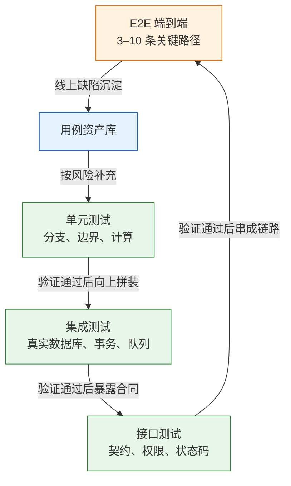
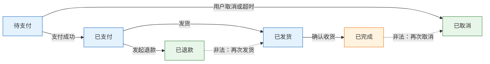
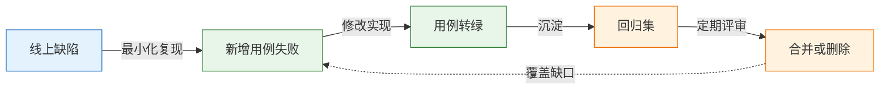

# 测试基础与用例设计

> 测试是在有限时间和资源下，用可重复的观察结果换取发布决策所需的信息。用例设计决定这份信息的密度：测什么、测多深、哪些组合明确不测。

---

## 一、测试是什么

### 1.1 核心概念

测试不是“证明代码正确”，而是**用一组可核对的事实降低发布风险**。一次执行至少要留下三样东西：输入是什么、观察到了什么、结论依据是什么。缺少任何一项，“测过了”就只是一句无法复核的口头结论。

测试活动有三个基本属性：

- **可判定**：每条用例都有明确的前置条件、操作和预期结果，换一个人执行能得到同一个结论。
- **可重复**：环境、数据、时钟、随机种子受控，今天绿明天红必须有原因可查。
- **可追溯**：用例能对应到需求条目或风险项，失败时能判断影响哪个业务能力。

测试能回答的问题和不能回答的问题必须分开，否则团队会把质量责任全部压给测试执行环节。

| 能回答 | 不能回答 |
|---|---|
| 指定输入下行为是否符合预期 | 需求本身是否值得做 |
| 某条路径是否被覆盖 | 未想到的路径是否存在缺陷 |
| 改动是否破坏既有行为 | 生产配置与测试环境是否一致 |
| 失败时影响哪个模块 | 用户会不会按设计的方式操作 |

测试也不解决“代码没有被调用”“线上流量模型与测试不同”“第三方服务变更”这几类问题。它们分别属于代码评审、可观测性建设和契约管理。

### 1.2 与相邻技术的关系

测试处在需求、开发、发布之间，和几个相邻活动共享目标，但产出物不同。把它们混为一谈，常见结果是“评审时只提代码风格，测试时才发现规则没定义”。

| 活动 | 关注点 | 主要产出 | 与测试的边界 |
|---|---|---|---|
| 需求评审 | 规则是否完整、可验证 | 明确的验收条件 | 评审定“测什么”，测试定“怎么验” |
| 代码评审 | 设计、边界、可维护性 | 修改意见 | 评审看结构，测试看行为 |
| 静态分析 | 类型、空值、规范 | 告警清单 | 不执行程序，发现不了逻辑错误 |
| 自动化测试 | 回归行为是否保持 | 可重复执行的用例 | 只验证已写出的断言 |
| 监控告警 | 线上真实状态 | 指标与事件 | 发现已发生的问题，不预防 |
| 灰度发布 | 变更影响范围 | 分批放量结论 | 用真实流量补充测试盲区 |

测试左移指把可验证性提前到需求和设计阶段：验收条件写不清，后面的用例一定含糊。测试右移指把线上观测纳入质量反馈：灰度、日志、业务指标能发现测试环境造不出来的问题。两者都不替代对方。

### 1.3 架构组成

测试体系按“反馈速度”和“真实程度”分层。越往下执行越快、定位越准，但证明不了组件拼装；越往上越接近真实用户，但更慢、更贵、更容易受环境影响。



| 层次 | 主要验证 | 能发现的问题 | 单次量级 | 失败定位 |
|---|---|---|---|---|
| 单元 | 一个类或函数的逻辑 | 分支漏写、边界算错、空值 | 毫秒 | 精确到方法 |
| 集成 | 代码与真实中间件 | SQL 方言、事务、序列化、约束 | 秒到十秒 | 到模块 |
| 接口 | 对外的 HTTP 合同 | 路由、鉴权、状态码、字段 | 百毫秒 | 到接口 |
| E2E | 用户关键路径 | 前后端衔接、登录态、部署 | 十秒到分钟 | 到页面 |
| 探索式 | 人寻找未预设的路径 | 需求漏洞、交互问题 | 人工 | 依靠记录 |

比例不是教条。业务系统常见“大量单元 + 适量接口 + 少量 E2E”；以页面为主的项目会提高组件测试和接口测试的占比，形成所谓测试奖杯。形状取决于失败主要发生在哪里：业务规则错，往单元压；页面拼装错，往组件和接口压；部署与配置错，才需要 E2E。

> **注意**：分层描述的是验证范围，不是团队分工。让“单元测试由开发写、接口测试由测试写”固定下来，容易在层与层之间留下无人负责的缝隙。

---

## 二、测试环境与工具链

### 2.1 测试环境的组成

测试结果只有在环境可描述时才可信。一个可用的测试环境至少固定五项：运行时版本、依赖服务版本、数据库字符集与时区、外部服务挡板、测试数据来源。

| 环境 | 用途 | 数据特征 | 主要风险 |
|---|---|---|---|
| 本地 | 开发自测、快速反馈 | 自造数据 | 与 CI 版本不一致 |
| CI | 合并门禁、回归 | 每次新建 | 资源受限、并行冲突 |
| 预发 | 发布前验收 | 接近生产结构 | 数据脱敏不彻底 |
| 生产影子 | 灰度与观测 | 真实流量 | 副作用不可回滚 |

环境差异最常见的三个来源是：JDK 版本、数据库大版本、时区与字符集。三者都能让同一段代码在不同机器上表现不同，而且报错信息往往指向业务逻辑，不指向环境。

固定环境的原则是**把版本写进配置，不写进人的记忆**。容器镜像 tag、JDK 发行版、Maven 依赖版本、数据库初始化脚本，都应在仓库里可查。CI 与本地使用同一份配置，差异只允许出现在资源规格和密钥来源上。

### 2.2 测试框架与工具选型

Java 后端的常用组合是 JUnit 5 负责用例组织，AssertJ 负责断言，Mockito 负责替身，Testcontainers 负责真实依赖，REST Assured 或 MockMvc 负责接口层。前端常见的是 Vitest 或 Jest 加 Testing Library，E2E 用 Playwright。

| 工具 | 职责 | 适用层 | 选择依据 |
|---|---|---|---|
| JUnit 5 | 用例发现、生命周期、参数化 | 单元、集成 | Java 生态默认选择 |
| AssertJ | 链式断言、集合与异常断言 | 全部 | 失败信息可读 |
| Mockito | 替身创建与交互验证 | 单元、切片 | 只替换协作者 |
| Testcontainers | 按需启动真实中间件 | 集成 | 需要真实方言与协议 |
| MockMvc | 不起服务器的 MVC 切片 | 接口、切片 | 验证路由与序列化 |
| Playwright | 浏览器自动化 | E2E | 跨浏览器、自动等待 |

选型的第一原则是**一个项目只保留一套测试框架**。JUnit 4 与 JUnit 5 混用、TestNG 与 JUnit 并存，会让执行器漏扫用例，表现为“写了但没跑”。第二原则是断言库统一，避免同一项目里 `assertEquals`、`assertThat`、`Truth` 三种写法并存，失败信息格式不一致。

> **开发提示**：依赖版本尽量交给 BOM 管理。Spring Boot 项目的 `spring-boot-starter-test` 已聚合 JUnit Jupiter、AssertJ、Mockito、JSONassert 等常用库，手写版本号只会增加冲突概率。

### 2.3 最小可运行验证

动手写业务用例前，先确认测试能被执行器发现。新建一个只验证环境的用例，跑通后再逐步加内容。

```xml
<!-- pom.xml：测试依赖，版本由 spring-boot-dependencies BOM 管理 -->
<dependency>
  <groupId>org.springframework.boot</groupId>
  <artifactId>spring-boot-starter-test</artifactId>
  <scope>test</scope>
</dependency>
```

```xml
<!-- pom.xml：固定测试 JVM 的时区，避免本地与 CI 结果不同 -->
<plugin>
  <groupId>org.apache.maven.plugins</groupId>
  <artifactId>maven-surefire-plugin</artifactId>
  <configuration>
    <argLine>-Duser.timezone=UTC</argLine>
  </configuration>
</plugin>
```

```java
// src/test/java/com/example/EnvironmentSmokeTest.java
class EnvironmentSmokeTest {

    @Test
    void 测试运行时使用固定时区() {
        // 时区不固定会让日期断言在 CI 与本地得到不同结果
        assertThat(ZoneId.systemDefault()).isEqualTo(ZoneId.of("UTC"));
    }
}
```

```bash
# ========== 执行单个测试类 ==========
# -q 只输出错误与测试汇总，-Dtest 指定类名
mvn -q -Dtest=EnvironmentSmokeTest test

# ========== 确认运行时版本 ==========
# 输出 Java 版本与供应商，CI 日志里应能查到同一行
java -version
```

执行成功时，Surefire 汇总行类似 `Tests run: 1, Failures: 0, Errors: 0, Skipped: 0`。若显示 `Tests run: 0`，先检查类名是否符合 `*Test` 模式、测试方法是否为 `void` 且无参数，再检查是否混用了两套 JUnit API。

时区断言不是形式主义。很多“昨天还好好的”失败，根源是 CI 容器使用 UTC、开发机使用本地时区，而代码里直接调用了 `LocalDateTime.now()`。

---

## 三、用例设计方法

### 3.1 等价类与边界值

输入是连续区间时，不必穷举。把处理逻辑相同的输入划成一类，每类取一个代表；错误最集中在类的交界处，因此边界单独取值。

以优惠券面额为例，规则是“0.01–500.00 元，最多两位小数”。先划分有效等价类、无效等价类，再补边界。

| 类 | 代表值 | 预期 | 设计目的 |
|---|---|---|---|
| 合法下界 | 0.01 | 通过 | 最小可受理金额 |
| 合法中间 | 99.99 | 通过 | 常规业务值 |
| 合法上界 | 500.00 | 通过 | 最大可受理金额 |
| 小于下界 | 0.00、-1 | 拒绝 | 零值与负数 |
| 大于上界 | 500.01 | 拒绝 | 越界一档 |
| 精度非法 | 1.999 | 拒绝 | 三位小数 |
| 类型非法 | 空、`abc`、`1e3` | 拒绝 | 解析失败 |

边界值至少取 `0`、`0.01`、`0.02`、`499.99`、`500.00`、`500.01`。这六个值比在区间中部随手取十个值更容易命中缺陷，因为比较运算的符号错误、闭开区间写反都发生在端点。

设计步骤可以固定为四步：读规则并写下数学区间；划分有效与无效等价类；在每类中选代表值；把所有端点单独列出并标注预期。预期必须来自需求，不能来自当前代码的输出，否则测试只是在给实现拍照。

### 3.2 判定表

多个条件共同决定结果时，逐条试很容易只覆盖“全真”和“全假”。判定表把条件与动作摆成矩阵，强迫设计者面对组合和优先级。

下单用券的规则：订单满 100 元、券在有效期、券未使用，三者都满足才抵扣。

| 规则 | 满 100 | 在有效期 | 未使用 | 结果 |
|---|---|---|---|---|
| R1 | 是 | 是 | 是 | 抵扣成功 |
| R2 | 否 | 是 | 是 | 拒绝：未达门槛 |
| R3 | 是 | 否 | 是 | 拒绝：已过期 |
| R4 | 是 | 是 | 否 | 拒绝：已使用 |
| R5 | 否 | 否 | 否 | 拒绝，错误信息优先给门槛 |

最后一行是产品决策，不是技术决策。多个条件同时不满足时先报哪个错，必须和产品确认；否则前端提示会随实现顺序漂移，同一张券在不同入口得到不同文案。

判定表可以化简：若某个条件取值不影响结果，就把两行合并，用“—”表示无关。但化简后的规则要回填一条注释，说明为什么无关，避免后来者误删必要条件。

### 3.3 状态迁移

有生命周期的对象（订单、支付、审批、账号）要按状态画图，重点测**非法迁移**。正向路径通常开发自测就会覆盖，事故多发生在“已经完成的单还能不能取消”“退款后还能不能发货”。



| 当前状态 | 事件 | 预期 | 关注点 |
|---|---|---|---|
| 待支付 | 支付成功 | 进入已支付 | 金额与订单号一致 |
| 待支付 | 重复支付 | 只扣一次 | 幂等键是否生效 |
| 待支付 | 超时 | 进入已取消 | 库存是否回补 |
| 已支付 | 退款 | 进入已退款 | 退款金额与流水 |
| 已完成 | 取消 | 拒绝 | 错误码是否稳定 |
| 已退款 | 发货 | 拒绝 | 非法迁移不能落库 |

状态图要落到数据上：每次迁移都应同时断言状态字段、版本号或更新时间、关联流水。只断言接口返回成功，无法发现“状态改了但库存没回补”。

### 3.4 场景法

场景法把用户目标串成链路，再给每个环节加异常分支。它负责“串起来是否成立”，等价类和边界负责“单点是否算对”。

- 主流程：登录 → 选商品 → 用券下单 → 支付 → 查看订单。
- 分支：未登录、库存不足、支付超时、重复点击提交、支付成功但回调延迟。
- 恢复：支付超时后重新发起、回调延迟到达后的对账、取消订单后的库存回补。

| 场景 | 关键步骤 | 注入的异常 | 断言重点 |
|---|---|---|---|
| 正常下单 | 选商品到支付完成 | 无 | 订单、库存、流水一致 |
| 未登录下单 | 直接访问结算页 | 无有效会话 | 跳转登录且不建单 |
| 库存不足 | 提交时库存被抢完 | 并发扣减 | 返回可识别错误，不扣款 |
| 支付回调延迟 | 支付成功但通知晚到 | 延迟消息 | 订单最终一致 |
| 重复提交 | 连续点击两次 | 相同幂等键 | 只产生一个订单 |

场景用例不要写成操作流水账。每一步都要说明“为什么这一步存在”，否则链路越写越长，真正要验证的一致性反而被淹没。

### 3.5 组合爆炸与正交降维

四个参数各有四个取值，全组合是 256 条，没人维护。成对覆盖（pairwise）保证任意两个参数的取值组合至少出现一次，通常能降到十几条。多数缺陷由一两个因素共同触发，四个因素同时异常的概率低得多。

| 策略 | 用例量级 | 覆盖保证 | 适用场景 |
|---|---|---|---|
| 全组合 | 笛卡尔积 | 所有组合 | 参数少且后果严重 |
| 成对覆盖 | 十几到几十条 | 任意两参数组合 | 多参数表单、配置矩阵 |
| 正交表 | 按表构造 | 均衡分散 | 实验设计、性能因子 |
| 风险补测 | 少量 | 已知高危组合 | 金额边界、权限交叉 |

成对覆盖之后仍要单独补高风险组合：金额边界 × 无权限、库存为零 × 重复提交、退款中 × 再次支付。这些组合的业务后果远大于普通组合，不能因为“统计上已覆盖”就放过。

工具只负责生成组合，不负责判断哪些组合危险。以 PICT 为例，先把参数与取值写成模型文件：

```text
# coupon-model.txt：每行一个参数，冒号后是用逗号分隔的取值
Amount: 0, 99, 100, 500
CouponValid: yes, no
CouponUnused: yes, no
UserLevel: normal, vip
```

```bash
# 生成成对覆盖用例集，输出重定向到文件
pict coupon-model.txt > coupon-cases.txt

# 查看生成条数与参数列
wc -l coupon-cases.txt
```

四参数全组合是 32 条，成对覆盖通常能压到个位数。生成的组合仍需人工检查：`Amount=0 × CouponValid=yes` 这种业务上不可能出现的组合可以删，`Amount=500 × CouponUnused=no` 这类高危组合必须保留并补断言。

把工具输出直接当验收清单，等于把设计责任交给算法。模型里的取值来自需求边界，不来自工具默认值。

---

## 四、从规则到可执行用例

### 4.1 用例表结构

用例表是设计与执行之间的合同。字段不在多，在于每条都能独立执行、独立判定。

| 字段 | 内容要求 | 常见错误 |
|---|---|---|
| 编号 | 稳定且可引用 | 用行号代替，插入一行全乱 |
| 标题 | 条件 + 行为 + 结果 | 只写“测试优惠券” |
| 前置条件 | 数据、账号、状态 | 依赖上一条用例的残留 |
| 步骤 | 可执行的动作 | 写“进行下单操作” |
| 预期 | 可观察的值或状态 | 写“正常”“成功” |
| 优先级 | P0/P1/P2 | 按编写时间排序 |
| 层次 | 单元/集成/接口/E2E | 全部塞进 E2E |

标题推荐“给定条件，当操作，则结果”的压缩形式，例如“订单 99 元使用满 100 券，提交后被拒绝并提示未达门槛”。一条用例只验一个主结果；需要验多个结果时拆开，否则第一个失败会遮住后面的信息。

### 4.2 参数化测试实现

判定表的每一行可以直接映射为一行参数。这样表与代码同源，改规则时先改表，再让测试变红。

```java
@ParameterizedTest(name = "满{0}元/有效{1}/未用{2} -> {3}")
@CsvSource({
    "120, true,  true,  OK",
    "99,  true,  true,  BELOW_THRESHOLD",
    "120, false, true,  EXPIRED",
    "120, true,  false, USED",
    "99,  false, false, BELOW_THRESHOLD"
})
void 用券结果符合判定表(long amount, boolean valid, boolean unused, String expected) {
    // 被测服务只接收规则结果，金额与状态由参数驱动
    Result r = couponService.apply(amount, valid, unused);
    assertThat(r.code()).isEqualTo(expected);
}
```

| 判定表行 | 参数元组 | 断言 |
|---|---|---|
| R1 | `120, true, true, OK` | 抵扣成功 |
| R2 | `99, true, true, BELOW_THRESHOLD` | 未达门槛 |
| R3 | `120, false, true, EXPIRED` | 已过期 |
| R4 | `120, true, false, USED` | 已使用 |
| R5 | `99, false, false, BELOW_THRESHOLD` | 错误优先级 |

参数化用例的名称要带参数，失败时不必打开报告就能看出是哪一组。金额用最小货币单位或 `BigDecimal`，不要用 `double` 做等值断言。

### 4.3 执行与结果判读

```bash
# ========== 执行单个测试类 ==========
mvn -q -Dtest=CouponDecisionTest test

# ========== 只执行某个方法 ==========
# 方法名含中文时，部分终端需要加引号
mvn -q -Dtest='CouponDecisionTest#用券结果符合判定表' test

# ========== 执行失败后查看详细报告 ==========
# Surefire 报告默认在 target/surefire-reports
ls target/surefire-reports
```

预期汇总类似：

```text
Tests run: 5, Failures: 0, Errors: 0, Skipped: 0
```

看到失败先分辨类型：`Failures` 是断言不成立，通常是代码或预期有一方错了；`Errors` 是异常或环境问题，先看堆栈第一行。参数化用例失败时，报告会列出具体参数元组，先核对那一行是否符合判定表，再决定改代码还是改表。

> **注意**：不要用“重跑一次就绿”结束排查。偶发失败要么是数据或时钟未固定，要么是并发缺陷，两者都会在线上放大。

### 4.4 测试数据的准备

同样的用例，数据来源不同，稳定性差别很大。选择数据方案时看三点：能否重复构造、能否并行、是否贴近真实结构。

| 方案 | 构造方式 | 可重复性 | 适用场景 |
|---|---|---|---|
| 用例内常量 | 直接在代码里写值 | 高，但易撞唯一键 | 单字段边界、纯计算 |
| 工厂方法 | 用 Builder 给默认值再改字段 | 高 | 业务对象、组合字段 |
| SQL 脚本 | 初始化脚本插入固定行 | 中，依赖执行顺序 | 集成测试的基线数据 |
| 生产脱敏快照 | 导出后脱敏再导入 | 低，体积大 | 排查线上问题、性能基线 |

并行执行时，固定主键和固定业务单号是主要冲突源。可行做法是给每条用例加唯一后缀，例如订单号拼上时间戳与线程号；需要断言固定值时，在用例内部先查出实际主键，不要假设自增值从 1 开始。

时间同样属于测试数据。凡是涉及“过期”“超时”“账期”的规则，都应注入固定时钟，而不是在执行前 `sleep` 等待。`sleep` 让用例变慢，还无法保证边界恰好被跨过。

---

## 五、用例资产的管理

### 5.1 优先级与测试集

优先级按失败代价排，不按编写时间排。代价由影响面、发生频率、变更频率、发现速度和回滚难度共同决定。

| 集合 | 规模 | 覆盖 | 执行时机 | 时间预算 |
|---|---|---|---|---|
| 冒烟 P0 | 10–20 条 | 登录、核心动作、结果可见 | 每次部署 | 5 分钟内 |
| 回归 P1 | 按模块 | 正常路径、关键异常 | 合并前 | 十几分钟 |
| 全量 P2 | 全量 | 权限边界、兼容性 | nightly | 小时级 |
| 探索 | 不固定 | 新功能、变更周边 | 迭代内 | 按人力 |

冒烟集要少而硬。它回答“这次部署能不能让人开始测试”，不回答“功能是否完整”。把几十条边缘用例塞进冒烟，结果一定是有人开始跳过失败项。

### 5.2 缺陷回流与用例维护

线上每修一个缺陷，补一条能复现它的用例，这条用例才构成防线。没有回归用例的修复，只能算“这次碰巧好了”。



缺陷单同样要可判定。标题写“现象 + 条件”，正文至少包含版本与环境、前置数据、复现步骤、实际结果、期望结果、日志或截图、影响范围。缺一项，开发就要来回问一轮，修复也会慢半拍。

| 缺陷单字段 | 判定标准 | 缺失后果 |
|---|---|---|
| 版本与环境 | 可定位到构建号 | 无法判断是否已修复 |
| 前置数据 | 可直接构造 | 开发复现不了 |
| 步骤 | 编号且无隐含动作 | 争议是否操作差异 |
| 实际/期望 | 具体值或状态 | 修复目标不清 |
| 影响范围 | 模块、用户、金额 | 无法定优先级 |

### 5.3 用例评审与退役

用例也需要评审，重点不是文风，而是可判定性和层次归属。评审清单可以固定为六项。

| 检查项 | 通过标准 |
|---|---|
| 判定性 | 预期是值、状态或错误码，不是“正常” |
| 独立性 | 不依赖其他用例的执行顺序 |
| 数据 | 自造数据或声明依赖，可重复构造 |
| 层次 | 纯逻辑不放到 E2E，跨页面不硬塞单元 |
| 断言 | 断言对外行为，不断言私有方法 |
| 命名 | 失败时能从名称看出坏了什么 |

退役规则同样要明确：覆盖重复的合并，长期不失败且无风险关联的删除，验证实现细节的改写。回归集只增不减，最后一定慢到没人跑，等于没有回归。

### 5.4 CI 集成与门禁

用例只有进入流水线才有持续价值。门禁设计的关键是分层触发：每次提交跑快的，合并前跑中的，夜间跑慢的。

```yaml
# .github/workflows/test.yml：按测试集分层触发
name: test
on:
  pull_request:
  schedule:
    - cron: "0 18 * * *"        # 每天 UTC 18 点跑全量，对应东八区次日凌晨

jobs:
  unit:
    runs-on: ubuntu-latest
    steps:
      - uses: actions/checkout@v4
      - uses: actions/setup-java@v4
        with:
          distribution: temurin
          java-version: "21"
          cache: maven
      - run: mvn -B -q test     # 单元与切片，分钟级

  regression:
    if: github.event_name == 'schedule'
    runs-on: ubuntu-latest
    steps:
      - uses: actions/checkout@v4
      - uses: actions/setup-java@v4
        with:
          distribution: temurin
          java-version: "21"
          cache: maven
      - run: mvn -B -q verify   # 含集成测试，需要 Docker
```

| 阶段 | 触发条件 | 执行集合 | 失败处理 |
|---|---|---|---|
| 提交前 | 本地手工 | 受影响模块的单元用例 | 不提交 |
| 合并请求 | 每次推送 | 单元 + 切片 | 阻断合并 |
| 合并后 | 主干更新 | 全量单元 + 接口 | 回滚或热修 |
| 夜间 | 定时 | 集成 + E2E + 大数据量 | 次日优先处理 |

CI 上的失败必须可归因。日志里至少保留：执行的测试集、运行时版本、失败用例全名、实际值与期望值、容器镜像 tag。只贴一句“构建失败”，等于把排查成本转给下一个人。

> **注意**：CI 中不要依赖固定的数据库地址或本地已有数据。测试自己拉容器、自己建数据，才能在不同执行器上得到同一结果。

---

## 六、投入边界与检查清单

不是所有功能都值得自动化。判断依据是“这类验证会不会重复发生”和“失败的代价是否足够高”。

| 场景 | 自动化建议 | 理由 |
|---|---|---|
| 核心交易链路 | 必做，接口与集成层 | 高频、资损、回滚难 |
| 一次性数据修复脚本 | 不写用例，执行前备份 | 不复用，验证成本高于收益 |
| 纯展示静态页面 | 截图或人工检查 | 无业务逻辑，E2E 收益低 |
| 框架生成代码 | 不测 | 测的是框架而非自身逻辑 |
| 需求频繁变动 | 先写用例表，稳定后自动化 | 避免写一批改一批 |
| 预期无法定义 | 暂不自动化 | 测试会锁死当前实现 |

发布前可以用下面这份清单快速自检：

- 核心链路的失败路径是否有用例，而不是只有成功路径。
- 每条用例是否能被单独执行，且不依赖前一条的残留数据。
- 金额、时间、权限三类高风险输入是否覆盖了边界和非法值。
- 失败信息是否包含实际值、期望值和参数元组。
- 新增用例是否放进了正确的测试集，执行时间是否在预算内。
- 本次修复对应的缺陷是否留下了会变红的用例。

---

## 七、常见排障

| 现象 | 最可能原因 | 处理 |
|---|---|---|
| 用例全过，线上仍漏 | 只覆盖正常路径，或需求理解错 | 补判定表组合与非法迁移，评审时对齐预期 |
| 开发说复现不了 | 缺版本、环境、数据、步骤 | 缺陷单补齐六项要素 |
| 用例写了没人执行 | 描述不可判定，如“测试登录” | 改成给定-当-则，一条只验一个结果 |
| 改一行代码红一片 | 断言了实现细节、用例互相依赖 | 断言对外行为，每条用例自造数据 |
| 回归越跑越久 | 该在单元或接口层的留在了 E2E | 按分层下沉，E2E 只留关键路径 |
| 偶发失败靠重跑 | 时间、随机、并发、共享数据 | 固定时钟与种子，隔离数据，再判断是否真缺陷 |
| 覆盖率很高但没底 | 断言太弱，执行到不等于验到 | 检查断言强度，核心模块考虑变异测试 |
| 参数化用例只跑了一组 | CSV 引号或分隔符写错 | 检查 `@CsvSource` 的引号与逗号转义 |
| 测试类被跳过 | 类名或方法签名不符合执行器约定 | 类名以 `Test` 结尾，方法为无参 `void` |

排查顺序：

1. 先确认用例本身可判定：预期是否唯一、前置数据是否齐全。
2. 再确认环境：运行时版本、时区、依赖服务是否与目标一致。
3. 然后定位失败发生在链路哪一段：前端、网关、应用、数据库。
4. 最后判断是产品缺陷、用例缺陷还是环境差异，三者处理方式不同。

> **注意**：把“环境问题”当作结论之前，先给出可验证的证据，例如版本号、连接串主机名、容器镜像 tag。没有证据的归因，下一次还会以同样方式失败。
