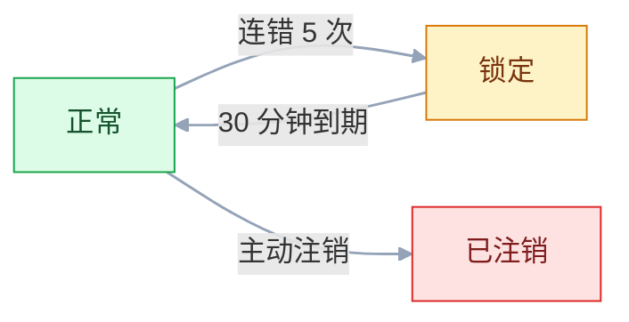
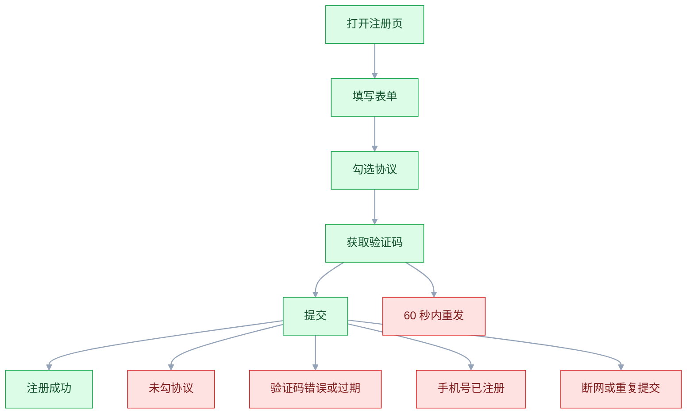
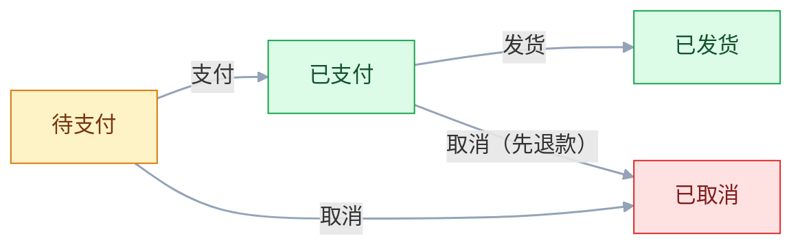

# 测试用例设计

## 一、工程案例：为注册登录模块产出 48 条可执行用例并接入自动化

**场景**：电商 App 的注册登录模块要改版，需求有 9 条规则（R1~R9），涉及 5 个输入字段、登录多条件组合、账号三态流转和一条完整注册流程。1 名测试、2 名开发，给 3 天。目标不是「写一堆用例」，而是产出一份**能评审、能执行、能追溯、能自动化**的用例集。

**交付物**：用例表（48 条）、需求追溯矩阵、自动化脚本（43 条）、手工清单（5 条）。

### 1.1 拆规则

| 编号 | 规则 |
|---|---|
| R1 | 注册需填用户名、密码、确认密码、手机号、短信验证码 |
| R2 | 用户名 6-20 位，仅字母数字下划线，不可重复 |
| R3 | 密码 8-20 位，必须含大写、小写、数字 |
| R4 | 确认密码与密码一致（大小写敏感） |
| R5 | 手机号 11 位、1 开头，同一号码只能注册一次 |
| R6 | 验证码 6 位数字，60 秒限发一次，5 分钟有效 |
| R7 | 登录连续错 5 次锁定 30 分钟，锁定期内正确密码也拒绝 |
| R8 | 账号状态：正常 / 锁定 / 已注销，已注销不可登录 |
| R9 | 未勾选用户协议不可注册 |

拆完先做一张「规则 → 方法」对照，避免拿到需求就开始点点点：

| 规则 | 特征 | 方法 |
|---|---|---|
| R2、R3、R5、R6 | 单字段、有范围与格式 | 等价类 + 边界值 |
| R4、R9 | 两值一致性与前置条件 | 等价类 |
| R7、R8 | 多条件共同决定结果 | 判定表 |
| R8 | 有状态与流转 | 状态迁移 |
| R1 | 有完整业务流程与分支 | 场景法 |

### 1.2 等价类与边界值

逐字段列出有效类和无效类，**每条无效用例只在一个字段上制造无效值，其余字段保持有效**，否则失败时无法判断是哪条规则被漏掉。

| 字段 | 有效 | 无效类（代表值） |
|---|---|---|
| 用户名 | `user_01` | `usr`；21 位；`user@01`；`用户01`；已存在；空 |
| 密码 | `Passw0rd` | 7 位；21 位；无大写；无小写；无数字；含空格；空 |
| 确认密码 | 与密码一致 | 不一致；大小写不同；空 |
| 手机号 | `13800000001` | 10 位；12 位；首位非 1；含字母；已注册；空 |
| 验证码 | 6 位且未过期 | 错误；5 位；7 位；非数字；过期；空 |

用户名（6-20）的边界取值，6 条就能抓住绝大多数差一错误：

| 编号 | 取值 | 预期 |
|---|---|---|
| TC-BV-01 | 5 位 | 拒绝 |
| TC-BV-02 | 6 位 | 通过 |
| TC-BV-03 | 7 位 | 通过 |
| TC-BV-04 | 19 位 | 通过 |
| TC-BV-05 | 20 位 | 通过 |
| TC-BV-06 | 21 位 | 拒绝 |

### 1.3 判定表覆盖登录组合

条件：C1 用户名存在、C2 密码正确、C3 未锁定、C4 未注销。全组合 16 列，合并后剩 6 条规则。

| 规则 | R1 | R2 | R3 | R4 | R5 | R6 |
|---|---|---|---|---|---|---|
| C1 用户名存在 | Y | Y | Y | Y | Y | N |
| C2 密码正确 | Y | Y | N | N | - | - |
| C3 未锁定 | Y | N | Y | N | - | - |
| C4 未注销 | Y | Y | Y | Y | N | - |
| A1 登录成功 | X | | | | | |
| A2 提示账密错误 | | | X | | | X |
| A3 提示已锁定 | | X | | X | | |
| A4 提示已注销 | | | | | X | |

转成可执行用例：

| 编号 | 用户名 | 密码 | 账号状态 | 预期 |
|---|---|---|---|---|
| TC-DT-01 | 存在 | 正确 | 正常 | 登录成功 |
| TC-DT-02 | 存在 | 正确 | 锁定 | 提示已锁定 |
| TC-DT-03 | 存在 | 错误 | 正常 | 提示账密错误，失败次数 +1 |
| TC-DT-04 | 存在 | 错误 | 锁定 | 提示已锁定（锁定优先） |
| TC-DT-05 | 存在 | 正确 | 已注销 | 提示已注销 |
| TC-DT-06 | 不存在 | 任意 | 任意 | 提示账密错误（不暴露账号是否存在） |

**判定表真正的产出不是这 6 条，而是逼出了两个需求空白**：锁定期间继续输错，失败次数是否累加、锁定时长是否重算；锁定与已注销同时成立时，R5 把 C2、C3 合并成「-」是否成立、该提示哪一个。这两条必须在评审时找产品确认。

### 1.4 状态迁移覆盖账号三态



| 编号 | 当前 | 事件 | 预期 | 类型 |
|---|---|---|---|---|
| TC-SM-01 | 正常 | 连错 5 次 | 转锁定，提示剩余时间 | 合法 |
| TC-SM-02 | 锁定 | 30 分钟后正确密码 | 转正常，登录成功 | 合法 |
| TC-SM-03 | 锁定 | 30 分钟内正确密码 | 拒绝 | 非法 |
| TC-SM-04 | 锁定 | 期间继续输错 | 拒绝，提示剩余时间 | 非法 |
| TC-SM-05 | 锁定 | 距解锁不足 1 分钟用正确密码 | 仍拒绝，到期时刻起放行 | 边界 |
| TC-SM-06 | 正常 | 主动注销 | 转已注销，会话全部失效 | 合法 |
| TC-SM-07 | 已注销 | 任意登录 | 拒绝 | 非法 |
| TC-SM-08 | 已注销 | 同手机号重新注册 | 拒绝，提示该手机号已注册（R5 一号一账号） | 边界 |
| TC-SM-09 | 正常 | 错 4 次后输对 | 计数清零 | 合法 |
| TC-SM-10 | 锁定 | 并发登录 | 全部拒绝，不绕过 | 并发 |

### 1.5 场景法覆盖完整流程



| 编号 | 场景 | 预期 |
|---|---|---|
| TC-SC-01 | 完整正常注册 | 成功、落库、跳转 |
| TC-SC-02 | 未勾协议 | 不提交并提示 |
| TC-SC-03 | 60 秒内重复获取验证码 | 拒绝并倒计时 |
| TC-SC-04 | 验证码错误 | 提示可重试 |
| TC-SC-05 | 验证码过期 | 提示重新获取 |
| TC-SC-06 | 手机号已注册 | 提示去登录 |
| TC-SC-07 | 提交时断网 | 提示网络异常，无脏数据 |
| TC-SC-08 | 快速双击提交 | 只产生一条记录 |

### 1.6 汇总与自动化

| 模块 | 条数 | P0 | P1 | P2 |
|---|---|---|---|---|
| 注册 | 31 | 4 | 20 | 7 |
| 登录 | 12 | 3 | 6 | 3 |
| 安全与兼容 | 5 | 1 | 3 | 1 |
| 合计 | 48 | 8 | 29 | 11 |

把 R2、R3 的校验写在 `registration.py`，测试放 `tests/test_registration_rules.py`，参数化一次覆盖全部取值：

```python
# tests/test_registration_rules.py
import pytest
from registration import is_valid_username, is_valid_password

@pytest.mark.parametrize("username, ok", [
    ("usr", False), ("user_0", True), ("a" * 20, True), ("a" * 21, False),
    ("user@01", False), ("用户01", False), ("", False),
])
def test_username_rule(username, ok):
    assert is_valid_username(username) is ok

@pytest.mark.parametrize("password, ok", [
    ("Ab1cdef", False), ("Abcdefg1", True), ("A" * 18 + "b1", True),
    ("passw0rd", False), ("PASSW0RD", False), ("Password", False), ("", False),
])
def test_password_rule(password, ok):
    assert is_valid_password(password) is ok
```

```bash
pytest -q tests/test_registration_rules.py
```

```text
..............                                                           [100%]
14 passed in 0.04s
```

需求追溯用一条命令就能查缺：

```bash
grep -o "R[1-9]" docs/test-cases.md | sort -u | wc -l
```

```text
9
```

少于 9 就说明有规则完全没有对应用例。

### 1.7 验收表

| # | 检查项 | 命令或检查 | 通过标准 |
|---|---|---|---|
| 1 | 规则全覆盖 | `grep -o "R[1-9]" docs/test-cases.md \| sort -u` | 输出 R1~R9 九条 |
| 2 | 边界覆盖 | 对照 5/6/20/21、7/8/20/21、10/11/12 | 每个边界两侧都有用例 |
| 3 | 无效类单变量 | 逐条检查无效用例 | 每条只改一个字段 |
| 4 | 判定表完整 | 6 条规则逐条有对应用例 | 6/6 |
| 5 | 状态迁移 | 3 个状态、3 条迁移逐条有覆盖 | 10/10，合法/非法/边界/并发均有 |
| 6 | 场景覆盖 | 基本流 1 条 + 备选流 7 条 | 8/8 |
| 7 | 预期可判定 | `grep -n "结果正常\|结果正确\|符合预期" docs/test-cases.md` | 无命中 |
| 8 | 优先级合理 | P0 是否都是挂了不可用 | P0 = 8 条 |
| 9 | 自动化通过 | `pytest -q` | 全绿，≤ 30 秒 |
| 10 | 可追溯 | 每条用例的需求来源列非空 | 48/48 有来源（R1~R9 或标注「探索」） |

> 第 7 项用 `grep` 真查一遍。写「结果正确」的用例，执行时只能靠执行者主观判断，换个人结论就可能不同。

---

## 二、高频问答：会卡住你的地方，也是面试最常问的

### 2.1 用例写了很多，风险没覆盖

**现场**

按「正常 / 业务拒绝 / 依赖失败」三列给用例分类，看后两列占比。

**要点**

- 数量够了不等于覆盖充分，大量用例在重复验证 happy path。
- 异常、边界、并发一条没有，风险就原样留在那里。
- 随机抽 10 条，问它验证的是哪条规则、哪个边界，答不出来的是凑数的。

**追问**

- 用例数量有上限吗？→ 按风险分配，P0 全覆盖，P2 抽测。
- 覆盖度怎么量化？→ 需求追溯矩阵，每条规则都要有用例。
- 三列里最容易缺哪列？→ 依赖失败。

### 2.2 边界值只测了边界本身

**现场**

检查每个区间是否同时有上点、内点、离点。

**要点**

- 上点只能抓「边界本身写错」，如 `>=` 写成 `>`。
- 边界被整体写偏一位要靠离点 17、61。
- 对每个范围列出 `下界-1 / 下界 / 下界+1 / 上界-1 / 上界 / 上界+1` 六点，缺哪个补哪个。

**追问**

- 六点必须全测吗？→ 时间紧张时至少 `17、18、60、61`。
- 连续值怎么取离点？→ 按精度取；枚举与字符串长度按字符数取。
- 只测 18 和 60 会漏什么？→ 漏掉整体偏移一位的写法错误。

### 2.3 一条用例改了两个无效字段

**现场**

看无效用例是否只在一个字段上偏离有效值。

**要点**

- 系统只提示第一个错误时，无法判断第二个字段的校验是否存在。
- 「少跑几次」换来的是「定位不了」，这笔账不划算。
- 每个无效类单独一条用例，其余字段全部取有效值。

**追问**

- 多个字段同时错时提示优先级怎么测？→ 单独设计用例，明确先提示哪个。
- 有效类能不能合并？→ 能，同一等价类取一个代表值。
- 无效类为什么不能合并？→ 一条失败无法归因到具体规则。

### 2.4 判定表化简把有效组合合并掉了

**现场**

对每个「-」问一句：这个条件真的不影响动作吗。

**要点**

- 合并的前提是「该条件取任意值都不影响结果」，业务上往往不成立。
- 「表上能合并」不等于「业务上等价」。
- 合并列必须能说出一条业务理由，例如「用户名不存在时统一提示账密错误，避免暴露账号是否存在」。

**追问**

- 不能化简怎么办？→ 全组合列出，条件数超 5 个先按业务约束剪枝。
- 化简过程还能产出什么？→ 需求空白，比如锁定期间失败次数是否累加。
- 「-」写多了有什么风险？→ 掩盖条件之间其实存在优先级。

### 2.5 预期结果写成「正常」「正确」

**现场**

全文搜索「正常」「正确」「符合预期」。

```bash
grep -n "结果正常\|结果正确\|符合预期" docs/test-cases.md
```

**要点**

- 没有可判定的输出，两个人执行会得出两个结论，自动化也无法断言。
- 描述现象不等于定义预期。
- 预期必须落到状态码、字段值、页面文案、数据库记录四者之一。

**追问**

- 断言文案会不会太脆？→ 会，优先断状态码与字段值，文案只断关键词。
- 预期能写成「与开发确认」吗？→ 不能，那是需求空白，评审时就该补。
- 自动化对预期的要求更高吗？→ 是，必须有可断言的输出。

### 2.6 用例步骤绑死界面细节

**现场**

统计最近一次改版废掉了多少条用例。

**要点**

- 按钮颜色、位置、文案一改，用例全部失效，维护成本超过收益。
- 把「操作说明书」写成「界面截图说明」是常见退化。
- 步骤写到「点击提交按钮」即可，不写「点击右下角蓝色按钮」。

**追问**

- 新人执行不了怎么办？→ 另给执行说明，不写进用例本体。
- 改版后哪些用例必须改？→ 只改受影响的步骤描述，预期不动。
- 步骤细到什么程度？→ 精确到输入值，不精确到像素位置。

### 2.7 状态机只测了合法迁移

**现场**

数一下非法迁移用例的数量。

**要点**

- 状态类 bug 更多表现为「非法迁移被允许」，例如已取消订单还能支付。
- 「能走通」不等于「不会走错」。
- 每个状态至少抽 2 条非法事件，再补「重复触发」和「并发触发」。

**追问**

- 状态多时先覆盖哪些？→ 会改变资金或库存的迁移。
- 状态覆盖和迁移覆盖是一回事吗？→ 不是，状态 × 事件矩阵才是迁移覆盖。
- 并发触发为什么要单独测？→ 两个事件同时到达可能绕过状态校验。

### 2.8 正交法漏掉已知的特定组合

**现场**

把历史 bug 的组合与生成结果对照。

**要点**

- 正交法只保证两两组合覆盖，三因素以上的交互和业务已知的坑不在保证内。
- 「两两覆盖」不等于「风险覆盖」。
- 已知问题组合手工加进清单，正交表只负责兜底。

**追问**

- pairwise 和 3-way 差在哪？→ 组合强度，成本随强度上升。
- 36 种全组合要跑多少组？→ 两两覆盖 12 组。
- 漏掉的组合从哪补？→ 从历史缺陷里提，不靠工具生成。

### 2.9 需求改了，用例没改

**现场**

任取一条需求变更，看能否在 5 分钟内列出受影响用例。

**要点**

- 用例没有关联需求编号，改需求时无法反查受影响范围。
- 用例库不是静态文档，需求变更就要跟着更新、删除或新增。
- 每条用例带需求编号，需求变更单里附「受影响用例清单」。

**追问**

- 没有工具怎么追溯？→ 表格加一列需求编号，关键是变更时真去查。
- 用例该删还是标作废？→ 标作废并从执行集移除，不删除。
- 追溯断了会怎样？→ 用例还在断言旧行为，等于传播错误预期。

### 2.10 时间边界靠手工掐点

**现场**

看验证码过期、锁定到期这类用例是否依赖真实等待。

**要点**

- 手工计时不可重复，跨天、跨时区、闰年更测不了。
- 「人等」不等于「系统等」，这类用例必须能把时间推进。
- 服务端注入 `Clock` 或把有效期做成可配置，测试里直接推进时间。

**追问**

- 不想改代码怎么办？→ 用 freezegun、time-machine 这类时间旅行工具。
- 有效期做成配置有什么风险？→ 测试配置与生产不一致时要单独校验。
- 哪些用例最依赖时间？→ 过期、锁定、倒计时、跨零点。

### 2.11 用例库越滚越大，回归跑不完

**现场**

统计近三个版本从未执行的用例占比。

**要点**

- 大量等价重复和已下线功能的用例占着执行时间，团队开始选择性执行。
- 「保留」不等于「安全」，用例集臃肿会让回归越来越慢，最后被裁剪。
- 作废用例标记而不删除，从执行集移除；每个版本清理一次重复项。

**追问**

- 怎么判断两条用例等价？→ 看覆盖矩阵，同一规则同一边界就是重复。
- 已下线功能的用例为什么还留？→ 便于回溯，但不能留在执行集里。
- 清理会不会误删有价值的？→ 只标作废不删除。

### 2.12 自动化全堆在 UI 层

**现场**

统计自动化用例的层次分布与总耗时。

**要点**

- UI 脚本慢、脆、定位差，规则校验本可在接口或单元层秒级覆盖。
- 「端到端」不等于「更可信」，它只是覆盖范围大。
- 把只验证字段规则的 UI 用例下沉到接口或单元层，UI 只留主流程。

**追问**

- 怎么判断一条 UI 用例该下沉？→ 看它验证的规则能不能用一条请求覆盖。
- 下沉后 UI 还留什么？→ 主流程与纯界面交互。
- 三层配比有标准吗？→ 没有，按风险和成本定，常见 70/20/10。
---

## 三、核心知识：从零开始要建立的东西

### 3.1 测试用例的要素

一条用例是一份可执行的操作说明：在什么前提下，做什么，输入什么，应该得到什么。

| 要素 | 作用 | 写法要求 |
|---|---|---|
| 编号 | 唯一标识、可追溯 | `TC-模块-序号` |
| 标题 | 一句话说清场景与预期 | 条件 + 结果 |
| 前置条件 | 执行前必须满足的状态 | 账号、数据、环境 |
| 步骤 | 操作序列 | 编号，精确到输入值 |
| 预期 | 可判定的结果 | 状态码、字段、文案 |
| 优先级 | 执行顺序 | P0/P1/P2 |

```text
烂：测登录
好：连续输错密码 5 次后账号锁定 30 分钟
烂：结果正确
好：HTTP 423，提示"账号已锁定，请 30 分钟后再试"
```

**边界**：给资深执行者可以只写标题加预期；给新人或要自动化的用例，步骤要细到每个输入。

### 3.2 等价类划分

把无穷多的输入切成若干类，同一类里任取一个值，程序走同一段逻辑。

| 类型 | 含义 | 例子（年龄 18-60） |
|---|---|---|
| 有效等价类 | 合法输入 | 18~60 的整数 |
| 无效等价类 | 每类一种错误 | 小于 18、大于 60、非整数、非数字、空 |

步骤：列输入项 → 找规则 → 划有效与无效类 → 每类取一个代表值 → 无效类单独成条。

**边界与取舍**：等价类假设「同一类行为一致」，如果代码对同类里的值有特殊处理（例如 `0` 表示未填写），它就不是同一个类，要单独拆出来。

> **面试**：常问「等价类划分怎么做？」答：把无穷多的输入切成有效与无效类，每类取一个代表值，无效类单独成条。

### 3.3 边界值分析

缺陷集中在输入域的边缘，因为比较符最容易写错。

| 概念 | 定义 | 年龄 18-60 的取值 |
|---|---|---|
| 上点 | 边界上的值 | 18、60 |
| 内点 | 范围内的值 | 19、30、59 |
| 离点 | 边界外最近的值 | 17、61 |

最小配置是六点：`17、18、19、59、60、61`。时间紧张时至少测 `17、18、60、61`。

**机制**：`>=` 写成 `>`、`<=` 写成 `<` 由上点暴露；边界被整体写偏一位由离点暴露。**取舍**：连续值（金额、时间）按精度取离点；枚举与字符串长度按字符数取。

> **面试**：常问「边界值分析要测哪几个点？」答：上点、内点、离点，最小配置六点（下界-1、下界、下界+1、上界-1、上界、上界+1）。

### 3.4 判定表

多个条件共同决定结果时，用表格穷举并化简。

| 组成 | 位置 | 含义 |
|---|---|---|
| 条件桩 | 左上 | 所有条件 |
| 动作桩 | 左下 | 所有可能结果 |
| 条件项 | 右上 | 每列各条件取值 |
| 动作项 | 右下 | 该组合下执行哪些动作 |

四步：列条件与动作 → 枚举 2ⁿ 列 → 合并无关项 → 每列生成一条用例。

**边界**：条件数超过 5 个时全组合爆炸，先按业务约束剪枝，再用正交法补组合覆盖。化简掉的列必须逐条确认业务上真的无关。

### 3.5 因果图与正交试验

**因果图**把「原因 → 结果」的逻辑画成图再转判定表。恒等、与、或、非是基本关系，异、或、唯一、要求、强制是约束。现代实践可以直接列条件组合再化简，效果等价，编码更容易。

**正交试验**处理多因素多水平：3 种系统 × 4 种浏览器 × 3 种分辨率 = 36 种全组合，两两覆盖 12 组就够（系统与浏览器的 3×4=12 个配对每个都要出现一次，每组只能覆盖其中一对）。

```python
from allpairspy import AllPairs

params = [["Windows", "macOS", "Linux"],
          ["Chrome", "Firefox", "Safari", "Edge"],
          ["1920x1080", "1366x768", "2560x1440"]]
for i, combo in enumerate(AllPairs(params), 1):
    print(i, combo)
```

**取舍**：正交法保证任意两因素组合至少出现一次，不保证三因素交互和业务已知风险。已知的坏组合必须手工补进去。

### 3.6 场景法

从业务流程里抽出基本流与备选流，每条路径一条用例。

| 概念 | 含义 | 下单例子 |
|---|---|---|
| 基本流 | 一切顺利的主路径 | 选商品 → 支付 → 扣库存 → 完成 |
| 备选流 | 分支、异常、回退 | 库存不足、支付超时、扣库存失败 |

**机制**：真实系统的 bug 多数在分支上，基本流一条就够，备选流要逐条列。**取舍**：路径数量随分支指数增长，按「这条分支是否改变数据状态」筛选，纯提示类分支可以合并。

> **面试**：常问「场景法里基本流和备选流分别是什么？」答：基本流是一切顺利的主路径，备选流是分支、异常、回退。

### 3.7 状态迁移法

对象有明确状态、状态间有流转规则时使用。产出两份东西：状态迁移图与状态 × 事件矩阵，图看合法路径，矩阵补非法事件。



| 当前 \ 事件 | 支付 | 取消 | 发货 |
|---|---|---|---|
| 待支付 | 已支付 | 已取消 | 拒绝 |
| 已支付 | 拒绝 | 已取消（先退款） | 已发货 |
| 已发货 | 拒绝 | 拒绝 | 拒绝 |

用例分三类：所有合法迁移逐条测；每个状态抽 2~3 条非法事件；重复触发与并发触发单独测。

**边界**：状态越多，矩阵越大。先覆盖「会改变资金或库存」的迁移，再补纯展示状态。

> **面试**：常问「状态迁移法产出什么？」答：状态迁移图和状态×事件矩阵，图看合法路径，矩阵补非法事件。

### 3.8 错误推测法

凭经验列出这类功能常见的错误，作为系统方法的补充。它不保证覆盖，只保证踩过的坑不再踩。

| 类别 | 测试点 |
|---|---|
| 空值与空白 | null、空串、全空格、字段缺失 |
| 特殊字符 | 引号、尖括号、百分号、反斜杠、emoji |
| 重复操作 | 双击提交、重复支付、重复回调 |
| 并发 | 同时改同一条记录、并发扣库存 |
| 时序 | 过期后使用、乱序到达、先操作后初始化 |
| 依赖失败 | 第三方超时、返回格式异常、限流 |
| 数据量 | 0 条、1 条、1 万条、超长列表 |

**用法**：系统方法出完用例后，拿这张清单逐项过一遍，补上的每一条都写清「曾经出过什么问题」。

### 3.9 用例优先级

| 级别 | 判定 | 执行时机 |
|---|---|---|
| P0 | 挂了业务不可用 | 每次提交或发版 |
| P1 | 挂了部分用户受影响 | 每次发版 |
| P2 | 几乎无感或边角 | 按版本抽测 |

划分只问一句：这个功能挂了，业务还能不能转。**取舍**：P0 太多等于没有优先级；一个模块的 P0 超过用例总数两成，先回头核功能分级，别靠加 P0 求安心。

### 3.10 用例评审

评审是提升用例质量性价比最高的动作，重点看覆盖缺口而不是文字格式。

| 检查项 | 要问的问题 |
|---|---|
| 需求覆盖 | 每条规则、每个异常说明有没有对应用例 |
| 边界覆盖 | 每个数值范围的上点与离点是否都测 |
| 无效类 | 每类错误输入是否都有代表 |
| 组合 | 多条件同时不满足时提示优先级是否明确 |
| 状态 | 合法与非法迁移是否都覆盖 |
| 流程 | 备选流、超时、回退是否覆盖 |
| 可判定 | 预期是否能明确判通过或不通过 |
| 可执行 | 前置数据造得出来吗，环境支持吗 |

**形式**：需求评审同步做、用例文档交叉评审、结对设计。评审记录要留下「谁提了什么、改没改」。

### 3.11 用例维护

过期的用例比没有用例更危险，它会传播错误的预期。

| 触发 | 动作 |
|---|---|
| 需求变更 | 按需求编号反查，更新、删除或新增 |
| 发现缺陷 | 复现步骤沉淀为用例，加入回归集 |
| 界面改版 | 只改受影响的步骤描述 |
| 功能下线 | 标记作废，从执行集移除，不删除 |
| 定期清理 | 合并重复项，补覆盖缺口 |

**机制**：用例的维护成本与「细节程度」成正比。少写界面细节、强关联需求编号，是降低长期成本的两个杠杆。

### 3.12 用例管理工具

| 工具 | 特点 | 适用 |
|---|---|---|
| 表格 | 零成本、灵活 | 小团队起步 |
| 禅道、Tapd | 用例与需求、缺陷打通 | 中小团队 |
| TestLink、Kiwi TCMS | 开源、可私有化 | 有合规要求 |
| Xray、Zephyr | 与 Jira 深度集成 | 已用 Jira |

选型标准只有一条：用例能和需求、缺陷关联。孤立存在的用例库很快没人维护。

执行状态四种：通过、失败、阻塞、跳过。两条纪律：失败必须提缺陷；大量阻塞要查环境和依赖，比失败更值得关注。

### 3.13 自动化用例的选择

| 值得自动化 | 不值得 |
|---|---|
| 重复执行的回归与冒烟 | 需求频繁变动的界面 |
| 结果确定的接口与规则 | 一次性活动页 |
| 大数据量参数组合 | 视觉与体验判断 |
| 长时间稳定性与压测 | 依赖不可控外部资源 |

三个都满足才进入候选：会重复执行、结果确定、断言明确。**取舍**：先把 P0 的回归做满，再按投入产出补 P1；不追求自动化比例，剩下的留给探索性测试。

### 3.14 数据驱动用例

同结构、不同数据的用例合并成一条参数化用例，数据与逻辑分离。

```java
@ParameterizedTest(name = "用户名 {0} 是否合法 = {1}")
@CsvSource({"usr,false", "user_0,true", "aaaaaaaaaaaaaaaaaaaa,true",
            "aaaaaaaaaaaaaaaaaaaaa,false", "user@01,false"})
void 用户名校验(String name, boolean ok) {
    assertEquals(ok, Validator.username(name));
}
```

**边界**：参数化适合「一套断言、多组数据」；如果每组数据的断言逻辑不同，强行合并会让失败信息难以定位。用例名要带数据描述。

### 3.15 可追溯性

用例、需求、缺陷三者用编号关联，形成可反查的网络。

```text
需求 R7 → 用例 TC-LOG-005、TC-LOG-006、TC-LOG-007
缺陷 BUG-231 → 用例 TC-LOG-006（回归）
```

| 方向 | 用途 |
|---|---|
| 需求 → 用例 | 需求变更时找受影响范围 |
| 用例 → 需求 | 评审时发现无来源的用例 |
| 缺陷 → 用例 | 确认修复有回归保护 |

**机制**：追溯靠编号，不靠记忆。**取舍**：小团队用表格加一列需求编号即可，不必上重型工具；关键是变更时真的去查。

---

## 四、冷门知识汇总

| 知识点 | 为什么冷门 | 用到时的关键词 |
|---|---|---|
| 弱一般与强一般等价类 | 多数人只用单变量等价类 | 多变量组合、健壮性测试 |
| 边界值六点扩展 | 日常只取上点与离点 | 下界-1、上界+1、精度边界 |
| 正交表记号 | 工具自动生成，很少手算 | L9(3⁴)、因素、水平 |
| PICT 约束建模 | 微软工具，团队少用 | if-then、invalidate、子模型 |
| 成对覆盖与 k 因子覆盖 | 常把 pairwise 当成覆盖了全部交互 | pairwise、3-way、4-way、组合强度 |
| 判定表的无关项合并 | 合并规则容易拍脑袋 | 无关项、业务等价 |
| 因果图约束 | 画图成本高，多直接列判定表 | E/I/O/R/M 约束 |
| 状态迁移的覆盖等级 | 很少区分状态覆盖与迁移覆盖 | 状态覆盖、迁移对覆盖 |
| 异常流的半成功 | 比全失败更难构造与排查 | 部分成功、补偿、幂等 |
| 时间旅行测试 | 需要可注入时钟或改系统时间 | Clock、freezegun、time-machine |
| 组合测试的优先级裁剪 | 组合爆炸时靠风险排序 | 风险加权、必测组合 |
| 用例的等价去重 | 很难判断两条用例是否真等价 | 覆盖矩阵、去重 |
| 众测与探索性会话 | 与脚本化测试流程不兼容 | 时间盒、测试章程 |
| 验收标准的可测性 | 合同语言天然模糊 | 可判定、量化阈值 |
