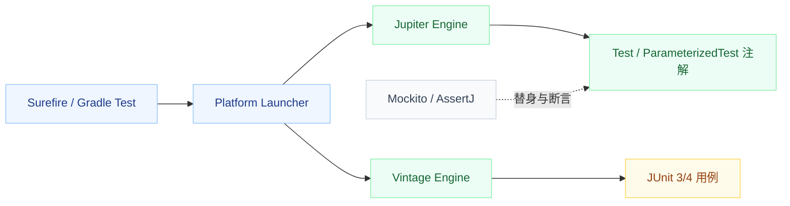
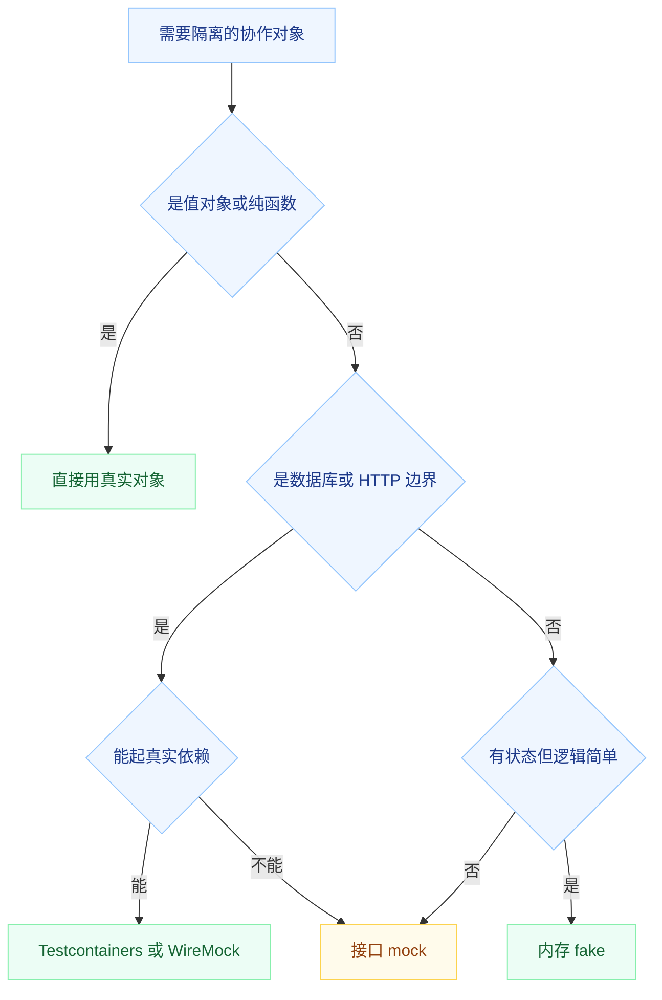

# JUnit5与Mockito

> 这篇从 JUnit 5 的平台结构讲起，经过环境准备、生命周期注解、断言与参数化测试，进入 Mockito 的打桩、验证和参数捕获，再讨论测试替身的选择边界，最后落到构建集成、排障手册和一个订单服务的完整单元测试案例。
>
> 学完能为一个依赖数据库、库存服务和时钟的业务类写出可重复、可维护的单元测试，并让它在 Maven、CI 和覆盖率报告里稳定通过。

## 一、JUnit 5 的组成与适用边界

JUnit 5 不是一个 jar，而是“平台 + 引擎 + 编程模型”三层，装错一层就会出现“测试类编译通过但一个都没执行”。这一章先把三者分清，再划出单元测试（Unit Test）与集成测试（Integration Test）的边界。

### 1.1 平台、引擎与编程模型

JUnit Platform（测试平台）只负责发现、调度和报告；JUnit Jupiter 提供 `@Test`、断言和参数化这套编程模型；JUnit Vintage 让 JUnit 3/4 的老用例还能跑在同一个平台上。



依赖坐标对应三层：

| Maven 坐标 | 提供的能力 | 少了它会怎样 |
|---|---|---|
| `junit-platform-launcher` | 发现与调度 | IDE/构建工具报找不到引擎 |
| `junit-jupiter` | API、参数化、引擎 | 测试能编译，运行数为 0 |
| `junit-jupiter-api` | 只有注解和断言 | 编译通过，没有引擎执行 |
| `junit-vintage-engine` | 跑 JUnit 4 用例 | 老用例被静默跳过 |

`junit-jupiter` 是聚合包，已经把 api、params、engine 打进依赖树。只引 `junit-jupiter-api` 是最常见的“0 tests run”原因，因为编译期只需要 API，运行期才需要引擎。

> 边界：新项目不要引 Vintage。它只用于迁移期，把 JUnit 4 用例和新用例放在同一个报告里；迁移完成后移除，否则两套生命周期注解会互相干扰。

### 1.2 与 Mockito、AssertJ、Surefire 的分工

JUnit 负责组织和执行用例，Mockito 负责造替身和验证交互，AssertJ 负责把断言写成可读的链，Surefire 负责在独立 JVM 里跑并汇总结果。四者职责不重叠，混用会写出难维护的测试。

| 组件 | 负责 | 不负责 |
|---|---|---|
| JUnit Jupiter | 用例结构、生命周期、参数化 | 造替身、复杂集合断言 |
| Mockito | 替身、打桩、交互验证 | 组织用例、生成报告 |
| AssertJ | 流式断言、集合与异常断言 | 生命周期、mock |
| Maven Surefire | 启动 JVM、收集结果 | 测试逻辑、依赖注入 |

一个典型分工是：JUnit 的 `@ExtendWith(MockitoExtension.class)` 初始化 mock，测试体用 Mockito 打桩，结果用 AssertJ 断言，最后由 Surefire 输出 `Tests run: N`。四层任何一层版本不匹配，故障现象都不一样，第八章按现象给排查命令。

### 1.3 版本基线与适用边界

版本基线取 2026 年企业仍在维护的稳定线：Java 21 LTS、JUnit Jupiter 5.11.x（6.0.x 坐标不变）、Mockito 5.x、AssertJ 3.27.x、Surefire 3.5.x。

| 组件 | 示例版本 | 关键约束 |
|---|---|---|
| Java | 21 LTS | 编译用 `release 21` |
| JUnit Jupiter | 5.11.4 | 6.0.x 仍是 `junit-jupiter` 坐标 |
| Mockito | 5.17.0 | 默认 inline mock maker |
| AssertJ | 3.27.7 | 3.x 兼容 Java 8+ |
| Surefire | 3.5.2 | 自动识别 JUnit Platform |

JUnit 6.0 于 2025 年发布，最低 Java 17，`junit-jupiter` 坐标和 Jupiter API 保持兼容，升级通常只改 BOM 版本号；老系统停在 5.11/5.12 也完全可用。Mockito 4.x 已停止维护，默认 mock maker 不能 mock final 类，2026 年不应再选；AssertJ 4.x 起才要求 Java 17，3.27 仍可跑在老项目上。

单元测试的边界要写死：

- 不启动 Spring 容器。需要容器、数据库、HTTP 的测试属于集成测试，放到 `*IT` 交给 Failsafe 或 Testcontainers。
- 不依赖真实时间、随机数、时区、网络。这些是不稳定测试的四大来源，全部用注入的协作者替换。
- 不验证框架行为。测的是自己的业务规则，不是 Hibernate 会不会生成 SQL。

> 边界：Mockito 不能替代契约测试。mock 返回的是测试自己写的数据，接口真的改了字段，mock 仍然“通过”。跨服务契约要用契约测试或 Testcontainers 校验，见 `02-Testcontainers与契约测试.md`。

## 二、环境准备与最小验证

这一章的目标是装好 JDK 21 与 Maven，写出一个最小测试并在命令行看到 `Tests run: 1`。跑不通这一步，后面的注解和 mock 都无从验证。

### 2.1 安装 JDK 21 与 Maven

四类系统的安装命令如下，装完都要用 `java -version` 和 `mvn -v` 确认版本。

```bash
# macOS（Homebrew）
brew install --cask temurin@21
brew install maven

# Ubuntu 24.04 LTS（22.04 需先加 backports 或 JDK PPA）
sudo apt update
sudo apt install -y openjdk-21-jdk maven

# Rocky Linux / CentOS Stream
sudo dnf install -y java-21-openjdk-devel maven

# Windows（PowerShell，winget）
winget install EclipseAdoptium.Temurin.21.JDK
winget install Apache.Maven
```

```bash
java -version
mvn -v
```

```text
openjdk version "21.0.13" 2026-10-22 LTS
OpenJDK Runtime Environment Temurin-21.0.13+10 (build 21.0.13+10)
Apache Maven 3.10.0
Java version: 21.0.13, vendor: Eclipse Adoptium
```

`mvn -v` 里的 `Java version` 必须是 21。Maven 会取 `JAVA_HOME`，机器上装了多个 JDK 时，先执行 `export JAVA_HOME=$(/usr/libexec/java_home -v 21)`（macOS）或 `export JAVA_HOME=/usr/lib/jvm/java-21-openjdk-amd64`（Ubuntu），再运行 Maven。

### 2.2 最小工程的 pom 配置

依赖分三块：JUnit BOM 统一 Jupiter 各模块版本；Mockito 的 `mockito-junit-jupiter` 提供扩展；AssertJ 提供流式断言。Surefire 3.5 显式指定版本，避免 Maven 默认插件过旧不识别 JUnit Platform。

```xml
<properties>
  <maven.compiler.release>21</maven.compiler.release>
  <project.build.sourceEncoding>UTF-8</project.build.sourceEncoding>
  <junit.version>5.11.4</junit.version>
  <mockito.version>5.17.0</mockito.version>
  <assertj.version>3.27.7</assertj.version>
</properties>

<dependencyManagement>
  <dependencies>
    <!-- BOM 统一 jupiter-api / params / engine 的版本，避免三者错位 -->
    <dependency>
      <groupId>org.junit</groupId>
      <artifactId>junit-bom</artifactId>
      <version>${junit.version}</version>
      <type>pom</type>
      <scope>import</scope>
    </dependency>
  </dependencies>
</dependencyManagement>

<dependencies>
  <dependency>
    <groupId>org.junit.jupiter</groupId>
    <artifactId>junit-jupiter</artifactId>
    <scope>test</scope>
  </dependency>
  <dependency>
    <groupId>org.mockito</groupId>
    <artifactId>mockito-junit-jupiter</artifactId>
    <version>${mockito.version}</version>
    <scope>test</scope>
  </dependency>
  <dependency>
    <groupId>org.assertj</groupId>
    <artifactId>assertj-core</artifactId>
    <version>${assertj.version}</version>
    <scope>test</scope>
  </dependency>
</dependencies>

<build>
  <plugins>
    <plugin>
      <groupId>org.apache.maven.plugins</groupId>
      <artifactId>maven-surefire-plugin</artifactId>
      <version>3.5.2</version>
    </plugin>
  </plugins>
</build>
```

Gradle 用 `useJUnitPlatform()` 打开平台，依赖写法等价：

```groovy
dependencies {
    testImplementation platform('org.junit:junit-bom:5.11.4')
    testImplementation 'org.junit.jupiter:junit-jupiter'
    testImplementation 'org.mockito:mockito-junit-jupiter:5.17.0'
    testImplementation 'org.assertj:assertj-core:3.27.7'
}

tasks.test {
    useJUnitPlatform()
    testLogging { events 'passed', 'skipped', 'failed' }
}
```

目录必须是 Maven 标准布局：被测类放 `src/main/java`，测试放 `src/test/java`，包名一致。测试类本身不需要 `public`，JUnit 5 允许包级可见，这样测试不会被意外当成 API 暴露。

### 2.3 第一个测试与预期输出

先写一个纯函数和一个测试，确认整条链路通。

```java
// src/main/java/com/example/Calculator.java
package com.example;

public class Calculator {
    public int add(int a, int b) {
        return a + b;
    }
}
```

```java
// src/test/java/com/example/CalculatorTest.java
package com.example;

import org.junit.jupiter.api.Test;

import static org.junit.jupiter.api.Assertions.assertEquals;

class CalculatorTest {

    @Test
    void addsTwoNumbers() {
        // 期望值在前、实际值在后，失败信息才不会反过来误导
        assertEquals(4, new Calculator().add(2, 2));
    }
}
```

```bash
mvn test
```

```text
[INFO] Running com.example.CalculatorTest
[INFO] Tests run: 1, Failures: 0, Errors: 0, Skipped: 0, Time elapsed: 0.015 s
[INFO] Results:
[INFO] Tests run: 1, Failures: 0, Errors: 0, Skipped: 0
[INFO] BUILD SUCCESS
```

看到 `Tests run: 1` 才算环境可用。只看到 `BUILD SUCCESS` 而没有任何 `Tests run`，说明测试根本没被发现，按第九章的“0 tests run”排查。

### 2.4 依赖与发现的四个坑

第一，`junit-jupiter-api` 单独存在时能编译不能运行；第二，测试类名不符合 Surefire 默认模式（`*Test`、`Test*`、`*Tests`、`*TestCase`）会被跳过；第三，JUnit 4 的 `org.junit.Test` 与 Jupiter 的注解同名，import 错了会跑到 Vintage，缺少 Vintage 时用例直接不被发现；第四，IDE 用自带 JUnit 运行器而不走 Maven，会出现“IDE 全绿、CI 全红”。

```bash
# 确认测试是否真的被 Surefire 发现
mvn -X test 2>&1 | grep -i "test class"
mvn help:effective-pom | grep -A3 surefire
```

> 边界：不要用 `mvn test` 之外的脚本手工拼 classpath 跑测试。手工 classpath 少了 engine 或 params 时，报错信息只会说“找不到测试”，不会指出缺哪个 jar。

## 三、注解与生命周期

JUnit 5 默认给每个测试方法新建一个测试类实例，字段状态不会跨方法泄漏；需要共享实例时必须显式声明，并承担清理责任。这一章把钩子、嵌套、条件和临时目录一次讲清。

### 3.1 默认生命周期：一个方法一个实例

`@TestInstance(PER_METHOD)` 是默认值。下面这个类里，`count` 是实例字段，两个测试各自从 0 开始，互不影响。

```java
class CounterTest {
    private int count = 0;   // 每个测试方法拿到新实例，天然隔离

    @Test
    void first() {
        count++;
        assertEquals(1, count);
    }

    @Test
    void second() {
        count++;
        assertEquals(1, count);   // 仍是 1，说明没有共享上一个测试的状态
    }
}
```

改成 `@TestInstance(TestInstance.Lifecycle.PER_CLASS)` 后，实例只建一次，`count` 会在两个方法间累加，后执行的那个断言会看到 2。这个开关的主要好处是允许非静态的 `@BeforeAll` 和 `@MethodSource`，代价是必须自己清理状态。

> 边界：`static` 字段在任何生命周期下都共享。用静态集合记录事件、用静态 mock 保存状态，都会让测试顺序敏感，并行执行时直接失败。

### 3.2 四个钩子的执行顺序

`@BeforeAll` 在类内所有测试前执行一次，`@BeforeEach` 在每个测试前执行，`@AfterEach` 与 `@AfterAll` 对称。用事件列表把顺序固定成断言，比看控制台打印可靠。

```java
class LifecycleDemoTest {

    // static 字段在整个类内共享，PER_METHOD 生命周期也不例外
    static final List<String> EVENTS = new ArrayList<>();

    @BeforeAll
    static void beforeAll() {
        EVENTS.add("beforeAll");
    }

    @BeforeEach
    void beforeEach() {
        EVENTS.add("beforeEach");
    }

    @Test
    void hooksRunBeforeTest() {
        EVENTS.add("test");
        // 用断言固定钩子顺序，不靠控制台打印顺序猜
        assertThat(EVENTS).containsExactly("beforeAll", "beforeEach", "test");
    }

    @AfterEach
    void afterEach() {
        EVENTS.add("afterEach");
    }

    @AfterAll
    static void afterAll() {
        // 此时 test 与 afterEach 都已执行完
        assertThat(EVENTS).containsExactly("beforeAll", "beforeEach", "test", "afterEach");
    }
}
```

运行结果：

```text
[INFO] Tests run: 1, Failures: 0, Errors: 0, Skipped: 0
```

| 注解 | 执行次数 | 典型用途 | 常见错误 |
|---|---|---|---|
| `@BeforeAll` | 每类一次 | 起容器、读大文件 | 非静态方法直接报错 |
| `@BeforeEach` | 每方法一次 | 构造被测对象、重置 mock | 忘了重置静态状态 |
| `@AfterEach` | 每方法一次 | 删临时数据、关流 | 清理逻辑写在测试体内 |
| `@AfterAll` | 每类一次 | 停容器、汇总 | 依赖测试执行顺序 |

### 3.3 嵌套、显示名与标签

`@Nested` 把同一组场景收进内部类，`@DisplayName` 让报告说人话，`@Tag` 让构建按组筛选。三者都不改变测试逻辑，只改变可读性和可筛选性。

```java
@DisplayName("订单金额计算")
class OrderAmountTest {

    @Nested
    @DisplayName("VIP 用户")
    class Vip {

        @Test
        @DisplayName("满 200 叠加优惠券后仍受 50 元上限约束")
        @Tag("fast")
        void cappedAtFifty() {
            assertThat(Discount.calculate("VIP", 1000, "MINUS_20")).isEqualTo(50.0);
        }
    }
}
```

`@Nested` 内部类不能是 `static`，且会继承外部类的 `@BeforeEach`。报告里的名字是“订单金额计算 > VIP 用户 > 满 200…”，定位失败用例比 `test3` 快得多。

```bash
mvn test -Dgroups=fast            # 只跑 fast 标签
mvn test -DexcludedGroups=slow    # 跳过 slow 标签
```

> 边界：标签是筛选手段，不是分层替代品。不要用标签表达依赖关系，比如“必须跑完 db 才能跑 api”，那属于测试数据准备，不是执行顺序。

### 3.4 条件执行、超时与临时目录

`@Disabled` 停用单个用例，`@EnabledOnOs`/`@EnabledIfEnvironmentVariable` 按环境启用，`@Timeout` 防止用例挂死，`@TempDir` 提供自动清理的临时目录。

```java
@Test
@Disabled("等待库存服务提供幂等接口后再启用")
void reservesIdempotently() { }

@Test
@EnabledOnOs(OS.LINUX)
void usesLinuxPath() { }

@Test
@Timeout(value = 2, unit = TimeUnit.SECONDS)
void completesQuickly(@TempDir Path tempDir) throws IOException {
    Path file = Files.writeString(tempDir.resolve("input.txt"), "ok");
    assertThat(Files.readString(file)).isEqualTo("ok");
}
```

`@TempDir` 可以修饰字段或方法参数，JUnit 在测试结束后递归删除，测试之间不会共用脏文件。`@Timeout` 默认在同一线程计时，不会中断阻塞的 IO；对可能永久阻塞的调用要用 `assertTimeoutPreemptively`，但它会换线程执行，`ThreadLocal` 和事务上下文会丢。

> 边界：`@Disabled` 必须带原因。没有原因的禁用等同于删测试，半年后没人知道它为什么存在。

## 四、断言：从 JUnit 内置到 AssertJ

断言（Assertion）决定测试失败时能看到什么。JUnit 内置断言够用但信息少，AssertJ 的链式断言在集合、异常和字段提取上更清楚；两者可以共存，同一项目内保持一致即可。

### 4.1 两套断言的分工

简单值比较用 JUnit 的 `assertEquals`，对象图、集合、异常和“提取多个字段”用 AssertJ。混用的判断标准是：失败信息能否直接指出哪个字段不对。

| 场景 | 推荐 | 失败信息 |
|---|---|---|
| 整数、字符串相等 | `assertEquals` | `expected: <a> but was: <b>` |
| 集合包含与顺序 | AssertJ `containsExactly` | 指出缺失/多余元素 |
| 对象多字段核对 | AssertJ `extracting` | 逐字段列出差异 |
| 异常类型与消息 | AssertJ `assertThatThrownBy` | 完整异常栈 |
| 浮点比较 | 两者都要给误差 | 不给误差会因精度失败 |

### 4.2 异常断言的正确写法

异常断言要同时核对类型、消息和是否由预期调用抛出。`assertThrows` 返回异常对象，适合继续取字段；AssertJ 的 `assertThatThrownBy` 适合链式核对消息和原因。

```java
@Test
void rejectsNonPositiveAmount() {
    IllegalArgumentException ex = assertThrows(
            IllegalArgumentException.class,
            () -> Discount.calculate("VIP", 0, null));
    assertEquals("amount must be positive", ex.getMessage());
}

@Test
void rejectsUnknownLevel() {
    assertThatThrownBy(() -> Discount.calculate("GOLD", 100, null))
            .isInstanceOf(IllegalArgumentException.class)
            .hasMessageContaining("unknown level")
            .hasNoCause();   // 确认不是被包装过的异常
}
```

`assertThrows` 的第二个参数是可执行体，不能提前把调用写在 lambda 外面，否则异常在断言之前就抛出了。

### 4.3 多断言与软断言

一个测试要核对多个独立事实时，用 `assertAll` 让所有失败一起报告；需要“全部跑完再汇总”的复杂场景，用 AssertJ 的 `SoftAssertions`（或静态的 `assertSoftly`）。

```java
@Test
void createsUser() {
    User user = new User("alice", 30, List.of("admin", "ops"));

    assertAll(
            () -> assertThat(user.name()).isEqualTo("alice"),
            () -> assertThat(user.age()).isEqualTo(30),
            () -> assertThat(user.roles()).containsExactly("admin", "ops")
    );
}

@Test
void validatesProfile() {
    User user = new User("bob", 17, List.of());

    SoftAssertions softly = new SoftAssertions();
    softly.assertThat(user.name()).startsWith("b");
    softly.assertThat(user.age()).isGreaterThanOrEqualTo(18);
    softly.assertThat(user.roles()).isNotEmpty();
    softly.assertAll();   // 所有失败一次性列出，不因第一条失败中断
}
```

`assertAll` 里的多个 lambda 都会执行，失败信息按顺序列出。普通 `assertThat` 一旦失败就终止当前测试，后面的断言不再执行，这也是“只修了第一个错”的常见原因。

### 4.4 断言的四个易错点

第一，`assertEquals(expected, actual)` 的参数顺序反了，失败信息会误导排查。第二，`BigDecimal` 用 `equals` 比较会连小数位一起比，`39.80` 与 `39.8` 不相等。第三，浮点数不给误差。第四，用 `toString` 的结果做断言。

下面这个测试故意失败，用来看清 `BigDecimal` 的失败信息：

```java
@Test
void bigDecimalEqualsIsScaleSensitive() {
    // 39.80 与 39.8 数值相同但小数位不同，equals 判为不等
    assertEquals(new BigDecimal("39.80"), new BigDecimal("39.8"));
}
```

```text
org.opentest4j.AssertionFailedError: expected: <39.80> but was: <39.8>
```

金额比较用 `isEqualByComparingTo`（AssertJ）或 `compareTo`，它只比数值不比小数位：

```java
assertThat(new BigDecimal("39.8")).isEqualByComparingTo("39.80");   // 通过
assertThat(0.1 + 0.2).isCloseTo(0.3, within(1e-9));                 // 浮点必须给误差
```

> 边界：不要为了“断言更严格”去比 `toString`。`Order` 的 `toString` 是调试输出，字段顺序和格式随时会变，测试会因无关改动失败。

## 五、参数化测试与动态测试

同一段逻辑用不同输入反复验证时，参数化测试（Parameterized Test）比复制十个方法更好维护：失败信息带参数、用例数量自动统计、边界值集中在一张表里。

### 5.1 五种数据源

`@ValueSource` 给单类型数组，`@CsvSource` 给多列字面量，`@CsvFileSource` 读文件，`@EnumSource` 遍历枚举，`@MethodSource` 用方法生成复杂参数。

```java
class ShippingFeeTest {

    static BigDecimal fee(String region, int weightGrams) {
        // 非法重量在入口拒绝，后面的分支只处理有效输入
        if (weightGrams <= 0) throw new IllegalArgumentException("weight must be positive");
        BigDecimal base = "WEST".equals(region) ? new BigDecimal("10.00") : new BigDecimal("6.00");
        return weightGrams > 1000 ? base.add(new BigDecimal("2.00")) : base;
    }

    @ParameterizedTest(name = "[{index}] {0} {1}g -> {2} 元")
    @CsvSource({
            "EAST,  500,  6.00",
            "EAST,  1200, 8.00",
            "WEST,  500,  10.00",
            "WEST,  1200, 12.00"
    })
    void calculatesFee(String region, int weightGrams, String expected) {
        assertThat(fee(region, weightGrams)).isEqualByComparingTo(expected);
    }

    @ParameterizedTest(name = "weight={0} 被拒绝")
    @ValueSource(ints = {0, -1})
    void rejectsNonPositiveWeight(int weightGrams) {
        assertThatThrownBy(() -> fee("EAST", weightGrams))
                .isInstanceOf(IllegalArgumentException.class)
                .hasMessageContaining("positive");
    }
}
```

四个 CSV 行会产生 4 次执行，报告里分别显示 `[1] EAST 500g -> 6.00 元` 这样的名字。`{index}` 从 1 开始，`{0}`、`{1}` 是参数占位符。

多行 CSV 用文本块更好读，注意每行不能有尾随逗号：

```java
@ParameterizedTest(name = "[{index}] {0} -> {1}")
@CsvSource(textBlock = """
        EAST,  6.00
        WEST,  10.00
        """)
void baseFeeByRegion(String region, String expected) {
    assertThat(fee(region, 100)).isEqualByComparingTo(expected);
}
```

### 5.2 方法源与参数聚合

参数是对象、或需要复用构造逻辑时，用 `@MethodSource` 返回 `Stream<Arguments>`。方法必须是 `static`，除非测试类声明了 `PER_CLASS`。

```java
class PasswordPolicyTest {

    static void validate(String password) {
        if (password == null || password.length() < 8) {
            throw new IllegalArgumentException("长度至少 8 位");
        }
        if (!password.matches(".*\\d.*")) {
            throw new IllegalArgumentException("必须包含数字");
        }
    }

    static Stream<Arguments> invalidPasswords() {
        return Stream.of(
                Arguments.of("", "长度至少 8 位"),
                Arguments.of("short", "长度至少 8 位"),
                Arguments.of("nodigit!", "必须包含数字")
        );
    }

    @ParameterizedTest(name = "[{index}] password=[{0}]")
    @MethodSource("invalidPasswords")
    void rejectsInvalidPassword(String password, String message) {
        assertThatThrownBy(() -> validate(password))
                .isInstanceOf(IllegalArgumentException.class)
                .hasMessage(message);
    }
}
```

参数超过四五个时，用 `ArgumentsAccessor` 按索引取值，或用 `@AggregateWith` 聚合成一个 record，避免一长串同类型参数传错位置。

```java
record FeeCase(String region, int weight, String expected) { }

@ParameterizedTest
@CsvSource({"EAST,500,6.00", "WEST,1200,12.00"})
void aggregates(ArgumentsAccessor args) {
    FeeCase c = new FeeCase(args.getString(0), args.getInteger(1), args.getString(2));
    assertThat(fee(c.region(), c.weight())).isEqualByComparingTo(c.expected());
}
```

`@CsvFileSource` 适合几十行以上的用例表，文件放 `src/test/resources`，用 `resources = "/fee-cases.csv"` 引用，`numLinesToSkip = 1` 跳过表头。

> 边界：只有一行数据的参数化没有意义，直接用 `@Test`。`@MethodSource` 的字符串必须与静态方法名完全一致，拼错时报“No arguments found”，不会提示方法名。

### 5.3 动态测试

用例数量在运行时才能确定时，用 `@TestFactory` 返回 `Stream<DynamicTest>`，每个动态测试独立计数、独立失败。

```java
@TestFactory
Stream<DynamicTest> validatesEverySku() {
    List<String> skus = List.of("SKU-1", "SKU-2");
    return skus.stream()
            .map(sku -> dynamicTest("校验 " + sku, () ->
                    assertThat(sku).startsWith("SKU-")));
}
```

运行结果是 2 个测试：

```text
[INFO] Tests run: 2, Failures: 0, Errors: 0, Skipped: 0
```

动态测试适合“从数据库或配置文件读用例”的场景。它不能使用 `@BeforeEach` 之外的生命周期扩展，也不参与 `@ParameterizedTest` 的名字模板。

### 5.4 参数化的取舍

参数化适合规则表、边界值、枚举分支和“同一算法多组输入”。不适合流程差异大、每步断言不同的场景，那会把一个测试写成 switch。

- 每组参数只验证一个行为，不要在参数里塞“期望是否抛异常”再分支。
- 边界值单独列，不从等价类里推导，`0`、`-1`、`Integer.MIN_VALUE` 要显式出现。
- CSV 里的空值用 `nullValues = "NULL"` 明确指定，空字符串与 `null` 是两件事。

## 六、Mockito：打桩、验证与捕获

Mockito 的核心只有三件事：造替身、打桩（Stubbing）、检查它被怎么调用。真正常用的 API 不到十个，剩下的都是边界处理。

### 6.1 扩展、注解与严格模式

`@ExtendWith(MockitoExtension.class)` 负责初始化 `@Mock`、`@Spy`、`@Captor`，并在测试结束后校验桩是否被使用。默认严格模式 `STRICT_STUBS` 会把“打了桩但没调用”判为失败。

```java
@ExtendWith(MockitoExtension.class)
class PaymentServiceTest {

    @Mock
    private PaymentGateway gateway;          // 接口替身，默认所有方法返回 null/false/0

    @Spy
    private List<String> auditLog = new ArrayList<>();   // 真实对象，可选择性打桩

    @Captor
    private ArgumentCaptor<BigDecimal> amountCaptor;
}
```

严格模式是默认值，也是最容易让人误判“Mockito 坏了”的地方：

```text
org.mockito.exceptions.misusing.UnnecessaryStubbingException:
Unnecessary stubbings detected.
Clean & maintainable test code requires zero unnecessary code.
```

出现这个异常说明某条 `when(...)` 从未被调用。先检查被测代码是否走了别的分支，再检查参数是否不匹配，最后才考虑 `lenient()`。把整个类设成 `@MockitoSettings(strictness = Strictness.LENIENT)` 会放过真正的冗余桩。

### 6.2 打桩：返回值、异常与动态应答

`when(mock.method(args)).thenReturn(value)` 是最基本的打桩。连续调用返回不同值时链式写 `thenReturn(a).thenReturn(b)`；需要根据入参计算时用 `thenAnswer`。

```java
// 片段：三种打桩写法，分别用于不同测试
when(gateway.charge("U-1", new BigDecimal("99.00")))
        .thenReturn(new ChargeResult("TX-9", true));

when(gateway.charge("U-2", new BigDecimal("10.00")))
        .thenThrow(new IllegalStateException("gateway down"));

when(gateway.charge("U-3", new BigDecimal("5.00")))
        .thenAnswer(invocation -> {
            BigDecimal amount = invocation.getArgument(1);
            // 应答里读入参，模拟按金额生成流水号
            return new ChargeResult("TX-" + amount.intValue(), true);
        });
```

三种写法混在同一个测试里，未被调用的桩会触发严格模式的 `UnnecessaryStubbingException`；实际使用时一种场景只留一条桩。

`thenReturn` 的参数在打桩时就被求值，`thenAnswer` 在调用时才求值。需要每次返回新对象（比如带时间戳的响应）时用后者，否则同一个对象被多个测试共享，容易出状态污染。

对 `void` 方法和 `spy` 对象，用 `doThrow`/`doReturn`/`doAnswer` 形式，因为 `when(spy.method())` 会先执行真实方法：

```java
@Test
void spyDoesNotHitRealIndex() {
    List<String> spy = spy(new ArrayList<>());
    // doReturn 不触发真实 get(0)，否则空列表会先抛 IndexOutOfBounds
    doReturn("mocked").when(spy).get(0);
    assertThat(spy.get(0)).isEqualTo("mocked");
}

@Test
void rejectsWhenGatewayFails() {
    doThrow(new IllegalStateException("down"))
            .when(gateway).charge(anyString(), any());
}
```

> 边界：`any()` 不能与具体值混用。`when(gateway.charge(anyString(), new BigDecimal("99.00")))` 会抛 `InvalidUseOfMatchersException`，要么全用匹配器，要么全用具体值。

### 6.3 验证：次数、顺序与零交互

验证只用于“有副作用的命令”，比如保存、扣款、发消息。查询方法的结果已经在断言里体现，再验证调用次数属于重复。

```java
@Test
void savesOnceAndNeverRefunds() {
    service.pay(command);

    verify(receipts, times(1)).save(any(Receipt.class));
    verify(gateway, never()).refund(anyString());
    verifyNoInteractions(auditLog);
}
```

顺序敏感的场景用 `InOrder`。典型例子是“先占库存再落单”，顺序错会产生“库存没占到但订单已保存”的脏数据。

```java
InOrder order = inOrder(inventory, repository);
order.verify(inventory).reserve("SKU-1", 2);
order.verify(repository).save(any(Order.class));
```

`verifyNoMoreInteractions(mock)` 断言“除了已验证的调用，没有别的调用”。它对实现细节过度敏感，被测方法多调一次日志或缓存就会失败，只在协议类协作对象上使用。

> 边界：不要 `verify` 每一个调用。测试应该描述“必须发生什么”，而不是“实现恰好调用了哪几行”。后者会让重构寸步难行。

### 6.4 参数匹配器与 ArgumentCaptor

匹配器解决“参数是对象、无法预先构造相等实例”的问题；`ArgumentCaptor` 解决“需要检查传入对象的多个字段”的问题。

```java
@Test
void capturesSavedOrder() {
    when(repository.save(any(Order.class))).thenAnswer(inv -> inv.getArgument(0));

    service.place(new PlaceOrderCommand("REQ-1", "SKU-1", 2));

    ArgumentCaptor<Order> captor = ArgumentCaptor.forClass(Order.class);
    verify(repository).save(captor.capture());
    assertThat(captor.getValue())
            .extracting(Order::sku, Order::quantity)
            .containsExactly("SKU-1", 2);
}
```

`argThat` 适合一行内的条件匹配，条件复杂时优先用 Captor，失败信息更清楚：

```java
verify(gateway).charge(eq("U-1"), argThat(amount -> amount.compareTo(BigDecimal.ZERO) > 0));
```

`BigDecimal` 作为参数时，匹配器与具体值的行为不同：`eq(new BigDecimal("99.00"))` 用 `equals`，`99.0` 不匹配；`argThat` 里用 `compareTo` 才按数值比较。这是“桩明明打了却不生效”的高频原因。

### 6.5 @InjectMocks 的注入规则与风险

`@InjectMocks` 会按“构造器 → setter → 字段”的顺序注入 mock，构造器注入时选择参数最多的那个。它省事，但注入失败时不会报错，字段保持 `null`，测试在调用处抛 `NullPointerException`。

```java
@ExtendWith(MockitoExtension.class)
class BrokenTest {
    @Mock OrderRepository repository;
    @Mock InventoryClient inventory;

    @InjectMocks OrderService service;   // 构造器有 5 个参数，缺 3 个 mock 时可能注入失败
}
```

被测类依赖超过三个时，直接在 `@BeforeEach` 里手工 `new`，编译器会检查参数，缺一个就编译不过：

```java
@BeforeEach
void setUp() {
    service = new OrderService(repository, inventory, pricing, idGenerator,
            Clock.fixed(Instant.parse("2026-11-13T08:00:00Z"), ZoneOffset.UTC));
}
```

> 边界：`@InjectMocks` 不校验注入完整性，也不适合构造器有副作用的类。手工构造多写一行，换来编译期检查和显式依赖，长期更省时间。

### 6.6 静态方法与构造器的 mock

Mockito 5 的 inline mock maker 可以直接 mock `static` 方法和构造器，用 try-with-resources 限定作用域。

```java
@Test
void freezesLegacyId() {
    try (MockedStatic<LegacyIds> ids = mockStatic(LegacyIds.class)) {
        ids.when(LegacyIds::next).thenReturn("O-1");
        assertThat(LegacyIds.next()).isEqualTo("O-1");
    }
}
```

这里用项目里的旧工具类 `LegacyIds` 举例；JDK 自身的类由 bootstrap 类加载器加载，不适合做静态 mock。静态 mock 是线程本地作用域，只在当前线程生效，且不能嵌套同一类型。更重要的边界是：它掩盖了设计问题。被测代码直接调 `UUID.randomUUID()`、`LocalDateTime.now()`、`Instant.now()`，说明依赖没有注入，改成注入 `IdGenerator` 和 `Clock` 后，测试不需要任何静态 mock。

## 七、测试替身的选择边界

测试替身（Test Double）不是越假越好。值对象用真的，外部边界用假的或 mock，核心业务逻辑尽量跑真代码——这是单元测试可维护性的分水岭。

### 7.1 五种替身

| 类型 | 做什么 | 典型场景 | 风险 |
|---|---|---|---|
| Dummy | 只为填参数 | 不使用的回调 | 传错类型掩盖问题 |
| Stub | 固定回应 | 查价、查配置 | 桩与真实行为漂移 |
| Spy | 包真实对象 | 局部覆盖、验证旧代码 | 真实方法被意外执行 |
| Mock | 记录并验证交互 | 扣款、发消息 | 过度绑定实现 |
| Fake | 轻量真实实现 | 内存仓储、内存队列 | 自身需要测试 |

### 7.2 选择顺序

先问“能不能用真实对象”。能，就用真实对象；不能，再问“是不是外部边界”。



内存 fake 的实现很短，且能被多个测试复用：

```java
class InMemoryOrderRepository implements OrderRepository {
    private final Map<String, Order> byRequestId = new HashMap<>();

    @Override
    public Optional<Order> findByRequestId(String requestId) {
        return Optional.ofNullable(byRequestId.get(requestId));
    }

    @Override
    public Order save(Order order) {
        byRequestId.put(order.requestId(), order);
        return order;
    }
}
```

同一个测试套件可以跑两遍：一遍对 fake，一遍对真实实现（Testcontainers 起 MySQL）。两份实现都通过，才说明 fake 没有偏离契约。

### 7.3 不该 mock 的对象

- 值对象和 record：`new Order(...)` 比 mock 一个 `Order` 更真实，也不会有“未打桩方法返回 null”的问题。
- 不归自己维护的第三方 SDK：直接 mock 会把 SDK 的类结构写进测试，升级 SDK 时全挂。包一层自己的接口（adapter），mock 自己的接口。
- 时间、随机数、UUID：注入 `Clock`、`RandomGenerator`、`IdGenerator`，不要静态 mock。
- 被测试类本身：mock 掉被测对象等于没测。

### 7.4 交互测试只用于命令

查询用状态断言，命令用交互验证。`findByRequestId` 返回什么，断言返回值即可；`save` 有没有被调用、调用几次、参数对不对，才需要 `verify`。

mock 的返回值是测试自己写的，接口字段改名、类型变化，mock 都不会报错。跨服务契约必须靠契约测试或真实依赖验证；单元测试只保证“在本服务内，协作方按约定被调用”。

> 边界：一个测试里 mock 超过五个协作者，通常说明被测类职责过多。先拆类，再写测试，不要用 mock 把设计问题盖住。

## 八、构建与 CI 集成

单元测试只有进入构建流水线才有价值。这一章给 Surefire 的筛选、并行、覆盖率门槛，以及 JDK 21 上 Mockito 的 agent 配置。

### 8.1 Surefire 的命名与筛选

Surefire 3.5 默认只跑 `*Test`、`Test*`、`*Tests`、`*TestCase`。显式配置包含与排除，可以让单元测试和集成测试分开跑。

```xml
<plugin>
  <groupId>org.apache.maven.plugins</groupId>
  <artifactId>maven-surefire-plugin</artifactId>
  <version>3.5.2</version>
  <configuration>
    <includes>
      <include>**/*Test.java</include>
    </includes>
    <excludes>
      <exclude>**/*IT.java</exclude>
    </excludes>
  </configuration>
</plugin>
```

```bash
mvn test                                   # 全部单元测试
mvn -Dtest=OrderServiceTest test           # 单个类
mvn -Dtest='OrderServiceTest#place_*' test # 单个类里的方法模式
mvn -Dgroups=fast test                     # 按 @Tag 筛选
mvn -DexcludedGroups=slow test             # 排除慢用例
mvn -Dtest=NoSuchTest -Dsurefire.failIfNoSpecifiedTests=false test
```

最后一条用于“按变更动态选测试”的流水线：筛选不到用例时不让构建失败。

### 8.2 并行执行

JUnit 5 的并行是选择性开启的，默认串行。打开后必须保证测试无共享可变状态，否则会出现“单跑通过、全量失败”。

```properties
# src/test/resources/junit-platform.properties
junit.jupiter.execution.parallel.enabled=true
junit.jupiter.execution.parallel.mode.default=concurrent
junit.jupiter.execution.parallel.mode.classes.default=concurrent
junit.jupiter.execution.parallel.config.strategy=fixed
junit.jupiter.execution.parallel.config.fixed.parallelism=4
```

`mode.default=concurrent` 让测试方法并行，`mode.classes.default=concurrent` 让测试类并行。Surefire 还要允许 fork 复用，否则每个类单起 JVM，并行没有收益：

```xml
<configuration>
  <forkCount>1</forkCount>
  <reuseForks>true</reuseForks>
</configuration>
```

> 边界：`@BeforeAll`/`@AfterAll` 修改静态状态时不要开并行。数据库、临时目录、固定端口都是并行冲突源；用 `@ResourceLock` 声明互斥，或把这些测试移到集成测试。

### 8.3 JaCoCo 覆盖率与门槛

JaCoCo 在测试 JVM 上挂 agent 记录执行轨迹，统计覆盖率（Coverage），`report` 生成 HTML/CSV，`check` 在低于门槛时让构建失败。

```xml
<plugin>
  <groupId>org.jacoco</groupId>
  <artifactId>jacoco-maven-plugin</artifactId>
  <version>0.8.12</version>
  <executions>
    <execution>
      <goals><goal>prepare-agent</goal></goals>
    </execution>
    <execution>
      <id>report</id>
      <phase>test</phase>
      <goals><goal>report</goal></goals>
    </execution>
    <execution>
      <id>check</id>
      <phase>verify</phase>
      <goals><goal>check</goal></goals>
      <configuration>
        <rules>
          <rule>
            <element>BUNDLE</element>
            <limits>
              <limit>
                <counter>LINE</counter>
                <value>COVEREDRATIO</value>
                <minimum>0.80</minimum>
              </limit>
            </limits>
          </rule>
        </rules>
      </configuration>
    </execution>
  </executions>
</plugin>
```

报告在 `target/site/jacoco/index.html`，CSV 在 `target/site/jacoco/jacoco.csv`。门槛按模块设，不要全项目一刀切：领域层可以要求 80%，DTO、配置类不设门槛。

覆盖率只说明“执行过”，不说明“断言对”。一个 100% 行覆盖的测试可能没有任何断言，也可能只覆盖正常路径。分支覆盖比行覆盖更接近有效，变异测试才真正检验断言强度。

### 8.4 单元测试与集成测试分离

Failsafe 跑 `*IT`，在 `verify` 阶段执行，失败时仍然生成报告；Surefire 跑 `*Test`，在 `test` 阶段快速反馈。两者用同一套 JUnit 5 注解，只是插件和目标不同。

```xml
<plugin>
  <groupId>org.apache.maven.plugins</groupId>
  <artifactId>maven-failsafe-plugin</artifactId>
  <version>3.5.2</version>
  <executions>
    <execution>
      <goals>
        <goal>integration-test</goal>
        <goal>verify</goal>
      </goals>
    </execution>
  </executions>
</plugin>
```

```bash
mvn verify          # 先单测，再集成测试
mvn test            # 只跑单测，日常最快
```

### 8.5 JDK 21 上的 Mockito agent

Mockito 5 默认用 inline mock maker，启动时动态挂载 agent。JDK 21 会打印警告，未来 JDK 会禁止动态挂载，正确做法是在 Surefire 里显式加 `-javaagent`。

```text
WARNING: A Java agent has been loaded dynamically (.../byte-buddy-agent-1.18.15.jar)
WARNING: Dynamic loading of agents will be disallowed by default in a future release
```

用 `maven-dependency-plugin` 的 `properties` 目标把 mockito-core 的 jar 路径暴露成属性，再拼进 `argLine`：

```xml
<plugin>
  <groupId>org.apache.maven.plugins</groupId>
  <artifactId>maven-dependency-plugin</artifactId>
  <version>3.8.1</version>
  <executions>
    <execution>
      <id>mockito-agent</id>
      <goals><goal>properties</goal></goals>
    </execution>
  </executions>
</plugin>

<plugin>
  <groupId>org.apache.maven.plugins</groupId>
  <artifactId>maven-surefire-plugin</artifactId>
  <version>3.5.2</version>
  <configuration>
    <!-- @{argLine} 保留 JaCoCo 写入的 agent，追加而不是覆盖 -->
    <argLine>@{argLine} -javaagent:${org.mockito:mockito-core:jar}</argLine>
  </configuration>
</plugin>
```

配置后重新运行，警告消失，测试结果不变：

```text
[INFO] Tests run: 17, Failures: 0, Errors: 0, Skipped: 0
```

> 边界：`argLine` 直接写死会覆盖 JaCoCo 的 `prepare-agent`，表现为覆盖率报告全 0。必须保留 `@{argLine}` 占位符。Gradle 对应的是 `jvmArgs` 加 `mockito-core` 的 agent 路径。

## 九、常见故障排查

测试框架的故障大多有固定现象和固定第一条命令。先按表定位，再看下面的细节，不要从头重装环境。

| 现象 | 原因 | 第一条命令 |
|---|---|---|
| 0 tests run | 缺 engine 或类名不匹配 | `mvn -X test \| grep -i "test class"` |
| UnnecessaryStubbing | 桩未被调用 | `mvn -Dtest=X test` 看堆栈行号 |
| PotentialStubbingProblem | 参数不匹配复用了桩 | 打开 `Mockito.mockingDetails` |
| NPE 在 service 内 | `@InjectMocks` 注入失败 | 打印字段或改手工构造 |
| cannot mock final class | Mockito 4 或 byte-buddy 过旧 | `mvn dependency:tree \| grep byte-buddy` |
| Unsupported class file | JDK 与 byte-buddy 不匹配 | `mvn -v` 与 `java -version` |
| 本地过、CI 挂 | 时区、语言、并行 | `TZ=UTC mvn test` |
| 覆盖率 0% | `argLine` 覆盖了 JaCoCo | `mvn help:effective-pom` |

### 9.1 UnnecessaryStubbingException

现象是测试全部通过但构建失败，堆栈指向某一行 `when(...)`。原因是被测代码走了提前返回分支，或参数匹配器与真实参数不一致。

```text
Unnecessary stubbings detected in test class: OrderServiceTest
Following stubbings are unnecessary:
1. -> at com.example.order.OrderServiceTest.setUp(OrderServiceTest.java:52)
```

排查顺序：先看该桩所在测试是否断言了别的分支；再用 `verify` 确认协作方法是否被调用；最后才判断桩本身多余。确实需要宽松模式的公共夹具，用 `lenient().when(...)` 只放宽单条，不要放宽整个类。

### 9.2 PotentialStubbingProblem

严格模式下，同一个 mock 方法先用参数 `A` 打桩，实际却用参数 `B` 调用，会提示“stubbing argument mismatch”，并列出实际参数与期望参数。`BigDecimal` 的 `99.0` 与 `99.00`、包装类型的 `1` 与 `1L` 都是常见触发点。

```java
// 错误：equals 比较小数位，99.0 不匹配 99.00
when(gateway.charge("U-1", new BigDecimal("99.00"))).thenReturn(ok);
service.pay("U-1", new BigDecimal("99.0"));   // PotentialStubbingProblem
```

改用 `argThat(a -> a.compareTo(new BigDecimal("99.00")) == 0)`，或在被测代码里统一金额精度（`setScale(2, RoundingMode.HALF_UP)`）。

### 9.3 测试数量为 0

`mvn test` 输出 `BUILD SUCCESS` 但没有 `Tests run`，说明 Surefire 没找到测试类。依次检查：测试是否在 `src/test/java`；类名是否匹配默认模式；`junit-jupiter-engine` 是否在运行期依赖里；IDE 是否用了自己的运行器。

```bash
mvn dependency:tree -Dscope=test | grep -E "junit|mockito|assertj"
mvn -X test 2>&1 | grep -iE "provider|test class|no tests"
```

### 9.4 注入失败导致的空指针

`@InjectMocks` 找不到匹配构造器时不会报错，字段保持 `null`。测试在第一次调用 mock 时抛 `NullPointerException`，堆栈指向被测类内部，看起来像业务 bug。

判断方法：在 `@BeforeEach` 里断言依赖非空，或直接改成手工构造。后者让编译器替测试检查参数，是更稳的做法。

### 9.5 时区、语言与并行导致的偶发失败

同一份测试在开发机通过、在 CI 失败，先固定环境再查逻辑：

```bash
TZ=UTC LANG=C mvn test
mvn test -Djunit.jupiter.execution.parallel.enabled=false
```

时间断言不要写 `LocalDate.now()`，用 `Clock.fixed`；字符串格式化显式传 `Locale.ROOT`；排序断言用 `containsExactlyInAnyOrder` 而不是依赖默认顺序。

## 十、最佳实践案例

### 10.1 案例背景

一个订单服务要接入新的库存系统。`OrderService.place()` 负责校验参数、查重、调价、占库存、落库五件事，依赖订单仓储、库存客户端、调价服务、ID 生成器和系统时钟。旧测试直接连测试库、用 `Thread.sleep` 等异步、用真实 `Instant.now()` 断言时间，10 次运行有 3 次失败，一次全量跑 47 秒，团队因此不敢改下单逻辑。

目标有三条：把单测变成确定性执行，2 秒内跑完；覆盖正常、幂等、库存不足、调价失败四类路径，`OrderService` 分支覆盖率达到 90% 以上；不改生产代码的对外行为，只把隐藏依赖改成构造器注入。约束是不引入 Spring 上下文、不连数据库、技术栈固定为 Java 21 + JUnit 5 + Mockito + AssertJ。

### 10.2 案例实操

第一步把隐藏依赖显式化：时间用 `Clock`，ID 用 `IdGenerator`，外部系统各包一个接口。生产代码只保留业务规则，不再自己调 `Instant.now()` 或 `UUID.randomUUID()`。

```java
// 以下 7 个文件同属 com.example.order 包，为节省篇幅合并展示；每个 public 类型单独成文件
package com.example.order;

// src/main/java/com/example/order/Order.java
public record Order(String id, String requestId, String sku, int quantity,
                    BigDecimal unitPrice, BigDecimal total, Instant createdAt) { }

// src/main/java/com/example/order/PlaceOrderCommand.java
public record PlaceOrderCommand(String requestId, String sku, int quantity) { }

// 四个协作对象定义成接口，Clock 用 JDK 的抽象类；单元测试里都能替换
public interface OrderRepository {
    Optional<Order> findByRequestId(String requestId);
    Order save(Order order);
}

public interface InventoryClient { boolean reserve(String sku, int quantity); }

public interface PricingService { BigDecimal priceOf(String sku); }

public interface IdGenerator { String nextId(); }

public class OutOfStockException extends RuntimeException {
    public OutOfStockException(String sku) { super("out of stock: " + sku); }
}
```

```java
// src/main/java/com/example/order/OrderService.java
public class OrderService {

    private final OrderRepository repository;
    private final InventoryClient inventory;
    private final PricingService pricing;
    private final IdGenerator idGenerator;
    private final Clock clock;

    public OrderService(OrderRepository repository, InventoryClient inventory,
                        PricingService pricing, IdGenerator idGenerator, Clock clock) {
        this.repository = repository;
        this.inventory = inventory;
        this.pricing = pricing;
        this.idGenerator = idGenerator;
        this.clock = clock;
    }

    public Order place(PlaceOrderCommand command) {
        // 入参在入口校验，避免非法数据进入库存和仓储
        if (command.quantity() <= 0) {
            throw new IllegalArgumentException("quantity must be positive");
        }
        if (command.requestId() == null || command.requestId().isBlank()) {
            throw new IllegalArgumentException("requestId required");
        }

        // 幂等：同一 requestId 重复下单直接返回已有订单，不能二次占库存
        Optional<Order> existing = repository.findByRequestId(command.requestId());
        if (existing.isPresent()) {
            return existing.get();
        }

        BigDecimal unitPrice = pricing.priceOf(command.sku());
        // 先占库存再落库：占不到库存就不产生订单记录
        if (!inventory.reserve(command.sku(), command.quantity())) {
            throw new OutOfStockException(command.sku());
        }

        // 金额用 BigDecimal 按数量乘，禁止用 double 累加
        BigDecimal total = unitPrice.multiply(BigDecimal.valueOf(command.quantity()));
        Order order = new Order(idGenerator.nextId(), command.requestId(), command.sku(),
                command.quantity(), unitPrice, total, clock.instant());
        return repository.save(order);
    }
}
```

第二步写测试。用 `MockitoExtension` 初始化四个 mock，时钟在 `@BeforeEach` 里固定，被测对象手工构造，不依赖 `@InjectMocks` 的静默注入。

```java
// src/test/java/com/example/order/OrderServiceTest.java
package com.example.order;

import org.junit.jupiter.api.BeforeEach;
import org.junit.jupiter.api.DisplayName;
import org.junit.jupiter.api.Test;
import org.junit.jupiter.api.extension.ExtendWith;
import org.junit.jupiter.params.ParameterizedTest;
import org.junit.jupiter.params.provider.CsvSource;
import org.junit.jupiter.params.provider.NullAndEmptySource;
import org.junit.jupiter.params.provider.ValueSource;
import org.mockito.ArgumentCaptor;
import org.mockito.InOrder;
import org.mockito.Mock;
import org.mockito.junit.jupiter.MockitoExtension;

import java.math.BigDecimal;
import java.time.Clock;
import java.time.Instant;
import java.time.ZoneOffset;
import java.util.Optional;

import static org.assertj.core.api.Assertions.assertThat;
import static org.assertj.core.api.Assertions.assertThatThrownBy;
import static org.mockito.ArgumentMatchers.any;
import static org.mockito.ArgumentMatchers.anyInt;
import static org.mockito.ArgumentMatchers.anyString;
import static org.mockito.Mockito.inOrder;
import static org.mockito.Mockito.never;
import static org.mockito.Mockito.verify;
import static org.mockito.Mockito.verifyNoInteractions;
import static org.mockito.Mockito.when;

@ExtendWith(MockitoExtension.class)
class OrderServiceTest {

    private static final Instant FIXED_INSTANT = Instant.parse("2026-11-13T08:00:00Z");

    @Mock private OrderRepository repository;
    @Mock private InventoryClient inventory;
    @Mock private PricingService pricing;
    @Mock private IdGenerator idGenerator;

    private OrderService service;

    @BeforeEach
    void setUp() {
        // 固定时钟让 createdAt 可断言，避免测试依赖真实时间
        Clock clock = Clock.fixed(FIXED_INSTANT, ZoneOffset.UTC);
        service = new OrderService(repository, inventory, pricing, idGenerator, clock);
    }

    @Test
    @DisplayName("正常下单：返回订单，金额、ID、创建时间都来自协作对象")
    void place_createsOrderWithFixedClock() {
        when(repository.findByRequestId("REQ-1")).thenReturn(Optional.empty());
        when(pricing.priceOf("SKU-1")).thenReturn(new BigDecimal("19.90"));
        when(inventory.reserve("SKU-1", 2)).thenReturn(true);
        when(idGenerator.nextId()).thenReturn("O-1");
        when(repository.save(any(Order.class))).thenAnswer(invocation -> invocation.getArgument(0));

        Order order = service.place(new PlaceOrderCommand("REQ-1", "SKU-1", 2));

        assertThat(order.id()).isEqualTo("O-1");
        assertThat(order.total()).isEqualByComparingTo("39.80");
        assertThat(order.createdAt()).isEqualTo(FIXED_INSTANT);
        assertThat(order.unitPrice()).isEqualByComparingTo("19.90");
    }

    @ParameterizedTest(name = "quantity={0}, unitPrice={1} => total={2}")
    @CsvSource({
            "1, 19.90, 19.90",
            "3, 19.90, 59.70",
            "2, 0.01,  0.02",
            "100, 1999.99, 199999.00"
    })
    @DisplayName("金额按数量精确相乘，不出现浮点误差")
    void place_calculatesTotal(int quantity, String unitPrice, String expectedTotal) {
        when(repository.findByRequestId(anyString())).thenReturn(Optional.empty());
        when(pricing.priceOf(anyString())).thenReturn(new BigDecimal(unitPrice));
        when(inventory.reserve(anyString(), anyInt())).thenReturn(true);
        when(idGenerator.nextId()).thenReturn("O-1");
        when(repository.save(any(Order.class))).thenAnswer(invocation -> invocation.getArgument(0));

        Order order = service.place(new PlaceOrderCommand("REQ-1", "SKU-1", quantity));

        assertThat(order.total()).isEqualByComparingTo(expectedTotal);
    }

    @Test
    @DisplayName("先占库存，再保存订单")
    void place_reservesStockBeforeSaving() {
        when(repository.findByRequestId("REQ-1")).thenReturn(Optional.empty());
        when(pricing.priceOf("SKU-1")).thenReturn(new BigDecimal("10.00"));
        when(inventory.reserve("SKU-1", 1)).thenReturn(true);
        when(idGenerator.nextId()).thenReturn("O-1");
        when(repository.save(any(Order.class))).thenAnswer(invocation -> invocation.getArgument(0));

        service.place(new PlaceOrderCommand("REQ-1", "SKU-1", 1));

        // 顺序错了会出现“库存没占到但订单已落库”的脏数据
        InOrder order = inOrder(inventory, repository);
        order.verify(inventory).reserve("SKU-1", 1);
        order.verify(repository).save(any(Order.class));
    }

    @Test
    @DisplayName("保存的订单内容用 ArgumentCaptor 完整核对")
    void place_savesCompleteOrder() {
        when(repository.findByRequestId("REQ-1")).thenReturn(Optional.empty());
        when(pricing.priceOf("SKU-1")).thenReturn(new BigDecimal("5.50"));
        when(inventory.reserve("SKU-1", 4)).thenReturn(true);
        when(idGenerator.nextId()).thenReturn("O-9");
        when(repository.save(any(Order.class))).thenAnswer(invocation -> invocation.getArgument(0));

        service.place(new PlaceOrderCommand("REQ-1", "SKU-1", 4));

        ArgumentCaptor<Order> captor = ArgumentCaptor.forClass(Order.class);
        verify(repository).save(captor.capture());
        assertThat(captor.getValue())
                .extracting(Order::id, Order::requestId, Order::sku, Order::quantity)
                .containsExactly("O-9", "REQ-1", "SKU-1", 4);
        assertThat(captor.getValue().total()).isEqualByComparingTo("22.00");
    }

    @ParameterizedTest(name = "quantity={0} 被拒绝")
    @ValueSource(ints = {0, -1, Integer.MIN_VALUE})
    @DisplayName("数量非正时在入口抛异常，不触碰任何协作对象")
    void place_rejectsNonPositiveQuantity(int quantity) {
        PlaceOrderCommand command = new PlaceOrderCommand("REQ-1", "SKU-1", quantity);

        assertThatThrownBy(() -> service.place(command))
                .isInstanceOf(IllegalArgumentException.class)
                .hasMessageContaining("quantity");

        verifyNoInteractions(repository, inventory, pricing, idGenerator);
    }

    @ParameterizedTest(name = "requestId=[{0}] 被拒绝")
    @NullAndEmptySource
    @ValueSource(strings = {" ", "  "})
    @DisplayName("requestId 为 null、空串或空白时拒绝下单")
    void place_rejectsBlankRequestId(String requestId) {
        PlaceOrderCommand command = new PlaceOrderCommand(requestId, "SKU-1", 1);

        assertThatThrownBy(() -> service.place(command))
                .isInstanceOf(IllegalArgumentException.class)
                .hasMessageContaining("requestId");

        verifyNoInteractions(repository, inventory, pricing, idGenerator);
    }

    @Test
    @DisplayName("重复 requestId 返回已有订单，不重复占库存")
    void place_returnsExistingOrderForDuplicateRequest() {
        Order existing = new Order("O-OLD", "REQ-1", "SKU-1", 2,
                new BigDecimal("10.00"), new BigDecimal("20.00"), FIXED_INSTANT);
        when(repository.findByRequestId("REQ-1")).thenReturn(Optional.of(existing));

        Order result = service.place(new PlaceOrderCommand("REQ-1", "SKU-1", 2));

        assertThat(result).isSameAs(existing);
        // 幂等分支必须在调价、占库存、落库之前返回
        verifyNoInteractions(pricing, inventory, idGenerator);
        verify(repository, never()).save(any(Order.class));
    }

    @Test
    @DisplayName("库存不足抛 OutOfStockException，且不保存订单")
    void place_throwsWhenStockUnavailable() {
        when(repository.findByRequestId("REQ-1")).thenReturn(Optional.empty());
        when(pricing.priceOf("SKU-1")).thenReturn(new BigDecimal("10.00"));
        when(inventory.reserve("SKU-1", 99)).thenReturn(false);

        PlaceOrderCommand command = new PlaceOrderCommand("REQ-1", "SKU-1", 99);

        assertThatThrownBy(() -> service.place(command))
                .isInstanceOf(OutOfStockException.class)
                .hasMessageContaining("SKU-1");

        // 没有库存就不该产生订单记录
        verify(repository, never()).save(any(Order.class));
        verifyNoInteractions(idGenerator);
    }

    @Test
    @DisplayName("调价失败时不再尝试占库存")
    void place_stopsWhenPricingFails() {
        when(repository.findByRequestId("REQ-1")).thenReturn(Optional.empty());
        when(pricing.priceOf("SKU-1")).thenThrow(new IllegalStateException("price service down"));

        PlaceOrderCommand command = new PlaceOrderCommand("REQ-1", "SKU-1", 1);

        assertThatThrownBy(() -> service.place(command))
                .isInstanceOf(IllegalStateException.class)
                .hasMessage("price service down");

        verifyNoInteractions(inventory);
        verify(repository, never()).save(any(Order.class));
    }
}
```

第三步运行并看覆盖率。JaCoCo 配置按 8.3 节放在 `pom.xml`，`mvn test` 同时产出报告。

```bash
mvn test
```

```text
[INFO] Running com.example.order.OrderServiceTest
[INFO] Tests run: 17, Failures: 0, Errors: 0, Skipped: 0, Time elapsed: 0.596 s
[INFO] Results:
[INFO] Tests run: 17, Failures: 0, Errors: 0, Skipped: 0
[INFO] BUILD SUCCESS
```

```bash
python3 - <<'EOF'
import csv
for r in csv.DictReader(open('target/site/jacoco/jacoco.csv')):
    line = int(r['LINE_COVERED']) + int(r['LINE_MISSED'])
    branch = int(r['BRANCH_COVERED']) + int(r['BRANCH_MISSED'])
    print(r['CLASS'], f"行 {r['LINE_COVERED']}/{line}", f"分支 {r['BRANCH_COVERED']}/{branch}")
EOF
```

```text
Order 行 1/1 分支 0/0
OrderService 行 14/14 分支 10/10
OutOfStockException 行 1/1 分支 0/0
PlaceOrderCommand 行 1/1 分支 0/0
```

### 10.3 案例结果

17 个测试全部通过，0 失败、0 错误、0 跳过；单类执行约 0.6 秒，比改造前的 47 秒快两个数量级。`OrderService` 行覆盖 14/14、分支覆盖 10/10，全部主代码行覆盖 17/17。10 次连续运行结果一致，不再依赖机器时区和真实时间。

| 指标 | 改造前 | 改造后 |
|---|---|---|
| 单测数量 | 9 | 17 |
| 通过率 | 7/10 波动 | 10/10 稳定 |
| 全量耗时 | 47 s | 0.6 s |
| `OrderService` 分支覆盖 | 未统计 | 10/10 |
| 外部依赖 | 测试库 + 真实时钟 | 无 |

改造前一列来自团队当时的运行记录（示例），改造后的数量、耗时和覆盖率是在同一台开发机上实测的。

失败模式有三个，都是实际踩过的：

- `BigDecimal` 用 `assertEquals` 比较，`39.80` 与 `39.8` 不等，改成 `isEqualByComparingTo` 后通过。金额断言统一用数值比较，是这个项目后来写进规范的一条。
- 幂等测试最初只断言返回对象相同，没有验证 `save` 未被调用；实现改成“先保存再查重”后测试仍然通过，漏掉了重复落库。补 `verify(repository, never()).save(any())` 后才拦住。
- `verifyNoMoreInteractions` 一度加在所有 mock 上，后来服务增加缓存读取，测试全部失败。改为只对协议类协作对象使用，其余用 `verifyNoInteractions` 或状态断言。

复盘：这个案例的真正收益不是覆盖率数字，而是把“时间、ID、外部系统”变成了构造器参数。单测能确定性运行之后，集成测试只需要验证仓储 SQL、库存 HTTP 契约和事务边界；这些在 `02-Testcontainers与契约测试.md` 里用 Testcontainers 和契约测试完成。单元测试负责规则，集成测试负责契约，两层各管一段，不能互相替代。
