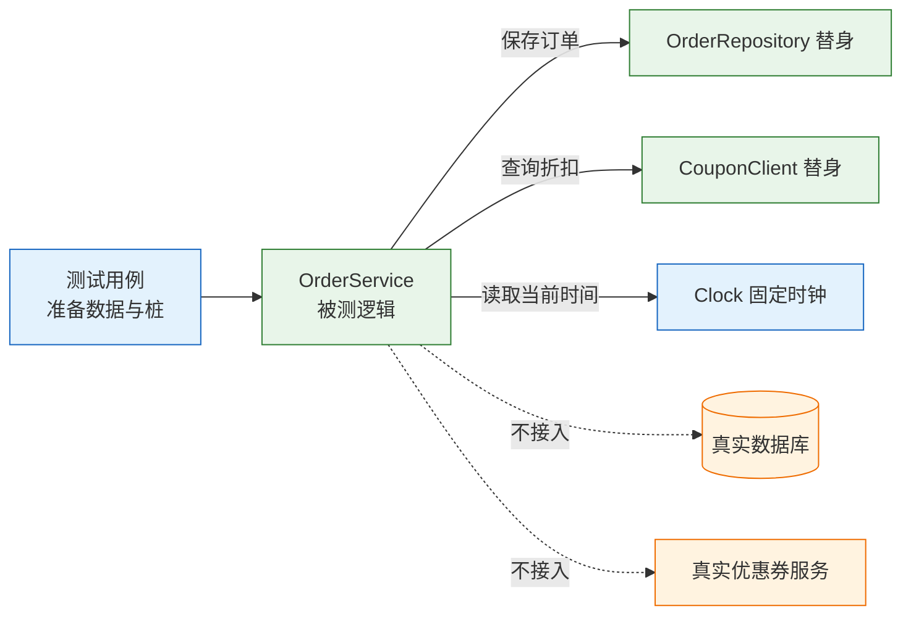
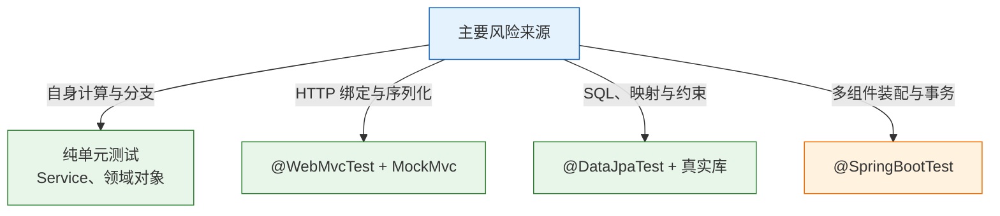
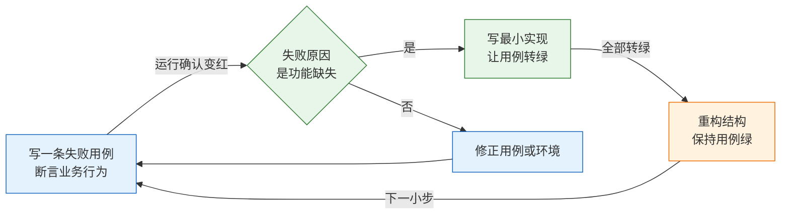

# 单元与后端测试

> 单元测试是给一段逻辑立合同：给定什么输入、协作者返回什么、应该得到什么。它换的是毫秒级定位和重构的胆量，不是覆盖率数字。

---

## 一、单元测试是什么

### 1.1 核心概念

单元测试是在进程内、脱离外部依赖，对**一个类或一个函数**的行为做出的可重复验证。它的“单元”指验证范围，不指代码行数：一个类可以是一个单元，一组纯函数也可以是一个单元。

一个测试方法通常包含四段结构，业内常称为 Arrange-Act-Assert：

- **准备**：构造被测对象，设置替身返回值与输入数据。
- **执行**：调用一个公开方法，尽量只调用一次。
- **断言**：比较实际结果与预期，断言失败要能直接读出差异。
- **清理**：释放静态状态、临时文件、线程池。

单元测试能发现的问题集中在逻辑本身：分支漏写、边界比较写反、空值未处理、金额舍入错误、状态判断顺序错误。它不能发现 SQL 在真实数据库上能否执行，也不能发现路由、鉴权、序列化是否正确。

| 能发现 | 不能发现 |
|---|---|
| 分支未覆盖、条件写反 | SQL 方言、索引、约束 |
| 边界值算错、精度丢失 | 事务传播、并发锁 |
| 空值与异常路径缺失 | JSON 字段名与序列化配置 |
| 状态判断顺序错误 | 路由、过滤器、鉴权链路 |
| 纯函数输入输出不一致 | 多服务拼装后的行为 |

把单元测试当成质量全责，会得到两个坏结果：一是为了“测全”而把数据库、HTTP 都搬进单元层，测试变慢且不稳定；二是线上出现装配问题时，团队误以为“测试都过了”。单元测试是底座，不是全部。

### 1.2 与相邻技术的关系

同一个金额计算错误，在不同层次被发现时，修复成本差别很大。单元测试直接指出方法名和行号；接口测试只告诉某个端点返回 500；E2E 只告诉页面没有跳转。

| 层次 | 验证对象 | 反馈速度 | 失败信息 |
|---|---|---|---|
| 单元 | 类或函数的行为 | 毫秒 | 方法、断言实际值 |
| 切片 | 一层框架衔接 | 秒 | 路由、状态码、SQL |
| 集成 | 真实中间件装配 | 十秒 | 模块、异常栈 |
| 接口 | 对外 HTTP 合同 | 百毫秒 | 端点、响应体 |
| E2E | 用户关键路径 | 分钟 | 页面、截图 |

单元测试与代码评审也不是替代关系。评审看设计与边界是否合理，测试看行为是否符合预期。评审漏掉的空值分支，测试可以补；测试写不出的设计问题，评审可以拦。

> **开发提示**：判断一段逻辑该不该写单元测试，先问“它的主要风险来自自身计算，还是来自与框架的衔接”。前者写单元，后者写切片或集成。

### 1.3 架构组成

单元测试的运行结构很小：测试类创建被测对象，被测对象只依赖抽象接口，所有外部协作者由替身顶替，真实数据库与网络不进入进程。



要让代码能被这样切开，设计上需要四个配合：

- **依赖注入**：仓库、外部客户端、时钟从构造函数传入，不在方法内部 `new`。
- **面向接口**：被测类依赖接口而非具体实现，替身才能替换。
- **无隐藏状态**：不依赖静态单例、`ThreadLocal` 缓存和可变的全局配置。
- **副作用收口**：计算与保存分开，纯计算部分做成无状态方法。

一个明显的信号是“测试必须启动完整 Spring 容器才能跑”。这通常说明依赖是隐藏的：要么在方法里 `new`，要么从静态上下文取。先让依赖显式化，再谈覆盖率；否则测的是一整个容器，不是那段逻辑。

---

## 二、测试环境与框架

### 2.1 构建工具与依赖

Java 项目通常由 Maven 或 Gradle 管理测试依赖。Spring Boot 项目直接引入 `spring-boot-starter-test`，它聚合了 JUnit Jupiter、AssertJ、Mockito、JSONassert 等库，版本由 BOM 统一管理。

```xml
<!-- pom.xml：测试依赖不写版本号，交给 spring-boot-dependencies BOM -->
<dependencies>
  <dependency>
    <groupId>org.springframework.boot</groupId>
    <artifactId>spring-boot-starter-test</artifactId>
    <scope>test</scope>
  </dependency>
</dependencies>

<build>
  <plugins>
    <plugin>
      <groupId>org.apache.maven.plugins</groupId>
      <artifactId>maven-surefire-plugin</artifactId>
      <!-- 单元测试在 test 阶段执行，默认扫描 *Test / Test* / *Tests -->
    </plugin>
  </plugins>
</build>
```

| 组件 | 职责 | 常见误用 |
|---|---|---|
| JUnit Jupiter | 用例发现、生命周期、参数化 | 与 JUnit 4 混用导致漏扫 |
| AssertJ | 链式断言、异常与集合断言 | 只断言 `isNotNull` |
| Mockito | 替身创建、交互验证 | 替换被测对象本身 |
| Surefire | `test` 阶段执行单元测试 | 类名不符默认模式，显示 0 个用例 |
| Failsafe | `verify` 阶段执行 `*IT` | 集成测试塞进 Surefire |

依赖冲突最常见的原因是手工指定 JUnit 或 Mockito 版本，与 BOM 中的版本不一致。表现可能是 `NoSuchMethodError`、`ClassNotFoundException`，也可能只是某些注解不生效。排查时先看 `mvn dependency:tree`，不要在代码里猜。

### 2.2 JUnit 5 用例组织

JUnit 5 的用例方法必须是 `void`、无参数（参数化除外），通过 `@Test` 标记。生命周期注解有四个常用项：`@BeforeEach`、`@AfterEach`、`@BeforeAll`、`@AfterAll`。前两个每个方法执行一次，后两个每个类执行一次，默认要求静态方法。

```java
@ExtendWith(MockitoExtension.class)
class OrderServiceTest {

    @Mock OrderRepository repo;
    @Mock CouponClient coupons;
    Clock clock = Clock.fixed(Instant.parse("2026-01-01T00:00:00Z"), ZoneOffset.UTC);

    private OrderService service;

    @BeforeEach
    void setUp() {
        // 每个用例都拿到全新的被测对象，避免状态串扰
        service = new OrderService(repo, coupons, clock);
    }
}
```

| 注解 | 执行次数 | 典型用途 |
|---|---|---|
| `@BeforeEach` | 每个测试方法前 | 构造被测对象、准备数据 |
| `@AfterEach` | 每个测试方法后 | 清理临时文件、恢复静态状态 |
| `@BeforeAll` | 每个类一次 | 启动昂贵且只读的资源 |
| `@AfterAll` | 每个类一次 | 关闭共享资源 |

用例之间不允许有顺序依赖。JUnit 默认不保证方法执行顺序，即使某个版本按名称排序，也不应当作契约。需要共享数据时，在 `@BeforeEach` 里重建，而不是指望前一个用例留下。

### 2.3 Mockito 装配

Mockito 提供两种装配方式：注解与手工构造。注解写法短，但依赖 `MockitoExtension` 才能把 `@Mock` 注入测试实例。

```java
// 方式一：注解，必须加 @ExtendWith(MockitoExtension.class)
@ExtendWith(MockitoExtension.class)
class AnnotatedTest {
    @Mock OrderRepository repo;
    @Mock CouponClient coupons;
}

// 方式二：手工构造，依赖关系一眼可见，排查注入问题更快
class ManualTest {
    OrderRepository repo = mock(OrderRepository.class);
    CouponClient coupons = mock(CouponClient.class);
    OrderService service = new OrderService(repo, coupons, Clock.systemUTC());
}
```

`@InjectMocks` 看起来省事，但它按类型和字段名反射注入，遇到同类型多个依赖或字段改名时容易静默失败。依赖超过三个时，与其调注入，不如先检查这个类是否承担了太多职责。

> **注意**：`@Mock` 生成的替身默认对所有返回对象的方法返回 `null`，对基本类型返回默认值。忘记设置返回值时，被测代码往往在远处抛 `NullPointerException`，堆栈指向业务行而不是测试准备段。

---

## 三、可测试性设计

### 3.1 依赖注入与显式依赖

可测试性不是测试阶段补出来的，而是设计阶段留下的。最直接的指标是：能否在普通 `main` 方法里手动组装这个类，而不启动框架。

```java
// 可测试：依赖从构造函数进入，测试可以传替身
public class OrderService {
    private final OrderRepository repo;
    private final CouponClient coupons;
    private final Clock clock;

    public OrderService(OrderRepository repo, CouponClient coupons, Clock clock) {
        this.repo = repo;
        this.coupons = coupons;
        this.clock = clock;
    }
}
```

```java
// 难测试：依赖在方法内部创建，测试无法替换，只能连真实服务
public Order create(long userId, long amountCents) {
    OrderRepository repo = new JdbcOrderRepository();
    CouponClient coupons = new HttpCouponClient("https://coupon.example.com");
    // ...
}
```

| 代码信号 | 隐含问题 | 重构动作 |
|---|---|---|
| 方法内 `new` 外部客户端 | 依赖不可替换 | 改为构造参数 |
| 直接调用 `Instant.now()` | 时间不可控 | 注入 `Clock` |
| 静态工具类读写全局缓存 | 用例互相污染 | 改为实例依赖或显式重置 |
| 一个类注入五个以上协作者 | 职责过多 | 按业务能力拆分 |
| 测试需要大量反射设私有字段 | 封装边界不清 | 提供构造入口或工厂 |

### 3.2 时间与随机性

时间是单元测试最常见的非确定性来源。`LocalDateTime.now()`、`System.currentTimeMillis()`、`new Date()` 都会让“过期”“账期”“超时”这类断言随执行时刻变化。

```java
// 生产代码：时间从 Clock 读取，测试可以固定
Instant now = Instant.now(clock);

// 测试代码：固定到某一刻，断言结果稳定
Clock fixed = Clock.fixed(Instant.parse("2026-01-01T00:00:00Z"), ZoneOffset.UTC);
```

随机数同理。业务逻辑需要随机时，把随机源抽成接口或传入种子；UUID 可以断言格式与非空，不要断言具体值。需要固定 ID 时，用工厂方法生成可预测值，而不是在断言里写死一个运行时才知道的字符串。

时区也要显式。测试 JVM 的默认时区可能来自操作系统，CI 容器通常是 UTC。涉及日期截断、跨天判断的用例，应在测试配置里固定 `user.timezone`，或在代码里始终使用显式时区。

### 3.3 副作用收口

查询与写入混在一个方法里，测试就很难只验证计算。把纯计算抽出来，单元测试直接打纯函数；写入部分交给集成测试验证。

```java
// 纯计算：无副作用，输入输出完全可判定
long payable(long amountCents, long discountCents) {
    return Math.max(0, amountCents - discountCents);
}

// 编排：负责取折扣、构造订单、落库，单元测试关注调用与状态
public Order create(long userId, long amountCents, String couponCode) {
    long discount = couponCode == null ? 0
            : coupons.discountFor(couponCode, userId, amountCents);
    Order order = new Order(UUID.randomUUID().toString(), userId,
            amountCents, payable(amountCents, discount), Instant.now(clock));
    repo.save(order);
    return order;
}
```

收口之后，金额规则的用例不需要任何替身；编排用例只需要验证“取折扣、算金额、落库”三件事的顺序与参数。测试的准备工作量会明显下降。

---

## 四、测试替身与断言策略

### 4.1 替身类型

“Mock”常被当作所有替身的统称。实际有五种，职责不同，用错会让测试变成“验证自己写的假实现”。

| 类型 | 作用 | 典型场景 | 风险 |
|---|---|---|---|
| Dummy | 只为填参数，不被调用 | 构造函数必填但本用例不用 | 一旦被调用就空指针 |
| Stub | 给定返回值 | 优惠券服务返回固定折扣 | 返回值与真实服务漂移 |
| Spy | 包住真实对象，记录调用 | 保留部分真实逻辑 | 可能真执行一次副作用 |
| Mock | 预设行为并验证交互 | 验证“保存被调用一次” | 过度断言实现细节 |
| Fake | 可工作的轻量实现 | 内存仓库、内存队列 | 自己要维护，可能失真 |

选择顺序可以固定为：能用真实对象就用真实对象；需要隔离外部依赖时用 Stub；需要验证关键协作时用 Mock；需要保留部分真实行为时用 Spy；需要一整套可工作的替代实现时用 Fake。

一个方法里替换超过三个协作者，通常说明这个类承担了太多职责。先考虑拆类，而不是继续加 Mock。测试难写往往是设计信号，不是测试工具不够强。

### 4.2 结果断言与交互断言

原则是**优先断言结果，其次断言关键交互**。结果是业务合同，交互是实现路径。断言实现路径的测试，会在重构时大面积变红，却不一定发现真正的业务错误。

```java
// 结果断言：应付金额是业务合同，折扣怎么算出来不重要
assertThat(order.payableCents()).isEqualTo(8_000L);

// 关键交互：订单必须落库，这是合同的一部分
verify(repo).save(order);

// 过度交互：复述了实现里调用折扣服务的参数，重构即红
verify(coupons).discountFor("NEW20", 7L, 10_000L);
```

第二条和第三条的区别在于“失败意味着什么”。`save` 没被调用，意味着订单可能丢失；`discountFor` 的参数变化，可能只是实现换了一种等价写法。只有参数本身构成对外契约时，才值得断言。

### 4.3 参数捕获与异常契约

只验证 `save` 被调用还不够，还要验证写进去的内容。`ArgumentCaptor` 把调用参数捕出来，再对字段断言。

```java
@Test
void 保存的订单带上了正确的用户和状态() {
    service.create(7L, 10_000L, null);

    ArgumentCaptor<Order> captor = ArgumentCaptor.forClass(Order.class);
    verify(repo).save(captor.capture());
    assertThat(captor.getValue().userId()).isEqualTo(7L);
    assertThat(captor.getValue().payableCents()).isEqualTo(10_000L);
    assertThat(captor.getValue().createdAt())
            .isEqualTo(Instant.parse("2026-01-01T00:00:00Z"));
}
```

异常也是合同的一部分。要断言异常类型、关键消息和副作用：失败时不能留下半条数据。

```java
@Test
void 不存在的优惠券不留下订单() {
    when(coupons.discountFor("BAD", 7L, 1_000L))
            .thenThrow(new CouponNotFoundException("BAD"));

    assertThatThrownBy(() -> service.create(7L, 1_000L, "BAD"))
            .isInstanceOf(CouponNotFoundException.class)
            .hasMessageContaining("BAD");

    // 异常路径最值钱的断言：没有写入半条订单
    verifyNoInteractions(repo);
}
```

| 断言对象 | 写法 | 适用场景 |
|---|---|---|
| 返回值 | `assertThat(actual).isEqualTo(expected)` | 纯计算、状态转换 |
| 抛出的异常 | `assertThatThrownBy(...).isInstanceOf(...)` | 参数校验、业务拒绝 |
| 写入内容 | `ArgumentCaptor` + 字段断言 | 落库、发消息、调外部 |
| 调用次数 | `verify(repo, times(1)).save(any())` | 幂等、防重复提交 |
| 无交互 | `verifyNoInteractions(repo)` | 失败路径不产生副作用 |

> **注意**：Mockito 的参数匹配器必须整体使用。一个参数用 `anyString()`、另一个用具体值，会抛 `InvalidUseOfMatchersException`。要么全部匹配器，要么全部具体值。

### 4.4 测试命名与失败信息

测试名称是失败时的第一条诊断信息。名称应描述“在什么条件下，期望什么行为”，不描述实现步骤。

| 命名方式 | 示例 | 评价 |
|---|---|---|
| 行为描述 | `折扣大于原价时应付为零` | 失败时能直接定位业务规则 |
| 方法加序号 | `testCreate1`、`testCreate2` | 无法判断坏了什么 |
| 实现描述 | `调用save方法一次` | 重构即失效 |
| 需求编号 | `COUPON_003_超限拒绝` | 可追溯，但需配合描述 |

断言失败时，默认信息只给实际值与期望值。对复杂对象补充 `as()` 描述，可以省掉一次调试。

```java
assertThat(order.payableCents())
        .as("500 分订单使用 2000 分券后的应付金额")
        .isZero();
```

失败信息里不要拼接大段日志。把关键输入、实际值、期望值三样留下即可，堆栈和上下文由测试报告提供。

---

## 五、完整示例：订单金额计算

### 5.1 被测代码

规则：下单时按优惠券抵扣，应付金额不能为负，创建时间取自注入的时钟。

```java
public class OrderService {
    private final OrderRepository repo;
    private final CouponClient coupons;
    private final Clock clock;

    public OrderService(OrderRepository repo, CouponClient coupons, Clock clock) {
        this.repo = repo;
        this.coupons = coupons;
        this.clock = clock;
    }

    public Order create(long userId, long amountCents, String couponCode) {
        // 无券时不调用外部服务，直接按原价
        long discount = couponCode == null
                ? 0
                : coupons.discountFor(couponCode, userId, amountCents);
        // 折扣可能大于原价，下限截断到 0
        long payable = Math.max(0, amountCents - discount);
        Order order = new Order(UUID.randomUUID().toString(), userId,
                amountCents, payable, Instant.now(clock));
        repo.save(order);
        return order;
    }
}
```

### 5.2 测试代码

依赖用 Mockito 生成，时钟固定，构造函数手工装配。两个用例分别覆盖正常抵扣和金额下限。

```java
@ExtendWith(MockitoExtension.class)
class OrderServiceTest {

    @Mock OrderRepository repo;
    @Mock CouponClient coupons;
    Clock clock = Clock.fixed(Instant.parse("2026-01-01T00:00:00Z"), ZoneOffset.UTC);

    @Test
    void 用券后应付金额等于原价减折扣() {
        when(coupons.discountFor("NEW20", 7L, 10_000L)).thenReturn(2_000L);
        OrderService service = new OrderService(repo, coupons, clock);

        Order order = service.create(7L, 10_000L, "NEW20");

        assertThat(order.payableCents()).isEqualTo(8_000L);
        assertThat(order.createdAt())
                .isEqualTo(Instant.parse("2026-01-01T00:00:00Z"));
        verify(repo).save(order);
    }

    @Test
    void 折扣大于原价时应付为零而不是负数() {
        when(coupons.discountFor("BIG", 7L, 500L)).thenReturn(2_000L);
        OrderService service = new OrderService(repo, coupons, clock);

        assertThat(service.create(7L, 500L, "BIG").payableCents()).isZero();
    }

    @Test
    void 无券时不调用折扣服务按原价下单() {
        OrderService service = new OrderService(repo, coupons, clock);

        Order order = service.create(7L, 10_000L, null);

        assertThat(order.payableCents()).isEqualTo(10_000L);
        // 无券路径不应产生外部调用，这比断言“调用了一次”更有价值
        verifyNoInteractions(coupons);
        verify(repo).save(order);
    }
}
```

第二条用例锁的是“不能为负”这个业务约束，不是某个具体算式。以后折扣规则从固定金额改成比例，这条用例仍然有效。

| 用例 | 输入 | 替身行为 | 断言 |
|---|---|---|---|
| 正常抵扣 | 10,000 分 + NEW20 | 返回 2,000 | 应付 8,000，时间固定，已保存 |
| 金额下限 | 500 分 + BIG | 返回 2,000 | 应付 0 |
| 无券 | 10,000 分 + null | 不被调用 | 应付 10,000 |
| 券不存在 | 1,000 分 + BAD | 抛异常 | 异常类型正确，未落库 |

### 5.3 执行与结果判读

```bash
# ========== 执行单个测试类 ==========
mvn -q -Dtest=OrderServiceTest test

# ========== 只执行一个方法 ==========
mvn -q -Dtest='OrderServiceTest#折扣大于原价时应付为零而不是负数' test

# ========== 执行全部单元测试 ==========
mvn -q test
```

预期汇总类似：

```text
Tests run: 3, Failures: 0, Errors: 0, Skipped: 0
```

如果 `Tests run` 是 0，先检查类名是否以 `Test` 结尾、方法是否无参无返回值、是否混用了 JUnit 4 的 `org.junit.Test`。如果失败信息里出现 `UnnecessaryStubbingException`，说明某个桩没有被用到，删掉它；不要习惯性加 `lenient()`，那会把真实问题一起放过。

---

## 六、参数化与边界覆盖

### 6.1 表驱动

计价这类规则最值得用表驱动。一条规则一行数据，新增边界只加一行，不复制方法。

| 原价（分） | 折扣（分） | 应付 | 说明 |
|---|---|---|---|
| 9,999 | 2,000 | 7,999 | 小额订单同样抵扣 |
| 10,000 | 0 | 10,000 | 无券 |
| 10,000 | 2,000 | 8,000 | 正常 |
| 500 | 2,000 | 0 | 折扣超原价 |
| 0 | 0 | 0 | 零元订单是否允许需产品确认 |

```java
@ParameterizedTest(name = "{0} - {1} = {2}")
@CsvSource({"9999, 2000, 7999", "10000, 0, 10000",
            "10000, 2000, 8000", "500, 2000, 0"})
void 应付金额按规则计算(long amount, long discount, long expected) {
    when(coupons.discountFor(anyString(), anyLong(), anyLong()))
            .thenReturn(discount);
    OrderService service = new OrderService(repo, coupons, clock);

    assertThat(service.create(7L, amount, "C").payableCents())
            .isEqualTo(expected);
}
```

金额一律用最小货币单位或 `BigDecimal`。测试里用 `double` 比较，`0.1 + 0.2` 的误差会让边界断言随机变红，而且这种红很难复现。

### 6.2 分支覆盖清单

覆盖率工具只能说明“执行过”，不能说明“断言过”。写用例时按分支清单逐项检查，比事后看百分比有效。

| 分支 | 输入条件 | 断言重点 |
|---|---|---|
| 有券 | `couponCode != null` | 调用折扣服务，金额被扣减 |
| 无券 | `couponCode == null` | 不调用折扣服务，原价落库 |
| 折扣小于原价 | 差额为正 | 应付等于差额 |
| 折扣等于原价 | 差额为零 | 应付为零 |
| 折扣大于原价 | 差额为负 | 截断为零，不出现负数 |
| 折扣服务异常 | 抛业务异常 | 不落库，异常向外传播 |

分支清单要跟着需求走。需求新增“券可叠加”时，清单里必须出现“两张券的先后顺序”和“叠加后是否仍受上限约束”，否则覆盖率再高也盖不住新规则。

### 6.3 测试数据的构造

数据构造的目标是可读、可重复、可并行。三种常用方式各有位置。

| 方式 | 写法 | 优点 | 风险 |
|---|---|---|---|
| 直接构造 | `new Order("ORD-1", 7L, 100L)` | 一眼看懂 | 固定单号易冲突 |
| 工厂方法 | `anOrder().withAmount(100).build()` | 默认值集中 | 字段多时膨胀 |
| 唯一后缀 | `"ORD-" + UUID.randomUUID()` | 并行安全 | 断言不能写死 ID |

```java
// 测试数据工厂：默认值合理，用例只改关心的字段
static Order.OrderBuilder anOrder() {
    return Order.builder()
            .orderNo("ORD-" + UUID.randomUUID())
            .userId(7L)
            .amountCents(10_000L)
            .status(OrderStatus.CREATED);
}
```

工厂方法的名字要表达业务含义，例如 `anExpiredCoupon()`、`aPaidOrder()`。读用例时能直接看出数据处于什么状态，比堆十几个 setter 更清楚。

---

## 七、Controller 与 Repository 切片

### 7.1 分层测试选型

后端最常见的错位，是给 Controller 写纯单元测试：Mock 掉 Service，断言返回 `ResponseEntity.ok(...)`。这只验证了“Controller 调用了 Service”，路由、参数绑定、JSON 序列化、异常映射一个都没测。

| 层 | 纯单元测试 | 更合适的做法 |
|---|---|---|
| Controller | 价值低 | `@WebMvcTest` + MockMvc |
| Service | 主力 | 纯单元，依赖用替身 |
| Repository | 不适用 | `@DataJpaTest` + 真实库 |
| 序列化 / DTO | 很少 | 一次 Jackson 往返测试 |
| 定时任务 / 监听器 | 低 | 切片或集成测试 |

判断标准是：**这个类的主要风险来自它自己的逻辑，还是来自它和框架的衔接？** 前者写单元，后者写切片。给 Repository 写“Mock 掉 JdbcTemplate”的测试尤其没意义，它证明不了 SQL 能不能跑。



### 7.2 MVC 切片

`@WebMvcTest` 只启动 MVC 相关组件，不启动数据库和 Service。它适合验证路由、参数校验、状态码、错误结构。

```java
@WebMvcTest(OrderController.class)
class OrderControllerTest {

    @Autowired MockMvc mvc;

    // Spring Boot 3.4 起用 @MockitoBean 替代 @MockBean，旧项目仍可见后者
    @MockitoBean OrderService service;

    @Test
    void 金额为负时返回四百并带字段错误() throws Exception {
        mvc.perform(post("/api/orders")
                        .contentType(MediaType.APPLICATION_JSON)
                        .content("""
                                {"userId":7,"amountCents":-1}
                                """))
                .andExpect(status().isBadRequest())
                .andExpect(jsonPath("$.code").value("VALIDATION_FAILED"))
                .andExpect(jsonPath("$.details[0].field").value("amountCents"));
    }
}
```

| 断言点 | 方法 | 能发现的问题 |
|---|---|---|
| 状态码 | `status().isBadRequest()` | 异常映射错、校验未生效 |
| 响应字段 | `jsonPath("$.code")` | 字段改名、结构漂移 |
| 内容类型 | `content().contentType(...)` | 返回 HTML 错误页 |
| 请求绑定 | 构造 JSON 或表单 | 字段名、类型转换错误 |
| 未调用 Service | `verifyNoInteractions(service)` | 校验失败仍执行业务 |

切片测试不要断言 Service 的内部行为。它关心的是“请求进来后，MVC 层是否正确处理”，业务规则留给 Service 的单元测试。

### 7.3 数据访问切片

Repository 的行为依赖数据库方言、约束和事务，用替身测不出来。`@DataJpaTest` 会启动 JPA 与数据源，默认把数据源替换成内嵌库；要连接真实数据库，需要关闭这个替换。

```java
@DataJpaTest
@AutoConfigureTestDatabase(replace = Replace.NONE)
class OrderRepositoryTest {

    @Autowired OrderRepository repo;

    @Test
    void 订单号唯一约束由数据库兜底() {
        repo.save(new Order("ORD-1", 7L, 10_000L));

        assertThatThrownBy(() -> repo.save(new Order("ORD-1", 8L, 20_000L)))
                .isInstanceOf(DataIntegrityViolationException.class);
    }
}
```

`Replace.NONE` 只是“不要替换”，数据源仍要指向一个可用的数据库。真实数据库的接入、容器管理与迁移验证放在集成测试层处理，单元测试文件里不重复搭建。

---

## 八、缺陷回归与 TDD

### 8.1 红绿重构

TDD 的循环是：先写一个失败的测试，再写刚好够的代码让它通过，最后在测试保护下整理结构。难点在第一步：失败原因必须是“功能未实现”，不能是编译不过或环境没起来。



一次只前进一小步。先断言“正常抵扣后的金额”，跑红，实现；再断言“折扣不能为负”，跑红，加保护。一次写五个断言，第一个失败会挡住后面四个，分不清是设计错还是实现错。

| 阶段 | 动作 | 完成标志 |
|---|---|---|
| 红 | 写一条针对缺失行为的用例 | 失败信息指向业务断言 |
| 绿 | 写最小实现 | 该用例通过，其他用例不红 |
| 重构 | 去重、改名、拆方法 | 全部用例仍绿 |

### 8.2 回归用例

线上报“用券后订单金额变成负数”，处理顺序固定为五步：

1. **先写复现测试**：构造 `amount=500`、`discount=2000`，断言应付为 0。此时测试红，证明复现成功。
2. **再改代码**：加 `Math.max(0, ...)`。
3. **测试转绿**，跑整个类，确认没有破坏其他分支。
4. **补边界**：折扣恰好等于原价、折扣为 0、券不存在抛异常。
5. **提交**：测试和修复在同一个提交里，评审时能看到“为什么改”。

回归用例要能在修复前稳定变红。若复现用例时红时绿，说明还没找到真正的触发条件，此时改代码只是碰运气。

### 8.3 提交前与 CI 的执行策略

本地提交前跑受影响模块的单元测试，合并请求触发全量单元与切片，集成测试放到合并后或夜间。这样既保证反馈速度，又不让慢测试阻断每一次小改动。

```bash
# ========== 提交前：只跑改动模块 ==========
mvn -q -pl order-service -Dtest='Order*Test' test

# ========== 合并请求：全量单元与切片 ==========
mvn -B -q test

# ========== 合并后或夜间：含集成测试 ==========
mvn -B -q verify
```

| 阶段 | 命令 | 时间预算 | 失败处理 |
|---|---|---|---|
| 本地提交前 | `mvn -q -Dtest='*Test' test` | 1 分钟内 | 修完再提交 |
| 合并请求 | `mvn -B -q test` | 5 分钟内 | 阻断合并 |
| 合并后 | `mvn -B -q verify` | 15 分钟内 | 回滚或热修 |
| 夜间 | 全量 + 大数据量 | 小时级 | 次日优先处理 |

> **注意**：CI 日志要保留失败用例全名、实际值、期望值和运行时版本。只有“构建失败”四个字，排查会从分钟级变成小时级。

---

## 九、适用边界

单元测试不是越多越好。下列场景投入产出比低，应该明确不写或换层次。

| 场景 | 建议 | 原因 |
|---|---|---|
| DTO、record、getter/setter | 不写 | 没有自身逻辑 |
| Lombok 生成的 builder | 不写 | 出问题也是框架问题 |
| 纯转发、纯编排 | 少写 | 断言调用顺序等于复述代码 |
| 复杂 SQL、窗口函数 | 换集成测试 | 单元层看不到执行计划 |
| 第三方库内部行为 | 不写 | 应相信其自带测试 |
| 消息监听器、过滤器 | 换切片测试 | 行为依赖容器 |
| 需求频繁变动 | 先写用例表 | 接口稳定后再固化 |
| 为覆盖率硬凑 | 不写 | 维护成本高于收益 |

一个常见浪费是给 `equals/hashCode` 写测试，或对私有方法做反射调用。前者测的是生成代码，后者把实现细节锁死。把时间留给状态迁移、金额计算、权限判断这些真正会出错的逻辑。

---

## 十、常见排障

| 现象 | 最可能原因 | 处理 |
|---|---|---|
| 测试绿，但线上算错 | 没有断言，或只断言 `isNotNull` | 断言具体值或状态，关键分支逐条覆盖 |
| 依赖上出现空指针 | `@Mock` 没生效，未加 `MockitoExtension` | 加 `@ExtendWith`，或手工构造传入替身 |
| 参数匹配器报错 | 匹配器与具体值混用 | 全部用匹配器或全部用具体值 |
| `UnnecessaryStubbingException` | 桩了用不到的返回值 | 删除多余桩，慎用 `lenient()` |
| 对 Spy 用 `when` 却执行了真实方法 | `when(spy.foo())` 先调用了一次 | 改 `doReturn(...).when(spy).foo()` |
| 隔天跑就失败 | 依赖当前时间、时区、随机数 | 注入 `Clock`，固定种子与时区 |
| 单独跑过，一起跑挂 | 静态状态、共享数据、执行顺序 | 每用例自建数据，静态 Mock 用后关闭 |
| `mvn test` 显示 0 个测试 | 类名不符模式，或混用两套 JUnit | 命名 `*Test`，只保留一套框架 |
| 覆盖率很高但没测到东西 | 把被测逻辑本身 Mock 掉了 | 只替换协作者，不替换被测类 |
| 测试名是 `test1`、`test2` | 失败时看不出坏了什么 | 用行为命名，如“折扣大于原价时应付为零” |
| 一重构就红一片 | 断言私有方法、内部调用顺序 | 只断言公开行为与关键协作 |
| 异常路径从没测过 | 只覆盖成功路径 | 补“依赖抛异常时不留下半条数据” |
| 依赖抛异常却报空指针 | 替身未设异常行为，默认返回 `null` | 显式 `thenThrow`，断言业务异常类型 |
| `@InjectMocks` 注入不进去 | 字段名不匹配，或同类型依赖有多个 | 改手工构造，依赖超过三个考虑拆类 |

排查顺序：

1. 先看失败断言的实际值与期望值，判断是代码错还是测试错。
2. 再看依赖替身是否真的注入：打印对象身份或加断点。
3. 单独跑该类，再跑全量，区分“用例问题”和“污染问题”。
4. 最后才检查框架版本与依赖树，先确认 Surefire 报告里的测试数是否正确。

> **注意**：不要用删除断言的方式让测试变绿。测试变绿只说明断言通过，不说明行为正确；删掉的那条断言，通常正是这次改动最该守住的边界。
