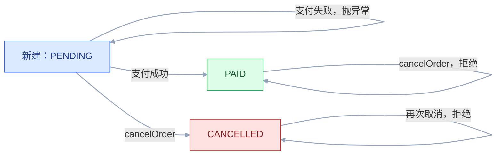
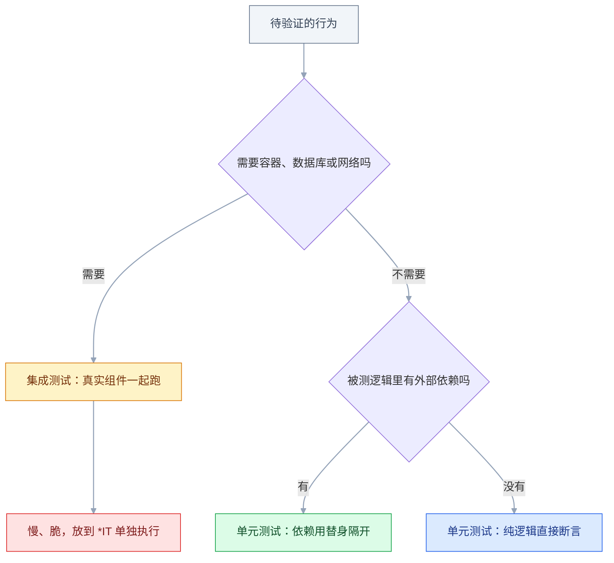
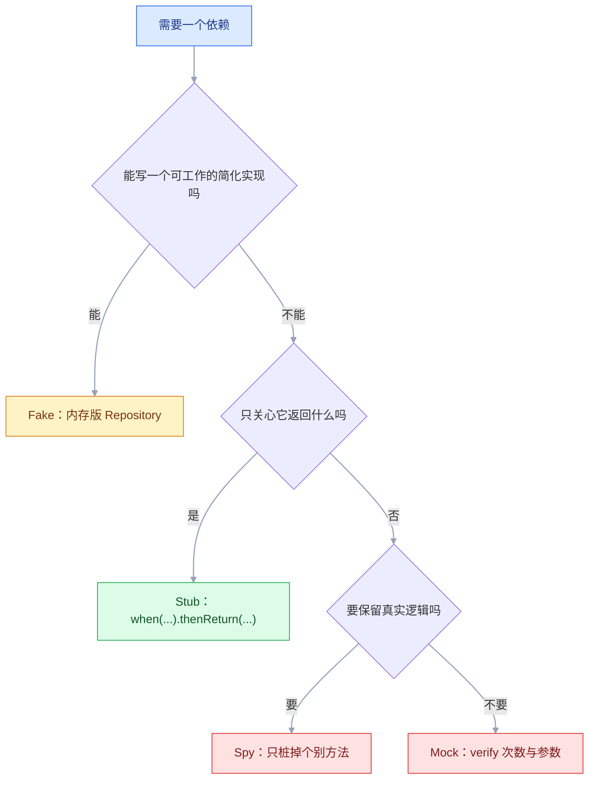

# 单元测试与 Mock

## 一、工程案例：给订单服务补齐 22 个单元测试并接进 CI

**场景**：一个 `OrderService` 有价格计算、创建订单、取消订单三段逻辑，依赖 `OrderRepository`、`PaymentClient`、`InventoryClient` 三个外部组件。当前测试为空，改任何一行都靠手工造数据。目标是补一套毫秒级的单元测试，覆盖折扣规则、状态流转、参数校验与依赖失败，并让它在 CI 上拦住回归。

**约束**：不启动 Spring 容器；不连数据库；不真发支付请求；单个测试类 2 秒内跑完。

### 1.1 被测代码

```java
public class Order {
    public enum Status { PENDING, PAID, CANCELLED }
    private Long id; private String userId; private int amount; private Status status;
    public Order(String userId, int amount) { this.userId = userId; this.amount = amount; this.status = Status.PENDING; }
    // getters / setters 省略
}

public class OrderService {
    private final OrderRepository orderRepository;
    private final PaymentClient paymentClient;
    private final InventoryClient inventoryClient;
    public OrderService(OrderRepository r, PaymentClient p, InventoryClient i) { ... }

    /** 满 10000 分减 1000；满 20000 分减 3000；VIP 在满减之后打 95 折；最低 1 分 */
    public int calculatePrice(int amount, boolean vip) {
        if (amount <= 0) throw new IllegalArgumentException("订单金额必须大于 0");
        int price = amount;
        if (amount >= 20000)      price = amount - 3000;
        else if (amount >= 10000) price = amount - 1000;
        if (vip) price = (int) Math.round(price * 0.95);
        return Math.max(price, 1);
    }

    public Order createOrder(String userId, int amount, int quantity) {
        if (userId == null || userId.isBlank()) throw new IllegalArgumentException("用户不能为空");
        if (amount <= 0)   throw new IllegalArgumentException("订单金额必须大于 0");
        if (quantity <= 0) throw new IllegalArgumentException("数量必须大于 0");
        if (!inventoryClient.hasStock(quantity)) throw new InsufficientStockException("库存不足");
        Order saved = orderRepository.save(new Order(userId, amount));
        PaymentResult result = paymentClient.pay(new PaymentRequest(saved.getId(), saved.getAmount(), userId));
        if (!result.isSuccess()) throw new PaymentFailedException(result.getMessage());
        saved.setStatus(Order.Status.PAID);
        return orderRepository.save(saved);
    }

    public Order cancelOrder(Long orderId) {
        Order order = orderRepository.findById(orderId)
            .orElseThrow(() -> new OrderNotFoundException("订单不存在: " + orderId));
        if (order.getStatus() != Order.Status.PENDING) throw new IllegalStateException("只有待支付订单可以取消");
        order.setStatus(Order.Status.CANCELLED);
        Order saved = orderRepository.save(order);
        sendCancellationNotice(saved);
        return saved;
    }
    protected void sendCancellationNotice(Order order) { /* 调外部通知服务 */ }
}
```

**关键前提**：`OrderService` 用构造器注入。测试里可以直接 `new OrderService(mockRepo, mockPay, mockStock)`，完全不涉及容器；字段注入的类做不到这一点。

### 1.2 依赖与测试类骨架

```xml
<dependencies>
    <dependency><groupId>org.junit.jupiter</groupId>
        <artifactId>junit-jupiter</artifactId><version>5.10.2</version><scope>test</scope></dependency>
    <dependency><groupId>org.mockito</groupId>
        <artifactId>mockito-junit-jupiter</artifactId><version>5.11.0</version><scope>test</scope></dependency>
    <dependency><groupId>org.assertj</groupId>
        <artifactId>assertj-core</artifactId><version>3.25.3</version><scope>test</scope></dependency>
</dependencies>
```

> 版本迭代较快，以上小版本以官方当前稳定版为准；Spring Boot 项目只加 `spring-boot-starter-test` 即可，其中已含 JUnit 5、Mockito、AssertJ。

```java
@ExtendWith(MockitoExtension.class)          // 少了这行，@Mock 字段为 null
@DisplayName("订单服务 - 创建订单")
class OrderServiceCreateTest {
    @Mock private OrderRepository orderRepository;
    @Mock private PaymentClient paymentClient;
    @Mock private InventoryClient inventoryClient;
    @InjectMocks private OrderService orderService;

    @BeforeEach
    void 让save模拟数据库生成主键() {
        lenient().when(orderRepository.save(any(Order.class)))
            .thenAnswer(inv -> { Order o = inv.getArgument(0); if (o.getId() == null) o.setId(1L); return o; });
    }
}
```

### 1.3 价格计算：参数化覆盖边界

```java
@DisplayName("订单价格计算")
class OrderPriceTest {
    private final OrderService orderService = new OrderService(null, null, null);   // 纯逻辑，不需要依赖

    @Nested @DisplayName("满减规则（非 VIP）")
    class NormalDiscount {
        @ParameterizedTest(name = "原价 {0} 分，实付 {1} 分")
        @CsvSource({"1,1", "9999,9999", "10000,9000", "10001,9001",
                    "19999,18999", "20000,17000", "20001,17001"})
        void 满减计算(int amount, int expected) {
            assertThat(orderService.calculatePrice(amount, false)).isEqualTo(expected);
        }
    }

    @Nested @DisplayName("VIP 折扣（满减之后计算）")
    class VipDiscount {
        @ParameterizedTest(name = "原价 {0} 分，VIP 实付 {1} 分")
        @CsvSource({"9999,9499", "10000,8550", "20000,16150", "19999,18049"})
        void VIP折扣计算(int amount, int expected) {
            assertThat(orderService.calculatePrice(amount, true)).isEqualTo(expected);
        }
    }

    @Nested @DisplayName("非法输入")
    class InvalidInput {
        @ParameterizedTest(name = "金额 {0} 应被拒绝")
        @ValueSource(ints = {0, -1, -10000})
        void 非正数金额抛异常(int amount) {
            assertThatThrownBy(() -> orderService.calculatePrice(amount, false))
                .isInstanceOf(IllegalArgumentException.class).hasMessage("订单金额必须大于 0");
        }
    }
}
```

**为什么这样切**：金额用「分」不用浮点，避免误差；边界全测（9999/10000/10001、19999/20000/20001），因为 `>=` 极易写错；VIP 单独一组，锁死「满减之后打折」的顺序；`@Nested` 让报告按「满减 / VIP / 非法」分层。

### 1.4 创建订单：Mock 三个依赖

测试用例围着状态迁移补：`createOrder` 只在支付成功时把订单推到 `PAID`，`cancelOrder` 只接受 `PENDING`。



```java
@Test @DisplayName("正常创建：有库存、支付成功 → PAID，保存两次")
void 正常创建订单() {
    when(inventoryClient.hasStock(2)).thenReturn(true);
    when(paymentClient.pay(any(PaymentRequest.class))).thenReturn(PaymentResult.success("PAY-888"));
    Order order = orderService.createOrder("u1", 10000, 2);
    assertAll(
        () -> assertThat(order.getId()).isEqualTo(1L),
        () -> assertThat(order.getStatus()).isEqualTo(Order.Status.PAID));
    verify(inventoryClient).hasStock(2);
    verify(orderRepository, times(2)).save(any(Order.class));
}

@Test @DisplayName("库存不足：抛异常，不保存、不支付")
void 库存不足时创建失败() {
    when(inventoryClient.hasStock(999)).thenReturn(false);
    assertThatThrownBy(() -> orderService.createOrder("u1", 10000, 999))
        .isInstanceOf(InsufficientStockException.class).hasMessage("库存不足");
    verify(orderRepository, never()).save(any());
    verify(paymentClient, never()).pay(any());
}

@Test @DisplayName("支付失败：订单保持 PENDING")
void 支付失败时创建失败() {
    when(inventoryClient.hasStock(1)).thenReturn(true);
    when(paymentClient.pay(any())).thenReturn(PaymentResult.failure("余额不足"));
    assertThatThrownBy(() -> orderService.createOrder("u1", 10000, 1))
        .isInstanceOf(PaymentFailedException.class).hasMessage("余额不足");
    ArgumentCaptor<Order> captor = ArgumentCaptor.forClass(Order.class);
    verify(orderRepository, times(1)).save(captor.capture());
    assertThat(captor.getValue().getStatus()).isEqualTo(Order.Status.PENDING);
}

@ParameterizedTest(name = "{0}")
@CsvSource({"用户为空,'',10000,1", "金额为0,u1,0,1", "数量为负,u1,10000,-1"})
void 参数校验失败(String desc, String userId, int amount, int quantity) {
    assertThatThrownBy(() -> orderService.createOrder(userId, amount, quantity))
        .isInstanceOf(IllegalArgumentException.class);
    verifyNoInteractions(inventoryClient, paymentClient, orderRepository);   // 快速失败
}
```

### 1.5 参数捕获与部分真实逻辑

```java
@Test @DisplayName("传给支付服务的请求：金额、订单号、用户都正确")
void 传给支付服务的参数正确() {
    when(inventoryClient.hasStock(1)).thenReturn(true);
    when(paymentClient.pay(any())).thenReturn(PaymentResult.success("PAY-1"));
    orderService.createOrder("u1", 8800, 1);
    ArgumentCaptor<PaymentRequest> captor = ArgumentCaptor.forClass(PaymentRequest.class);
    verify(paymentClient).pay(captor.capture());
    PaymentRequest sent = captor.getValue();
    assertAll(
        () -> assertThat(sent.getUserId()).as("用户").isEqualTo("u1"),
        () -> assertThat(sent.getAmount()).as("金额").isEqualTo(8800),
        () -> assertThat(sent.getOrderId()).as("订单ID").isEqualTo(1L));
}
```

取消订单既要验证真实的状态校验，又不想真发通知：

```java
@Spy @InjectMocks private OrderService orderService;   // Spy：默认执行真实逻辑

@Test void 取消订单_真实逻辑加stub通知() {
    Order pending = new Order("u1", 10000); pending.setId(1L);
    when(orderRepository.findById(1L)).thenReturn(Optional.of(pending));
    when(orderRepository.save(any(Order.class))).thenAnswer(inv -> inv.getArgument(0));
    doNothing().when(orderService).sendCancellationNotice(any(Order.class));   // 对 Spy 必须用 doXxx
    Order result = orderService.cancelOrder(1L);
    assertThat(result.getStatus()).isEqualTo(Order.Status.CANCELLED);
    verify(orderService).sendCancellationNotice(any(Order.class));
}
```

> 更干净的设计是把通知做成注入的 `NotificationClient`，直接 Mock 那个 Client，而不是 Spy 被测类自己。Spy 常用在无法改结构的既有代码上。

### 1.6 运行与验收

```bash
mvn -B test
```

```text
[INFO] Running com.example.order.OrderPriceTest
[INFO] Tests run: 14, Failures: 0, Errors: 0, Skipped: 0, Time elapsed: 0.9 s
[INFO] Running com.example.order.OrderServiceCreateTest
[INFO] Tests run: 7, Failures: 0, Errors: 0, Skipped: 0, Time elapsed: 1.4 s
[INFO] Running com.example.order.OrderCancelSpyTest
[INFO] Tests run: 1, Failures: 0, Errors: 0, Skipped: 0, Time elapsed: 0.5 s
[INFO] Tests run: 22, Failures: 0, Errors: 0, Skipped: 0
[INFO] BUILD SUCCESS
```

接进 CI 就是把同一条命令放进流水线（`.github/workflows/test.yml`）：

```yaml
name: test
on: [push, pull_request]
jobs:
  unit:
    runs-on: ubuntu-latest
    steps:
      - uses: actions/checkout@v4
      - uses: actions/setup-java@v4
        with:
          distribution: temurin
          java-version: "21"
          cache: maven
      - run: mvn -B test
```

分支保护里把 `unit` 设为 required check，红灯即禁止合并。

| # | 检查项 | 命令或检查 | 通过标准 |
|---|---|---|---|
| 1 | 全部通过 | `mvn -B test` | 22 条全绿 |
| 2 | 速度 | 看 `Total time` | 单个测试类 ≤ 2 秒 |
| 3 | 不启动容器 | 测试类注解 | 无 `@SpringBootTest` |
| 4 | 边界覆盖 | 检查 `@CsvSource` | 9999/10000/10001、19999/20000/20001 |
| 5 | 异常路径 | 搜索 `assertThatThrownBy` | 每个写方法至少一条 |
| 6 | 无僵尸 stub | 跑测试 | 无 `UnnecessaryStubbingException` |
| 7 | 断言可读 | 看失败信息 | 能读出期望与实际 |
| 8 | 可复现 | `for i in $(seq 10); do mvn -q test; done` | 10 次结果一致 |
| 9 | CI 阻断 | 故意把 `>=` 改成 `>` 后提交 | CI 红灯且禁止合并 |
| 10 | 无静默禁用 | `grep -rn "@Disabled" src/test/java` | 输出为空或带原因 |

---

## 二、高频问答：会卡住你的地方，也是面试最常问的

### 2.1 `@Mock` 字段是 null，测试 NPE

**现场**

看测试类注解；或打印 `orderRepository` 是否为 null。

**要点**

- 测试类少了 `@ExtendWith(MockitoExtension.class)`，注解根本没被处理。
- 把「注解没生效」当成「库有问题」，方向一开始就错了。
- 加了注解仍为 null，检查是不是手写了 `new OrderService()` 覆盖了 `@InjectMocks` 的注入结果。

**追问**

- 注入失败为什么不报错？→ 字段仍是 null，要到使用时才 NPE。
- `@SpringBootTest` 里也要这行吗？→ 不用，容器负责注入；纯单元测试才要。
- `@Mock` 能写成 static 吗？→ 不能，它在每个测试方法前重建。

### 2.2 参数匹配器混用报错

**现场**

看是否抛 `InvalidUseOfMatchersException`。

```java
when(service.query(1L, anyString())).thenReturn(orders);        // ✘ 抛异常
when(service.query(eq(1L), anyString())).thenReturn(orders);    // ✔
```

**要点**

- 多参数方法里，只要有一个参数用了匹配器，所有参数都必须用匹配器包装。
- 匹配器不是「只影响那个参数」，它决定了整个调用的匹配方式。
- 精确值一律包成 `eq(...)`。

**追问**

- `any()` 匹配 null 吗？→ 匹配；`any(Order.class)` 不匹配 null。
- 复杂条件怎么写？→ 简单条件用 `argThat`。
- 要看多次调用的全部参数呢？→ 用 `ArgumentCaptor`。

### 2.3 对 Spy 用 `when` 真的执行了一次方法

**现场**

在真实方法里打日志或加计数器，看是否多执行一次。

```java
when(spy.getXXX()).thenReturn("x");              // ✘ 真执行 getXXX()
doReturn("x").when(spy).getXXX();                // ✔
doNothing().when(smsService).send(anyString(), any());   // void 方法
```

**要点**

- `when(spy.method())` 会先真的调用一次目标方法，副作用已经发生。
- `when(...)` 不是纯声明，参数位置就已经执行了。
- 口诀：普通 Mock 用 `when`，Spy 或 void 方法用 `doXxx().when(...)`。

**追问**

- void 方法为什么也必须用 `doXxx`？→ `when()` 里写不出返回值。
- Spy 什么时候用？→ 无法改结构的既有代码。
- 更干净的做法是什么？→ 把通知做成注入的 Client，直接 Mock 它。

### 2.4 测试静默通过，其实什么都没验

**现场**

看依赖返回值是否被显式 stub；或先 `verify` 调用确实发生。

```java
when(orderRepository.findById(1L)).thenReturn(Optional.empty());   // 忘写 stub 也是这个结果
Order order = orderRepository.findById(1L).orElse(null);           // 不 NPE，order 为 null
assertThat(order).isNotNull();                                     // 只有断言才抓得到
```

**要点**

- Mock 未 stub 时返回该类型的默认值：`0`、`false`、空集合、空 `Optional`。
- 业务空跑也不报错，「不抛异常」不等于「结果正确」。
- 依赖返回值参与判断的测试，要么显式 stub，要么断言返回值本身。

**追问**

- 怎么系统性地发现这类测试？→ 删断言或改 stub 返回值，看是否还绿。
- 默认值为什么危险？→ 它让「没配置」看起来像「正常返回」。
- 严格模式能拦住吗？→ `UnnecessaryStubbingException` 只抓没用的 stub。

### 2.5 Mock 把被测逻辑本身也替掉了

**现场**

问一句：这个 stub 的返回值是不是来自业务代码。

```java
when(priceCalculator.calculate(any())).thenReturn(90.0);   // ✘ 被测逻辑被替换
```

**要点**

- stub 的返回值是自己现编的，断言只证明 Mock 按指令工作。
- 「隔离依赖」不等于「隔离被测对象」。
- Mock 列表里不应出现被测类自身和纯函数工具类。

**追问**

- 这样的测试为什么还能绿？→ 它验证的是 Mock 的行为，不是业务行为。
- 替身的边界在哪？→ 只替跨进程、跨库、不确定的依赖。
- 纯函数要 Mock 吗？→ 不要，直接调真实实现。

### 2.6 `UnnecessaryStubbingException`

**现场**

看报错指向哪个 stub 与哪一行。

```java
@MockitoSettings(strictness = Strictness.LENIENT)   // 只对确有共享 stub 的类放宽
```

**要点**

- 某个 stub 在所有测试里都没被用到，通常是复制粘贴残留或参数不匹配。
- 它是信号不是误报，先删掉没用的 stub。
- 只有 `@BeforeEach` 里公共 stub 被部分测试用到时，才用 `lenient()`。

**追问**

- 参数不匹配为什么也会触发？→ stub 没命中，调用落到默认值。
- 全局关掉严格模式有什么代价？→ 僵尸 stub 和无效测试都不再有提示。
- 公共 stub 怎么处理最干净？→ 移到真正用到它的测试方法里。

### 2.7 Python 里 `patch` 打错位置

**现场**

看被测模块是怎么导入被 patch 函数的。

```python
# sms.py 定义；order_service.py 里 from sms import send
@patch("sms.send")             # ✘ order_service 用的是自己那份引用
@patch("order_service.send")   # ✔
```

**要点**

- patch 的目标是「使用位置」而不是「定义位置」。
- `from x import y` 之后，被测模块持有一份自己的引用。
- patch 路径写到被测模块的命名空间下。

**追问**

- 换成 `import sms` 再 `sms.send()` 呢？→ 这时 patch `sms.send` 有效。
- patch 没生效为什么测试还是绿的？→ 真实函数被调用，返回值没参与断言。
- 有更稳的做法吗？→ 依赖注入一个 client，测试里换掉。

### 2.8 无种子的随机数据导致偶发失败

**现场**

连跑 20 次，看是否只在部分运行失败。

```java
Random random = new Random();      // ✘ 时红时绿
Random random = new Random(42);    // ✔ 可复现
```

**要点**

- `new Random()` 每次都不同，某些数据触发边界。
- 时红时绿是确定的缺陷，不是抖动。
- 固定种子后若仍失败，说明是真 bug，正好抓到了。

**追问**

- 固定种子会不会掩盖问题？→ 会缩小样本，批量造数据要多跑几组种子。
- 生产用随机数怎么办？→ 测试里注入固定种子或固定数据。
- 随机数据适合什么？→ 大数据量下的边界探索，不适合当唯一用例。

### 2.9 测试之间互相影响

**现场**

打乱顺序跑；或只跑第二个测试。

```java
static OrderRepository repo = mock(OrderRepository.class);   // ✘ 类级共享
@BeforeEach void setUp() { orderService = new OrderService(); }   // ✔ 每个测试全新实例
```

**要点**

- 共享了 static 状态或 `@BeforeAll` 里的对象，前一个测试把数据改脏。
- 单独跑都能过、顺序一变就挂，这是顺序依赖不是并发。
- 每个测试自己准备全部数据，共享对象只放不可变的。

**追问**

- `@BeforeAll` 什么时候可以用？→ 只放启动后不再变的重量级资源。
- 怎么快速定位是谁污染的？→ 二分法跑，或单独跑第二个测试。
- 复用和隔离怎么平衡？→ 只复用只读资源。

### 2.10 `mockStatic` 不关闭，污染其他测试

**现场**

看后续测试是否出现莫名其妙的固定时间或固定 UUID。

```java
try (MockedStatic<LocalDateTime> mocked = mockStatic(LocalDateTime.class)) {
    mocked.when(LocalDateTime::now).thenReturn(LocalDateTime.of(2026, 1, 1, 12, 0));
    assertEquals("中午好", greetService.greet());
}   // 退出自动释放
```

**要点**

- 静态 mock 是线程内全局的，不用 try-with-resources 关闭就会残留。
- 「全局副作用」不是工具缺陷，是用法问题。
- 优先把时间源抽成可注入的 `Clock`，根本不需要 mockStatic。

**追问**

- 同一线程能同时 mock 同一个类两次吗？→ 不能。
- Mockito 4 需要额外配置吗？→ 要写一行 `mock-maker-inline`。
- 静态工具类都该 mock 吗？→ 不该，纯函数直接调。

### 2.11 单元测试越来越慢，没人愿意跑

**现场**

看测试类是否带 `@SpringBootTest`；统计总耗时。

**要点**

- 测试里混进了 Spring 容器、数据库、网络调用，单次从毫秒变秒级。
- 这不是机器不够，是把集成测试当单元测试跑。
- 需要环境才能跑的测试移到 `*IT`，用 failsafe 单独执行，单元测试保持无容器。

**追问**

- 单元测试的速度线在哪？→ 单个测试类 2 秒内，单次通常 < 10ms。
- 已经混进来的怎么拆？→ 按「需要环境吗」二分。
- 慢一点为什么不能忍？→ 跑一次 3 分钟，改两行就不想跑。

### 2.12 `mvn test` 显示 0 个测试，构建却是绿的

**现场**

看日志里的 `Tests run:` 总数，0 就是一条都没跑；再用 `mvn -B test -Dtest=OrderPriceTest` 单点验证。

```xml
<!-- 类名不符合默认规则时，显式告诉 Surefire 扫哪些文件 -->
<plugin>
    <groupId>org.apache.maven.plugins</groupId>
    <artifactId>maven-surefire-plugin</artifactId>
    <configuration>
        <includes><include>**/*Spec.java</include></includes>
    </configuration>
</plugin>
```

**要点**

- 类名不匹配 Surefire 默认规则（`*Test`、`Test*`、`*Tests`、`*TestCase`），根本没被扫描到。
- JUnit 4 写法的测试没有 `junit-vintage-engine`，同样不执行。
- `BUILD SUCCESS` 只说明构建没报错，不说明有测试被执行。

**追问**

- CI 里怎么防「0 个测试也绿」？→ 断言 `Tests run` 大于 0，别只看退出码。
- 类名一定要叫 `*Test` 吗？→ 不一定，用 Surefire 的 `includes` 显式声明。
- 单点跑能验证什么？→ 指定不到就是扫描规则的问题。
---

## 三、核心知识：从零开始要建立的东西

### 3.1 单元测试的边界

单元测试验证代码里的最小可测单元，通常是函数、方法或类，运行时不启动容器、不连数据库、不发网络请求、不读文件。

| | 单元 | 集成 | E2E |
|---|---|---|---|
| 测什么 | 一个方法/类 | 多组件协作 | 整个系统 |
| 单次耗时 | 通常 < 10ms | 100ms 到数秒 | 数秒到数十秒 |
| 失败原因 | 业务逻辑错 | 逻辑、SQL、配置、依赖 | 界面、环境、网络 |

定性只需要两步：



**判断法**：这个测试需要「环境」才能跑吗？需要就不是单元测试。**边界**：Service 里调 Repository 的部分用替身隔开，只测 Service 自己的逻辑。

> **面试**：常问「什么是单元测试？」答：验证最小可测单元（函数/方法/类），运行时不启容器、不连库、不发网络、不读文件。

### 3.2 FIRST 原则

| 字母 | 原则 | 违反的后果 | 做法 |
|---|---|---|---|
| F | Fast | 跑得慢就没人跑 | 不启容器、不连库、不 sleep |
| I | Independent | 顺序一变就挂 | 每个测试自己造数据 |
| R | Repeatable | 今天过明天不过 | 不依赖时间、随机、网络 |
| S | Self-validating | 要人看输出判断对错 | 用断言，不打印 |
| T | Timely | 事后补成本高 | 与代码同时写 |

**机制**：速度直接决定执行频率。跑一次 3 分钟，改两行就不想跑；3 秒，就会自然敲一遍。

> **面试**：常问「单元测试的 FIRST 原则是什么？」答：Fast、Independent、Repeatable、Self-validating、Timely，核心是快且独立可重复。

### 3.3 AAA 结构

一个测试分三段：Arrange 造数据与替身、Act 调用被测方法、Assert 验证结果。

```java
@Test void 满一万减一千() {
    OrderService service = new OrderService(null, null, null);   // Arrange：纯逻辑不需要依赖
    int actual = service.calculatePrice(10000, false);           // Act
    assertThat(actual).isEqualTo(9000);                          // Assert
}
```

**边界**：Act 只允许一个动作；出现两个行为断言就拆成两个测试。名字用「被测方法_场景_预期」或直接写人话，失败时报告就是一句可读的结论。

### 3.4 测试替身的五种类型

| 类型 | 做什么 | 典型场景 |
|---|---|---|
| Dummy | 只为占参数位，从不用到 | 不能为 null 的参数 |
| Stub | 提供预设返回值 | 让查询返回一个假订单 |
| Spy | 记录调用，也执行真实逻辑 | 验证通知被调一次 |
| Mock | 预设行为 + 记录调用 | 验证是否发起支付 |
| Fake | 能工作的简化实现 | 内存版 Repository |

选哪一种，看你要断言什么：



```java
when(orderRepository.findById(1L)).thenReturn(Optional.of(order));   // Stub：给返回值
verify(paymentClient).pay(any(PaymentRequest.class));                // Mock：验调用发生
doReturn("x").when(spy).method();                                    // Spy：保留真实逻辑，只桩一个方法
```

**取舍**：需要断言「结果对不对」时用 Stub 做状态验证；需要断言「有没有发生、发生几次」时才用 Mock 做行为验证。**优先状态验证**，行为验证会把测试与实现流程绑死。

> **面试**：常问「Mock 和 Stub 有什么区别？」答：Stub 只提供预设返回值做状态验证，Mock 额外记录调用做行为验证；优先状态验证。

### 3.5 Mockito 的注解与注入

| 注解 | 生成什么 | 方法默认行为 |
|---|---|---|
| `@Mock` | 假对象 | 返回默认值，需自己 stub |
| `@Spy` | 真对象 | 执行真实方法 |
| `@InjectMocks` | 被测对象真身 | 按构造器、setter、字段顺序注入 |

```java
@ExtendWith(MockitoExtension.class)
class OrderServiceTest {
    @Mock private OrderRepository orderRepository;
    @InjectMocks private OrderService orderService;
}
```

**机制**：`@InjectMocks` 依次尝试构造器（参数最多的那个）、setter、字段，前一级成功就不再往下，所以生产代码用构造器注入最省事。注入失败不会报错，字段仍是 `null`，报 NPE 时先查这里（见 2.1）。**边界**：`@Mock` 在每个测试方法前重建，不要写成 static 字段。

### 3.6 Stub 与行为验证

```java
when(orderRepository.findById(1L)).thenReturn(Optional.of(order));               // 精确参数
when(smsService.getRemainingCount()).thenReturn(3, 2, 1);                        // 连续返回
when(paymentClient.pay(any())).thenThrow(new PaymentTimeoutException("超时"));     // 抛异常
when(orderRepository.save(any(Order.class))).thenAnswer(inv -> {                 // 依赖入参
    Order o = inv.getArgument(0); o.setId(100L); return o;
});
doThrow(new RuntimeException("不可用")).when(smsService).send(anyString(), anyString());
```

```java
verify(orderRepository).save(any(Order.class));          // 恰好 1 次
verify(orderRepository, times(2)).save(any());           // 2 次
verify(orderRepository, never()).deleteById(any());      // 从未
InOrder inOrder = inOrder(orderRepository, paymentClient);
inOrder.verify(orderRepository).save(any());             // 先落库
inOrder.verify(paymentClient).pay(any());                // 再支付
```

**取舍**：`verifyNoMoreInteractions` 会让实现轻微变化就红，谨慎使用。

### 3.7 参数匹配器

```java
any() / any(Order.class) / anyString() / anyInt() / anyLong()
isNull() / notNull()
eq("value")
contains("sub") / startsWith("a") / endsWith("b")
argThat(o -> o.getAmount() > 100)
```

**规则**：方法有多个参数时，用匹配器就必须全部用匹配器。**易错**：`any()` 连 `null` 也匹配，`any(Order.class)` 只匹配该类型且不匹配 `null`。**边界**：简单条件用 `argThat`；复杂对象、多字段断言、需要看多次调用的全部参数时，用 `ArgumentCaptor`。

```java
verify(paymentClient, times(3)).pay(captor.capture());
assertThat(captor.getAllValues()).extracting(PaymentRequest::getAmount).containsExactly(100, 200, 300);
```

### 3.8 静态方法与时间源

静态方法无法用普通 Mock 覆盖。Mockito 5 起内置 inline mock maker，`mockStatic` 开箱可用；Mockito 4 需要在 `src/test/resources/mockito-extensions/org.mockito.plugins.MockMaker` 里写一行 `mock-maker-inline`。版本行为以官方当前稳定版为准。

```java
try (MockedStatic<LocalDateTime> mocked = mockStatic(LocalDateTime.class)) {
    mocked.when(LocalDateTime::now).thenReturn(LocalDateTime.of(2026, 1, 1, 12, 0));
    assertEquals("2026年1月1日 中午好", greetService.greet());
}
```

**更好的做法**：把时间与随机性抽成可注入组件。

```java
public OrderService(OrderRepository repo, Clock clock) { ... }
Clock fixed = Clock.fixed(Instant.parse("2026-01-01T12:00:00Z"), ZoneId.of("Asia/Shanghai"));
```

**边界**：静态 mock 是线程内全局的，必须关闭；同一线程不能同时 mock 同一个类两次。

### 3.9 测试数据构造

| 方式 | 特点 | 适用 |
|---|---|---|
| 直接 new | 简单直白 | 字段少的对象 |
| Builder | 只写与默认值不同的字段 | 字段多、组合多 |
| Object Mother | 有名有姓的典型数据 | 业务语义清晰 |
| 工厂 + 固定种子 | 批量随机且可复现 | 大数据量 |

```java
Order order = anOrder().withAmount(200).withCoupon("VIP20").build();
Order paid = Orders.paidOrder();
Random random = new Random(42);   // 固定种子
```

**机制**：默认值集中管理，测试里只覆盖关心的字段，一眼看出这条测试在验证什么。

### 3.10 参数化测试

| 来源 | 用途 |
|---|---|
| `@ValueSource` | 单参数、同类型一组值 |
| `@CsvSource` | 多参数，最常用 |
| `@MethodSource` | 参数是对象或需要构造 |

```java
@ParameterizedTest(name = "原价 {0}，VIP={1}，实付 {2}")
@CsvSource({"1,false,1", "10000,false,9000", "20000,true,16150"})
void 价格计算(int amount, boolean vip, int expected) {
    assertThat(orderService.calculatePrice(amount, vip)).isEqualTo(expected);
}
```

**边界**：`@CsvSource` 里 `''` 是空字符串，未加引号的空值才是 `null`；传 `null` 时用 `nullValues` 显式声明，别靠猜。

**取舍**：一组断言、多组数据时参数化最划算；每组断言逻辑不同时不要合并，否则失败信息指向不清。

### 3.11 生命周期与隔离

| 注解 | 何时跑 | 用途 |
|---|---|---|
| `@BeforeAll` | 类开始前一次，static | 启动重量级资源 |
| `@BeforeEach` | 每个测试前 | 初始化被测对象 |
| `@AfterEach` | 每个测试后 | 清理数据与资源 |
| `@AfterAll` | 类结束后一次，static | 释放共享资源 |

执行顺序：`@BeforeAll → (@BeforeEach → @Test → @AfterEach) 循环 → @AfterAll`。

**机制**：对象初始化几乎总放 `@BeforeEach`，每个测试拿全新实例；放 `@BeforeAll` 会让前一个测试改脏的对象影响后一个。

### 3.12 覆盖率与变异测试

| 指标 | 含义 | 盲区 |
|---|---|---|
| 行覆盖 | 代码行是否执行过 | 不检查断言 |
| 分支覆盖 | 每个判断两侧是否都走 | 不检查组合 |
| 变异覆盖 | 注入的 bug 能否被杀死 | 计算成本高 |

**取舍**：覆盖率是「不足的信号」，不是「足够的证明」。核心逻辑 80%+，普通代码 60%~80%，胶水代码不设指标。变异测试用于抽查断言强度，不适合每次提交跑。

> **面试**：常问「代码覆盖率 100% 是不是就够了？」答：覆盖率是不足的信号不是足够的证明，行覆盖不检查断言，应配合变异测试抽查。

### 3.13 测试反模式

| 反模式 | 表现 | 修复 |
|---|---|---|
| 测实现细节 | 重构不改行为也会红 | 断言最终结果 |
| 测试互相依赖 | 单独跑就 NPE | 每个测试自备数据 |
| 随机数据 flaky | 时红时绿 | 固定种子 |
| 断言过多 | 一个测试 15 个字段 | 拆成多个 |
| 只测 happy path | 异常分支没有 | 正常 + 主要异常 + 边界 |
| 测试里实现逻辑 | expected 用另一份公式 | 期望值写死 |
| 打印代替断言 | 用 `println` 看结果 | 用断言 |

**判断法**：重构代码但不改外部行为，测试会红，就说明测了实现细节。flaky 测试是团队信任崩塌的起点，一旦有人说「重跑一下就行」，测试就失去意义。

### 3.14 CI 中的单元测试

门禁建议：单元测试全绿（必须）、新代码覆盖率不低于阈值、无新增 `@Disabled`、测试失败阻断合并。

**给既有代码补测试的顺序**：先挑高价值且好测的纯逻辑建立信心；再给每次改动补测试（修 bug 补一条能复现的测试，加功能带测试）；重构前补测试锁定当前行为；最后逐步覆盖需要替身的 Service 层。

### 3.15 多语言对照

| 概念 | Java | Python | JavaScript（Vitest） |
|---|---|---|---|
| 测试标记 | `@Test` | `def test_` 函数 | `it()` |
| 替身 | `@Mock` + `when` | `MagicMock` | `vi.fn()` |
| 模拟抛异常 | `thenThrow` | `side_effect` | `mockRejectedValue`（异步） |
| 验证调用 | `verify(x).m()` | `x.m.assert_called_once()` | `expect(x.m).toHaveBeenCalled()` |
| 参数捕获 | `ArgumentCaptor` | `call_args` | `fn.mock.calls[0][0]` |
| 参数化 | `@ParameterizedTest` | `@pytest.mark.parametrize` | `it.each` |
| 模块或静态替换 | `mockStatic` | `patch("mod.name")` | `vi.mock("mod")` |
| 生命周期 | `@BeforeEach` | fixture | `beforeEach` |

**机制**：三种生态的替身与断言能力一一对应，差异只在生命周期机制。测试思想一致：AAA、状态验证优先、边界全覆盖。

---

## 四、冷门知识汇总

| 知识点 | 为什么冷门 | 用到时的关键词 |
|---|---|---|
| `@TempDir` | 只在测文件读写时用 | JUnit 5 临时目录、自动清理 |
| `@TestInstance(PER_CLASS)` | 免写 static 的写法，团队少用 | 生命周期、`@Nested` |
| `MockedConstruction` | 需要 mock 构造器时才用 | `new` 出来的对象、try-with-resources |
| 自定义 `ParameterResolver` | 需要注入自定义参数时才用 | 扩展模型、参数注入 |
| `assertSoftly` | 一条失败就中断，软断言少人用 | AssertJ 软断言、一次报全 |
| `@Tag` 分组执行 | 只在要拆快慢测试时用 | `-Dgroups=fast`、CI 分片 |
| `TestInfo` 注入 | 按方法名造数据或调试时才用 | 当前测试名、`@DisplayName` |
| 断言描述 `as()` | 失败信息可读性，常被忽略 | 自定义失败消息 |
| 超时断言的抖动 | 严格性能指标不适合放在单元测试 | `@Timeout`、CI 负载 |
| CI 缓存与并行 | 依赖下载与分片执行影响反馈时间 | `cache: maven`、forkCount |
| Vitest 的 `vi.mock` 提升 | 工厂函数被提到文件顶部执行，引用外部变量会报错 | `vi.hoisted`、模块替换 |
