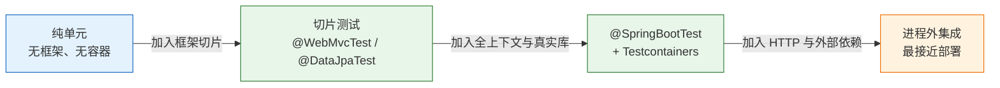
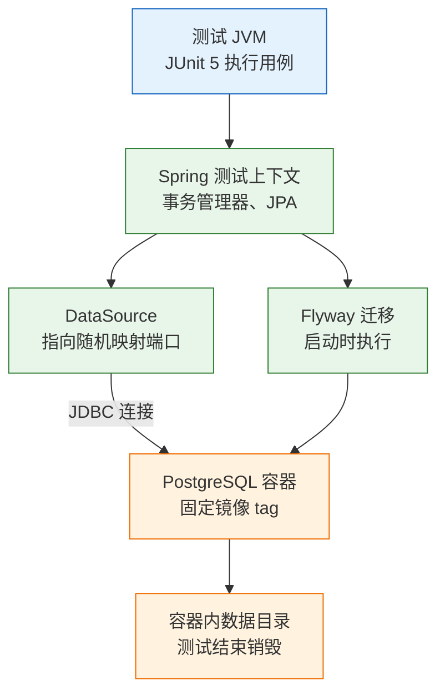
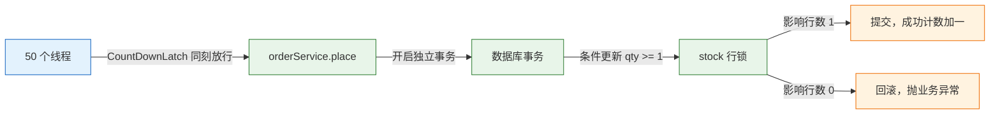

# 集成测试与数据库测试

> 单元测试证明代码按设想运行，集成测试证明它与真实数据库、事务、序列化装配后仍然成立。两者之间差的，往往就是上线那一刻的报错。

---

## 一、集成测试是什么

### 1.1 核心概念

集成测试验证**自己写的代码与真实基础设施之间的装配**。它不替换数据库、事务管理器、ORM 映射和迁移脚本，只替换不受控制的外部服务。

装配错误有几个典型来源：

- SQL 用了 MySQL 的 `ON DUPLICATE KEY UPDATE`，PostgreSQL 直接语法错。
- 金额字段用 `double`，真实 `numeric(12,2)` 四舍五入后差一分钱。
- 唯一索引冲突抛出的异常类型，和代码里捕获的不是同一个。
- 事务没提交，测试线程读得到、别的线程读不到。
- 时区设置不同，`timestamp` 与 `timestamptz` 相差八小时。
- 迁移脚本在空库能跑，在有数据的库上因非空列失败。

这些都不是“逻辑错”，单元测试天生看不见。集成测试的职责，就是在上线前把这些差异暴露出来。

| 单元测试能发现 | 集成测试才能发现 |
|---|---|
| 分支遗漏、边界算错 | SQL 方言、函数不存在 |
| 金额计算顺序错误 | 列精度、字符集、时区 |
| 空值与异常未处理 | 约束冲突的异常类型 |
| 状态判断写反 | 事务提交与回滚边界 |
| 对象字段赋值错误 | ORM 映射、懒加载、级联 |

集成测试也不能证明全部。它不验证页面交互，不验证用户真实路径，不验证生产数据量下的查询计划。这些分别属于 E2E、探索式测试和性能测试。

### 1.2 与相邻技术的关系

集成测试处在单元与接口之间：比单元真实，比接口更接近存储层。它通常不经过 HTTP，而是直接调用 Service 或 Repository，因此失败信息更靠近 SQL 和事务。

| 层次 | 启动什么 | 适合验证 | 耗时 |
|---|---|---|---|
| 纯单元 | 无框架、无容器 | 计算、分支、状态判断 | 毫秒 |
| 切片 | 一层框架组件 | 路由、映射、单条 SQL | 秒级 |
| 集成 | 全上下文 + 真实库 | 事务、约束、迁移、并发 | 十秒级 |
| 接口 | HTTP 客户端 + 应用 | 合同、鉴权、序列化 | 百毫秒 |
| E2E | 浏览器 + 完整部署 | 用户关键路径 | 分钟级 |

范围越大，越接近真实，也越难定位。一个失败可能来自业务代码、ORM 配置、迁移脚本、容器启动或网络。因此集成测试的日志要保留足够上下文，不能只留一句断言失败。

### 1.3 架构组成

集成测试的范围可以画成一条光谱。选择原则是：能在小范围验证的，不拉全上下文；必须验证装配的，才启动真实依赖。



一次数据库集成测试的运行栈包含五层：测试 JVM、Spring 测试上下文、数据源与 JPA、数据库容器、容器内的临时数据目录。



这条链路里任何一层配置错，表现都可能是“连不上数据库”。排障时按链路从下往上查，比在业务代码里找问题快。

---

## 二、环境与依赖

### 2.1 Docker 与 Testcontainers

集成测试需要一台可用的 Docker 守护进程。Testcontainers 在测试启动时拉起容器，测试结束后销毁，不依赖本机预装的数据库。

```bash
# ========== 检查 Docker 可用性 ==========
# 守护进程不可用时，Testcontainers 会在启动阶段直接失败
docker info

# ========== 预拉镜像，减少首次执行等待 ==========
docker pull postgres:18-alpine
```

Testcontainers 的生命周期由注解控制：`@Testcontainers` 找到 `@Container` 字段，类级静态容器在整个测试类期间只启动一次，方法级容器每个测试方法启动一次。容器启动后，Testcontainers 通过等待策略确认端口可连接，再把随机映射端口交给测试。

| 组件 | 作用 | 常见问题 |
|---|---|---|
| `@Testcontainers` | 管理容器启停 | 忘加注解，容器不启动 |
| `@Container` | 标记容器字段 | 非静态字段导致每方法重启 |
| 等待策略 | 确认服务就绪 | 只看端口，没等初始化完成 |
| Ryuk | 测试结束回收容器 | 受限 Docker 环境无法启动 |
| 随机端口映射 | 避免端口冲突 | 代码里写死 5432 |

> **注意**：容器启动成功不等于数据库可用。PostgreSQL 镜像初始化期间会短暂重启，等待策略应使用 Testcontainers 提供的数据库等待策略，不要用固定 `sleep`。

排查容器问题时，先确认它是否还在运行，再读容器日志：

```bash
# ========== 查看测试启动的数据库容器 ==========
# 容器名通常由镜像名与随机后缀组成
docker ps --filter "ancestor=postgres:18-alpine"

# ========== 读取容器日志 ==========
# 初始化失败、端口冲突、权限错误都会在日志开头出现
docker logs <容器ID>
```

容器在测试结束后会被回收，失败现场可能已经不在了。需要保留现场时，临时关掉自动回收，或把日志输出到测试报告目录，再进行分析。

### 2.2 Maven 依赖

依赖分三块：Spring Boot 的测试容器支持、具体数据库模块、JUnit 5 集成。版本由 Spring Boot BOM 管理，不在业务 `pom.xml` 里手写。

```xml
<!-- pom.xml：集成测试依赖 -->
<dependencies>
  <!-- 提供 @ServiceConnection，把容器连接信息注入数据源 -->
  <dependency>
    <groupId>org.springframework.boot</groupId>
    <artifactId>spring-boot-testcontainers</artifactId>
    <scope>test</scope>
  </dependency>

  <!-- PostgreSQL 专用容器模块 -->
  <dependency>
    <groupId>org.testcontainers</groupId>
    <artifactId>postgresql</artifactId>
    <scope>test</scope>
  </dependency>

  <!-- JUnit 5 的 @Testcontainers 支持 -->
  <dependency>
    <groupId>org.testcontainers</groupId>
    <artifactId>junit-jupiter</artifactId>
    <scope>test</scope>
  </dependency>
</dependencies>
```

| 依赖 | 提供的能力 | 缺失后果 |
|---|---|---|
| `spring-boot-testcontainers` | `@ServiceConnection`、连接详情定制 | 需手写 `@DynamicPropertySource` |
| `postgresql` | `PostgreSQLContainer` | 只能使用通用容器，配置繁琐 |
| `junit-jupiter` | `@Testcontainers`、`@Container` | 容器注解不生效 |

测试类命名建议以 `IT` 结尾，交给 Failsafe 在 `verify` 阶段执行，避免每次 `mvn test` 都拉起容器。

### 2.3 测试配置

测试配置要显式关闭“自动建表”，改为校验迁移结果。否则 Hibernate 会自动补列，掩盖迁移脚本缺失。

```yaml
# src/test/resources/application-test.yml
spring:
  jpa:
    hibernate:
      ddl-auto: validate       # 只校验实体与表结构是否一致
    open-in-view: false        # 测试中关闭懒加载兜底，暴露映射问题
  flyway:
    enabled: true              # 启动时执行迁移，脚本本身也被验证
  datasource:
    hikari:
      maximum-pool-size: 5     # 测试并发有限，避免占满容器连接
```

| 配置项 | 作用 | 错误配置的后果 |
|---|---|---|
| `ddl-auto: validate` | 启动时校验映射 | 用 `update` 会掩盖迁移缺失 |
| `flyway.enabled` | 执行迁移脚本 | 关闭后表结构可能来自旧快照 |
| `open-in-view` | 控制会话范围 | 开启会掩盖懒加载问题 |
| 连接池大小 | 限制并发连接 | 过大导致容器连接被打满 |

> **注意**：测试库不要复用开发库的连接串。数据源被环境变量覆盖时，测试可能直接跑在开发库上，清理脚本会删掉真实数据。

### 2.4 Failsafe 执行配置

Surefire 只扫描 `*Test`，Failsafe 扫描 `*IT` 并在 `verify` 阶段执行。两者分开，`mvn test` 保持快速，`mvn verify` 才拉起容器。

```xml
<!-- pom.xml：Failsafe 绑定 integration-test 与 verify 两个阶段 -->
<plugin>
  <groupId>org.apache.maven.plugins</groupId>
  <artifactId>maven-failsafe-plugin</artifactId>
  <executions>
    <execution>
      <goals>
        <goal>integration-test</goal>
        <goal>verify</goal>
      </goals>
    </execution>
  </executions>
</plugin>
```

| 命令 | 执行内容 | 典型耗时 |
|---|---|---|
| `mvn test` | 单元与切片 | 秒到分钟 |
| `mvn verify` | 单元 + 集成 | 分钟到十几分钟 |
| `mvn -Dit.test=OrderRepositoryIT verify` | 指定集成类 | 取决于容器启动 |

集成测试类被写成 `OrderRepositoryTest` 时，Surefire 会在 `test` 阶段执行它，容器被意外拉起。命名与插件配置要一起检查。

---

## 三、数据库集成测试

### 3.1 容器接入

下面的测试类启动完整 Spring 上下文，连接 Testcontainers 拉起的 PostgreSQL。`@ServiceConnection` 把容器地址、端口、用户名、密码自动注入数据源。

```java
@SpringBootTest
@Testcontainers
class OrderRepositoryIT {

    // static：整个测试类共用一个容器，避免每个方法重启
    @Container
    @ServiceConnection
    static PostgreSQLContainer<?> pg =
            new PostgreSQLContainer<>("postgres:18-alpine");

    @Autowired OrderRepository repo;
    @Autowired JdbcTemplate jdbc;
    @Autowired DataSource dataSource;

    @Test
    void 数据源连接到容器而不是本地库() throws Exception {
        try (Connection conn = dataSource.getConnection()) {
            String url = conn.getMetaData().getURL();
            // 断言端口是容器映射端口，防止误连本地数据库
            assertThat(url).contains(String.valueOf(pg.getMappedPort(5432)));
        }
    }
}
```

| 要素 | 写法 | 作用 |
|---|---|---|
| 全上下文 | `@SpringBootTest` | 加载事务、JPA、迁移 |
| 容器管理 | `@Testcontainers` + `@Container` | 启动与销毁 |
| 连接注入 | `@ServiceConnection` | 免写 `@DynamicPropertySource` |
| 容器复用 | `static` 字段 | 类级共享，减少启动次数 |
| 镜像版本 | 固定 tag | 避免昨天绿今天红 |

最后一条尤其重要。写 `latest` 意味着镜像内容随时变化，测试失败时无法判断是代码改了还是镜像换了。

旧项目或需要自定义数据源时，常见写法是手动注册连接信息：

```java
@DynamicPropertySource
static void datasource(DynamicPropertyRegistry registry) {
    registry.add("spring.datasource.url", pg::getJdbcUrl);
    registry.add("spring.datasource.username", pg::getUsername);
    registry.add("spring.datasource.password", pg::getPassword);
}
```

这种方式字段多、容易漏，且不同数据库模块的 getter 名称不同。能用 `@ServiceConnection` 时优先用它，把手工映射留给特殊配置。

### 3.2 映射与约束断言

集成测试的断言要落到数据库里，不能只看方法有没有抛异常。下面两个用例分别验证唯一约束和金额精度。

```java
@Test
void 订单号唯一约束由数据库兜底() {
    repo.save(new Order("ORD-1", 7L, 10_000L));

    assertThatThrownBy(() -> repo.save(new Order("ORD-1", 8L, 20_000L)))
            .isInstanceOf(DataIntegrityViolationException.class);
}

@Test
void 金额列按两位小数存储() {
    jdbc.update("insert into orders(order_no, user_id, amount) values (?, ?, ?)",
            "ORD-2", 7L, new BigDecimal("19.99"));

    BigDecimal stored = jdbc.queryForObject(
            "select amount from orders where order_no = 'ORD-2'", BigDecimal.class);
    assertThat(stored).isEqualByComparingTo("19.99");
}
```

| 断言对象 | 具体动作 | 能抓到的问题 |
|---|---|---|
| 行状态 | 查回字段值、条数 | 映射错、字段漏写 |
| 精度 | `BigDecimal` 比较 | 小数位截断、四舍五入 |
| 约束 | 重复键、非空、外键 | 应用校验漏了，数据库也没兜住 |
| 事务 | 异常后两边都不落库 | 事务边界标错、异常被吞 |
| 时区 | `timestamptz` 往返 | 环境差异导致偏移 |

`isEqualByComparingTo` 比较的是数值而不是 `BigDecimal` 的 scale。数据库可能把 `19.99` 存成 `19.990`，用 `isEqualTo` 会误报。

### 3.3 迁移脚本验证

项目使用 Flyway 时，应用启动会执行迁移，迁移脚本本身也被验证了一次。要额外确认迁移历史没有失败记录；Liquibase 对应的检查表是 `DATABASECHANGELOG`，断言字段不同，思路一致。

```java
@Test
void 迁移脚本全部执行成功() {
    Integer failed = jdbc.queryForObject(
            "select count(*) from flyway_schema_history where success = false",
            Integer.class);
    assertThat(failed).isZero();
}
```

| 迁移检查 | 验证方式 | 能发现的问题 |
|---|---|---|
| 空库初始化 | 容器每次全新启动 | 脚本依赖手工建表 |
| 有数据升级 | 先导入基线数据再迁移 | 非空列缺默认值 |
| 可重复执行 | 同一脚本执行两次 | 非幂等 DDL |
| 回滚脚本 | 单独环境执行 | 回滚后结构不一致 |
| 字符集与时区 | 插入中文与时间戳 | 编码错误、时区偏移 |

`ddl-auto: update` 在测试里看似省事，实际会掩盖迁移脚本缺失：测试库被 Hibernate 自动补了列，生产跑迁移时才发现脚本没写。`validate` 会让这种问题在 CI 里直接失败。

```bash
# ========== 执行集成测试 ==========
# 需要 Docker 守护进程；首次会拉镜像，之后走本地缓存
mvn -q -Dtest=OrderRepositoryIT test

# ========== 使用 Failsafe 管理 *IT ==========
mvn -q -Dit.test=OrderRepositoryIT verify
```

执行成功时汇总类似 `Tests run: 3, Failures: 0, Errors: 0, Skipped: 0`。若在容器启动阶段失败，先看 Docker 是否可用，再看镜像能否拉取。

---

## 四、事务与并发测试

### 4.1 事务边界

事务测试要验证两件事：成功时全部提交，失败时全部回滚。只测成功路径，无法发现“扣了库存但订单没建”这类事故。

```java
@Test
void 业务异常时库存与订单一起回滚() {
    jdbc.update("insert into stock(sku, qty) values ('SKU-9', 1)");

    assertThatThrownBy(() -> orderService.place("SKU-9", 2))
            .isInstanceOf(InsufficientStockException.class);

    // 订单没有新增，库存也没有被扣减
    assertThat(jdbc.queryForObject(
            "select qty from stock where sku = 'SKU-9'", Integer.class)).isEqualTo(1);
}
```

| 场景 | 预期 | 断言位置 |
|---|---|---|
| 正常提交 | 订单与库存都可见 | 新事务中查询 |
| 业务异常 | 两者都回滚 | 异常后查询原值 |
| 运行时异常 | 默认回滚 | 确认未被 catch 吞掉 |
| 受检异常 | 取决于配置 | 检查 `rollbackFor` |
| 异步线程 | 独立事务 | 不能依赖测试事务回滚 |

**不要给测试方法加 `@Transactional` 就指望覆盖所有场景**。业务方法在别的线程开自己的事务，测试事务管不到；线程提交的数据会留下来，后续用例读到脏数据。异步、并发、真实 HTTP 调用都属于这一类。

### 4.2 并发超卖验证

业务规则：下单扣库存，两者必须同生共死；库存只有 10 件，50 个请求同时来，成功数必须恰好是 10，库存不能为负。

```java
@Test
void 并发下单不会超卖() throws Exception {
    jdbc.update("insert into stock(sku, qty) values ('SKU-1', 10)");
    int threads = 50;
    ExecutorService pool = Executors.newFixedThreadPool(16);
    CountDownLatch start = new CountDownLatch(1);
    CountDownLatch done = new CountDownLatch(threads);
    AtomicInteger ok = new AtomicInteger();

    for (int i = 0; i < threads; i++) {
        pool.submit(() -> {
            try {
                start.await();                 // 所有线程在同一刻起跑
                orderService.place("SKU-1", 1); // 内部 @Transactional
                ok.incrementAndGet();
            } catch (RuntimeException ignored) {
                // 库存不足是预期失败，成功数由 ok 统计
            } finally {
                done.countDown();
            }
        });
    }
    start.countDown();
    assertThat(done.await(10, TimeUnit.SECONDS)).isTrue();
    pool.shutdown();

    assertThat(ok.get()).isEqualTo(10);
    assertThat(jdbc.queryForObject(
            "select qty from stock where sku = 'SKU-1'", Integer.class)).isZero();
}
```



两个关键点：

- **同刻起跑**：没有 `CountDownLatch`，线程会顺序执行，测不出竞争。
- **结果可判定**：成功数必须等于库存数，而不是“小于等于 10”。后者会把“全部失败”也判为通过。

并发测试验证的是“当前隔离级别与锁策略下不超卖”，不是数学证明。它可能偶发通过，因此要配合日志确认确实发生了竞争，例如统计更新失败次数。线程池要在 `finally` 中关闭，否则测试 JVM 可能因为非守护线程迟迟不退出，表现为“用例通过但构建卡住”。

### 4.3 锁策略断言

超卖能被挡住，通常靠行锁、条件更新或乐观锁。测试要贴着实际策略写，否则实现从悲观锁换成乐观锁，测试仍绿，并发行为却已经变了。

```java
// 条件更新：库存不足时受影响行数为 0，必须当失败处理
int updated = jdbc.update(
        "update stock set qty = qty - 1 where sku = ? and qty >= 1", "SKU-1");
assertThat(updated).isZero();
```

使用 `@Version` 乐观锁时，要构造两个事务读同一版本、先后提交，后提交者抛 `ObjectOptimisticLockingFailureException`。单线程调用一次是测不出来的。

| 策略 | 测试构造 | 断言 |
|---|---|---|
| 条件更新 | 库存为 0 时执行更新 | 受影响行数为 0 |
| 悲观锁 | 两个线程先后持有同一行 | 后到者等待，最终数量正确 |
| 乐观锁 | 两个事务读同一版本 | 后提交抛乐观锁异常 |
| 唯一约束 | 并发插入同一业务键 | 只有一个成功，其余冲突 |

> **注意**：并发用例失败后不要直接加 `sleep` 重试。先确认线程是否真的同时到达临界区，再确认数据库隔离级别与索引是否支持预期锁行为。

---

## 五、缓存、事件与消息

### 5.1 缓存一致性

缓存测试的关键不是“能存能取”，而是**写后读一致**：更新数据库后，缓存是否失效或同步更新。

```java
@Test
void 更新订单后缓存应失效() {
    orderService.updateAmount(id, 2_000L);

    // 经过缓存的读取应看到新值
    assertThat(orderService.get(id).amountCents()).isEqualTo(2_000L);

    // 绕过缓存直查库，确认两边一致
    assertThat(jdbc.queryForObject(
            "select amount from orders where id = ?", Long.class, id))
            .isEqualTo(2_000L);
}
```

只断言缓存命中率没有意义。命中旧值同样是命中，线上表现就是“改了金额，页面还是旧的”。

缓存还要测两个边界：TTL 到期后能从数据库重新加载，以及数据库无记录时不缓存空值。后者若处理不当，新写入的数据会被“空值缓存”挡住，直到 TTL 结束才可见。

### 5.2 领域事件

领域事件要验证两件事：提交后发送，回滚不发送。只测“正常路径发了一条”，等于没测可靠性。

```java
@SpringBootTest
@RecordApplicationEvents
@Testcontainers
class OrderEventIT {

    @Container
    @ServiceConnection
    static PostgreSQLContainer<?> pg =
            new PostgreSQLContainer<>("postgres:18-alpine");

    @Autowired OrderService orderService;
    @Autowired TransactionTemplate tx;
    @Autowired ApplicationEvents events;

    @Test
    void 事务回滚后不发布订单创建事件() {
        assertThatThrownBy(() -> tx.execute(status -> {
            orderService.create(7L, 10_000L, null);
            throw new IllegalStateException("强制回滚");
        })).isInstanceOf(IllegalStateException.class);

        assertThat(events.stream(OrderCreated.class)).isEmpty();
    }
}
```

监听器要使用 `@TransactionalEventListener(AFTER_COMMIT)`。若在事务内直接发送消息，回滚后消息已经发出，补偿逻辑很难收尾。

### 5.3 消息幂等

消息队列的集成测试要覆盖“重复消费只产生一次效果”。做法是发送同一条消息两次，断言业务表只有一条记录、库存只扣一次。

| 对象 | 验证点 | 做法 | 常见问题 |
|---|---|---|---|
| Redis 缓存 | 命中、失效、TTL | 真实容器 | 写库后没删缓存 |
| 领域事件 | 提交后发、回滚不发 | `@RecordApplicationEvents` | 事务内发事件 |
| 消息队列 | 发送成功、消费幂等 | 真实容器或内存实现 | 重复消费、确认丢失 |
| 定时任务 | 重复执行不重复处理 | 固定时钟 + 唯一键 | 多实例同时跑 |

消息测试不要在断言前 `sleep` 等消费。用轮询加超时，或使用测试框架提供的等待机制；固定等待会让测试在慢机器上随机失败。

使用事务性发件箱时，断言点要落在 outbox 表：业务成功时同一事务写入一条待发送记录，业务回滚时一条都没有；投递器重复扫描同一条记录，业务侧仍只产生一次效果。

| 发件箱断言 | 构造 | 预期 |
|---|---|---|
| 业务成功 | 正常下单 | outbox 新增一条待发送 |
| 业务回滚 | 下单后抛异常 | outbox 无记录 |
| 重复投递 | 同一条记录投递两次 | 消费侧只生效一次 |
| 投递失败 | 模拟发送异常 | 状态保持待发送，可重试 |

---

## 六、数据隔离与执行速度

### 6.1 隔离策略

集成测试慢，主要慢在容器启动和上下文加载。数据隔离策略决定能否并行，也决定失败是否可复现。

| 策略 | 做法 | 速度 | 并行友好 | 风险 |
|---|---|---|---|---|
| 事务回滚 | 测试方法加 `@Transactional` | 最快 | 好 | 异步线程、真实 HTTP 不生效 |
| 清表 | `@AfterEach` 执行 `TRUNCATE ... CASCADE` | 快 | 中 | 外键顺序、忘清关联表 |
| 独立 schema | 每个 worker 一个 schema | 中 | 好 | 迁移要跑多次 |
| 模板数据库 | 先迁移好，再 `CREATE DATABASE ... TEMPLATE` | 中 | 好 | 需要建库权限 |
| 每类一个容器 | `@Container` + 类级复用 | 慢启动 | 好 | 类之间仍共享数据 |
| 每方法一个容器 | 方法级容器 | 最慢 | 好 | 一般不必要 |

务实组合是：**容器类级复用 + 每个用例自造唯一数据 + 必要时清表**。事务回滚留给纯查询和单线程写测试，别拿它掩盖并发问题。

```java
@AfterEach
void cleanUp() {
    // 有外键时用 CASCADE，并重置自增序列，避免用例依赖固定 ID
    jdbc.execute("TRUNCATE TABLE order_item, orders RESTART IDENTITY CASCADE");
}
```

清表语句要覆盖关联表。只清主表会留下孤儿行，下一次用例可能因外键约束失败，错误信息却指向插入语句。

### 6.2 容器复用与并行

容器复用有三个层次：类级静态容器、Spring 上下文缓存、Testcontainers 的跨进程复用。前两个默认可用，第三个需要额外配置，并要考虑容器残留。

| 复用方式 | 生效范围 | 配置成本 | 注意事项 |
|---|---|---|---|
| `static` 容器 | 单个测试类 | 无 | 类内数据需自行清理 |
| Spring 上下文缓存 | 相同配置的测试类 | 无 | 配置不同会重新加载 |
| Testcontainers 复用 | 多次执行之间 | 需开启复用 | 容器可能残留旧数据 |

并行执行时，同一个容器会被多个测试类共享。此时不能依赖固定主键、固定单号或全表计数。给每条数据加唯一后缀，断言时按后缀过滤。

```java
// 并行安全的业务键：前缀可读，后缀唯一
String orderNo = "ORD-" + UUID.randomUUID();
```

JUnit 5 的并行开关放在 `junit-platform.properties`，不写在某个测试类上：

```properties
# src/test/resources/junit-platform.properties
junit.jupiter.execution.parallel.enabled=true
junit.jupiter.execution.parallel.mode.default=concurrent
junit.jupiter.execution.parallel.config.strategy=fixed
junit.jupiter.execution.parallel.config.fixed.parallelism=4
```

| 配置项 | 作用 | 取值建议 |
|---|---|---|
| `parallel.enabled` | 总开关 | 仅数据隔离到位后开启 |
| `mode.default` | 方法级并行 | `concurrent` |
| `config.strategy` | 并行度计算方式 | `fixed` 最可控 |
| `fixed.parallelism` | 并发线程数 | 不超过数据库连接池 |

开启并行前先确认三件事：用例不共享固定主键、清理逻辑不互相删数据、容器连接池足够。三者任一不满足，并行只会把偶发失败变成常态。

### 6.3 CI 集成

CI 上的集成测试需要 Docker。GitHub Actions 的 `ubuntu-latest` 运行器自带 Docker，可以直接运行 Testcontainers；GitLab CI 需要挂载 Docker socket 或使用 DinD 服务。

```yaml
# .github/workflows/integration.yml：合并后执行集成测试
name: integration
on:
  push:
    branches: [main]
  schedule:
    - cron: "0 18 * * *"       # 夜间跑一次，覆盖外部依赖变化

jobs:
  integration:
    runs-on: ubuntu-latest
    steps:
      - uses: actions/checkout@v4
      - uses: actions/setup-java@v4
        with:
          distribution: temurin
          java-version: "21"
          cache: maven
      - run: mvn -B -q verify   # Failsafe 执行 *IT，Testcontainers 拉起数据库
```

| 方案 | 启动方式 | 适用 | 注意 |
|---|---|---|---|
| Testcontainers | 测试代码内拉起 | 本地与 CI 一致 | 需要 Docker 权限 |
| CI 服务容器 | 流水线声明 service | 固定依赖版本 | 主机名是服务名 |
| 外部测试库 | 预建数据库 | 无法拉容器 | 数据隔离与清理 |
| 内存数据库 | H2 等替代 | 纯查询快速验证 | 方言差异大 |

> **注意**：CI 中不要用固定端口映射。多个任务并行时会争抢同一端口，表现为随机“端口已占用”。让 Testcontainers 分配随机端口，测试只读取注入后的连接信息。

---

## 七、适用边界

集成测试成本高，不适合覆盖所有逻辑。下列场景应明确交给其他层次。

| 场景 | 建议 | 原因 |
|---|---|---|
| 纯计算、纯转换 | 单元测试 | 拉容器只会变慢 |
| 第三方服务内部行为 | 契约测试或挡板 | 不受控制，真实调用不稳定 |
| 框架自身行为 | 信任框架测试 | 事务传播、序列化不必逐条验证 |
| 跨服务事务 | 测补偿逻辑 | 本地事务保证不了全局原子性 |
| 特定硬件、专有中间件 | 记录为未覆盖 | 不写假装通过的测试 |
| 每次提交跑全量 | 拆分执行 | 集成测试放合并后或夜间 |

跨服务事务要测的是“补偿是否被执行”，不是“本地事务能否回滚”。用本地事务模拟分布式原子性，得到的绿是假的。

边界判断可以按三个问题依次过：这个失败是否只可能来自真实依赖；这类依赖是否能在容器里稳定复现；验证它的成本是否低于上线后发现的成本。三个答案都是“是”，才值得放进集成测试。否则先用切片或挡板，把慢测试留给真正需要装配验证的场景。

---

## 八、常见排障

| 现象 | 最可能原因 | 处理 |
|---|---|---|
| 单元全绿，上线 SQL 语法错 | 用了 H2 或内存库，方言不同 | 换 Testcontainers + 同版本数据库 |
| 单独跑过，一起跑挂 | 共享数据、执行顺序、残留行 | 每用例唯一键，`@AfterEach` 清理 |
| 加了 `@Transactional` 却没回滚 | 业务在异步线程或真实 HTTP 线程提交 | 显式清理，不依赖测试事务 |
| 并发测试复现不了超卖 | 线程没同时起跑，或数据太少 | `CountDownLatch` 同刻起跑，增加竞争 |
| 容器起不来，报端口占用 | 固定映射端口，多个容器抢端口 | 不写固定端口，使用随机映射 |
| CI 上连不上数据库 | 服务未就绪或主机名写错 | 用 `@ServiceConnection`，确认服务名 |
| 本地过，CI 时区或字符集错 | JVM 时区、locale、数据库编码不同 | 固定 `TimeZone`/`Locale`，库统一 UTF-8 |
| 唯一键冲突但异常类型不对 | 框架异常转换层不同 | 断言 `DataIntegrityViolationException` 父类 |
| 测试跑在开发库或生产库上 | 数据源被环境变量覆盖 | 测试配置强制指向容器，启动断言库名 |
| 集成测试要跑十分钟 | 每个类都起容器、全量上下文 | 容器复用、缩小切片、按模块拆分 |
| 测试通过但生产迁移失败 | `ddl-auto: update` 自动补了列 | 改 `validate`，迁移脚本纳入测试 |
| 缓存测试只验了能存能取 | 没验写后失效 | 更新后同时查缓存与数据库 |
| 小数据量全绿，线上超时 | 查询计划随数据量变化 | 造接近生产的数据量，单独跑一组 |
| 容器启动超时 | 镜像拉取慢或等待策略过短 | 预拉镜像，使用数据库等待策略 |
| 事件测试时有时无 | 监听器在事务提交前执行 | 改 `AFTER_COMMIT`，再断言事件 |

排查顺序：

1. 先读失败阶段：容器启动失败、上下文加载失败、用例断言失败，三者的排查入口完全不同。
2. 看容器是否起来：`docker ps`，再看测试日志里的 JDBC URL 与映射端口。
3. 确认迁移脚本是否执行，表结构是否与实体一致。
4. 单独跑失败用例，排除顺序依赖与残留数据。
5. 对比本地与 CI 的镜像 tag、时区、字符集、JDK 版本。
6. 最后才怀疑业务代码与事务配置。

> **安全警告**：清理脚本、`TRUNCATE`、`DROP SCHEMA` 只能指向测试容器。执行前用启动断言确认库名或连接串包含测试标识，避免误伤开发库与生产库。
