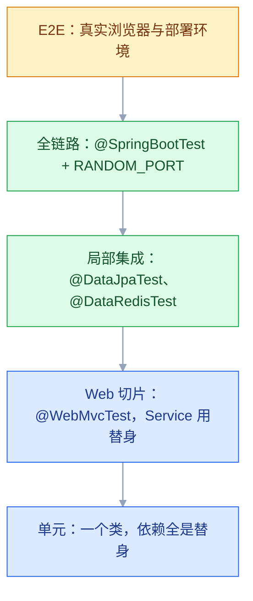
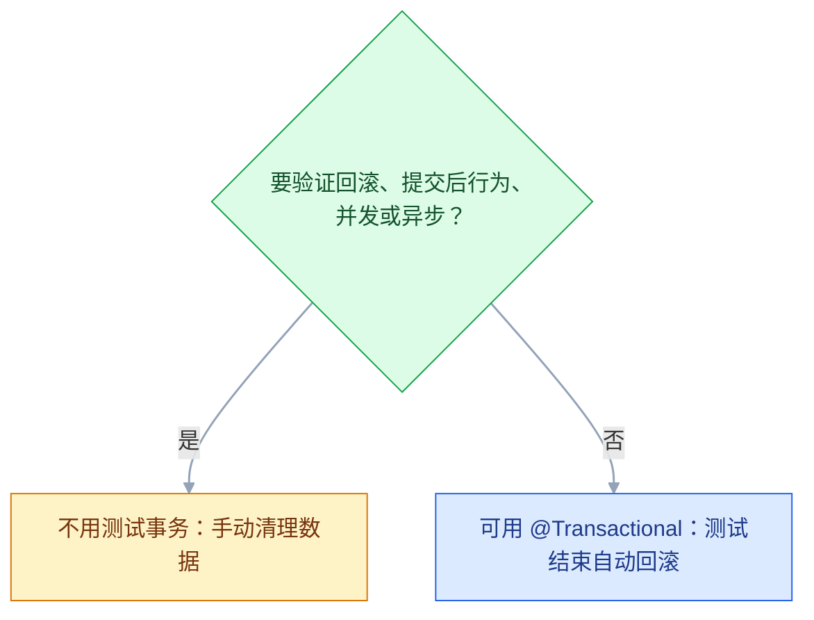

# 集成测试与数据库测试

## 一、工程案例：用 Testcontainers 给任务系统搭一套集成测试并接进 CI

**场景**：任务管理系统后端用 Spring Boot 3 + MySQL 8 + Redis 7。用户与任务一对多，创建任务要扣配额，任务列表走缓存，另有一批多表 JOIN 的报表 SQL。上线前出过两次事故：并发下任务被多创建、配额扣了但任务没落库。现在要用真实容器把这几个风险点锁死。

**目标**：一套 `mvn -B verify` 能在 5 分钟内跑完的集成测试，不依赖共享测试库，新人有 Docker 就能跑。

### 1.1 环境与依赖

```bash
docker version
docker pull mysql:8.0
docker pull redis:7
```

```text
Server: Docker Engine - Community
 Engine:
  Version: 27.3.1
 ...
```

只看到 `Client:` 段、没有 `Server:` 段，说明 Docker 守护进程没起来，Testcontainers 会直接失败。

```xml
<dependencies>
    <dependency><groupId>org.springframework.boot</groupId>
        <artifactId>spring-boot-starter-test</artifactId><scope>test</scope></dependency>
    <dependency><groupId>org.testcontainers</groupId>
        <artifactId>mysql</artifactId><scope>test</scope></dependency>
    <dependency><groupId>org.testcontainers</groupId>
        <artifactId>junit-jupiter</artifactId><scope>test</scope></dependency>
    <dependency><groupId>org.awaitility</groupId>
        <artifactId>awaitility</artifactId><scope>test</scope></dependency>
</dependencies>
```

> 继承 Spring Boot 父 POM 时，两个 Testcontainers 构件的版本由 Boot 的依赖管理锁定；不继承父 POM 才需要单独导入 `testcontainers-bom`，版本以官方当前稳定版为准。镜像 tag 必须写死：`mysql:latest` 会让某天的测试结果和昨天不同，`mysql:8.0` 也只锁到次版本，补丁仍会漂。

### 1.2 容器单例与基类

```java
public final class SharedContainers {
    public static final MySQLContainer<?> MYSQL =
            new MySQLContainer<>(DockerImageName.parse("mysql:8.0"))
                    .withDatabaseName("appdb").withUsername("app").withPassword("app123")
                    .withCommand("--character-set-server=utf8mb4",
                                 "--collation-server=utf8mb4_unicode_ci",
                                 "--default-time-zone=+08:00");
    public static final GenericContainer<?> REDIS =
            new GenericContainer<>(DockerImageName.parse("redis:7")).withExposedPorts(6379);
    static { MYSQL.start(); REDIS.start(); }
    private SharedContainers() {}
}

@SpringBootTest
@ActiveProfiles("test")
public abstract class IntegrationTestBase {
    @DynamicPropertySource
    static void props(DynamicPropertyRegistry registry) {
        registry.add("spring.datasource.url", SharedContainers.MYSQL::getJdbcUrl);
        registry.add("spring.datasource.username", SharedContainers.MYSQL::getUsername);
        registry.add("spring.datasource.password", SharedContainers.MYSQL::getPassword);
        registry.add("spring.data.redis.host", SharedContainers.REDIS::getHost);
        registry.add("spring.data.redis.port", () -> SharedContainers.REDIS.getMappedPort(6379));
    }
}
```

容器只启动一次，子类共用同一份 Spring 上下文。端口是运行时才确定的，所以必须用 `@DynamicPropertySource`，静态的 `@TestPropertySource` 拿不到。Spring Boot 3.1+ 也可以改用 `@ServiceConnection`，但要额外引入 `spring-boot-testcontainers`；这里保留显式注册，端口映射看得更清楚。

| 写法 | 启动次数 | 结果 |
|---|---|---|
| 字段不加 static | 每个测试方法一次 | 慢十倍以上 |
| `static` 字段 | 每个测试类一次 | 可接受 |
| 单例 + 基类 | 整个 JVM 一次 | 推荐 |

### 1.3 数据层：真实 SQL 与真实约束

被测查询用了 `DATE_FORMAT`、`IFNULL` 这类函数，其中 `DATE_FORMAT` 是 MySQL 方言：

```java
@Query(value = """
    SELECT u.id, u.username,
           IFNULL(SUM(CASE WHEN t.status = 'TODO' THEN 1 END), 0) AS todoCount,
           IFNULL(SUM(CASE WHEN t.status = 'DONE' THEN 1 END), 0) AS doneCount,
           DATE_FORMAT(MAX(t.created_at), '%Y-%m-%d') AS lastCreatedDay
    FROM t_user u LEFT JOIN t_task t ON t.user_id = u.id
    GROUP BY u.id, u.username ORDER BY todoCount DESC, u.id ASC
    """, nativeQuery = true)
List<TaskSummary> findTaskSummaries();
```

支撑代码只有两块：`fixture` 集中造数据，`DbCleaner` 负责清库——先 `SET FOREIGN_KEY_CHECKS=0`，再按表清空，避免外键顺序问题。

```java
// fixture：support 包里的测试数据 Builder，默认值集中管理
class TaskRepositoryIT extends IntegrationTestBase {
    @Autowired TaskRepository taskRepository;
    @Autowired UserRepository userRepository;
    @Autowired DbCleaner dbCleaner;

    @BeforeEach void setUp() { dbCleaner.cleanAll(); }

    @Test void 多表聚合_包含没有任务的用户() {
        User alice = userRepository.saveAndFlush(fixture.user("alice"));
        userRepository.saveAndFlush(fixture.user("bob"));
        taskRepository.saveAndFlush(fixture.task(alice, "任务1", TODO, 2));
        taskRepository.saveAndFlush(fixture.task(alice, "任务2", TODO, 4));
        taskRepository.saveAndFlush(fixture.task(alice, "任务3", DONE, 1));

        List<TaskSummary> result = taskRepository.findTaskSummaries();
        assertThat(result).hasSize(2);
        assertThat(result.get(0).getUsername()).isEqualTo("alice");
        assertThat(result.get(0).getTodoCount()).isEqualTo(2);
        assertThat(result.get(1).getTodoCount()).isZero();   // LEFT JOIN + IFNULL
    }

    @Test void 标题超过200字符_被MySQL拒绝() {
        User alice = userRepository.saveAndFlush(fixture.user("alice"));
        assertThatThrownBy(() -> taskRepository.saveAndFlush(
                fixture.task(alice, "长".repeat(300), TODO, 1)))
            .isInstanceOf(DataIntegrityViolationException.class)
            .rootCause().hasMessageContaining("Data too long");
    }
}
```

```bash
mvn -B verify -Dit.test=TaskRepositoryIT
```

```text
[INFO] Tests run: 2, Failures: 0, Errors: 0, Skipped: 0, Time elapsed: 9.3 s
[INFO] BUILD SUCCESS
```

这两条在 H2 上会给出不同结论：`DATE_FORMAT` 直接报函数不存在；长度约束虽然也会拦，但异常类与消息由 H2 自己给，照 H2 写的断言换库就挂。另外，原生查询不保证先 flush 挂起的实体，fixture 一律 `saveAndFlush`，否则 CI 上会偶发「数据明明存了却查不到」。**测试通过不代表生产能过，先看测试连的是不是真库。**

### 1.4 事务：扣配额与建任务同生共死

```java
@Transactional(rollbackFor = Exception.class)
public Task createTask(Long userId, String title) {
    User user = userRepository.findById(userId).orElseThrow();
    int updated = quotaRepository.deduct(userId, 1);      // 原子条件更新
    if (updated == 0) throw new InsufficientQuotaException("配额不足");
    Task saved = taskRepository.save(Task.builder().title(title).owner(user).build());
    eventPublisher.publishTaskCreated(saved.getId(), userId);   // 故意留在事务里
    return saved;
}
```

这里的事件发布必须是同步的、在同一个事务里；一旦换成 `@TransactionalEventListener(phase = AFTER_COMMIT)`，事件失败时业务已提交，下面这条回滚断言必然失败。

```java
class TaskTransactionIT extends IntegrationTestBase {
    @Test void 扣配额后发事件失败_任务与配额都回滚() {
        eventPublisher.failNextPublish();
        assertThatThrownBy(() -> taskService.createTask(aliceId, "会失败的任务"))
            .isInstanceOf(RuntimeException.class);
        assertThat(taskRepository.count()).isZero();
        assertThat(quotaRepository.findById(aliceId).orElseThrow().getUsed()).isZero();
    }
}
```

**这个类不能加 `@Transactional`**。测试事务会把业务写入纳进同一个事务，业务异常只是把它标记成 rollback-only，已写入的行在事务结束前仍然查得到；测试结束时整库一起回滚，又分不清是业务回滚还是测试回滚。用 `dbCleaner` 手动清理。

### 1.5 并发：100 个线程抢 10 个名额

```java
@Test void 一百个线程抢十个名额_成功数正好是10() throws Exception {
    CountDownLatch start = new CountDownLatch(1);
    CountDownLatch done = new CountDownLatch(100);
    AtomicInteger success = new AtomicInteger();
    ExecutorService pool = Executors.newFixedThreadPool(100);
    for (int i = 0; i < 100; i++) {
        pool.submit(() -> {
            try {
                start.await();
                if (quotaService.grab(userId, 1)) success.incrementAndGet();
            } catch (Exception ignored) {
            } finally { done.countDown(); }
        });
    }
    start.countDown();
    assertThat(done.await(60, TimeUnit.SECONDS)).isTrue();
    pool.shutdown();
    assertThat(success.get()).isEqualTo(10);
    assertThat(quotaRepository.findById(userId).orElseThrow().getUsed()).isEqualTo(10);
}
```

```text
并发测试完成：成功=10
[INFO] Tests run: 1, Failures: 0, Errors: 0, Skipped: 0, Time elapsed: 18.7 s
```

四个要点：发令枪让线程同时开始；线程池大小不小于并发数；连接池上限也要不小于并发数（Hikari 默认 10，100 个线程会被池限流，竞争窗口变小，容易误判成通过）；配额初始数据必须真提交，否则别的线程看不见。写成「先查再减」会跑出 `expected: <10> but was: <98>`，单线程测试永远发现不了。这条放进 `QuotaConcurrencyIT`，和事务类一样不加 `@Transactional`。

### 1.6 缓存与 HTTP 全链路

缓存测三件事：首次查库并写缓存、第二次不查库、更新后缓存失效。用 `@MockitoSpyBean`（Spring Boot 3.4+；旧版本是 `@SpyBean`）统计真实 Repository 的调用次数。

```java
@Test void 第二次查询不查库_更新后缓存失效() {
    assertThat(queryService.getById(taskId).getTitle()).isEqualTo("任务A");
    verify(spiedRepository, times(1)).findById(taskId);
    queryService.getById(taskId);
    verify(spiedRepository, times(1)).findById(taskId);      // 仍是 1 次

    queryService.updateTitle(taskId, "改过的标题");
    assertThat(redisTemplate.opsForValue().get("task:" + taskId)).isNull();
    assertThat(queryService.getById(taskId).getTitle()).isEqualTo("改过的标题");
}
```

缓存测试开始前必须先清 Redis：上一个测试留下的 key 会让「首次查询走库」直接命中缓存，第一条断言就红。缓存和数据库要一起清，只清一边等于没清。缓存用例放 `TaskCacheIT`，下面的 Controller 用例放 `TaskApiIT`。

Controller 全链路要同时断言响应和落库：

```java
MvcResult result = mockMvc.perform(post("/api/tasks").header("X-User-Id", aliceId)
        .contentType(MediaType.APPLICATION_JSON).content("{\"title\":\"写周报\"}"))
       .andExpect(status().isCreated())
       .andExpect(jsonPath("$.status").value("TODO"))
       .andReturn();
long id = JsonPath.read(result.getResponse().getContentAsString(), "$.id");
assertThat(taskRepository.findById(id)).isPresent();
assertThat(quotaRepository.findById(aliceId).orElseThrow().getUsed()).isEqualTo(1);
```

只断言 `200` 不够，返回错误 JSON 也会是 200；只断言响应也不够，事务没提交时响应照样正确。

### 1.7 CI 与分层执行

```java
@Tag("integration")
class TaskRepositoryIT extends IntegrationTestBase { }
```

```xml
<plugin>
    <groupId>org.apache.maven.plugins</groupId>
    <artifactId>maven-surefire-plugin</artifactId>
    <configuration><excludedGroups>integration</excludedGroups></configuration>
</plugin>
<plugin>
    <groupId>org.apache.maven.plugins</groupId>
    <artifactId>maven-failsafe-plugin</artifactId>
    <configuration><groups>integration</groups></configuration>
    <executions><execution><goals><goal>integration-test</goal><goal>verify</goal></goals></execution></executions>
</plugin>
```

```yaml
name: test
on: [push, pull_request]
jobs:
  test:
    runs-on: ubuntu-latest
    steps:
      - uses: actions/checkout@v4
      - uses: actions/setup-java@v4
        with: { java-version: '21', distribution: 'temurin', cache: maven }
      - run: docker pull mysql:8.0 && docker pull redis:7
      - run: mvn -B verify
      - if: always()
        uses: actions/upload-artifact@v4
        with: { name: reports, path: target/failsafe-reports }
```

本地开发跑单元测试（秒级），提交前跑集成测试（分钟级），CI 跑全量。**`*IT` 归 failsafe，`mvn test` 不会执行它**，别把「没跑」当成「通过」。`@Tag("integration")` 只负责分组，不负责文件名：类名不是 `*IT` 时，surefire 按标签排除、failsafe 按文件名不收录，结果是一条都没跑。

### 1.8 验收表

| # | 检查项 | 命令或检查 | 通过标准 |
|---|---|---|---|
| 1 | Docker 可用 | `docker version` | 有 `Server:` 段与版本号 |
| 2 | 真库真缓存 | `mvn dependency:tree -Dincludes=com.h2database:h2` | 结果里没有 h2 条目 |
| 3 | 容器只启一次 | 看启动日志里 `Creating container for image: mysql:8.0` | 整个测试过程只出现 1 次 |
| 4 | SQL 正确 | `mvn -B verify -Dit.test=TaskRepositoryIT` | 2 条全过 |
| 5 | 事务回滚 | `mvn -B verify -Dit.test=TaskTransactionIT` | 配额与任务都为 0 |
| 6 | 并发不超发 | `mvn -B verify -Dit.test=QuotaConcurrencyIT` | 成功数正好 10 |
| 7 | 缓存失效 | `mvn -B verify -Dit.test=TaskCacheIT` | 更新后 key 为 null |
| 8 | 全链路 | `mvn -B verify -Dit.test=TaskApiIT` | 201 且按返回 id 能查到 |
| 9 | 全量耗时 | `time mvn -B verify` | 镜像已预热时 ≤ 5 分钟 |
| 10 | 报告归档 | CI artifact | 失败时能下载报告 |

> 第 2 项要真查。项目里只要还留着 H2 依赖，就有人会图快把测试切过去，然后在某次上线时收获一个「MySQL 特有语法」的惊喜。

---

## 二、高频问答：会卡住你的地方，也是面试最常问的

### 2.1 测试全绿，上线报 SQL 语法错

**现场**

```bash
mvn dependency:tree -Dincludes=com.h2database:h2
```

再看测试数据源 URL 指向哪里。

**要点**

- 测试连的是 H2，`DATE_FORMAT`、`JSON_EXTRACT`、`ON DUPLICATE KEY` 这些 MySQL 语法根本没执行过。
- 「方言不一致」不是「环境故障」：把测试数据源指向真 MySQL 容器，同一条 SQL 重跑就能确认。
- 更隐蔽的一种：`@DataJpaTest` 默认带 `@AutoConfigureTestDatabase(replace = Replace.ANY)`，会尝试用嵌入式库替换 DataSource——classpath 上有 H2 就悄悄换掉，没有就直接报「Failed to replace DataSource」，两种情况下容器都白起。切片测试要显式写 `Replace.NONE`，或设 `spring.test.database.replace=none`。

**追问**

- H2 的 `MODE=MySQL` 够用吗？→ 不够，隔离级别、锁等待、索引前缀都模仿不了。
- 怎么防止有人图快切回 H2？→ CI 里查依赖树，没有 h2 条目。
- 真库主要测什么？→ 方言、约束、事务、并发。

### 2.2 单独跑都过，一起跑就挂

**现场**

打乱顺序跑；或只跑第二个测试。

**要点**

- 上一个测试造的数据没清，`count()`、唯一索引、列表顺序全被污染。
- 「顺序依赖」不是「框架并发 bug」。
- 每个测试在 `@BeforeEach` 清表或造自己的数据，禁止依赖「库里本来有什么」。

**追问**

- 怎么快速确认是污染？→ 只跑第二个测试，能过就是前一个留下的。
- 清表遇到外键怎么办？→ 先 `SET FOREIGN_KEY_CHECKS=0` 再按表清空。
- 事务回滚能替代清表吗？→ 单线程 CRUD 可以，异步、并发不行。

### 2.3 并发测试怎么都复现不了超发

**现场**

看测试有没有事务注解；看 Hikari 的 `maximum-pool-size`；打印线程实际开始时间。

**要点**

- 测试类加了 `@Transactional`，数据没提交，其他线程看不到。
- 线程池、连接池太小，任务在排队，竞争窗口变小。
- 「没复现」不等于「不存在」：去掉 `@Transactional` 手动清理，线程池和连接池上限都不小于并发数，加发令枪让线程同时起跑。

**追问**

- Hikari 默认连接数是多少？→ 10，100 个线程会被池限流。
- 单线程为什么测不出超发？→ 「先查再减」顺序执行永远正确。
- 并发测试跑几轮？→ 3~5 轮并重置数据，单轮可能碰巧通过。

### 2.4 `@Transactional` 加了却没回滚

**现场**

看调用是否经过代理；看异常是否是受检异常；看异常有没有被吞掉。

**要点**

- 注解存在不等于事务生效，得经过代理才有拦截。
- 五种常见原因：同类内部方法互调、方法不是 public、异常类型不在 `rollbackFor` 内、异常被 catch 后没重新抛出、被测代码自己开了新事务。
- 判据是在事务方法里抛异常后查库，数据还在就是代理没拦到。

**追问**

- 受检异常为什么默认不回滚？→ Spring 默认只对 `RuntimeException` 和 `Error` 回滚。
- 同类互调怎么解决？→ 拆到另一个 Bean，或注入自身代理。
- `REQUIRES_NEW` 有什么影响？→ 内层独立提交，外层回滚带不走它。

### 2.5 集成测试跑一次要五分钟

**现场**

看日志里容器启动次数与上下文缓存命中。

**要点**

- 每个测试方法都重建容器和 Spring 上下文，启动开销重复了 N 次。
- 「集成测试本来就慢」是错觉，启动成本可以只付一次。
- 容器改 static 单例、注解组合保持一致以复用上下文、数据层用切片测试。

**追问**

- 上下文什么时候会重建？→ 注解组合或属性不同，缓存 key 就变。
- 切片测试能省多少？→ 只加载部分 Bean，1~3 秒而不是几十秒。
- CI 上要开 reuse 吗？→ 不要，每次都是新机器。

### 2.6 异步结果等不到，偶尔失败

**现场**

记录从发送到消费的实际耗时分布。

```java
await().atMost(Duration.ofSeconds(5)).pollInterval(Duration.ofMillis(100))
       .untilAsserted(() -> assertThat(messageRepository.count()).isEqualTo(1));
```

**要点**

- `Thread.sleep` 是固定等待，机器慢时不够、机器快时白等。
- 「概率等待」不是同步，异步完成时间没有上界。
- 用 Awaitility 轮询到条件成立，超时才失败。
- Kafka 这类带位点的队列还要看消费组：共享 group 的位点已被别的测试推进，或新 group 从 latest 开始，都会表现成「永远等不到」；每个测试用独立 group 并设 `auto.offset.reset=earliest`。

**追问**

- `atMost` 设多长？→ 通常 5 秒内，太长会拖慢失败反馈。
- 为什么共享 group 会永远等不到？→ 位点已被别的测试推进。
- 轮询间隔怎么定？→ 100ms 级别，太密浪费、太疏变慢。

### 2.7 断言全表数量，数据一多就红

**现场**

断言前先打印全表内容。

**要点**

- `count()` 把别的测试或初始化脚本的数据也算进来了。
- 「全局状态」不是「本次结果」。
- 只断言自己造的数据，例如按业务主键查回来比对，不用全表计数。

**追问**

- 什么时候可以用 `count()`？→ 清库后的唯一写入者，且断言前后没人写。
- 唯一索引冲突能这么测吗？→ 能，但要断言异常类型与错误码。
- 列表顺序能断言吗？→ 要先有 `ORDER BY`，否则顺序不保证。

### 2.8 端口冲突，CI 上随机失败

**现场**

看失败日志里的 `Address already in use`。

**要点**

- 写死 `3306`、`8080` 或使用 `DEFINED_PORT`，并行任务互相抢占。
- 端口是运行时资源，不是配置项。
- 容器用随机映射端口，Web 测试用 `RANDOM_PORT`。

**追问**

- Testcontainers 怎么给端口？→ 随机映射，`getMappedPort` 取。
- `DEFINED_PORT` 什么时候用？→ 需要固定端口调试，不用于 CI。
- 本地并行跑也会冲突吗？→ 会，同一个 fork 里也一样。

### 2.9 只断言 HTTP 200，接口错了也过

**现场**

看断言里有没有 `jsonPath` 和数据库校验。

**要点**

- 业务错误常以 200 返回统一响应体，字段缺失、状态不对都测不出来。
- 「传输成功」不是「业务成功」。
- 至少断言一个业务字段加一条落库记录。

**追问**

- 为什么返回错误 JSON 也是 200？→ 统一响应体约定，状态码放在 body 里。
- 事务没提交时响应会怎样？→ 照样正确，所以要查库。
- 断言几个字段合适？→ 关键业务字段，不要全字段平铺。

### 2.10 本地过，CI 上字符集或时区不对

**现场**

在容器里执行 `SHOW VARIABLES LIKE 'character_set_%'` 和 `SELECT NOW()`。

**要点**

- 容器默认字符集、排序规则、时区与生产不一致，中文乱码或时间差 8 小时。
- 「默认值差异」不是「机器故障」。
- 启动容器时显式传字符集、排序规则、时区参数，和生产的 `my.cnf` 对齐。

**追问**

- 为什么正好差 8 小时？→ 容器默认 UTC，业务按 Asia/Shanghai 存。
- 排序规则不一致会怎样？→ 大小写与重音比较结果不同。
- 为什么只在 CI 上出现？→ 本地镜像可能已改过配置或复用了旧容器。

### 2.11 唯一索引冲突，catch 的异常类型对不上

**现场**

打印异常全类名与 SQLState（MySQL 重复键是 `23000`、错误码 `1062`，H2 是 `23505`），与生产日志对比。

**要点**

- MySQL 驱动抛 `SQLIntegrityConstraintViolationException`，H2 抛 `JdbcSQLIntegrityConstraintViolationException`，按 H2 的类型写换库就挂。
- 「实现类」不是「稳定契约」。
- catch 父类 `DataIntegrityViolationException`，或按厂商错误码判断。

**追问**

- 为什么按错误码更稳？→ 错误码是协议层约定，类名随驱动变。
- Spring 的异常转换在哪一层？→ 持久层把厂商异常包成 `DataIntegrityViolationException`。
- 同一个坑还有哪类异常？→ 锁超时、死锁。

### 2.12 测试跑在了生产库上

**现场**

启动时打印 DataSource URL；断言 host 是本地或容器地址、库名以 `_test` 结尾。

**要点**

- test profile 没覆盖默认配置，或复制生产配置时只改了库名没改 host，清理脚本照样执行。
- 这不是「改回来就好」，一次 `TRUNCATE` 或迁移脚本已经落库。
- 测试基类加启动守卫，库名或 host 不匹配就立刻失败；清理脚本执行前再校验一次环境变量，绝不靠人记得改。

**追问**

- 只读账号能防住吗？→ 能降风险，但迁移脚本仍要写权限。
- CI 上怎么防？→ 连接串白名单，发现 `prod` 立即失败。
- 真出事了先做什么？→ 停测试任务、评估影响范围、从备份恢复。
---

## 三、核心知识：从零开始要建立的东西

### 3.1 集成测试的边界

集成测试把两个或以上真实模块拼起来跑，验证「接缝」：SQL、事务、序列化、缓存、消息、并发。



| | 单元 | 集成 |
|---|---|---|
| 依赖 | 全部替身 | 真实依赖 |
| 速度 | 毫秒 | 秒到分钟 |
| 失败含义 | 逻辑错 | 逻辑、SQL、配置、环境 |
| 数量 | 多 | 少而关键 |

**判断法**：把某个依赖换成假的，就是单元测试；真的启动它，就是集成测试。启动 Spring 容器但 Mock 掉 Service 的 `@WebMvcTest`，仍属于 Web 层切片。

> **面试**：常问「集成测试和单元测试的区别是什么？」答：集成测试用真实依赖验证接缝（SQL、事务、缓存等），依赖全是替身的就是单元测试。

### 3.2 集成范围的选择

| | 局部集成 | 大范围集成 |
|---|---|---|
| 做法 | 只启动需要的组件 | 启动整个应用上下文 |
| 例子 | `@DataJpaTest`、`@DataRedisTest` | `@SpringBootTest` |
| 速度 | 1~3 秒 | 5~30 秒 |
| 覆盖 | 一条边 | 整条链路 |

配比原则：每个自定义 SQL、每条缓存失效逻辑都该有局部集成；大范围集成只覆盖几条核心业务链路。**取舍**：局部集成定位快，但测不出跨层配置问题；全链路真实，但慢且失败原因多。

### 3.3 数据库方言差异

H2 的 `MODE=MySQL` 只是尽量模仿语法，模仿不到的地方会制造假绿灯。

| 行为 | MySQL 8 | H2 | 后果 |
|---|---|---|---|
| `DATE_FORMAT` | 支持 | 不支持 | 测试报错或被迫改写 SQL |
| JSON 类型与函数 | 原生 JSON 类型，`JSON_EXTRACT`、`->>` 可用 | JSON 类型存在，函数集不同 | 依赖 JSON 函数的 SQL 跑不通 |
| 索引前缀长度 | DYNAMIC 行格式下 3072 字节 | 不支持 `(col(n))` 前缀语法 | H2 建表就失败，测不到上限 |
| 默认隔离级别 | REPEATABLE READ | READ COMMITTED | 并发结果不同 |
| 字符串比较 | 默认大小写不敏感 | 默认敏感 | `Admin` 匹配不到 `admin` |
| 唯一键异常 | `SQLIntegrityConstraintViolationException` | `JdbcSQLIntegrityConstraintViolationException` | catch 具体类换库就挂 |

**结论**：测数据库就用真数据库。H2 只适合「纯 JPA 映射」的冒烟，不适合验证 SQL 与约束；隔离级别、锁等待这类运行时行为，`MODE=MySQL` 也改不了。

> **面试**：常问「测试用 H2 代替真实数据库有什么问题？」答：H2 模仿不到 MySQL 方言、约束与运行时行为，会制造假绿灯，应直接用真库。

### 3.4 Testcontainers 的生命周期


启动时依次发生：检查 Docker、拉镜像、随机端口启动、等就绪、注入连接信息、跑测试、销毁。Ryuk 容器负责在测试进程崩溃时回收资源，避免 Docker 里堆垃圾。

**边界**：容器启动 8~20 秒，适合集成测试，不适合每个单元测试；无 Docker 的环境需要 testcontainers-cloud 或 DinD 兜底。

### 3.5 容器复用与启动成本

| 手段 | 效果 | 注意 |
|---|---|---|
| `static` 容器 | 类内只启一次 | 不加 static 会每方法重启 |
| 单例 + 基类 | 整个 JVM 一次 | 子类共享上下文 |
| `withReuse(true)` | 跨测试类、跨命令复用 | 需在 `~/.testcontainers.properties` 设 `testcontainers.reuse.enable=true` |
| 镜像预热 | 省首次拉取 | CI 里先 `docker pull` |
| 切片测试 | 减少上下文启动 | 数据层不必起全应用 |

**取舍**：CI 上不要开 reuse，每次都是新机器，复用没意义还容易出状态残留；本地开 reuse 能显著缩短反馈。

### 3.6 Spring 测试切片

| 注解 | 启动范围 | 用途 |
|---|---|---|
| `@SpringBootTest` | 整个上下文 | 核心链路、Controller |
| `@DataJpaTest` | JPA 相关 Bean | 自定义 SQL、映射、约束 |
| `@WebMvcTest` | Web 层 | 参数校验、异常处理 |
| `@JdbcTest` | DataSource 与 JdbcTemplate | 纯 SQL |
| `@DataRedisTest` | Redis 相关 | 缓存逻辑 |
| `@JsonTest` | Jackson | 序列化格式 |

`@DataJpaTest`、`@JdbcTest` 默认会尝试替换 DataSource：`@AutoConfigureTestDatabase(replace = Replace.ANY)` 去找嵌入式库，有 H2 就换掉，没有就启动报错，你配的容器都被忽略。切片里要用 Testcontainers，必须加 `@AutoConfigureTestDatabase(replace = Replace.NONE)`。

切片测试不是「更小的集成测试」这么简单：它只加载一部分 Bean，Service 往往要 Mock。**判断标准**：测试里有 `@MockitoBean SomeService`（Spring Boot 3.4 之前是 `@MockBean`），它就不是全链路集成测试。

> **面试**：常问「@DataJpaTest 默认会替换数据源吗？」答：默认 `Replace.ANY` 会尝试用嵌入式库替换 DataSource，有 H2 就换掉，要用容器需显式 `Replace.NONE`。

### 3.7 Web 环境的三种模式

| 模式 | 启动内容 | 请求方式 | 真实端口 |
|---|---|---|---|
| `MOCK` | Web 上下文，不启 Servlet 容器 | MockMvc | 无 |
| `RANDOM_PORT` | 真 Tomcat，随机端口 | TestRestTemplate | 有 |
| `DEFINED_PORT` | 真 Tomcat，固定端口 | TestRestTemplate | 有，易冲突 |

只验证「参数进、JSON 出」用 `MOCK`；验证真实 HTTP 行为（编码、Content-Type、过滤器）用 `RANDOM_PORT`。**取舍**：真实端口更接近生产，但慢且需要管理端口。

### 3.8 测试数据管理

| 策略 | 优点 | 缺点 | 适用 |
|---|---|---|---|
| 事务回滚 | 最快、零清理 | 异步、多线程、新事务无效 | 单线程 CRUD |
| `@Sql` 清理 | 明确可控 | 要写删除语句 | 精确控制 |
| 手工 `@AfterEach` | 灵活 | 容易漏、外键顺序麻烦 | 少量表 |
| 每类清表 | 快且干净 | 需要清表脚本 | 主流做法 |
| 重建容器 | 绝对干净 | 极慢 | 极少用 |

**铁律**：一个测试方法单独跑、一起跑、任意顺序跑，结果都必须一样。

### 3.9 事务边界

```java
@Test void 配额不足_任务不落库() {
    assertThatThrownBy(() -> taskService.createTask(userId, "任务A"))
        .isInstanceOf(InsufficientQuotaException.class);
    assertThat(taskRepository.count()).isZero();
    assertThat(quotaRepository.findById(userId).orElseThrow().getUsed()).isZero();
}
```

**这个测试不能加 `@Transactional`**：测试事务和业务方法共用同一个事务，业务抛异常只是把它标记成 rollback-only，之前写入的行在事务结束前仍然查得到；测试结束时整库一起回滚，又分不清是业务回滚还是测试回滚。

不能依赖回滚的四种情况：被测代码用 `REQUIRES_NEW` 开新事务；异步线程用另一个连接；并发测试需要数据真提交；验证触发器或唯一索引冲突后的提交行为。



> **面试**：常问「为什么集成测试里不能给测试加 @Transactional？」答：测试事务与业务共用同一事务，业务异常只标记 rollback-only，写入的行仍查得到，回滚后也分不清，应手动清理。

### 3.10 并发测试的构造

| 要素 | 做法 | 缺失的后果 |
|---|---|---|
| 同时起跑 | `CountDownLatch(1)` | 线程排队，测不出竞争 |
| 线程数 | 不小于并发数 | 任务在队列里等着 |
| 结果统计 | `AtomicInteger` | 计数丢失 |
| 结束等待 | 另一个 latch 或 `Future.get` | 主线程提前断言 |
| 数据提交 | 不用测试事务 | 其他线程看不到数据 |
| 多轮执行 | 循环 3~5 轮并重置 | 单轮可能碰巧通过 |

**机制**：并发缺陷是概率性的，测试只能提高暴露概率，不能证明不存在。**取舍**：并发测试慢且偶发，放在集成集里按需跑，不进冒烟。

### 3.11 缓存测试

要测三件事：首次查询走库并写缓存、第二次命中缓存、更新后缓存失效。

| 验证手段 | 能回答的问题 |
|---|---|
| `@MockitoSpyBean` 数调用 | 这次查询有没有走库 |
| 直接读 Redis key | 缓存有没有写进去、有没有删掉 |
| 对比返回值 | 读到的是新值还是旧值 |

**边界**：缓存一致性有天然窗口（先删缓存还是先更新库），集成测试能验证最终结果，验证不了极端并发下的瞬时不一致；那类问题要靠延迟双删、版本号等设计手段。

### 3.12 异步断言

| 写法 | 结果 |
|---|---|
| `Thread.sleep(1000)` 后断言 | 机器慢就红，机器快就白等 |
| 轮询到条件成立 | 稳定，失败时给出超时时间 |
| 直接断言 | 几乎必红 |

```java
await().atMost(Duration.ofSeconds(5)).pollInterval(Duration.ofMillis(100))
       .untilAsserted(() -> assertThat(repository.count()).isEqualTo(1));
```

**机制**：异步系统的完成时间没有上界，只能设定可接受的上界。**边界**：`atMost` 太长会拖慢失败反馈，通常 5 秒内。

### 3.13 数据库迁移与 DDL

测试库的表结构必须与生产同源，否则测的是另一套 schema。

| 方式 | 一致性 | 适用 |
|---|---|---|
| `ddl-auto=create-drop` | 由实体推导，可能与生产不同 | 本地临时验证 |
| 手写 `schema.sql` | 易漂移 | 小型项目 |
| Flyway / Liquibase | 与生产同一份迁移脚本 | 推荐 |
| 生产 schema dump | 最真实，但含敏感信息 | 脱敏后使用 |

**机制**：迁移脚本是 schema 的唯一事实来源，测试启动时在容器里从头执行一遍，顺带验证脚本本身可执行。**取舍**：迁移会让上下文启动多几秒，但能提前发现「生产少一个字段」这类事故。

### 3.14 测试污染的防治

| 污染源 | 表现 | 防治 |
|---|---|---|
| 共享测试库 | 别人删数据你就挂 | 每个测试套一套容器 |
| 未清理的写入 | 全表计数越来越大 | `@BeforeEach` 清表 |
| 静态缓存 | 上一个测试的缓存还在 | 清 Redis 或使用独立库 |
| 异步残留 | 测试结束后消息才被消费 | 等待收敛或关闭消费者 |
| 测试连生产库 | 真删真改，事故级 | 连接串白名单 + 只读账号 |

**最危险的一条是最后一行**：配置复制粘贴时把生产连接串带进测试，一次 `TRUNCATE` 就能清空线上数据。防护手段是启动时校验数据库名与环境变量，发现 `prod` 立即失败。

### 3.15 CI 中的容器运行

| 环境 | Docker 来源 | 注意 |
|---|---|---|
| GitHub Actions 托管 runner | 自带 | 直接可用，先拉镜像 |
| 自建 runner | 挂 socket 或 DinD | 权限与网络安全 |
| Kubernetes Job | DinD sidecar | 需要 privileged |
| 本地 | Docker Desktop / Colima | 内存与磁盘配额 |

```bash
docker info >/dev/null || { echo "Docker 不可用"; exit 1; }
mvn -B verify
```

**机制**：集成测试的可重复性依赖「每次都是全新容器」，所以 CI 上不挂载宿主机目录、不复用容器、不写死端口。**取舍**：容器化让 CI 变慢，但换来的是一致性；用分层执行把慢测试留到合并请求阶段。

### 3.16 消息队列测试

消息队列比数据库多两层状态：broker 里的 topic/queue，以及消费组的位点。下面以 Kafka 为例，RabbitMQ 对应的是共享 queue 与 ack。

| 坑 | 表现 | 做法 |
|---|---|---|
| 共享消费组 | 别的测试先消费，自己的断言永远等不到 | 每个测试生成独立 group id |
| 位点从 latest 开始 | 先发消息、消费者后启动，消息被跳过 | 测试消费组设 `auto.offset.reset=earliest` |
| topic 未就绪 | 首次发送报 unknown topic | 等 broker 就绪或显式建 topic |
| 至少一次投递 | 同一条消息被消费两次，按条数断言为 2 | 断言业务幂等，或按业务键查 |
| 消费者未停 | 下个测试收到上个测试的残留消息 | 每个测试独立 topic，结束时停消费者 |

**边界**：mock 或嵌入式 broker 只能验证代码分支，验证不了序列化、分区、重投递，这些要用真实 broker 容器。镜像与客户端版本以官方当前稳定版为准。

---

## 四、冷门知识汇总

| 知识点 | 为什么冷门 | 用到时的关键词 |
|---|---|---|
| Ryuk 清理容器 | 正常退出时看不出它的作用 | `testcontainers/ryuk`、崩溃回收 |
| `withReuse(true)` | 需要本地配置开关，CI 不用 | `~/.testcontainers.properties` |
| `@ServiceConnection` | Spring Boot 3.1+ 新写法，教程多是旧版 | 自动配置数据源、省 `@DynamicPropertySource`；需 `spring-boot-testcontainers` 依赖 |
| 容器固定字符集与时区 | 默认值通常够用，出问题才查 | `--character-set-server`、`--default-time-zone` |
| `@DirtiesContext` | 重建上下文极慢，很少主动用 | 上下文缓存、脏上下文 |
| `@SqlConfig` 隔离事务 | 需要脚本在测试事务外执行时才用 | `transactionMode=ISOLATED` |
| `@SpyBean` 改名 | Spring Boot 3.4+ 才改 | `@MockitoSpyBean` |
| 唯一索引异常层级 | 平时只 catch 业务异常 | `DataIntegrityViolationException`、SQLState |
| 触发器与提交后行为 | 回滚事务里测不到 | 手动提交、`REQUIRES_NEW` |
| 并行测试与随机端口 | 单线程跑不出问题 | Surefire fork、JUnit 并行 |
| 容器镜像 digest | 平时只写 tag，tag 可被覆盖 | `mysql@sha256:...` |
| `docker context` 指向 Podman/Colima | 本机 `docker` 能用不代表 Testcontainers 找得到 socket | `docker context ls`、`DOCKER_HOST` |
| `@Testcontainers` 与手动单例混用 | 静态 `@Container` 会在类结束时被停掉，下个类连不上 | `@Container`、容器生命周期 |
| `@TestMethodOrder(Random)` | 默认顺序固定但不可依赖，顺序依赖被掩盖 | `MethodOrderer.Random`、打乱顺序 |
