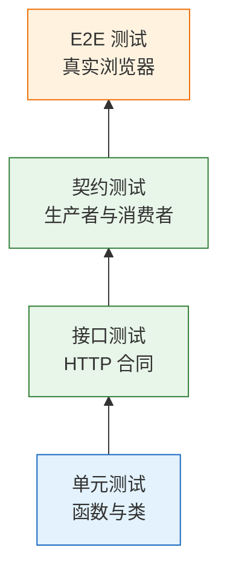
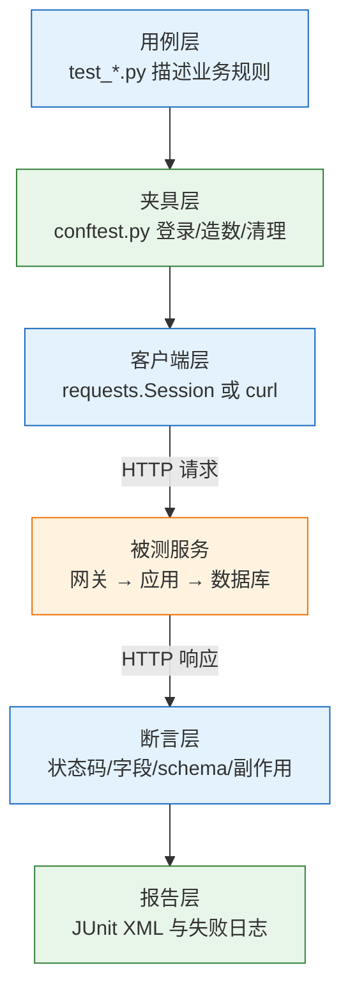
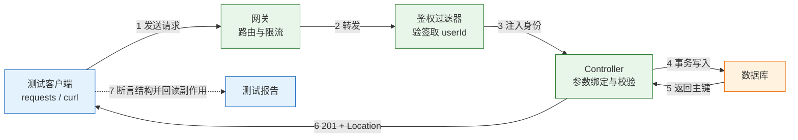

# 接口测试

---

## 一、接口测试是什么

接口测试是绕过界面、直接向服务端发送 HTTP 请求并断言响应的一类自动化测试。它把服务当作黑盒，只依赖对外暴露的路径、方法、请求头、请求体和状态码，不关心内部的类名、函数名与调用栈。

从质量保障的视角看，接口测试解决三个问题：

- **定位精度**：页面只报“没有跳转”，接口测试能指出是网关拦截、鉴权失败、参数校验、事务回滚还是序列化异常。
- **执行成本**：一次运行在秒级覆盖几十种参数组合，不依赖浏览器、分辨率、动画和网络抖动。
- **契约稳定**：接口是前后端之间、服务与服务之间的合同，合同一旦破坏，影响面横跨多个调用方。

它不解决的问题同样明确：页面布局、交互反馈、浏览器兼容、静态资源加载。这些分别由组件测试和 E2E 测试承担。

### 1.1 核心概念

- **被测系统（SUT）**：被验证的服务实例。测试只通过它的公开入口交互，不直接调用内部方法。
- **请求构造**：把路径、方法、请求头、查询参数、请求体组装成一次合法调用。构造能力决定用例能覆盖多少分支。
- **断言**：对响应的可验证结论，包括状态码、响应头、JSON 字段、结构 schema，以及数据库中的副作用。
- **夹具（fixture）**：用例运行前准备、运行后清理的可复用代码块。登录令牌、临时订单、测试账号都属于夹具。
- **契约**：接口对调用方的承诺，包含字段名、类型、可空性、枚举取值、错误码。契约变更需要通知所有调用方。
- **幂等**：同一请求重复提交产生同一结果。创建类接口靠幂等键实现，查询与删除天然幂等。
- **副作用**：一次调用在服务端留下的持久变化，例如写库、扣库存、发消息、记审计日志。响应正确不代表副作用正确。

区分“响应断言”和“副作用断言”是接口测试的分水岭。只校验 `201` 和 JSON 字段，等于只验了服务会说话，没验它真的办了事。



越往上层，单条用例越贵、失败信息越模糊、能覆盖的分支越少。接口测试位于中间，是投入产出比最高的一层。

### 1.2 与相邻技术的关系

| 层次 | 验证对象 | 典型工具 | 单次耗时 |
|---|---|---|---|
| 单元测试 | 函数、类、纯逻辑分支 | JUnit、pytest、Vitest | 毫秒级 |
| 接口测试 | HTTP 合同、权限、状态机 | pytest、requests、Postman | 百毫秒级 |
| 契约测试 | 生产者与消费者的字段约定 | Pact、Schemathesis | 秒级 |
| E2E 测试 | 真实浏览器中的完整链路 | Playwright、Cypress | 十秒级 |

四层不是替代关系。接口测试的真实度高于单元测试，因为它经过路由、参数绑定、序列化、鉴权、事务；稳定性高于 E2E，因为它不碰渲染和动画。它的失效边界也很清楚：前端把字段拼错、按钮绑错事件，接口测试全部看不见。

> **开发提示**：接口测试与接口文档是同一份知识的两面。文档描述“应该是什么”，测试验证“实际是什么”。两者不一致时，先确认哪一边过期，再改代码。

### 1.3 架构组成



五层的职责必须分离，否则维护成本会快速上升：

- **用例层**只写业务语义，例如“取消后不能再次取消”，不写 URL 拼接和重试逻辑。
- **夹具层**负责登录、造数、清理，是唯一允许出现账号密码的地方。
- **客户端层**统一超时、重试、请求头、日志，避免每条用例各自设置。
- **断言层**把常用断言封装成函数，例如 `assert_error(r, "VALIDATION_FAILED")`。
- **报告层**输出机器可读结果，供 CI 判断红绿并归档现场。

> **注意**：不要在用例里直接 `requests.get(...)`。裸调用没有统一超时，CI 上一条挂死的请求会拖满整个作业时长。

---

## 二、环境与工具准备

> **版本现状（2026）**：pytest 主版本为 8.x，requests 为 2.32.x，jsonschema 为 4.x，Python 建议 3.12 及以上。三者都是纯 Python 依赖，不涉及系统级编译。

### 2.1 运行环境与依赖

```bash
# ========== 创建隔离环境 ==========
# 独立虚拟环境，避免污染系统 Python 与其他项目的依赖
python3 -m venv .venv
source .venv/bin/activate

# ========== 安装测试依赖 ==========
# pytest 负责发现用例与生成报告，requests 负责 HTTP，jsonschema 负责结构校验
pip install "pytest>=8,<9" "requests>=2.32,<3" "jsonschema>=4,<5"

# ========== 固化依赖 ==========
# 导出到测试专用文件，CI 只装测试所需，不装应用运行依赖
pip freeze > requirements-test.txt

# ========== 验证环境 ==========
pytest --version
python -c "import requests, jsonschema; print(requests.__version__)"
```

| 依赖 | 作用 | 缺失后的表现 |
|---|---|---|
| pytest | 用例发现、夹具、参数化、报告 | 无法组织用例，只能写脚本 |
| requests | HTTP 客户端、连接池、Cookie | 需手工拼 socket，超时难统一 |
| jsonschema | 响应结构校验 | 只能逐字段手写断言 |
| pytest-rerunfailures | 失败重试（可选） | 偶发网络抖动直接判红 |

依赖版本用上下界锁定而不是 `latest`。上界防止主版本升级带来破坏性变更，下界保证 CI 与本地行为一致。

### 2.2 curl 与 Postman 调试

写用例之前，先用最小客户端把请求打通。curl 适合脚本化与 CI 冒烟，Postman 适合探索式调试与团队共享。

```bash
# ========== 登录并提取令牌 ==========
# jq -r 取原始字符串；密码从环境变量注入，不落命令历史
TOKEN=$(curl -sS -X POST "$API_BASE_URL/api/login" \
  -H 'Content-Type: application/json' \
  -d "{\"username\":\"alice\",\"password\":\"$TEST_PASSWORD\"}" \
  | jq -r '.accessToken')

# 令牌为空说明登录已失败，后续请求没有意义
test -n "$TOKEN" && echo "token ok"

# ========== 创建订单并查看完整响应 ==========
# -D 把响应头单独写入文件，-o 写响应体，-w 追加状态码与耗时
curl -sS -D /tmp/order.headers -o /tmp/order.json \
  -X POST "$API_BASE_URL/api/orders" \
  -H "Authorization: Bearer $TOKEN" \
  -H 'Content-Type: application/json' \
  -H "Idempotency-Key: $(uuidgen)" \
  -d '{"customerNo":"C-0001","amountCents":1999}' \
  -w 'status=%{http_code} time=%{time_total}s\n'

# 从响应头确认 Location 指向新资源
grep -i '^location' /tmp/order.headers

# 从响应体取出订单号，供后续步骤复用
ORDER_ID=$(jq -r '.id' /tmp/order.json)
jq '{id, status, amountCents}' /tmp/order.json

# ========== 复核副作用 ==========
# 用返回的 id 再读一次，确认数据真的落库而不是只回了 201
curl -sS "$API_BASE_URL/api/orders/$ORDER_ID" \
  -H "Authorization: Bearer $TOKEN" | jq '.status, .amountCents'

# ========== 越权验证 ==========
# 先取 bob 的令牌，再用它读 alice 的订单，期望 403 或 404
BOB_TOKEN=$(curl -sS -X POST "$API_BASE_URL/api/login" \
  -H 'Content-Type: application/json' \
  -d "{\"username\":\"bob\",\"password\":\"$TEST_PASSWORD\"}" \
  | jq -r '.accessToken')

curl -sS -o /dev/null -w '%{http_code}\n' \
  "$API_BASE_URL/api/orders/$ORDER_ID" \
  -H "Authorization: Bearer $BOB_TOKEN"
```

**curl 参数速查：**

| 参数 | 作用 | 常见误用 |
|---|---|---|
| `-X` | 指定方法 | 与 `-d` 同用属冗余，改写时易漏 |
| `-H` | 添加请求头 | 漏 `Content-Type` 导致按表单解析 |
| `-d` | 请求体 | 默认表单编码，JSON 必须配 `Content-Type` |
| `-D` | 响应头写入文件 | 与 `-i` 混淆，后者混进响应体 |
| `-o` | 响应体写入文件 | 与 `-O` 混淆，后者用远程文件名 |
| `-w` | 自定义输出 | 忘记转义 `%` 导致格式串报错 |

Postman 的价值在于把请求、环境、断言、文档放在同一个集合里。集合内的 `Tests` 脚本在响应返回后执行，适合做轻量断言和变量传递：

```js
// Postman 的 Tests 脚本：响应返回后执行
// 断言状态码，失败时该请求标记为不通过
pm.test('状态码为 201', () => pm.response.to.have.status(201));

// 断言响应头，正则匹配允许带 charset
pm.test('返回 JSON', () => pm.response.to.have.header('Content-Type', /application\/json/));

const body = pm.response.json();

// 断言业务字段，而不是整个 body 全等
pm.test('订单状态为 CREATED', () => pm.expect(body.status).to.eql('CREATED'));

// 把订单号写入集合变量，供后续请求用 {{orderId}} 引用
pm.collectionVariables.set('orderId', body.id);
```

集合在 CI 中执行用 newman，它是 Postman 集合的命令行运行器：

```bash
# ========== 安装并执行集合 ==========
# -e 指定环境文件，其中存放 baseUrl 与令牌
npx newman run api.postman_collection.json \
  -e api.postman_environment.json \
  --reporters cli,junit \
  --reporter-junit-export report.xml

# 失败即返回非零退出码，流水线据此判红
echo "exit=$?"
```

> **注意**：Postman 环境文件里若写了真实令牌，不能提交进仓库。导出前把敏感变量清空，或改用 `--env-var` 在流水线中注入。

### 2.3 测试工程结构

```text
tests/api/
  conftest.py            # 会话级夹具：客户端、登录令牌、造数与清理
  test_orders.py         # 订单主流程、边界、幂等
  test_permissions.py    # 越权矩阵
  schemas/order.json     # 响应契约，独立于用例维护
  data/seed.sql          # 大批量造数脚本，少量数据仍走接口
```

| 路径 | 职责 | 维护者 |
|---|---|---|
| `conftest.py` | 夹具与环境开关 | 测试负责人 |
| `test_*.py` | 业务断言 | 功能负责人 |
| `schemas/` | 契约文件 | 接口负责人 |
| `data/` | 造数与清理脚本 | 测试负责人 |

契约文件独立存放，是因为它被多个用例和多个服务共享。写死在用例里，字段一改就要改十几处。

---

## 三、接口契约的组成

### 3.1 状态码与响应头

状态码是最低成本的断言，也是最容易被敷衍的一项。全部返回 `200`、让前端读 body 里的 `code`，会让网关、监控、重试策略全部失效。

| 场景 | 状态码 | 关键响应头 |
|---|---|---|
| 创建成功 | `201` | `Location` 指向新资源 |
| 查询成功 | `200` | `Content-Type`、`ETag` |
| 删除成功 | `204` | 无响应体 |
| 参数不合法 | `400` | `Content-Type: application/json` |
| 未认证 | `401` | `WWW-Authenticate` |
| 已认证但无权 | `403` | 无 |
| 资源不存在 | `404` | 无 |
| 状态冲突 | `409` | 无 |
| 触发限流 | `429` | `Retry-After` |

`Location` 常被漏掉。创建成功后客户端要拿到新资源地址，靠拼接字符串既容易错，也会在路径改版时失效。断言写成 `created.headers["Location"].endswith(body["id"])`，既验证存在性，也验证指向正确。

### 3.2 响应体与错误结构

成功响应要断言字段名、类型、枚举取值；错误响应要断言稳定的机器码。两者都不能断言面向用户的文案。

```json
{
  "code": "VALIDATION_FAILED",
  "message": "请求参数不合法",
  "details": [{"field": "amountCents", "reason": "must be >= 1"}]
}
```

- `code` 是机器码，前端据此分支，测试据此断言，必须稳定。
- `message` 是给人看的，可以翻译、可以改文案，测试不应断言全文。
- `details` 定位到具体字段，前端才能把错误标在对应输入框上。

> **注意**：把异常堆栈直接序列化进响应，等于把表名、类名、依赖版本暴露给调用方。错误结构要有统一出口，未捕获异常一律转成 `500` 加通用文案。

### 3.3 鉴权、幂等与副作用



鉴权发生在 Controller 之前。只测“带正确令牌能通过”，等于跳过了最值钱的一段。认证方式的选择直接影响用例写法：

| 方式 | 请求中携带 | 适用场景 | 测试关注点 |
|---|---|---|---|
| Bearer | `Authorization: Bearer <token>` | 前后端分离、开放 API | 过期、刷新、令牌泄漏 |
| Cookie | `Cookie: session=...` | 同源 Web | CSRF、`SameSite`、域与路径 |
| API Key | `X-API-Key: ...` | 服务间调用 | 不要放 query，易进访问日志 |

Cookie 依赖 `requests.Session()` 自动保存 `Set-Cookie`，Bearer 需要每次显式携带。两种方式不要混用，否则 401 时无法判断是没登录还是没权限。

幂等要分两类看。查询与删除天然幂等，重复调用结果一致；创建类接口靠幂等键去重，同一个 `Idempotency-Key` 提交两次必须返回同一个资源。测试里固定幂等键会命中上一次运行留下的结果，造成假绿，每次都要生成新键。

副作用是最后一道验证。接口返回 `201` 之后，用另一个请求或直接查库确认：订单确实存在、库存确实扣减、消息确实入队。只信响应体，等于相信服务自己给自己打分。

---

## 四、用例设计

### 4.1 分层与优先级

接口测试不等于“把每个接口都点一遍”。优先级按故障代价排序，而不是按接口数量排序。

| 优先级 | 覆盖对象 | 深度要求 |
|---|---|---|
| P0 | 登录、下单、支付、退款、权限变更 | 成功、失败、幂等、副作用全测 |
| P1 | 查询、列表、状态流转 | 主要分支与边界值 |
| P2 | 字典、配置、只读元数据 | 状态码与结构即可 |
| P3 | 管理后台低频接口 | 冒烟一条 |

一条下单链路至少覆盖五类：正常创建、参数非法、未认证、越权、重复提交。只写“正常创建”是用例数量最多、发现问题最少的一种写法。

### 4.2 参数与边界

边界值不是随便挑几个数字，而是围绕校验规则的两侧取值：

- 金额为 `0`、负数、超过上限、带三位小数 → `400`，且 `details` 指出 `amountCents`。
- 缺 `customerNo` → `400`，而不是 `500`。空指针导致的 `500` 是最常见的接口缺陷。
- 字符串超长、含控制字符、含前后空格 → 按约定拒绝或裁剪，不能静默截断。
- 枚举字段传未定义值 → `400`，不能落库成脏数据。

参数化能把组合压进一张表，失败时也能直接看出是哪组输入：

```python
import pytest

# 每组：说明、请求体、期望状态码、期望错误码
INVALID_AMOUNTS = [
    ("金额为零", {"customerNo": "C-1", "amountCents": 0}, 400, "VALIDATION_FAILED"),
    ("金额为负", {"customerNo": "C-1", "amountCents": -1}, 400, "VALIDATION_FAILED"),
    ("超过上限", {"customerNo": "C-1", "amountCents": 10**9}, 400, "VALIDATION_FAILED"),
    ("缺少客户号", {"amountCents": 100}, 400, "VALIDATION_FAILED"),
]


@pytest.mark.parametrize("case,payload,status,code", INVALID_AMOUNTS,
                         ids=[c[0] for c in INVALID_AMOUNTS])
def test_create_rejects_invalid_payload(client, token, case, payload, status, code):
    r = client.post(f"{BASE}/api/orders", json=payload,
                    headers={"Authorization": f"Bearer {token}"}, timeout=5)
    # 断言状态码与机器码，不断言提示文案
    assert r.status_code == status, f"{case}: {r.text}"
    assert r.json()["code"] == code
```

`ids` 让报告直接显示中文场景名，而不是 `payload0`。排查时省下的时间远大于写这一行的成本。

### 4.3 权限与状态机

权限用例要用矩阵思维，而不是零散补几条。每一行是一个“身份 × 资源归属 × 操作”的组合：

| 身份 | 自己的资源 | 他人的资源 | 不存在的资源 |
|---|---|---|---|
| 匿名 | `401` | `401` | `401` |
| 普通用户 | `200` | `403` 或 `404` | `404` |
| 管理员 | `200` | `200` | `404` |

返回 `404` 比 `403` 更安全，它不暴露“这个 id 存在”。测试要按约定断言其中之一，不能写成 `in (200, 403, 404)` 这种什么都接受的条件。

状态机用例的核心是“非法迁移必须被拒绝”。已取消的订单不能再次支付，已发货的订单不能取消，退款中的订单不能重复退款。每一条都要断言状态码、错误码，以及状态没有被意外改写。

### 4.4 列表与分页

列表接口比详情更容易漏，因为它同时涉及过滤、排序、分页和总数。

- 每页条数不超过 `pageSize`。
- 按约定字段排序，顺序稳定。
- 翻页不重复、不丢项。
- 空结果返回 `200` 加空数组，而不是 `404`。
- `total` 与当前过滤条件一致，不是全表条数。

排序不稳定是翻页丢项的根因。数据库没有唯一键兜底时，相同创建时间的记录在两次查询中顺序可能不同，第二页就会重复或跳过。测试用“翻两页取并集去重”能直接暴露这个问题。

---

## 五、完整示例：订单接口测试

### 5.1 夹具与登录态

```python
# tests/api/conftest.py
import os
import uuid

import pytest
import requests

# 地址只从环境变量读取，缺省值仅供本地开发
BASE = os.environ.get("API_BASE_URL", "http://127.0.0.1:8080")


@pytest.fixture(scope="session")
def client():
    # 整个会话复用一个 Session：连接复用、Cookie 自动保存
    s = requests.Session()
    s.headers["Content-Type"] = "application/json"

    # 记录最近一次响应，供 7.2 的失败报告钩子取证
    def _record(resp, *args, **kwargs):
        s.last_response = resp
        return resp

    s.hooks["response"].append(_record)
    yield s
    s.close()


def _login(client, username):
    # 登录辅助：密码统一从环境变量注入，仓库里不存明文
    r = client.post(f"{BASE}/api/login",
                    json={"username": username,
                          "password": os.environ["TEST_PASSWORD"]},
                    timeout=5)
    # 登录失败直接中断，避免后续用例全红却看不出根因
    r.raise_for_status()
    return r.json()["accessToken"]


@pytest.fixture(scope="session")
def token(client):
    # 属主账号：只用于创建和读取自己的资源
    return _login(client, "alice")


@pytest.fixture(scope="session")
def bob_token(client):
    # 越权用例专用账号：与属主账号分离，避免权限互相污染
    return _login(client, "bob")


@pytest.fixture
def headers(token):
    # 属主请求头：绝大多数用例直接注入这个夹具
    return {"Authorization": f"Bearer {token}"}


@pytest.fixture
def bob_headers(bob_token):
    # 越权用例专用请求头，与属主身份严格分离
    return {"Authorization": f"Bearer {bob_token}"}


@pytest.fixture
def order_payload():
    # 每次生成新客户号，避免撞唯一索引
    return {"customerNo": f"C-{uuid.uuid4().hex[:8]}", "amountCents": 1999}


@pytest.fixture
def created_order(client, headers, order_payload):
    # 用接口造前置数据，顺带验证创建接口本身
    r = client.post(f"{BASE}/api/orders", json=order_payload,
                    headers=headers, timeout=5)
    assert r.status_code == 201, r.text
    order_id = r.json()["id"]
    # yield 之后的清理即使断言失败也会执行
    yield order_id
    client.delete(f"{BASE}/api/orders/{order_id}", headers=headers, timeout=5)
```

登录夹具用 `scope="session"`，因为登录一次就够。但账号必须按角色分开：属主账号、越权账号、管理员账号各一个，越权用例不能复用属主账号，否则测出来的是“自己访问自己”。

### 5.2 主流程用例

```python
# tests/api/test_orders.py
import os
import uuid

import pytest

BASE = os.environ.get("API_BASE_URL", "http://127.0.0.1:8080")


def test_create_then_get(client, headers, order_payload):
    # 创建：断言状态码、响应头、业务字段、资源地址
    created = client.post(f"{BASE}/api/orders", json=order_payload,
                          headers=headers, timeout=5)

    assert created.status_code == 201
    assert created.headers["Content-Type"].startswith("application/json")
    body = created.json()
    assert body["status"] == "CREATED"
    assert body["amountCents"] == 1999
    # Location 必须指向刚创建的资源，而不是固定路径
    assert created.headers["Location"].endswith(body["id"])

    # 回读：确认写入成功，而不是只返回了内存对象
    got = client.get(f"{BASE}/api/orders/{body['id']}",
                     headers=headers, timeout=5)
    assert got.status_code == 200
    assert got.json()["id"] == body["id"]
```

```bash
# ========== 执行 ==========
# 依赖：pip install "pytest>=8,<9" "requests>=2.32,<3" "jsonschema>=4,<5"
# -q 只输出汇总；失败时 pytest 仍打印完整断言详情
pytest -q tests/api

# ========== 只看某条用例 ==========
# -k 按名称匹配，-vv 展开每条断言
pytest -vv tests/api/test_orders.py -k create_then_get
```

预期输出类似：

```text
1 passed in 0.42s
```

三条关键习惯已经建立：地址从环境变量来、请求带超时、断言具体字段而不是“非空”。

### 5.3 副作用与契约校验

响应正确只是第一层。副作用要用独立请求验证，契约要用 schema 固化。

```python
from jsonschema import validate

# 契约只约束稳定字段：必填、类型、枚举、取值范围
ORDER_SCHEMA = {
    "type": "object",
    "required": ["id", "status", "amountCents", "createdAt"],
    "properties": {
        "id": {"type": "string"},
        "status": {"enum": ["CREATED", "PAID", "CANCELED"]},
        "amountCents": {"type": "integer", "minimum": 1},
        "createdAt": {"type": "string", "format": "date-time"},
    },
    # 加字段不算破坏契约，删字段、改类型才算
    "additionalProperties": True,
}


def test_order_response_matches_contract(client, headers, created_order):
    body = client.get(f"{BASE}/api/orders/{created_order}",
                      headers=headers, timeout=5).json()
    # schema 校验失败会抛出 ValidationError，pytest 直接判红
    validate(instance=body, schema=ORDER_SCHEMA)


def test_cancel_writes_side_effect(client, headers, created_order):
    url = f"{BASE}/api/orders/{created_order}/cancel"
    r = client.post(url, headers=headers, timeout=5)
    assert r.status_code == 200

    # 用列表接口反查，确认状态真的落库而不是只改在缓存里
    listed = client.get(f"{BASE}/api/orders?status=CANCELED&size=50",
                        headers=headers, timeout=5).json()
    assert created_order in [o["id"] for o in listed["items"]]
```

| 断言类型 | 具体内容 | 失败意味着 |
|---|---|---|
| 状态码 | `201`、`400`、`403` | 路由或异常处理错 |
| 响应头 | `Content-Type`、`Location` | 客户端无法定位资源 |
| 业务字段 | 状态、金额、枚举 | 逻辑或序列化错 |
| 结构 schema | 必填、类型、范围 | 契约被破坏 |
| 副作用 | 回读、库存、消息 | 事务未提交或写错表 |

> **注意**：`additionalProperties: True` 是有意为之。写成 `False` 后，后端每加一个字段都会让所有用例变红，团队很快就会把这条断言删掉。

### 5.4 幂等与越权用例

```python
def test_cancel_is_idempotent(client, headers, created_order):
    url = f"{BASE}/api/orders/{created_order}/cancel"

    # 连续两次调用，第二次必须返回与第一次一致的结果
    first = client.post(url, headers=headers, timeout=5)
    second = client.post(url, headers=headers, timeout=5)

    assert first.status_code == 200
    assert second.status_code == first.status_code
    assert second.json()["status"] == "CANCELED"


def test_create_with_same_idempotency_key(client, headers, order_payload):
    # 复制一份再追加幂等键，避免改动被其他夹具共享的字典
    idem_headers = dict(headers)
    # 每次用新键；固定键会命中上次运行留下的结果，造成假绿
    idem_headers["Idempotency-Key"] = uuid.uuid4().hex

    a = client.post(f"{BASE}/api/orders", json=order_payload,
                    headers=idem_headers, timeout=5)
    b = client.post(f"{BASE}/api/orders", json=order_payload,
                    headers=idem_headers, timeout=5)

    # 同一个幂等键只产生一条记录，而不是两条
    assert a.status_code == 201
    assert a.json()["id"] == b.json()["id"]


def test_other_user_cannot_read(client, bob_headers, created_order):
    r = client.get(f"{BASE}/api/orders/{created_order}",
                   headers=bob_headers, timeout=5)
    # 403 与 404 都是可接受约定，但必须在契约里选定一种
    assert r.status_code in (403, 404)
    # 错误响应不能泄漏属主信息
    assert "alice" not in r.text
```

只发一次请求测不出“先查后插”的竞态。关键写接口连发两次，是成本最低的并发探测手段。

---

## 六、测试数据与环境隔离

接口测试最常见的“偶发红”不是接口坏了，是数据坏了。

### 6.1 数据唯一性

| 问题 | 做法 |
|---|---|
| 固定客户号撞唯一索引 | 每次用 UUID 或时间戳后缀 |
| 用例 A 创建的 id 给 B 用 | 每个用例自己创建，夹具返回 id |
| 测试互相依赖执行顺序 | 默认乱序也能过；需要顺序就说明设计有问题 |
| 跑完留一堆垃圾数据 | 夹具 `yield` 后调删除接口或清理脚本 |

唯一后缀要带业务前缀，例如 `C-<uuid8>`，既保证唯一，也便于在库里按前缀批量清理。

### 6.2 清理与夹具生命周期

清理必须放在 `yield` 之后，不能写在用例最后一行。中间任何一条断言失败，用例函数就提前退出，末尾的清理代码不会执行。

```python
@pytest.fixture
def created_order(client, headers, order_payload):
    r = client.post(f"{BASE}/api/orders", json=order_payload,
                    headers=headers, timeout=5)
    order_id = r.json()["id"]
    # yield 之前是准备，yield 之后是清理，二者都会执行
    yield order_id
    # 清理失败不应掩盖用例本身的失败，所以只记录不抛出
    client.delete(f"{BASE}/api/orders/{order_id}",
                  headers=headers, timeout=5)
```

> **安全警告**：清理脚本只能删除带测试前缀的数据，绝不能执行 `DELETE FROM orders` 或 `TRUNCATE`。测试库与开发库、预发库必须物理隔离，清理语句上线前要由第二人复核。

数据量小时优先走接口造数，顺带验证创建接口；只有需要几百条分页数据时才用 SQL 批量插入，否则 setup 会比测试本身还慢。

时间不要写死。“创建时间在最近一分钟内”比等于某个固定字符串稳；跨时区运行时统一用 UTC，展示层再转本地时区。

### 6.3 环境标识校验

| 检查项 | 做法 | 目的 |
|---|---|---|
| 地址来源 | 只读 `API_BASE_URL`，无硬编码 | 防止误打生产 |
| 环境标识 | 启动时请求 `/api/meta` 比对 `env` 字段 | 确认打的是测试环境 |
| 数据库名 | 断言库名含 `_test` 后缀 | 防止连到共享库 |
| 账号来源 | 环境变量注入，仓库只留 `.env.example` | 防止凭据泄漏 |

```python
@pytest.fixture(scope="session", autouse=True)
def guard_environment(client):
    # 会话开始前校验一次环境标识，打错环境直接终止整轮
    meta = client.get(f"{BASE}/api/meta", timeout=5).json()
    assert meta["env"] in ("test", "staging"), f"拒绝在 {meta['env']} 上执行"
```

这条守卫的价值在于“失败得早”。等跑完两百条用例才发现打的是预发共享库，清理和回滚的成本要高得多。

---

## 七、CI 集成

### 7.1 流水线结构

接口测试在流水线里通常位于“构建之后、E2E 之前”。它比 E2E 快，能在合并前给出第一道业务信号。

| 阶段 | 内容 | 失败处理 |
|---|---|---|
| 准备 | 起测试库、装依赖、启动服务 | 直接失败，不重试 |
| 等待就绪 | 轮询健康检查，带超时 | 超时打印服务日志 |
| 执行 | 按标记分组跑用例 | 记录 JUnit 报告 |
| 归档 | 上传报告与失败请求日志 | `if: always()` |

```yaml
# .github/workflows/api-test.yml
name: api-test
on:
  pull_request:
  push:
    branches: [main]

jobs:
  api:
    runs-on: ubuntu-latest
    # 作业级超时，防止挂死的请求拖满 runner 时长
    timeout-minutes: 15
    services:
      # 用容器起独立测试库，避免打到共享环境
      postgres:
        image: postgres:16-alpine
        env:
          POSTGRES_PASSWORD: test
          POSTGRES_DB: app_test
        ports: ['5432:5432']
        options: >-
          --health-cmd "pg_isready -U postgres"
          --health-interval 5s
          --health-timeout 3s
          --health-retries 10
    steps:
      - uses: actions/checkout@v4

      - uses: actions/setup-python@v5
        with:
          python-version: '3.12'
          cache: pip

      - run: pip install -r requirements-test.txt

      - name: 启动被测服务
        run: nohup java -jar app.jar --spring.profiles.active=test &

      - name: 轮询健康检查
        run: |
          # 最多等 120 秒，成功即退出，失败打印日志
          for i in $(seq 1 60); do
            curl -fsS http://127.0.0.1:8080/actuator/health && exit 0
            sleep 2
          done
          echo "服务未就绪" && exit 1

      - name: 执行接口测试
        env:
          API_BASE_URL: http://127.0.0.1:8080
          TEST_PASSWORD: ${{ secrets.TEST_PASSWORD }}
        run: pytest -q tests/api --junitxml=report.xml

      - uses: actions/upload-artifact@v4
        if: always()
        with:
          name: api-report
          path: report.xml
```

### 7.2 报告与失败取证

流水线只给一行 `AssertionError` 是没法修的。失败时至少要留下三样东西：完整请求、完整响应、服务端日志。

```python
# conftest.py：失败时打印请求与响应，便于在 CI 日志里直接定位
@pytest.hookimpl(hookwrapper=True)
def pytest_runtest_makereport(item, call):
    outcome = yield
    report = outcome.get_result()
    if report.failed:
        # 5.1 的 client 夹具把最近一次响应挂在会话对象上
        resp = getattr(item.funcargs.get("client"), "last_response", None)
        if resp is not None:
            print(f"\n请求: {resp.request.method} {resp.request.url}")
            print(f"状态: {resp.status_code}")
            print(f"响应: {resp.text[:2000]}")
```

请求日志要把 `Authorization` 头脱敏后再打印。原样输出等于把令牌写进 CI 日志，任何有读权限的人都能复用。

### 7.3 分片、重试与调度

| 策略 | 适用 | 风险 |
|---|---|---|
| 全量串行 | 用例少于 200 条 | 时长随规模线性增长 |
| 按文件分片 | 用例之间独立 | 单文件内的用例仍串行 |
| 失败重试 2 次 | 网络抖动、第三方超时 | 掩盖真实竞态 |
| 夜间全量 | 回归与慢用例 | 反馈滞后 |

```bash
# ========== 分片执行 ==========
# 需 pytest-split 插件；四台机器各跑四分之一，用例必须彼此独立
pytest -q tests/api --splits 4 --group 1

# ========== 失败重试 ==========
# 需 pytest-rerunfailures 插件；仅用于已知的网络抖动，次数不超过 2
pytest -q tests/api --reruns 2 --reruns-delay 1

# ========== 只跑冒烟集 ==========
# 用标记区分 P0 与全量，PR 阶段只跑 P0
pytest -q tests/api -m "p0"
```

重试是止痛药，不是治疗。一条用例连续三次靠重试变绿，说明它依赖了不该依赖的东西：共享数据、不稳定时钟、未就绪的下游。先定位，再决定是否保留重试。

> **运维提示**：把 `--reruns` 与 `--reruns-delay` 写在 CI 配置里而不是 `pytest.ini`，本地调试时保持“一次失败就是失败”，避免开发阶段也养成看绿灯不看原因的习惯。

---

## 八、契约测试的定位

接口测试验证“调用之后返回什么”，契约测试验证“生产者和消费者对字段的理解一致”。两者解决的问题不同。

### 8.1 OpenAPI 校验

后端对外提供 API 时，通常已经维护了一份 OpenAPI 文档。把文档接进测试，可以让“文档与实现不一致”在合并前暴露。

| 方式 | 做法 | 适用 |
|---|---|---|
| 响应校验 | 用文档里的 schema 校验实际响应 | 单服务、文档较新 |
| 请求校验 | 校验测试发出的请求符合文档 | 防止测试用了未定义参数 |
| 属性测试 | 由工具按 schema 自动生成请求 | 发现未覆盖的边界 |

工具选型上，`jsonschema` 适合手工挑关键接口做定点校验，成本低、可控；基于 OpenAPI 的自动生成工具覆盖广，但需要文档质量足够高，否则会产出大量噪声。

### 8.2 消费者驱动契约

| 维度 | 提供者驱动 | 消费者驱动 |
|---|---|---|
| 契约来源 | 生产者写文档 | 消费者声明需求 |
| 变更发现 | 生产者改完再通知 | 合并前即可验证 |
| 适用规模 | 单团队、少量消费者 | 多团队、微服务 |
| 维护成本 | 低 | 高，需要契约仓库 |

消费者驱动契约的流程是：消费者写出自己实际用到的字段与交互，生成契约文件；生产者拉取契约并回放验证；任一方破坏约定，流水线在合并前变红。

不必一开始就上契约平台。先把关键接口的 schema 固化进测试，字段破坏性变更能在合并前被拦住，已经解决了大部分问题。契约测试替代不了接口测试：它保证字段兼容，不保证权限、状态机、幂等和副作用。

---

## 九、常见排障

### 9.1 故障表

| 现象 | 最可能原因 | 处理 |
|---|---|---|
| 返回 200 就判通过 | 没断言业务码和字段 | 断言状态码 + 关键字段 + 结构 |
| 加个字段测试就红 | 整个 body 全等比较 | 只断言契约字段，允许新增 |
| 本地过，CI 上 401 | 令牌写死、过期，或账号不同 | 会话级登录夹具，凭据从环境变量注入 |
| 流水线偶尔卡死 | 请求没有超时 | 每个请求设 `timeout`，作业设超时 |
| 固定业务字段撞唯一索引 | 用例共享同一份数据 | 唯一后缀，用例自造数据 |
| 单独跑过，一起跑挂 | 模块级变量传 id、依赖顺序 | 每个用例独立准备与清理 |
| 本地能通，CI 不通 | 地址硬编码 `localhost` | 用 `API_BASE_URL`，容器内用服务名 |
| 越权用例永远 404 | 用了不存在的 id | 先用属主账号创建真实资源 |
| CI 里 `sleep 10` 等应用 | 启动时间不稳定 | 轮询健康检查，带超时与失败日志 |
| 测完发现打的是共享库 | 环境未隔离 | 独立测试库；启动时校验环境标识 |
| Cookie 用例一直 401 | Session 没保存 Cookie，或 `SameSite` 拦截 | 复用同一个 `Session`，打印实际请求头 |
| 改了错误文案测试就红 | 断言了面向用户的 `message` | 断言稳定的 `code` 与字段名 |
| 只跑一次就认为稳定 | 没覆盖重复提交与并发 | 关键写接口连发两次，或补并发用例 |
| 响应体中文乱码 | 未按 `charset` 解码 | 用 `r.json()` 或显式指定编码 |

大多数“接口偶发失败”最后都能归到三件事：数据不唯一、等待不充分、环境不固定。先排这三项，比读框架源码快。

### 9.2 排查顺序

1. `curl -i` 重放一次，确认服务端原始响应，排除客户端库干扰。
2. 核对请求头：`Authorization`、`Content-Type`、幂等键是否带对。
3. 读响应体的错误码与 `details`，不要只看状态码。
4. 查应用日志与数据库，确认事务是否提交、副作用是否发生。
5. 检查环境：地址、账号、库名是否指向预期目标。
6. 最后才怀疑测试框架或 HTTP 客户端库。

把顺序固定下来，能避免“一上来就改测试代码”的惯性。多数红灯在第一步和第四步之间就能定位。
