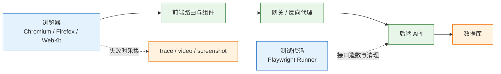
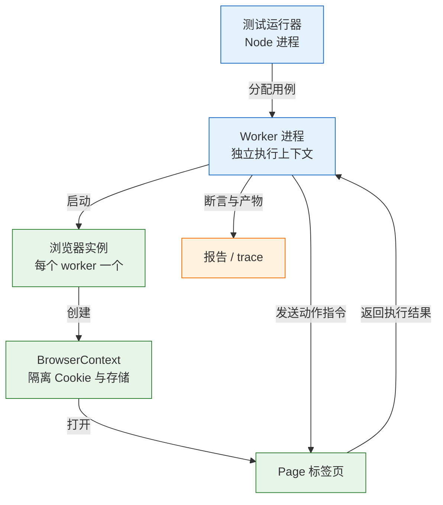
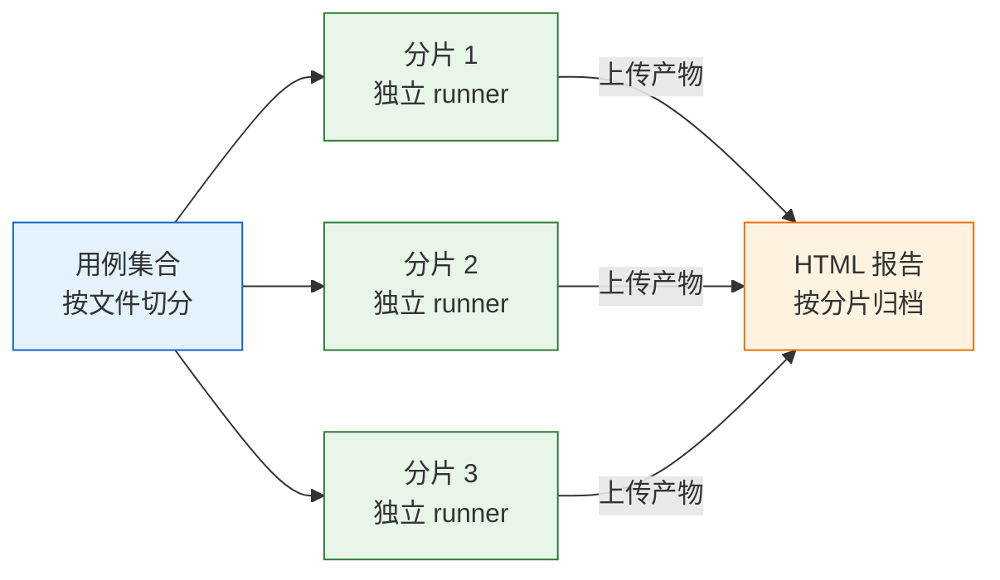

# E2E 测试

---

## 一、E2E 测试是什么

端到端测试（End-to-End Testing，简称 E2E）从真实用户入口出发，经过前端路由、网关、后端接口、数据库，再回到界面，验证整条链路是否仍然走得通。它不模拟内部调用，而是像用户一样点击、输入、等待、观察。

E2E 只回答一个问题：真实用户从浏览器进来，关键路径还能不能走通。它不负责穷举分支，而是用最贵的测试守住最不能坏的几条路。

### 1.1 核心概念

- **浏览器上下文（BrowserContext）**：一个隔离的会话，拥有独立的 Cookie、localStorage、缓存。同一浏览器进程可以开多个上下文，互不干扰。
- **页面（Page）**：上下文中的一个标签页。绝大多数操作都发生在页面上。
- **定位器（Locator）**：对“如何找到一个元素”的惰性描述，在真正执行动作时才解析。它不是元素句柄，页面重渲染后依然有效。
- **自动等待（Auto-waiting）**：动作执行前，框架自动检查元素是否存在、可见、稳定、可用、能接收事件，全部满足才动手。
- **存储状态（storageState）**：把 Cookie 与 localStorage 序列化成 JSON，供其他用例复用登录态。
- **追踪文件（trace）**：一次执行的完整录像，包含每步操作、DOM 快照、网络请求与控制台输出。

理解“定位器是惰性的”是写好 E2E 的前提。拿到元素引用再操作，页面一刷新引用就失效；描述查找规则再操作，框架每次都会重新解析。

E2E 的独特价值来自“真实”二字：真实的浏览器渲染、真实的网络往返、真实的部署产物。前端构建配置、网关重写、CDN 缓存、跨域策略这些只在联调环境才暴露的问题，都能在合并前被它拦住。代价是它同时继承了这些环节的全部波动，因此每一条用例都必须能解释清楚“它守的是哪一段衔接”。

### 1.2 与相邻技术的关系

| 层次 | 验证对象 | 典型工具 | 单次耗时 |
|---|---|---|---|
| 单元测试 | 函数与组件逻辑 | Vitest、Jest | 毫秒级 |
| 组件测试 | 单个组件的渲染与交互 | Testing Library | 百毫秒级 |
| 接口测试 | HTTP 合同、权限、状态机 | pytest、Postman | 百毫秒级 |
| E2E 测试 | 浏览器中的完整链路 | Playwright、Cypress | 十秒级 |

E2E 的不可替代性在于“跨层衔接”：前端发出的字段后端能不能收、登录态能不能带上、部署后静态资源能不能加载、网关重写规则有没有生效。这些在单元层和接口层都看不见。

它的代价同样明显：起浏览器、加载前端、登录、点页面、等接口、查数据库，一条用例比接口测试慢两个数量级。失败原因可能是产品缺陷，也可能是动画没结束、选择器改名、CI 缺字体、网络慢了一秒。

### 1.3 架构组成



四段职责要分清：

- **测试代码**负责驱动与断言，同时用接口准备数据，避免用界面造前置条件。
- **浏览器**负责渲染与交互，是唯一接近真实用户的环节。
- **被测系统**包含前端、网关、后端、数据库，任何一段坏了都会让用例变红。
- **取证产物**只在失败时产生，用于事后还原现场，不参与断言。

> **注意**：E2E 框架驱动的是真实浏览器，不是无头 DOM 模拟器。样式、布局、滚动、遮挡都会真实发生，这既是它的价值，也是它不稳定的来源。

---

## 二、环境与工具准备

> **版本现状（2026）**：Playwright 为 1.x 系列，安装命令自动取当前稳定版；Node.js 建议 20 及以上，CI 常用 22 或 24。浏览器二进制与系统依赖由 `playwright install` 单独管理，不随 npm 包下载。

### 2.1 Node 与 Playwright 安装

```bash
# ========== 初始化工程 ==========
# 已有前端工程时跳过 init，直接安装依赖即可
npm init playwright@latest

# 交互过程会询问：语言 TypeScript/JavaScript、测试目录、是否加 GitHub Actions
# 选择 TypeScript 与 e2e 目录，CI 配置可后续手写

# ========== 仅安装运行库（接入已有工程） ==========
npm install -D @playwright/test

# ========== 安装浏览器与系统依赖 ==========
# --with-deps 会一并安装字体、音频库等系统包，CI 上必须带
npx playwright install --with-deps chromium

# ========== 验证安装 ==========
npx playwright --version
npx playwright test --list
```

`--with-deps` 在 Linux 上会调用系统包管理器安装依赖。CI 镜像通常缺少中文字体与图形库，不带这个参数会在启动浏览器时直接失败，报错信息还与应用无关，很容易误判。

| 组件 | 作用 | 常见缺失表现 |
|---|---|---|
| `@playwright/test` | 测试运行器与断言库 | 命令不存在 |
| 浏览器二进制 | Chromium/Firefox/WebKit | 启动即报找不到可执行文件 |
| 系统依赖 | 字体、图形库、音频库 | 启动崩溃或中文显示为方块 |
| Node.js | 运行测试进程 | 版本过低导致语法不支持 |

### 2.2 配置文件

```ts
// playwright.config.ts
import { defineConfig, devices } from '@playwright/test';

export default defineConfig({
  // 用例目录，与单元测试目录分开，避免误收集
  testDir: './e2e',

  // CI 上失败重试两次；本地不重试，逼着开发者看真实原因
  retries: process.env.CI ? 2 : 0,

  // 单个用例超时，超过即判定卡死
  timeout: 30_000,

  // 断言超时，短于用例超时，便于快速失败
  expect: { timeout: 5_000 },

  use: {
    // 相对路径都以此为基准，用例里不写完整域名
    baseURL: 'http://127.0.0.1:5173',

    // 首次重试时录制 trace，平衡开销与取证需求
    trace: 'on-first-retry',
    video: 'retain-on-failure',
    screenshot: 'only-on-failure',

    // 固定语言与时区，消除环境差异导致的文本断言失败
    locale: 'zh-CN',
    timezoneId: 'Asia/Shanghai',
  },

  projects: [
    // setup 项目只跑登录脚本，产出 storageState
    { name: 'setup', testMatch: /auth\.setup\.ts/ },
    {
      name: 'chromium',
      testIgnore: /auth\.setup\.ts/,
      use: {
        ...devices['Desktop Chrome'],
        storageState: 'playwright/.auth/user.json',
      },
      // 业务用例依赖 setup 完成，保证登录态文件已生成
      dependencies: ['setup'],
    },
  ],

  webServer: {
    // 跑测试前自动起前端，退出时自动关停
    command: 'npm run dev',
    url: 'http://127.0.0.1:5173',
    // 本地复用已开的 dev server；CI 始终新起，避免测到旧进程
    reuseExistingServer: !process.env.CI,
    timeout: 120_000,
  },
});
```

**关键配置项：**

| 配置 | 作用 | 取值建议 |
|---|---|---|
| `retries` | 失败重试次数 | CI 为 2，本地为 0 |
| `trace` | 追踪录制时机 | `on-first-retry`，兼顾开销 |
| `storageState` | 复用登录态 | 指向 setup 产出的文件 |
| `webServer` | 自动起停被测应用 | CI 不复用已有进程 |

### 2.3 工程目录结构

```text
e2e/
  auth.setup.ts          # 登录一次，写出 storageState
  tasks.spec.ts          # 业务用例
  fixtures.ts            # 自定义夹具：造数、清理、登录角色
playwright.config.ts     # 运行配置
playwright/.auth/        # 登录态文件，必须加入 .gitignore
test-results/            # 失败产物，默认已被忽略
playwright-report/       # HTML 报告，CI 归档
```

`playwright/.auth/` 里存的是可复用的会话令牌，等同于账号密码。提交进仓库等于把测试账号公开，必须在 `.gitignore` 中忽略：

```bash
# .gitignore
# 登录态文件含令牌，禁止入库
playwright/.auth/
# 运行产物
test-results/
playwright-report/
```

> **安全警告**：`storageState` 文件里的 Cookie 可以直接冒用身份。共享 CI 产物前先确认归档范围不包含该目录，日志中也不要打印其内容。

---

## 三、浏览器自动化原理

### 3.1 驱动协议与执行流程



执行模型有三层隔离，直接影响用例写法：

- **进程隔离**：默认按 CPU 核心数的一半起 worker，worker 之间不共享内存。模块级变量在并行时各有一份，不能用来传递数据。
- **上下文隔离**：每个用例默认新建一个 `BrowserContext`，Cookie 与 localStorage 从零开始。这解释了为什么“上一条用例登录过”对下一条无效。
- **页面隔离**：一个上下文可开多个页面，它们共享 Cookie。多标签场景要用 `context.newPage()`，而不是新开浏览器。

> **注意**：`test.describe.serial()` 只保证同一文件内的用例顺序执行，不保证跨文件。依赖顺序本身就是设计缺陷，正确做法是每条用例自己准备状态。

并行度由 `workers` 控制，默认取 CPU 核心数的一半左右。同一文件内的用例默认按顺序执行，只有开启 `fullyParallel` 才会拆到不同 worker。开启前先确认用例之间没有共享可变数据，否则会把原本偶发的冲突变成稳定复现的互相干扰。

### 3.2 自动等待与可操作性检查

点击不是“发一个鼠标事件”这么简单。框架在执行动作前会依次检查五个条件，任一不满足就轮询重试，直到超时：

| 检查项 | 含义 | 不满足的典型场景 |
|---|---|---|
| Attached | 元素已挂载到 DOM | 接口未返回，列表还是骨架屏 |
| Visible | 有非空尺寸且非 `visibility:hidden` | 折叠面板未展开 |
| Stable | 连续两帧位置不变 | 入场动画进行中 |
| Enabled | 未设置 `disabled` | 表单校验未通过 |
| Receives Events | 命中测试指向该元素 | 被弹窗或遮罩挡住 |

这五项检查解释了绝大多数“明明元素在，就是点不到”：元素在 DOM 里但被遮罩挡住，或者动画还在位移。框架会等到条件满足，不需要手写 `sleep`。

超时报错也要按这五项拆开读。提示“元素不可见”说明渲染或折叠状态不对，提示“元素未稳定”通常是动画或布局抖动，提示“被其他元素接收事件”则是遮罩或定位问题。三种原因的修法完全不同，笼统地加超时只会让问题更晚暴露。

### 3.3 定位器解析

定位器是惰性的。`page.getByRole('button', { name: '保存' })` 只是记录了查找规则，真正解析发生在 `click()`、`fill()`、`expect()` 调用时。每次解析都会重新查询 DOM，所以页面重渲染不会让定位器失效。

解析默认是严格模式：匹配到多个元素时直接报错，而不是默默取第一个。这条规则逼着定位器写得更精确，也避免了“改版后点到错误按钮”的隐性故障。

```ts
// 严格模式下会报错：页面上有两个“删除”按钮
await page.getByRole('button', { name: '删除' }).click();

// 先收敛到目标行，再在行内查找，作用域明确
const row = page.getByRole('listitem').filter({ hasText: title });
await row.getByRole('button', { name: '删除' }).click();
```

严格模式报错是好事，它说明定位规则不够精确。加 `.first()` 或 `.nth(0)` 能让报错消失，但也会把“匹配到多个”这个真实问题藏起来：列表排序一变，点到的就是另一行。优先用 `filter` 缩小作用域，确实无法区分时再用测试 ID。

---

## 四、用例设计

### 4.1 关键路径选取

E2E 的数量由失败代价决定，不由页面数量决定。一个中等业务系统保留 5–15 条就够，超过这个数通常说明该下沉的没下沉。

| 场景 | 用 E2E | 更合适的选择 |
|---|---|---|
| 登录后能否看到工作台 | 是 | — |
| 下单全流程（选品→支付→详情） | 是 | — |
| 金额满减的 12 种组合 | 否 | 单元参数化 |
| 未登录访问详情是否跳登录 | 是（一条） | 接口测 401 加路由测试 |
| 表单必填项提示文案 | 否 | 组件测试 |
| 第三方支付回调 | 否 | 接口测试加挡板 |

选取顺序建议按事故代价排：登录与鉴权、核心交易、资金与库存、权限边界、数据删除。每一类留一条主路径，其余按最近三个月的线上事故补。

### 4.2 用例拆分粒度

一条用例只验证一个用户目标。把“创建→编辑→删除”塞进一条，失败时不知道断在哪一步，也没法单独重跑。

| 写法 | 优点 | 缺点 |
|---|---|---|
| 一条用例走完整流程 | 用例数少 | 失败点模糊，无法单跑 |
| 每条用例一个目标 | 定位精确，可单独重跑 | 需要接口造前置数据 |
| 每条用例自带清理 | 可并行、可乱序 | 代码量略多 |

拆开之后，前置状态用接口造，E2E 只走要验证的那一段。这样既保留了界面验证的真实性，又避免了用界面重复造十条数据。

### 4.3 覆盖链路与断言对象

E2E 断言的是用户可见结果：URL、可见文本、列表里的那一行、按钮状态。不要断言 DOM 结构、CSS 类名、接口返回的每个字段，那些是实现细节。

断言最好落在“用户下一步要做什么”上：列表里出现那一行、按钮变成“已取消”、跳转到详情页。这样的断言在重构后仍然成立。

反面写法是把断言压在实现细节上：`expect(await page.locator('.row').count()).toBe(1)` 依赖类名与数量，`expect(body.code).toBe(0)` 依赖内部枚举。前者在换样式库时全红，后者在后端统一响应结构时全红，而用户体验并没有变化。

一条用例的断言数量控制在三到五条。太少无法定位问题，太多则第一条失败后后面的都不再执行，反而看不出全貌。把“创建成功”“列表出现”“详情可打开”拆到不同用例，比在一条里堆十条断言更有效。

---

## 五、完整示例：任务管理

### 5.1 登录态复用

登录只做一次，把会话存下来，业务用例直接复用。这样既快，又少一个失败点。

```ts
// e2e/auth.setup.ts
import { test as setup, expect } from '@playwright/test';

// setup 项目里的用例，跑完产出 storageState 文件
setup('登录一次', async ({ page }) => {
  await page.goto('/login');

  // 用标签定位表单，避免依赖 input 的 name 或 class
  await page.getByLabel('用户名').fill('alice');
  await page.getByLabel('密码').fill(process.env.E2E_PASSWORD!);

  await page.getByRole('button', { name: '登录' }).click();

  // 等到跳转完成再存状态，否则可能存到未登录的快照
  await expect(page).toHaveURL('/tasks');

  // 写入上下文全部 Cookie 与 localStorage
  await page.context().storageState({ path: 'playwright/.auth/user.json' });
});
```

```bash
# ========== 只跑 setup，确认登录态能生成 ==========
npx playwright test --project=setup

# ========== 产物检查 ==========
# 文件存在且包含 cookies 与 origins 两个键
cat playwright/.auth/user.json | jq 'keys'
```

多角色场景按角色各存一份文件，例如 `user.json` 与 `admin.json`，再用 `test.use({ storageState: '...' })` 在具体文件里切换。不要用一份管理员登录态跑所有用例，否则权限边界永远测不出来。

### 5.2 业务用例

```ts
// e2e/tasks.spec.ts
import { test, expect } from '@playwright/test';

test('创建任务后能在列表看到并删除', async ({ page }) => {
  // 唯一标题，避免并行时与其他用例的数据冲突
  const title = `任务-${Date.now()}`;

  await page.goto('/tasks');

  // 打开表单：角色加可访问名称，重构后仍然有效
  await page.getByRole('button', { name: '新建任务' }).click();
  await page.getByLabel('标题').fill(title);
  await page.getByRole('button', { name: '保存' }).click();

  // 断言用户能看到的那一行，而不是列表的 DOM 结构
  const row = page.getByRole('listitem').filter({ hasText: title });
  await expect(row).toBeVisible();

  // 删除后断言行消失，用数量归零而不是 sleep
  await row.getByRole('button', { name: '删除' }).click();
  await expect(row).toHaveCount(0);
});
```

```bash
# ========== 首次在新机器上装浏览器 ==========
npx playwright install --with-deps chromium

# ========== 全量运行 ==========
npx playwright test

# ========== 带界面观察执行过程 ==========
npx playwright test --headed --project=chromium

# ========== 只跑某条用例 ==========
npx playwright test -g "创建任务"

# ========== 打开 HTML 报告 ==========
npx playwright show-report
```

预期输出类似：

```text
Running 2 tests using 1 worker
2 passed (4.2s)
```

两条用例：一条 setup 登录，一条业务操作。`storageState` 让业务用例跳过 UI 登录，`webServer` 负责起停前端。

| 断言 | 写法 | 验证目标 |
|---|---|---|
| 新行出现 | `expect(row).toBeVisible()` | 创建成功且列表已刷新 |
| 行内文本 | `filter({ hasText: title })` | 落库内容与输入一致 |
| 行消失 | `expect(row).toHaveCount(0)` | 删除生效且界面同步 |
| 页面地址 | `toHaveURL('/tasks')` | 路由跳转正确 |

四条断言都落在用户能看见的结果上。改列表容器的标签、换样式方案、调整接口字段名，这些断言都不会红。

### 5.3 接口造数与清理

用界面造十条前置数据，等于把测试时间翻十倍。前置数据走接口，被测行为走界面。

```ts
// e2e/tasks.spec.ts 追加（文件顶部已有 import，这里不再重复）
test('列表展示接口预置的任务', async ({ page, request }) => {
  const title = `任务-${Date.now()}`;

  // request 夹具复用配置里的 baseURL，相对路径可直接写
  const res = await request.post('/api/tasks', {
    data: { title, assignee: 'alice' },
    headers: { Authorization: `Bearer ${process.env.E2E_TOKEN}` },
  });
  // 造数失败要立刻报错，否则后续断言会给出误导性的结论
  expect(res.status()).toBe(201);
  const { id } = await res.json();

  // 被测行为仍然从界面走
  await page.goto('/tasks');
  await expect(
    page.getByRole('listitem').filter({ hasText: title })
  ).toBeVisible();

  // 清理放在用例末尾；也可提到 afterEach 统一处理
  const del = await request.delete(`/api/tasks/${id}`, {
    headers: { Authorization: `Bearer ${process.env.E2E_TOKEN}` },
  });
  expect(del.status()).toBe(204);
});
```

> **注意**：接口造数只用于“准备”，不能用来“断言”。如果直接用接口返回证明功能正常，就退化成接口测试，界面上真正的缺陷会被漏掉。

### 5.4 第三方依赖拦截

支付、短信、地图不要在 E2E 里真调。用 `page.route` 拦住请求，返回固定响应，测的是“支付成功后前端怎么跳转”。

```ts
test('支付成功后展示结果页', async ({ page }) => {
  // 拦截必须在触发动作之前注册
  await page.route('**/api/payments/**', route =>
    route.fulfill({
      status: 200,
      contentType: 'application/json',
      body: JSON.stringify({ status: 'PAID' }),
    })
  );

  await page.goto('/orders/ORD-1');

  // 触发支付动作后，断言页面进入成功态
  await page.getByRole('button', { name: '确认支付' }).click();
  await expect(page.getByText('支付成功')).toBeVisible();
});
```

拦截要写在触发动作之前。顺序反了，请求已经发出，路由规则不会生效。

真实回调另做接口测试，或保留一条联调环境的人工验收。E2E 负责前端对响应的处理，不负责验证第三方服务可用性。

拦截本身有边界：由 Service Worker 代理发出的请求默认不经过 `page.route`，需要先用 `serviceWorkers: 'block'` 阻断注册，或改从后端打桩。iframe 内的请求要按 frame 分别注册，写在顶层页面上的规则不会自动生效。

---

## 六、断言与稳定性

### 6.1 定位器优先级

| 优先级 | 定位方式 | 示例 | 说明 |
|---|---|---|---|
| 1 | 角色加可访问名称 | `getByRole('button', { name: '保存' })` | 最接近用户与辅助技术 |
| 2 | 表单标签 | `getByLabel('标题')` | 表单首选 |
| 3 | 可见文本 | `getByText('订单已创建')` | 适合结果断言 |
| 4 | 测试 ID | `getByTestId('task-row')` | 语义难表达时兜底 |
| 5 | CSS / XPath | `.task-row:nth-child(2)` | 最脆，避免使用 |

CSS 类名是样式实现，重构一次就废；`nth-child` 在列表排序变化后必错。角色定位同时覆盖了可访问性，等于顺手做了一次无障碍检查。

### 6.2 可观察状态替代固定等待

| 要等的东西 | 正确写法 | 不要写 |
|---|---|---|
| 元素出现 | `await expect(locator).toBeVisible()` | `waitForTimeout(2000)` |
| 元素消失 | `await expect(locator).toHaveCount(0)` | 循环 `isVisible()` |
| 文本变化 | `toHaveText` / `toContainText` | 取 `textContent()` 再比较 |
| URL 跳转 | `await expect(page).toHaveURL(...)` | 固定 sleep |
| 接口返回 | `page.waitForResponse(...)` | 猜一个时间 |

```ts
// 错误：等 2 秒，慢机器上仍然不够
await page.waitForTimeout(2000);

// 正确：等到用户真的能看到
await expect(page.getByText('保存成功')).toBeVisible();
```

`expect(locator)` 会自动重试到断言超时，`click()` 也会等元素可操作。手写 sleep 只是把不确定性往后推，机器越快越容易漏，机器越慢越容易红。

`waitForResponse` 必须在触发动作之前注册，否则响应可能已经回来，Promise 永远等不到：

```ts
// 先注册等待，再触发请求
const respPromise = page.waitForResponse(r =>
  r.url().includes('/api/tasks') && r.request().method() === 'POST'
);
await page.getByRole('button', { name: '保存' }).click();
const resp = await respPromise;
expect(resp.status()).toBe(201);
```

### 6.3 消除四类不确定性

稳定性不是“跑得多”，而是“同样的输入必得同样的结果”。E2E 里能引入不确定性的主要四类：

| 来源 | 表现 | 消除方式 |
|---|---|---|
| 时间 | 限时活动、相对时间文案 | 服务端注入固定时钟 |
| 随机 | 随机标题、随机排序 | 用时间戳但不用随机，排序加唯一键 |
| 网络 | 接口慢、第三方超时 | 拦截外部依赖，等确定响应 |
| 共享状态 | 并行时看到彼此数据 | 唯一标题、独立账号、用例后清理 |

逐个消掉，比加超时有效。超时只是把失败推迟到更晚、更难解释的时刻。

共享状态最容易在“本地单跑全绿、CI 并行全红”时暴露。定位方法是把 worker 固定为 1 再跑一遍：如果串行通过，问题就在数据隔离而不是代码逻辑。此时不要去调并行度，而要给每条用例加上唯一标识与独立清理。

---

## 七、CI 集成

### 7.1 流水线配置

| 阶段 | 内容 | 失败处理 |
|---|---|---|
| 依赖 | `npm ci` 加安装浏览器 | 直接失败，不重试 |
| 构建 | 构建前端产物 | 阻断后续 |
| 执行 | 按分片跑用例 | 归档报告 |
| 归档 | 上传 HTML 报告与 trace | `if: always()` |

```yaml
# .github/workflows/e2e.yml
name: e2e
on:
  pull_request:

jobs:
  e2e:
    runs-on: ubuntu-latest
    # 作业级超时，防止单条用例挂死拖满 runner
    timeout-minutes: 30
    strategy:
      # 一个分片失败不取消其他分片，便于一次看全所有问题
      fail-fast: false
      matrix:
        shard: [1, 2, 3]
    steps:
      - uses: actions/checkout@v4

      - uses: actions/setup-node@v4
        with:
          node-version: '24'
          cache: npm

      - run: npm ci

      # --with-deps 安装浏览器与系统字体库，CI 上不可省略
      - run: npx playwright install --with-deps chromium

      - name: 执行分片
        run: npx playwright test --shard=${{ matrix.shard }}/3
        env:
          E2E_PASSWORD: ${{ secrets.E2E_PASSWORD }}
          E2E_TOKEN: ${{ secrets.E2E_TOKEN }}

      - uses: actions/upload-artifact@v4
        if: always()
        with:
          name: playwright-report-${{ matrix.shard }}
          path: |
            playwright-report/
            test-results/
          retention-days: 7
```

### 7.2 分片与并行

```bash
# ========== 按分片执行 ==========
# 三台机器各跑三分之一；用例必须彼此独立
npx playwright test --shard=1/3
npx playwright test --shard=2/3
npx playwright test --shard=3/3

# ========== 控制本地并行度 ==========
# 机器性能有限时降为 2 个 worker，避免互相抢资源
npx playwright test --workers=2
```



三个分片彼此不通信，只在报告层汇总。每个分片各出一份报告，排查时先按失败用例所在文件定位分片号，再下载对应产物。分片之间不能靠“先跑的那台准备好了数据”来协作，所有前置条件必须在分片内部自给自足。

若需要一份合并报告，可改用 blob 报告器，事后在单独作业里执行 `npx playwright merge-reports`。合并是独立步骤，不改变分片各自的执行边界。

分片只按测试文件切，所以同一文件里的用例会在同一台机器上串行；文件之间的数据隔离仍然要自己保证。

分片能成立的前提有三个：用例之间无共享可变数据、每条用例能独立登录或复用只读登录态、失败不依赖执行顺序。缺一个，分片只会把偶发失败放大。每个分片都从空数据开始不现实，通常按测试账号池分配，或每条用例用唯一标题并在结束时清理。

### 7.3 失败取证与 trace

CI 失败只给一句 `timeout 5000ms` 没法修。`trace: 'on-first-retry'` 会在第一次重试时录制完整调用、网络与快照：

```bash
# ========== 下载并打开 trace ==========
# 路径来自 HTML 报告里的失败用例详情
npx playwright show-trace test-results/.../trace.zip
```

打开 trace 先看三段：

| 面板 | 看什么 | 结论 |
|---|---|---|
| 快照（Snapshot） | 元素在不在、是否被遮挡 | 区分“没渲染”与“点错位置” |
| 网络（Network） | 接口状态码与响应体 | 区分“接口错”与“前端没处理” |
| 控制台（Console） | 前端异常与告警 | 区分“页面崩了”与“断言写错” |

三者一对，基本能判断是“没等到”“接口错”还是“页面崩”。先看 trace，不要靠猜，也不要一上来就加重试。

---

## 八、适用边界

### 8.1 适合自动化的链路

| 链路 | 保留条数 | 理由 |
|---|---|---|
| 登录、登出、会话过期 | 2–3 | 坏了全站不可用 |
| 核心交易主路径 | 1–2 | 直接关联营收 |
| 权限跳转与越权拦截 | 2 | 前端隐藏不等于后端拦住 |
| 部署后静态资源加载 | 1 | 只在真实部署环境暴露 |

这张表的条数不是硬指标。业务变化快的系统可以只留三条，把监控与告警补上；资金链路长的系统即使超过十五条也不算多。判断标准始终是：这条链路坏掉时，是否有人会立刻放下手头的事。

### 8.2 不适合的场景

- **纯展示页面**：截图对比或人工看一眼，成本更低。
- **能用接口或组件测试覆盖的分支**：错误提示、表单校验、空列表，放在下层。
- **第三方登录与支付**：真实环境不可控，用挡板模拟回调，保留一条人工验收。
- **频繁改版的页面**：选择器和流程天天变，先稳定结构再自动化。
- **全量回归**：E2E 全量放夜间任务，合并请求只跑冒烟集，否则没人等。
- **没有可观测断言的场景**：动画是否流畅，自动化判不了，不要硬写。
- **纯视觉回归**：配色、阴影、间距，用截图对比工具，不要用文字断言模拟。
- **依赖真实时钟的限时活动**：倒计时、秒杀结束，先让服务端时间可控，否则半夜必红。

多浏览器也不必全量：

| 目标 | 跑哪些 | 频率 |
|---|---|---|
| 主流程回归 | Chromium | 每次合入 |
| 兼容性 | Chromium / Firefox / WebKit | 每晚 |
| 移动端布局 | 一个移动视口 | 每晚 |

E2E 的维护成本主要在定位器和数据，不在断言。页面一重构，选择器就要跟着改；少碰 DOM 结构，多用角色和可见文本，能把维护量降一个量级。

---

## 九、常见排障

### 9.1 故障表

| 现象 | 最可能原因 | 处理 |
|---|---|---|
| 点击后立刻数元素，数量为 0 | 没等渲染或接口返回 | 用 `expect(...).toBeVisible()` 自动重试 |
| 改个样式类名，一批用例红 | 用 CSS 类名定位 | 换角色、标签、测试 ID |
| 每条用例都走 UI 登录 | 没复用登录态 | `storageState` 加 setup 项目 |
| 登录态文件被提交进 Git | 忘了加 `.gitignore` | 忽略 `playwright/.auth/` |
| 并行时互相看到对方数据 | 共用账号和标题 | 唯一标题、独立账号池、用例后清理 |
| CI 报浏览器启动失败 | 缺系统依赖或未装浏览器 | `npx playwright install --with-deps chromium` |
| 本地过，CI 文本断言失败 | 时区、语言、字体不同 | 配置 `locale`、`timezoneId` |
| 偶发超时，重跑就过 | 固定 sleep、动画、接口慢 | 等可观察状态；查 trace 定位 |
| 只跑了一条用例 | 残留 `test.only` | CI 加检查，禁止提交 `.only` |
| 失败没有任何现场 | 没开 trace 或 video | `trace: 'on-first-retry'` |
| 一条用例里创建、编辑、删除全做 | 失败点不明确 | 拆成独立用例，前置数据用接口造 |
| 本地只跑过 Chromium | 其他内核布局不同 | 夜间任务跑 Firefox/WebKit |
| 限时用例在 CI 偶发失败 | 依赖本机真实时间 | 服务端注入时间或固定时钟 |
| 测试通过但用户点不到 | 元素被遮挡或不可操作 | 用 `click()` 的可操作性检查，断言 `toBeEnabled()` |
| 报告里用例全绿但没执行 | `test.skip` 或过滤条件过窄 | 核对 `--project`、`-g` 与 `testIgnore` |

E2E 的红灯只有两种值得保留：产品真的坏了，或者测试真的写错了。第三种“环境抖了”出现三次以上，就要当缺陷修，而不是加一条重试。

### 9.2 排查顺序

1. 本地用同一命令、同一浏览器重跑，确认是否与环境相关。
2. 打开 trace，看失败瞬间的快照、网络请求与控制台错误。
3. 判断是“没等到”还是“真的错”：查接口响应与数据库状态。
4. 修定位器或等待条件，不要用加大超时掩盖。
5. 连续失败且与本次改动无关，先隔离该用例，再定位根因。
6. 最后核对运行参数：项目、分片、`storageState` 路径是否一致。

把顺序固定下来，能避免“先加超时、再加重试、最后删用例”的三连。多数红灯在第二步就能定性。
