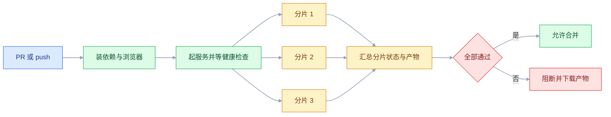
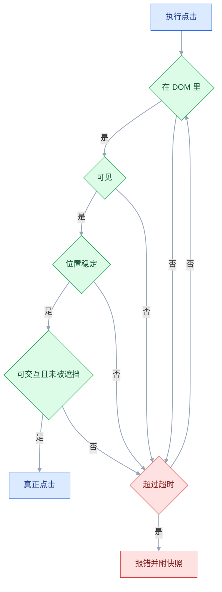
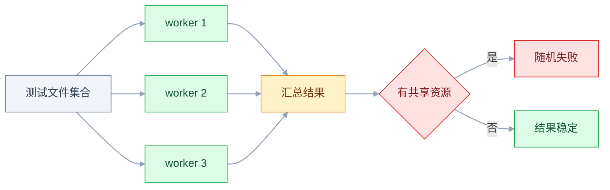

# E2E 测试

## 一、工程案例：把「登录到删任务」做成 8 条 E2E，发版前 5 分钟跑完

**场景**：任务管理系统前端 React、后端 Spring Boot，每次发版前测试同学手工回归 2 小时，还常漏。要自动化的只有一条主链路：**登录 → 创建任务 → 编辑 → 标记完成 → 筛选 → 删除**，外加错误密码和接口 500 两个异常分支，共 8 条。目标是发版前 5 分钟跑完，失败时能直接看到是哪一步、哪个请求出的问题。

**范围划定的依据**：这 8 条挂了，用户就用不了产品；表单的十几种校验组合、按钮颜色、文案细节一律不进来——那些交给单元测试和接口测试。**E2E 的数量由「业务上不能断的路径」决定，不由「页面上有多少元素」决定。**

### 1.1 初始化与配置

```bash
npm init playwright@latest      # TypeScript=Yes / tests / GitHub Actions=Yes / 装浏览器=Yes
rm -f tests/example.spec.ts .github/workflows/playwright.yml
mkdir -p tests/{pages,fixtures,e2e} playwright/.auth
```

删掉脚手架自带的示例用例和 workflow：示例会让验收里的「8 passed」变成 9 passed，生成的 workflow 又会和 1.5 的 `e2e.yml` 重复触发。账号放 `.env`（`E2E_USER`、`E2E_PASS`）；Playwright 不会自动读 `.env`，本地在 config 顶部 `import 'dotenv/config'`（`npm i -D dotenv`），CI 用 secrets 注入同名变量。`.env` 与 `playwright/.auth/` 一起进 `.gitignore`。

```typescript
// playwright.config.ts
import { defineConfig, devices } from '@playwright/test';

export default defineConfig({
  testDir: './tests/e2e',
  globalSetup: './tests/global-setup.ts',
  timeout: 30_000,                       // 单条用例上限
  expect: { timeout: 5_000 },            // 单个断言的重试上限
  fullyParallel: true,
  forbidOnly: !!process.env.CI,          // CI 上禁止 test.only
  retries: process.env.CI ? 1 : 0,       // 本地不重试，问题要暴露
  workers: process.env.CI ? 4 : undefined,
  reporter: [['html', { open: 'never' }]],   // 1.4 的 show-report 与 1.5 的产物都靠它
  use: {
    baseURL: process.env.BASE_URL || 'http://localhost:3000',
    storageState: 'playwright/.auth/user.json',
    trace: 'retain-on-failure',
    screenshot: 'only-on-failure',
    locale: 'zh-CN',
    timezoneId: 'Asia/Shanghai',
  },
  projects: [{ name: 'chromium', use: { ...devices['Desktop Chrome'] } }],
  webServer: { command: 'npm run start', url: 'http://localhost:3000',
               reuseExistingServer: !process.env.CI, timeout: 120_000 },
});
```

初始化后先把 `playwright/.auth/`、`test-results/`、`playwright-report/` 写进 `.gitignore`。五个配置项决定成败：`expect.timeout` 太小会误报 flaky，太大失败要等很久；`retries` 本地必须为 0；`trace` 至少 `retain-on-failure`；`storageState` 让 8 条用例只登录一次；`reporter` 固定 html，1.4 的 `show-report` 才有东西可看。

### 1.2 支撑层：登录态、造数据、页面对象

```typescript
// tests/global-setup.ts —— 整个测试会话只跑一次
import { chromium, FullConfig } from '@playwright/test';

export default async function globalSetup(config: FullConfig) {
  const baseURL = config.projects[0].use.baseURL!;
  const browser = await chromium.launch();
  const page = await browser.newPage();
  await page.goto(`${baseURL}/login`);
  await page.getByLabel('用户名').fill(process.env.E2E_USER!);
  await page.getByLabel('密码').fill(process.env.E2E_PASS!);
  await page.getByRole('button', { name: '登录' }).click();
  await page.waitForURL('**/tasks');
  await page.context().storageState({ path: 'playwright/.auth/user.json' });
  await browser.close();
}
```

```typescript
// tests/fixtures/api.ts —— 用接口造数据，比走 UI 快一个数量级
import { APIRequestContext, request } from '@playwright/test';

const BASE = process.env.API_BASE_URL || 'http://localhost:8080/api';

export async function loginViaApi() {
  const ctx = await request.newContext({ baseURL: BASE });
  const r = await ctx.post('/auth/login', { data: { username: process.env.E2E_USER, password: process.env.E2E_PASS } });
  if (!r.ok()) throw new Error(`登录失败: ${r.status()} ${await r.text()}`);
  return { ctx, token: (await r.json()).data.accessToken as string };
}

export async function createTaskViaApi(ctx: APIRequestContext, token: string,
  title: string, status = 'TODO'): Promise<number> {
  const r = await ctx.post('/tasks', {
    headers: { Authorization: `Bearer ${token}` },
    data: { title, priority: 2, status },
  });
  if (!r.ok()) throw new Error(`造数据失败: ${r.status()} ${await r.text()}`);
  return (await r.json()).data.id as number;
}

export const uniqueTitle = (p = '任务') => `${p}-${Date.now()}-${Math.random().toString(36).slice(2, 6)}`;
```

```typescript
// tests/pages/TaskListPage.ts
import { Page, Locator, expect } from '@playwright/test';

export class TaskListPage {
  readonly items: Locator;
  constructor(private readonly page: Page) {
    this.items = page.getByTestId('task-item');
  }
  async goto() {
    await this.page.goto('/tasks');
    await expect(this.page.getByRole('heading', { name: '我的任务' })).toBeVisible(); }
  itemByTitle(title: string) { return this.items.filter({ hasText: title }); }

  async create(title: string, priority: '高' | '中' | '低' = '中') {
    await this.page.getByRole('button', { name: '新建任务' }).click();
    await this.page.getByLabel('标题').fill(title);
    await this.page.getByLabel('优先级').selectOption(priority);
    await this.page.getByRole('button', { name: '保存' }).click();
    await expect(this.page.getByTestId('toast')).toContainText('创建成功');
  }
  async markDone(title: string) {
    const row = this.itemByTitle(title);
    await row.getByRole('checkbox').check();
    await expect(row.getByTestId('task-status')).toHaveText('已完成');
  }
  async filterBy(status: '全部' | '待办' | '已完成') {
    await this.page.getByLabel('状态筛选').selectOption(status);
  }
  async remove(title: string) {
    const row = this.itemByTitle(title);
    await row.hover();
    await row.getByRole('button', { name: '删除' }).click();
    await this.page.getByRole('button', { name: '确认删除' }).click();
    await expect(row).toHaveCount(0);
  }
}
```

页面对象只做两件事：**收敛定位器**、**把一步操作等到它的结果出现**。断言仍留在测试里，否则读用例的人不知道到底验了什么。

### 1.3 八条核心用例

```typescript
// tests/e2e/task.spec.ts
import { test, expect } from '@playwright/test';
import { TaskListPage } from '../pages/TaskListPage';
import { uniqueTitle } from '../fixtures/api';

test.describe('任务主链路', () => {
  let list: TaskListPage;
  test.beforeEach(async ({ page }) => {
    list = new TaskListPage(page);
    await list.goto();
  });

  test('创建后出现在列表并提示成功', async () => {
    const title = uniqueTitle('周报');
    await list.create(title, '高');
    await expect(list.itemByTitle(title)).toBeVisible();
    await expect(list.itemByTitle(title).getByTestId('task-priority')).toHaveText('高');
  });

  test('编辑后刷新仍生效', async ({ page }) => {
    const title = uniqueTitle('初稿');
    await list.create(title);
    await list.itemByTitle(title).getByRole('link').click();
    await page.getByRole('button', { name: '编辑' }).click();
    await page.getByLabel('标题').fill(`${title}-改`);
    await page.getByRole('button', { name: '保存' }).click();
    await page.reload();                                   // 关键：刷新验证真落库
    await expect(page.getByRole('heading', { level: 1 })).toHaveText(`${title}-改`);
  });

  test('标记完成后筛选能对上', async () => {
    const title = uniqueTitle('待办');
    await list.create(title);
    await list.markDone(title);
    await list.filterBy('已完成');
    await expect(list.itemByTitle(title)).toBeVisible();
    await list.filterBy('待办');
    await expect(list.itemByTitle(title)).toHaveCount(0);
  });

  test('删除后从列表消失', async ({ page }) => {
    const title = uniqueTitle('待删除');
    await list.create(title);
    await list.remove(title);
    await expect(page.getByTestId('toast')).toContainText('删除成功');
  });
});
```

刷新那一步不是形式：不刷新时页面显示的是内存里的新标题，后端如果漏更新字段，前端照样对——**这类 bug 只有 `reload()` 能抓住**。

```typescript
// tests/e2e/errors.spec.ts
import { test, expect } from '@playwright/test';

test.describe('异常分支', () => {
  test.use({ storageState: { cookies: [], origins: [] } });   // 清空登录态

  test('错误密码停在登录页并提示', async ({ page }) => {
    await page.goto('/login');
    await page.getByLabel('用户名').fill(process.env.E2E_USER!);
    await page.getByLabel('密码').fill('wrong-password');
    await page.getByRole('button', { name: '登录' }).click();
    await expect(page.getByTestId('form-error')).toContainText('用户名或密码错误');
    await expect(page).toHaveURL(/\/login$/);
  });

  test('未登录访问列表跳登录页', async ({ page }) => {
    await page.goto('/tasks');
    await expect(page).toHaveURL(/\/login/);
  });
});

test('列表接口 500 显示错误条且不白屏', async ({ page }) => {
  await page.route('**/api/tasks*', route =>
    route.fulfill({
      status: 500,
      contentType: 'application/json',
      body: JSON.stringify({ code: 'INTERNAL_ERROR', message: '服务器开小差了' }),
    }));
  await page.goto('/tasks');
  await expect(page.getByTestId('error-banner')).toContainText('服务器开小差了');
  await expect(page.getByRole('heading', { name: '我的任务' })).toBeVisible();
  await expect(page.getByTestId('task-item')).toHaveCount(0);
});
```

`route` 的匹配串要写 `**/api/tasks*`，只写 `**/api/tasks` 会漏掉带查询串的列表请求——这是「拦截了但没生效」的最常见原因。

需要多条数据时用接口造，UI 只负责验证：

```typescript
// tests/e2e/filter.spec.ts
import { test, expect } from '@playwright/test';
import { TaskListPage } from '../pages/TaskListPage';
import { createTaskViaApi, loginViaApi, uniqueTitle } from '../fixtures/api';

test('筛选只显示对应状态', async ({ page }) => {
  const { ctx, token } = await loginViaApi();
  const todo = uniqueTitle('待办'), done = uniqueTitle('已完成');
  await createTaskViaApi(ctx, token, todo, 'TODO');
  await createTaskViaApi(ctx, token, done, 'DONE');
  const list = new TaskListPage(page);
  await list.goto();
  await list.filterBy('已完成');
  await expect(list.itemByTitle(done)).toBeVisible();
  await expect(list.itemByTitle(todo)).toHaveCount(0);
  await ctx.dispose();
});
```

### 1.4 失败现场：trace 是唯一入口

```bash
npx playwright test tests/e2e/task.spec.ts          # 跑单个文件
npx playwright test --ui                            # 时间轴 + DOM 快照，本地排查首选
npx playwright show-report                          # 从报告里点开失败用例的 trace
```

报告里每条失败用例都带 trace 入口；命令行也可以 `npx playwright show-trace <失败输出里给出的 trace.zip 路径>`，路径含用例标题，不要手拼。

trace 里依次看四样东西：时间轴（操作顺序与每步耗时）、失败那刻的 DOM 快照、网络请求（发了没、状态码、请求体与响应体）、控制台报错。**顺序很重要**：先确认请求发了没有，再看响应对不对，最后才怀疑断言写错。

需要把请求钉进失败信息时，用 `page.waitForResponse`：**先挂监听、再触发动作**，顺序反了会漏掉已经完成的响应——它只等「注册之后」发生的事件。

### 1.5 接进 CI，按分片并行

```yaml
# .github/workflows/e2e.yml
name: E2E
on:
  pull_request:
  push: { branches: [main] }
jobs:
  e2e:
    runs-on: ubuntu-latest
    timeout-minutes: 20
    strategy:
      fail-fast: false
      matrix: { shard: [1, 2, 3] }
    steps:
      - uses: actions/checkout@v4
      - uses: actions/setup-node@v4
        with: { node-version: '22', cache: npm }
      - run: npm ci
      - run: npx playwright install --with-deps chromium
      - name: 起后端并等就绪
        # 前提：backend/app.jar 由上游构建 job 产出并上传；本 job 只负责起服务
        run: |
          nohup java -jar backend/app.jar > backend.log 2>&1 &
          for i in $(seq 1 60); do curl -sf http://localhost:8080/actuator/health && break; sleep 2; done
          curl -sf http://localhost:8080/actuator/health || { tail -50 backend.log; exit 1; }
      - name: 跑分片
        run: npx playwright test --shard=${{ matrix.shard }}/3
        env: { BASE_URL: http://localhost:3000, CI: true }
      - uses: actions/upload-artifact@v4
        if: always()
        with:
          name: e2e-${{ matrix.shard }}
          path: |
            playwright-report/
            test-results/
          retention-days: 7
```



分片的分配是确定性的：同一条用例每次都会落在同一个分片，不会出现两条用例抢同一份数据。粒度看 `fullyParallel`：本配置为 `true`，分片会按用例均衡；关掉它才按文件切，文件大小不均时分片会明显倾斜。分片数不要超过用例数，否则会有分片空跑。

### 1.6 验收：10 项全过才算交付

| # | 检查项 | 命令或检查 | 通过标准 |
|---|---|---|---|
| 1 | 浏览器就绪 | `npx playwright install --with-deps chromium` | 无报错 |
| 2 | 用例可枚举 | `npx playwright test --list` | 列出 8 tests |
| 3 | 单条可跑 | `npx playwright test -g "创建后"` | 1 passed |
| 4 | 全量通过 | `npx playwright test` | 8 passed |
| 5 | 连跑稳定 | `--repeat-each=5 --workers=1` | 40 passed，无 flaky |
| 6 | 并行稳定 | `--workers=4` | 与串行结果一致 |
| 7 | 无固定等待 | `grep -rn "waitForTimeout" tests/` | 无输出 |
| 8 | 无样式定位 | `grep -rn "locator('\\." tests/` | 无输出 |
| 9 | 凭证未入库 | `git check-ignore playwright/.auth/user.json` | 输出该路径 |
| 10 | 失败有产物 | 故意改错断言后跑 | 生成 trace.zip 与截图 |

第 5 项是硬指标：**「跑一次通过」不叫稳定，连跑 5 轮全过才算**。第 6 项验证数据隔离，并行挂了基本都是账号或数据被共用。

---

## 二、高频问答：会卡住你的地方，也是面试最常问的

### 2.1 点击后立刻数元素个数

**现场**

```typescript
// ✘ 赌请求已经回来
expect(await page.getByTestId('task-item').count()).toBe(1);
// ✔ 自动重试，直到出现或超时
await expect(page.getByTestId('task-item')).toHaveCount(1);
```

`--repeat-each=10 --workers=1`，能复现就说明是代码问题。

**要点**

- 把「偶发」当成「环境」会误诊：`locator.count()` 取的是当下快照，请求还没回来就已经比完了。
- 凡是涉及页面状态变化的断言，一律用 `await expect(locator)`，不要先取值再比较。
- 核实方式：连续重复 10 次单线程，能复现就是代码没等状态变化。

**追问**

- 为什么 `await` 了还不等？→ 取快照那一刻就定格，后续变化不计入。
- `expect.poll` 用在哪？→ 断言普通值（如轮询接口状态）时的重试手段。
- 软断言能救吗？→ 不能，它只是失败继续跑，根因仍是没等。

### 2.2 用 CSS 类名定位元素

**现场**

```typescript
page.locator('.btn-primary')                        // ✘ 样式类
page.locator('form > div:nth-child(3) > button')    // ✘ 结构
page.getByRole('button', { name: '保存' })           // ✔ 语义
page.getByTestId('task-save')                       // ✔ 显式契约
```

让前端随手改一次样式类，看测试是否红。

**要点**

- 把「能定位到」当成「稳定定位」是错觉：类名属于样式实现，前端重构随手就改，改完测试红但功能正常。
- 定位优先级是 role → label → testid → 文本 → CSS，CSS 只在没有语义可用时兜底。
- 核实方式：让前端改一次样式类，测试红而功能正常，就是定位写了实现细节。

**追问**

- testid 要前端配合吗？→ 要，它是显式契约，但最稳。
- nth-child 为什么差？→ 结构一变就挂，比类名还脆。
- 文本定位问题在哪？→ 文案一改就挂，只能中间使用。

### 2.3 每条用例都走 UI 登录

**现场**

```typescript
// playwright.config.ts
use: { storageState: 'playwright/.auth/user.json' }          // 全局默认复用
// 单条用例或 describe 内覆盖
test.use({ storageState: { cookies: [], origins: [] } });
```

`--reporter=list` 看每条用例耗时，登录占了大头。

**要点**

- 把「真实」当成「必须每步都真」会浪费：一次登录 2 秒，20 条用例白烧 40 秒，且与被测目标无关。
- 登录态复用不降低真实性——登录本身另有专门用例覆盖。
- 核实方式：对比开启 `storageState` 前后的总耗时，缩短明显就是登录在拖。

**追问**

- 哪些用例不该复用？→ 未登录、错误密码、登录态失效这些专门测的。
- storageState 含什么？→ Cookie、localStorage、IndexedDB，不含 sessionStorage。
- 为什么要专门用例覆盖登录？→ 否则复用之后没人验证登录本身对不对。

### 2.4 storageState 提交进了 Git

**现场**

```bash
printf 'playwright/.auth/\n' >> .gitignore
git rm --cached -r playwright/.auth
```

打开 `user.json` 看有没有 `token`、`session` 字段；`git log --all -- playwright/.auth/` 看有没有历史。

**要点**

- 把「登录态文件」当成「普通配置」会泄密：里面是 Cookie、localStorage、IndexedDB 明文，等于把账号凭证提交到仓库。
- 已提交过的要轮换凭证，只删文件不够——历史里还在。
- 核实方式：看 `user.json` 有无 `token` 字段，或 `git log` 是否出现过该路径。

**追问**

- 只删文件够吗？→ 不够，历史记录里凭证仍在，必须轮换。
- sessionStorage 会被带进去吗？→ 不会，要放得用 `addInitScript` 注入。
- 多角色怎么管？→ 准备多份 state 文件，像管理账号一样管理。

### 2.5 并行跑时账号或数据被共用

**现场**

```typescript
// tests/fixtures/user.ts —— 每个 worker 一个账号
import { test as base } from '@playwright/test';

export const test = base.extend<{ user: string }>({
  user: async ({}, use, workerInfo) => {
    await use(`e2e_user_${workerInfo.workerIndex}`);
  },
});
// 用例里显式声明 user 才会实例化：async ({ page, user }) => { ... }
```

并行跑两次，看失败是否集中在「数量」「第一条」这类断言上。

**要点**

- 用「串行」掩盖「不隔离」是假解：所有 worker 用同一个账号，列表混进别人造的数据，断言数量必然错。
- 数据要么按 worker 隔离，要么每条用例只断言自己造的那条。
- 核实方式：并行跑两次，失败若集中在数量、第一条这类断言，就是账号或数据被共用。

**追问**

- 加 `workers:1` 算解决吗？→ 不算，只是把问题藏起来，没隔离根因。
- 每个 worker 一个账号怎么实现？→ 用 fixture 按 `workerInfo.workerIndex` 派号。
- 数据隔离还有别法吗？→ 每条用例只断言自己造的那条，不数别人。

### 2.6 CI 上浏览器起不来

**现场**

```bash
npx playwright install --with-deps chromium     # Linux / CI 必须带 --with-deps
```

在干净容器里跑一次 `install` 再跑用例。

**要点**

- 把「npm 装完」当成「环境就绪」会漏事：只装了浏览器二进制，没装系统依赖（字体、图形库）。
- CI 镜像若预装过浏览器，要确认其版本与 `@playwright/test` 同一条版本线。
- 核实方式：干净容器里 `install` 后跑用例，报错出现 `libnss3.so`、`libatk` 就是缺系统库。

**追问**

- 本地为什么没事？→ 本地桌面系统已带图形库，CI 精简镜像没有。
- macOS 要 `--with-deps` 吗？→ 不需要，那是 Linux/CI 专用。
- 版本线不一致会怎样？→ 协议不匹配，驱动连不上浏览器。

### 2.7 时区与语言导致断言挂

**现场**

```typescript
use: { locale: 'zh-CN', timezoneId: 'Asia/Shanghai' }
```

本地临时设 `TZ=UTC` 跑一遍，能复现就是时区问题。

**要点**

- 把「环境差异」当成「功能 bug」会误诊：runner 默认 UTC + en-US，页面渲染出 `Oct 20` 或前一天。
- 日期断言尽量断言格式或相对时间，不要断言具体字符串。
- 核实方式：本地设 `TZ=UTC` 跑一遍，代码没改但文本变了就是时区/语言问题。

**追问**

- 文案断言也受影响？→ 是，en-US 下前端可能回退到英文文案。
- 时区设了还差什么？→ locale 也要设，否则数字日期格式仍按英文。
- 相对时间怎么断言？→ 断言「X 分钟前」或「刚刚」这类文案，不锚定绝对时间。

### 2.8 用固定 sleep 等页面

**现场**

```typescript
await page.waitForTimeout(2000);                            // ✘
await expect(page.getByTestId('task-item')).toHaveCount(1); // ✔
```

`grep -rn "waitForTimeout" tests/` 有多少处。

**要点**

- 把「等待」当成「同步」是错觉：sleep 快时白等、慢时不够，只是把概率问题往后推。
- 提交到仓库的代码里出现 `waitForTimeout`，就是 flaky 的种子。
- 核实方式：把 sleep 从 2 秒改成 5 秒，失败率下降但没归零，说明根因不是时间不够。

**追问**

- 真有必须等的情况吗？→ 很少，多半能用断言重试或 `waitForResponse` 替代。
- 为什么不能靠调长 sleep？→ 慢机器仍不够，还拖慢全量。
- 怎么消灭已有 sleep？→ 逐处换成对状态/响应的等待。

### 2.9 `test.only` 被提交

**现场**

```typescript
forbidOnly: !!process.env.CI     // CI 上直接报错退出
```

看报告的 total 与 skipped 数。

**要点**

- 把「绿」当成「全跑过」会被骗：只跑了一条用例，其余全部跳过，绿灯是假的。
- `forbidOnly` 是必配项，靠人记得删是不可靠的。
- 核实方式：报告里 passed 远小于总数，或 skipped 数异常，就是 only 漏删。

**追问**

- 本地要不要开 forbidOnly？→ 不开，本地要靠 only 调试。
- CI 报错后怎么修？→ 去掉 only 重跑，不要临时改配置绕过。
- 还有哪些会伪装成绿？→ `|| true`、retry 把失败盖掉。

---

## 三、核心知识：从零开始要建立的东西

### 3.1 浏览器自动化的两条路线

| | WebDriver 路线 | CDP 路线 |
|---|---|---|
| 代表 | Selenium、WebdriverIO | Playwright、Puppeteer |
| 通信 | W3C WebDriver 协议，走 HTTP | 浏览器调试协议，走 WebSocket（Chromium 走 CDP，Firefox/WebKit 用各自协议的补丁版） |
| 能力 | 标准化好，老浏览器支持广 | 能拿网络、性能、覆盖率等内部事件 |
| 等待 | 需要自己写显式等待 | 内置自动等待与重试断言 |

路线决定了「谁负责等元素」。WebDriver 路线把等待交给测试代码，所以老代码里到处是 `WebDriverWait`；CDP 路线把可操作性检查做进了动作里，代码更短，但**不理解它等的是什么，就还是会写出 flaky**。Playwright 并非只驱动 Chromium，三套引擎各自维护协议，具体支持范围以官方当前稳定版为准。

### 3.2 自动等待的可交互判定



五个条件是文档里的可操作性检查项：attached、visible、stable、enabled、receives events。具体到某个动作只查其中几项——`click()` 查 visible、stable、enabled、receives events，`fill()` 还要 editable。**它等的是「元素此刻能不能点」，不是「业务处理完了没有」**。所以点击之后要等结果（toast、列表变化、URL 变化），不能等元素本身。

> **面试**：常问「Playwright 自动等待到底在等什么？点击后还要等什么？」答：等元素可交互（可见、稳定、未被遮挡），不等业务处理完，所以点击后要等结果变化。

### 3.3 定位器的语义层级

| 层级 | 写法 | 稳定性 | 说明 |
|---|---|---|---|
| 角色 | `getByRole('button', { name: '保存' })` | 最高 | 与无障碍语义一致 |
| 标签 | `getByLabel('标题')` | 高 | 表单字段首选 |
| testid | `getByTestId('task-save')` | 高 | 显式契约，需要前端配合 |
| 占位符/文本 | `getByPlaceholder('请输入标题')` | 中 | 文案一改就挂 |
| CSS/XPath | `locator('.item > span')` | 低 | 结构与样式一变就挂 |

判断标准：**这个定位描述的是「用户看到的东西」还是「实现细节」**。`getByRole('button', { name: '保存' })` 描述用户意图，`.btn-primary` 描述实现。落地顺序与 2.2 一致：role → label → testid → 文本 → CSS。

> **面试**：常问「为什么不用 CSS 选择器定位元素？」答：CSS 是样式实现，一重构就挂；优先 role / label / testid 这类语义，描述用户意图。

### 3.4 断言的重试模型

| 断言 | 是否重试 | 说明 |
|---|---|---|
| `await expect(locator).toBeVisible()` | 是 | 轮询到超时 |
| `await expect(locator).toHaveCount(1)` | 是 | 集合变化也能等到 |
| `expect(await locator.count()).toBe(1)` | 否 | 取快照后比较 |
| `expect(resp.status()).toBe(201)` | 否 | 响应已定 |

规律很简单：**`expect` 的参数是 Locator 或 Page 时会重试，是普通值时不重试**。所以 `await locator.textContent()` 之后再断言，等于放弃了自动等待。普通值确实需要等时用 `expect.poll`，例如 `await expect.poll(() => api.status(id)).toBe('DONE')`，它按间隔反复调用直到通过或超时。

> **面试**：常问「为什么我写的断言不重试？」答：expect 参数是 Locator 才重试，是普通值（count、status）不重试，普通值要用 expect.poll。

```typescript
await expect.soft(page.getByTestId('count')).toHaveText('3');   // 软断言，失败继续跑
```

软断言适合「一次收集多个界面问题」，但主流程断言不要用它——失败了还继续往下跑，后面的报错会掩盖真正的第一现场。

### 3.5 页面对象与业务语言

| 做法 | 用例读起来 | 前端改动的影响 |
|---|---|---|
| 定位器散在用例里 | `page.locator('.btn').click()` | 改一处要改 N 个文件 |
| 薄页面对象 | `list.create(title)` | 只改页面对象 |

推荐薄封装：方法名用业务语言（`create`、`markDone`、`remove`），内部负责等待该动作的结果。**不要为了「复用」把断言也封进去**，否则失败信息只剩「expectCreated 失败」。

### 3.6 认证态复用的原理

`storageState` 本质是把浏览器上下文里的 Cookie、localStorage 与 IndexedDB 序列化成 JSON，下次创建上下文时灌回去。它绕过的只是登录这一步，后续所有请求仍然是真的。

| 场景 | 做法 |
|---|---|
| 默认已登录 | 全局 `use.storageState` |
| 测未登录 | `test.use({ storageState: { cookies: [], origins: [] } })` |
| 多角色 | 准备多份 state，按 `describe` 切换 |
| token 过期 | CI 每次全新登录，天然规避 |

三个注意点：文件含凭证必须进 `.gitignore`；`storageState` 包含 Cookie、localStorage 和 IndexedDB（`indexedDB` 选项默认开启），但**不含 sessionStorage**，前端若把 token 放 sessionStorage，要用 `addInitScript` 在页面加载前注入；角色越多，state 文件越多，要像管理测试账号一样管理它们。

### 3.7 网络拦截的三种用法

`page.route` 能改装任何请求，三个典型用途：造 500 验证错误提示、造延迟验证 loading、造空列表验证空状态。匹配串必须写 `**/api/tasks*`，漏掉 `*` 就匹配不到带查询串的列表请求。

```typescript
await page.route('**/api/tasks*', r => r.fulfill({ status: 500, json: { code: 'X' } }));
await page.route('**/api/tasks*', r => r.fulfill({ json: [] }));
await page.route('**/api/tasks*', async r => { await new Promise(x => setTimeout(x, 1500)); await r.continue(); });
```

拦截的价值是把「服务端不配合」变成可重复的用例。**它不能替代真实链路测试**——拦截多了，测的就成了前端自己的 mock。

### 3.8 数据准备的三种方式

| 方式 | 速度 | 稳定性 | 适用 |
|---|---|---|---|
| 走 UI 造 | 最慢 | 一般 | 造数据本身就是被测流程 |
| 调接口造 | 快 | 高 | 默认选择 |
| 预置种子数据 | 最快 | 低 | 只读展示类页面 |

推荐「接口造数据 + UI 只做验证」。用 UI 造三条数据大约 30 秒，用接口 300 毫秒，差距在 CI 上会放大成几分钟。种子数据的风险是用例之间互相干扰，一旦有人改了种子，几十条用例一起红。

### 3.9 并行与分片的边界



并行的前提是**没有共享可变状态**：账号、数据、文件、数据库序列都要隔离。`--shard` 在机器之间切用例（关掉 `fullyParallel` 时按文件切），`workers` 在单机上并行跑；分片用于横向扩机器，`workers` 用于压满一台机器，两者可以叠加。

> **面试**：常问「shard 和 workers 有什么区别？」答：shard 是跨机器切用例，workers 是单机并行，目的分别是横向扩机和压满单机，可叠加。

### 3.10 失败产物与 trace

| 产物 | 体积 | 什么时候开 |
|---|---|---|
| 截图 | 小 | `only-on-failure` |
| 录屏 | 大 | 失败保留，或只留关键流程 |
| trace | 中 | `retain-on-failure`，排查主力 |

trace 之所以是主力，因为它把「操作、DOM、网络、控制台」按同一条时间轴对齐了。录屏只能看到画面，看不到请求体；截图只有一帧。CI 上**一定要上传 `test-results/`**，否则失败就是一句 `Expected 1 Received 0`。

### 3.11 稳定性的度量方式

| 指标 | 算法 | 健康线（经验值） |
|---|---|---|
| 通过率 | 通过次数 / 总运行次数 | ≥ 99% |
| flaky 率 | 重试后才通过的用例数 / 总用例数 | < 2% |
| 平均耗时 | 全量运行时长 | 发版前能等完 |
| 定位耗时 | 从红灯到找到原因的时间 | < 15 分钟 |

flaky 率是最该盯的指标：它一旦上升，团队就会开始无视红灯，测试就废了。**不要用「重试后通过率」自我安慰**，那只是把分母换掉了。

### 3.12 在测试金字塔里的位置

| 层 | 数量级 | 单条耗时 | 主要价值 |
|---|---|---|---|
| 单元 | 上千 | 毫秒 | 逻辑正确 |
| 接口 | 数百 | 几十毫秒 | 契约与业务规则 |
| E2E | 十几条 | 几秒到几十秒 | 用户能否完成任务 |

E2E 少不是因为不重要，而是因为**它贵且脆**——一条 E2E 失败，可能是前端、后端、数据、环境任一环节；一条单测失败，位置几乎是确定的。

---

## 四、冷门知识汇总

| 知识点 | 为什么冷门 | 用到时的关键词 |
|---|---|---|
| 组件测试 | 介于单元与 E2E 之间，多数团队直接跳到 E2E | `@playwright/experimental-ct-react` / `mount` |
| 多标签与弹窗 | 支付、OAuth 常开新窗口，默认上下文拿不到 | `context.waitForEvent('page')` |
| 请求录制回放 | 后端不稳定时的临时手段，容易过期 | `recordHar` / `routeFromHAR` |
| 移动端模拟 | 真机与模拟器的触摸事件不同 | `devices['iPhone 13']` / `hasTouch` |
| 证书错误 | 内网自签证书导致整页打不开 | `ignoreHTTPSErrors` |
| 重试的隔离性 | 失败重试会重启 worker 进程并新建上下文，模块级变量与内存状态清空，但磁盘上的 storageState 不受影响 | `retries` / `testInfo.retry` |
| 特性开关 | 同一份代码在不同开关下页面不同 | `addInitScript` / 环境变量 |
| 时间控制 | 依赖「当前时间」的页面（倒计时、过期、免打扰时段）难稳定复现 | `page.clock` / `clock.install` |
