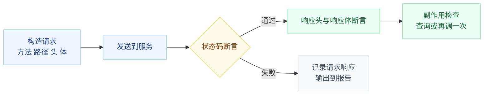

# API测试与RestAssured

> 这篇从接口测试要验证的 HTTP 契约讲起，经过 curl 与 Bruno 的手工验证、RestAssured 的请求构造与断言、JSONPath 与 JSON Schema 校验、MockMvc 切片测试，最后落到 Allure 报告、CI 接入、排障手册和一个订单接口的完整测试案例。
>
> 学完能独立为一个 Spring Boot 服务写出可重复执行的接口测试套件，并在 CI 中产出可定位失败的测试报告。

## 一、接口测试验证的契约

接口测试验证的是调用方与服务方对同一份 HTTP 契约的理解是否一致，而不是服务内部逻辑是否正确。逻辑分支组合交给单元测试，浏览器行为交给端到端测试，接口测试卡在两者之间，用秒级成本换真实网络与序列化的覆盖。

### 1.1 一份 HTTP 契约包含什么

一次接口调用产生五类可断言的证据，缺一类就会留下盲区。

| 维度 | 断言内容 | 常见漏测 |
|---|---|---|
| 方法与路径 | POST /api/orders 命中正确处理器 | 路径拼错被 404 掩盖 |
| 状态码 | 201、400、404、415 各自成立 | 只测 200 正常路径 |
| 响应头 | Location、Content-Type、缓存头 | 创建接口不校验 Location |
| 响应体 | 字段、类型、枚举、嵌套结构 | 只断言一个字段 |
| 副作用 | 数据落库、消息投递、幂等 | 响应对了但数据没写 |

创建订单是能把这五类一次覆盖的典型接口：成功返回 201 与 Location，参数非法返回 400，查不到返回 404，媒体类型不对返回 415。

### 1.2 状态码是契约的第一层

状态码写错比字段写错更难在联调时发现，因为调用方通常只判断“是不是 2xx”。

| 区间 | 语义 | 接口测试里要覆盖的例子 |
|---|---|---|
| 2xx | 成功 | 200 查询、201 创建、204 删除 |
| 3xx | 重定向、缓存 | 一般不由业务接口返回 |
| 4xx | 调用方错误 | 400 参数、401 未认证、403 无权限、404 不存在、409 冲突、415 媒体类型 |
| 5xx | 服务方错误 | 500 未捕获异常、503 依赖不可用 |

有两种风格会被混用：一种用 HTTP 状态码表达结果，一种永远返回 200 并在体内放业务码。两种都能用，但同一套接口只能选一种。混用的代价是监控、网关重试、SDK 生成全部要写特例，接口测试也无法用状态码做第一层筛选。

### 1.3 接口测试与上下层的分工

一次完整的接口测试是“构造请求 → 发送 → 断言状态与头 → 断言体 → 检查副作用”的固定链路。



接口测试与上下层的关系见 [测试策略与用例设计](../01-测试基础/01-测试策略与用例设计.md)：接口层负责契约和边界，不负责穷举业务规则组合；数据库与消息的真实交互放在 [Testcontainers 与契约测试](../02-单元与集成/02-Testcontainers与契约测试.md)；浏览器关键路径放在 [Playwright 端到端](../04-端到端与UI/01-Playwright端到端.md)。

### 1.4 什么不该用接口测试做

接口测试擅长证明“这份契约按约定工作”，不擅长证明“所有输入组合都正确”。

- 业务规则组合：优惠叠加、税费分档这类笛卡尔积，用单元测试参数化，跑一千个用例只要几百毫秒；放接口层要发一千次 HTTP。
- 浏览器行为：按钮点击、焦点、滚动、可访问性，接口测试看不到。
- 性能与容量：接口测试的并发模型是一次一个请求，压测要用 [k6 与 JMeter](../05-性能测试/01-k6与JMeter性能测试.md)。
- 安全漏洞：越权、注入、依赖漏洞要走 [安全测试与依赖扫描](../06-安全测试/01-安全测试与依赖扫描.md)，接口测试最多覆盖认证与基本越权。

> 边界：接口测试的断言对象是契约。契约本身错了（比如设计上就该返回 409 却返回 200），测试写得再全也只能证明错误被稳定复现。

## 二、准备：被测服务与工具链

这一章把版本、依赖、被测服务和验证命令固定下来，后续五章都跑在同一个工程上。

### 2.1 版本基线

| 组件 | 版本 | 用途 |
|---|---|---|
| Java | 21 LTS | 编译与运行 |
| Spring Boot | 3.5.x | 被测服务 |
| RestAssured | 5.5.x | 接口测试 DSL |
| JUnit 5 | Boot 3.5 管理版本 | 测试运行器 |
| Bruno CLI | 4.x | 手工集合与命令行执行 |
| Allure | 2.29.x | 报告 |

RestAssured 5.5 要求 Java 8 以上，与 Java 21 完全兼容；JSON Schema 校验依赖 `json-schema-validator` 模块，MockMvc 方式依赖 `spring-mock-mvc` 模块，三者版本必须一致，否则 Groovy 运行时会出现方法找不到。

### 2.2 工程结构

被测服务与测试放在同一个 Maven 工程里，测试直接读主代码的类，不需要另建仓库。

```text
order-service/
├── pom.xml
└── src
    ├── main/java/demo/orders
    │   ├── OrderServiceApplication.java
    │   ├── OrderController.java
    │   └── ApiExceptionHandler.java
    └── test
        ├── java/demo/orders
        │   ├── OrderApiMockMvcTest.java
        │   └── OrderApiHttpTest.java
        └── resources/schemas/order.json
```

### 2.3 pom.xml

依赖只引四个测试作用域的库：RestAssured 核心、JSON Schema 校验、MockMvc 适配、Spring Boot 测试启动器。

```xml
<?xml version="1.0" encoding="UTF-8"?>
<project xmlns="http://maven.apache.org/POM/4.0.0"
         xmlns:xsi="http://www.w3.org/2001/XMLSchema-instance"
         xsi:schemaLocation="http://maven.apache.org/POM/4.0.0 https://maven.apache.org/xsd/maven-4.0.0.xsd">
  <modelVersion>4.0.0</modelVersion>

  <parent>
    <groupId>org.springframework.boot</groupId>
    <artifactId>spring-boot-starter-parent</artifactId>
    <version>3.5.0</version>
    <relativePath/>
  </parent>

  <groupId>demo</groupId>
  <artifactId>order-service</artifactId>
  <version>1.0.0</version>

  <properties>
    <java.version>21</java.version>
  </properties>

  <dependencies>
    <dependency>
      <groupId>org.springframework.boot</groupId>
      <artifactId>spring-boot-starter-web</artifactId>
    </dependency>
    <dependency>
      <groupId>org.springframework.boot</groupId>
      <artifactId>spring-boot-starter-validation</artifactId>
    </dependency>
    <dependency>
      <groupId>org.springframework.boot</groupId>
      <artifactId>spring-boot-starter-test</artifactId>
      <scope>test</scope>
    </dependency>
    <dependency>
      <groupId>io.rest-assured</groupId>
      <artifactId>rest-assured</artifactId>
      <version>5.5.1</version>
      <scope>test</scope>
    </dependency>
    <!-- 校验响应结构，不靠手写一堆 hasKey 断言 -->
    <dependency>
      <groupId>io.rest-assured</groupId>
      <artifactId>json-schema-validator</artifactId>
      <version>5.5.1</version>
      <scope>test</scope>
    </dependency>
    <!-- 让 RestAssured 直接驱动 DispatcherServlet，不起真实端口 -->
    <dependency>
      <groupId>io.rest-assured</groupId>
      <artifactId>spring-mock-mvc</artifactId>
      <version>5.5.1</version>
      <scope>test</scope>
    </dependency>
  </dependencies>

  <build>
    <plugins>
      <plugin>
        <groupId>org.springframework.boot</groupId>
        <artifactId>spring-boot-maven-plugin</artifactId>
      </plugin>
    </plugins>
  </build>
</project>
```

三个 RestAssured 模块都用 `${...}` 统一版本也可以，但在多模块工程里更容易出现“核心升了、模块没升”的错配，直接写同一版本号更省事。

### 2.4 被测服务

服务只有两个端点：创建订单、按 id 查询，非法参数统一返回 400。内存 Map 代替数据库，让接口测试关注契约而不是数据准备。

```java
package demo.orders;

import jakarta.validation.Valid;
import jakarta.validation.constraints.Min;
import jakarta.validation.constraints.NotBlank;
import org.springframework.http.ResponseEntity;
import org.springframework.web.bind.annotation.*;

import java.net.URI;
import java.util.Map;
import java.util.concurrent.ConcurrentHashMap;
import java.util.concurrent.atomic.AtomicLong;

@RestController
@RequestMapping("/api/orders")
public class OrderController {

    public record CreateOrderRequest(
            @NotBlank(message = "sku is required") String sku,
            @Min(value = 1, message = "quantity must be >= 1") int quantity) {
    }

    public record OrderResponse(long id, String sku, int quantity, String status) {
    }

    private final AtomicLong ids = new AtomicLong(1000);
    private final Map<Long, OrderResponse> store = new ConcurrentHashMap<>();

    @PostMapping
    public ResponseEntity<OrderResponse> create(@Valid @RequestBody CreateOrderRequest req) {
        long id = ids.incrementAndGet();
        OrderResponse order = new OrderResponse(id, req.sku(), req.quantity(), "CREATED");
        store.put(id, order);
        // 201 必须带 Location，调用方据此查询资源，不靠猜 id 规则
        return ResponseEntity.created(URI.create("/api/orders/" + id)).body(order);
    }

    @GetMapping("/{id}")
    public ResponseEntity<OrderResponse> get(@PathVariable long id) {
        OrderResponse order = store.get(id);
        // 查不到返回 404，不用 200 + null，避免调用方把空体当成功
        return order == null ? ResponseEntity.notFound().build() : ResponseEntity.ok(order);
    }
}
```

参数校验失败默认返回 Spring 的通用错误体，字段名藏在异常里。为了让调用方能直接定位字段，加一个统一异常处理器。

```java
package demo.orders;

import org.springframework.http.HttpStatus;
import org.springframework.web.bind.MethodArgumentNotValidException;
import org.springframework.web.bind.annotation.ExceptionHandler;
import org.springframework.web.bind.annotation.ResponseStatus;
import org.springframework.web.bind.annotation.RestControllerAdvice;

import java.util.List;
import java.util.Map;

@RestControllerAdvice
public class ApiExceptionHandler {

    @ExceptionHandler(MethodArgumentNotValidException.class)
    @ResponseStatus(HttpStatus.BAD_REQUEST)
    public Map<String, Object> onValidation(MethodArgumentNotValidException ex) {
        // 每个字段一条错误，前端和测试都能按 field 精准断言
        List<Map<String, String>> errors = ex.getBindingResult().getFieldErrors().stream()
                .map(e -> Map.of("field", e.getField(), "message", e.getDefaultMessage()))
                .toList();
        return Map.of("errors", errors);
    }
}
```

```java
package demo.orders;

import org.springframework.boot.SpringApplication;
import org.springframework.boot.autoconfigure.SpringBootApplication;

@SpringBootApplication
public class OrderServiceApplication {
    public static void main(String[] args) {
        SpringApplication.run(OrderServiceApplication.class, args);
    }
}
```

`spring-boot-starter-validation` 不是 Web 启动器的传递依赖，漏引时 `@Valid` 静默失效：数量传 0 也会创建成功。这是接口测试最容易漏测的一类问题，因为测试只覆盖了 201 就永远不会发现。

### 2.5 启动与冒烟验证

```bash
mvn -q -DskipTests package
java -jar target/order-service-1.0.0.jar --server.port=29731
```

本机实测启动日志尾部：

```text
Tomcat started on port 29731 (http) with context path '/'
Started OrderServiceApplication in 0.903 seconds (process running for 1.115)
```

端口取 29731 是为了避开本机已占用的 8080，CI 里则由 `RANDOM_PORT` 自动分配。

```bash
curl -s -i -X POST http://localhost:29731/api/orders \
  -H 'Content-Type: application/json' \
  -d '{"sku":"SKU-1","quantity":2}'
```

本机实测响应：

```text
HTTP/1.1 201
Location: /api/orders/1001
Content-Type: application/json
Transfer-Encoding: chunked

{"id":1001,"sku":"SKU-1","quantity":2,"status":"CREATED"}
```

拿到 201 与 Location 之后，契约的最小闭环就成立，后面所有自动化断言都以这组响应为准。

### 2.6 工具安装

curl 在 Windows 10 1803 之后、macOS、主流 Linux 发行版都自带，无需安装。

Bruno 分桌面端与命令行两套。桌面端用于手写和调试集合，从 usebruno.com 下载对应安装包；命令行用于 CI：

```bash
# macOS 与 Linux 通用，本机 Node 22 环境实测
npm install -g @usebruno/cli
bru --version

# Ubuntu 24.04 若 npm 未安装
sudo apt install -y nodejs npm
# Rocky Linux 9
sudo dnf install -y nodejs npm
# Windows 用 winget 装 Node 后同样执行 npm install -g
```

Allure 命令行有两种装法，任选其一：

```bash
# 方式一：npm
npm install -g allure-commandline
# 方式二：macOS Homebrew
brew install allure
# Ubuntu 与 Rocky 从 GitHub Releases 下载 zip 后解压到 /opt/allure，并把 bin 加入 PATH
```

> 边界：Allure 报告只在本地查看或 CI 归档，不需要装到被测服务器上。测试代码只依赖 `allure-junit5` 与 `allure-rest-assured` 两个库，报告生成是独立步骤。

## 三、curl 与 Bruno：先把接口手工打一遍

写自动化之前先用 curl 把契约打一遍，能提前发现“文档写的和实际返回的不一样”，省掉一半改断言的时间。

### 3.1 curl 的六个参数覆盖八成场景

| 参数 | 说明 | 典型用法 |
|---|---|---|
| -i | 输出响应头 | 看 Location、Content-Type |
| -s | 静默，去掉进度条 | 脚本里必加 |
| -X | 指定方法 | -X POST |
| -H | 加请求头 | -H 'Content-Type: application/json' |
| -d | 请求体 | -d '{"sku":"SKU-1"}' |
| -o | 响应体写入文件 | -o /tmp/resp.json |

本机实测的四个场景：

```bash
# 创建成功
curl -s -i -X POST http://localhost:29731/api/orders \
  -H 'Content-Type: application/json' -d '{"sku":"SKU-1","quantity":2}'

# 参数非法，两个字段同时报错
curl -s -i -X POST http://localhost:29731/api/orders \
  -H 'Content-Type: application/json' -d '{"sku":"","quantity":0}'

# 查询不存在的订单
curl -s -i http://localhost:29731/api/orders/999999

# 漏掉 Content-Type
curl -s -i -X POST http://localhost:29731/api/orders -d '{"sku":"SKU-1","quantity":2}'
```

```text
HTTP/1.1 400
Content-Type: application/json

{"errors":[{"field":"sku","message":"sku is required"},{"field":"quantity","message":"quantity must be >= 1"}]}

HTTP/1.1 404
Content-Length: 0

HTTP/1.1 415
Content-Type: application/json

{"timestamp":"2026-11-12T21:44:18.170+00:00","status":415,"error":"Unsupported Media Type","path":"/api/orders"}
```

415 表示服务端拒绝了请求的媒体类型；curl 默认按 `application/x-www-form-urlencoded` 发送，Spring 因此拒绝。看到 415 先查 Content-Type，不要先怀疑参数。

### 3.2 用退出码做脚本断言

`curl` 默认在 HTTP 4xx/5xx 时仍返回退出码 0，脚本会误判成功。

| 退出码 | 含义 | 触发条件 |
|---|---|---|
| 0 | 请求完成 | 即使响应是 500 |
| 22 | HTTP 错误 | 加 --fail 或 --fail-with-body |
| 6 | DNS 解析失败 | 域名写错 |
| 7 | 连接被拒 | 服务没起或端口错 |
| 28 | 超时 | --max-time 到点 |

```bash
#!/usr/bin/env bash
set -euo pipefail
BASE=${1:-http://localhost:29731}

# -w 只输出状态码，-o 把响应体写到文件供下一步取值
code=$(curl -s -o /tmp/resp.json -w '%{http_code}' -X POST "$BASE/api/orders" \
  -H 'Content-Type: application/json' -d '{"sku":"SKU-1","quantity":2}')
[ "$code" = "201" ] || { echo "create failed: $code"; exit 1; }

id=$(python3 -c 'import json;print(json.load(open("/tmp/resp.json"))["id"])')
code=$(curl -s -o /dev/null -w '%{http_code}' "$BASE/api/orders/$id")
[ "$code" = "200" ] || { echo "get failed: $code"; exit 1; }

code=$(curl -s -o /dev/null -w '%{http_code}' "$BASE/api/orders/999999")
[ "$code" = "404" ] || { echo "404 check failed: $code"; exit 1; }

echo "smoke ok: id=$id"
```

本机实测输出：

```text
smoke ok: id=1001
```

`--fail-with-body` 同时保留响应体和错误退出码：

```bash
curl -s -o /dev/null -w 'with --fail: %{http_code}\n' --fail-with-body \
  http://localhost:29731/api/orders/999999
```

```text
with --fail: 404
```

此时 `$?` 为 22，`set -e` 会中断脚本。这套写法适合部署后的冒烟，不适合当回归套件：每次都要起服务，断言散在 shell 里，失败信息只有一行。

### 3.3 Bruno 集合：把手工请求变成可保存的资产

Bruno 的集合是一个目录，每个请求一个 `.bru` 文件，纯文本，能进 Git 评审。

```text
# bruno.json
{
  "version": "1",
  "name": "order-api",
  "type": "collection",
  "ignore": ["node_modules", ".git"]
}
```

```text
# collection.bru
meta {
  name: order-api
}
```

```text
# environments/local.bru
vars {
  baseUrl: http://localhost:29731
}
```

```text
# requests/create-order.bru
meta {
  name: create-order
  seq: 1
}

post {
  url: {{baseUrl}}/api/orders
  body: json
}

headers {
  Content-Type: application/json
}

body:json {
  {
    "sku": "SKU-1",
    "quantity": 2
  }
}

assert {
  res.status: eq 201
}

tests {
  test("Location 指向新订单", function () {
    expect(res.getHeader("Location")).to.match(/^\/api\/orders\/\d+$/);
  });
}
```

```text
# requests/get-order.bru
meta {
  name: get-order
  seq: 2
}

get {
  url: {{baseUrl}}/api/orders/1001
  body: none
}

assert {
  res.status: eq 200
}
```

```text
# requests/create-order-invalid.bru
meta {
  name: create-order-invalid
  seq: 3
}

post {
  url: {{baseUrl}}/api/orders
  body: json
}

headers {
  Content-Type: application/json
}

body:json {
  {
    "sku": "",
    "quantity": 0
  }
}

assert {
  res.status: eq 400
}

script:post-response {
  test("校验错误字段", () => {
    expect(res.getBody().errors[0].field).to.equal("sku");
  });
}
```

`assert` 块是声明式断言，`tests` 块是 JS 断言。简单判断用前者，需要取值计算或跨字段比较用后者。两个块都只在请求发出后执行，集合里请求的顺序由 `seq` 决定。

### 3.4 命令行执行与 CI

```bash
cd bruno/order-api
bru run --env local
```

本机实测输出（Bruno CLI 4.3.0）：

```text
requests/create-order (201 ) - 11 ms
Tests
  ✓ Location 指向新订单
Assertions
  ✓ res.status: eq 201
requests/get-order (200 ) - 3 ms
Assertions
  ✓ res.status: eq 200
requests/create-order-invalid (400 ) - 4 ms
Post-Response Tests
  ✓ 校验错误字段
Assertions
  ✓ res.status: eq 400

Execution Summary
  Status      ✓ PASS
  Requests    3 (3 Passed)
  Tests       1/1
  Assertions  3/3
```

CI 里输出 JUnit XML 供平台解析（示例）：

```bash
bru run --env ci --reporter-junit results.xml
```

> 边界：Bruno 适合联调阶段的手工验证和少量冒烟断言。需要数据准备、复杂 JSON 路径断言、失败重跑、报告归档时，交给 RestAssured；两边职责不要重叠，否则同一份契约要维护两套断言。

## 四、RestAssured：请求与断言

RestAssured 的价值在 DSL 与可复用规格，不在“能发 HTTP”。用 given-when-then 把请求准备、发送、断言分开，失败时能从异常信息直接看出断的是哪一段。

### 4.1 第一个用例

`@SpringBootTest(webEnvironment = RANDOM_PORT)` 让 Spring Boot 随机分配端口，测试之间不会抢端口。

```java
package demo.orders;

import io.restassured.specification.RequestSpecification;
import org.junit.jupiter.api.BeforeEach;
import org.junit.jupiter.api.Test;
import org.springframework.boot.test.context.SpringBootTest;
import org.springframework.boot.test.web.server.LocalServerPort;

import static io.restassured.RestAssured.given;
import static org.hamcrest.Matchers.equalTo;

@SpringBootTest(webEnvironment = SpringBootTest.WebEnvironment.RANDOM_PORT)
class OrderApiHttpTest {

    @LocalServerPort
    private int port;

    private RequestSpecification spec;

    @BeforeEach
    void pointRestAssuredAtTheServer() {
        spec = given()
                .port(port)
                .basePath("/api")
                .contentType("application/json");
    }

    @Test
    void createOrderReturns201() {
        spec.body("""
                        {"sku":"SKU-1","quantity":2}
                        """)
                .when()
                .post("/orders")
                .then()
                .statusCode(201)
                .body("sku", equalTo("SKU-1"));
    }
}
```

三个块的职责必须分清：

| 块 | 职责 | 常见误用 |
|---|---|---|
| given | 请求规格：地址、头、体、过滤器 | 把会变的数据塞进共享 spec |
| when | 只放方法调用 | 在 when 里再写断言 |
| then | 状态码、头、体、时间断言 | 断言失败后不保留请求响应 |

`when()` 之后只允许一个 HTTP 方法调用，之后再写 `body(...)` 会被当作响应断言。把断言塞进 `when` 是 Groovy DSL 里最常见的编译通过但语义错误的写法。

### 4.2 复用 RequestSpecification

共享 spec 只放所有用例都成立的配置：端口、basePath、Content-Type、日志过滤器。会变的部分（body、查询参数、token）在用例里追加。

```java
spec.body("""
                {"sku":"SKU-2","quantity":1}
                """)
        .when()
        .post("/orders")
        .then()
        .statusCode(201);
```

查询参数同样挂在 spec 上，只影响当前这一次请求（片段，要求服务端有列表端点）：

```java
spec.queryParam("status", "CREATED")
        .when()
        .get("/orders")
        .then()
        .statusCode(200);
```

当前被测服务只有创建与按 id 查询，照抄第二条会得到 404。片段说明写法，运行时以工程实际端点为准，这也是正文里把“能跑”的用例和“讲写法”的片段分开标注的原因。

> 边界：`basePath("/api")` 会拼在所有相对路径前。响应头里的 `Location: /api/orders/1001` 是绝对路径，直接拿来回放会变成 `/api/api/orders/1001`，得到 404。这是本机第一次跑通时真实踩到的失败，第八章给排查方法。

### 4.3 常用断言速查

| 断言 | 用途 | 说明 |
|---|---|---|
| statusCode(201) | 状态码 | 整数或 Hamcrest 匹配器 |
| header("Location", ...) | 响应头 | 值可用 matchesPattern |
| contentType("application/json") | 媒体类型 | 只比较类型部分 |
| body("id", notNullValue()) | 字段存在 | 路径支持 JSONPath |
| body("errors", hasSize(2)) | 集合大小 | 配合 everyItem 检查元素 |
| time(lessThan(500L)) | 响应时间 | 只能当烟雾报警，不是性能测试 |

### 4.4 提取响应继续使用

创建后拿 id 查详情是接口测试里最常见的链式调用场景。

```java
Response created = spec.body("""
                {"sku":"SKU-9","quantity":3}
                """)
        .when()
        .post("/orders")
        .then()
        .statusCode(201)
        .extract().response();

JsonPath json = created.jsonPath();
long id = json.getLong("id");
assertThat(id).isGreaterThan(1000);

String location = created.header("Location");
assertThat(location).isEqualTo("/api/orders/" + id);

// basePath 已经是 /api，这里只能带相对路径
spec.when()
        .get("/orders/" + id)
        .then()
        .statusCode(200)
        // JSON 里的整数默认按 Integer 比较，long 直接放进 equalTo 会类型不匹配
        .body("id", equalTo((int) id));
```

`extract().response()` 只在需要二次使用时调用。只要断言就结束的用例不要 extract，否则多一次对象创建，失败信息也更长。

### 4.5 参数化非法输入

边界值不需要为每个值写一个方法，参数化能把报告里的用例名直接写成入参。

```java
@ParameterizedTest(name = "quantity={0} 应被拒绝")
@ValueSource(ints = {0, -1, -99})
void quantityMustBePositive(int quantity) {
    spec.body("{\"sku\":\"SKU-1\",\"quantity\":" + quantity + "}")
            .when()
            .post("/orders")
            .then()
            .statusCode(400);
}
```

本机实测这组参数跑出 3 个用例全部通过，5.2 的匹配器组合另有 1 个用例通过。这组参数化用例用于演示写法，不计入 9.2 的 5 个案例用例。参数化的边界是“输入可枚举、断言一致”；如果每个值的期望响应不同，用 `@MethodSource` 传期望值，不要在一个方法里写 if。

## 五、响应体校验：JSONPath 与 JSON Schema

字段级断言证明“这个字段对”，Schema 证明“结构没变”。两者一起用，才能同时抓住值错误和契约漂移。

### 5.1 JSONPath 的固定写法

| 写法 | 取值 | 场景 |
|---|---|---|
| $.id | 根对象字段 | 单个字段 |
| $.items[0].sku | 数组第一个元素 | 顺序稳定时 |
| $.items[*].sku | 所有 sku | 断言集合 |
| $..price | 任意层级的 price | 结构深层嵌套 |
| $.items[?(@.qty > 2)] | 过滤 | 只关心大额行 |
| $.items.length() | 数组长度 | 配合 greaterThan |
| $['sku-code'] | 带连字符的键 | 键名不是合法标识符 |

路径写错时 RestAssured 抛的是 `IllegalArgumentException: Invalid JSON expression` 或返回 null，不是断言失败。看到路径类异常先单独打印一次响应体，不要反复改断言。

### 5.2 Hamcrest 匹配器组合

```java
spec.body("""
                {"sku":"","quantity":0}
                """)
        .when()
        .post("/orders")
        .then()
        .statusCode(400)
        .body("errors", hasSize(2))
        .body("errors.field", containsInAnyOrder("sku", "quantity"))
        .body("errors.message", everyItem(not(emptyString())));
```

`errors.field` 表示“取每个元素的 field 组成集合”，等价于 `errors[*].field`。用 `containsInAnyOrder` 而不是 `contains`，因为字段报错顺序由校验器决定，不是契约的一部分。

### 5.3 JSON Schema 校验结构

结构断言写成 schema 文件，新增字段、类型变化、必填缺失都能一次发现。

```json
{
  "$schema": "https://json-schema.org/draft/2020-12/schema",
  "type": "object",
  "required": ["id", "sku", "quantity", "status"],
  "properties": {
    "id": { "type": "integer", "minimum": 1001 },
    "sku": { "type": "string", "minLength": 1 },
    "quantity": { "type": "integer", "minimum": 1 },
    "status": { "type": "string", "enum": ["CREATED", "PAID", "SHIPPED"] }
  },
  "additionalProperties": false
}
```

文件放在 `src/test/resources/schemas/order.json`，断言一行接入：

```java
import static io.restassured.module.jsv.JsonSchemaValidator.matchesJsonSchemaInClasspath;

spec.when()
        .post("/orders")
        .then()
        .statusCode(201)
        .body(matchesJsonSchemaInClasspath("schemas/order.json"));
```

为了确认校验真的生效，把 `status` 的枚举临时改成 `["PAID"]` 再跑一次，本机实测失败信息：

```text
error: instance value ("CREATED") not found in enum (possible values: ["PAID"])
    keyword: "enum"
```

这段输出证明 schema 校验不是装饰：枚举、必填、类型、`additionalProperties` 都会实际参与比较。验证完必须把 schema 改回，否则回归会一直红。

`additionalProperties: false` 是最有争议的一行。开得严，服务端加一个字段就会让所有客户端测试失败，这恰好是契约变更的信号；关得松，拼错字段名（`skuu`）不会报错，直到线上取值拿到 null。内部服务建议开严，对外 API 建议先开日志告警再收紧。

### 5.4 OpenAPI 3.1 作为契约来源

OpenAPI 3.1 的 Schema 对象对齐 JSON Schema 2020-12，`$schema` 声明与上面的文件一致，这也是选 3.1 而不是 3.0 的实际收益：同一份 schema 既能给文档，也能给测试。

从服务导出契约再落成测试文件（片段，需工程引入 springdoc）：

```bash
curl -s http://localhost:8080/v3/api-docs \
  | jq '.components.schemas.OrderResponse' > src/test/resources/schemas/order.json
```

导出结果缺少 `$schema`、`additionalProperties` 等约束，需要手工补三处：加 `$schema`、把 `nullable` 换成 `type: ["string","null"]`、给对象加 `additionalProperties: false`。手工维护 schema 与导出 schema 二选一：

| 来源 | 优点 | 代价 |
|---|---|---|
| 手写 schema | 约束可控、评审清楚 | 与实现可能脱节 |
| OpenAPI 导出 | 与实现同源 | 需补约束、生成物要入库 |
| 消费者驱动契约 | 贴近调用方 | 需要 Pact 等额外设施 |

> 边界：Schema 断言只证明结构，不证明业务值。金额算错、状态流转错，schema 一样通过。业务断言不能省。

## 六、MockMvc：不起服务的切片测试

MockMvc 把请求直接送进 DispatcherServlet，不经过 Tomcat 和真实网络，单次调用在毫秒级，适合在本地和 CI 的每次提交上跑。

### 6.1 两种跑法的差别

| 方式 | 启动内容 | 单次耗时 | 覆盖范围 |
|---|---|---|---|
| RestAssuredMockMvc | Spring 上下文，无端口 | 毫秒 | 路由、序列化、校验、异常处理 |
| RANDOM_PORT | 完整内嵌 Tomcat | 十毫秒级 | 上述全部加真实 HTTP 与过滤器 |

| 方式 | 适合 | 不适合 |
|---|---|---|
| RestAssuredMockMvc | 提交前快速回归、控制器单测 | 过滤器、连接器、TLS |
| RANDOM_PORT | 合并前回归、契约测试 | 大量用例的分钟级流水线 |

### 6.2 完整 MockMvc 用例

```java
package demo.orders;

import io.restassured.module.mockmvc.RestAssuredMockMvc;
import org.junit.jupiter.api.BeforeEach;
import org.junit.jupiter.api.Test;
import org.springframework.beans.factory.annotation.Autowired;
import org.springframework.boot.test.context.SpringBootTest;
import org.springframework.web.context.WebApplicationContext;

import static io.restassured.module.mockmvc.RestAssuredMockMvc.given;
import static org.hamcrest.Matchers.*;

@SpringBootTest
class OrderApiMockMvcTest {

    @Autowired
    private WebApplicationContext context;

    @BeforeEach
    void bindContext() {
        // 把 MockMvc 绑定到当前测试的上下文，避免多个测试类共享实例
        RestAssuredMockMvc.webAppContextSetup(context);
    }

    @Test
    void createOrderReturns201AndLocation() {
        given()
                .contentType("application/json")
                .body("""
                        {"sku":"SKU-1","quantity":2}
                        """)
                .when()
                .post("/api/orders")
                .then()
                .statusCode(201)
                // 只约束 Location 的形态，不写死自增 id，否则换环境就红
                .header("Location", matchesPattern("/api/orders/\\d+"))
                .body("sku", equalTo("SKU-1"))
                .body("status", equalTo("CREATED"));
    }

    @Test
    void quantityZeroIsRejected() {
        given()
                .contentType("application/json")
                .body("""
                        {"sku":"SKU-1","quantity":0}
                        """)
                .when()
                .post("/api/orders")
                .then()
                .statusCode(400);
    }

    @Test
    void unknownOrderReturns404() {
        given()
                .when()
                .get("/api/orders/999999")
                .then()
                .statusCode(404);
    }
}
```

MockMvc 模式下 `given()` 来自 `io.restassured.module.mockmvc.RestAssuredMockMvc`，不是 `io.restassured.RestAssured`。两个静态导入同时存在时，编译器不报错，运行时却会因为拿不到 MockMvc 实例而失败。

### 6.3 为什么需要真实端口再跑一遍

MockMvc 不发起网络请求，URL 拼错时没有 Tomcat 访问日志，也不经过连接器与过滤器。真实端口模式下，`basePath` 会加在相对路径前，而响应头 `Location` 里的值已经带 `/api`，把它当相对路径传回去就会拼成 `/api/api/orders/1001`，得到 404。这个失败只有真实端口模式能暴露，MockMvc 套件会一直绿。

所以两套用例的分工是：MockMvc 负责快速发现“路由、校验、序列化”回归，真实端口负责发现“路径拼接、过滤器、连接器”回归。只留一套，等于放弃另一半信号。

### 6.4 选择规则

每次提交跑 MockMvc 套件，合并请求跑真实端口套件，发布前用 Bruno 或冒烟脚本打一次预发。三层都跑同一份断言会造成维护成本翻倍，做法是：MockMvc 覆盖路由与校验，真实端口只覆盖“网络与过滤器相关”的关键路径。

## 七、报告与 CI：Allure 接入

失败的接口测试如果只给一行 `expected 200 but was 404`，排查要从头复现。Allure 把请求、响应、断言、耗时一起归档，报告里能直接看到发出去的 URL 和返回体。

### 7.1 依赖与 agent

在第二章的 pom.xml 里追加三组依赖和一个 surefire 配置。

```xml
<properties>
  <allure.version>2.29.1</allure.version>
</properties>

<dependencies>
  <dependency>
    <groupId>io.qameta.allure</groupId>
    <artifactId>allure-junit5</artifactId>
    <version>${allure.version}</version>
    <scope>test</scope>
  </dependency>
  <dependency>
    <groupId>io.qameta.allure</groupId>
    <artifactId>allure-rest-assured</artifactId>
    <version>${allure.version}</version>
    <scope>test</scope>
  </dependency>
  <!-- 生成 @Step 与附件所需的切面，缺了它报告只有用例名没有内容 -->
  <dependency>
    <groupId>org.aspectj</groupId>
    <artifactId>aspectjweaver</artifactId>
    <scope>test</scope>
  </dependency>
</dependencies>

<build>
  <plugins>
    <plugin>
      <groupId>org.apache.maven.plugins</groupId>
      <artifactId>maven-surefire-plugin</artifactId>
      <configuration>
        <argLine>-javaagent:${settings.localRepository}/org/aspectj/aspectjweaver/${aspectj.version}/aspectjweaver-${aspectj.version}.jar</argLine>
        <systemPropertyVariables>
          <allure.results.directory>${project.build.directory}/allure-results</allure.results.directory>
        </systemPropertyVariables>
      </configuration>
    </plugin>
  </plugins>
</build>
```

`${aspectj.version}` 由 Spring Boot 的依赖管理提供，不要自己写死，否则升级 Boot 后 agent 与依赖版本对不上。结果目录默认是工作目录下的 `allure-results`，显式指向 `target/` 才能被 `mvn clean` 清掉。

### 7.2 用注解组织用例

在用例类和方法上加注解（片段）：

```java
@Epic("订单服务")
@Feature("订单创建与查询")
class OrderApiHttpTest {

    @Test
    @Story("创建订单")
    @DisplayName("合法请求返回 201、Location 和完整订单体")
    void fullCreateThenFetchFlow() { /* ... */ }

    @Test
    @Story("参数校验")
    @DisplayName("空 sku 返回 400 且指出字段名")
    void invalidSkuReturns400WithMessage() { /* ... */ }
}
```

Epic、Feature、Story 三级对应“系统 → 模块 → 场景”，报告里的分组树据此生成。`@DisplayName` 用中文写“输入 + 期望”，失败列表不用点进去就知道哪条契约被破坏。

### 7.3 把请求响应挂到报告

在共享 spec 的构造处加过滤器（片段）：

```java
spec = given()
        .port(port)
        .basePath("/api")
        .contentType("application/json")
        // 过滤器自动记录请求与响应，失败时不用再手工复现
        .filter(new AllureRestAssured());
```

过滤器挂在 shared spec 上，所有用例自动生效。不要在每个用例里 new 一次，否则某个用例漏挂就恰好是失败时没有证据的那条。

### 7.4 生成报告

```bash
mvn -B test
allure serve target/allure-results
```

本机实测测试结果目录（5 个用例，16 个文件）：

```text
target/allure-results/
├── 17d15615-...-result.json
├── 239dede9-...-container.json
├── 24a84926-...-container.json
├── 311b8ede-...-result.json
└── ...
```

```text
合法请求返回 201、Location 和完整订单体 | passed | attachments: 2
空 sku 返回 400 且指出字段名 | passed | attachments: 2
createOrderReturns201AndLocation() | passed
quantityZeroIsRejected() | passed
unknownOrderReturns404() | passed
```

两个真实端口用例各带 2 个附件（请求、响应），MockMvc 用例没有附件，因为它们没挂过滤器。`allure serve` 会启动本地端口并打开浏览器，页面内容属于可视化输出，此处不作实测展示。

Maven 里也可以直接出静态报告：

```bash
mvn io.qameta.allure:allure-maven:2.15.0:report
```

用完整坐标而不是 `mvn allure:report`，可以避开内网镜像缺少插件前缀元数据的问题。报告输出在 `target/site/allure-maven-plugin`。

### 7.5 CI 集成

```yaml
# .github/workflows/api-test.yml（示例，未在本机执行）
name: api-test
on: [push, pull_request]
jobs:
  test:
    runs-on: ubuntu-24.04
    steps:
      - uses: actions/checkout@v4
      - uses: actions/setup-java@v4
        with:
          java-version: '21'
          distribution: temurin
          cache: maven
      - run: mvn -B test
      - uses: actions/upload-artifact@v4
        if: always()
        with:
          name: allure-results
          path: target/allure-results
```

`if: always()` 是关键：测试失败时也要上传结果，否则最需要报告的那次构建没有附件。流水线其余部分见 [CI 流水线与测试治理](../07-CI与治理/01-CI流水线与测试治理.md)。

### 7.6 边界

Allure 是观测工具，不是断言工具。断言失败必须有明确的 message；把“报告里能看到”当成断言，等于把判断留给人眼。报告目录不要提交到 Git，`target/` 本来就在忽略列表里。

## 八、排障现场手册

接口测试的失败九成落在四个地方：地址拼错、媒体类型不对、上下文没起来、用例之间共享状态。按现象查表，比从头读日志快。

### 8.1 常见现象与第一条命令

| 现象 | 原因 | 第一条命令 |
|---|---|---|
| 所有请求 404，URL 里出现两个 /api | basePath 与已带前缀的路径叠加 | `given().log().all()` 看请求行 |
| 创建成功但回放 Location 得到 404 | Location 已含 /api，再拼 basePath | 改成相对路径 `/orders/{id}` 后重跑 |
| 415 Unsupported Media Type | 漏 Content-Type 或发成表单 | `curl -i -H 'Content-Type: application/json'` |
| 400 但响应体没有字段信息 | 缺 validation 依赖或异常处理器 | 检查依赖树是否有 starter-validation |
| Connection refused | 服务没起或端口错 | `lsof -nP -iTCP:8080 -sTCP:LISTEN` |

| 现象 | 原因 | 第一条命令 |
|---|---|---|
| 401 或 403 | token 过期、缺 Authorization | `curl -i -H "Authorization: Bearer $TOKEN"` |
| 单测通过，全量失败 | 用例共享内存数据或固定 id | `mvn test -Dtest=类名` 单独复跑 |
| 断言随机失败 | 依赖时间、顺序、并发 | 看断言是否用了 now 或固定 id |
| 报告没有请求附件 | 过滤器没挂或 agent 缺失 | 查 target/allure-results 有无 attachment |
| 中文断言失败信息乱码 | 控制台编码与报告编码不一致 | 统一 UTF-8 后复跑 |

第一条命令的原则是先拿到“实际发生了什么”，再猜原因。`given().log().all()` 打印请求行、头和体；`extract().response().prettyPrint()` 打印响应；两者一起贴进缺陷单，比描述“接口不通”有效得多。

### 8.2 真实失败复盘：basePath 叠加

第四章的用例第一次运行时，`expected status code 200 but was 404`，断言行是回放 Location 的那一步。日志里请求行是：

```text
GET http://localhost:64383/api/api/orders/1001
```

`/api` 出现两次：一次来自 `basePath("/api")`，一次来自响应头 `Location: /api/orders/1001`。修复方式是回放时只带资源相对路径：

```java
spec.when().get("/orders/" + id)
```

这类失败的价值在于它暴露了“测试侧配置”和“服务端契约”的边界。响应头里的 Location 是给外部调用方的绝对路径，测试侧的 basePath 是本地约定，两者不能直接拼接。

### 8.3 上线前检查清单

- [ ] 每个接口至少覆盖成功、参数非法、资源不存在三类；
- [ ] 创建类接口断言状态码、Location、响应体结构；
- [ ] 响应 Schema 与实现同步，枚举与必填字段有约束；
- [ ] MockMvc 与真实端口两套用例都通过；
- [ ] 测试不依赖固定自增 id、当前时间、执行顺序；
- [ ] 报告能在 CI 归档，失败时有请求响应附件。

## 九、最佳实践案例

### 9.1 案例背景

一个四人小组维护订单服务，对外 2 个端点，合并请求前靠人工 curl 点一遍，回归记录写在聊天群里。上线两周内出现过两次“参数校验没生效导致 0 件订单入库”和一次“响应加了字段导致客户端解析失败”。目标是把接口回归变成合并请求的必过项，失败能在 5 分钟内定位到请求与响应。约束是 Java 21、Spring Boot 3.5、CI 机器无浏览器、不能引入外部数据库。

### 9.2 案例实操

第一步，按第二章建工程，写入 `OrderController`、`ApiExceptionHandler` 与 `pom.xml`。RestAssured 三个模块统一 5.5.1，避免 Groovy 运行时错配。

第二步，用 curl 确认主要契约，实测输出作为后续断言的依据：

```bash
curl -s -i -X POST http://localhost:29731/api/orders \
  -H 'Content-Type: application/json' -d '{"sku":"SKU-1","quantity":2}'
```

```text
HTTP/1.1 201
Location: /api/orders/1001
Content-Type: application/json

{"id":1001,"sku":"SKU-1","quantity":2,"status":"CREATED"}
```

第三步，写 MockMvc 快速套件，覆盖路由、校验、404。完整代码见 6.2，运行：

```bash
mvn -B -Dtest=OrderApiMockMvcTest test
```

```text
Tests run: 3, Failures: 0, Errors: 0, Skipped: 0 -- in demo.orders.OrderApiMockMvcTest
```

第四步，写真实端口套件，覆盖创建后查询的链路与 Schema。完整代码见 4.1、4.4，Schema 见 5.3，关键断言：

```java
Response created = spec.body("""
                {"sku":"SKU-9","quantity":3}
                """)
        .when()
        .post("/orders")
        .then()
        .statusCode(201)
        .body(matchesJsonSchemaInClasspath("schemas/order.json"))
        .extract().response();

long id = created.jsonPath().getLong("id");
```

第五步，接 Allure：加 7.1 的依赖与 surefire 配置，类上加 `@Epic/@Feature`，方法上加 `@Story/@DisplayName`，spec 上加 `AllureRestAssured` 过滤器。

第六步，全量运行：

```bash
mvn -B test
```

本机实测输出：

```text
Tests run: 3, Failures: 0, Errors: 0, Skipped: 0 -- in demo.orders.OrderApiMockMvcTest
Tests run: 2, Failures: 0, Errors: 0, Skipped: 0 -- in demo.orders.OrderApiHttpTest
Tests run: 5, Failures: 0, Errors: 0, Skipped: 0
BUILD SUCCESS
```

第七步，给联调同学留一份 Bruno 集合，目录与文件见 3.3，运行结果：

```bash
bru run --env local
```

```text
Requests    3 (3 Passed)
Tests       1/1
Assertions  3/3
Status      ✓ PASS
```

### 9.3 案例结果

5 个自动化用例全部通过，两个测试类合计耗时约 4 秒（MockMvc 2.7 秒 + 真实端口 1.1 秒，含 Spring 上下文启动）。Bruno 集合 3 个请求全部通过，1 个 JS 断言与 3 个声明式断言成立。Allure 结果目录产出 16 个文件，5 条用例结果，真实端口两条各带请求与响应两个附件。

过程中真实遇到并修复的失败模式有三个：

- basePath 与 Location 叠加导致 404，修复为回放相对路径，见 8.2；
- 漏 `Content-Type` 导致 415，断言前先确认请求头，见 3.1；
- Schema 枚举收窄时测试立刻变红，证明结构断言真的在比较，见 5.3。

复盘：接口测试的收益不在用例数量，而在“契约变更能否被自动发现”。三条规则固定下来：断言必须带 message 或明确的匹配器；创建类接口必须断言 Location 与结构；测试数据不依赖固定 id 与执行顺序。下一步把 Schema 的来源切到 OpenAPI 3.1 导出，减少手写与实现脱节；性能与安全分别交给 k6 与依赖扫描，不塞进接口套件。
