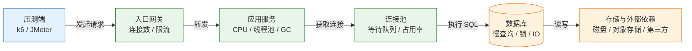
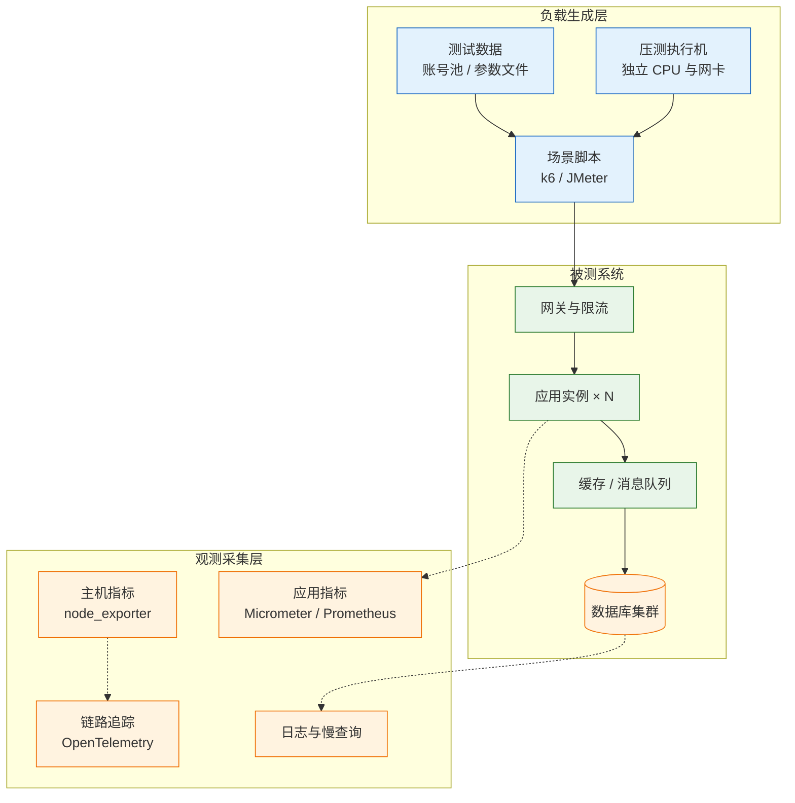
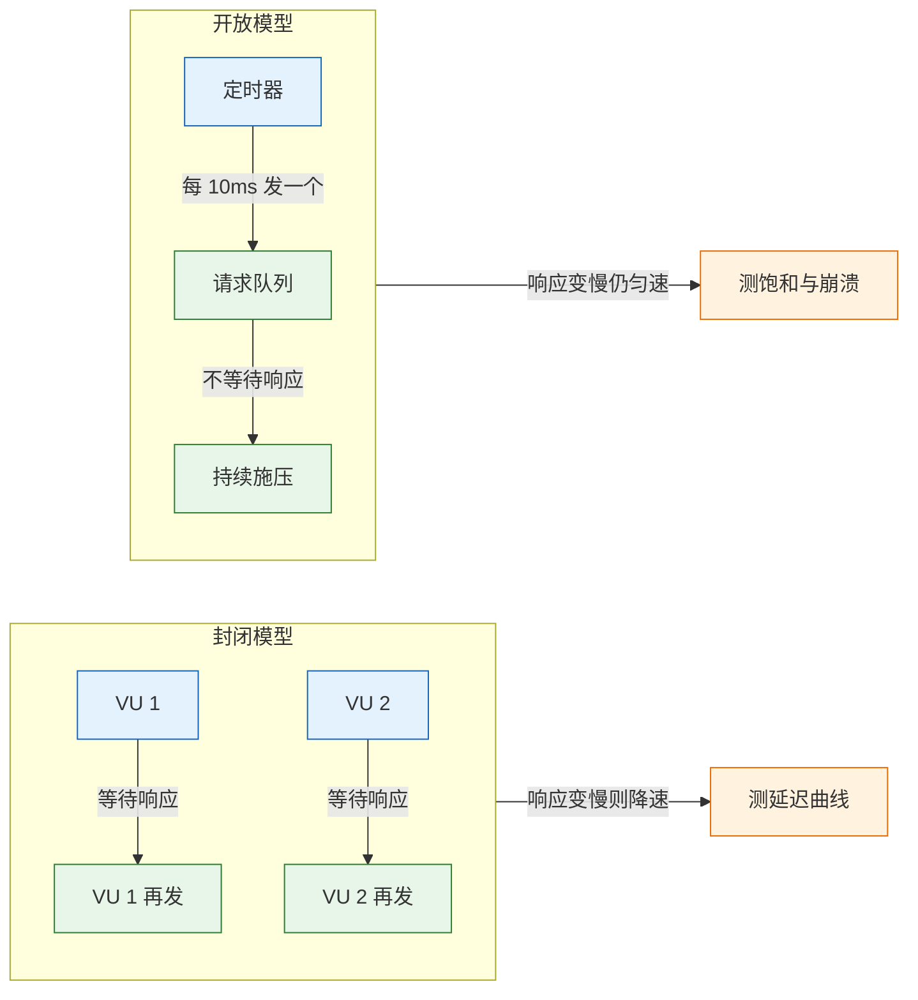
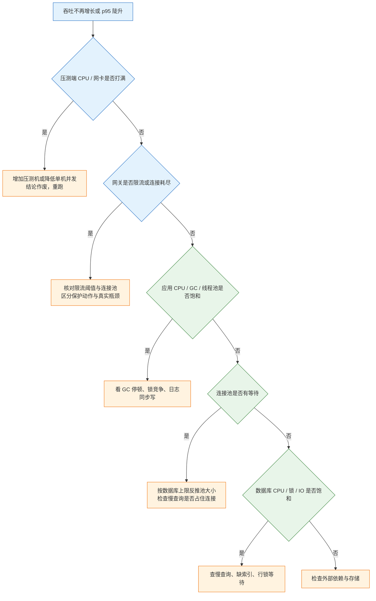

# 性能测试

---

## 一、性能测试是什么

性能测试是在受控负载下测量系统处理能力、响应时间与资源消耗的工程活动。它回答三个问题：当前配置能稳定承载多少业务量、系统最先在哪一层饱和、距离业务阈值还有多少余量。与功能测试不同，性能测试的结论永远带前提条件，脱离配置、数据量和流量结构的 QPS 数字没有意义。

它不验证功能正确性。压测脚本发出十万次下单请求，只能证明链路没有崩溃，不能证明金额、库存和优惠计算正确；也不验证数据一致性、界面可用性和安全边界，这些属于各自专项的职责。

性能测试的价值不在"通过"，而在画出系统的能力曲线：负载上升时吞吐如何增长、延迟如何抬升、在哪一点由线性转为饱和。有了这条曲线，扩容、限流、降级和容量规划才有依据。

### 1.1 核心概念

- **负载（Load）**：单位时间内到达系统的请求数或并发用户数，是自变量。
- **响应时间（Response Time）**：从发出请求到收到完整响应的时间，通常看分位数而不是平均值。
- **吞吐（Throughput）**：单位时间完成的请求数或事务数，只有"完成"才计数。
- **饱和度（Saturation）**：资源排队程度，如 CPU 运行队列、连接池等待队列、磁盘 IO 队列。
- **拐点（Knee）**：吞吐停止随负载线性增长、延迟开始陡升的位置。
- **思考时间（Think Time）**：虚拟用户在两次请求之间的停顿，决定封闭模型的发送节奏。
- **预热（Warm-up）**：JIT 编译、连接池建连、缓存填充完成前的阶段，其数据不计入稳态。

按目的划分，性能测试有六种基本类型：

| 类型 | 目的 | 典型时长 | 主要观察 |
|---|---|---|---|
| 冒烟 | 验证脚本、登录态与链路可用 | 1–2 分钟 | 错误率、状态码 |
| 基准 | 单接口在空载下的成本 | 3–5 分钟 | p50/p95、下游耗时 |
| 负载 | 预期峰值下是否满足 SLO | 10–30 分钟 | p95/p99、错误率、资源 |
| 压力 | 找到拐点与崩溃点 | 逐步加量 | 吞吐拐点、饱和层 |
| 浸泡 | 长时间运行是否退化 | 2–24 小时 | 内存、连接数、GC、磁盘 |
| 尖峰 | 瞬时流量与恢复能力 | 数十秒 | 排队、超时、恢复时间 |

> **注意**：六种类型的脚本可以复用，但阈值和观测项不同。用负载测试的脚本直接跑浸泡，往往会漏掉内存增长和连接泄漏这两个核心指标。

一次请求会依次穿过压测端、入口网关、应用、连接池、数据库和存储，每一层都有独立的饱和点：



压测的任务是找出这条链上最先饱和的一环。总 QPS 只是结果，不是原因。

### 1.2 与相邻技术的关系

性能测试位于"验证能力"的位置，向上承接容量规划，向下依赖可观测性提供证据，与功能测试、混沌工程各有边界。

| 技术 | 关注点 | 与性能测试的边界 |
|---|---|---|
| 功能测试 | 输入输出是否符合预期 | 不测量时间与资源，用例可被压测复用 |
| 负载测试 | 预期流量下是否达标 | 是性能测试的一种，结论用于验收 |
| 容量规划 | 需要多少资源、留多少余量 | 消费压测曲线，结合成本与增长预测 |
| 可观测性 | 指标、日志、链路的持续采集 | 为压测提供分层证据，压测反过来校准阈值 |
| 混沌工程 | 注入故障验证韧性 | 关注"坏的时候怎样"，压测关注"好的时候上限" |
| 代码剖析 | 单请求内部耗时分布 | 定位代码级根因，不替代端到端压测 |

> **运维提示**：压测报告里的每一个结论都应当能对应到一个监控面板。没有监控数据的压测，只能得到"快"或"慢"的模糊印象，无法指导扩容。

### 1.3 架构组成

一套可复现的压测体系由四部分组成：负载生成、被测系统、观测采集、结果归档。



| 组成部分 | 职责 | 关键要求 |
|---|---|---|
| 负载生成 | 按模型产生请求、维持节奏 | 独立机器、时钟同步、自身资源不满载 |
| 被测系统 | 提供与生产一致的版本与配置 | 同镜像、同参数、同中间件版本 |
| 观测采集 | 记录分层指标与调用链 | 采样率固定、时间戳对齐、保留原始数据 |
| 结果归档 | 保存脚本、配置、指标与结论 | 可复现，能回答"当时怎么跑的" |

三层的时钟必须同步，否则 QPS 拐点和 CPU 抬升对不上时间轴，排查会直接失效。容器环境统一挂载宿主时钟，物理机用 chrony 或 NTP 校时，偏差控制在秒级以内。

---

## 二、环境与工具选型

压测环境的第一原则是隔离：压测机不能与被测服务同机，测试环境不能连真实计费、短信和支付通道。第二原则是一致：镜像、JVM 参数、连接池大小、中间件版本都要与生产对齐，否则测出来的是另一套系统。

### 2.1 压测环境准备

动手前先核对压测机的资源，确认它有能力发出目标流量。千兆网卡的理论上限约 125 MB/s，单个请求 2 KB、目标 5000 RPS 时，仅请求体就需要 10 MB/s，加上响应和 TLS 开销，带宽会先成为瓶颈。

```bash
# ========== 压测机基础信息 ==========
# 查看 CPU 核数与型号，确认压测端不会先打满
lscpu | grep -E '^CPU\(s\)|Model name'

# 查看内存，k6 在大量 VU 时内存占用明显
free -h

# 查看网卡速率与双工模式
ethtool eth0 | grep -E 'Speed|Duplex'

# 查看文件描述符上限，连接数多时必须调大
ulimit -n

# ========== 时间同步 ==========
# 查看时钟偏差，超过 1 秒就要处理
chronyc tracking

# ========== 到目标服务的网络质量 ==========
# 连续探测 20 次，观察 RTT 抖动与丢包
ping -c 20 10.0.1.20
```

| 检查项 | 要求 | 不满足的后果 |
|---|---|---|
| 压测机 | 独立主机，4 核以上 | 工具抢 CPU，容量被低估 |
| 网络位置 | 与目标同机房、同网段 | RTT 偏大，延迟结论失真 |
| 数据量 | 接近生产，字段分布一致 | 小表全走缓存，压不出慢查询 |
| 版本配置 | 与生产同镜像、同参数 | 参数不同，结论不可用 |
| 外部依赖 | 沙箱、Mock 或挡板 | 真实计费、被限流、不可复现 |
| 监控 | 主机、应用、数据库指标齐全 | 只能看到总 QPS，无法定位 |
| 缓存状态 | 冷启动与稳态分别记录 | 两者可能差一个数量级 |

> **注意**：测试环境常见的"缩水"是副本数减少、连接池调小、数据库规格降低。这些差异必须写进报告，否则容量结论无法外推到生产。

### 2.2 k6 安装与工程结构

k6 是 Go 编写的负载生成器，脚本用 JavaScript 编写，单个二进制即可运行，资源开销小，适合放进 CI 做性能回归。

```bash
# ========== macOS ==========
brew install k6

# ========== Debian / Ubuntu ==========
# 导入官方签名密钥
curl -s https://dl.k6.io/key.gpg | sudo gpg --dearmor -o /usr/share/keyrings/k6-archive-keyring.gpg

# 添加软件源
echo "deb [signed-by=/usr/share/keyrings/k6-archive-keyring.gpg] https://dl.k6.io/deb stable main" | \
  sudo tee /etc/apt/sources.list.d/k6.list

# 安装
sudo apt update && sudo apt install -y k6

# ========== 容器方式（CI 常用） ==========
# 标准输入传入脚本，适合流水线里临时执行
docker run --rm -i grafana/k6 run - < script.js

# ========== 验证 ==========
k6 version
```

工程目录按职责拆分，脚本、数据、配置和结果分开存放：

| 路径 | 用途 | 说明 |
|---|---|---|
| `scripts/` | 场景脚本 | 一个业务链路一个文件 |
| `data/` | 参数文件 | 账号池、商品 ID，CSV 或 JSON |
| `config/` | 环境配置 | 各环境的 BASE_URL 与阈值 |
| `results/` | 结果归档 | summary JSON、HTML 报告 |
| `lib/` | 公共函数 | 登录、签名、断言封装 |

### 2.3 压测工具对比

工具选型取决于协议支持、脚本可维护性和团队技能，不存在通用最优解。

| 工具 | 负载模型 | 脚本语言 | 适用场景 |
|---|---|---|---|
| k6 | 封闭与开放均支持 | JavaScript | HTTP/WebSocket，CI 集成，开发者友好 |
| JMeter | 以线程组为核心 | XML 配置 / Groovy | 多协议、图形化、传统测试团队 |
| Locust | 协程，偏封闭 | Python | 复杂业务逻辑、自定义协议 |
| wrk / wrk2 | 多线程，偏开放 | Lua | 单接口基准、极限吞吐测量 |
| Gatling | 异步 Actor | Scala / Java DSL | 高并发、报告完善、JVM 团队 |

k6 的阈值可以直接决定流水线成败，这是它适合性能回归的关键：阈值不达标时进程以非零码退出，不需要额外解析报告。

### 2.4 观测面准备

压测期间至少采集四类数据：压测端指标、入口指标、应用指标、数据层指标。用 Prometheus 查询时，先确认指标名与标签，避免压测开始后才发现采集缺失。

```bash
# ========== 主机层 ==========
# 每秒采样一次，观察 CPU、上下文切换、中断
pidstat -u -w -p "$(pgrep -f 'java.*app.jar')" 1

# 查看 TCP 连接状态汇总，TIME_WAIT 过多会影响端口复用
ss -s

# 查看磁盘 IO 利用率与 await
iostat -x 1

# ========== 容器层 ==========
# 不进入交互模式，取一次快照
docker stats --no-stream

# ========== 应用层 ==========
# JVM GC 与堆使用，按实际 PID 替换
jstat -gcutil "$(pgrep -f 'java.*app.jar')" 1000
```

| 层次 | 关键指标 | 采集方式 |
|---|---|---|
| 压测端 | VU 数、发送速率、自身 CPU | k6 summary、node_exporter |
| 入口 | QPS、连接数、4xx/5xx、限流次数 | Nginx / 网关访问日志与指标 |
| 应用 | p95、线程池队列、GC 停顿、错误率 | Micrometer、Actuator、JFR |
| 连接池 | 活跃连接、等待线程、获取耗时 | HikariCP 指标、Druid 监控 |
| 数据库 | 慢查询、锁等待、连接数、CPU | `pg_stat_activity`、`performance_schema` |
| 存储 | IOPS、吞吐、await、队列深度 | node_exporter、云监控 |

> **运维提示**：压测开始前先做一次 5 分钟的"空载基线"，记录各层指标的正常值。没有基线，压测中出现 40% 的 CPU 占用时无法判断是正常还是异常。

---

## 三、负载模型与指标口径

负载模型决定压力如何施加，指标口径决定结论是否可信。两者任一出错，后面的分析都建立在错误数据上。

### 3.1 封闭模型与开放模型

**封闭模型**固定虚拟用户数，每个用户收到响应后才发下一个请求。响应变慢时发送速率自动下降，压力被系统"吸收"，因此它测的是"固定并发下的延迟"，不是"固定到达率下的能力"。

**开放模型**固定到达率，无论服务多慢都按计划发请求。它更接近真实流量，也更容易暴露排队和崩溃点。



两种模型靠利特尔法则换算：

```text
在途请求数 L = 到达率 λ × 平均响应时间 W
```

目标 500 RPS、平均响应 200 ms，则平均有 `500 × 0.2 = 100` 个请求在途。若应用线程池只有 50，剩余 50 个只能排队，响应时间被拉长——这不是代码慢，是并发度不足。反过来，已知并发 200、平均响应 400 ms，可承载的到达率约为 `200 / 0.4 = 500 RPS`。

排队延迟随利用率非线性上升。设单请求服务时间 S、到达率 λ，利用率 `U = λS`，近似等待时间与 `U / (1 - U)` 成正比：利用率 70% 时等待约为服务时间的 2.3 倍，90% 时约为 9 倍，99% 时约为 99 倍。容量规划通常按 70%–80% 水位留余量，而不是等 CPU 到 100%。

| 维度 | 封闭模型 | 开放模型 |
|---|---|---|
| 控制变量 | 并发用户数 | 每秒到达请求数 |
| 响应变慢时 | 自动降低发送速率 | 维持发送速率，队列堆积 |
| 适合回答 | 固定并发下的延迟 | 目标流量下是否稳定 |
| 典型执行器 | `constant-vus`、`ramping-vus` | `constant-arrival-rate`、`ramping-arrival-rate` |
| 常见误读 | 把 VU 当 RPS | 忽略 `maxVUs` 被顶满 |

### 3.2 核心指标口径

| 指标 | 定义 | 常见误用 |
|---|---|---|
| 平均响应时间 | 所有请求耗时的算术平均 | 被大量快请求拉低，掩盖长尾 |
| p95 / p99 | 95%/99% 的请求不超过该值 | 只看 p95，忽略 p99 的超时 |
| 吞吐（RPS/TPS） | 每秒完成的请求或事务数 | 把"发出"当成"完成" |
| 错误率 | 非预期状态码、超时、连接失败 | 只统计 5xx，漏掉超时和业务错误码 |
| 并发数 | 同时在途的请求数 | 把 VU 数直接当成 RPS |
| 资源饱和度 | CPU、内存、连接池、磁盘 IO | 只看应用，不看数据库与网络 |
| Apdex | 以阈值 T 计算的满意度指数 | 阈值 T 未按业务定义，数字无意义 |

连接池不是越大越好。池大小要覆盖"同时正在使用连接"的峰值，而不是所有在途请求；一个请求只在访问数据库的那段时间占用连接。把池调到与线程池一样大，往往只是把压力全部推给数据库。

> **注意**：k6 默认把 2xx 和 3xx 视为成功，`http_req_failed` 只看这个判定。业务返回 200 但响应体里是错误码时，该指标仍显示 0，必须自定义 `Rate` 统计。

### 3.3 分位聚合与时间对齐

分位数不能求平均。两个实例的 p95 分别是 100 ms 和 500 ms，合并后的 p95 既不是 300 ms，也不能由两者平均得出；必须把原始桶或样本合并后重新计算。

Prometheus 的直方图用 `histogram_quantile` 在聚合后的桶上计算，聚合维度写错会得到失真结果：

```promql
# 正确：先按服务聚合桶，再算分位
histogram_quantile(
  0.95,
  sum by (le, service) (rate(http_server_requests_seconds_bucket[5m]))
)

# 错误：对已经算好的分位再求平均
avg(http_server_requests_seconds_p95)
```

| 数据源 | 分位算法 | 误差来源 |
|---|---|---|
| k6 summary | 客户端全样本排序 | 不含网络重传与服务端排队 |
| Prometheus 直方图 | 桶插值 | 桶边界过粗，长尾被截断 |
| 链路追踪 | 采样样本计算 | 采样率低时高估或低估 |
| 数据库慢日志 | 阈值过滤 | 只记录超过阈值的语句 |

时间对齐依赖时钟同步。压测机、应用节点、数据库节点的 NTP 偏差应控制在 1 秒内，否则"QPS 在 10:05 到顶、CPU 在 10:07 抬升"这类结论会把因果顺序判反。

---

## 四、完整压测脚本

脚本要把业务链路、参数生成、断言和阈值写全，才能得到可用的数据。下面以"登录后创建订单"为例，从封闭模型写到开放模型。

### 4.1 脚本结构与参数注入

环境相关的内容全部通过环境变量传入，脚本本身不写死地址和令牌。`__ENV` 读取 `-e` 传入的值，`__VU` 是当前虚拟用户编号，`__ITER` 是该用户的迭代次数。

| 脚本要素 | 作用 | 常见错误 |
|---|---|---|
| `options.stages` | 定义负载曲线 | 没有预热段，首分钟数据失真 |
| `options.thresholds` | 定义达标口径 | 只写 p95，忽略错误率 |
| `default function` | 单次迭代的业务链路 | 写入固定账号，造成热点 |
| `check` | 断言状态码与响应 | 把断言失败当成请求失败 |
| `sleep` | 模拟思考时间 | 封闭模型下漏写，压力被放大 |
| `tags` | 按接口拆分指标 | 全部请求同名，无法定位 |

```bash
# ========== 目录约定 ==========
# scripts/order.js      业务脚本
# data/accounts.csv     账号池
# config/test.env       环境变量

# ========== 运行并注入参数 ==========
# 创建结果目录，--summary-export 不会自动创建父目录
mkdir -p results

# BASE_URL 指向测试环境，TOKEN 使用测试账号签发的令牌
k6 run \
  -e BASE_URL=http://10.0.1.20:8080 \
  -e TOKEN="$TEST_TOKEN" \
  --summary-export results/order-summary.json \
  scripts/order.js
```

`--summary-export` 输出机器可读的 JSON，便于归档和趋势对比。脚本内部的 `handleSummary` 可以自定义报告格式，把关键指标写进 HTML 或直接推送到时序库。

### 4.2 封闭模型脚本

```js
// scripts/order.js
// 依赖：k6 1.x，Node 语法由 k6 内置的 Goja 引擎解释
import http from 'k6/http';
import { check, sleep } from 'k6';
import { randomIntBetween } from 'https://jslib.k6.io/k6-utils/1.4.0/index.js';

// ========== 运行配置 ==========
// 阈值不达标时 k6 以退出码 99 结束，可直接卡住 CI
const thresholds = {
  http_req_duration: ['p(95)<300', 'p(99)<800'], // 95% 在 300ms 内，99% 在 800ms 内
  http_req_failed: ['rate<0.01'],                 // 失败率低于 1%
  checks: ['rate>0.99'],                          // 业务断言通过率高于 99%
};

// 冒烟模式用固定 VU 与时长；正式模式用 stages 梯度加压，两者互斥
const smoke = __ENV.SMOKE === '1';

export const options = smoke
  ? { vus: 10, duration: '30s', thresholds }
  : {
      // stages 是 ramping-vus 执行器的简写：按时长把 VU 数推到目标值
      stages: [
        { duration: '1m', target: 50 },    // 预热：让 JIT、连接池、缓存进入稳态
        { duration: '3m', target: 200 },   // 爬坡：观察吞吐是否随并发线性增长
        { duration: '5m', target: 200 },   // 稳态：采集结论数据
        { duration: '30s', target: 0 },    // 收尾：优雅退出，避免残留连接
      ],
      thresholds,
    };

// ========== 业务场景 ==========
export default function () {
  // 每次迭代生成唯一客户号，避免唯一索引冲突导致假失败
  const customerNo = `C-${__VU}-${__ITER}-${Date.now()}`;

  // 构造请求体；金额用整数分，避免浮点误差
  const payload = JSON.stringify({
    customerNo,
    amountCents: randomIntBetween(1000, 5000),
    channel: 'web',
  });

  // 发起创建订单请求，tags 用于在结果里按接口拆分指标
  const res = http.post(`${__ENV.BASE_URL}/api/orders`, payload, {
    headers: {
      'Content-Type': 'application/json',
      Authorization: `Bearer ${__ENV.TOKEN}`,
    },
    tags: { name: 'create_order' },
    timeout: '10s', // 单请求超时，避免慢请求无限占用 VU
  });

  // 断言状态码与响应结构；check 结果单独统计，不影响 http_req_failed
  check(res, {
    'status is 201': (r) => r.status === 201,
    'has order id': (r) => {
      try {
        return JSON.parse(r.body).id !== undefined;
      } catch (e) {
        return false;
      }
    },
  });

  // 思考时间：模拟用户操作间隔，1 秒上下浮动
  sleep(Math.random() * 0.5 + 0.75);
}
```

### 4.3 开放模型与场景编排

开放模型用到达率控制压力，工具根据响应时间自动增加 VU。`preAllocatedVUs` 是预分配数量，`maxVUs` 是上限；上限被顶满说明服务已经把请求拖到工具都发不出去，这本身就是结论。

```js
// scripts/order-open.js
import http from 'k6/http';
import { check } from 'k6';

export const options = {
  scenarios: {
    // 场景一：恒定到达率，验证目标流量下是否稳定
    steady: {
      executor: 'constant-arrival-rate',
      rate: 300,            // 每秒发起 300 个迭代
      timeUnit: '1s',
      duration: '10m',
      preAllocatedVUs: 100, // 预分配，减少运行中扩容抖动
      maxVUs: 800,          // 上限，顶满即代表服务端已饱和
      gracefulStop: '30s',  // 到点后给在途请求 30 秒收尾
    },
    // 场景二：阶梯到达率，用于寻找拐点
    ramp: {
      executor: 'ramping-arrival-rate',
      startRate: 50,
      timeUnit: '1s',
      preAllocatedVUs: 100,
      maxVUs: 800,
      stages: [
        { target: 100, duration: '2m' },
        { target: 200, duration: '2m' },
        { target: 400, duration: '2m' },
        { target: 600, duration: '2m' },
      ],
    },
  },
  thresholds: {
    http_req_duration: ['p(95)<300'],
    http_req_failed: ['rate<0.01'],
  },
};

export default function () {
  const res = http.get(`${__ENV.BASE_URL}/api/products?page=1&size=20`, {
    tags: { name: 'list_products' },
  });
  check(res, { 'status is 200': (r) => r.status === 200 });
}
```

两个场景会同时运行，指标按 `scenario` 标签自动拆分。只想跑其中一个时，用 `--env` 配合脚本内的条件分支，或直接拆成两个文件，避免在报告里混在一起。

### 4.4 业务指标与自定义统计

状态码正确不代表业务成功。下面的脚本用 `Counter`、`Rate`、`Trend` 分别统计业务错误、业务成功率和关键步骤耗时。

```js
// scripts/business.js
import http from 'k6/http';
import { check } from 'k6';
import { Counter, Rate, Trend } from 'k6/metrics';

// ========== 自定义指标 ==========
// 业务错误码计数器，按错误码打标签
const bizErrors = new Counter('biz_errors');
// 业务成功率：响应体 code 为 0 才算成功
const bizSuccess = new Rate('biz_success');
// 下单接口的服务端处理耗时（取自响应体，不含网络）
const serverCost = new Trend('server_cost_ms', true);

export const options = {
  vus: 50,
  duration: '5m',
  thresholds: {
    biz_success: ['rate>0.995'],   // 业务成功率高于 99.5%
    server_cost_ms: ['p(95)<200'], // 服务端处理耗时 p95 低于 200ms
  },
};

export default function () {
  const res = http.post(`${__ENV.BASE_URL}/api/orders`, JSON.stringify({ amountCents: 1999 }), {
    headers: { 'Content-Type': 'application/json', Authorization: `Bearer ${__ENV.TOKEN}` },
    tags: { name: 'create_order' },
  });

  let body = {};
  try {
    body = JSON.parse(res.body);
  } catch (e) {
    bizErrors.add(1, { reason: 'invalid_json' });
  }

  // 业务码 0 表示成功，其余按错误码计数
  const ok = res.status === 201 && body.code === 0;
  bizSuccess.add(ok);
  if (!ok) {
    bizErrors.add(1, { reason: String(body.code || res.status) });
  }

  // 服务端耗时字段由后端返回，单位毫秒
  if (body.costMs !== undefined) {
    serverCost.add(body.costMs);
  }

  check(res, { 'http 201': (r) => r.status === 201 });
}
```

> **注意**：`Trend` 的第二个参数 `true` 表示按时间值展示（单位毫秒），阈值计算不受影响；不加这个参数时，指标仍可参与 `p(95)` 计算，只是报告按普通数值呈现。

### 4.5 运行与结果解读

先跑一次 30 秒、10 VU 的冒烟，确认脚本、令牌、参数和数据都正确，再进入正式压测。

```bash
# ========== 冒烟 ==========
# SMOKE=1 切换到固定 10 VU / 30 秒，只验证链路，不看性能结论
k6 run -e SMOKE=1 -e BASE_URL="$BASE_URL" -e TOKEN="$TOKEN" scripts/order.js

# ========== 正式压测 ==========
# 输出 JSON 摘要，便于与历史版本对比
k6 run --summary-export results/order-$(date +%Y%m%d-%H%M).json \
  -e BASE_URL="$BASE_URL" -e TOKEN="$TOKEN" scripts/order.js
```

开放模型脚本里的两个场景会同时执行。只跑其中一个时，注释掉另一个场景的配置，或拆成两个文件，不要靠命令行参数猜测。

摘要中的关键行如下，具体数值取决于环境：

```text
http_req_duration..............: avg=<实测> min=<实测> med=<实测> p(90)=<实测> p(95)=<实测>
http_req_failed................: <实测>% ✓ <成功数> ✗ <失败数>
checks.........................: <实测>% ✓ <通过数> ✗ <失败数>
iterations.....................: <完成数> <速率>/s
vus_max........................: <实测>
```

阈值不达标时的输出形状：

```text
✗ http_req_duration
  ↳  95% — ✓ <达标数> / ✗ <超时数>
```

退出码为 99，流水线据此判定失败。判定前先确认不是压测端先饱和：`vus_max` 被顶满、压测机 CPU 超过 80%、网卡丢包，都会伪造出"服务端慢"的结论。

---

## 五、梯度加压与瓶颈定位

### 5.1 冒烟与梯度方案

冒烟只跑 1–2 分钟、低并发，确认脚本、登录态、数据、下游都通。冒烟不过，后面的数据全部作废。

梯度加压的每一档要稳定运行 3–5 分钟再记录，间隔太短会把爬坡阶段的排队当成稳态。

| 档位（VU） | p95 | 错误率 | 应用 CPU / 数据库 CPU |
|---|---|---|---|
| 50 | 80 ms | 0% | 20% / 15% |
| 100 | 130 ms | 0% | 40% / 30% |
| 200 | 240 ms | 0% | 75% / 55% |
| 400 | 900 ms | 3.2% | 98% / 80% |

前两档处于线性区，200 VU 时应用 CPU 已到 75%，接近拐点；400 VU 时应用接近打满、错误率抬头，判断为已饱和。

表内数字是示例形状，不是通用结论。判断依据是趋势：吞吐是否还随并发增长、p95 是否突然抬升、错误是否开始出现。拐点通常落在资源利用率 70%–80% 之后，因为排队延迟随利用率非线性上升。

### 5.2 拐点识别与结果分析

把每一档的"到达率、完成率、p95、错误率、各层利用率"画在同一时间轴上，可以区分三种典型形态：

| 形态 | 表现 | 含义 |
|---|---|---|
| 线性增长 | 吞吐随并发上升，p95 平稳 | 资源充足，可继续加量 |
| 提前饱和 | 吞吐不再增长，p95 陡升 | 某层达到上限，需定位 |
| 崩溃 | 吞吐下降，错误率飙升 | 队列溢出、连接耗尽或级联超时 |

定位方法用 USE 与 RED 两套模型交叉验证：USE 看每层资源的利用率、饱和度和错误；RED 看服务的速率、错误和延迟。两者在同一时刻同时抬升的那一层，就是瓶颈层。

```promql
# 应用实例 CPU 使用量（核），按 pod 拆分
sum by (pod) (rate(container_cpu_usage_seconds_total{namespace="shop"}[1m]))

# 数据库连接数占上限比例，先聚合成单值再相除
sum(pg_stat_activity_count) / max(pg_settings_max_connections)

# 连接池等待线程数，持续大于 0 说明池不够
hikaricp_connections_pending
```

### 5.3 分层排查顺序

从压测端往数据层查，是因为越靠前的层越容易被误判，改动成本也越低。



排查时一次只改一个变量。同时调大连接池、加索引、改缓存，复测变快也无法归因。

### 5.4 常见性能瓶颈

| 瓶颈 | 典型现象 | 验证方式 | 优化方向 |
|---|---|---|---|
| N+1 查询 | 单请求 SQL 数随列表长度增长 | 开 SQL 日志数语句条数 | 批量查询、关联加载 |
| 缺索引 | 数据量增大后 p95 阶跃上升 | `EXPLAIN` 看全表扫描 | 补复合索引，注意最左前缀 |
| 连接池过小 | 获取连接等待时间高 | 池等待线程数、获取耗时 | 按 `并发 × 持有时间` 估算 |
| 连接池过大 | 数据库连接数打满、上下文切换高 | 数据库 `max_connections` | 收敛到数据库可承受范围 |
| 长事务 | 行锁等待、死锁增加 | `pg_stat_activity`、锁视图 | 缩短事务，移出网络调用 |
| GC 停顿 | 周期性超时尖刺 | GC 日志、停顿分位 | 调堆、换收集器、减对象分配 |
| 同步日志 | CPU 不高但吞吐上不去 | 日志框架异步配置 | 改异步 Appender、降级别 |
| 缓存击穿 | 冷启动或过期瞬间打满数据库 | 缓存命中率、数据库 QPS | 空值缓存、互斥重建、预热 |
| 线程池排队 | 请求等待时间远大于处理时间 | 队列长度、活跃线程数 | 按下游能力设池，加背压 |
| 网络带宽 | 大响应体时吞吐封顶 | 网卡速率、重传率 | 压缩、分页、CDN |

> **安全警告**：在生产环境直接加压可能拖垮真实用户，必须有隔离流量、限流、熔断和回滚预案，并提前通知值班人员。没有这些条件时，只在测试环境或影子链路压测。

---

## 六、容量结论与复测

### 6.1 容量结论的表述

容量结论必须带前提，写成一句可被复核的话，而不是一个孤立的数字。

```text
在 4C8G × 2 实例、PostgreSQL 4C16G、商品 10 万行、缓存预热完成的条件下，
p95 < 300ms 的稳定吞吐为 320 RPS，对应约 160 并发；
超过 360 RPS 后 p95 快速上升，数据库 CPU 先到 80%。
按 70% 水位留余量，建议线上按 220 RPS 做容量规划。
```

结论要包含：硬件与副本数、数据规模、缓存状态、外部依赖状态、达标口径、拐点位置、余量建议。缺任何一项，下一个人都无法复现。

### 6.2 优化复测方法

复测必须复用同一脚本、同一数据量、同一梯度、同一时间窗。否则无法判断是优化生效，还是这次流量更小。

| 变量 | 复测要求 | 不控制会怎样 |
|---|---|---|
| 脚本与阈值 | 完全一致 | 口径变化，数字不可比 |
| 数据量 | 同一份数据或同量级 | 查询计划变化，结论失真 |
| 缓存状态 | 同为冷启动或同为稳态 | 差一个数量级 |
| 实例与规格 | 不变 | 无法归因到代码改动 |
| 压测时段 | 避开定时任务与备份 | 资源竞争导致误判 |
| 外部依赖 | 同一 Mock 或沙箱 | 第三方抖动污染结果 |

### 6.3 适用边界

| 场景 | 是否适用 | 原因 |
|---|---|---|
| 接口稳定、准备上线 | 适用 | 可给出容量与余量结论 |
| 功能频繁变更 | 不适用 | 数字下周即失效 |
| 数据量严重不足 | 慎用 | 小表压不出慢查询 |
| 缓存全冷或全热 | 需分别测 | 两种状态性能差距大 |
| 真实第三方计费 | 禁止 | 会产生真实费用与限流 |
| 只压读接口 | 不完整 | 写路径的锁与事务更易成瓶颈 |
| 生产环境无隔离 | 禁止 | 会拖垮真实用户 |

> **注意**：压测不能替代线上监控。真实流量结构、热点 Key、用户分布和后台任务节奏，压测都模拟不全；容量结论要定期用生产指标校准。

---

## 七、常见排障

| 现象 | 最可能原因 | 处理 |
|---|---|---|
| 用平均响应时间下结论 | 长尾被平均掩盖 | 同时看 p95、p99 与最大值 |
| 压测机与被测服务同机 | 工具抢 CPU 与网络 | 分开部署，压测端也纳入监控 |
| 把 VU 数当 RPS | 封闭模型响应变慢会自动降速 | 用到达率模型，或按利特尔法则换算 |
| `check` 失败但错误率为 0 | `http_req_failed` 只看状态码 | 自定义 `Rate` 统计业务失败 |
| 数据量太小压不出问题 | 查询走内存、索引全命中 | 造到生产同量级或按比例放大 |
| 所有请求打同一账号 | 行锁与缓存热点集中 | 账号池加随机分布 |
| 未预热就记录数据 | JIT、连接池、缓存未就绪 | 先跑 1–2 分钟预热再统计 |
| 连接池调大后更慢 | 数据库连接打满、上下文切换增加 | 按数据库上限反推池大小 |
| 压测打到真实第三方 | 配置未隔离 | 扫一遍外部域名，切沙箱或挡板 |
| 浸泡测试内存持续上涨 | 泄漏或缓存无上限 | 看堆快照、连接数、队列长度 |
| 压测期间定时任务在跑 | 与在线流量抢 CPU 与 IO | 按生产时间窗开启或单独标注 |
| 只看应用 CPU 不看 GC | 长停顿表现为超时 | 记录 GC 次数与停顿分位 |
| 只压一个接口代表全站 | 真实流量是读写混合 | 按生产比例混合接口与参数 |

排障顺序：

1. 确认压测端不是瓶颈：CPU、网卡、文件描述符、`maxVUs` 是否顶满。
2. 按错误类型分层：超时指向排队，连接拒绝指向连接数或端口，5xx 指向应用异常。
3. 对齐时间轴：QPS 拐点与哪一层指标在同一分钟抬升。
4. 查慢查询和锁等待，再查连接池与线程池。
5. 一次只改一个变量，用同一梯度复测，并补一条长期回归。

性能测试的最终交付物不是一份报告，而是一套能重复执行的脚本、一条可对比的指标曲线，以及一份写明前提的容量结论。
