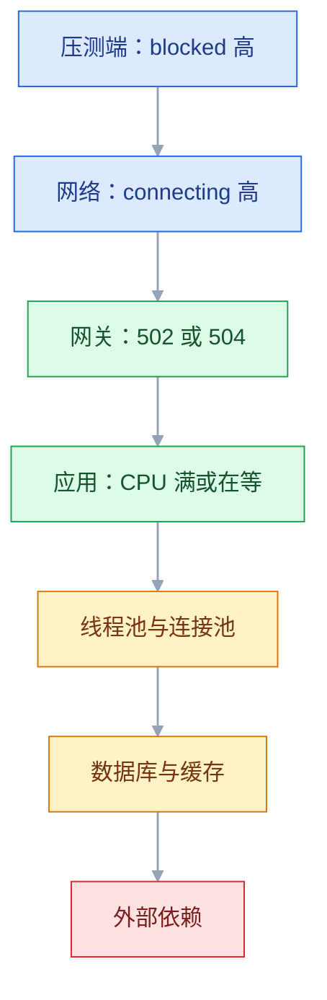

# 性能测试

## 一、工程案例：把下单链路压到 500 QPS，并给出瓶颈结论

**场景**：订单服务下周做推广，业务方要求「500 QPS 下 P95 < 500ms、错误率 < 0.1%」。当前是单台 4C8G，应用、MySQL、Redis 同机，`t_order` 500 万行。团队只在本地 `ab` 压过 200 并发，看到 QPS 300 就以为够用。这次要交付的不是一个数字，而是一份**能指导扩容的结论**：拐点在哪、瓶颈是什么、改完提升了多少、要几台机器。

**先把目标写下来**，否则压完只会得到一堆无法解释的曲线：

```text
场景：查询订单列表（80%） + 创建订单（20%），比例贴近真实流量
负载：开环到达率，50/200/350/500 四级阶梯，500 QPS 保持 5 分钟（全程约 12.5 分钟）
标准：P95 < 500ms、P99 < 1000ms、错误率 < 0.1%、CPU < 80%
环境：预发，4C8G × 1，数据量与生产同数量级
统计：前 3 级各取 1 分钟保持段，500 QPS 取后 4 分钟；爬坡段不计入
```

### 1.1 环境与数据准备

```bash
# 压测机与被测机分开：工具本身吃 CPU，同机会把数据压失真
nproc; free -g; uname -r                    # 被测机：4 核 / 7G
k6 version                                  # 以官方当前稳定版为准
curl -s http://192.168.1.10:8080/actuator/health    # {"status":"UP"}
```

数据量决定结论的有效性。1000 条数据下全表扫也就 1ms，压不出任何问题：

```sql
-- 500 个压测账号，避免所有请求挤在一个用户上
INSERT INTO t_user (username, password, nickname, created_at)
SELECT CONCAT('perf_user_', LPAD(n, 4, '0')),
       '$2b$10$69.du77Zn48rNtjUGqa0jODctzBMgcMSWPR7ExIzqWTcx4c7MVopy',  -- Perf@123456
       CONCAT('压测用户', n), NOW()
FROM (SELECT (a.n + b.n*10 + c.n*100) + 1 AS n
      FROM (SELECT 0 AS n UNION SELECT 1 UNION SELECT 2 UNION SELECT 3 UNION SELECT 4
            UNION SELECT 5 UNION SELECT 6 UNION SELECT 7 UNION SELECT 8 UNION SELECT 9) a,
           (SELECT 0 AS n UNION SELECT 1 UNION SELECT 2 UNION SELECT 3 UNION SELECT 4
            UNION SELECT 5 UNION SELECT 6 UNION SELECT 7 UNION SELECT 8 UNION SELECT 9) b,
           (SELECT 0 AS n UNION SELECT 1 UNION SELECT 2 UNION SELECT 3 UNION SELECT 4) c) t
WHERE n <= 500;

SELECT (SELECT COUNT(*) FROM t_order) AS order_rows, (SELECT COUNT(*) FROM t_user) AS user_rows;
-- | order_rows | user_rows |
-- |    5000000 |    100500 |
```

监控必须在压测开始前就采上，否则事后无法解释「为什么 200 并发就崩了」。最省事的是每 5 秒记一行 `uptime`、`free -m` 与 `vmstat`，重定向到 `/tmp/perf-monitor.log`：

```bash
nohup bash -c 'while true; do date +%T; uptime; vmstat 1 2 | tail -1; sleep 5; done' > /tmp/perf-monitor.log 2>&1 &
```

### 1.2 压测脚本

```javascript
// perf/order.js
import http from 'k6/http';
import { check, group } from 'k6';
import { Rate, Trend } from 'k6/metrics';

const BASE = __ENV.BASE_URL || 'http://192.168.1.10:8080';
const bizOk = new Rate('business_success_rate');
const listTrend = new Trend('list_duration', true);
const createTrend = new Trend('create_duration', true);

// 冒烟只验证脚本对不对，用固定 VU；正式压测才用到达率模型
const SMOKE = __ENV.SMOKE === '1';

const scenario = SMOKE
  ? { executor: 'constant-vus', vus: 2, duration: '30s' }
  : {
      executor: 'ramping-arrival-rate',       // 按「每秒到达多少请求」加压，不按 VU
      startRate: 10,
      timeUnit: '1s',
      stages: [
        { target: 50,  duration: '1m' },      // 爬坡 + 预热：JIT、连接池、缓存填充
        { target: 50,  duration: '1m' },      // 每级保持 1 分钟，够采一组稳态值
        { target: 200, duration: '1m' },
        { target: 200, duration: '1m' },
        { target: 350, duration: '1m' },
        { target: 350, duration: '1m' },
        { target: 500, duration: '1m' },
        { target: 500, duration: '5m' },      // 目标负载保持 5 分钟
        { target: 0,   duration: '30s' },
      ],
      preAllocatedVUs: 100,
      maxVUs: 2500,                           // 500 QPS × 最坏 5s 响应，留足在途 VU
    };

export const options = {
  scenarios: {
    order: scenario,
  },
  thresholds: {
    http_req_duration: ['p(95)<500', 'p(99)<1000'],
    'http_req_duration{name:listOrders}':   ['p(95)<300'],
    'http_req_duration{name:createOrder}':  ['p(95)<800'],
    http_req_failed: ['rate<0.001'],
    business_success_rate: ['rate>0.999'],
  },
  summaryTrendStats: ['avg', 'med', 'p(90)', 'p(95)', 'p(99)', 'max'],
};

// 预登录 50 个账号：登录慢，不能混进主场景的测量
export function setup() {
  const tokens = [];
  for (let i = 1; i <= 50; i++) {
    const res = http.post(`${BASE}/api/auth/login`,
      JSON.stringify({ username: `perf_user_${String(i).padStart(4, '0')}`, password: 'Perf@123456' }),
      { headers: { 'Content-Type': 'application/json' } });
    if (res.status === 200) tokens.push(res.json('data.accessToken'));
  }
  if (tokens.length === 0) throw new Error('没有任何账号登录成功，压测终止');
  return { tokens };
}

export default function (data) {
  const token = data.tokens[__VU % data.tokens.length];   // 轮换账号，避免行锁
  const headers = { 'Content-Type': 'application/json', Authorization: `Bearer ${token}` };

  group('查询订单列表', () => {
    const page = Math.floor(Math.random() * 10) + 1;      // 随机翻页，避免全命中同一页缓存
    const t0 = Date.now();
    const res = http.get(`${BASE}/api/orders?page=${page}&size=20&status=PAID`,
      { headers, tags: { name: 'listOrders' } });
    listTrend.add(Date.now() - t0);
    bizOk.add(check(res, {
      'list: 200': (r) => r.status === 200,
      'list: 有列表': (r) => Array.isArray(r.json('data.items')),
      'list: 不超过 20 条': (r) => r.json('data.items').length <= 20,
    }));
  });

  // 每 4 次迭代建 1 单：列表 80%、创建 20%，和业务口径一致
  if (Math.random() < 0.25) {
    group('创建订单', () => {
      const t0 = Date.now();
      const res = http.post(`${BASE}/api/orders`,
        JSON.stringify({ sku: 'SKU-001', quantity: 1, remark: `perf_${__VU}_${__ITER}` }),
        { headers, tags: { name: 'createOrder' } });
      createTrend.add(Date.now() - t0);
      bizOk.add(check(res, {
        'create: 201': (r) => r.status === 201,
        'create: 返回 id': (r) => Number(r.json('data.id')) > 0,
      }));
    });
  }
}
```

四个设计决定值得解释：

| 决定 | 原因 |
|---|---|
| `ramping-arrival-rate` 而不是 `constant-vus` | 按 QPS 加压才和业务目标同一个口径；VU 模式在响应变慢时会自动降低实际请求速率 |
| `setup` 里预登录 50 个账号并轮换 | 每个 VU 都登录会污染主场景；所有请求同一个用户会撞行锁 |
| `bizOk` 单独统计业务成功率 | `http_req_failed` 只看 HTTP 层，接口返回 200 但 `code` 是错的它不算失败 |
| 到达率模型里不放 `sleep` | 思考时间已由到达率表达；再叠 `sleep` 只会把在途 VU 抬高，`maxVUs` 不够时会被迫降速，压不到目标 QPS |

### 1.3 冒烟与梯度执行

```bash
# 冒烟：验证脚本本身对，不是测性能
k6 run -e SMOKE=1 perf/order.js
```

`SMOKE=1` 走脚本里的固定 2 VU 分支。不能写 `--vus 2 --duration 30s`：脚本里定义了 `scenarios` 之后，这两个参数不能再覆盖它，k6 会提示参数冲突，实际执行的仍是脚本里的场景。

```text
INFO[0002] setup 完成：50 个有效 token
     ✓ business_success_rate........: 100.00%
     ✓ http_req_failed..............: 0.00%
     http_reqs......................: 1246   41.53/s
```

冒烟要核对四件事：请求成功、断言全过、**数据真的落库**（`SELECT ... WHERE remark LIKE 'perf_%'`）、速率不是 0 也不是异常高。这一步能拦住 90% 的「压了个寂寞」：token 过期全 401、字段名错全 400、地址写成 localhost 压的是自己。

```bash
k6 run -e BASE_URL=http://192.168.1.10:8080 perf/order.js 2>&1 | tee /tmp/run1.log
```

| 阶段 | 到达率 | QPS | 平均 RT | P95 | P99 | 错误率 | CPU | 连接池 active |
|---|---|---|---|---|---|---|---|---|
| 1 | 50 | 49 | 48ms | 96ms | 158ms | 0% | 14% | 2/20 |
| 2 | 200 | 197 | 82ms | 210ms | 380ms | 0% | 38% | 9/20 |
| 3 | 350 | 341 | 160ms | 460ms | 890ms | 0.08% | 62% | 20/20 |
| 4 | 500 | **352** | **1420ms** | **3180ms** | **5100ms** | **7.2%** | **98%** | 20/20，等待 300+ |

四行对应脚本里的四级阶梯：前 3 级各取 1 分钟保持段，500 QPS 取后 4 分钟，爬坡段全部丢弃。


**怎么读这张表**：到达率从 200 涨到 350，QPS 还能跟上（197 → 341）；从 350 涨到 500，实际 QPS 反而掉到 352，P95 从 460ms 跳到 3180ms，错误率 7.2%——**这就是饱和**。系统不是「慢了一点」，是「加多少压力都吐不出更多结果」。

### 1.4 定位瓶颈

**第一步：先排除压测端。** 看 k6 自己的时间构成：

```text
http_req_blocked........: avg=0.8ms      ← 等空闲连接，很小
http_req_connecting.....: avg=0.3ms      ← 建连，很小
http_req_waiting........: avg=1410ms     ← 等服务器首字节，几乎全部时间
http_req_receiving......: avg=5.2ms      ← 收响应体，很小
```

`waiting` 占了 99%，说明瓶颈在服务端，不是网络、不是工具。如果 `blocked` 很大，那是压测机自己的连接复用或端口耗尽（`ulimit -n`、大量 TIME_WAIT），先修工具侧。顺序的完整判据见 3.11。

**第二步：看服务端 CPU。**

```bash
top -H -p $(pgrep -f 'order-service.jar')
```

```text
load average: 12.42, 9.81, 5.20
%Cpu(s): 96.5 us,  3.0 sy,  0.0 ni,  0.3 id
 18250 app    99.2  26.8   5:02.11 http-nio-8080-exec-3
 18251 app    98.7  26.8   5:01.44 http-nio-8080-exec-4
 18252 app    97.9  26.8   4:58.02 http-nio-8080-exec-5
 18253 app    96.4  26.8   4:55.31 http-nio-8080-exec-6
```

4 核机器 load 12.4，用户态占 96.5%——四个业务线程各占满一个核，其余负载来自同机的 MySQL 与 Redis，**整体在算，不在等**。这和「连接池不够」的典型画像（CPU 低、线程大量 WAITING）不同，说明先要查的是代码与 SQL。

**第三步：看线程在算什么。**

```bash
PID=$(pgrep -f 'order-service.jar')
printf '0x%x\n' 18250          # 18250 → 0x474a
jstack $PID > /tmp/jstack.txt && grep -A 25 'nid=0x474a' /tmp/jstack.txt
```

```text
"http-nio-8080-exec-3" #45 daemon prio=5 cpu=302114.31ms
    at java.base/java.lang.StringLatin1.indexOf(StringLatin1.java:1589)
    at com.example.order.service.OrderServiceImpl.isUrgent(OrderServiceImpl.java:187)
    at com.example.order.service.OrderServiceImpl.toVO(OrderServiceImpl.java:152)
```

`toVO` 在列表接口里被逐条调用——典型的「循环里做事」。

**第四步：看数据库在干什么。**

```bash
mysql -e "SELECT @@slow_query_log, @@long_query_time;"   # 先确认慢日志开着，否则下面只会返回空
sudo mysqldumpslow -s c -t 5 /var/lib/mysql/slow.log
```

```text
Count: 12480  Time=0.42s  Lock=0.01s
  SELECT * FROM t_order WHERE user_id = N AND status = 'S' ORDER BY created_at DESC LIMIT N, N
Count: 12003  Time=0.18s  Lock=0.00s
  SELECT * FROM t_user WHERE id = N
```

`mysqldumpslow` 会把数字归一化成 `N`、字符串归一化成 `S`，所以语句里看不到真实参数；`-s c` 是按出现次数排序。慢日志没开时，退路是 `performance_schema.events_statements_summary_by_digest`。

第一条 12480 次、平均 0.42s；第二条 12003 次、平均 0.18s——**这就是 N+1**：每查一页 20 条订单，就要为每条订单查一次用户，一页 21 次 SQL。

```sql
EXPLAIN SELECT * FROM t_order
WHERE user_id = 42 AND status = 'PAID' ORDER BY created_at DESC LIMIT 0, 20\G
-- type: ALL            ← 全表扫描
-- key: NULL            ← 没用到索引
-- rows: 4823910        ← 要扫 480 万行
-- Extra: Using where; Using filesort
```

**第五步：看连接池。**

```text
hikaricp_connections_active:  20
hikaricp_connections_max:     20     ← 池子满了
hikaricp_connections_pending: 312    ← 312 个线程在等连接
```

三处问题互相叠加：N+1 让单请求 SQL 从 1 次变 21 次；缺索引让每次查询扫 480 万行；连接池 20 让 500 个并发线程排队。**主因是前两个，连接池把影响放大。**

### 1.5 优化与复测

**一次只改一个变量**，每改一步测一次，否则不知道是谁起的作用。

```java
// ❌ 循环里查库 + 循环里做耗时计算
private OrderVO toVO(Order o) {
    OrderVO vo = new OrderVO();
    User u = userMapper.selectById(o.getUserId());          // N+1：一页 20 条查 20 次
    vo.setUrgent(o.getRemark() != null && o.getRemark().contains("紧急"));
    return vo;
}

// ✅ 批量查 + 计算移出循环
List<Order> orders = orderMapper.selectByUser(userId, page, size);   // 1 次
Set<Long> userIds = orders.stream().map(Order::getUserId).collect(Collectors.toSet());
Map<Long, String> names = userMapper.selectBatchIds(userIds).stream()
        .collect(Collectors.toMap(User::getId, User::getNickname));  // 1 次
return orders.stream().map(o -> toVO(o, names.get(o.getUserId()))).toList();
```

```sql
ALTER TABLE t_order ADD INDEX idx_user_status_created (user_id, status, created_at DESC);
-- 预期 Query OK, 0 rows affected (8.42 sec)；在线加索引会短暂占 IO，低峰期做
```

降序索引从 MySQL 8.0 起才真正生效，更低版本会忽略 `DESC` 仍按升序建，查询计划要看 `EXPLAIN` 确认；具体以官方当前稳定版为准。

| | 优化前 | 优化后 |
|---|---|---|
| 扫描行数 | 4,823,910 | 486 |
| 单次查询 | 420ms | 4ms |
| SQL 次数 / 请求 | 21 | 2 |

```yaml
spring.datasource.hikari:
  maximum-pool-size: 50        # 20 → 50
  connection-timeout: 3000     # 等不到连接就快速失败，不要慢慢窒息
```

**为什么是 50 而不是 200**：数据库 `max_connections` 是 200，池上限 × 实例数要留余量；而查询从 420ms 降到 4ms 后，50 个连接每秒足以支撑万级查询。**池大小由「单次查询耗时」决定，不是拍脑袋按并发数配。**

复测（同样 500 QPS 到达率）：

| 指标 | 优化前 | 优化后 | 变化 |
|---|---|---|---|
| 实际 QPS | 352 | **498** | 1.4x，到达率终于被吃下 |
| 平均 RT | 1420ms | **58ms** | 24x |
| P95 | 3180ms | **180ms** | 17.7x |
| P99 | 5100ms | **420ms** | 12x |
| 错误率 | 7.2% | **0%** | 消除 |
| CPU | 98% | **52%** | 降 46 个百分点 |
| 连接池 pending | 312 | **0** | 消除 |

```bash
k6 run perf/order.js; echo $?     # 0 —— thresholds 全过
```

### 1.6 容量结论

```text
达标口径：P95 < 500ms 且错误率 < 0.1% 且 CPU < 80%
单机（4C8G）：500 QPS 时 P95 180ms、CPU 52%，到 80% 还有约 28 个百分点
             继续加到 700 QPS 时 P95 380ms、CPU 71%
             加到 900 QPS 时 P95 640ms、CPU 84% —— P95 与 CPU 双双超目标
安全容量：约 700 QPS
扩容：目标 1500 QPS → 3 台应用（1500 / 700 × 1.3 ≈ 2.8，取 3 台，合计 2100 QPS）
      前提是数据库不再是瓶颈：连接池 50 × 3 = 150 < max_connections 200（余 25%）
      换算式见 3.12
```

扩容前还要查四件事：应用是否无状态（Session 是否外置）、定时任务会不会多实例重复跑、缓存命中率会不会因实例变多下降、日志与监控会不会被打爆。**加机器只能解决应用层的量，解决不了数据库这个单点。**

### 1.7 验收：10 项全过才算交付

| # | 检查项 | 命令或检查 | 通过标准 |
|---|---|---|---|
| 1 | 工具与被测机分离 | 两台机器各跑 `nproc` | 不是同一台 |
| 2 | 数据量同量级 | `SELECT COUNT(*) FROM t_order` | 与生产同一数量级 |
| 3 | 账号已打散 | `SELECT COUNT(DISTINCT user_id) FROM t_order WHERE remark LIKE 'perf_%'` | 接近压测账号数 |
| 4 | 脚本冒烟 | `k6 run -e SMOKE=1 perf/order.js` | 错误率 0，check 全过 |
| 5 | 数据真落库 | 查 `remark LIKE 'perf_%'` | 有新记录 |
| 6 | 监控已采集 | `/tmp/perf-monitor.log` 有时间序列 | 覆盖整个压测窗口 |
| 7 | 阈值可阻断 | `k6 run ...; echo $?` | 达标 0，不达标 99 |
| 8 | 瓶颈有证据 | jstack / 慢查询 / EXPLAIN / 池指标 | 每项都有原始输出 |
| 9 | 优化前后可比 | 同机器、同数据量、同脚本 | 差异只来自被改的那一处 |
| 10 | 结论可换算 | 报告里有单机容量与扩容台数 | 能直接给运维下单 |

第 3 项常被跳过：500 个并发如果都打同一个用户，压出来的是行锁，不是系统能力。

---

## 二、高频问答：会卡住你的地方，也是面试最常问的

### 2.1 用平均响应时间下结论

**现场**

```text
avg 120ms | P50 45ms | P95 680ms | P99 2100ms | max 8000ms
```

把同一份数据的平均值与 P99 并排放。

**要点**

- 平均值被大量快请求拉低，长尾用户可能在等 5 秒，不能代表用户体验。
- SLA 一律用分位数写，不用平均值写。
- 核实方式：P99 超过平均值 10 倍，说明存在系统性停顿（GC、锁等待、慢 SQL），不是个别慢请求。

**追问**

- P95 和 P99 差很大说明什么？→ 长尾明显，有偶发尖刺，得查 GC/慢 SQL。
- Max 能写进 SLA 吗？→ 不能，它是异常值，单看会误判。
- 平均值完全没用吗？→ 不是，但下结论和写 SLA 用分位数。

### 2.2 压测工具和被测服务同机

**现场**

```bash
# 在被测机上看：压测进程是否也在跑
ps aux | grep -E 'k6|jmeter|wrk' | grep -v grep
```

把工具挪到另一台机器重压同一场景。

**要点**

- 把「省机器」当成「不影响」会失真：k6 自己也要吃 1~2 核，和被测服务抢 CPU，还共用网卡。
- 至少分两台，且在同一网段。
- 核实方式：工具挪到另一台重压，QPS 明显上升，原数据就是工具拖累（看 `http_req_blocked`）。

**追问**

- 为什么要在同一网段？→ 跨网段带宽和延迟会污染结果。
- `blocked` 偏高说明什么？→ 压测端等空闲连接，是工具侧端口/复用问题。
- 同机一定错吗？→ 小流量本地验证可以，正式报告不行。

### 2.3 把 VU 数当成并发请求数

**现场**

```text
500 VU、每次循环 200ms 请求 + 3s 思考
在途请求 ≈ 500 × 0.2 / 3.2 ≈ 31
```

`QPS × RT(秒)` 得到真实并发，和 VU 数对比。

**要点**

- 把「虚拟用户」当成「并发连接」是概念错：VU 循环里有响应等待和 sleep，真正在途的请求远小于 VU。
- 要压 QPS 用到达率模型，要压并发连接数才用 VU 模型，两者不能混着汇报。
- 核实方式：用利特尔法则反算并发 ≈ QPS × RT，和 VU 数对比差出数量级就是混淆。

**追问**

- 为什么 VU 模型会自动退让？→ 响应变慢循环拉长，实际请求速率下降。
- 哪种模型能证明扛住目标 QPS？→ 开环到达率，闭环会随变慢降速。
- 报告写 VU 还是 QPS？→ 写 QPS，VU 不反映真实压力。

### 2.4 `check` 失败但错误率显示 0

**现场**

```javascript
thresholds: {
  checks: ['rate>0.99'],                    // 让断言失败也能阻断
  business_success_rate: ['rate>0.999'],
}
```

看 `checks` 那一行的失败数，而不是只看 `http_req_failed`。

**要点**

- 把「HTTP 200」当成「业务成功」会漏判：`check` 失败只记指标，不影响 `http_req_failed`，也不让进程退出非 0。
- 业务码必须单独统计并设阈值。
- 核实方式：故意把断言改成 `r.status === 999`，若退出码仍为 0，门禁就是假的。

**追问**

- `http_req_failed` 看什么？→ 只看 HTTP 层错误，业务失败它不记。
- 阈值怎么设才拦得住？→ checks 和业务成功率都设 rate，失败即非 0 退出。
- k6 默认退出码 0 吗？→ 是，不达标要 thresholds 触发。

### 2.5 数据量太小，压不出问题

**现场**

`EXPLAIN` 看 `rows`；把数据灌到生产量级再压。

**要点**

- 把「空库快」当成「系统快」是假象：数据少时全表扫描也只要 1ms，索引缺失、深分页都暴露不出来。
- 数据量、索引、统计信息，三者缺一不可。
- 核实方式：同一接口在 1 千条与 500 万条下各压一次，差距往往一个数量级。

**追问**

- 统计信息指什么？→ 优化器的行数估算，过期会导致走错执行计划。
- 没生产数据量怎么办？→ 至少让索引选择性、行数、单行大小接近。
- 深分页何时暴露？→ 列表翻到很后面，OFFSET 越深越慢。

### 2.6 所有请求打同一个账号

**现场**

`SHOW PROCESSLIST` 里大量 `Waiting for lock`；QPS 上不去但 CPU 不高。

**要点**

- 把「单用户」当成「代表性负载」会失真：同一用户的行锁、同一 session、同一限流桶，压出来的是锁竞争。
- 账号、参数、分页都要打散，否则测的是单点。
- 核实方式：换成 50 个账号轮换后再压，QPS 明显上升则原结论作废。

**追问**

- 为什么 CPU 不高却上不去？→ 线程在等行锁，没在算。
- 分页也要打散？→ 是，否则全命中同一页缓存，DB 很闲。
- 限流桶也会干扰？→ 会，单用户容易触发单账号限流。

### 2.7 在生产环境压测

**现场**

压之前先 `echo "$BASE_URL"` 看一眼目标地址。

**要点**

- 把「真实」排在「安全」前面是错的：压测会打满连接池、带宽、磁盘日志，等于对真实用户发起攻击。
- 全量压测只在预发做；生产只允许影子流量或极小灰度，且要有回滚预案。
- 核实方式：脚本启动第一行打印目标地址，并在预发域名白名单里校验。

**追问**

- 生产完全不能压吗？→ 只能影子流量或极小灰度，且有预案。
- 预发和生产差很多怎么办？→ 至少数据量、拓扑、配置对齐。
- 怎么防误压生产？→ 白名单校验 + 启动打印地址 + 书面授权。

### 2.8 没有预热就开始记录

**现场**

看分阶段数据：第一段 P95 是否明显高于后续同负载段。

**要点**

- 把「冷启动」当成「稳态」会偏慢：JVM 要 JIT 编译、连接池要建立、缓存要填充，前 30~60 秒偏慢。
- 脚本里要留一段预热，只把目标负载的稳态保持段纳入统计。
- 核实方式：看 QPS/RT 曲线前 60 秒是否明显异常，且报告要写清哪段是统计窗口。

**追问**

- 预热多久合适？→ 一般 1 分钟，让 JIT、连接池、缓存都热起来。
- 不写统计窗口会怎样？→ 读者会误把冷启动数据当结论。
- 哪些东西要预热？→ JIT、连接池、缓存、操作系统页缓存。

### 2.9 连接池调大后反而更慢

**现场**

调大后 DB 的 CPU sys 升高、QPS 下降、P99 更差。

**要点**

- 把「排队」当成「池子小」会越调越慢：数据库 4 核，200 个连接在库内部互相抢，上下文切换暴涨。
- 经验起点是「数据库核数 × 2~4」再压测校准，不是官方默认值。
- 核实方式：先看单次查询耗时；SQL 本身 400ms，加连接只是让更多请求一起慢。先修 SQL，再调池。

**追问**

- 池子到底由什么决定？→ 单次查询耗时，不是并发数拍脑袋。
- 太小会怎样？→ 线程 WAITING，CPU 看着闲系统已废。
- 线程池和连接池怎么配？→ 要匹配，否则大量线程在等连接。

### 2.10 压测流量打到真实外部依赖

**现场**

```bash
# 预发配置里扫一遍外部依赖：出现真实域名就先切沙箱或加挡板
grep -rniE 'sms|pay|logistics|api\.' config/application-*.yml | grep -vi sandbox
```

压测前逐个确认外部域名；看出口流量是否指向沙箱或挡板。

**要点**

- 把「联调环境」当成「封闭环境」会出事：预发常连着真实短信、支付、物流，压一轮就是真金白银，还会被限流封号。
- 外部依赖切不了沙箱，就在脚本里绕开这部分链路。
- 核实方式：压测窗口内看第三方调用量与账单是否同步上涨，或出口网关只放行白名单域名。

**追问**

- 第三方怎么处理？→ 切沙箱/挡板，或脚本里绕过该链路。
- 不做会怎样？→ 烧钱、被限流、污染对方数据。
- 挡板要仿真吗？→ 至少响应延迟和错误率接近真实。

---

## 三、核心知识：从零开始要建立的东西

### 3.1 两类负载模型

| 模型 | 怎么加压 | 特点 | 适合 |
|---|---|---|---|
| 闭环（VU） | 固定虚拟用户，响应越快循环越快 | 系统变慢时自动降低压力 | 模拟真实用户行为 |
| 开环（到达率） | 固定每秒请求数，不管响应多慢 | 系统变慢时压力不降，会堆积 | 验证目标 QPS、找拐点 |

两者的差别在饱和区非常明显：开环会把系统压到崩溃，闭环会自动「退让」。**要证明「能不能扛住 500 QPS」，必须用开环**；用闭环压出来的 500 QPS，可能只是系统变慢后自然降到 500。

> **面试**：常问「开环和闭环负载模型有什么区别？」答：开环按到达率加压、系统变慢也不降，闭环按 VU、变慢会退让；要证明扛住目标 QPS 必须用开环。

### 3.2 利特尔法则

```text
并发数 = 吞吐量 × 平均响应时间
```

| 已知 | 求 | 算法 |
|---|---|---|
| 100 并发、RT 0.2s | QPS | 100 / 0.2 = 500 |
| 目标 2000 QPS、RT 0.2s | 需要的并发 | 2000 × 0.2 = 400 |
| QPS 800、RT 1.5s | 实际并发 | 800 × 1.5 = 1200 |

它有三个用途：反推需要多少 VU、校验报告里的 QPS 是否可信、判断系统是否饱和。**最实用的判据是：并发翻倍而 QPS 不变，说明已经饱和。**

> **面试**：常问「利特尔法则是什么？怎么用它判断系统饱和？」答：并发=吞吐量×平均响应时间；并发翻倍而 QPS 不变就是饱和。

### 3.3 分位数的含义

| 指标 | 含义 | 参考目标 |
|---|---|---|
| P50 | 一半请求快于它 | < 100ms |
| P95 | 95% 请求快于它，常写进 SLA | < 300~500ms |
| P99 | 长尾控制线 | < 1s |
| Max | 最慢那一个，通常是异常值 | 单独看 |

P95 不是「平均的 95%」，而是**把所有请求按耗时排序后第 95% 位置的值**。100 个请求里 95 个 50ms、5 个 20s，平均值 1s 看着还行，但那 5 个人已经在投诉。长尾往往对应系统性问题：GC 停顿、锁等待、连接池抢占、慢 SQL。

### 3.4 吞吐量的三种口径

QPS 数接口调用次数，一次列表查询算 1 QPS；TPS 数完整业务次数，一次下单含 5 个接口也只算 1 TPS；RPS 常与 QPS 混用，静态资源场景更常见。

下单链路 QPS 5000、每单 5 个接口，TPS 就是 1000。**汇报时必须写清口径**，否则「我们扛住了 5000」可能只是 1000 单。

### 3.5 线性区、拐点与饱和区


拐点的三个信号，出现任意一个就算到了：**QPS 增长明显变缓**（并发翻倍只涨 20%）、**P95/P99 非线性上升**（200ms 跳到 1s+）、**错误率从 0 变非 0**。日常负载要控制在拐点的 60%~80%，留出突发余量——系统贴着拐点跑，一次流量抖动就会掉进饱和区。

> **面试**：常问「怎么判断系统到了拐点？」答：QPS 增长明显变缓、P95/P99 非线性上升、错误率从 0 变非 0，任一出现即拐点。

### 3.6 排队与利用率的非线性

响应时间不是随负载线性增长的，而是**在接近饱和时急剧上升**。原因是排队：利用率 50% 时队列很短，80% 时开始有感，95% 时平均等待时间可能是服务时间的 20 倍。按单队列单服务台的 M/M/1 近似，等待时间 / 服务时间 = ρ/(1−ρ)，ρ=0.95 时就是 19 倍——**这不是夸张，是排队论的必然结果**。

| 利用率 | 主观感受 | 风险 |
|---|---|---|
| < 50% | 很快 | 资源浪费 |
| 60%~70% | 正常 | 健康区间 |
| 80%~90% | 偶发变慢 | 一次抖动就排队 |
| > 95% | 明显卡顿 | 雪崩前兆 |

这解释了一个常见困惑：CPU 从 60% 加到 80%，QPS 只涨了一点，P99 却翻倍。**容量规划要按利用率留余量，不是按「还没到 100%」判断。**

### 3.7 线程池与连接池的关系

| 池 | 等什么 | 太小 | 太大 |
|---|---|---|---|
| Tomcat 线程池 | 等业务处理 | 请求排队，RT 上升 | 上下文切换、内存占用 |
| 数据库连接池 | 等 DB 连接 | 线程 WAITING，CPU 不高 | 数据库内部争抢，反而更慢 |

两者要匹配：线程池 200 而连接池 10，190 个线程在等连接，CPU 看着很闲但系统已经废了——**「CPU 没满」不代表有余量**。经验公式（IO 密集型）：

```text
线程数 ≈ 核数 × (1 + 平均等待时间 / 平均计算时间)
例：4 核，等待 180ms、计算 20ms → 4 × (1 + 9) = 40
```

算出来是「打满」的上限，实际按 70%~80% 取，别让线程池自己成为排队点。

> **面试**：常问「数据库连接池设多大合适？」答：由单次查询耗时决定，经验起点是 DB 核数×2~4 再压测校准，先修 SQL 再调池，不是按并发数拍脑袋。

### 3.8 缓存的三种状态

| 效应 | 表现 | 对压测的影响 |
|---|---|---|
| 命中率高 | QPS 虚高、DB 很闲 | 测到的是缓存能力，不是系统能力 |
| 冷启动 | 第一批请求全穿透 | 前几十秒数据不可用 |
| 击穿 | 热点 key 过期瞬间打爆 DB | 压测中偶发尖刺 |

压测要分别测「全命中」「全穿透」「混合」三种口径，并在报告里标注。**只报全命中的数字，是性能报告里最常见的美化手法。**

### 3.9 数据规模的影响

| 数据量 | 典型表现 |
|---|---|
| 1 千行 | 全表扫 1ms，缺索引也很快 |
| 10 万行 | 缺索引开始有感，深分页变慢 |
| 500 万行 | 缺索引直接秒级，`filesort` 落磁盘 |
| 1 亿行 | 分区、归档、冷热分离成为必需 |

所以压测环境的数据量必须与生产同数量级。做不到时，至少要让**索引选择性、表行数、单行大小**接近，并在报告里写明差异——否则结论只能内部参考。

### 3.10 六类压测的目的

| 类型 | 目的 | 加压方式 |
|---|---|---|
| 基准 | 建立基线 | 单请求、低并发，反复跑 |
| 负载 | 验证目标负载是否达标 | 加到预期业务量并保持 |
| 压力 | 找拐点与崩溃形态 | 持续加，直到崩 |
| 稳定性 | 看长时间是否退化 | 目标负载的 60%~80%，8~24 小时 |
| 尖峰 | 验证弹性与恢复 | 瞬间拉满再回落 |
| 并发 | 验证锁、幂等与超卖 | 同一时刻提交同一请求，只看结果对不对 |

负载测试最常用，前提是**有明确目标**；稳定性测试专抓内存泄漏与连接泄漏，跑 10 分钟没问题、跑 4 小时 OOM 是典型现象。超卖类问题要靠瞬时同请求的并发测试，它验证的是锁与幂等，不是吞吐。

### 3.11 瓶颈定位的顺序



顺序不能反：先证明「不是工具、不是网络」，再进应用。应用层先分「在算」还是「在等」：CPU 满就是算，`jstack` 找热点方法；CPU 不满就查等待——连接池、线程池、锁、GC、外部 HTTP。

### 3.12 容量换算

```text
单机安全容量 = 满足 P95 与错误率门槛的最大 QPS
所需机器数 = 目标 QPS / 单机容量 × 冗余系数（1.2~1.3）
```

| 换算 | 公式 | 例 |
|---|---|---|
| QPS → 日请求量 | QPS × 86400 × 峰谷系数 | 700 × 86400 × 0.15 ≈ 907 万 |
| 日请求量 → 日活 | 日请求量 / 人均请求数 | 907 万 / 50 ≈ 18 万 |
| 目标 → 机器数 | 目标 QPS / 单机 QPS × 1.3 | 1500 / 700 × 1.3 ≈ 3 台 |

换算出的是**应用层**需求。数据库能不能扛住翻倍连接、缓存命中率会不会下降、定时任务会不会重复执行，都要单独确认。

---

## 四、冷门知识汇总

| 知识点 | 为什么冷门 | 用到时的关键词 |
|---|---|---|
| 到达率被 VU 上限吃掉 | 到达率模型下 VU 不够会静默降速，曲线看着像服务端饱和 | k6 `insufficient VUs` / `maxVUs` |
| 影子库与流量染色 | 生产压测的合规做法，中小团队很少落地 | `shadow database` / `traffic replay` |
| 全链路压测 | 大促才做，需要网关到 MQ 全链路改造 | `流量染色` / `数据隔离` |
| JIT 去优化 | 方法被判定失效后回退解释执行，偶发尖刺很难复现 | `-XX:+PrintCompilation` / `made not entrant` |
| GC 日志分析 | 有了监控面板后很少手工读日志 | `-Xlog:gc*` / GCeasy |
| 火焰图 | 比 jstack 更能看出 CPU 时间分布 | `async-profiler` / `arthas profiler` |
| 数据库单独压测 | 应用层压测会把 DB 问题混在一起 | `sysbench` / `mysqlslap` |
| 深分页优化 | 只有列表翻到很后面才暴露 | `LIMIT 100000,20` / 游标翻页 |
| 限流与熔断验证 | 压测时很少有人专门验证兜底是否生效 | `Sentinel` / `429` / `Retry-After` |
| 慢启动与弹性伸缩 | 云上扩容有 1~3 分钟延迟，尖峰测试才暴露 | `HPA` / `cooldown` |
| 压测数据清理 | 不清理会污染后续基线与分页用例 | `perf_` 前缀 / 批量删除 |
| 网络带宽核算 | 大响应场景下先撞带宽而不是 CPU | `sar -n DEV` / `%util` |
