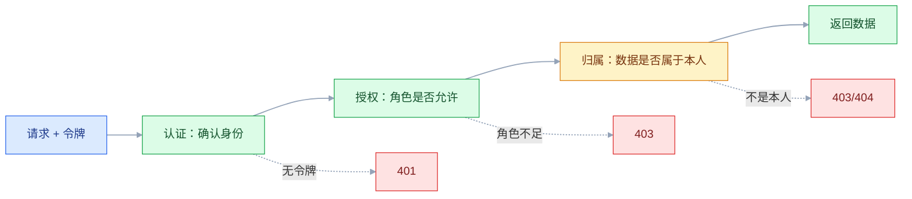
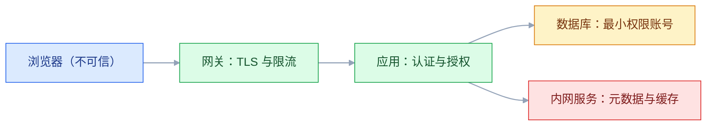

# 安全测试

## 一、工程案例：对订单系统 12 个接口做一次越权自查并出报告

**场景**：订单系统上线前三天，客户方要求提供一份安全自查报告。团队没有专职安全工程师，只有两个后端和一个测试。买商业扫描器来不及，但 OWASP Top 10 里的 A01（Broken Access Control，访问控制失效）恰好是这类业务系统最可能中招、也最容易手工验证的一类。计划用两个晚上，把 `/api` 下 12 个接口按三种身份跑一遍，找出「换个 id 就能看别人数据」的问题，修完复测，出一页结论。

**先把范围和判定口径写死**，否则测到一半就会变成漫无目的的扫描：

```text
范围：/api 下 12 个接口（订单、用户、文件、报表），不含第三方系统
身份：alice(1001) / bob(1002) / admin(1) / 匿名
判定：用别人的身份拿到了不该拿的数据，或完成了不该做的操作，即为越权
环境：test 命名空间，数据为脱敏测试数据
窗口：20:00-23:00，有书面授权与紧急联系人
产出：可复现请求 + 响应证据 + 修复验证 + 一页报告
```

### 1.1 授权与环境确认

授权不是走形式。至少要留下：目标域名与 IP、时间窗口、允许的测试类型（是否允许上传、是否允许爆破）、禁止事项（不碰真实用户数据、不做拒绝服务）、双方联系人。没有书面授权，任何「帮忙测一下」都可能变成违法行为。

以下命令存成 `env-check.sh` 执行，`BASE` 只改这一处：

```bash
#!/usr/bin/env bash
set -euo pipefail
BASE=https://test-api.example.com

# 确认打的是测试环境：看网关返回的环境标识与数据库名
curl -s "$BASE/api/actuator/info" | jq . || true
# {"app":"order-service","env":"test","db":"order_test"}
# 若 actuator 未开放（返回 404/403），改用响应头或配置中心确认，不要猜：
curl -sI "$BASE/" | grep -iE 'x-env|x-app-env' || true

# 确认域名解析到测试集群，而不是生产 SLB
dig +short test-api.example.com
# 10.20.3.17
```

准备三个账号，登录后把 token 存进临时文件，后续所有请求复用。文件用 `mktemp` 生成并限定权限，避免写到固定的 `/tmp/tokens.env` 被同机其他用户预置或读取。以下命令在当前 shell 里直接执行，不要另起脚本：

```bash
BASE=${BASE:-https://test-api.example.com}
umask 077
TOKENS=$(mktemp)

for u in alice:Alice@123456 bob:Bob@123456 admin:Admin@123456; do
  name=${u%%:*}; pass=${u#*:}
  token=$(curl -s -X POST "$BASE/api/auth/login" \
    -H 'Content-Type: application/json' \
    -d "{\"username\":\"$name\",\"password\":\"$pass\"}" | jq -r '.data.accessToken')
  if [ -z "$token" ] || [ "$token" = "null" ]; then
    echo "$name 登录失败，先确认账号与密码" >&2
    continue
  fi
  printf '%s=%s\n' "$name" "$token" >> "$TOKENS"
  echo "$name token 长度: ${#token}"
done
# alice token 长度: 218
# bob token 长度: 218
# admin token 长度: 221
. "$TOKENS"
rm -f "$TOKENS"
```

token 只放权限为 600 的临时文件，不要写进脚本、命令行历史或聊天记录。密码放在 `-d` 里同样会出现在本机 `ps` 的参数中，这也是后面「日志与凭据」要处理的问题。

### 1.2 接口清单与期望矩阵

先把「谁应该能做什么」写成矩阵，再拿真实响应去对。没有期望值，测出来的 200 也无法判断对错。

| # | 方法与路径 | alice | bob | admin | 匿名 |
|---|---|---|---|---|---|
| 1 | `POST /api/auth/login` | 公开 | 公开 | 公开 | 公开 |
| 2 | `GET /api/orders` | 200，仅自己 | 200，仅自己 | 200，全部 | 401 |
| 3 | `GET /api/orders/{id}` | 自己的 200 | 别人的 403/404 | 200 | 401 |
| 4 | `POST /api/orders` | 201 | 201 | 201 | 401 |
| 5 | `DELETE /api/orders/{id}` | 自己的 204 | 别人的 403/404 | 204 | 401 |
| 6 | `GET /api/users/{id}` | 自己 200 | 别人 403/404 | 200 | 401 |
| 7 | `PUT /api/users/{id}` | 自己 200 | 别人 403/404 | 200 | 401 |
| 8 | `GET /api/admin/users` | 403 | 403 | 200 | 401 |
| 9 | `POST /api/admin/users/{id}/disable` | 403 | 403 | 200 | 401 |
| 10 | `POST /api/files/upload` | 201 | 201 | 201 | 401 |
| 11 | `GET /api/files/{id}` | 自己的 200 | 别人的 403/404 | 200 | 401 |
| 12 | `GET /api/report/export?url=` | 白名单内 200 | 同左 | 同左 | 401 |

一个探测函数就够用，重点在「换身份、换 id、换方法」三件事上。把它存成 `authz-probe.sh`，在 1.1 的同一个 shell 里 `source authz-probe.sh` 后复用：

```bash
probe() {  # 用法：probe GET /api/orders/88001 "$bob" bob [JSON_BODY]
  local method=$1 path=$2 token=$3 who=$4 body=${5:-}
  local args=(-s -o /tmp/body.json -w '%{http_code}' -X "$method" "$BASE$path")
  [ -n "$token" ] && args+=(-H "Authorization: Bearer $token")
  [ -n "$body" ] && args+=(-H 'Content-Type: application/json' -d "$body")
  code=$(curl "${args[@]}")
  msg=$(jq -r '.message // .code // "ok"' /tmp/body.json 2>/dev/null || true)
  printf '%-6s %-34s %-6s -> %s  %s\n' "$method" "$path" "$who" "$code" "$msg"
}

probe GET  /api/orders/88001        "$alice" alice
probe GET  /api/orders/88001        "$bob"   bob
probe GET  /api/orders/88001        "$admin" admin
probe GET  /api/orders/88001        ""       anon
```

```text
GET    /api/orders/88001                alice  -> 200  ok
GET    /api/orders/88001                bob    -> 200  ok          ← 不该是 200
GET    /api/orders/88001                admin  -> 200  ok
GET    /api/orders/88001                anon   -> 401  UNAUTHORIZED
```

匿名请求返回 401 只证明「认证生效」，不能证明「授权生效」。**认证回答「你是谁」，授权回答「你能碰什么」，两者必须分开验证。**

### 1.3 六个发现

按「证据 → 根因 → 修复」记录。每一条都要能由另一个人照着命令复现，否则修复方会认为你在猜。验证以只读为主；必须做写操作时，只改自己造的数据，验证后回滚，不落地后门、不删真实数据。

**发现 1：订单详情存在水平越权（IDOR）。** bob 用 alice 的订单 id 拿到了完整订单，包括收货地址与手机号。根因是接口只校验了登录，SQL 直接按主键查：

```java
// ❌ 只按 id 查，登录即可看
Order order = orderMapper.selectById(id);
return Result.ok(order);

// ✅ 查出来之后再判归属，管理员放行
Order order = orderMapper.selectById(id);
if (order == null) throw new NotFoundException();          // 统一 404，避免枚举 id
if (!order.getUserId().equals(currentUserId()) && !currentUser().isAdmin()) {
    throw new ForbiddenException("无权访问该订单");
}
```

**发现 2：取消订单只校验登录，不校验归属。** `DELETE /api/orders/88001` 用 bob 的 token 返回 204，alice 的订单状态变成 `CANCELLED`。这类写操作比读更危险，因为不会在页面上留下明显痕迹。修复不能只靠「先查再判」，还要让更新语句本身带条件，避免并发下被绕过：

```sql
UPDATE t_order SET status = 'CANCELLED', updated_at = NOW()
WHERE id = ? AND user_id = ? AND status = 'PAID';
-- 影响行数为 0 时返回 403/404，不要返回 200
```

**发现 3：管理接口存在垂直越权。** alice 的 token 请求 `GET /api/admin/users` 返回 200 和全部用户列表。前端把「用户管理」菜单藏了，但后端没有任何角色判断，直接访问接口即可。修复分两层，缺一不可。注解要生效，配置类上还需要 `@EnableMethodSecurity`（Spring Security 5.6 起提供，6.x 已取代 `@EnableGlobalMethodSecurity(prePostEnabled = true)`）：

```java
@PreAuthorize("hasRole('ADMIN')")        // 方法级：要求 ROLE_ADMIN 权限
@GetMapping("/api/admin/users")
public Result<List<UserVO>> list() { ... }
```

```java
// SecurityFilterChain：路径级兜底，防止新接口忘记加注解
http.authorizeHttpRequests(auth -> auth
        .requestMatchers("/api/admin/**").hasRole("ADMIN")
        .requestMatchers("/api/**").authenticated()
        .anyRequest().denyAll());        // 默认拒绝，新增路径忘了配也进不去
```

健康检查、登录等必要路径要单独 `permitAll`，但不要为了省事把兜底改回放行。

**发现 4：用户详情返回了密码哈希、身份证与内部评分。** `GET /api/users/1001` 的响应里有 `password`、`salt`、`idCard`、`internalScore`。密码哈希虽然不可逆，但离线爆破的成本远低于在线尝试；身份证则直接构成个人信息泄露。修复用出口白名单，而不是在实体上一个个加忽略：

```java
// ✅ 返回专用 VO，只暴露页面需要的字段
public record UserVO(Long id, String nickname, String maskedPhone) {}

// 手机号脱敏，日志与前端都拿不到全量
String masked = phone.replaceAll("(\\d{3})\\d{4}(\\d{4})", "$1****$2");
```

**发现 5：上传接口只校验扩展名，双扩展名可上传脚本。** `shell.jsp.jpg` 上传成功，且文件落在 Web 根目录下、可通过 URL 直接访问。是否真的执行取决于中间件的扩展名映射，本次只确认了「可上传、可访问」，所以按中危记录；若同目录确实把 `.jsp` 交给容器解析，则应升为严重。修复要同时处理「内容、名字、位置、响应头」四件事：

```java
// 1) 读文件头判断真实类型，不信任 Content-Type 与扩展名
//    JPEG: FF D8 FF   PNG: 89 50 4E 47   PDF: 25 50 44 46
// 2) 白名单扩展名 + 随机文件名，丢弃用户原始名
String ext = detectExtension(bytes);            // 由文件头映射，如 jpg/png/pdf
String name = UUID.randomUUID() + "." + ext;
// 3) 存到 Web 根目录之外，由下载接口鉴权后转发
// 4) 响应加 X-Content-Type-Options: nosniff 与 Content-Disposition: attachment
```

**发现 6：报表导出接口的 `url` 参数可打内网。** `GET /api/report/export?url=http://169.254.169.254/latest/meta-data/` 返回了云主机元数据。修复用「协议 + 域名白名单 + 解析后 IP 校验」，并且禁止跟随重定向：

```java
URI uri;
try {
    uri = URI.create(raw);                       // 解析失败按 400 处理，不要漏成 500
} catch (IllegalArgumentException e) {
    throw new BadRequestException();
}
if (!"https".equals(uri.getScheme()) || uri.getHost() == null) {
    throw new BadRequestException();
}
if (!allowedHosts.contains(uri.getHost())) throw new BadRequestException();
InetAddress[] addrs;
try {
    addrs = InetAddress.getAllByName(uri.getHost());
} catch (UnknownHostException e) {
    throw new BadRequestException();
}
for (InetAddress addr : addrs) {
    if (addr.isLoopbackAddress() || addr.isLinkLocalAddress()
            || addr.isSiteLocalAddress() || addr.isAnyLocalAddress()
            || addr.isMulticastAddress()) {
        throw new BadRequestException();
    }
}
// 关键：后续必须连接上面校验过的 IP（或走固定出站代理），
// 不能把域名再次交给 HTTP 客户端解析，否则 DNS rebinding 可绕过。
```

Java 的 `isSiteLocalAddress()` 不覆盖 IPv6 ULA（`fc00::/7`）与 `100.64.0.0/10` 这类共享地址，黑名单很容易漏。生产环境优先做成「目标域名/IP 白名单」，并限制出站端口与响应大小。

六个问题里，三个是访问控制、一个是敏感信息、一个是上传、一个是 SSRF。**它们都不是靠扫描器「扫」出来的，而是靠一份期望矩阵逐格对出来的。**



### 1.4 修复与复测

修复顺序按风险排：先堵写操作与数据泄露，再处理上传与 SSRF，最后补日志与监控。每修一条就复测一条，不要等全部改完再一起验。

| 接口 | 修复前（越权或恶意输入） | 修复后 | 回归（正当请求） |
|---|---|---|---|
| `GET /api/orders/88001` | 200，含地址手机号 | 404 | 200 |
| `DELETE /api/orders/88001` | 204，状态已取消 | 404 | 204 |
| `GET /api/admin/users`（alice） | 200，全量用户 | 403 | admin 200 |
| `GET /api/users/1001` | 200，含 password/idCard | 403 | 200，仅 VO 字段 |
| `POST /api/files/upload` | 201，`shell.jsp.jpg` 可访问 | 400，类型不符 | 正常 jpg 201 |
| `GET /api/report/export?url=` | 200，返回元数据 | 400，域名不允许 | 白名单域名 200 |

上传这一行要分两种样本：`shell.jsp.jpg` 没有 JPEG 文件头，修复后应在内容校验处返回 400；补上 `FF D8 FF` 的图片马能通过文件头检查，这时拦住它的是随机文件名、非 Web 目录与 `attachment`。复测必须两种都试，只测第一种会高估修复效果。

复测脚本存成 `retest.sh`，同样用 `source retest.sh` 在当前 shell 执行。要能一次跑完，并且把「应该 200 的」和「应该 403 的」都断言上，避免修过头把正常功能也挡了：

```bash
check() {  # check 期望码 实际码 说明
  if [ "$1" = "$2" ]; then echo "PASS  $3"; else echo "FAIL  $3 (期望 $1 实际 $2)"; fi
}

code=$(curl -s -o /dev/null -w '%{http_code}' "$BASE/api/orders/88001" -H "Authorization: Bearer $bob")
check 404 "$code" "bob 不能读 alice 的订单"

code=$(curl -s -o /dev/null -w '%{http_code}' "$BASE/api/orders/88001" -H "Authorization: Bearer $alice")
check 200 "$code" "alice 仍能读自己的订单"

code=$(curl -s -o /dev/null -w '%{http_code}' "$BASE/api/admin/users" -H "Authorization: Bearer $alice")
check 403 "$code" "alice 不能进管理接口"
```

```text
PASS  bob 不能读 alice 的订单
PASS  alice 仍能读自己的订单
PASS  alice 不能进管理接口
```

### 1.5 报告

报告不用长，一页足够，但必须让不懂安全的人也能排优先级：

```text
订单系统 v1.3 安全自查报告
范围：/api 12 个接口，test 环境，2026-10-18 20:00-23:00
结论：发现 6 个问题（高危 5、中危 1），已修复 6 个，复测通过
高危：订单详情水平越权、取消订单越权、管理接口垂直越权、用户详情敏感字段泄露、导出接口 SSRF
中危：上传双扩展名（文件可访问，未验证解析执行）
遗留：登录失败次数限制、依赖升级排期
```

风险等级不要凭感觉写。用 CVSS 的基础评分做锚点，下面按 CVSS 3.1 的区间表述：9.0-10.0 为严重，7.0-8.9 为高危，4.0-6.9 为中危，0.1-3.9 为低危，0 为无。CVSS 已有 4.0，指标与命名有调整，引用时以 FIRST 官方当前版本为准。同一个「越权读订单」，能读到手机号与地址的，和只能读到订单号的，评分不应该一样；能读到云元数据并换出临时凭据的 SSRF，也不该按低危处理。

### 1.6 验收：11 项全过才算交付

| # | 检查项 | 命令或检查 | 通过标准 |
|---|---|---|---|
| 1 | 书面授权 | 授权邮件或工单编号 | 目标、窗口、禁止事项齐全 |
| 2 | 环境确认 | `/api/actuator/info` 的 `env`，或 `x-env` 响应头 | 为 test，不是 prod |
| 3 | 账号矩阵 | alice / bob / admin 均可登录 | 三个 token 都可用 |
| 4 | 接口清单 | 与路由表逐条对照 | 12 个接口无遗漏 |
| 5 | 期望矩阵 | 每个接口四种身份都有期望值 | 无空白格 |
| 6 | 读写都测 | GET / POST / PUT / DELETE 均覆盖 | 不只测查询 |
| 7 | 证据可复现 | 每条发现附 curl 与响应 | 他人照抄可复现 |
| 8 | 修复在服务端 | 绕过前端直接调接口 | 仍返回 403/404 |
| 9 | 回归通过 | 本人与 admin 的正常路径 | 未被误挡 |
| 10 | 敏感字段 | 响应与日志中检索 password/salt/idCard/token | 响应无这些字段，日志无凭据 |
| 11 | 报告可决策 | 含等级、修复状态、遗留项 | 能直接排上线 |

第 6 项最容易漏：很多人只测「能不能看别人的」，不测「能不能改别人的」。读是泄露，写是破坏，后者的优先级更高。

---

## 二、高频问答：会卡住你的地方，也是面试最常问的

### 2.1 用不存在的 id 测越权

**现场**

```bash
# 无效：id 不存在，403 说明不了任何问题
probe GET /api/orders/99999999 "$bob" bob     # 403

# 有效：88001 确实属于 alice
probe GET /api/orders/88001 "$bob" bob        # 200 → 漏洞
```

先用 alice 的 token 确认这条数据存在且可访问，再换 bob 的 token 请求同一个 id。

**要点**

- 把「查不到」当成「没权限」会漏判：不存在的数据与无权限的数据走同一个分支，403 可能只是「查不到」。
- 只有「数据存在 + 他人可访问」才叫越权。
- 核实方式：先用 owner token 确认数据存在可访问，再换他人 token 请求同一个 id。

**追问**

- 为什么不能用不存在的 id？→ 不存在的资源不走鉴权分支，测不出归属校验。
- 返回 404 还是 403？→ 都行，404 不泄露资源是否存在，关键是不能 200。
- 只测读够吗？→ 不够，写操作危害更高。

### 2.2 前端隐藏了按钮，就认为权限做了

**现场**

```bash
curl -s -o /dev/null -w '%{http_code}\n' "$BASE/api/admin/users" \
  -H "Authorization: Bearer $alice"      # 200 → 垂直越权
```

从前端 bundle 或网关日志里找到管理接口路径，绕过页面直接请求。

**要点**

- 把「看不见」当成「进不去」是误判：隐藏只是 UI 行为，接口仍对任何登录用户开放。
- 一切前端判断都只是体验优化，服务端必须再判一次。
- 核实方式：从前端 bundle 或网关日志找管理接口路径，用普通用户 token 直接 curl。

**追问**

- 前端能不能做权限？→ 能做展示，不能当安全边界。
- 后端怎么兜底？→ 路径级规则 + 方法级注解双保险。
- 菜单藏了还有风险吗？→ 有，接口仍可达。

### 2.3 扫描器没告警，就认为没有漏洞

**现场**

看扫描报告覆盖了哪些 URL；业务接口是否登录后才可达。

**要点**

- 把「扫描绿」当成「没漏洞」会漏大问题：扫描器不认识业务语义，越权、逻辑漏洞、竞态基本扫不出来。
- 扫描器负责覆盖面，人负责业务语义，两者不能互相替代。
- 核实方式：看报告覆盖的 URL，确认业务接口是否登录后才可达、是否被扫到。

**追问**

- 扫描器擅长什么？→ 缺失响应头、目录列表、已知指纹这类通用问题。
- 越权为什么扫不出？→ 它不知道订单 88001 属于谁，也不会持两个账号对比。
- 那扫描器没用吗？→ 有用，但只是覆盖面的一部分。

### 2.4 只测 GET，不测写操作

**现场**

```bash
# 用 bob 的 token 删 alice 的订单，然后回查状态
curl -s -o /dev/null -w '%{http_code}\n' -X DELETE "$BASE/api/orders/88001" \
  -H "Authorization: Bearer $bob"       # 204 → 越权写
```

写操作之后用 owner 的 token 回查，状态变了就是漏洞。

**要点**

- 把「读不到」当成「改不了」会漏最危险的一类：越权修改、删除、审批往往藏在 PUT/DELETE/POST 里。
- 写操作的危害高于读，测试顺序也应该排在前面。
- 核实方式：对每个资源把四种方法都跑一遍，写之后用 owner token 回查数据是否真的变了。

**追问**

- 为什么写更危险？→ 不留页面痕迹，直接破坏数据。
- 只回查状态码够吗？→ 不够，要回查数据本身。
- 怎么从代码上防？→ 更新语句带 `user_id` 条件，影响 0 行返回 403。

### 2.5 只用 admin 账号测所有接口

**现场**

同一条请求换 alice、bob、匿名各跑一次，看是否只有该放行的身份拿到 200。

**要点**

- 把「管理员可用」当成「权限正确」等于没测：admin 本来就该全通。
- 测权限要用「权限最小」的账号。
- 核实方式：同一请求换 alice、bob、匿名各跑一次，只有该放行的身份拿到 200 才算对。

**追问**

- 为什么不用 admin？→ 它全部放行，验证不了鉴权边界。
- 匿名也要测吗？→ 要，它验证认证是否生效（401）。
- 多角色怎么覆盖？→ 每个低权限角色都进期望矩阵跑一遍。

### 2.6 改了 URL 里的 userId 没生效，就认为安全

**现场**

请求体里的归属字段同样可以被篡改，把 `ownerId` 改成 `1002` 再提交：

```json
{"title":"测试","ownerId":1001}
```

把请求里所有 id 类字段列出来，逐个替换成他人 id，观察新建的数据归谁。

**要点**

- 只盯一个参数不够：后端可能压根不读 URL 里的 id，而是从 token 取当前用户。
- 归属字段必须由服务端从会话写入，不能接受客户端传值。
- 核实方式：把请求里所有 id 类字段逐个替换成他人 id，看新建数据归谁。

**追问**

- body 里的 ownerId 能改吗？→ 能，同样必须由服务端强制覆盖。
- 怎么防篡改？→ 归属从会话取，客户端传值一律忽略。
- 多租户怎么处理？→ 每条查询强制拼 `tenant_id`。

### 2.7 上传只改了 Content-Type，就认为绕不过

**现场**

```text
shell.jsp.jpg        → 若中间件按 .jsp 解析，直接执行
shell.JPG            → 大小写绕过扩展名黑名单
shell.jpg.php        → 校验只看 .jpg 就放行，落地后按 .php 解析
shell.php.（Windows）→ 末尾点被系统归一化，黑名单对不上
文件头写入 FF D8 FF → 骗过简单的 magic bytes 检查
%00 截断             → 只对很老的运行时有效，现代 JDK/Tomcat 不认
```

上传后直接访问返回的 URL，看是下载、是 404，还是被当作脚本执行。

**要点**

- 只验 Content-Type 是最弱的校验，真正的绕过在扩展名与解析路径，不能把「一个 payload 被拦」当成「一类攻击被防」。
- 上传目录必须不可执行，文件必须改名，这两条比任何黑名单都可靠。
- 核实方式：上传后直接访问返回 URL，看是下载、404 还是被当作脚本执行。

**追问**

- 双扩展名怎么防？→ 取最后一段扩展名并转小写，结合文件头。
- 文件头能伪造吗？→ 能（图片马），所以要随机名 + 非 Web 目录。
- 内容校验够吗？→ 不够，要内容 + 改名 + 非 Web 目录 + `attachment`。

### 2.8 改 JWT payload 返回 401，就认为令牌安全

**现场**

```bash
# 解码看结构，payload 只是 base64url，不是加密；先补回被去掉的 =
payload=$(cut -d. -f2 <<< "$alice" | tr '_-' '/+')
case $(( ${#payload} % 4 )) in
  2) payload="$payload==" ;;
  3) payload="$payload=" ;;
esac
printf '%s' "$payload" | base64 -d | jq
# {"sub":"1001","role":"USER","exp":1760000000}
```

用已知弱密钥离线签一个合法 token，或用 `alg:none` 构造无签名令牌。

**要点**

- 把「改坏了」当成「改不了」会误判：401 可能来自格式错误、过期或解析异常，不等于校验了算法与密钥。
- 服务端必须固定允许的算法，并校验签名、过期时间与签发者。
- 核实方式：用弱密钥离线签合法 token，或用 `alg:none` 构造无签名令牌；服务端若接受就是严重漏洞。

**追问**

- `alg:none` 是什么？→ 声明无签名，服务端若接受就能伪造。
- HS256/RS256 混淆怎么利用？→ 拿公钥当 HS256 密钥签，服务端误用即伪造。
- payload 是加密的吗？→ 不是，只是 base64url，任何人都能解码。

### 2.9 内网系统不用测安全

**现场**

用低权限员工账号访问，看是否能碰到管理功能与敏感数据。

**要点**

- 把「网络边界」当成「权限边界」是错觉：内网也有普通员工、外包、被钓鱼的终端，横向移动正是从内网开始。
- 内网系统同样要做认证、授权、审计，只是威胁模型不同。
- 核实方式：假设攻击者已有一个普通账号，列出他能触达的接口与数据。

**追问**

- 内网威胁模型不同在哪？→ 攻击者已有内网立足点，重点是横向移动。
- 外包账号怎么管？→ 最小权限 + 操作审计。
- 网络隔离够吗？→ 不够，还要应用层鉴权。

### 2.10 日志里打印了 token 与身份证，测试时没人看

**现场**

```bash
# 应用日志里直接检索敏感模式
grep -rnE 'Bearer [A-Za-z0-9._-]{20,}|"password"|1[3-9][0-9]{9}' /var/log/order/
```

在日志平台搜 `Bearer`、`password`、`idCard`、`13800`。

**要点**

- 把「内部可见」当成「可以明文」会二次泄露：日志被采集到集中平台，权限更宽、留存更久。
- 凭据与个人敏感信息一律脱敏，日志只留可关联的请求 id。
- 核实方式：导出最近一天应用日志，用正则搜 `Bearer`/`password`/手机号。

**追问**

- 脱敏在哪一环做？→ 写日志之前，不是采集之后。
- token 怎么记？→ 只留不可逆哈希前 8 位，不要截前缀。
- 手机号怎么脱敏？→ 保留前三后四。

### 2.11 令牌放在 Cookie 里，只加 SameSite 就认为不用防 CSRF

**现场**

```bash
# 仅适用于会话放在 Cookie 里的系统；本例用 Bearer，下面会直接 401
# 先在浏览器登录，导出会话 Cookie 到 cookie.txt（Netscape 格式）
# 跨站 HTML 表单能发出的两类请求，都不带 CSRF token
curl -s -o /dev/null -w 'urlencoded -> %{http_code}\n' \
  -X POST "$BASE/api/orders" -b cookie.txt \
  -H 'Content-Type: application/x-www-form-urlencoded' --data 'sku=1001&qty=1'

curl -s -o /dev/null -w 'multipart  -> %{http_code}\n' \
  -X POST "$BASE/api/orders" -b cookie.txt -F 'sku=1001' -F 'qty=1'
# 任一返回 201/200 且订单挂在当前用户名下 → 服务端只看 Cookie，缺 CSRF 校验
```

先确认接口接受不带 CSRF token 的表单 POST，再用真实跨站页面看 Cookie 是否被带上。

**要点**

- 把「浏览器默认行为」当成「服务端校验」会漏防：SameSite 按站点而非来源隔离，同主域子域被攻陷、顶层 GET 跳转都能绕过，它只是纵深防御。
- 若接口只收 JSON，普通表单发不出来，但那是内容类型的副作用，不叫 CSRF 防护。
- 核实方式：先确认接口接受不带 token 的表单 POST，再用真实跨站页面看 Cookie 是否被带上。

**追问**

- 令牌放 `Authorization` 头还要防吗？→ 不用，跨站页面设不了这个头，天然免疫。
- GET 写操作算 CSRF 吗？→ 算，一个 `` 就能触发，GET 必须无副作用。
- SameSite 有用吗？→ 有，但只是纵深防御，不能替代服务端校验。

---

## 三、核心知识：从零开始要建立的东西

### 3.1 认证与授权的分界

认证（Authentication）解决「你是谁」，授权（Authorization）解决「你能做什么」。两者串行，但失败语义不同：没有身份是 401，有身份但不够格是 403。

| 场景 | 正确状态码 | 常见错误 |
|---|---|---|
| 未带 token | 401 | 返回 200 加空数据 |
| token 过期 | 401 | 500 堆栈 |
| 普通用户访问管理接口 | 403 | 302 跳登录页 |
| 访问他人资源 | 403 或 404 | 200 返回数据 |

返回 404 而不是 403，是为了不泄露「这个 id 存在」。两者都能接受，关键是**不能返回 200**。授权判断必须发生在服务端，且默认拒绝：新加的接口如果忘了配规则，应该进不去，而不是人人可进。

> **面试**：常问「越权返回 403 还是 404？有什么区别？」答：都行，404 不泄露资源是否存在；关键是绝不能 200，且授权在服务端默认拒绝。

### 3.2 水平越权与垂直越权

| 类型 | 含义 | 例子 | 根因 |
|---|---|---|---|
| 水平越权 | 同级用户之间互相访问 | bob 看 alice 的订单 | 只按 id 查，没判归属 |
| 垂直越权 | 低权限执行高权限操作 | 普通用户调管理接口 | 只在前端藏菜单 |
| 上下文越权 | 越出当前业务上下文 | 改 tenantId 跨租户 | 多租户过滤缺失 |

水平越权的英文是 IDOR（Insecure Direct Object Reference），本质是「把内部 id 直接暴露给用户，又信任用户只改自己的」。修复不是把 id 加密，而是每次访问都做归属校验。垂直越权则要靠角色模型与统一的拦截规则，不能依赖每个开发记得加注解。

### 3.3 归属校验的三个位置

| 位置 | 做法 | 优缺点 |
|---|---|---|
| Controller | 取当前用户，调用前判断 | 直观，但容易被新接口漏掉 |
| Service | 查询后判 `ownerId`，写操作带 `user_id` 条件 | 推荐，业务语义集中 |
| 数据层 | MyBatis 拦截器 / RLS 自动拼租户条件 | 兜底强，调试困难 |

三层可以叠加，但不能只靠最上面一层。最稳的写法是「查询带归属条件」：`WHERE id = ? AND user_id = ?`，查不到就是 404，天然避免了「先查后判」之间的竞态。管理员的例外要显式写出，不要用「如果角色不是 USER 就放行」这种反向逻辑，否则新增角色会自动获得权限。

> **面试**：常问「怎么修水平越权？先查后判够吗？」答：不够，更新语句要带 user_id 条件，避免并发绕过；查询直接带归属条件查不到即 404。

### 3.4 会话与令牌

传统 Session 把状态放在服务端，靠 `JSESSIONID` 关联；JWT 把状态放在客户端，靠签名防篡改。两者没有绝对优劣，关键是别把 JWT 当成「加密令牌」——它的 payload 只是 base64url，任何人都能解码。

| 检查项 | 安全做法 | 风险 |
|---|---|---|
| Cookie 属性 | `HttpOnly; Secure; SameSite=Lax`；跨站嵌入用 `None; Secure` 并配 CSRF 校验 | 缺 HttpOnly 可被 XSS 读取，缺 SameSite 易被 CSRF |
| 令牌存储 | 内存或 HttpOnly Cookie | 放 localStorage 易被脚本窃取 |
| 过期与续期 | 短 access + 可撤销 refresh | 永久 token 无法失效 |
| 注销 | 服务端黑名单或版本号 | 只删前端等于没注销 |
| 算法 | 服务端固定一种（如 RS256），拒绝 none 与头里的 alg | 算法混淆可伪造令牌 |
| 密码存储 | bcrypt / Argon2id，每用户独立盐 | MD5/SHA1 加盐也能被 GPU 快速爆破 |
| 登录防爆破 | 失败计数 + 延迟或锁定 + 风控 | 无限重试可撞库 |

JWT 的常见坑是「只验签名，不验声明」：`exp`、`iss`、`aud` 都要校验；`alg` 必须由服务端指定，不能读 token 头里的值。密钥要足够长，HS256 的弱密钥可以被离线爆破。密码不要自己写哈希，用 bcrypt、scrypt 或 Argon2id 这类慢哈希；JWT 只解决会话，不解决密码存储。

### 3.5 注入漏洞的本质

注入是「把用户输入当成代码或指令的一部分」。SQL、命令、LDAP、模板、日志都可能有注入，共同点是**拼接**。

```java
// ❌ 拼接：输入 ' OR '1'='1 改变语义
String sql = "SELECT * FROM t_task WHERE title LIKE '%" + kw + "%'";

// ✅ 参数化：输入永远只是值
jdbcTemplate.query("SELECT * FROM t_task WHERE title LIKE ?",
        rs -> ..., "%" + kw + "%");
```

参数化查询能解决绝大多数 SQL 注入，但解决不了「结构部分」的注入：表名、列名、`ORDER BY` 方向不能用占位符，必须走白名单映射。LIKE 的通配符也要转义，否则用户可以构造 `%` 扫全表。ORM 的 `@Query` 拼接、MyBatis 的 `${}` 同样是高危点，`#{}` 才是预编译。

### 3.6 输出编码与上下文

XSS 的根因是「把用户输入当成 HTML 或 JS 执行」。防御不是过滤输入，而是**按输出位置编码**：

| 输出位置 | 编码方式 | 例子 |
|---|---|---|
| HTML 文本 | HTML 实体编码 | `<` → `&lt;` |
| HTML 属性 | 值加引号并做属性编码 | `"` → `&quot;` |
| JS 字符串 | 避免内联；必须内联时用 JSON 编码并转义 `<` | `JSON.stringify` 后把 `<` 替换为 `\u003c` |
| URL 参数 | URL 编码 | `encodeURIComponent` |
| CSS | 尽量避免动态拼接 | 白名单 |

存储型 XSS 会在详情页触发，影响所有查看者，优先级高于反射型。富文本场景不能简单转义，否则格式全丢，应该用 DOMPurify 这类白名单清洗器。CSP 是第二道防线：`default-src 'self'` 限制脚本来源与数据外发地址，但要在 `script-src` 里避免 `unsafe-inline`，否则内联注入照样执行。

### 3.7 CSRF：浏览器自动带上的凭据

CSRF（Cross-Site Request Forgery，跨站请求伪造）利用的是「浏览器会自动附带 Cookie」。攻击者不需要读到令牌，只要让受害者的浏览器向已登录的站点发一个请求，就完成了以受害者身份的操作。成立条件有三个：凭据自动携带、参数可预测、服务端不校验请求来源。

| 防御 | 做法 | 边界 |
|---|---|---|
| CSRF Token | 与会话绑定的随机 token，服务端比对 | 表单与 AJAX 都要带 |
| Origin / Referer | 校验来源站，敏感请求缺失即拒绝 | 部分客户端不带 Referer |
| SameSite | `Lax` 起步，敏感操作 `Strict` | 按 site 而非 origin，同主域子域可绕过 |
| 自定义请求头 | 要求 `X-Requested-With` 等 | 需 CORS 配置正确，跨站表单设不了 |
| 令牌不落 Cookie | 放 `Authorization` 头，由脚本显式添加 | 该接口天然不受 CSRF 影响 |

关键区别：令牌放在 `Authorization` 头里，跨站页面既读不到也设不了，因此这类接口不需要 CSRF token；令牌放在 Cookie 里由浏览器自动附带，就必须防。GET 请求必须无副作用，否则一个 `` 就能触发。SameSite 只是纵深防御，不能替代服务端校验。

> **面试**：常问「用 Bearer token 还要防 CSRF 吗？」答：不用，跨站页面设不了 Authorization 头，天然不受 CSRF 影响；令牌放 Cookie 才要防。

### 3.8 文件上传的信任边界

上传的本质是「让外部数据进入系统」，所以要假设文件名、扩展名、Content-Type、文件内容全部可伪造。

| 检查层 | 做法 | 不能只靠它的原因 |
|---|---|---|
| 扩展名 | 白名单，取最后一段并转小写 | 双扩展名、大小写、末尾点或空格 |
| Content-Type | 仅作参考 | 客户端可任意设置 |
| 文件头 | 校验 magic bytes | 图片马可带脚本 |
| 存储位置 | Web 根目录之外 | 被直接访问即执行 |
| 文件名 | UUID 重命名 | 原始名可含路径 |
| 响应头 | `nosniff` + `attachment` | 浏览器可能嗅探 |

最稳的组合是：内容校验 + 随机名 + 非 Web 目录 + 下载接口鉴权 + 独立域名。图片还可以做二次渲染（重新编码），彻底破坏嵌入的脚本。上传目录的 `php/jsp` 执行权限必须关掉，这条比任何黑名单都有效。

### 3.9 SSRF 与元数据地址

SSRF 是「让服务器替攻击者发请求」。服务器在内网，能碰到用户碰不到的东西：云元数据、内部管理台、Redis、数据库。

```text
http://169.254.169.254/latest/meta-data/         云主机元数据
http://127.0.0.1:6379/                          本机 Redis
http://10.20.3.5:8080/actuator/env              内网应用
file:///etc/passwd                              本地文件
gopher://127.0.0.1:6379/_INFO                   构造任意 TCP 协议
```

防御要按顺序：协议白名单（只允许 https）→ 域名白名单 → DNS 解析后校验 IP → 禁止重定向 → 设置超时与响应大小上限。只校验字符串里有没有 `127.0.0.1` 是不够的，`0x7f.1`、十进制 IP、DNS rebinding 都能绕过。**解析后的 IP 才是最终连接的目标，校验必须发生在解析之后，并且连接时要用同一个 IP**；若把域名再次交给 HTTP 客户端解析，rebinding 仍能把请求换到内网。

### 3.10 反序列化的入口

反序列化把字节流还原成对象，如果攻击者能控制字节流，就可能构造出执行链。Java 的 `ObjectInputStream`、Fastjson 的 `autoType`、Jackson 的 `enableDefaultTyping`（新版本改用 `activateDefaultTyping` 并配校验器）、旧版 SnakeYAML 的默认 Constructor 都是历史高危点。

| 入口 | 风险 | 收敛方式 |
|---|---|---|
| Cookie / Header | 反序列化身份信息 | 改用签名 token |
| RPC 协议 | 内部服务互传对象 | 白名单类 + 版本校验 |
| 缓存值 | Redis 里存序列化对象 | 只存 JSON |
| 导入文件 | 解析用户上传的结构 | 禁用多态类型 |

原则是「不反序列化不可信数据」。做不到时，用类白名单把可还原的类型限制死，并升级到修复过漏洞的版本。这类漏洞的特点是利用链深、扫描器难发现，一旦成功往往是远程代码执行。

### 3.11 供应链与依赖漏洞

现代应用的代码大部分不是自己写的。一个传递依赖里的漏洞，可能让前面所有权限设计失效。

| 风险 | 表现 | 检查 |
|---|---|---|
| 已知 CVE | Log4Shell、Fastjson 反序列化 | SCA 扫描 + 版本比对 |
| 投毒 | 包名相似、维护者账号被盗 | 锁文件 + 来源校验 |
| 依赖混淆 | 内部包名被发布到公共仓库 | 私有源优先 + scope |
| 过期组件 | 两年未更新的框架 | 定期升级窗口 |

`mvn dependency:tree`、`npm ls`、`trivy fs` 都能列出实际使用的版本。重点不是「有多少条告警」，而是「哪些能被外部触发」。一个只在高危接口路径上的中危漏洞，优先级可能高于十个用不到的严重漏洞。

### 3.12 日志、审计与脱敏

安全事件发生后，日志是唯一的追溯依据。但日志本身也是数据泄露的高发区。

| 该记 | 不该记 |
|---|---|
| 时间、请求 id、用户 id、接口、结果码 | 密码、token、Cookie |
| 授权失败的原因分类 | 完整身份证、银行卡、地址 |
| 管理操作的 before/after | 完整请求体（可能含隐私） |
| 登录失败次数与来源 IP | 加密密钥、数据库连接串 |

脱敏要在「写日志之前」做，而不是采集之后再加规则。手机号保留前三后四，身份证只留后四位，token 只留不可逆哈希的前 8 位用于关联——直接截 token 前缀既可能泄露有效片段，JWT 的前缀又都是同一个头。审计日志要单独存储、只追加、访问受限，否则攻击者进来第一件事就是删日志。

### 3.13 威胁建模方法

威胁建模是「在写代码之前，先问哪里会出事」。STRIDE 是最常用的分类法：

| 类型 | 含义 | 例子 |
|---|---|---|
| Spoofing | 冒充身份 | 伪造 token、撞库 |
| Tampering | 篡改数据 | 改价格、改归属 |
| Repudiation | 否认操作 | 没有审计日志 |
| Information disclosure | 信息泄露 | 报错带堆栈、越权读 |
| Denial of service | 拒绝服务 | 无限流、深分页 |
| Elevation of privilege | 提权 | 普通用户进管理后台 |

落地方式很简单：画一张数据流图，标出信任边界（浏览器→网关→应用→数据库→内网），对每条跨边界的箭头问六个问题。**威胁建模的产出是测试用例，不是一张挂在墙上的图。**



### 3.14 风险评级与 CVSS

风险不是「感觉严重」，而是「可能性 × 影响」。CVSS 用一组可复现的指标算基础分。下表是 3.1 的基础指标；4.0 已调整指标名称与计算方式，引用时以 FIRST 官方当前版本为准：

| 维度 | 取值举例 | 对分数的影响 |
|---|---|---|
| 攻击向量 AV | 网络 / 相邻 / 本地 / 物理 | 网络最高 |
| 攻击复杂度 AC | 低 / 高 | 低复杂度更高 |
| 权限要求 PR | 无 / 低 / 高 | 无权限更高 |
| 用户交互 UI | 无 / 需要 | 不需要更高 |
| 影响 CIA | 高 / 低 / 无 | 三项都高最高 |

同样是越权，匿名可读全量用户 = 严重；登录后可读他人订单号 = 中危。评分之外还要看业务：涉及资金、身份证、医疗数据的，应该在上表基础上上调。**报告里写清评分依据，比只写一个数字更有用。**

### 3.15 授权边界与法律红线

安全测试的合法性来自授权，不来自「我是为了系统好」。

| 事项 | 必须做到 |
|---|---|
| 授权 | 书面授权，写明目标、时间、范围、禁止行为 |
| 范围 | 只测授权域名与 IP，不碰第三方依赖 |
| 数据 | 不使用真实用户数据，测试数据脱敏 |
| 影响 | 不做拒绝服务、不持久化后门、不横向扩散 |
| 披露 | 发现漏洞先私下报告，给修复窗口 |
| 留存 | 证据加密保存，到期销毁 |

《网络安全法》《数据安全法》《个人信息保护法》都对未授权访问与数据泄露有明确责任。即使是自家系统，跨主体（客户、合作方）也要单独授权。**测试前确认「谁的系统、谁签字、出了事找谁」，这三问答不上来就不要开始。**

> **面试**：常问「安全测试的合法边界是什么？」答：必须有书面授权，写明目标、时间、范围、禁止行为；未授权访问同样担责。

---

## 四、冷门知识汇总

| 知识点 | 为什么冷门 | 用到时的关键词 |
|---|---|---|
| 租户隔离的行级安全 | 多租户系统才需要，单租户项目用不上 | `row level security` / `tenant_id` |
| JWT 算法混淆 | 多数库要求显式指定算法，自建校验仍常踩 | `alg=none` / `RS256 to HS256` |
| DNS rebinding | SSRF 的高级绕过，普通白名单挡不住 | `rebinding` / `resolve-then-connect` |
| 图片二次渲染 | 比文件头校验更彻底，但会损失元数据 | `re-encode` / `ImageIO` |
| 反序列化利用链 | 利用链深，扫描器基本扫不到 | `gadget chain` / `autoType` |
| 依赖混淆 | 企业内部包名被抢注才触发 | `dependency confusion` / `private registry` |
| 日志注入 | 换行符伪造日志条目，很少被检查 | `CRLF injection` / `log forging` |
| 时序侧信道 | 字符串比较提前返回会泄露长度与前缀 | `constant-time compare` |
| 点击劫持 | 靠响应头防御，功能测试不会发现 | `X-Frame-Options` / `frame-ancestors` |
| CORS 与凭据组合 | `*` 加 `credentials` 浏览器会拒绝，但配置仍常见 | `Access-Control-Allow-Origin` |
| 密码重置令牌 | 一次性、短时效、绑定用户，容易实现错 | `reset token` / `single use` |
| 开放重定向 | 登录跳转参数可被换成外站，常与钓鱼组合 | `open redirect` / `redirect_uri` |
| Host 头注入 | 重置链接用请求 Host 拼绝对地址，可被投毒 | `Host header injection` |
| SVG 上传 | SVG 是 XML，直接打开或内嵌为文档时可执行脚本 | `image/svg+xml` / `Content-Disposition` |
| 子资源完整性 | 第三方 CDN 脚本被篡改时，SRI 能挡住 | `integrity` / `crossorigin` |
| 安全响应头 | 不影响功能，只有专项检查才会看 | `CSP` / `nosniff` / `HSTS` |
