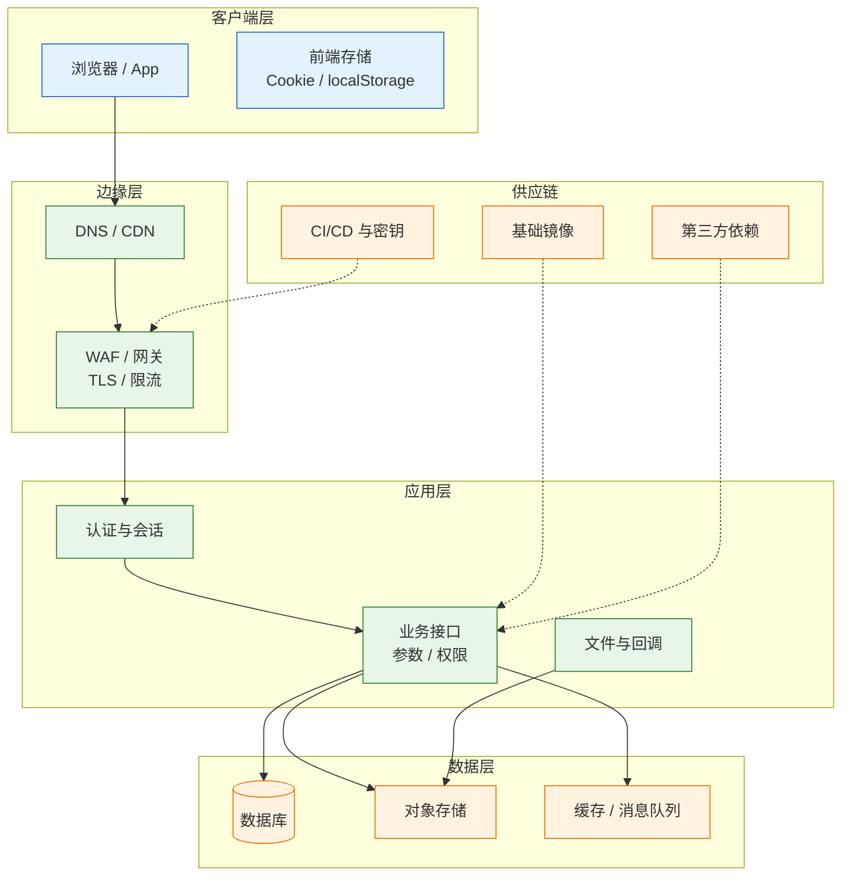
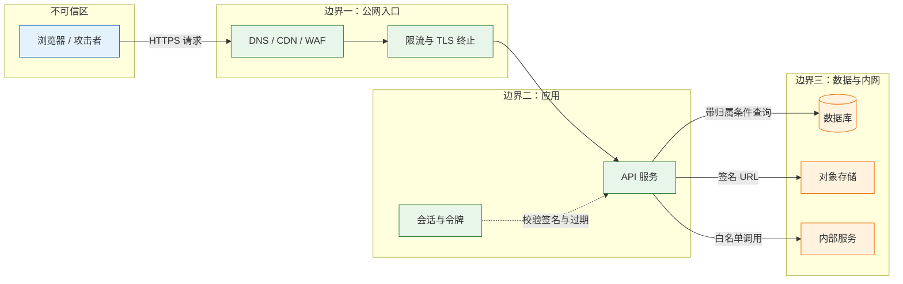
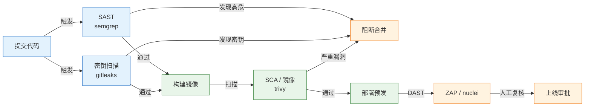

# 安全测试

---

## 一、安全测试是什么

安全测试是在授权范围内，沿系统的信任边界验证"谁能进来、进来能做什么、数据会不会被带走"的工程活动。它不追求把所有漏洞找干净，而是用有限时间覆盖最可能造成真实损失的入口，并给出可复现的证据和可执行的修复位置。

与功能测试相比，安全测试的判定标准不是"符合需求"，而是"违反预期"。一个接口按文档返回了数据，功能测试判为通过；如果返回的是他人的数据，安全测试判为失败。大多数真实事故并不来自复杂攻击，而来自"以为已经校验过"的地方：前端隐藏了按钮、网关做了鉴权、查询用了参数化，却在某个分支漏掉。

安全测试也不能替代代码审计、依赖治理和运行时防护。它验证的是可观察的行为，看不到未被触发的死代码、配置在别处的密钥，以及供应链深处的后门。

### 1.1 核心概念

- **机密性（Confidentiality）**：数据只被授权主体读取。
- **完整性（Integrity）**：数据只被授权主体修改，且修改可追溯。
- **可用性（Availability）**：系统在攻击或异常下仍能提供服务。
- **信任边界（Trust Boundary）**：数据或控制权从低信任区进入高信任区的交界，如浏览器到网关、应用到数据库。
- **攻击面（Attack Surface）**：所有可被外部触达的入口，包括接口、参数、文件、端口、第三方回调。
- **威胁建模（Threat Modeling）**：在测试前系统性列出"谁、通过什么、造成什么后果"。
- **误报与漏报**：扫描器报告了不存在的问题，或漏掉了真实存在的问题，两者都需要人工判断。

按手段划分，常见的安全测试类型如下：

| 类型 | 作用 | 适用阶段 | 主要局限 |
|---|---|---|---|
| SAST 静态分析 | 扫描源码中的危险模式 | 编码与提交 | 不理解运行时数据流，误报多 |
| DAST 动态扫描 | 对运行中的服务发探测请求 | 测试与预发 | 看不到源码，覆盖范围依赖爬虫 |
| IAST 交互分析 | 插桩后结合运行时数据 | 测试 | 需部署 agent，性能有开销 |
| SCA 依赖扫描 | 比对组件版本与漏洞库 | 构建与上线 | 只报已知漏洞，不判可利用性 |
| 渗透测试 | 人工组合漏洞完成攻击链 | 上线前与定期 | 依赖人员经验，不可完全重复 |
| 配置核查 | 检查基线、权限、暴露面 | 部署与巡检 | 只覆盖已知基线项 |

> **注意**：扫描器通过不等于安全。越权、业务逻辑绕过、竞态条件、权限矩阵缺格，这些都需要按角色和真实资源手工验证。

### 1.2 与相邻技术的关系

| 技术 | 关注点 | 与安全测试的边界 |
|---|---|---|
| 功能测试 | 功能是否符合需求 | 用例可复用，但判定标准不同 |
| 代码审计 | 源码中的数据流与控制流 | 覆盖未触发代码，不验证部署配置 |
| 渗透测试 | 模拟攻击者完成利用链 | 安全测试的子集，强调人工组合 |
| 合规审计 | 是否满足标准条款 | 关注证据与流程，不等于实际安全 |
| 应急响应 | 已发生事件后的处置 | 安全测试在其之前，降低发生概率 |
| 可观测性 | 日志、指标、追踪 | 为审计与溯源提供证据 |

> **运维提示**：把安全测试左移到提交阶段，用 SAST、密钥扫描和依赖扫描拦住低级问题；把 DAST 和人工越权验证放在预发环境，避免在生产制造垃圾数据。

### 1.3 架构组成

安全测试的对象不是单个接口，而是整条数据通路。按层次拆开，每一层都有独立的检查点和常用手段。



| 层次 | 测试对象 | 常用手段 |
|---|---|---|
| 客户端 | 存储、跳转、前端校验 | 浏览器开发者工具、代理抓包 |
| 边缘 | TLS、WAF 规则、暴露端口 | `openssl`、`nmap`、配置核查 |
| 应用 | 认证、授权、输入处理、会话 | `curl`、代理、越权脚本 |
| 数据 | 访问控制、备份、脱敏 | 权限查询、样本抽查 |
| 供应链 | 镜像、依赖、流水线密钥 | `trivy`、`semgrep`、`gitleaks` |

---

## 二、测试范围与授权

安全测试与功能测试最大的区别是：未经授权，测试行为本身就可能违法或造成事故。范围、时间、行为边界必须落到书面，口头同意在出事后无法作为依据。

### 2.1 授权要素

| 要素 | 必须写明的内容 | 缺失的后果 |
|---|---|---|
| 资产范围 | 域名、IP、接口、App、账号 | 越界扫描第三方，承担法律责任 |
| 时间窗口 | 起止时间、可测时段、值守人 | 与发布或大促冲突，放大故障 |
| 行为边界 | 是否可写、可上传、可做压力测试 | 误删数据、产生真实交易 |
| 数据处理 | 测试数据来源、脱敏方式、留存期限 | 测试库泄露真实用户信息 |
| 联系与中止 | 应急联系人、中止条件 | 出现异常无法及时止损 |
| 报告流向 | 谁能看、多久修复、是否公开 | 漏洞细节外泄，扩大风险 |

授权书至少由资产负责人和安全负责人双方签字。第三方托管系统，如云厂商、支付网关、短信平台，必须取得对方书面授权，不能因为"我们是客户"就默认可以扫描。

### 2.2 测试环境与账号矩阵

测试环境要独立于生产，数据库使用脱敏数据。账号至少准备四类角色，另加一个过期账号用于验证失效；数量不足时，"他人资源"和"管理接口"都测不全。

| 账号 | 用途 | 关键要求 |
|---|---|---|
| 匿名 | 验证未登录访问 | 不携带任何令牌与 Cookie |
| alice | 资源属主 | 可创建订单、文件、个人资料 |
| bob | 他人资源访问者 | 与 alice 同角色，便于测水平越权 |
| admin | 管理接口 | 仅用于验证正向路径与垂直越权 |
| 过期账号 | 令牌失效 | 用于验证过期与吊销 |

登录后先保存令牌，后续所有用例复用，避免每次请求重新登录导致会话状态混乱：

```bash
# ========== 获取令牌 ==========
# 使用测试账号登录，响应中取 access_token
ALICE_TOKEN=$(curl -sS -X POST "$BASE/api/auth/login" \
  -H 'Content-Type: application/json' \
  -d '{"username":"alice","password":"'"$ALICE_PASSWORD"'"}' | jq -r '.access_token')

BOB_TOKEN=$(curl -sS -X POST "$BASE/api/auth/login" \
  -H 'Content-Type: application/json' \
  -d '{"username":"bob","password":"'"$BOB_PASSWORD"'"}' | jq -r '.access_token')

# ========== 确认令牌格式 ==========
# JWT 为三段式；只检查段数与长度，不解码、不据此判断签名有效
echo "$ALICE_TOKEN" | awk -F. '{print "段数=" NF, "payload 长度=" length($2)}'
```

> **注意**：解码 JWT 只是查看声明，不代表令牌可信；完整解码方法见 4.1，需处理 base64url 字符集与填充。

### 2.3 测试数据脱敏

从生产导一份用户表进测试库，本身就是一次数据泄露。脱敏要在导出后立即执行，测试库不保留原始副本。

```sql
-- ========== 测试库脱敏（PostgreSQL 示例） ==========
-- 执行前先备份，确认连接的确实是测试库
select current_database();

-- 邮箱改为不可回推的占位值
update users set email = 'user' || id || '@example.test';

-- 手机号保留前三后四，中间掩码
update users set phone = left(phone, 3) || '****' || right(phone, 4);

-- 姓名只保留姓
update users set name = left(name, 1) || '**';

-- 地址与身份证直接清空或替换
update users set address = '测试地址', id_card = null;
```

| 字段 | 处理方式 | 说明 |
|---|---|---|
| 手机号 | 中间四位掩码 | 保留格式，便于测校验规则 |
| 邮箱 | 替换为示例域名 | 防止误发真实邮件 |
| 身份证 | 清空或生成合法校验位假号 | 避免真实个人信息入库 |
| 地址 | 替换为固定文本 | 保留长度与字符集 |
| 密码哈希 | 重置为测试口令 | 不能反推，也不应保留生产哈希 |
| 支付信息 | 全部替换为沙箱卡号 | 禁止真实卡号进入测试环境 |

### 2.4 行为边界

| 行为 | 是否允许 | 说明 |
|---|---|---|
| 用测试账号读自己的数据 | 允许 | 基线用例 |
| 两个测试账号互测越权 | 允许 | 需提前建好账号与资源 |
| 读取他人真实数据、导出全量 | 禁止 | 即使能读也不能扩大范围 |
| 生产环境删除、改价、批量写入 | 禁止 | 会造成真实损失 |
| 对生产做洪水、慢连接测试 | 禁止 | 属于拒绝服务攻击 |
| 对第三方系统扫描 | 需书面授权 | 云服务、支付、短信平台 |
| 发现漏洞后公开细节 | 禁止 | 走内部修复与披露流程 |

> **安全警告**：任何扫描、爆破、压力型测试都必须先确认目标在授权清单内。对公网 IP 段做端口扫描、对登录接口做口令喷洒，都可能触发对方告警并被认定为攻击。

---

## 三、威胁建模与攻击面

威胁建模把"可能出事"变成一张可执行清单：资产是什么、谁能触达、缺哪道控制、用什么请求验证。没有这一步，测试容易变成按工具清单打勾。

### 3.1 STRIDE 模型

| 威胁 | 含义 | 验证动作 |
|---|---|---|
| Spoofing 冒充 | 伪造身份或令牌 | 无令牌、过期令牌、改签名后重放 |
| Tampering 篡改 | 修改请求中的数据 | 改金额、归属人、角色、订单状态 |
| Repudiation 否认 | 操作无法追溯 | 查关键操作是否有审计日志与操作人 |
| Information disclosure 泄露 | 读到不应读的数据 | 越权读、错误堆栈、日志中的令牌 |
| Denial of service 拒绝服务 | 资源被耗尽 | 限流是否生效、超大请求是否被拒 |
| Elevation of privilege 提权 | 跨角色执行操作 | 普通用户直接调管理接口 |

STRIDE 的产出不是六行文字，而是"资产—入口—控制—用例"的对应关系。每条威胁至少落到一个接口和一个预期状态码。

### 3.2 信任边界



每一条箭头都是一个检查点：

| 边界 | 检查点 | 失败表现 |
|---|---|---|
| 浏览器到网关 | HTTPS、HSTS、WAF 规则 | 明文传输、绕过规则 |
| 网关到应用 | 身份透传、可信头过滤 | 伪造 `X-User-Id` 提权 |
| 应用到数据库 | 参数化、归属条件、最小权限 | 注入、越权读全表 |
| 应用到对象存储 | 签名 URL、私有桶、类型限制 | 任意文件下载与覆盖 |
| 应用到内网 | 白名单、超时、禁跟随重定向 | SSRF 探测内网与元数据 |

> **注意**：网关透传 `X-User-Id`、`X-Role` 这类头时，必须确认应用只信任来自网关的请求，并在入口剥离客户端自带的同名头。否则改一个请求头就能提权。

### 3.3 风险评级

漏洞等级不能只凭感觉。CVSS 给出基础评分，再结合业务数据敏感度、暴露面和现有补偿控制做环境修正。

| 评分区间 | 等级 | 处置时限（示例） | 典型场景 |
|---|---|---|---|
| 9.0–10.0 | 严重 | 立即，24 小时内 | 未授权 RCE、全量数据泄露 |
| 7.0–8.9 | 高危 | 3 个工作日内 | 越权读写、SQL 注入 |
| 4.0–6.9 | 中危 | 两周内 | 存储型 XSS、信息泄露 |
| 0.1–3.9 | 低危 | 下个迭代 | 版本号暴露、缺少安全头 |

评分只是输入，最终等级还要看"能拿到什么"。一个需要管理员账号才能触发的高危漏洞，实际风险可能低于一个匿名可用的中危越权。

### 3.4 攻击面清单

| 攻击面 | 典型入口 | 优先检查 |
|---|---|---|
| 认证 | 登录、注册、找回密码、刷新令牌 | 枚举、爆破、令牌校验 |
| 授权 | 资源详情、导出、批量操作 | 水平与垂直越权 |
| 输入 | 查询参数、JSON 字段、上传文件名 | 注入、XSS、路径穿越 |
| 文件 | 上传、下载、预览、回调 | 类型校验、存储位置、执行权限 |
| 第三方 | 支付回调、OAuth、Webhook | 签名校验、重放、SSRF |
| 管理面 | 后台、Actuator、调试端口 | 默认口令、未授权访问 |
| 供应链 | 依赖、镜像、CI 变量 | 已知漏洞、密钥泄露 |

---

## 四、认证与授权测试

认证确认请求者身份，失败返回 `401`；授权判断该身份能否执行操作，失败返回 `403`。两者混在一起测，是最常见的漏测原因。

### 4.1 认证机制测试

| 检查项 | 请求构造 | 期望结果 |
|---|---|---|
| 无令牌访问受保护接口 | 去掉 `Authorization` 头 | `401` |
| 过期令牌 | 使用已过 `exp` 的令牌 | `401` |
| 篡改签名 | 改 payload 后保留原签名 | `401` |
| `alg` 改为 `none` | 头部改成 `"alg":"none"`，去掉签名 | `401` |
| 登出后重放 | 登出后再次使用旧令牌 | `401` |
| 刷新令牌重复使用 | 同一 refresh token 用两次 | 第二次失败或轮换 |
| 口令爆破 | 连续错误登录 | 锁定、验证码或限流 |
| 账号枚举 | 不存在与存在的账号各试一次 | 响应与耗时一致 |

JWT 的 payload 可以被 base64url 解码，这不是漏洞，它本来就不加密。要测的是签名是否真的校验、算法是否被限制、过期是否生效，而不是"能解出内容"。

```bash
# ========== base64url 解码函数 ==========
# JWT 使用 URL 安全字符集且去掉填充，直接 base64 -d 会失败
b64url_decode() {
  local s="$1"
  s="${s//-/+}"; s="${s//_//}"
  local pad=$(( (4 - ${#s} % 4) % 4 ))
  printf '%s%*s' "$s" "$pad" '' | tr ' ' '=' | base64 -d
}

# ========== 查看声明（不验证签名） ==========
PAYLOAD=$(echo "$ALICE_TOKEN" | cut -d. -f2)
b64url_decode "$PAYLOAD" | jq .

# ========== 验证签名校验 ==========
# 修改 payload 中的 sub 后重新编码，仍保留原签名
HEADER=$(echo "$ALICE_TOKEN" | cut -d. -f1)
BODY=$(b64url_decode "$PAYLOAD" \
  | jq -c '.sub="admin"' | base64 | tr -d '=\n' | tr '+/' '-_')
FORGED="$HEADER.$BODY.$(echo "$ALICE_TOKEN" | cut -d. -f3)"

# 用伪造令牌访问，期望 401
curl -sS -o /dev/null -w '%{http_code}\n' "$BASE/api/me" -H "Authorization: Bearer $FORGED"

# ========== 验证 alg=none ==========
NONE_HEADER=$(printf '{"alg":"none","typ":"JWT"}' | base64 | tr -d '=\n' | tr '+/' '-_')
curl -sS -o /dev/null -w '%{http_code}\n' "$BASE/api/me" -H "Authorization: Bearer $NONE_HEADER.$BODY."
```

> **注意**：某些 JWT 库默认接受 `alg: none` 或允许头部 `jku`、`x5u` 指向外部密钥。测试时同时检查头部字段是否被白名单限制，而不只是换 payload。

### 4.2 水平越权与垂直越权

- **水平越权**：alice 能读或改 bob 的数据。两人角色相同，只是资源不属于该用户。
- **垂直越权**：普通用户能调管理员接口。角色层级被跨过。

水平越权最常见的根因，是查询只按资源 id 查找，没带归属条件：

```sql
-- 错误：知道 id 就能读
select * from orders where id = ?;

-- 正确：归属条件进入查询，而不是查出来再判断
select * from orders where id = ? and user_id = ?;
```

"查出来再 `if (order.userId != currentUser) throw`"也能防住，但很容易在某个分支漏掉；把条件写进 SQL，漏的概率更低。返回 `404` 比 `403` 更少泄露资源是否存在，两者都能接受，关键是**不能返回 200**。

### 4.3 越权验证脚本

下面这段脚本覆盖读、写、管理接口和匿名访问四种情况，可直接复制执行。依赖 `curl` 与 `jq`。

```bash
#!/usr/bin/env bash
# ========== 前置检查 ==========
# 缺少变量时立即退出，避免打到错误环境
: "${BASE:?请设置 BASE，例如 https://test.example.com}"
: "${ALICE_TOKEN:?请设置 alice 的令牌}"
: "${BOB_TOKEN:?请设置 bob 的令牌}"

# ========== 属主创建真实资源 ==========
# 必须用真实存在的资源，不存在的 id 返回 404 说明不了问题
ORDER_ID=$(curl -sS -X POST "$BASE/api/orders" \
  -H "Authorization: Bearer $ALICE_TOKEN" \
  -H 'Content-Type: application/json' \
  -d '{"amountCents":1999}' | jq -r '.id')

# 创建失败时 id 为 null，后续用例会全部误判，直接退出
if [ -z "$ORDER_ID" ] || [ "$ORDER_ID" = "null" ]; then
  echo "创建订单失败，检查令牌与接口"
  exit 1
fi

echo "资源 id = $ORDER_ID"

# ========== 属主正向校验 ==========
# 先确认资源确实存在且 alice 可读，排除"资源本来就不存在"
ALICE_READ=$(curl -sS -o /dev/null -w '%{http_code}' \
  "$BASE/api/orders/$ORDER_ID" \
  -H "Authorization: Bearer $ALICE_TOKEN")
echo "alice 读取自己的订单：$ALICE_READ（期望 200）"

# ========== 水平越权：读 ==========
BOB_READ=$(curl -sS -o /tmp/bob-read.json -w '%{http_code}' \
  "$BASE/api/orders/$ORDER_ID" \
  -H "Authorization: Bearer $BOB_TOKEN")
echo "bob 读取 alice 订单：$BOB_READ（期望 403 或 404）"

# ========== 水平越权：写 ==========
BOB_WRITE=$(curl -sS -o /tmp/bob-write.json -w '%{http_code}' \
  -X PATCH "$BASE/api/orders/$ORDER_ID" \
  -H "Authorization: Bearer $BOB_TOKEN" \
  -H 'Content-Type: application/json' \
  -d '{"amountCents":1}')
echo "bob 修改 alice 订单：$BOB_WRITE（期望 403 或 404）"

# ========== 水平越权：删 ==========
# 放在最后，避免资源被成功删除后影响前面的用例
BOB_DELETE=$(curl -sS -o /dev/null -w '%{http_code}' \
  -X DELETE "$BASE/api/orders/$ORDER_ID" \
  -H "Authorization: Bearer $BOB_TOKEN")
echo "bob 删除 alice 订单：$BOB_DELETE（期望 403 或 404；返回 200/204 即写越权成立）"

# ========== 垂直越权 ==========
ADMIN_API=$(curl -sS -o /dev/null -w '%{http_code}' \
  "$BASE/api/admin/users" \
  -H "Authorization: Bearer $ALICE_TOKEN")
echo "普通用户调用管理接口：$ADMIN_API（期望 403）"

# ========== 匿名访问 ==========
ANON=$(curl -sS -o /dev/null -w '%{http_code}' "$BASE/api/orders/$ORDER_ID")
echo "匿名读取订单：$ANON（期望 401）"
```

三个细节决定用例是否有效：资源必须真实存在；必须使用 bob 自己的令牌，空令牌测的是认证而不是授权；读之外必须测写，写操作的危害更大。

### 4.4 接口角色矩阵

先把接口和角色列成矩阵，再逐格填预期。矩阵能避免漏测，也方便转成参数化用例。

| 接口 | 匿名 | alice（属主） | bob（他人） |
|---|---|---|---|
| `GET /orders/{id}` | 401 | 200 | 403/404 |
| `DELETE /orders/{id}` | 401 | 200 | 403/404 |
| `POST /orders` | 401 | 201 | 201 |

| 接口 | alice（普通用户） | admin |
|---|---|---|
| `GET /admin/users` | 403 | 200 |
| `PATCH /users/{id}/role` | 403 | 200 |

两张表合起来就是完整的角色矩阵。

矩阵填完，把每行转成 `(method, path, actor, expected)` 四元组，用脚本或测试框架批量执行。一个五十行的矩阵，跑一次就能覆盖几十种组合。

### 4.5 会话与令牌

| 检查项 | 期望 | 常见缺陷 |
|---|---|---|
| Cookie `HttpOnly` | 存在 | 前端 JS 可读，XSS 可直接偷令牌 |
| Cookie `Secure` | 存在 | HTTP 下也会发送 |
| Cookie `SameSite` | `Lax` 或 `Strict` | `None` 且无其他防护，易受 CSRF |
| 令牌存放位置 | 内存或 HttpOnly Cookie | 放 URL 会进入日志与 `Referer` |
| 登出失效 | 旧令牌立即不可用 | 无状态令牌无吊销机制 |
| 多端登录 | 按设计互踢或共存 | 会话固定，攻击者复用 |
| 空闲超时 | 按业务设定 | 永久有效 |

> **注意**：`SameSite=Lax` 能挡住多数跨站 POST，但不能替代 CSRF token；跨站 GET、子域写入和旧浏览器仍需额外校验 `Origin` 或 `Referer`。

---

## 五、常见漏洞与验证动作

漏洞验证要落到一个最小请求。说不清怎么复现的发现，先不要写进报告。

### 5.1 注入类

SQL 注入的根因是拼接 SQL。验证时先传单引号观察报错，再用布尔条件对比响应差异，最后才用工具确认。

```bash
# ========== 手工探测 ==========
# 单引号：观察是否 500、是否出现 SQL 关键字
curl -sS -o /tmp/quote.txt -w '%{http_code}\n' \
  "$BASE/api/items?id=1%27"

# 布尔对比：真条件与假条件返回的数据量应不同
curl -sS "$BASE/api/items?id=1%20AND%201=1" | wc -c
curl -sS "$BASE/api/items?id=1%20AND%201=2" | wc -c

# ========== 工具确认（仅限授权目标） ==========
# level 提高覆盖更多测试向量，risk 提高会使用更危险的载荷
sqlmap -u "$BASE/api/items?id=1" --batch --level=2 --risk=2 --dbms=postgresql
```

| 类型 | 验证载荷 | 修复方向 |
|---|---|---|
| SQL 注入 | `'`、`1 AND 1=2`、时间盲注 | 参数化查询，禁用字符串拼接 |
| 命令注入 | `; id`、`&& whoami`、`$(id)` | 不用 shell，参数化调用，白名单 |
| 模板注入 | `{{7*7}}`、`${7*7}` | 不渲染用户输入，沙箱模板 |
| LDAP 注入 | `*)(uid=*` | 转义特殊字符，参数化过滤器 |
| 日志注入 | 换行加伪造日志行 | 编码换行与控制字符 |

> **安全警告**：`sqlmap` 的 `--risk=3` 会使用更新、删除等载荷，只能对测试库使用。对生产库执行可能造成数据损坏。

### 5.2 跨站类

XSS 的判定标准是"输入是否在对应上下文被正确编码"，不是"能否弹出对话框"。存储型 XSS 危害最大，因为它会持久化并影响所有查看者。

```bash
# ========== 存储型 XSS 探测 ==========
# 在昵称字段写入带事件处理器的标签
curl -sS -X PATCH "$BASE/api/users/me" \
  -H "Authorization: Bearer $ALICE_TOKEN" \
  -H 'Content-Type: application/json' \
  -d '{"nickname":""}'

# 再读取列表，检查返回中是否原样包含该标签
curl -sS "$BASE/api/users?page=1" -H "Authorization: Bearer $ALICE_TOKEN" | grep -o ']*>'
```

| 上下文 | 正确编码 | 错误做法 |
|---|---|---|
| HTML 文本 | `&lt;`、`&gt;` | 只过滤 `<script>` |
| HTML 属性 | 引号转义 + 属性白名单 | 直接拼接 `href`、`src` |
| JavaScript 字符串 | `\u003c` 等 Unicode 转义 | 用 HTML 实体编码 |
| URL 参数 | `encodeURIComponent` | 原样拼进 `location` |
| CSS | 禁止用户控制 | 允许 `expression()` |

CSRF 的前提是浏览器自动携带凭证。验证时用一个跨站页面发起改密或下单请求，观察是否成功；修复不能只靠前端加头，必须让服务端能区分"用户主动发起"和"第三方页面自动发起"。

### 5.3 服务端请求与文件处理

SSRF 的验证方式是把服务端会访问的地址改成内网地址或云元数据地址，观察响应时间、状态码和回显差异。

```bash
# ========== SSRF 探测 ==========
# 回调地址指向云元数据服务，期望被拒绝或超时
curl -sS -X POST "$BASE/api/webhooks/test" \
  -H "Authorization: Bearer $ALICE_TOKEN" \
  -H 'Content-Type: application/json' \
  -d '{"url":"http://169.254.169.254/latest/meta-data/"}'

# 指向内网地址，观察是否返回连接成功或内部错误
curl -sS -X POST "$BASE/api/webhooks/test" \
  -H "Authorization: Bearer $ALICE_TOKEN" \
  -H 'Content-Type: application/json' \
  -d '{"url":"http://10.0.0.1:6379/"}'
```

| 风险 | 验证动作 | 修复方向 |
|---|---|---|
| SSRF | 改回调 URL 为内网、元数据、`file://` | 协议与域名白名单，禁跟随重定向，独立出口 |
| 文件上传 | 改扩展名、改魔数、双扩展名 | 校验魔数、限大小、随机名、存非 Web 根 |
| 路径穿越 | 文件名填 `../../etc/passwd` | 规范化路径后校验前缀，禁用用户可控路径 |
| 任意文件下载 | 改 `file` 参数为绝对路径 | 用资源 id 映射，不暴露文件系统路径 |
| 压缩炸弹 | 上传高压缩比归档 | 限制解压后大小与层数 |

> **注意**：只校验 `Content-Type` 等于没有校验，客户端可以随意伪造。必须读取文件头魔数，并在存储侧关闭脚本执行权限。

### 5.4 依赖与配置

```bash
# ========== 依赖漏洞 ==========
# 前端依赖，只看生产依赖
npm audit --omit=dev

# Maven 依赖树，配合 SCA 平台比对公告
mvn dependency:tree

# Python 依赖
pip-audit -r requirements.txt

# ========== 镜像与文件系统 ==========
# 只报高危与严重，忽略暂无修复版本的条目
trivy image --severity HIGH,CRITICAL --ignore-unfixed myapp:1.0
trivy fs --scanners vuln,secret,misconfig .

# ========== 安全响应头 ==========
curl -sS -D - -o /dev/null https://target.example.com | grep -iE \
  'strict-transport-security|content-security-policy|x-content-type-options|referrer-policy'

# ========== TLS 配置 ==========
openssl s_client -connect target.example.com:443 \
  -servername target.example.com -tls1_2 </dev/null 2>/dev/null | grep -E 'Protocol|Cipher'
```

| 配置项 | 期望 | 风险 |
|---|---|---|
| HSTS | `max-age` 大于半年，含子域 | 可被降级到 HTTP |
| CSP | 默认拒绝，按需放行 | XSS 无第二道防线 |
| `X-Content-Type-Options` | `nosniff` | 浏览器 MIME 嗅探执行脚本 |
| `Referrer-Policy` | `no-referrer` 或同源 | 令牌与路径外泄 |
| 目录列表 | 关闭 | 源码与备份文件暴露 |
| 默认口令 | 已修改 | 后台被直接接管 |
| 调试端点 | 未暴露 | Actuator、`/debug` 泄露配置 |

### 5.5 业务逻辑与并发

逻辑漏洞没有统一特征，只能按业务规则逐条反推。常见方向是改价格、改数量、复用优惠、跳过步骤和并发抢购。

| 场景 | 验证动作 | 修复方向 |
|---|---|---|
| 价格篡改 | 改请求体中的单价与总价 | 服务端按商品重新计价 |
| 数量为负 | 提交负数或超大数量 | 范围校验与库存原子扣减 |
| 优惠券复用 | 同一券并发提交多次 | 唯一约束 + 原子状态流转 |
| 越权导出 | 改导出条件为全量 | 导出也走归属过滤与审批 |
| 批量赋值 | 请求体加 `role`、`balance` 字段 | DTO 白名单，禁止直接绑定实体 |
| 竞态条件 | 并发提交同一资源 | 乐观锁、唯一索引、幂等键 |

> **安全警告**：并发类验证会产生重复订单或重复扣款，只能在测试环境使用专用账号和沙箱支付。生产环境验证必须由业务方配合，并准备回滚脚本。

---

## 六、自动化扫描与工具链

扫描器的价值在于稳定覆盖已知模式，节省重复劳动；它的盲区在于业务逻辑和权限组合，必须由人工用例补齐。

### 6.1 工具对比

| 工具 | 类型 | 适用对象 | 注意事项 |
|---|---|---|---|
| nuclei | 模板化 DAST | Web、API、暴露面 | 模板质量决定误报率 |
| OWASP ZAP | 代理与 DAST | Web 应用 | 需登录态配置，爬虫覆盖有限 |
| sqlmap | 注入专项 | 带参数的 HTTP 接口 | 高风险载荷，仅限测试库 |
| nikto | 配置与指纹 | Web 服务器 | 噪声大，适合初筛 |
| nmap | 端口与服务识别 | 主机与网络 | 全端口扫描耗时长且易触发告警 |
| semgrep | SAST | 多语言源码 | 规则需按团队规范定制 |
| trivy | SCA 与镜像 | 依赖、镜像、IaC | 需维护漏洞库与忽略清单 |
| gitleaks | 密钥扫描 | Git 历史与工作区 | 历史提交中的密钥同样要轮换 |

### 6.2 扫描命令

```bash
# ========== 端口与服务识别 ==========
# 统一存放扫描输出，后续命令都写入该目录
mkdir -p results

# 只扫授权清单内的主机；-Pn 跳过主机发现，适合禁 ping 的环境
nmap -sV -sC -Pn -p 80,443,8080,8443 target.example.com

# ========== 模板化漏洞扫描 ==========
# 限速 50 请求/秒，避免影响测试环境
nuclei -u https://target.example.com -severity high,critical -rl 50 -o results/nuclei.txt

# ========== Web 基线扫描 ==========
# 挂载当前目录用于输出报告；只做被动基线，不主动爆破
docker run --rm -v "$(pwd)/results:/zap/wrk:rw" \
  ghcr.io/zaproxy/zaproxy:stable \
  zap-baseline.py -t https://target.example.com -r zap-report.html

# ========== Web 服务器配置核查 ==========
nikto -h https://target.example.com -ssl -Tuning 123 -o results/nikto.txt

# ========== 源码静态扫描 ==========
# auto 使用官方规则集，ERROR 级别优先处理
semgrep --config=auto --severity ERROR .

# ========== 密钥扫描 ==========
# 同时覆盖工作区与 Git 历史
gitleaks detect --source . --report-format json --report-path results/gitleaks.json
```

> **安全警告**：扫描前确认目标在授权范围内，并设置合理的限速。全端口扫描、目录爆破和漏洞模板同时运行，可能把测试环境打挂，也可能触发对方安全设备封禁源 IP。

### 6.3 CI 接入



| 阶段 | 检查 | 阻断条件 |
|---|---|---|
| 提交 | SAST、密钥扫描 | 高危规则命中、真实密钥 |
| 构建 | 依赖与镜像扫描 | 严重漏洞且有修复版本 |
| 预发 | DAST 基线、越权用例 | 新增高危、认证绕过 |
| 上线 | 人工复核与审批 | 未修复的严重项 |
| 运行 | 依赖巡检、日志告警 | 新披露的严重漏洞 |

流水线里的扫描要固定规则版本和忽略清单，否则同一份代码今天过、明天不过，团队会直接关掉检查。

### 6.4 结果处理

| 现象 | 可能原因 | 处理 |
|---|---|---|
| 大量 SQL 注入告警 | 爬虫把正常参数当注入点 | 手工复核响应差异，确认是否可复现 |
| 报告缺少登录后页面 | 未配置会话 | 导入 Cookie 或令牌，限定爬取范围 |
| 同一问题重复出现 | 多个 URL 指向同一处理逻辑 | 按根因合并，不按 URL 计数 |
| 依赖漏洞无法修复 | 上游未发布新版本 | 记录补偿控制与到期时间 |
| 扫描结果为空 | 目标被 WAF 拦截或限速 | 核对状态码与响应长度，调整限速 |

> **运维提示**：把误报写进忽略清单时，必须同时写原因、责任人和复核日期。只写"忽略"的清单，半年后没人敢删，也没人知道它是否仍然成立。

---

## 七、漏洞报告与复测

### 7.1 报告结构

报告不要只写"高危/中危"。每条发现至少包含接口、角色、复现请求、实际与期望、影响、修复位置和复测结果。

| 字段 | 内容要求 |
|---|---|
| 标题 | 一句话说明缺陷与影响，不写攻击载荷 |
| 位置 | 方法、路径、参数、涉及角色 |
| 前置条件 | 需要哪个账号、哪个资源、是否需登录 |
| 复现步骤 | 编号步骤，附最小 `curl` |
| 实际响应 | 状态码、关键字段，敏感值打码 |
| 期望响应 | 应为 401/403/404 或过滤后的数据 |
| 影响 | 能读什么、能改什么、影响范围 |
| 修复建议 | 具体到层：查询条件、异常映射、存储位置 |
| 复测结果 | 修复版本、复测时间、是否通过 |

```text
标题：普通用户可通过订单详情接口读取他人订单
位置：GET /api/orders/{id}，参数 id 为自增整数
前置：alice 与 bob 均为普通用户，已登录
步骤：
  1. alice 创建订单，得到 id=88001
  2. bob 使用自己的令牌请求 /api/orders/88001
实际：200，响应包含 alice 的金额、收货地址、手机号
期望：403 或 404
影响：任意登录用户可遍历 id 读取全量订单，涉及约 <数量> 条记录
修复：数据访问层查询追加 user_id 条件；异常统一映射为 404
复测：<修复版本> 环境重放同一请求，返回 404，通过
```

修复建议要写到层。只写"加强校验"没有可执行性，下一个人还得重新判断一遍。

### 7.2 复测与回归

| 复测项 | 要求 | 说明 |
|---|---|---|
| 同一请求 | 原样重放 | 确认修复生效 |
| 变体请求 | 改参数位置、编码、大小写 | 防止只修了一个入口 |
| 相邻接口 | 同模块的其他资源 | 同一根因往往影响多个接口 |
| 正向路径 | 属主仍可正常访问 | 防止修复过度导致功能不可用 |
| 自动化回归 | 固化为测试用例 | 防止重构后复发 |

> **注意**：修复后只测"原来那个请求"不够。按 id 越权通常成片存在，必须抽查同类的导出、批量查询、关联资源接口。

### 7.3 安全测试边界

| 场景 | 是否适合 | 原因 |
|---|---|---|
| 有书面授权、明确范围 | 适合 | 行为可追溯，风险可控 |
| 无授权的第三方系统 | 禁止 | 可能触犯法律 |
| 生产环境破坏性测试 | 禁止 | 会造成真实数据与资金损失 |
| 只测 GET 接口 | 不完整 | 写操作才是资金与数据入口 |
| 只用管理员账号 | 不完整 | 垂直越权永远测不出来 |
| 把扫描报告当结论 | 不适合 | 报告是线索，必须手工验证 |
| 内网系统跳过 | 不适合 | 横向移动正是攻破后的下一步 |
| 功能未稳定就全量渗透 | 低效 | 先修认证与越权，性价比最高 |

---

## 八、常见排障

| 现象 | 最可能原因 | 处理 |
|---|---|---|
| 越权用例返回 404 就认为安全 | 使用了不存在的资源 id | 先用属主账号创建真实资源 |
| 前端隐藏按钮就认为权限做了 | 只在 UI 层控制 | 直接调接口验证服务端 |
| 扫描器无告警就认为没漏洞 | 逻辑漏洞不在扫描范围 | 按角色矩阵手工测越权 |
| 只测 GET 不测写操作 | 忽略状态变更 | 补 POST、PATCH、DELETE 用例 |
| 所有接口都用 admin 测 | 高权限掩盖缺失校验 | 每个角色各跑一遍 |
| 改 URL 中的 userId 未生效就认为安全 | 身份取自令牌，但 body 里还有 ownerId | 同时改 body、header、路径参数 |
| 只改 `Content-Type` 就认为上传安全 | 服务端可能按扩展名或魔数判断 | 扩展名、魔数、大小、访问方式都测 |
| JWT 解出 payload 就报漏洞 | 误把编码当加密 | 改 payload 后重放，确认签名被拒 |
| 日志中打印令牌与身份证 | 日志也是泄露面 | 脱敏、缩短保留期、限制访问 |
| 报告只写"存在越权" | 缺少接口、角色与复现步骤 | 附最小请求、实际响应、影响范围 |
| 只测登录不测登出 | 旧令牌仍可用 | 登出后重放同一请求，期望 401 |
| Cookie 只加 `SameSite` 就认为免 CSRF | 跨站 GET、子域、旧浏览器 | 加 token 并校验 `Origin` |
| 修复后只重放原请求 | 同根因影响多个接口 | 抽查同类接口与变体请求 |

排障顺序：

1. 确认环境与身份：打的是测试库还是生产库，令牌属于哪个账号，是否已过期。
2. 用 `curl -i` 看原始响应：状态码、`Set-Cookie`、错误结构、响应长度。
3. 对照角色矩阵，确认期望值是否写错，资源是否真实存在。
4. 查应用日志与 SQL，确认服务端实际执行了什么，而不是前端展示了什么。
5. 修复后重放同一请求，再测变体与相邻接口，最后固化为自动化回归。

安全测试的交付物不是一份"高危若干"的清单，而是一组可重放的请求、一张覆盖角色与资源的矩阵，以及每条发现对应的修复层与复测证据。
