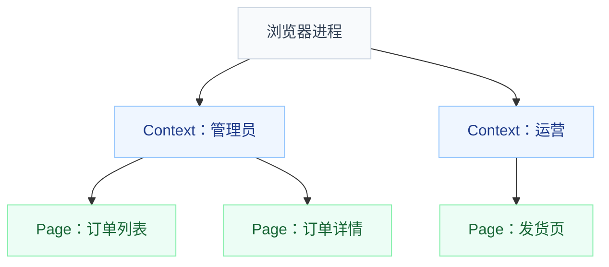
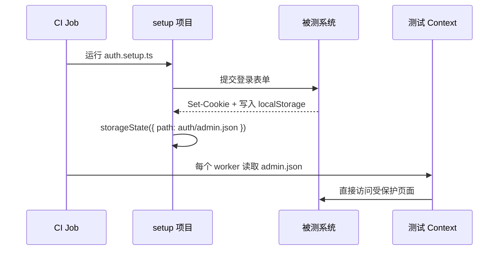
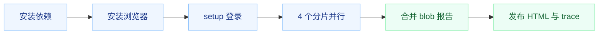

# Playwright端到端

> 这篇从 E2E 在测试分层中的职责边界讲起，经过安装与最小闭环、语义选择器、自动等待、页面对象模型、storageState 认证、数据与网络控制、并行分片和 trace 调试，最后落到 CI 流水线与一套订单主流程的完整案例。
>
> 学完能独立搭建一套稳定、可并行、失败可定位的 Playwright 端到端测试，并把它接进 CI 门禁。

## 一、端到端测试的职责边界

端到端测试（End-to-End Testing，E2E）只回答一个问题：真实用户能否从入口走到目标结果。它不负责穷举业务规则，也不负责证明样式正确；这两件事分别属于单元测试和视觉回归。

### 1.1 该由 E2E 承担的判断

一条用例要不要放进 E2E，看它是否同时满足三个条件：跨页面或跨服务、结果只有真实浏览器能验证、失败会让用户无法完成任务。只满足一个条件的，往下层放。

| 场景 | 放 E2E | 原因 |
|---|---|---|
| 登录后下单并支付 | 是 | 跨页面、跨服务、含真实跳转 |
| 折扣公式的边界值 | 否 | 单元测试毫秒级覆盖更彻底 |
| 角色菜单可见性 | 是 | 权限与路由、接口共同决定 |
| 接口参数校验 | 否 | 接口测试直接构造请求更快 |
| 浏览器返回后筛选条件保留 | 是 | 依赖真实历史栈与缓存 |

> 边界：E2E 覆盖率不是目标。一个系统有 200 条 E2E，跑一次四十分钟，团队就会开始跳过失败用例，这比没有 E2E 更危险。

### 1.2 Playwright 的执行模型

Playwright 用浏览器进程、上下文（BrowserContext）、页面（Page）三层隔离。一个 context 相当于一个独立用户：cookie、localStorage、缓存各自一份；一个 page 相当于一个标签页。测试默认每个用例新建 context，所以用例之间不会互相污染。



驱动进程在浏览器之外，通过 WebSocket 发 CDP 或各浏览器自己的协议。这一点决定了三件事：可以多浏览器并行、可以注入网络拦截、可以在不修改被测代码的前提下读取 DOM 快照。

| 工具 | 执行方式 | 并行模型 | 主要代价 |
|---|---|---|---|
| Playwright | 进程外驱动 | 多 worker、多 context | 需要管理浏览器版本 |
| Cypress | 浏览器内运行 | 多进程 | 跨域与多标签受限 |
| Selenium | WebDriver 协议 | Grid 节点 | 等待逻辑要自己写 |

### 1.3 稳定性来自隔离，不是重试

重试只能把偶发失败变成“看起来通过”，不能消除失败原因。稳定的 E2E 有三个前提：用例自己造数据、用例不依赖执行顺序、断言等待的是用户可见状态而不是固定秒数。

> 边界：支付、短信、第三方登录这类不可控外部依赖，应该用 sandbox 或网络拦截隔离，而不是在 CI 里重试到通过。重试次数是观测指标，不是修复手段。

## 二、安装与第一个可运行测试

这一章把环境装好，并跑通一条能看见浏览器行为的用例。装完的标准不是命令成功，而是 `npx playwright test` 输出 `1 passed`。

### 2.1 版本基线

| 组件 | 版本 | 说明 |
|---|---|---|
| Node.js | 22 LTS | Playwright 1.5x 的最低要求之上 |
| @playwright/test | 1.56 | 1.5x 线，本文命令按此版本 |
| 浏览器 | 随包绑定 | Chromium、Firefox、WebKit |
| http-server | 14 | 只为最小示例提供静态页 |

### 2.2 三端安装

Ubuntu 24.04 用 NodeSource 装 Node，再由 Playwright 安装浏览器依赖：

```bash
sudo apt-get update
sudo apt-get install -y curl git
curl -fsSL https://deb.nodesource.com/setup_22.x | sudo -E bash -
sudo apt-get install -y nodejs
node -v          # 期望 v22.x

mkdir pw-e2e && cd pw-e2e
npm init -y
npm i -D @playwright/test@1.56 http-server@14
# --with-deps 会顺带装 Linux 下 Chromium 需要的系统库
npx playwright install --with-deps chromium
```

macOS 用 Homebrew，浏览器不需要 `--with-deps`：

```bash
brew install node@22
node -v
mkdir pw-e2e && cd pw-e2e
npm init -y
npm i -D @playwright/test@1.56 http-server@14
npx playwright install chromium
```

Windows 用 winget，命令在 PowerShell 中执行：

```powershell
winget install OpenJS.NodeJS.LTS
node -v
mkdir pw-e2e; cd pw-e2e
npm init -y
npm i -D @playwright/test@1.56 http-server@14
npx playwright install chromium
```

> 边界：企业网络走代理时，npm 与浏览器下载要分别配置。`npm config set proxy` 只管 npm，浏览器下载还要 `HTTPS_PROXY`；离线环境用 `PLAYWRIGHT_BROWSERS_PATH` 指向统一缓存目录，不要让每个项目各下一份。

### 2.3 目录与配置

```text
pw-e2e/
├── app/
│   └── index.html
├── playwright.config.ts
├── package.json
└── tests/
    └── smoke.spec.ts
```

配置文件里的每一项都直接影响稳定性，先按下面写，后面章节再解释取舍：

```ts
// playwright.config.ts
import { defineConfig, devices } from '@playwright/test';

export default defineConfig({
  testDir: './tests',
  // 用例之间不共享状态，才敢开文件内并行
  fullyParallel: true,
  // CI 上误留 test.only 会让其余用例静默不跑，必须拦住
  forbidOnly: !!process.env.CI,
  // 本地不重试，避免把不稳定藏起来；CI 重试两次用于收集 flake
  retries: process.env.CI ? 2 : 0,
  workers: process.env.CI ? 4 : undefined,
  timeout: 30_000,
  expect: { timeout: 5_000 },
  reporter: process.env.CI
    ? [['blob'], ['github']]
    : [['list'], ['html', { open: 'never' }]],
  use: {
    baseURL: process.env.BASE_URL ?? 'http://127.0.0.1:4173',
    // 首次失败才录 trace，兼顾体积与可诊断性
    trace: 'on-first-retry',
    screenshot: 'only-on-failure',
    video: 'retain-on-failure',
    locale: 'zh-CN',
    timezoneId: 'Asia/Shanghai',
  },
  projects: [
    { name: 'chromium', use: { ...devices['Desktop Chrome'] } },
  ],
  webServer: {
    // -c-1 关掉缓存，避免改完页面还看到旧资源
    command: 'npx http-server app -p 4173 -c-1',
    url: 'http://127.0.0.1:4173',
    reuseExistingServer: !process.env.CI,
    timeout: 30_000,
  },
});
```

最小页面只保留一个登录表单，够验证浏览器、选择器和断言三件事：

```html
<!-- app/index.html -->
<!doctype html>
<html lang="zh-CN">
<head>
  <meta charset="utf-8" />
  <title>运维控制台</title>
</head>
<body>
  <main>
    <h1>运维控制台</h1>
    <form id="login">
      <label for="email">邮箱</label>
      <input id="email" name="email" type="email" required />
      <label for="password">密码</label>
      <input id="password" name="password" type="password" required />
      <button type="submit">登录</button>
    </form>
    <p id="msg" role="status"></p>
  </main>
  <script>
    document.querySelector('#login').addEventListener('submit', (e) => {
      e.preventDefault();
      // 真实系统这里会发请求；示例只更新状态文本，保持零后端依赖
      document.querySelector('#msg').textContent = '登录成功';
    });
  </script>
</body>
</html>
```

第一个用例同时验证标题、表单和按钮状态：

```ts
// tests/smoke.spec.ts
import { test, expect } from '@playwright/test';

test('首页能加载并显示登录表单', async ({ page }) => {
  await page.goto('/');
  await expect(page.getByRole('heading', { name: '运维控制台' })).toBeVisible();
  await expect(page.getByLabel('邮箱')).toBeVisible();
  // 按钮可点说明脚本已加载，避免只断言静态 HTML
  await expect(page.getByRole('button', { name: '登录' })).toBeEnabled();
});
```

运行：

```bash
npx playwright test tests/smoke.spec.ts
```

预期输出：

```text
Running 1 test using 1 worker

  ✓  1 tests/smoke.spec.ts:3:1 › 首页能加载并显示登录表单 (612ms)

  1 passed (1.4s)
```

### 2.4 安装后自检

三条命令分别确认版本、浏览器缓存和配置解析：

```bash
npx playwright --version
npx playwright install --dry-run
npx playwright test --list
```

预期输出关键行：

```text
Version 1.56.0
browser: chromium version 141.0.7390.37
Total: 1 test in 1 file
```

`--dry-run` 显示的是将要下载的版本，不是已安装列表；已安装版本看 `~/.cache/ms-playwright`（Linux）、`~/Library/Caches/ms-playwright`（macOS）或 `%USERPROFILE%\AppData\Local\ms-playwright`（Windows）。

### 2.5 日常命令

| 目的 | 命令 |
|---|---|
| 跑全部用例 | `npx playwright test` |
| 跑单个文件 | `npx playwright test tests/orders.spec.ts` |
| 按标题过滤 | `npx playwright test -g "提交订单"` |
| 有头模式 | `npx playwright test --headed` |
| 交互调试 | `npx playwright test --ui` |
| 只跑失败用例 | `npx playwright test --last-failed` |

## 三、选择器：优先用户可见的语义

选择器的第一原则是：优先使用用户和读屏软件都能感知的语义，其次才是测试专用属性，最后才是 CSS 和 XPath。选择器写错是 E2E 维护成本的主要来源。

### 3.1 选择器优先级

| 顺序 | 写法 | 适用 | 风险 |
|---|---|---|---|
| 1 | `getByRole` | 按钮、链接、标题、表格 | 文案改动会失败，但这是真实契约 |
| 2 | `getByLabel` | 表单字段 | 缺 label 时无法使用 |
| 3 | `getByPlaceholder` | 无 label 的搜索框 | 占位文本常变 |
| 4 | `getByText` | 静态说明文字 | 容易匹配到多个节点 |
| 5 | `getByTestId` | 动态列表、画布、第三方组件 | 与用户语义脱节 |
| 6 | CSS / XPath | 兜底 | 绑定实现，重构即碎 |

> 边界：`getByRole` 依赖可访问名称。一个按钮如果只放了图标、没有 `aria-label`，角色查询会失败；这时先修可访问性，再写测试，不要退回 CSS。

### 3.2 角色与可访问名称

```ts
// 按角色查询等价于读屏软件看到的结构，顺带做了一次可访问性冒烟
await page.getByRole('button', { name: '提交订单' }).click();

// 名称默认忽略大小写并做子串匹配，exact: true 才是整串精确匹配
await page.getByRole('button', { name: '提交订单', exact: true }).click();

// 正则用于名称带动态后缀的场景，例如「删除第 3 行」
await page.getByRole('button', { name: /^删除第 \d+ 行$/ }).click();

// 标题带层级，避免匹配到页面里同名的 h3
await expect(page.getByRole('heading', { level: 2, name: '订单详情' })).toBeVisible();

// 复选框用 check 而不是 click，语义更清晰且会校验最终状态
await page.getByRole('checkbox', { name: '同意服务协议' }).check();
```

### 3.3 列表与表格

表格里的按钮必须先限定到行，否则“删除”会匹配到每一行：

```ts
const row = page.getByRole('row', { name: /ORD-20261113-001/ });

// 行内单元格数量变化通常意味着列被误删
await expect(row.getByRole('cell')).toHaveCount(6);
await row.getByRole('button', { name: '发货' }).click();

// filter 适合状态筛选，不依赖 DOM 结构
const paidRows = page.getByRole('row').filter({ hasText: '已支付' });
await expect(paidRows).toHaveCount(3);

// has 用子元素定位，适合“含退款按钮的行”这种结构条件
const refundable = page.getByRole('row').filter({
  has: page.getByRole('button', { name: '退款' }),
});
```

### 3.4 strict mode 与多元素

Playwright 的定位器在操作或断言时要求唯一匹配。匹配到两个会直接报错，而不是默默取第一个：

```text
Error: strict mode violation: getByRole('button', { name: '删除' }) resolved to 2 elements:
    1) <button>删除</button> aka getByRole('row', { name: 'ORD-001' }).getByRole('button', { name: '删除' })
    2) <button>删除</button> aka getByRole('row', { name: 'ORD-002' }).getByRole('button', { name: '删除' })
```

正确做法是缩小范围；`.first()` 只适用于集合本身无序、取任意一个都成立的场景：

```ts
// 正确：先限定行，再取按钮
await page.getByRole('row', { name: /ORD-001/ })
  .getByRole('button', { name: '删除' })
  .click();

// 兜底：确实只关心集合中的任意一个
await page.getByTestId('toast').first().waitFor();
```

> 边界：`.nth(2)` 把测试绑定到渲染顺序，排序规则一变就错。需要按业务顺序断言时，先读取整列文本再比较数组。

### 3.5 test id 的边界

`data-testid` 适合三类节点：虚拟滚动列表的行、Canvas 或图表容器、无法控制语义的第三方组件。它不适合普通按钮和输入框，因为那会绕开可访问性检查。

```ts
// 只在没有稳定语义时使用，并把默认属性改成团队约定
// playwright.config.ts
use: { testIdAttribute: 'data-test' },
```

```html
<div data-test="chart-revenue" role="img" aria-label="近 30 天营收趋势"></div>
```

```ts
await expect(page.getByTestId('chart-revenue')).toBeVisible();
```

### 3.6 iframe、Shadow DOM 与文件

```ts
// 第三方支付页在 iframe 里，必须先进入 frame 再定位
const payFrame = page.frameLocator('#payment-frame');
await payFrame.getByLabel('卡号').fill('4242 4242 4242 4242');

// 开放式 Shadow DOM 会被 CSS 定位器自动穿透，角色查询同样有效
await page.getByRole('button', { name: '选择文件' }).click();

// 上传不弹系统窗口，直接给路径；路径相对当前工作目录
await page.getByLabel('合同附件').setInputFiles('fixtures/contract.pdf');

// 先挂等待再触发，避免下载事件比监听更早发生
const downloadPromise = page.waitForEvent('download');
await page.getByRole('button', { name: '导出' }).click();
const download = await downloadPromise;
await download.saveAs('out/orders.xlsx');
```

> 边界：封闭式 Shadow Root（`mode: 'closed'`）无法从外部查询，只能让组件暴露测试接口或改用组件测试。跨域 iframe 的内容也拿不到 DOM，只能断言外层状态。

## 四、自动等待与 web-first 断言

Playwright 的动作会先等元素可操作，断言会轮询到超时。理解这一点，就能删掉代码里绝大多数 `waitForTimeout`。

### 4.1 动作前的可操作性检查

点击、填写、勾选之前，Playwright 依次检查下列条件，全部满足才执行：

| 检查 | 含义 | 常见失败原因 |
|---|---|---|
| Attached | 元素在 DOM 中 | 列表还没渲染 |
| Visible | 有尺寸且不是 `visibility:hidden` | 折叠面板未展开 |
| Stable | 连续两帧位置不变 | 入场动画还在跑 |
| Receives events | 命中点没有被遮挡 | 加载遮罩未消失 |
| Enabled | 不是 `disabled` | 表单校验未通过 |

### 4.2 断言会重试，`waitForTimeout` 不会

下面两段代码的差别不是风格，而是可靠性：

```ts
// 错误：固定等 2 秒，接口慢就假失败，接口快就白等
await page.waitForTimeout(2000);
expect(await page.getByText('保存成功').isVisible()).toBe(true);
```

```ts
// 正确：断言在 5 秒内反复检查，成功即返回
await expect(page.getByText('保存成功')).toBeVisible();
```

`isVisible()` 是一次性查询，返回布尔值，不会重试；`expect(locator)` 才带轮询。常用的 web-first 断言：

```ts
await expect(page.getByRole('status')).toHaveText('保存成功');
await expect(page.getByRole('row')).toHaveCount(12);
await expect(page).toHaveURL(/\/orders\/\d+$/);
await expect(page.getByLabel('数量')).toHaveValue('2');
await expect(page.getByRole('switch', { name: '启用' })).toBeChecked();
await expect(page.getByRole('alert')).toContainText('库存不足');
```

> 边界：`toHaveText` 默认整串匹配，文本前后有空格也会失败；需要包含关系时用 `toContainText`。断言 DOM 数量前先想清楚“稳定数量”是不是业务契约，分页大小变化会让它误报。

### 4.3 超时分层

| 超时 | 默认值 | 配置位置 | 调大前的判断 |
|---|---|---|---|
| 单条用例 | 30 秒 | `timeout` | 是否真的走了长流程 |
| 断言轮询 | 5 秒 | `expect.timeout` | 接口 P95 是否超过 5 秒 |
| 单次动作 | 不限 | `use.actionTimeout` | 不建议单独设，受用例总时长约束 |
| 页面导航 | 不限 | `use.navigationTimeout` | 首屏资源是否过大 |
| 本地服务启动 | 60 秒 | `webServer.timeout` | 构建是否在启动时才做 |

全局调大超时是最差的处理方式：它让真正的性能退化被掩盖，也让失败反馈变慢。正确顺序是先看 trace，确认卡在哪一步，再决定是修产品、修数据，还是只给这一条用例加 `test.setTimeout()`。

### 4.4 等网络还是等界面

断言用户看到的结果，用界面断言；断言请求本身，用 `waitForResponse`。两者都要时，先挂 Promise 再触发动作：

```ts
// 先挂监听，避免响应比 click 返回得更快造成竞态
const responsePromise = page.waitForResponse(
  (r) => r.url().includes('/api/orders') && r.request().method() === 'POST',
);

await page.getByRole('button', { name: '提交订单' }).click();

const response = await responsePromise;
expect(response.status()).toBe(201);
await expect(page.getByRole('heading', { name: '订单已创建' })).toBeVisible();
```

`page.waitForLoadState('networkidle')` 不适合作为常规等待：长轮询、埋点和 WebSocket 会让它永远不空闲。只在排查“到底还有哪些请求没结束”时临时使用。

### 4.5 软断言与步骤

```ts
test('订单详情字段完整', async ({ page }) => {
  await test.step('打开订单详情', async () => {
    await page.goto('/orders/ORD-20261113-001');
  });

  await test.step('校验关键字段', async () => {
    // soft 断言失败后继续执行，一次拿到全部字段问题
    await expect.soft(page.getByTestId('order-no')).toHaveText('ORD-20261113-001');
    await expect.soft(page.getByTestId('order-amount')).toHaveText('¥1,280.00');
    await expect.soft(page.getByTestId('order-status')).toHaveText('待发货');
  });
});
```

> 边界：软断言只适合彼此独立的字段校验。后续步骤依赖前面结果时用硬断言，否则会在错误状态下继续操作，报出一串无关失败。

## 五、页面对象模型

页面对象模型（Page Object Model，POM）把“页面怎么操作”从“业务期望是什么”里拆出来。它的价值是改动只落在一个文件，而不是让测试少写几行。

### 5.1 POM 的职责边界

一个页面对象只做三件事：暴露定位器、封装多步动作、封装“页面已到达”的状态判断。业务断言留在测试里，跨页面的流程编排放在 fixture 或辅助函数里。

| 放进 POM | 不放进 POM |
|---|---|
| 定位器定义 | 具体用例的期望值 |
| 填写、提交、翻页 | 跨三个页面的业务流程 |
| 等待页面就绪 | 测试数据构造 |
| 组件级复用 | 环境判断 |

### 5.2 目录结构

```text
tests/
├── pages/
│   ├── login.page.ts
│   └── orders.page.ts
├── fixtures.ts
├── auth.setup.ts
└── specs/
    ├── order-flow.spec.ts
    └── permission.spec.ts
```

### 5.3 页面对象代码

```ts
// tests/pages/login.page.ts
import { type Page, type Locator, expect } from '@playwright/test';

export class LoginPage {
  readonly email: Locator;
  readonly password: Locator;
  readonly submit: Locator;
  readonly message: Locator;

  constructor(private readonly page: Page) {
    this.email = page.getByLabel('邮箱');
    this.password = page.getByLabel('密码');
    this.submit = page.getByRole('button', { name: '登录' });
    this.message = page.getByRole('status');
  }

  async goto() {
    await this.page.goto('/login');
  }

  async login(email: string, password: string) {
    await this.email.fill(email);
    await this.password.fill(password);
    await this.submit.click();
    // 登录成功的稳定信号是离开登录页，而不是某条 toast 出现
    await expect(this.page).not.toHaveURL(/\/login$/);
  }
}
```

```ts
// tests/pages/orders.page.ts
import { type Page, type Locator, expect } from '@playwright/test';

export class OrdersPage {
  readonly search: Locator;
  readonly table: Locator;

  constructor(private readonly page: Page) {
    this.search = page.getByPlaceholder('搜索订单号');
    this.table = page.getByRole('table', { name: '订单列表' });
  }

  async goto() {
    await this.page.goto('/orders');
    await expect(this.table).toBeVisible();
  }

  // 行定位器是方法而不是字段：订单号是用例传入的，不能提前固化
  row(orderNo: string): Locator {
    return this.page.getByRole('row', { name: new RegExp(orderNo) });
  }

  async ship(orderNo: string) {
    await this.row(orderNo).getByRole('button', { name: '发货' }).click();
    await this.page.getByRole('dialog', { name: '确认发货' })
      .getByRole('button', { name: '确认' })
      .click();
  }

  async filterByStatus(status: string) {
    await this.page.getByLabel('订单状态').selectOption({ label: status });
  }
}
```

### 5.4 用 fixture 注入页面对象

fixture 是 Playwright 的依赖注入机制。相比每个用例里 `new`，它延迟创建、带类型、可以组合：

```ts
// tests/fixtures.ts
import { test as base } from '@playwright/test';
import { LoginPage } from './pages/login.page';
import { OrdersPage } from './pages/orders.page';

type Pages = {
  loginPage: LoginPage;
  ordersPage: OrdersPage;
};

export const test = base.extend<Pages>({
  // 页面对象在用例真正用到时才实例化，没用到的不会创建
  loginPage: async ({ page }, use) => {
    await use(new LoginPage(page));
  },
  ordersPage: async ({ page }, use) => {
    await use(new OrdersPage(page));
  },
});

export { expect } from '@playwright/test';
```

```ts
// tests/specs/order-flow.spec.ts
import { test, expect } from '../fixtures';

test('运营可以为已支付订单发货', async ({ ordersPage, page }) => {
  await ordersPage.goto();
  await ordersPage.filterByStatus('已支付');
  await ordersPage.ship('ORD-20261113-001');

  // 业务断言留在用例里，页面对象只负责操作
  await expect(ordersPage.row('ORD-20261113-001')).toContainText('已发货');
  await expect(page.getByRole('status')).toHaveText('发货成功');
});
```

### 5.5 POM 的边界

- 不要为每个页面建一个继承自 `BasePage` 的类。继承超过两层后，改基类会同时影响所有页面。
- 页面对象里的 `expect` 只用于“页面是否就绪”，业务结果断言放回用例。
- 组件对象（导航栏、日期选择器、表格）可以独立，页面对象组合它们，不要复制定位器。
- 一个页面对象超过 150 行，通常说明它承担了多个页面或整条业务流程，应该拆。

## 六、认证状态与 storageState

登录是 E2E 最慢、最不稳定的一步。标准做法是全局登录一次，把 cookie 和 localStorage 存成 `storageState`，后续每个 context 直接加载。

### 6.1 登录一次的执行顺序



### 6.2 setup 项目

```ts
// tests/auth.setup.ts
import { test as setup, expect } from '@playwright/test';

const authFile = 'auth/admin.json';

setup('管理员登录', async ({ page }) => {
  await page.goto('/login');
  await page.getByLabel('邮箱').fill(process.env.E2E_ADMIN_EMAIL!);
  await page.getByLabel('密码').fill(process.env.E2E_ADMIN_PASSWORD!);
  await page.getByRole('button', { name: '登录' }).click();

  // 必须等真实登录完成，否则会把未登录状态写进 storageState
  await expect(page.getByRole('heading', { name: '工作台' })).toBeVisible();

  await page.context().storageState({ path: authFile });
  // 文件里有会话凭证，CI 上只作为临时产物，不入库
});
```

```ts
// playwright.config.ts 的 projects 部分
projects: [
  // setup 项目不跑普通用例，只负责产出状态文件
  { name: 'setup', testMatch: /auth\.setup\.ts/ },
  {
    name: 'chromium',
    use: { ...devices['Desktop Chrome'], storageState: 'auth/admin.json' },
    // 保证 setup 先执行且成功，否则后续用例会以匿名身份跑
    dependencies: ['setup'],
  },
],
```

### 6.3 多角色

角色多时按项目拆分，不要在一个用例里反复登出登录：

```ts
projects: [
  { name: 'setup', testMatch: /auth\.setup\.ts/ },
  {
    name: 'admin',
    use: { ...devices['Desktop Chrome'], storageState: 'auth/admin.json' },
    dependencies: ['setup'],
    testMatch: /specs\/admin\/.*\.spec\.ts/,
  },
  {
    name: 'operator',
    use: { ...devices['Desktop Chrome'], storageState: 'auth/operator.json' },
    dependencies: ['setup'],
    testMatch: /specs\/operator\/.*\.spec\.ts/,
  },
],
```

单个用例临时换角色，用 `test.use`：

```ts
import { test, expect } from '@playwright/test';

test.describe('只读角色', () => {
  // 文件级覆盖，describe 内所有用例都用这个身份
  test.use({ storageState: 'auth/viewer.json' });

  test('看不到发货按钮', async ({ page }) => {
    await page.goto('/orders');
    await expect(page.getByRole('button', { name: '发货' })).toHaveCount(0);
  });
});
```

### 6.4 API 登录与 token 注入

UI 登录慢且依赖页面结构，更稳的方式是调登录接口。若 token 存在 localStorage，需要手工拼状态文件：

```ts
// scripts/api-auth.mjs —— 在 setup 项目里以子进程或直接 import 执行
import { request } from '@playwright/test';
import fs from 'node:fs';

const baseURL = process.env.BASE_URL ?? 'http://127.0.0.1:4173';

const ctx = await request.newContext({ baseURL });
const res = await ctx.post('/api/auth/login', {
  data: {
    email: process.env.E2E_ADMIN_EMAIL,
    password: process.env.E2E_ADMIN_PASSWORD,
  },
});
if (res.status() !== 200) throw new Error(`login failed: ${res.status()}`);

const { token } = await res.json();

const state = {
  cookies: [],
  origins: [
    {
      origin: baseURL,
      // storageState 只保留 cookie 和 localStorage，token 存哪就写哪
      localStorage: [{ name: 'access_token', value: token }],
    },
  ],
};

fs.mkdirSync('auth', { recursive: true });
fs.writeFileSync('auth/admin.json', JSON.stringify(state, null, 2));
await ctx.dispose();
```

如果后端用 HttpOnly Cookie，直接 `const state = await ctx.storageState()` 即可，不要手工拼。

### 6.5 storageState 的边界

- 只保存 cookie 与 localStorage，不保存 sessionStorage、IndexedDB、Service Worker 缓存。系统把会话放 sessionStorage 时，加载状态文件仍然未登录。
- token 有有效期。测试环境给 E2E 账号单独发长 TTL 的令牌，或者每次流水线重新执行 setup。
- `auth/*.json` 含真实会话，必须写进 `.gitignore`；CI 用 secrets 注入账号密码，产物保留 1 天即删。
- 状态文件跨环境不可复用：域名、cookie 的 `Secure`、`SameSite` 都可能不同。

## 七、测试数据与网络控制

E2E 的数据问题只有两种解法：让每条用例造自己的数据，或者让它只读共享的固定数据。混用两者，就会出现“单跑通过、全量失败”。

### 7.1 三种造数方式

| 方式 | 速度 | 真实度 | 适用 |
|---|---|---|---|
| 接口造数 | 快 | 中 | 前置条件、批量数据 |
| UI 造数 | 慢 | 高 | 造数流程本身就是要测的功能 |
| 数据库夹具 | 最快 | 低 | 只读查询、报表校验 |

原则：前置条件一律走接口，只有“创建”这个动作本身属于测试目标时才走 UI。直连测试库只在只读场景使用，且不能绕过业务校验写脏数据。

### 7.2 网络拦截

`route` 用于模拟异常分支，不用于替代后端：

```ts
test('库存不足时禁止提交', async ({ page }) => {
  await page.route('**/api/orders', async (route) => {
    // 只拦截 POST，其他请求放行，避免把页面资源也挡掉
    if (route.request().method() !== 'POST') return route.continue();
    await route.fulfill({
      status: 409,
      contentType: 'application/json',
      body: JSON.stringify({ code: 'OUT_OF_STOCK', message: '库存不足' }),
    });
  });

  await page.goto('/cart');
  await page.getByRole('button', { name: '提交订单' }).click();
  await expect(page.getByRole('alert')).toHaveText('库存不足');
});
```

HAR 适合回放第三方接口或没有测试环境的外部服务：

```ts
await page.routeFromHAR('har/map-provider.har', {
  url: '**/api/map/**',
  // update: true 时录制并覆盖，正常回归必须是 false
  update: false,
  notFound: 'abort',
});
```

> 边界：拦截范围越小越好。把整页接口都 mock 掉，测试实际验证的是 mock 数据，不是系统行为；一旦真实接口字段变化，测试仍然全绿。

### 7.3 请求体断言

有时界面只显示“提交成功”，真正的契约在请求体里：

```ts
const requestPromise = page.waitForRequest(
  (r) => r.url().endsWith('/api/orders') && r.method() === 'POST',
);
await page.getByRole('button', { name: '提交订单' }).click();

const body = (await requestPromise).postDataJSON();
expect(body).toMatchObject({
  sku: 'SKU-2026-001',
  quantity: 2,
  // 金额必须由前端按分传输，浮点数会在后端产生精度误差
  amountInCents: 128000,
});
```

### 7.4 数据隔离与清理

```ts
import { test as base, expect } from '@playwright/test';

type OrderFixtures = { orderNo: string };

export const test = base.extend<OrderFixtures>({
  orderNo: async ({ request }, use) => {
    // 带时间戳与随机后缀，避免并行 worker 撞号
    const orderNo = `E2E-${Date.now()}-${Math.random().toString(36).slice(2, 8)}`;
    const res = await request.post('/api/test/orders', { data: { orderNo } });
    expect(res.ok()).toBeTruthy();

    await use(orderNo);

    // 用例失败也执行清理，防止测试库无限膨胀
    await request.delete(`/api/test/orders/${orderNo}`);
  },
});
```

> 边界：清理接口只存在于测试环境，生产网关必须屏蔽。共享账号（如固定的 admin）会让并行用例互相改密码、锁账号，每个 worker 应使用独立账号或独立租户。

## 八、并行、分片与重试

并行不是把 `workers` 调大就完了。先保证隔离，再谈并发；否则只是把偶发失败的概率放大。

### 8.1 并行单位

- worker 是进程，数量默认是 CPU 核数的一半；
- 每个用例拿到全新的 context 和 page，cookie、storage 不共享；
- `fullyParallel: true` 让同一文件内的用例也并行；
- `test.describe.configure({ mode: 'serial' })` 只用于强依赖流程，且该文件永远落在一个 worker 上。

```ts
// 有先后依赖的流程才用 serial，并接受它无法并行
test.describe.configure({ mode: 'serial' });

test('创建订单', async ({ page }) => { /* ... */ });
test('支付订单', async ({ page }) => { /* ... */ });
```

### 8.2 分片

分片在 `fullyParallel: true` 时按用例均衡，未开启时按文件切分；两种都要求用例或文件时长尽量均匀：

```bash
# 4 个分片中的第 1 个
npx playwright test --shard=1/4
```

CI 里用矩阵并行执行，每个分片上传自己的 blob 报告，最后合并。分片是否均衡取决于用例时长分布；未开 `fullyParallel` 时才由文件粒度决定，一个 40 条用例的大文件会把某个分片拖慢，应按业务域拆文件。

### 8.3 重试策略

| 环境 | retries | 目的 |
|---|---|---|
| 本地 | 0 | 失败立即暴露 |
| CI 主分支 | 2 | 区分真实失败与 flake |
| 发布前回归 | 0 | 不接受任何偶发 |

重试只能用于收集证据。连续重试都失败的是真 bug；第一次失败、重试通过的要进 flake 清单，限期修复。

```bash
# 主动猎捕 flake：同一文件重复 20 次，4 个 worker 并发
npx playwright test tests/specs/order-flow.spec.ts --repeat-each=20 --workers=4
```

### 8.4 不稳定的常见来源

| 现象 | 根因 | 处理 |
|---|---|---|
| 单跑过、全量挂 | 共享账号或固定订单号 | 每用例独立数据 |
| 偶发等不到 toast | 动画或接口慢 | 断言最终状态，不 sleep |
| CI 挂、本地过 | 时区、字体、慢机器 | 固定 locale/timezone，CI 容器 |
| 顺序一变就挂 | 用例间有隐式依赖 | 每用例独立 context |
| 第三方超时 | 外部服务不可控 | 拦截或 sandbox |

### 8.5 worker 数与资源

浏览器是内存大户。4 核 8 GB 的 CI 机器跑 4 个 Chromium worker 已经接近上限；页面里再有地图、图表、视频，worker 数要减半。判断依据是 CI 的 OOM 记录和单条用例耗时，不是本机体验。

## 九、trace、截图与调试

E2E 失败最贵的成本是定位。trace 把每一步的 DOM 快照、网络、控制台和源码调用栈打包，是首选证据。

### 9.1 trace 配置

| 值 | 何时录 | 体积 | 用途 |
|---|---|---|---|
| `off` | 不录 | 0 | 稳定后的日常 |
| `on-first-retry` | 首次重试 | 中 | 默认推荐 |
| `retain-on-failure` | 全程录，失败保留 | 大 | 难复现问题 |
| `on` | 全程录，全部保留 | 最大 | 本地排查 |

```ts
// 单条用例强制开 trace，排查完删除
test.use({ trace: 'on' });
```

### 9.2 读 trace

```bash
npx playwright show-trace test-results/order-flow-提交订单-chromium/trace.zip
```

trace 查看器里按时间轴可以看到：每个动作前后的 DOM 快照、请求与响应、console 输出、源码位置、实际耗时。常见用法是点开失败动作，对比“点击前”和“点击后”的 DOM，确认是元素没出现、被遮挡，还是点击后接口报错。

### 9.3 交互调试

```bash
# UI 模式：时间旅行、watch、逐个动作执行
npx playwright test --ui

# 打开浏览器并暂停在每一步，适合看真实渲染
npx playwright test --debug

# 录制操作生成代码，仅作为起点，生成的选择器要人工改成语义定位
npx playwright codegen http://127.0.0.1:4173
```

`PWDEBUG=1` 与 `--debug` 等价。调试时把 `workers` 设为 1，否则多个浏览器窗口会互相抢焦点。

### 9.4 截图、视频与控制台

```ts
test('导出报表', async ({ page }, testInfo) => {
  const errors: string[] = [];
  page.on('console', (msg) => {
    // 只收集 error，warning 在多数系统里是噪音
    if (msg.type() === 'error') errors.push(msg.text());
  });
  page.on('pageerror', (err) => errors.push(err.message));

  await page.goto('/reports');
  await page.getByRole('button', { name: '导出' }).click();

  // 把接口响应挂到报告，失败时不用再翻网络面板
  const res = await page.request.get('/api/reports/latest');
  await testInfo.attach('report.json', {
    body: await res.body(),
    contentType: 'application/json',
  });

  expect(errors).toEqual([]);
});
```

> 边界：控制台里的 404 可能来自埋点或 favicon，直接断言“零 error”会长期误报。按 URL 白名单过滤后再断言。

### 9.5 失败信息怎么读

```text
Error: expect(locator).toBeVisible() failed

Locator: getByRole('button', { name: '提交订单' })
Expected: visible
Timeout: 5000ms
Call log:
  - expect.toBeVisible with timeout 5000ms
  - waiting for getByRole('button', { name: '提交订单' })
```

按顺序排除：名称是否被改（含空格与全角）、按钮是否 `disabled`、是否在 iframe 里、是否被遮罩挡住、页面是否根本没跳转。`Call log` 只说明等了这个定位器，不说明页面为什么没出现，必须配合 trace 看快照。

## 十、CI 流水线

CI 的目标不是“跑一遍”，而是“十五分钟内给出可信结论，并把失败证据留在产物里”。

### 10.1 流水线结构



### 10.2 GitHub Actions

```yaml
# .github/workflows/e2e.yml
name: e2e
on:
  pull_request:
  push:
    branches: [main]

jobs:
  test:
    runs-on: ubuntu-24.04
    strategy:
      fail-fast: false
      matrix:
        shard: [1, 2, 3, 4]
    steps:
      - uses: actions/checkout@v4

      - uses: actions/setup-node@v4
        with:
          node-version: 22
          cache: npm

      - run: npm ci

      # 只装 Chromium，省一半下载时间；多浏览器回归放在 nightly
      - run: npx playwright install --with-deps chromium

      - run: npx playwright test --shard=${{ matrix.shard }}/4
        env:
          CI: true
          BASE_URL: ${{ vars.E2E_BASE_URL }}
          E2E_ADMIN_EMAIL: ${{ secrets.E2E_ADMIN_EMAIL }}
          E2E_ADMIN_PASSWORD: ${{ secrets.E2E_ADMIN_PASSWORD }}

      - uses: actions/upload-artifact@v4
        if: always()
        with:
          name: blob-report-${{ matrix.shard }}
          path: blob-report
          retention-days: 7

      - uses: actions/upload-artifact@v4
        if: failure()
        with:
          name: traces-${{ matrix.shard }}
          path: test-results
          retention-days: 7

  merge:
    if: always()
    needs: [test]
    runs-on: ubuntu-24.04
    steps:
      - uses: actions/checkout@v4
      - uses: actions/setup-node@v4
        with:
          node-version: 22
          cache: npm
      - run: npm ci
      # 先把所有分片的 blob 产物下载到同一目录，merge-multiple 合并内容
      - uses: actions/download-artifact@v4
        with:
          pattern: blob-report-*
          path: all-blobs
          merge-multiple: true
      # blob 是分片的中间格式，合并后才能生成完整 HTML 报告
      - run: npx playwright merge-reports --reporter html ./all-blobs
      - uses: actions/upload-artifact@v4
        with:
          name: html-report
          path: playwright-report
          retention-days: 7
```

### 10.3 Docker 固定环境

CI 机器与开发机的字体、系统库不同，会让截图和时间相关用例产生差异。用官方镜像可以固定版本：

```bash
docker run --rm --ipc=host \
  -v "$PWD":/work -w /work \
  -e CI=true \
  mcr.microsoft.com/playwright:v1.56.0-noble \
  npx playwright test
```

> 边界：镜像 tag 必须与 `@playwright/test` 版本一致。`latest` 会在某天悄悄升级浏览器，让历史 trace 和基线失效。

### 10.4 报告与产物

| 报告 | 用途 | 保留时间 |
|---|---|---|
| blob | 分片中间格式，供合并 | 7 天 |
| HTML | 人读，含 trace 链接 | 7 天 |
| JUnit XML | GitLab、Jenkins 展示 | 30 天 |
| trace | 失败定位 | 7 天 |

### 10.5 门禁策略

| 指标 | 阈值 | 不达标动作 |
|---|---|---|
| P0 用例通过率 | 100% | 阻断合并 |
| flake 率 | < 2% | 进清单，两周内修 |
| 全量耗时 | < 15 分钟 | 拆文件或加机器 |
| 失败 trace 覆盖 | 100% | 检查 reporter 配置 |

## 十一、常见故障排查手册

先给现象与第一条命令，再展开。E2E 的排障顺序永远是：看 trace → 看快照 → 看网络 → 看控制台。

| 现象 | 大概率原因 | 第一条命令 |
|---|---|---|
| 等到 5 秒仍不可见 | 元素未渲染、被遮挡、文案变了 | `npx playwright show-trace <trace.zip>` |
| strict mode violation | 定位器匹配多个 | 在 trace 里看 resolved to 列表 |
| 本地过、CI 挂 | 时区、字体、慢机器 | 对比 CI 与本地 trace 的首个差异动作 |
| 登录态失效 | token 过期或域名不一致 | 检查 `auth/*.json` 的 cookie 域 |
| 浏览器启动失败 | 系统库缺失或版本不匹配 | `npx playwright install --with-deps` |
| 下载/上传失败 | 事件竞态或路径不对 | 先挂 `waitForEvent` 再触发 |
| 弹窗挡住点击 | 遮罩未消失 | 断言遮罩隐藏后再操作 |

### 11.1 超时

先分清是动作超时还是断言超时。动作超时看可操作性五项检查；断言超时看接口和控制台。不要第一反应改 `timeout`，先看 trace 里最后一张快照。

```bash
npx playwright test tests/specs/order-flow.spec.ts --debug
```

### 11.2 strict mode

错误信息会列出每个匹配元素的祖先定位器，直接抄其中一条限定范围即可。若两个元素都合理，说明业务上需要区分，例如“默认地址”和“备用地址”，应加 `filter` 而不是 `.first()`。

### 11.3 CI 才失败

按可能性排序：时区（用 `timezoneId` 固定）、字体（用容器）、并发数（CI 机器核少）、网络（内网服务未开放）、数据（共享测试库被其他流水线改动）。逐项排除时保留两份 trace 对比。

### 11.4 认证过期

症状是所有受保护页面都跳回登录页，且只有跑了一段时间后的分片失败。检查 `auth/*.json` 的生成时间与 token TTL；把 setup 放到每个分片开头执行，或给测试账号单独发长有效期令牌。

### 11.5 浏览器启动失败

```text
browserType.launch: Executable doesn't exist at /home/runner/.cache/ms-playwright/chromium-1210/chrome-linux/chrome
```

版本升级后浏览器未重装。执行 `npx playwright install --with-deps chromium`，并确认 CI 缓存 key 包含 Playwright 版本号。

## 十二、最佳实践案例

### 12.1 案例背景

某电商后台的订单模块有 6 个页面、3 种角色，发布前回归靠 12 条手工清单，两个人做两天。三个月内出过两次线上事故：一次是重复提交生成两笔订单，一次是运营角色看到了管理员才有的退款按钮。团队要求把 P0 主流程做成自动回归，目标是发布前 15 分钟内给出结论。

约束有三条：测试环境每天清库，不能依赖固定订单；支付走第三方 sandbox，不能真实扣款；CI 是 4 核 8 GB 的 GitHub 托管 Runner。以下数据为示例，统计口径是同一仓库连续 50 次流水线。

### 12.2 案例实操

最终结构：

```text
pw-e2e/
├── app/                        # 本地演示用静态页
├── auth/                       # 运行时生成，已 gitignore
├── tests/
│   ├── auth.setup.ts
│   ├── fixtures.ts
│   ├── pages/
│   │   ├── login.page.ts
│   │   └── orders.page.ts
│   └── specs/
│       ├── admin/order-flow.spec.ts
│       └── operator/permission.spec.ts
├── playwright.config.ts
└── .github/workflows/e2e.yml
```

依赖与脚本：

```json
{
  "name": "pw-e2e",
  "private": true,
  "scripts": {
    "test": "playwright test",
    "test:ui": "playwright test --ui",
    "test:flake": "playwright test --repeat-each=10 --workers=4",
    "report": "playwright show-report"
  },
  "devDependencies": {
    "@playwright/test": "1.56.0",
    "http-server": "14.1.1"
  }
}
```

配置在第二章基础上补三处：两个角色项目、失败产物、4 个 worker：

```ts
// playwright.config.ts（关键片段）
import { defineConfig, devices } from '@playwright/test';

const authDir = 'auth';

export default defineConfig({
  testDir: './tests',
  fullyParallel: true,
  forbidOnly: !!process.env.CI,
  // 托管 Runner 只有 4 核，4 个 worker 是实测的稳定上限
  retries: process.env.CI ? 2 : 0,
  workers: process.env.CI ? 4 : undefined,
  timeout: 30_000,
  expect: { timeout: 5_000 },
  reporter: process.env.CI
    ? [['blob'], ['github']]
    : [['list'], ['html', { open: 'never' }]],
  use: {
    baseURL: process.env.BASE_URL ?? 'http://127.0.0.1:4173',
    trace: 'on-first-retry',
    screenshot: 'only-on-failure',
    video: 'retain-on-failure',
    locale: 'zh-CN',
    timezoneId: 'Asia/Shanghai',
  },
  projects: [
    { name: 'setup', testMatch: /auth\.setup\.ts/ },
    {
      name: 'admin',
      use: { ...devices['Desktop Chrome'], storageState: `${authDir}/admin.json` },
      dependencies: ['setup'],
      testMatch: /specs\/admin\/.*\.spec\.ts/,
    },
    {
      name: 'operator',
      use: { ...devices['Desktop Chrome'], storageState: `${authDir}/operator.json` },
      dependencies: ['setup'],
      testMatch: /specs\/operator\/.*\.spec\.ts/,
    },
  ],
});
```

setup 一次产出两个角色状态：

```ts
// tests/auth.setup.ts
import { test as setup, expect } from '@playwright/test';

const accounts = [
  { file: 'auth/admin.json', email: process.env.E2E_ADMIN_EMAIL!, password: process.env.E2E_ADMIN_PASSWORD! },
  { file: 'auth/operator.json', email: process.env.E2E_OPERATOR_EMAIL!, password: process.env.E2E_OPERATOR_PASSWORD! },
];

for (const account of accounts) {
  setup(`登录 ${account.file}`, async ({ page }) => {
    await page.goto('/login');
    await page.getByLabel('邮箱').fill(account.email);
    await page.getByLabel('密码').fill(account.password);
    await page.getByRole('button', { name: '登录' }).click();
    await expect(page.getByRole('heading', { name: '工作台' })).toBeVisible();
    await page.context().storageState({ path: account.file });
  });
}
```

订单页对象补上“等待列表稳定”的方法，避免刚进页面就点按钮：

```ts
// tests/pages/orders.page.ts
import { type Page, type Locator, expect } from '@playwright/test';

export class OrdersPage {
  readonly search: Locator;
  readonly table: Locator;
  readonly loading: Locator;

  constructor(private readonly page: Page) {
    this.search = page.getByPlaceholder('搜索订单号');
    this.table = page.getByRole('table', { name: '订单列表' });
    this.loading = page.getByTestId('table-loading');
  }

  async goto() {
    await this.page.goto('/orders');
    // 先等加载遮罩消失，再等表格出现，避免骨架屏被当成空列表
    await expect(this.loading).toBeHidden();
    await expect(this.table).toBeVisible();
  }

  row(orderNo: string): Locator {
    return this.page.getByRole('row', { name: new RegExp(orderNo) });
  }

  async submitOrder(sku: string, quantity: number) {
    await this.page.goto(`/orders/new?sku=${sku}`);
    await this.page.getByLabel('数量').fill(String(quantity));
    await this.page.getByRole('button', { name: '提交订单' }).click();
  }

  async ship(orderNo: string) {
    await this.row(orderNo).getByRole('button', { name: '发货' }).click();
    await this.page.getByRole('dialog', { name: '确认发货' })
      .getByRole('button', { name: '确认' })
      .click();
  }
}
```

主流程用例覆盖“下单 → 支付回调 → 发货”，数据全部由接口造：

```ts
// tests/specs/admin/order-flow.spec.ts
import { test, expect } from '../../fixtures';
import { OrdersPage } from '../../pages/orders.page';

test.describe('订单主流程', () => {
  test('下单后支付回调成功，运营可以发货', async ({ page, request }) => {
    const orderNo = `E2E-${Date.now()}-${Math.random().toString(36).slice(2, 8)}`;

    // 前置数据走接口，UI 只验证用户动作
    const created = await request.post('/api/test/orders', {
      data: { orderNo, sku: 'SKU-2026-001', quantity: 2 },
    });
    expect(created.status()).toBe(201);

    const orders = new OrdersPage(page);
    await orders.goto();
    await orders.search.fill(orderNo);
    await expect(orders.table.getByRole('row').filter({ hasText: orderNo })).toHaveCount(1);

    // 模拟第三方支付回调，避免真实扣款
    const paid = await request.post(`/api/test/orders/${orderNo}/pay`);
    expect(paid.ok()).toBeTruthy();

    await page.reload();
    await orders.ship(orderNo);
    await expect(orders.row(orderNo)).toContainText('已发货');

    // 正常路径收尾清理；需要失败也清理时用 7.4 的 fixture
    await request.delete(`/api/test/orders/${orderNo}`);
  });

  test('重复点击只生成一笔订单', async ({ page, request }) => {
    const before = await (await request.get('/api/test/orders/count')).json();

    await page.goto('/orders/new?sku=SKU-2026-002');
    await page.getByLabel('数量').fill('1');

    const submit = page.getByRole('button', { name: '提交订单' });
    // 连点两次复现线上事故：按钮在请求返回前没有禁用
    await submit.click();
    await submit.click({ force: true });

    await expect(page.getByRole('heading', { name: '订单已创建' })).toBeVisible();

    const after = await (await request.get('/api/test/orders/count')).json();
    expect(after.count - before.count).toBe(1);
  });
});
```

权限用例验证“看不到”而不是“点了才报错”：

```ts
// tests/specs/operator/permission.spec.ts
import { test, expect } from '@playwright/test';

test('运营角色看不到退款入口', async ({ page }) => {
  await page.goto('/orders');
  await expect(page.getByRole('table', { name: '订单列表' })).toBeVisible();

  // 数量断言比“不可见”更严格：入口根本不应渲染
  await expect(page.getByRole('button', { name: '退款' })).toHaveCount(0);
});
```

CI 在 10.2 的模板上增加 setup 与合并步骤，跑法：

```bash
# 本地全量
npm test

# 模拟 CI 分片
CI=true npx playwright test --shard=1/4
```

预期输出（示例）：

```text
Running 7 tests using 4 workers, shard 1 of 4

  ✓  6 tests/specs/admin/order-flow.spec.ts:5:3 › 订单主流程 › 下单后支付回调成功，运营可以发货 (8.4s)
  ✓  1 tests/specs/operator/permission.spec.ts:3:1 › 运营角色看不到退款入口 (2.1s)

  7 passed (48.6s)
```

四个分片合并后的报告：24 passed，测试阶段总耗时 1 分 52 秒（不含依赖安装）。

### 12.3 案例结果

| 指标 | 改造前 | 改造后 |
|---|---|---|
| 回归方式 | 2 人 × 2 天手工 | 24 条自动，1 分 52 秒 |
| 发布前反馈 | 次日上午 | 提交后 15 分钟内 |
| 线上事故 | 3 个月 2 次 | 6 个月 0 次同类 |
| flake 率 | 无统计 | 0.8%（50 次流水线） |
| 失败定位耗时 | 平均 40 分钟 | 平均 8 分钟（看 trace） |

改造中修掉的真实问题：重复提交用例稳定复现了“按钮未禁用”，修复后接口加了幂等键；权限用例发现运营角色能通过直达 URL 打开退款页，前端隐藏了入口但路由守卫缺失。两个问题都不是新功能引入，而是历史遗留。

失败模式与复盘：

- 第一版有 3 条用例偶发失败，根因是共享 admin 账号和固定订单号，改成每 worker 独立账号后消失。
- 支付回调最初用 UI 点击 sandbox 页面，平均 40 秒且偶尔超时；改为接口触发回调后降到 1 秒内。
- 第一版没开 `fullyParallel`，分片按文件切，订单文件有 14 条用例，导致 1 号分片比其他慢一倍；改为按用例均衡后恢复正常。
- 没有把视觉校验塞进 E2E。颜色和布局变化交给截图对比，E2E 只断言结构和文案，避免两套失败原因混在一起。
