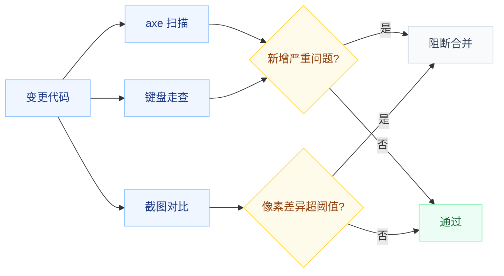
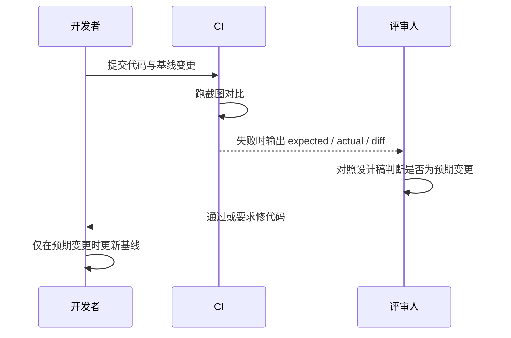

# 可访问性与视觉回归

> 这篇从自动化检查能覆盖和不能覆盖的可访问性问题讲起，经过 axe 扫描、键盘与焦点验证、语义人工检查、视觉回归原理、截图对比与基线管理，最后落到一条能进 CI 的质量门禁和一套后台系统改造案例。
>
> 学完能把可访问性检查和视觉回归接进 Playwright，判断哪些问题必须人工确认，并管好会持续变化的截图基线。

## 一、两类检查的边界

可访问性检查回答“不同能力的人能不能用”，视觉回归回答“界面有没有发生非预期变化”。两者都用浏览器自动化，但一个是规则判定，一个是像素比对，误报来源完全不同。

### 1.1 自动化能查什么，不能查什么

可访问性标准以 WCAG（Web Content Accessibility Guidelines）2.2 的 A/AA 级为准。自动化工具擅长结构性问题，不擅长语义质量。

| 问题类型 | axe 可查 | 键盘脚本可查 | 必须人工 |
|---|---|---|---|
| 表单缺 label | 是 | 部分 | 确认提示是否可理解 |
| 文本对比度不足 | 多数 | 否 | 图片、渐变背景 |
| 键盘无法到达 | 否 | 是 | 读屏顺序是否合理 |
| 焦点不可见 | 否 | 可测计算样式 | 视觉上是否足够明显 |
| 标题层级跳跃 | 部分（best-practice 规则） | 否 | 标题文案是否有意义 |
| 图片 alt 存在但无意义 | 否 | 否 | 是 |
| 弹窗焦点被困住 | 否 | 是 | 关闭后回到哪里 |

行业经验口径是自动化能发现三到五成的可访问性问题，比例随规则集和页面复杂度变化，不应写进验收指标当作覆盖率。剩下的必须靠键盘走查和读屏抽检。

> 边界：`axe` 报 0 违规只代表“没有命中规则”，不代表“对残障用户可用”。一个全是 `div` 加 `onclick` 的页面可能通过部分规则，但键盘完全无法操作。

### 1.2 视觉回归测的是变化，不是美观

截图对比（Visual Regression Testing）把当前渲染与基线图逐像素比较，发现“本来不该变的地方变了”。它不判断设计好不好看，也不判断间距是否符合规范；那些属于设计评审。

| 适合截图对比 | 不适合截图对比 |
|---|---|
| 设计系统组件外观 | 每次都会变的实时数据 |
| 关键页面整体布局 | 视频、Canvas 动画 |
| 深色/浅色主题 | 第三方嵌入内容 |
| 响应式断点表现 | 随机推荐位、广告位 |

### 1.3 两类检查都需要基线治理

axe 的“基线”是已知问题清单，截图的“基线”是基准图片。两者都需要评审、过期和清理机制，否则一年后会得到一份没人敢动的豁免列表和几千张没人看过的图片。



## 二、环境与最小闭环

这一章把 axe 和截图对比各跑通一次，先看到真实的违规输出和差异输出，再谈策略。装完的标准是两条命令都能给出明确结果。

### 2.1 版本基线

| 组件 | 版本 | 说明 |
|---|---|---|
| Node.js | 22 LTS | 与 E2E 共用运行时 |
| @playwright/test | 1.56 | 1.5x 线 |
| @axe-core/playwright | 4.10 | 封装 axe-core 4.10 |
| axe-core | 4.10 | 由上一个包传递依赖 |

### 2.2 三端安装

Ubuntu 24.04：

```bash
sudo apt-get update
sudo apt-get install -y curl git
curl -fsSL https://deb.nodesource.com/setup_22.x | sudo -E bash -
sudo apt-get install -y nodejs
node -v          # 期望 v22.x

mkdir pw-quality && cd pw-quality
npm init -y
npm i -D @playwright/test@1.56 @axe-core/playwright@4.10
npx playwright install --with-deps chromium
```

macOS：

```bash
brew install node@22
mkdir pw-quality && cd pw-quality
npm init -y
npm i -D @playwright/test@1.56 @axe-core/playwright@4.10
npx playwright install chromium
```

Windows PowerShell：

```powershell
winget install OpenJS.NodeJS.LTS
mkdir pw-quality; cd pw-quality
npm init -y
npm i -D @playwright/test@1.56 @axe-core/playwright@4.10
npx playwright install chromium
```

> 边界：`@axe-core/playwright` 需要页面已加载完成再扫描。若在 `page.goto` 返回后立刻 `analyze()`，可能扫到骨架屏，违规数没有意义。先等待页面主区域可见。

### 2.3 配置

在 E2E 配置上增加截图默认参数与快照路径模板：

```ts
// playwright.config.ts
import { defineConfig, devices } from '@playwright/test';

export default defineConfig({
  testDir: './tests',
  retries: process.env.CI ? 2 : 0,
  workers: process.env.CI ? 4 : undefined,
  reporter: process.env.CI ? [['blob'], ['github']] : [['list'], ['html']],
  expect: {
    timeout: 5_000,
    toHaveScreenshot: {
      // 抗锯齿会让同一页面产生几十个像素差异，留一点容差
      maxDiffPixels: 120,
      maxDiffPixelRatio: 0.001,
      // 动画中途截图必然不稳定，统一禁用
      animations: 'disabled',
      caret: 'hide',
      // css 像素不受设备像素比影响，跨机器更稳
      scale: 'css',
    },
  },
  // 快照按项目与平台分目录，避免 Chromium 与 WebKit 互相覆盖
  snapshotPathTemplate:
    '{testDir}/__screenshots__/{testFileName}/{arg}-{projectName}-{platform}{ext}',
  use: {
    baseURL: process.env.BASE_URL ?? 'http://127.0.0.1:4173',
    trace: 'on-first-retry',
    screenshot: 'only-on-failure',
    locale: 'zh-CN',
    timezoneId: 'Asia/Shanghai',
  },
  projects: [
    { name: 'chromium', use: { ...devices['Desktop Chrome'] } },
  ],
});
```

### 2.4 第一个 axe 测试

```ts
// tests/a11y/smoke.spec.ts
import { test, expect } from '@playwright/test';
import AxeBuilder from '@axe-core/playwright';

test('登录页没有严重可访问性问题 @a11y', async ({ page }) => {
  await page.goto('/login');
  // 等表单真正渲染出来，否则扫的是空壳
  await expect(page.getByRole('button', { name: '登录' })).toBeVisible();

  const results = await new AxeBuilder({ page })
    // 只启用 WCAG 2.0/2.1/2.2 的 A、AA 规则，不把实验规则算进门禁
    .withTags(['wcag2a', 'wcag2aa', 'wcag21a', 'wcag21aa', 'wcag22a', 'wcag22aa'])
    .analyze();

  expect(results.violations).toEqual([]);
});
```

运行：

```bash
npx playwright test tests/a11y/smoke.spec.ts
```

故意留一个没有 label 的输入框时，预期失败输出：

```text
Error: expect(received).toEqual(expected)

- Expected  []
+ Received  [
+   {
+     "id": "label",
+     "impact": "critical",
+     "help": "Form elements must have labels",
+     "nodes": [
+       { "target": ["#phone"], "html": "<input id=\"phone\" type=\"tel\">" }
+     ]
+   }
+ ]
```

### 2.5 第一个截图测试

```ts
// tests/visual/smoke.spec.ts
import { test, expect } from '@playwright/test';

test('登录页视觉基线 @visual', async ({ page }) => {
  await page.goto('/login');
  await expect(page.getByRole('heading', { name: '运维控制台' })).toBeVisible();

  await expect(page).toHaveScreenshot('login.png', { fullPage: true });
});
```

第一次运行没有基线，Playwright 会写入实际截图并失败：

```text
Error: expect(page).toHaveScreenshot() failed.
A snapshot doesn't exist at tests/__screenshots__/smoke.spec.ts/login-chromium-darwin.png, writing actual.
```

第二次运行通过：

```text
Running 1 test using 1 worker
  ✓  1 tests/visual/smoke.spec.ts:3:1 › 登录页视觉基线 @visual (1.2s)
  1 passed (2.4s)
```

### 2.6 日常命令

| 目的 | 命令 |
|---|---|
| 只跑可访问性 | `npx playwright test --grep @a11y` |
| 只跑视觉 | `npx playwright test --grep @visual` |
| 更新全部截图 | `npx playwright test --grep @visual --update-snapshots` |
| 更新单个测试 | 加 `-g "登录页视觉基线"` |
| 查看差异报告 | `npx playwright show-report` |
| 生成 axe JSON | 在用例里 `testInfo.attach` 或自行写文件 |

## 三、axe 扫描的正确接法

axe 是规则引擎，不是万能检查器。接得好，它能在合并前拦住结构性缺陷；接得差，它会变成一条被全员忽略的红线。

### 3.1 AxeBuilder 调用链

```ts
const results = await new AxeBuilder({ page })
  // include 用于只扫主内容区，排除全局导航的已知问题
  .include('#main-content')
  // exclude 用于第三方嵌入，责任不在本团队
  .exclude('#intercom-container')
  // withTags 控制规则集，门禁只保留 WCAG A/AA
  .withTags(['wcag2a', 'wcag2aa', 'wcag21a', 'wcag21aa', 'wcag22a', 'wcag22aa'])
  // disableRules 必须逐条写理由，不能整组关闭
  .disableRules(['color-contrast-enhanced'])
  .analyze();

// violations 是确定失败；incomplete 是需要人工确认的项
console.log(results.violations.length, results.incomplete.length);
```

`analyze()` 返回的对象里，`violations` 是规则判定失败，`incomplete` 是工具无法确定、需要人工复核，`passes` 是通过项。门禁只看 `violations`，但 `incomplete` 要定期抽查，否则会长期掩盖问题。

### 3.2 规则标签与影响等级

| 标签 | 覆盖 | 是否进门禁 |
|---|---|---|
| `wcag2a` | WCAG 2.0 A | 是 |
| `wcag2aa` | WCAG 2.0 AA | 是 |
| `wcag21a` | WCAG 2.1 A | 是 |
| `wcag21aa` | WCAG 2.1 AA | 是 |
| `wcag22a` | WCAG 2.2 A | 是 |
| `wcag22aa` | WCAG 2.2 AA | 是 |
| `best-practice` | 非强制的最佳实践 | 否 |

| impact | 含义 | 门禁处理 |
|---|---|---|
| critical | 阻断特定用户完成任务 | 0 容忍 |
| serious | 明显阻碍，有替代路径 | 0 容忍 |
| moderate | 体验受损 | 计入趋势 |
| minor | 轻微 | 记录不阻断 |

> 边界：`impact` 是 axe 按规则给的估计值，不等于业务优先级。一个 `minor` 的对比度问题出现在支付确认页，优先级可能高于列表页的 `serious` 标签问题。

### 3.3 扫描范围与登录态

只扫首页是最常见的自欺。P0 页面、关键弹窗、表单错误态都要覆盖。扫描前先进入对应状态：

```ts
test('订单详情弹窗无严重问题 @a11y', async ({ page }) => {
  await page.goto('/orders/ORD-20261113-001');
  await page.getByRole('button', { name: '查看物流' }).click();
  await expect(page.getByRole('dialog', { name: '物流轨迹' })).toBeVisible();

  // 弹窗打开后再扫，才能覆盖 dialog 内部
  const results = await new AxeBuilder({ page })
    .withTags(['wcag2a', 'wcag2aa', 'wcag21a', 'wcag21aa', 'wcag22a', 'wcag22aa'])
    .analyze();

  expect(results.violations).toEqual([]);
});
```

需要登录的页面直接用 storageState，不要在每条用例里重新登录；axe 扫描与登录无关，登录只影响能否进入页面。

### 3.4 失败信息格式化

默认的 `toEqual([])` 会打印整个对象，几十条违规时几乎无法阅读。用自定义消息把页面、规则、节点压成可操作的清单：

```ts
import type { Result } from 'axe-core';

function formatViolations(violations: Result[]): string {
  return violations
    .map((v) => {
      const targets = v.nodes.map((n) => n.target.join(' ')).join(', ');
      // 一行一条规则，附节点选择器，直接能拿去定位
      return `[${v.impact}] ${v.id}: ${v.help} × ${v.nodes.length} → ${targets}`;
    })
    .join('\n');
}

test('订单列表页无严重问题 @a11y', async ({ page }) => {
  await page.goto('/orders');
  await expect(page.getByRole('table', { name: '订单列表' })).toBeVisible();

  const results = await new AxeBuilder({ page })
    .withTags(['wcag2a', 'wcag2aa', 'wcag21a', 'wcag21aa', 'wcag22a', 'wcag22aa'])
    .analyze();

  const blocking = results.violations.filter(
    (v) => v.impact === 'critical' || v.impact === 'serious',
  );

  // 第二个参数是断言失败时的自定义消息
  expect(blocking, formatViolations(blocking)).toEqual([]);
});
```

失败时输出：

```text
Error: [serious] label: Form elements must have labels × 2 → #shipping-phone, #shipping-zip
       [critical] button-name: Buttons must have discernible text × 1 → .icon-btn-close
```

### 3.5 禁用规则要有理由

```ts
// 该组件是第三方地图，内部结构不可控，已在供应商工单 MAP-221 跟踪
.disableRules(['aria-required-children'])
```

每条 `disableRules` 都要有注释、责任人和到期日。禁止用 `withTags(['best-practice'])` 关掉整组，也禁止为了“先上线”关闭 `color-contrast`。

### 3.6 axe 的边界

- 跨域 iframe 内容读不到，只能扫外层；同域 iframe 由 axe 自动注入扫描，无需逐 frame 处理。
- 封闭式 Shadow DOM 不在 axe 的遍历范围。
- 对比度对渐变、半透明、背景图上的文字判定为 `incomplete`，要人工用取色工具确认。
- 动态内容在扫描瞬间不可见，就不会被检查到；先触发再扫。
- 自定义组件的 ARIA 组合是否正确，规则只能查“合法”，查不了“语义是否恰当”。

## 四、键盘与焦点

键盘可操作是 WCAG 2.1.1 的硬要求，也是 axe 查不出来的部分。用 Playwright 模拟 Tab、Enter、Escape，能覆盖大部分键盘缺陷。

### 4.1 Tab 顺序与可达性

```ts
test('下单表单的 Tab 顺序覆盖全部字段 @a11y', async ({ page }) => {
  await page.goto('/orders/new');

  const stops: string[] = [];
  for (let i = 0; i < 14; i++) {
    await page.keyboard.press('Tab');
    const label = await page.evaluate(() => {
      const el = document.activeElement as HTMLElement | null;
      if (!el || el === document.body) return '';
      return (
        el.getAttribute('aria-label') ||
        el.id ||
        el.textContent?.trim().slice(0, 24) ||
        el.tagName
      );
    });
    if (label) stops.push(label);
  }

  // 关键控件必须出现在键盘路径里；顺序断言需要读取完整序列后用 toEqual
  expect(stops).toEqual(
    expect.arrayContaining(['recipient', 'phone', 'address', 'submit-order']),
  );
});
```

> 边界：Tab 次数不能硬编码太多，页面结构一变就误报。更稳的写法是按“至少包含哪些关键控件”断言，而不是断言精确序列；只有在顺序本身是业务要求时才写全序列。

### 4.2 焦点可见

焦点可见不能只靠 `:focus` 的默认样式，很多重置样式会把它清掉：

```ts
test('每个 Tab 停靠点都有可见焦点 @a11y', async ({ page }) => {
  await page.goto('/orders/new');

  for (let i = 0; i < 10; i++) {
    await page.keyboard.press('Tab');
    const state = await page.evaluate(() => {
      const el = document.activeElement as HTMLElement | null;
      if (!el || el === document.body) return null;
      const s = getComputedStyle(el);
      // 键盘聚焦应命中 :focus-visible，这里用计算样式做近似判断
      return {
        id: el.id || el.tagName,
        visible:
          (s.outlineStyle !== 'none' && s.outlineWidth !== '0px') ||
          s.boxShadow !== 'none',
      };
    });

    if (state) {
      expect(state.visible, `${state.id} 缺少可见焦点`).toBeTruthy();
    }
  }
});
```

这只能判断“有没有”，判断不了“够不够明显”。对比度、遮挡、动画延迟仍要人眼看。更好的做法是在设计系统里统一 `:focus-visible` 样式，再用这条用例防止回退。

### 4.3 跳转链接与地标

```ts
test('键盘用户可以通过跳转链接直达主内容 @a11y', async ({ page }) => {
  await page.goto('/orders');

  // 跳转链接必须是第一个 Tab 停靠点，否则键盘用户要穿越整个导航
  await page.keyboard.press('Tab');
  const skip = page.getByRole('link', { name: '跳到主内容' });
  await expect(skip).toBeFocused();
  await expect(skip).toBeVisible();

  await page.keyboard.press('Enter');
  await expect(page.locator('#main-content')).toBeFocused();
});
```

主内容容器需要 `tabindex="-1"` 才能接住焦点；只写 `id` 不够。

### 4.4 弹窗焦点

```ts
test('发货弹窗限制焦点并在 Esc 后归还 @a11y', async ({ page }) => {
  await page.goto('/orders');

  const trigger = page
    .getByRole('row', { name: /ORD-20261113-001/ })
    .getByRole('button', { name: '发货' });
  await trigger.click();

  const dialog = page.getByRole('dialog', { name: '确认发货' });
  await expect(dialog).toBeVisible();
  // 打开后焦点应进入弹窗，而不是留在背景
  await expect(dialog.getByRole('button', { name: '确认' })).toBeFocused();

  for (let i = 0; i < 6; i++) {
    await page.keyboard.press('Tab');
    // 焦点陷阱：连续 Tab 不能跑到背景页面
    expect(await dialog.evaluate((el) => el.contains(document.activeElement))).toBe(true);
  }

  await page.keyboard.press('Escape');
  await expect(dialog).toBeHidden();
  // 关闭后必须回到触发按钮，否则键盘用户会丢失上下文
  await expect(trigger).toBeFocused();
});
```

### 4.5 只用键盘完成关键流程

单点检查通过，不代表流程可完成。至少挑一条 P0 路径做纯键盘回归：

```ts
test('只用键盘完成下单 @a11y', async ({ page }) => {
  await page.goto('/orders/new');

  await page.getByLabel('收货人').focus();
  await page.keyboard.type('张三');

  await page.keyboard.press('Tab');
  await page.keyboard.type('13800138000');

  await page.keyboard.press('Tab');
  await page.keyboard.type('上海市浦东新区世纪大道 100 号');

  // 用 Enter 提交而不是鼠标点击，验证表单的键盘提交路径
  await page.getByRole('button', { name: '提交订单' }).focus();
  await page.keyboard.press('Enter');

  await expect(page.getByRole('heading', { name: '订单已创建' })).toBeVisible();
});
```

> 边界：自定义下拉框、日期选择器、富文本编辑器是键盘缺陷高发区。它们通常需要方向键、Home/End、Esc 的完整支持，仅测 Tab 和 Enter 不够，要按组件文档逐项验证。

## 五、语义、表单与读屏人工检查

自动化之后，仍需人工确认语义。这一节给的是可重复的检查动作，不是主观感受。

### 5.1 标题层级与地标

```ts
test('页面只有一个 h1 且标题层级不跳跃 @a11y', async ({ page }) => {
  await page.goto('/orders');

  const levels = await page
    .locator('h1,h2,h3,h4,h5,h6')
    .evaluateAll((els) => els.map((e) => Number(e.tagName[1])));

  expect(levels.filter((l) => l === 1)).toHaveLength(1);

  const jumps = levels.filter((l, i) => i > 0 && l - levels[i - 1] > 1);
  // h2 直接跳到 h4 会让读屏用户以为漏了一节
  expect(jumps, `标题层级跳跃: ${jumps.join(',')}`).toEqual([]);
});
```

地标（landmark）检查靠读屏的“跳转到地标”功能，脚本只能确认元素存在：

```ts
await expect(page.getByRole('banner')).toBeVisible();
await expect(page.getByRole('main')).toBeVisible();
await expect(page.getByRole('navigation', { name: '主导航' })).toBeVisible();
```

### 5.2 表单标签与错误提示

错误提示必须同时满足三件事：输入框有 `aria-invalid`、错误文本通过 `aria-describedby` 关联、提交后焦点落到第一个错误字段。

```ts
test('表单错误可被读屏感知 @a11y', async ({ page }) => {
  await page.goto('/orders/new');
  await page.getByRole('button', { name: '提交订单' }).click();

  const phone = page.getByLabel('手机号');
  await expect(phone).toHaveAttribute('aria-invalid', 'true');
  // 错误文本必须能被字段的 accessible description 读到
  await expect(phone).toHaveAccessibleDescription(/手机号格式不正确/);
  await expect(phone).toBeFocused();
});
```

```html
<label for="phone">手机号</label>
<input id="phone" aria-invalid="true" aria-describedby="phone-error" />
<p id="phone-error" role="alert">手机号格式不正确</p>
```

> 边界：只把错误文字变红、不加 `aria-describedby`，视力正常的用户能看到，读屏用户完全不知道错在哪。只用 `title` 提示同理。

### 5.3 图片替代文本

| 图片类型 | alt 写法 | 常见错误 |
|---|---|---|
| 信息图（含数据） | 概括结论与关键数字 | 只写“图片” |
| 装饰图 | `alt=""` | 写“装饰图片” |
| 功能图（按钮内） | 描述动作 | 描述外观 |
| 复杂图表 | 短 alt + 相邻文字说明 | alt 塞整段数据 |

```ts
// 装饰图必须是空 alt，读屏才会跳过；用类名圈定装饰图范围
await expect(page.locator('img.decorative').first()).toHaveAttribute('alt', '');

// 功能图标按钮的 accessible name 来自 alt 或 aria-label
await expect(page.getByRole('button', { name: '关闭' })).toBeVisible();
```

### 5.4 动态内容与播报

```ts
// role=status 隐含 aria-live=polite，role=alert 隐含 assertive；不要在 DOM 里重复写属性
await expect(page.getByRole('status')).toBeVisible();
await expect(page.getByRole('alert')).toBeVisible();
```

> 边界：`aria-live` 区域必须在内容变化前就存在于 DOM。动态创建整个区域再填文本，多数读屏不会播报。正确做法是容器常驻，只更新文本。

### 5.5 读屏抽检清单

每个迭代抽 2 个 P0 页面，用 NVDA（Windows）或 VoiceOver（macOS）走一遍：

| 检查项 | 通过标准 |
|---|---|
| 首屏朗读 | 标题、地标、主操作顺序合理 |
| 表单填写 | 每个字段能听到标签、必填、错误 |
| 弹窗 | 打开有播报，焦点不逃逸，关闭能返回 |
| 动态更新 | 成功/失败消息被播报 |
| 图片 | 信息图有结论，装饰图被跳过 |

记录方式：页面、读屏软件与版本、浏览器、问题、复现步骤。只写“读屏有问题”无法修。

## 六、把可访问性变成门禁

没有门禁的可访问性检查，最后都会变成“有空再修”。门禁要分级，否则历史债务会让整条流水线永远红着。

### 6.1 分级阈值

| 范围 | critical | serious | moderate |
|---|---|---|---|
| P0 页面 | 0 | 0 | 记录 |
| P1 页面 | 0 | 记录并限期 | 记录 |
| 遗留页面 | 进基线 | 进基线 | 记录 |

“记录”不是忽略：每次流水线把数量写进趋势文件，连续上升要有人解释。

### 6.2 已知问题基线

历史页面一次修不完，用基线文件只拦新增：

```json
{
  "version": 1,
  "expires": "2027-03-31",
  "suppressed": [
    {
      "page": "/legacy/reports",
      "rule": "color-contrast",
      "nodes": 12,
      "owner": "report-team",
      "ticket": "OPS-1842"
    }
  ]
}
```

```ts
// tests/a11y/helpers.ts
import fs from 'node:fs';
import type { Result } from 'axe-core';

type Baseline = {
  expires: string;
  suppressed: { page: string; rule: string; nodes: number }[];
};

export function newViolations(pagePath: string, violations: Result[]): Result[] {
  const baseline: Baseline = JSON.parse(
    fs.readFileSync('a11y-baseline.json', 'utf8'),
  );

  // 基线过期后全部恢复拦截，防止豁免永久化
  if (new Date(baseline.expires) < new Date()) return violations;

  return violations.filter((v) => {
    const known = baseline.suppressed.find(
      (s) => s.page === pagePath && s.rule === v.id,
    );
    // 只有数量没有增加才算已知问题；变多说明是新引入的
    return !known || v.nodes.length > known.nodes;
  });
}
```

基线必须带到期日。到期未清理，流水线自动恢复全量拦截，逼着团队处理。

### 6.3 归属与趋势

每条被抑制的规则要有 owner 和工单，否则没人认领。趋势看两个数：阻断级违规总数、豁免条目总数。前者应长期为 0，后者应逐季度下降。

### 6.4 常见反模式

- 只在首页跑 axe，内页和弹窗从不扫描。
- 为了绿而关闭 `color-contrast`，把最高频的真实问题藏起来。
- 把 `best-practice` 标签也设成阻断，团队被风格问题淹没后整体忽略。
- 基线文件没有到期日，三年后没人知道每条为什么存在。
- 用 axe 通过率对外宣称“已符合 WCAG”，法律与审计风险极高。

## 七、视觉回归的判定原理

截图对比不是“完全一致才通过”。渲染在不同机器上必然有细微差异，参数的作用是把“噪声”和“真实变化”分开。

### 7.1 三个阈值参数

| 参数 | 含义 | 建议 |
|---|---|---|
| `threshold` | 单像素颜色差容忍度，0–1 | 默认 0.2，通常不改 |
| `maxDiffPixels` | 允许不同的像素总数 | 小区域用 50–150 |
| `maxDiffPixelRatio` | 不同像素占比 | 整页用 0.001–0.01 |

`threshold` 用 YIQ 色彩空间计算单像素距离，调高会让轻微色差被忽略；`maxDiffPixels` 与 `maxDiffPixelRatio` 满足任一即通过。整页截图用比例更合理，小组件用绝对像素更精确。

### 7.2 不确定来源

| 来源 | 表现 | 处理 |
|---|---|---|
| 字体缺失 | 文字宽度、换行变化 | 固定容器与字体 |
| 抗锯齿 | 边缘零星像素差 | 阈值或 `scale: 'css'` |
| 动画 | 位置、透明度漂移 | `animations: 'disabled'` |
| 实时数据 | 数字、时间、订单号变化 | `mask` 或固定时钟 |
| 滚动条 | 宽度差 15px | 隐藏滚动条或固定视口 |
| 设备像素比 | 图片模糊度不同 | 固定 `deviceScaleFactor` |

### 7.3 截什么，不截什么

优先截“结构稳定、业务关键”的区域：设计系统组件、P0 页面首屏、空状态、错误状态、深色主题。不要截带实时图表、轮播、随机推荐、第三方广告的区域。

| 粒度 | 优点 | 缺点 |
|---|---|---|
| 组件级 | 差异定位准、跑得快 | 拼装后的页面问题漏掉 |
| 首屏 | 接近用户感知 | 滚动区域不覆盖 |
| 整页 `fullPage` | 覆盖完整 | 图片大、动态区域多 |

### 7.4 本地快照与云服务的分工

| 方案 | 判定 | 评审 | 成本 |
|---|---|---|---|
| Playwright 快照 | 本地像素比对 | 看 diff 图 | 低，基线入库 |
| Percy | 云端渲染比对 | Web 评审流 | 按截图计费 |
| Chromatic | 云端 + Storybook | 组件级评审 | 按快照计费 |

> 边界：跨操作系统比对几乎必然失败。要么统一在 Docker 里生成基线，要么按 `{platform}` 分目录各存一套。后者会让基线数量翻倍，团队小的时候不划算。

## 八、Playwright 截图对比实操

`toHaveScreenshot` 的核心是“稳定输入”。页面稳定、字体稳定、时间稳定，差异才有意义。

### 8.1 参数化截图

```ts
test('订单列表页视觉基线 @visual', async ({ page }) => {
  // 固定时钟，避免“刚刚”“2 分钟前”这类相对时间造成差异
  await page.clock.setFixedTime(new Date('2026-11-13T10:00:00Z'));

  await page.goto('/orders');
  await expect(page.getByTestId('table-loading')).toBeHidden();

  await expect(page).toHaveScreenshot('orders-list.png', {
    fullPage: true,
    // 遮罩会把区域涂成统一色块，比对时忽略其内容
    mask: [
      page.getByTestId('current-time'),
      page.getByTestId('order-no').first(),
      page.getByTestId('live-visitors'),
    ],
    // 单个用例覆盖全局阈值，整页允许更多像素差
    maxDiffPixels: 300,
    animations: 'disabled',
    caret: 'hide',
  });
});
```

`mask` 适合位置固定、内容可变的区域。位置也会变的区域（如随机推荐位）用 `stylePath` 注入 CSS 直接隐藏：

```css
/* tests/visual/hide-dynamic.css */
[data-testid='recommendation'],
[data-testid='cookie-banner'] {
  visibility: hidden !important;
}
```

```ts
await expect(page).toHaveScreenshot('home.png', {
  stylePath: 'tests/visual/hide-dynamic.css',
});
```

> 边界：`visibility: hidden` 保留布局，`display: none` 会改变布局。隐藏动态块时用前者，避免整页重排把无关区域也推出差异。

### 8.2 首次生成与更新

```bash
# 首次生成基线
npx playwright test --grep @visual --update-snapshots

# 查看新增了哪些图片，确认没有把错误状态存成基线
git status --short tests/__screenshots__
```

预期输出：

```text
Running 8 tests using 4 workers
  8 passed (12.6s)
```

`--update-snapshots` 会覆盖所有命中的基线。更新后必须人工看 diff 或打开图片确认，不能直接提交。

### 8.3 多浏览器与多视口

```ts
projects: [
  { name: 'chromium', use: { ...devices['Desktop Chrome'] } },
  { name: 'webkit', use: { ...devices['Desktop Safari'] } },
  {
    name: 'mobile',
    use: { ...devices['iPhone 15'], viewport: { width: 390, height: 844 } },
  },
],
```

配合 `snapshotPathTemplate` 里的 `{projectName}`，三套基线互不覆盖。多视口至少覆盖 390、768、1440 三个宽度，只测桌面会漏掉移动端换行与遮挡。

### 8.4 失败产物

差异失败时，Playwright 生成三张图：

```text
Error: expect(page).toHaveScreenshot() failed.
  1180 pixels (ratio 0.004 of all image pixels) are different.

  Expected: tests/__screenshots__/orders.spec.ts/orders-list-chromium-linux.png
  Received: test-results/orders-订单列表页视觉基线-chromium/orders-list-actual.png
  Diff:     test-results/orders-订单列表页视觉基线-chromium/orders-list-diff.png
```

`Expected` 是基线，`Received` 是本次渲染，`Diff` 用高亮标出差异像素。CI 必须把 `test-results` 作为失败产物上传，否则评审只能看到一句“有差异”。

## 九、基线管理

基线是代码资产，不是测试运行的副产品。它的生命周期要有明确规则：谁生成、谁评审、何时过期、怎么清理。

### 9.1 基线入库

- 图片提交到 Git，与代码同分支评审；
- 单张图控制在 300 KB 内，整页长图可裁关键区域；
- 数量多时用 Git LFS，避免仓库膨胀；
- 命名包含项目与平台，不手工改名。

### 9.2 变更评审流程



评审看三件事：差异是否对应本次需求、是否只影响目标区域、是否有意外连带变化。一个按钮改色却导致整页布局位移，说明改动范围超出预期，应退回。

### 9.3 环境一致性

基线必须在固定环境生成，通常是与 CI 相同的容器：

```bash
docker run --rm --ipc=host \
  -v "$PWD":/work -w /work \
  mcr.microsoft.com/playwright:v1.56.0-noble \
  npx playwright test --grep @visual --update-snapshots
```

容器内固定字体、系统库、浏览器版本。开发机 macOS 生成的基线不要提交，`{platform}` 分目录时也要在 CI 里统一为 Linux。

### 9.4 更新与清理

| 动作 | 命令 | 前置条件 |
|---|---|---|
| 全量更新 | `--update-snapshots` | 设计变更已评审 |
| 单条更新 | `-g "用例名" --update-snapshots` | 只影响该用例 |
| 删除失效基线 | `git rm` 对应图片 | 用例已删除或改名 |
| 检查孤儿基线 | 对比用例名与文件名 | 每季度一次 |

孤儿基线不会让测试失败，但会让人误以为页面仍受保护。用例删了，图也要删。

### 9.5 常见事故

- 本地跑一次 `--update-snapshots` 全量覆盖，把真实回归一起存成“正确”；
- 在 macOS 生成基线，CI 在 Linux 上永远差几百像素；
- 两个分支同时新增同名基线，合并时二进制冲突无法解决；
- 基线里包含测试账号的真实姓名与手机号，造成数据泄露；
- 动态区域忘了 mask，导致用例三天两头失败，最后被加进忽略列表。

## 十、CI 集成与报告

可访问性和视觉回归应该跑在同一个流水线，但分成不同作业：axe 失败要具体到规则，截图失败要拿到三张图，混在一起会拖慢定位。

### 10.1 作业拆分

| 作业 | 触发 | 产物 |
|---|---|---|
| a11y | 每次 PR | HTML 报告、违规 JSON |
| visual | 每次 PR | 报告、actual/diff 图 |
| nightly 全量 | 每日 | 多浏览器、多视口基线 |

用 `--grep @a11y` 与 `--grep @visual` 拆分，测试标题里带标签即可，不需要两套配置。

### 10.2 GitHub Actions

```yaml
# .github/workflows/quality.yml
name: quality
on: [pull_request]

jobs:
  a11y:
    runs-on: ubuntu-24.04
    steps:
      - uses: actions/checkout@v4
      - uses: actions/setup-node@v4
        with: { node-version: 22, cache: npm }
      - run: npm ci
      - run: npx playwright install --with-deps chromium
      - run: npx playwright test --grep @a11y --reporter=html
        env:
          CI: true
          BASE_URL: ${{ vars.E2E_BASE_URL }}
      - uses: actions/upload-artifact@v4
        if: always()
        with:
          name: a11y-report
          path: playwright-report
          retention-days: 7

  visual:
    runs-on: ubuntu-24.04
    container:
      image: mcr.microsoft.com/playwright:v1.56.0-noble
    steps:
      - uses: actions/checkout@v4
      - uses: actions/setup-node@v4
        with: { node-version: 22, cache: npm }
      - run: npm ci
      # 镜像自带与 9.3 基线生成一致的浏览器和系统字体
      - run: npx playwright test --grep @visual
        env:
          CI: true
          BASE_URL: ${{ vars.E2E_BASE_URL }}
      - uses: actions/upload-artifact@v4
        if: failure()
        with:
          name: visual-diff
          path: test-results
          retention-days: 7
```

### 10.3 报告与失败定位

| 产物 | 内容 | 谁看 |
|---|---|---|
| HTML 报告 | 用例、耗时、trace 链接 | 开发者 |
| `test-results` | actual / diff / expected 图 | 评审人 |
| axe JSON | 规则、节点、影响等级 | 前端负责人 |
| 趋势文件 | 每周违规与豁免数量 | 技术负责人 |

失败时先看 `Diff` 图确认差异位置，再看 `Received` 判断是渲染错乱还是内容变化，最后看 trace 确认当时的 DOM 状态。

### 10.4 成本控制

截图是耗时大户。一条整页截图在中等页面约 300–800 毫秒，48 条就是 30 秒以上。控制方式：只截 P0 页面、组件级优先、避免 `fullPage` 滥用、按项目分片。48 条基线、单浏览器、4 worker 在 4 核机器上约 1 分半，属于可接受范围（示例数据）。

### 10.5 门禁阈值

| 检查 | 阻断条件 | 备注 |
|---|---|---|
| P0 页面 axe | 有 critical/serious | 基线内除外 |
| 键盘主流程 | 失败 | 不允许豁免 |
| 视觉差异 | 超 `maxDiffPixels` | 评审后更新基线 |
| 基线过期 | 超过 `expires` | 强制清理 |

## 十一、误报与故障排查

误报处理不当，团队会先关检查、再关流程。下面是最常见的五类。

| 现象 | 大概率原因 | 第一条命令 |
|---|---|---|
| 只有 CI 有像素差 | 字体或系统库不同 | 在官方镜像里重跑 |
| 对比度误报 | 文字在渐变或图片上 | 看 axe 的 `incomplete` 项 |
| 截图偶发差异 | 动画、懒加载、时间 | `--repeat-each=10` 复现 |
| axe 扫不到弹窗 | 扫描时弹窗未打开 | 先触发再 `analyze()` |
| 基线冲突 | 分支同时新增 | 指定单条重建 |

### 11.1 字体渲染差异

症状是文字整体偏移一两个像素、换行位置不同。先确认两端字体列表一致：

```bash
fc-list | grep -i "noto sans cjk"
```

容器里装同一套字体，并在 CSS 里显式声明 `font-family`，不要依赖系统默认。中文页面尤其容易缺字导致回退字体。

### 11.2 对比度误报

axe 对渐变背景、半透明遮罩、背景图上的文字返回 `incomplete`，不是 `violations`。人工用取色工具取实际合成后的前景与背景色，按 WCAG 公式计算：

```text
对比度 = (L1 + 0.05) / (L2 + 0.05)
```

正文要求 4.5:1，大号文字 3:1。半透明按钮要把背景色合成后再算，不能只看 CSS 里的颜色值。

### 11.3 动画与懒加载

```ts
// 等待图片全部解码完成，避免截到占位图
await page.evaluate(() => Promise.all(
  Array.from(document.images).map((img) =>
    img.complete ? Promise.resolve() : new Promise((r) => { img.onload = r; img.onerror = r; }),
  ),
));
```

懒加载列表先滚到底再截，或只截首屏。滚动触发的入场动画用 `animations: 'disabled'`，仍不稳定就把该区域 mask 掉。

### 11.4 axe 扫不到的部分

- 同域 iframe 默认会被 axe-core 一并注入并扫描，结果合并在 `violations` 里；若只想限制范围，用 `include` 指向 iframe 内的选择器。
- 封闭 Shadow DOM 不在 axe 的遍历范围，只能要求组件库暴露测试入口。
- 跨域 iframe 无法读取，记录为人工检查项。
- PDF、Canvas、视频：规则引擎不覆盖，走人工清单。

### 11.5 基线体积与冲突

单张超过 1 MB 的长图会拖慢 CI 拉取。裁剪到关键区域，或用 `clip` 只截可视区。两个分支同时改同一张图时，Git 无法合并二进制，约定“基线只由主干更新”，功能分支不提交基线变更。

## 十二、最佳实践案例

### 12.1 案例背景

某 B2B 运营后台使用 Vue 3.5 + Element Plus，共 40 个页面、3 种角色。外部审计抽检 8 个页面，发现 137 处 axe 违规，其中 23 处为 serious/critical；键盘走查还发现弹窗焦点逃逸、关闭后焦点丢失、日期选择器无法用方向键操作。设计团队同时抱怨“改 A 页面经常把 B 页面样式带崩”，但没有证据。

目标是：P0 页面达到 WCAG 2.2 AA 的自动化可判定部分，键盘主流程可完成；关键页面有视觉基线，样式回归能在合并前发现。约束是历史页面不能一次全改，团队只有两名前端兼测试，CI 单作业不能超过 5 分钟。以下数据为示例，统计口径为同一仓库连续 30 次流水线。

### 12.2 案例实操

先建立可访问性测试夹具，统一规则集与排除项：

```ts
// tests/a11y/fixtures.ts
import { test as base } from '@playwright/test';
import AxeBuilder from '@axe-core/playwright';

type A11yFixtures = {
  makeAxeBuilder: () => AxeBuilder;
};

export const test = base.extend<A11yFixtures>({
  makeAxeBuilder: async ({ page }, use) => {
    const make = () =>
      new AxeBuilder({ page })
        // 门禁只保留 WCAG A/AA，实验规则单独跑在 nightly
        .withTags(['wcag2a', 'wcag2aa', 'wcag21a', 'wcag21aa', 'wcag22a', 'wcag22aa'])
        // 客服 SDK 由第三方注入，责任与修复都不在本团队
        .exclude('#intercom-container');
    await use(make);
  },
});

export { expect } from '@playwright/test';
```

P0 页面清单化，一条用例覆盖一个页面，失败信息带页面名：

```ts
// tests/a11y/pages.spec.ts
import { test, expect } from './fixtures';
import type { Result } from 'axe-core';

const p0Pages = [
  { name: '工作台', path: '/dashboard' },
  { name: '订单列表', path: '/orders' },
  { name: '订单详情', path: '/orders/ORD-20261113-001' },
  { name: '新建订单', path: '/orders/new' },
  { name: '商品列表', path: '/products' },
  { name: '库存调整', path: '/inventory/adjust' },
  { name: '发货单', path: '/shipments' },
  { name: '退款审核', path: '/refunds' },
  { name: '客户列表', path: '/customers' },
  { name: '角色权限', path: '/settings/roles' },
  { name: '操作日志', path: '/settings/audit' },
  { name: '个人设置', path: '/settings/profile' },
];

function fmt(violations: Result[]): string {
  return violations
    .map((v) => `[${v.impact}] ${v.id} × ${v.nodes.length} → ${v.nodes.map((n) => n.target.join(' ')).join(', ')}`)
    .join('\n');
}

for (const p of p0Pages) {
  test(`${p.name} 无阻断级违规 @a11y`, async ({ page, makeAxeBuilder }) => {
    await page.goto(p.path);
    // 等主区域渲染，避免扫骨架屏
    await expect(page.getByRole('main')).toBeVisible();

    const results = await makeAxeBuilder().analyze();
    const blocking = results.violations.filter(
      (v) => v.impact === 'critical' || v.impact === 'serious',
    );

    expect(blocking, `${p.name}\n${fmt(blocking)}`).toEqual([]);
  });
}
```

历史页面用基线豁免，只拦新增：

```json
{
  "version": 1,
  "expires": "2027-03-31",
  "suppressed": [
    { "page": "/legacy/reports", "rule": "color-contrast", "nodes": 12, "owner": "report-team", "ticket": "OPS-1842" },
    { "page": "/legacy/export", "rule": "label", "nodes": 3, "owner": "report-team", "ticket": "OPS-1843" }
  ]
}
```

键盘用例覆盖三条最高频缺陷：

```ts
// tests/a11y/keyboard.spec.ts
import { test, expect } from './fixtures';

test('发货弹窗焦点不逃逸且关闭后归还 @a11y', async ({ page }) => {
  await page.goto('/orders');

  const trigger = page
    .getByRole('row', { name: /ORD-20261113-001/ })
    .getByRole('button', { name: '发货' });
  await trigger.click();

  const dialog = page.getByRole('dialog', { name: '确认发货' });
  await expect(dialog).toBeVisible();
  await expect(dialog.getByRole('button', { name: '确认' })).toBeFocused();

  for (let i = 0; i < 6; i++) {
    await page.keyboard.press('Tab');
    expect(await dialog.evaluate((el) => el.contains(document.activeElement))).toBe(true);
  }

  await page.keyboard.press('Escape');
  await expect(dialog).toBeHidden();
  await expect(trigger).toBeFocused();
});

test('日期筛选可用方向键操作 @a11y', async ({ page }) => {
  await page.goto('/orders');
  const dateInput = page.getByLabel('下单日期');
  await dateInput.focus();
  await page.keyboard.press('Enter');

  const grid = page.getByRole('grid', { name: '选择日期' });
  await expect(grid).toBeVisible();
  // 方向键改变选中日，Enter 确认，是日期组件的键盘契约
  await page.keyboard.press('ArrowRight');
  await page.keyboard.press('Enter');

  await expect(dateInput).not.toHaveValue('');
});
```

视觉基线只覆盖 6 个关键页面，动态区域统一屏蔽：

```ts
// tests/visual/key-pages.spec.ts
import { test, expect } from '@playwright/test';

const pages = [
  { name: '工作台', path: '/dashboard' },
  { name: '订单列表', path: '/orders' },
  { name: '新建订单', path: '/orders/new' },
  { name: '商品列表', path: '/products' },
  { name: '退款审核', path: '/refunds' },
  { name: '个人设置', path: '/settings/profile' },
];

for (const p of pages) {
  test(`${p.name} 视觉基线 @visual`, async ({ page }) => {
    // 固定时间，去掉“几分钟前”与图表时间轴漂移
    await page.clock.setFixedTime(new Date('2026-11-13T10:00:00Z'));
    await page.goto(p.path);
    await expect(page.getByRole('main')).toBeVisible();

    await expect(page).toHaveScreenshot(`${p.name}.png`, {
      fullPage: true,
      mask: [
        page.getByTestId('current-time'),
        page.getByTestId('live-visitors'),
        // 表格首行的订单号每轮都不同，遮掉内容不遮位置
        page.getByTestId('order-no').first(),
      ],
      maxDiffPixels: 300,
    });
  });
}
```

基线在容器里生成，避免 macOS 与 Linux 的字体差异：

```bash
docker run --rm --ipc=host \
  -v "$PWD":/work -w /work \
  mcr.microsoft.com/playwright:v1.56.0-noble \
  npx playwright test --grep @visual --update-snapshots

git status --short tests/__screenshots__
```

预期输出（示例）：

```text
Running 6 tests using 4 workers
  6 passed (18.4s)

tests/__screenshots__/key-pages.spec.ts/工作台-chromium-linux.png
tests/__screenshots__/key-pages.spec.ts/订单列表-chromium-linux.png
...
```

CI 按 10.2 的模板拆成两个作业。第一次上线时，a11y 作业输出：

```text
Running 12 tests using 4 workers
  9 failed
  3 passed

  1) tests/a11y/pages.spec.ts:31:3 › 订单列表 无阻断级违规 @a11y

Error: 订单列表
[critical] label × 2 → #shipping-phone, #shipping-zip
[serious] color-contrast × 5 → .status-tag--gray, .amount--muted
```

修复顺序按影响面：先修 23 处 critical/serious，再把 114 处 moderate 按页面排期。典型修复包括：

```html
<!-- 修复前：只有 placeholder，没有 label -->
<input id="shipping-phone" placeholder="手机号" />

<!-- 修复后：label 关联，错误可被读屏读取 -->
<label for="shipping-phone">手机号</label>
<input id="shipping-phone" aria-describedby="shipping-phone-error" />
<p id="shipping-phone-error" role="alert"></p>
```

```css
/* 修复前 3.1:1，未达 AA 的 4.5:1 */
.status-tag--gray { color: #9ca3af; background: #f3f4f6; }

/* 修复后 4.8:1，同时保留弱化层级 */
.status-tag--gray { color: #4b5563; background: #f3f4f6; }
```

弹窗焦点修复：打开时聚焦第一个可操作元素，Tab 在容器内循环，关闭时把焦点还给触发按钮；日期组件补齐方向键与 Enter 的处理。

视觉基线第一次跑出 9 处差异，其中 2 处是真实回归：订单列表的状态标签被全局样式改成灰色导致对比度不足；新建订单页的按钮组在 1280 宽度下换行错位。其余 7 处是字体抗锯齿与动态头像，前者通过容器统一，后者加入 mask。

### 12.3 案例结果

| 指标 | 改造前 | 改造后 |
|---|---|---|
| axe 违规总数 | 137 | 41（均在基线） |
| critical/serious | 23 | 0 |
| P0 页面覆盖 | 0 | 12 |
| 键盘缺陷 | 9 处 | 0 处 |
| 视觉基线 | 0 | 6 个页面 |
| 合并前样式回归 | 靠人眼 | 每次 PR 自动比对 |
| a11y 作业耗时 | 无 | 1 分 40 秒 |
| visual 作业耗时 | 无 | 2 分 10 秒 |

改造后连续 30 次流水线中，a11y 无新增阻断项，视觉基线误报率从第一周的 22% 降到 3%（示例数据）。误报主要来自未屏蔽的实时访客数和字体回退，逐条 mask 后稳定。

失败模式与复盘：

- 第一版把 `best-practice` 也设为阻断，一次 PR 报出 60 多条风格问题，团队直接要求关闭检查。分级后只拦 critical/serious，才被接受。
- 基线最初在开发机生成，CI 上全部失败。改为容器内生成并统一字体后消失。
- 有两条 axe 用例在弹窗动画未结束时扫描，违规数随机。改为等待 `dialog` 可见后再扫，稳定。
- 对比度修复曾把整站灰色文字统一加深，破坏了信息层级。最终按“正文、次要、禁用”三档分别定色，并补设计令牌，而不是全局替换。
- 视觉基线没有覆盖错误态，一次表单报错样式错位未被发现。后续为 P0 表单补了错误态截图，纳入同一基线目录。
