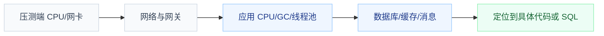

# k6与JMeter性能测试

> 这篇从性能测试要回答的问题和指标口径讲起，经过 k6 安装、脚本、场景模型与阈值，再用 JMeter 做同类实现对照，最后落到执行解读、瓶颈定位和一个大促前的容量验证案例。
>
> 学完能独立编写 k6 压测脚本、设定可判定的 SLO 阈值、用 JMeter 复现同类场景，并按分层方法定位瓶颈。

## 一、性能测试的目标与指标

性能测试不是“把并发调大看会不会崩”，而是在明确的业务模型和 SLO 下，回答系统能承载多少、哪里先到极限、扩容是否线性。一次有效的压测必须同时有负载模型、指标口径和判定标准，缺一项结果就不可复用。

### 1.1 性能测试回答的四类问题

| 问题 | 测试类型 | 典型时长 | 产出 |
|---|---|---|---|
| 单接口能跑多快 | 基准测试 | 1–5 分钟 | 基线延迟 |
| 目标负载下是否达标 | 负载测试 | 10–30 分钟 | SLO 判定 |
| 极限在哪里、怎么失败 | 压力测试 | 20–60 分钟 | 拐点与失败模式 |
| 长时间是否退化 | 稳定性测试 | 2–24 小时 | 内存/连接泄漏 |

还有两类补充：峰值测试（Spike）验证瞬时洪峰和限流，容量测试（Capacity）回答“加多少机器能扛多少量”。选择依据是决策目标，不是工具能力。

> 边界：没有明确业务模型（读写比、用户行为、数据分布）的压测，只能证明“脚本能跑”，不能作为容量结论。

### 1.2 五个核心指标

| 指标 | 定义 | 观察方式 | 常见陷阱 |
|---|---|---|---|
| 响应时间 RT | 请求发出到响应完成 | 分位数，不看平均值 | 平均值掩盖长尾 |
| 吞吐量 RPS/TPS | 每秒完成请求数 | 完成数，不是发出数 | 把排队算进吞吐 |
| 错误率 | 失败请求占比 | 按状态码和业务码分开 | 只看 HTTP 200 |
| 并发数 | 同时在途请求数 | VU 或连接数 | 与 RPS 混为一谈 |
| 资源利用率 | CPU/内存/IO/连接池 | 压测同期采集 | 只压应用不看依赖 |

吞吐量与并发、延迟的关系近似为：

```text
并发 ≈ 吞吐 × 平均延迟
```

Little 定律只在稳定区间成立。系统进入排队后，延迟上升、吞吐不再增长，这个拐点就是容量上限。

### 1.3 为什么必须看分位数

平均值会把少量超时请求摊薄。100 个请求里 95 个 50 ms、5 个 5 s，平均约 297 ms，看起来“还能接受”，但 5% 的用户已经不可用。对外 SLO 通常写成 P95 或 P99：

```text
P95 = 500 ms   表示 95% 的请求在 500 ms 内完成
P99 = 1000 ms  表示 99% 的请求在 1 s 内完成
```

分位数要带样本量和时间窗口。一次 30 秒的采样出现 P99 抖动，可能只是 GC 或冷缓存，不能直接判定容量不足。

> 边界：P99 需要足够样本。100 个请求的 P99 实际只由 1 个样本决定，波动极大；低于 1000 个请求的压测，优先看 P95。

### 1.4 指标口径要提前固定

同一份结果，口径不同结论相反。压测计划里必须写清：

- RT 从哪算起：客户端发出、服务端收到、还是首字节；
- 失败如何计：连接失败、超时、5xx、业务错误码是否都算；
- 吞吐按什么算：完成请求数 / 压测总时长，剔除 ramp-up 和 ramp-down；
- 统计窗口：全程、稳态 10 分钟、还是峰值 1 分钟；
- 依赖环境：数据库数据量、缓存命中率、网络延迟是否与生产同量级。

k6 默认的 `http_req_duration` 是客户端视角，包含 DNS、连接、TLS、发送、等待、接收。JMeter 的 `elapsed` 也是客户端视角，但 `Latency` 只到首字节。两者不能直接对比绝对值，只能对比趋势和分位数。

### 1.5 什么时候不该做压测

- 功能还没稳定、错误率本身不可控时，先修功能；
- 测试环境与生产在数据量、拓扑、网络上有数量级差异时，结论只能作参考；
- 压测目标只是“跑个数字交差”时，不如先定义 SLO；
- 生产压测没有限流、熔断、回滚和观测时，风险高于收益。

生产压测必须满足：有流量染色、有灰度范围、有实时止损开关、有依赖方知会。

## 二、环境与工具准备

这一章解决“装好并能跑通一个最小请求”。版本基线：k6 0.54+（0.5x 系列）、Apache JMeter 5.6+、JDK 21。k6 是单二进制，适合脚本化和 CI；JMeter 元件丰富，适合复杂协议和已有资产。

### 2.1 k6 安装

macOS：

```bash
brew install k6
k6 version
# k6 v0.54.0 (commit/..., go1.22.x, linux/amd64)
```

Ubuntu / Debian：

```bash
sudo gpg -k
sudo gpg --no-default-keyring \
  --keyring /usr/share/keyrings/k6-archive-keyring.gpg \
  --keyserver keyserver.ubuntu.com \
  --recv-keys C5AD17C747E3415A3642D57D77C6C491D6AC1D69
echo "deb [signed-by=/usr/share/keyrings/k6-archive-keyring.gpg] https://dl.k6.io/deb stable main" \
  | sudo tee /etc/apt/sources.list.d/k6.list
sudo apt-get update
sudo apt-get install k6
```

Rocky / CentOS：

```bash
sudo dnf install -y https://dl.k6.io/rpm/repo.rpm
sudo dnf install -y k6
```

Windows：

```powershell
winget install k6 --source winget
# 或 choco install k6
```

容器方式不依赖本机安装，适合 CI：

```bash
docker run --rm -i grafana/k6 run - < smoke.js
```

> 边界：k6 不是浏览器，不执行页面 JS、不渲染 DOM。需要测静态资源、前端渲染或 WebSocket 之外的浏览器行为时，用 Playwright 或 k6 browser 模块，不要拿 HTTP 脚本冒充。

### 2.2 JMeter 安装

JMeter 需要 JDK 21。macOS：

```bash
brew install jmeter
jmeter -v
# Apache JMeter 5.6.3
```

Ubuntu / Rocky 用官方二进制包，避免发行版仓库里的旧版本：

```bash
sudo apt-get install -y openjdk-21-jre-headless   # Rocky 用 sudo dnf install java-21-openjdk
curl -LO https://archive.apache.org/dist/jmeter/binaries/apache-jmeter-5.6.3.tgz
tar -xzf apache-jmeter-5.6.3.tgz
export PATH="$PWD/apache-jmeter-5.6.3/bin:$PATH"
jmeter -v
```

Windows 解压后把 `bin` 加入 `PATH`，或直接运行 `bin/jmeter.bat`。

> 边界：JMeter GUI 只用于编写和调试脚本。GUI 模式本身消耗大量内存和 CPU，用它施压会污染结果；正式执行必须 `-n` 非 GUI 模式。

### 2.3 被测环境与数据准备

压测结果的可比性来自环境一致性。准备清单：

| 项目 | 要求 | 不满足的后果 |
|---|---|---|
| 应用版本 | 与被验证版本一致 | 测的不是要上线的代码 |
| 数据量 | 与生产同数量级 | 索引和缓存表现失真 |
| 依赖服务 | 容量不低于被测服务 | 瓶颈误判到上游 |
| 网络 | 压测机与目标同机房 | RT 被公网延迟放大 |
| 监控 | 应用、DB、中间件同期采集 | 只看到结果看不到原因 |
| 账号与数据 | 可重复、可清理 | 越压越慢或数据污染 |

数据隔离的常用做法：为压测准备独立租户或独立库；写接口使用可回收的测试账号；每次执行前重置基线数据。

### 2.4 最小验证：一个 GET 请求

`smoke.js`：

```javascript
import http from 'k6/http';
import { check } from 'k6';

export const options = {
  vus: 1,
  iterations: 10,
};

export default function () {
  const base = __ENV.BASE_URL || 'http://127.0.0.1:8080';
  const res = http.get(`${base}/actuator/health`);
  // 健康检查只验证链路通，不作为业务 SLO；返回 200 且 status=UP 才算通过
  check(res, {
    'status is 200': (r) => r.status === 200,
    'body is UP': (r) => r.json('status') === 'UP',
  });
}
```

执行：

```bash
k6 run -e BASE_URL=http://127.0.0.1:8080 smoke.js
```

预期输出（关键片段）：

```text
  ✓ status is 200
  ✓ body is UP

  checks.........................: 100.00% ✓ 20  ✗ 0
  http_req_duration..............: avg=3.2ms  min=2.1ms  med=3.0ms  max=9.4ms  p(95)=5.1ms
  http_reqs......................: 10     8.9/s
  iterations.....................: 10     8.9/s
  vus............................: 1      min=1 max=1
```

出现 `connection refused` 时先确认服务端口和 `BASE_URL`，不要先改脚本。出现 `404` 时确认 context path 和 actuator 暴露配置。

## 三、k6 脚本结构

k6 脚本是 ES 模块，默认导出的函数每迭代执行一次。脚本要解决四件事：请求正确、数据可参数化、结果可判定、资源可回收。把业务断言写在 `check` 里，把 SLO 写在 `thresholds` 里，两者职责不同。

### 3.1 脚本骨架

```javascript
import http from 'k6/http';
import { check, sleep } from 'k6';
import { Trend, Rate, Counter } from 'k6/metrics';

// 自定义指标让业务延迟和 HTTP 延迟分开，避免静态资源拉高整体分位数
const orderLatency = new Trend('order_latency', true);
const orderOk = new Rate('order_ok');
const orderCount = new Counter('order_count');

export const options = {
  scenarios: {
    create_order: {
      executor: 'ramping-arrival-rate',
      startRate: 10,
      timeUnit: '1s',
      preAllocatedVUs: 50,
      maxVUs: 300,
      stages: [
        { target: 50, duration: '2m' },   // 预热，让 JIT 和连接池进入稳态
        { target: 150, duration: '5m' },  // 目标负载
        { target: 150, duration: '3m' },  // 稳态保持，取这一段做判定
        { target: 0, duration: '1m' },    // 收尾，避免残留连接干扰下一轮
      ],
    },
  },
  thresholds: {
    http_req_failed: ['rate<0.01'],
    http_req_duration: ['p(95)<500', 'p(99)<1000'],
    order_ok: ['rate>0.995'],
  },
};

export default function () {
  const base = __ENV.BASE_URL || 'http://127.0.0.1:8080';
  const token = __ENV.TOKEN;
  const headers = {
    'Content-Type': 'application/json',
    Authorization: `Bearer ${token}`,
  };
  // 用迭代序号打散 SKU，避免所有请求命中同一行造成人为热点
  const payload = JSON.stringify({ sku: `SKU-${__ITER % 100}`, qty: 1 });

  const res = http.post(`${base}/api/orders`, payload, {
    headers,
    tags: { api: 'create_order' },
  });

  orderLatency.add(res.timings.duration);
  orderCount.add(1);

  const ok = check(res, {
    'status is 201': (r) => r.status === 201,
    'has order id': (r) => r.json('id') !== undefined,
    'business code is 0': (r) => r.json('code') === 0,
  });
  orderOk.add(ok);

  // 思考时间模拟真实用户间隔；设为 0 会把系统压成纯吞吐测试
  sleep(1);
}
```

运行：

```bash
k6 run -e BASE_URL=http://10.0.1.20:8080 -e TOKEN=perf-token order.js
```

> 边界：`sleep` 会占用 VU 但不发请求。使用 arrival-rate 执行器时，思考时间不影响到达速率；使用 VU 执行器时，它直接决定 RPS。

### 3.2 HTTP 参数与常用能力

| 能力 | 写法 | 用途 |
|---|---|---|
| 查询参数 | `http.get(url, { tags })` 拼接 | 列表分页、筛选 |
| JSON 请求体 | `JSON.stringify(obj)` | 创建、更新 |
| 表单 | `http.post(url, { a: '1' })` | 传统接口 |
| 文件上传 | `http.file(binary, name, type)` | 附件场景 |
| 超时 | `{ timeout: '3s' }` | 防单请求拖死 VU |
| 重定向 | `{ redirects: 0 }` | 验证 302 行为 |
| 证书 | `{ tlsAuth }` | 双向 TLS |
| 代理 | `HTTP_PROXY` 环境变量 | 抓包与网关 |

k6 默认跟随重定向、默认超时 60 秒。压测时把超时收紧到业务可接受范围，否则一个挂起请求会占住 VU，表现为吞吐骤降而不是错误率上升。

### 3.3 参数化与关联

小数据用 `SharedArray` 在 VU 间共享只读数据，避免每个 VU 复制一份：

```javascript
import { SharedArray } from 'k6/data';

// SharedArray 在所有 VU 间共享一份，降低大文件场景的内存占用
const users = new SharedArray('users', () => JSON.parse(open('./users.json')));

export default function () {
  const user = users[(__VU - 1) % users.length];
  // 每个 VU 用固定账号，便于在服务端日志中按账号追踪
  const res = http.post(`${__ENV.BASE_URL}/api/login`, JSON.stringify(user), {
    headers: { 'Content-Type': 'application/json' },
  });
  const token = res.json('data.token');
  // token 存入 VU 上下文，后续请求复用；不要每迭代重新登录
  http.get(`${__ENV.BASE_URL}/api/profile`, {
    headers: { Authorization: `Bearer ${token}` },
  });
}
```

关联（correlation）指从上一个响应提取值供下一个请求使用。常见对象是 token、CSRF、订单号、签名。提取失败要显式失败，不要静默传 `undefined`。

### 3.4 自定义指标

| 类型 | 方法 | 适用 |
|---|---|---|
| Trend | `add(value)` | 延迟、响应大小 |
| Rate | `add(bool)` | 业务成功率 |
| Counter | `add(n)` | 订单数、消息数 |
| Gauge | `add(value)` | 队列长度、连接数快照 |

自定义指标必须加 `tags` 才有分析价值。例如按接口、按租户、按状态码拆分，才能在瓶颈分析时定位到具体路径。

### 3.5 setup / teardown 与数据隔离

```javascript
export function setup() {
  // 只执行一次：登录并准备压测数据，避免把登录耗时算进业务指标
  const res = http.post(`${__ENV.BASE_URL}/api/login`, JSON.stringify({
    username: __ENV.PERF_USER,
    password: __ENV.PERF_PASS,
  }), { headers: { 'Content-Type': 'application/json' } });
  return { token: res.json('data.token') };
}

export function teardown(data) {
  // 清理压测租户的数据，保证下一轮从同一基线开始
  http.del(`${__ENV.BASE_URL}/api/perf/reset`, null, {
    headers: { Authorization: `Bearer ${data.token}` },
  });
}

export default function (data) {
  http.get(`${__ENV.BASE_URL}/api/orders`, {
    headers: { Authorization: `Bearer ${data.token}` },
  });
}
```

> 边界：`setup` 的返回值会复制给每个 VU，数据量大时改用 `SharedArray` 或环境变量。`teardown` 失败不会改变测试结论，但会污染下一轮基线。

## 四、场景模型与阈值

同一份脚本，执行器和阶段不同，得到的结论完全不同。场景模型要写清“多少用户、以什么节奏、持续多久、什么时候判定”，阈值要写清“不达标就失败”。这两部分决定压测是实验还是表演。

### 4.1 五种负载模型

| 模型 | 目的 | 负载形状 | 判定点 |
|---|---|---|---|
| 冒烟 | 验证脚本和链路 | 1–5 VU，1 分钟 | 无错误 |
| 负载 | 目标负载下达标 | 平台型 | 稳态区间 |
| 压力 | 找拐点 | 阶梯上升 | 吞吐转平/错误上升 |
| 稳定性 | 查泄漏和退化 | 长时间平台 | 首末对比 |
| 峰值 | 验限流和恢复 | 瞬时尖峰 | 恢复时间 |

压力测试不要一次拉满。按 10%–20% 步长递增，每档保持 3–5 分钟，记录 RPS、P95、错误率和资源曲线，拐点出现在“资源已满但吞吐不增”的位置。

### 4.2 执行器选择

| 执行器 | 控制变量 | 适用场景 | 注意 |
|---|---|---|---|
| `shared-iterations` | 总迭代数 | 小规模功能验证 | 完成即结束 |
| `per-vu-iterations` | 每 VU 迭代数 | 均匀采样 | VU 间可能不同步 |
| `constant-vus` | 固定 VU | 稳定并发 | RPS 随 RT 波动 |
| `ramping-vus` | VU 曲线 | 阶梯压力 | 到达率不固定 |
| `constant-arrival-rate` | 每秒到达数 | 固定 RPS | 需足够 VU 兜底 |
| `ramping-arrival-rate` | 到达率曲线 | 容量与峰值 | 推荐用于 SLO |

RPS 目标明确的系统优先用 arrival-rate：它保证“每秒真的发起 N 个请求”，VU 只是执行资源。VU 模式更适合模拟“固定在线用户数”，例如长连接和思考时间明确的业务。

### 4.3 阶段设计

```javascript
stages: [
  { target: 100, duration: '2m' },  // 预热：排除冷启动和缓存未命中
  { target: 400, duration: '5m' },  // 爬坡：观察线性度
  { target: 400, duration: '10m' }, // 稳态：SLO 判定窗口
  { target: 0, duration: '2m' },    // 降压：观察恢复和队列排空
]
```

判定窗口取稳态段，不取爬坡段。爬坡阶段包含连接建立、JIT 编译、缓存填充，P95 天然偏高；把它算进结果会低估容量。降压阶段用于观察是否出现请求堆积和超时补偿。

### 4.4 阈值与自动中止

```javascript
export const options = {
  thresholds: {
    // 同一指标的多条阈值必须写在一个数组里，重复 key 会被静默覆盖
    http_req_duration: [
      { threshold: 'p(95)<500' },
      // 长格式：P99 越线立即中止；延迟 2 分钟评估，避开预热期的假超标
      { threshold: 'p(99)<1000', abortOnFail: true, delayAbortEval: '2m' },
    ],
    // 失败率按请求数算，不按迭代算，避免一个迭代内多请求被稀释
    http_req_failed: ['rate<0.01'],
    // 业务成功率单独约束，HTTP 200 不代表下单成功
    order_ok: ['rate>0.995'],
    // 按接口拆分阈值，定位到具体路径
    'http_req_duration{api:create_order}': ['p(95)<800'],
  },
};
```

阈值失败时 k6 退出码为 99，CI 可直接判定。不要用 `--no-thresholds` 绕过失败，那等于取消判定标准。

> 边界：`abortOnFail` 适合共享环境和 CI；做压力测试找拐点时不要开，否则在第一个拐点就退出，看不到失败后的行为。

### 4.5 多场景组合

```javascript
scenarios: {
  browse: {
    executor: 'constant-arrival-rate',
    rate: 200, timeUnit: '1s',
    duration: '10m',
    preAllocatedVUs: 50, maxVUs: 200,
    exec: 'browse',
  },
  buy: {
    executor: 'ramping-arrival-rate',
    startRate: 5, timeUnit: '1s',
    preAllocatedVUs: 30, maxVUs: 120,
    stages: [
      { target: 30, duration: '3m' },
      { target: 30, duration: '7m' },
    ],
    exec: 'buy',
    startTime: '3m', // 下单在浏览预热后开始，复现真实流量结构
  },
}
```

多场景共享同一进程资源。总 VU 上限是各场景之和，压测机 CPU 要先算够；否则瓶颈会先出现在压测端。

## 五、JMeter 对照

JMeter 的价值在于元件生态、协议覆盖和既有资产。它与 k6 的核心概念可以一一映射，掌握映射后不必两套脚本各写一遍。JMeter 脚本用 GUI 编写，用 CLI 执行，结果用 HTML 报告归档。

### 5.1 核心元件

| 元件 | 作用 | k6 对应 |
|---|---|---|
| Test Plan | 脚本根节点 | 脚本文件 |
| Thread Group | 虚拟用户与循环 | VU + 执行器 |
| HTTP Request | 一次请求 | `http.get/post` |
| CSV Data Set Config | 参数化 | `SharedArray` |
| JSON Extractor | 关联提取 | `res.json()` |
| Response Assertion | 断言 | `check()` |
| Constant Throughput Timer | 目标 TPS | arrival-rate |
| Aggregate Report | 聚合统计 | 内置 summary |

JMeter 的线程组按“线程数 × 循环次数”驱动；要固定 RPS，用吞吐量定时器或 Concurrency Thread Group 插件，不要靠调线程数硬凑。

### 5.2 线程组与参数化

一个可执行的线程组配置：

| 参数 | 值 | 说明 |
|---|---|---|
| Number of Threads | 100 | 并发用户数 |
| Ramp-up Period | 120 | 120 秒内逐步启动 |
| Loop Count | 永久 | 配合持续时间 |
| Duration | 600 | 稳态 10 分钟 |
| Scheduler | 勾选 | 到点自动停止 |

CSV Data Set Config：

```text
Filename: users.csv
File encoding: UTF-8
Variable Names: username,password
Delimiter: ,
Recycle on EOF: true
Stop thread on EOF: false
Sharing mode: All threads
```

`users.csv` 每行一个账号。共享模式选 `All threads` 时所有线程竞争读取，适合账号池；选 `Current thread` 时每个线程独立游标，适合需要稳定会话的场景。

### 5.3 断言与关联

JSON Extractor 提取 token：

```text
Names of created variables: token
JSON Path expressions: $.data.token
Match No.: 1
Default Values: TOKEN_NOT_FOUND
```

响应断言检查状态码和业务码，两个都要有：

```text
Test Field: Response Code
Pattern Matching Rules: Equals
Patterns to Test: 201

Test Field: JMeter Variable
JMeter Variable Name: token
Pattern Matching Rules: Matches
Patterns to Test: .+
```

> 边界：只断言 HTTP 200 会漏掉“接口成功返回但业务失败”的情况。业务码、关键字段、数据一致性至少各有一条断言。

### 5.4 非 GUI 执行与报告

```bash
jmeter -n -t order-test.jmx -l result.jtl -e -o report/
```

参数含义：

- `-n`：非 GUI，正式压测必须使用；
- `-t`：脚本路径；
- `-l`：原始结果，JTL；
- `-e -o`：生成 HTML 报告目录，目录必须为空或不存在。

预期输出：

```text
Creating summariser <summary>
Created the tree successfully using order-test.jmx
Starting standalone test @ 2026-11-13 10:00:00 CST
Waiting for possible Shutdown/StopTestNow/HeapDump message on port 4445
summary +   1240 in 00:00:10 =  124.0/s Avg:    82 Min:    21 Max:   640 Err:     0 (0.00%)
summary =  18600 in 00:02:30 =  124.0/s Avg:    85 Min:    21 Max:   980 Err:    12 (0.06%)
Tidying up ... @ 2026-11-13 10:02:32 CST
... end of run
```

HTML 报告里重点看 `Statistics`、`Response Times Over Time`、`Transactions per Second`、`Errors` 四块。JTL 保留原始样本，便于二次分析；报告只是视图，不要只留报告。

### 5.5 两种工具的取舍

| 维度 | k6 | JMeter |
|---|---|---|
| 脚本形式 | JavaScript 代码 | GUI 元件 + XML |
| 资源效率 | 高，单机可发大量请求 | 较低，GUI 和元件开销大 |
| 协议覆盖 | HTTP/WS/gRPC 为主 | HTTP/JDBC/JMS/MQ 等丰富 |
| CI 集成 | 原生，退出码清晰 | CLI 可用，报告生成略重 |
| 团队门槛 | 需要会 JS | 需要理解元件作用域 |
| 复杂关联 | 代码灵活 | 提取器组合直观 |

新项目、CI 门禁、以 HTTP 为主的场景优先 k6；已有 JMeter 资产、需要 JDBC/JMS 或非 HTTP 协议时保留 JMeter。两者结果不可直接比绝对值，只可比同一环境下的趋势。

## 六、执行与结果解读

一次压测的可信度取决于执行纪律：环境干净、负载稳定、采样完整、结论可复现。结果解读先看错误率和吞吐是否稳定，再看分位数，最后才看平均值。

### 6.1 执行前检查

```bash
# 压测机自身不能成为瓶颈：确认 CPU、文件句柄、临时端口足够
ulimit -n 65535
sysctl net.ipv4.ip_local_port_range
nproc
free -h

# 确认目标服务健康、版本正确
curl -s http://10.0.1.20:8080/actuator/info | jq '.build.version'
```

单机 k6 的实际上限受 CPU 和网卡限制。一个经验值：每 1 Gbps 网卡、4 核 CPU 大约能稳定发 2–5 万 RPS 的小请求；超过这个量级用多台压测机或 k6 分布式执行。

### 6.2 读懂 k6 汇总

```text
http_req_duration..............: avg=182ms min=41ms med=150ms max=2.1s p(90)=320ms p(95)=410ms p(99)=780ms
http_req_failed................: 0.18% ✓ 92 ✗ 51800
http_reqs......................: 51900  172.8/s
iterations.....................: 17300  57.6/s
vus............................: 150    min=1 max=150
vus_max........................: 300    min=300 max=300
```

解读顺序：

1. `http_req_failed` 是否在阈值内，先排除错误导致的假吞吐；
2. `http_reqs` 是否达到目标 RPS，未达到说明 VU 不足或系统已饱和；
3. `p(95)`、`p(99)` 是否达标，再看 `max` 是否异常；
4. `vus` 是否达到 `vus_max`，或 `dropped_iterations` 是否大于 0；出现说明 arrival-rate 在等 VU，结果偏乐观；
5. 结合服务端监控看资源曲线。

### 6.3 常见误读

| 现象 | 可能原因 | 正确处理 |
|---|---|---|
| RPS 上不去但 CPU 不高 | VU 不足或思考时间过长 | 加 VU 或改 arrival-rate |
| P95 正常但 P99 很差 | GC、锁等待、慢查询 | 看服务端长尾日志 |
| 错误率随负载线性上升 | 连接池或线程池打满 | 查池大小和排队 |
| 第一轮比第二轮慢 | 冷缓存、JIT 未预热 | 固定预热阶段 |
| 压测机 CPU 100% | 压测端先饱和 | 分布式压测 |

### 6.4 结果留档

每次压测至少保存：

- 脚本版本（Git commit）；
- 执行命令与环境变量（脱敏）；
- k6 `--summary-export` 的 JSON 或 JMeter JTL；
- 服务端监控截图或指标导出；
- 结论与阈值判定；
- 与上一轮的差异说明。

```bash
k6 run --summary-export=summary-20261113.json order.js
```

> 边界：`--summary-export` 只导出聚合值，不含原始样本。需要逐请求分析时用 `--out json=raw.json`，文件会很大，注意磁盘和采样成本。

## 七、瓶颈分析

瓶颈分析按“压测端 → 网络 → 应用 → 依赖”的顺序排除，每一层先看利用率再看饱和度。不要一上来改代码；先确认瓶颈真的在被测系统。

### 7.1 分层排查顺序



### 7.2 压测端与网络

```bash
# 压测机是否先饱和
top -H -p $(pgrep -f 'k6 run')
sar -n DEV 1 5
ss -s

# 目标机网络是否有丢包和重传
netstat -s | grep -E 'retransmit|listen'
```

压测端 CPU 超过 80%、网卡接近带宽上限、`ss -s` 显示大量 `TIME_WAIT`，都说明结果被压测端限制。处理：多机分布式、缩短连接复用、调大端口范围。

### 7.3 应用层

```bash
# 找最忙的线程
top -H -p <pid>
printf '%x\n' <tid>
jstack <pid> | grep -A 30 'nid=0x<hex>'

# GC 与堆
jstat -gcutil <pid> 1000 10
jcmd <pid> GC.heap_info
```

| 现象 | 常见原因 | 第一条命令 |
|---|---|---|
| CPU 高、RT 上升 | 计算密集、序列化、正则 | `top -H` + `jstack` |
| CPU 不高、RT 高 | 锁竞争、连接池等待 | `jstack` 找 BLOCKED |
| GC 频繁、停顿长 | 堆不足、大对象、晋升失败 | `jstat -gcutil` |
| 线程数暴涨 | 池配置不当、下游变慢 | `jcmd Thread.print` |

线程池和连接池要设置上限并监控排队。无界队列会把问题从“拒绝”变成“延迟无限增长”，压测时表现为 RPS 稳定但 P99 持续恶化。

### 7.4 数据库与缓存

```bash
# MySQL 当前连接与慢查询
mysql -e "SHOW PROCESSLIST;"
mysql -e "SHOW GLOBAL STATUS LIKE 'Threads_running';"
mysql -e "SHOW GLOBAL STATUS LIKE 'Innodb_row_lock_waits';"

# 执行计划，确认是否走索引
mysql -e "EXPLAIN ANALYZE SELECT * FROM orders WHERE user_id=42 ORDER BY created_at DESC LIMIT 20;"

# Redis 延迟与慢命令
redis-cli --latency -h 10.0.1.30
redis-cli slowlog get 10
```

| 现象 | 常见原因 | 处理 |
|---|---|---|
| DB CPU 高 | 缺索引、全表扫描 | 加复合索引、改写 SQL |
| 连接数打满 | 池过大或连接泄漏 | 降池上限、查未关闭连接 |
| 锁等待上升 | 长事务、热点行更新 | 缩短事务、拆分热点 |
| 缓存命中率下降 | 键设计、过期集中 | 加随机 TTL、预热 |

### 7.5 中间件与外部依赖

消息队列看堆积和消费速率，网关看上游超时和限流命中，第三方接口看自身配额和重试风暴。压测时给外部依赖加 mock 或挡板，否则测出来的是供应商的容量。

> 边界：不要在同一轮压测里同时改多个变量。一次只改一个（索引、池大小、GC 参数），否则无法归因。

## 八、最佳实践案例

### 8.1 案例背景

某订单服务计划参加大促，目标是峰值 800 RPS 下 P95 小于 300 ms、P99 小于 800 ms、错误率低于 0.5%。现状是单接口基准 P95 约 120 ms，但历史压测在 400 RPS 后 P95 快速上升，团队怀疑数据库。约束：只能用预发环境，数据量为生产的 60%，压测窗口 2 小时，不允许改表结构，只能加索引和调池。

### 8.2 案例实操

第一步，准备脚本。下单接口需要登录态，SKU 从 100 个中随机取，避免单行热点。

```javascript
// order.js
import http from 'k6/http';
import { check, sleep } from 'k6';
import { Trend, Rate } from 'k6/metrics';

const orderLatency = new Trend('order_latency', true);
const orderOk = new Rate('order_ok');

export const options = {
  scenarios: {
    order: {
      executor: 'ramping-arrival-rate',
      startRate: 20,
      timeUnit: '1s',
      preAllocatedVUs: 100,
      maxVUs: 600,
      stages: [
        { target: 100, duration: '2m' }, // 预热，填充连接池和缓存
        { target: 800, duration: '6m' }, // 爬坡到目标峰值
        { target: 800, duration: '8m' }, // 稳态窗口，用这一段判定
        { target: 0, duration: '2m' },   // 收尾，观察队列排空
      ],
    },
  },
  thresholds: {
    http_req_failed: ['rate<0.005'],
    order_latency: ['p(95)<300', 'p(99)<800'],
    order_ok: ['rate>0.995'],
  },
};

export function setup() {
  const res = http.post(`${__ENV.BASE_URL}/api/login`, JSON.stringify({
    username: __ENV.PERF_USER,
    password: __ENV.PERF_PASS,
  }), { headers: { 'Content-Type': 'application/json' } });
  return { token: res.json('data.token') };
}

export default function (data) {
  const sku = `SKU-${( __VU * 31 + __ITER ) % 100}`; // 固定步长打散，复现可重放
  const res = http.post(`${__ENV.BASE_URL}/api/orders`, JSON.stringify({
    sku, qty: 1, requestId: `${__VU}-${__ITER}`,
  }), {
    headers: {
      'Content-Type': 'application/json',
      Authorization: `Bearer ${data.token}`,
    },
    tags: { api: 'create_order' },
    timeout: '3s', // 超过 3 秒的请求直接失败，避免占住 VU
  });

  orderLatency.add(res.timings.duration);
  orderOk.add(check(res, {
    // 两个条件合并为一个 check，checks 计数才与请求数一一对应
    'status 201 and order id exists': (r) => r.status === 201 && r.json('data.orderId') !== undefined,
  }));
  sleep(0.5);
}
```

执行基线：

```bash
k6 run -e BASE_URL=http://10.0.1.20:8080 \
  -e PERF_USER=perf01 -e PERF_PASS='***' \
  --summary-export=baseline.json order.js
```

基线结果（示例，取稳态 2 分钟窗口，不是整轮 18 分钟总量）：

```text
order_latency..................: avg=268ms min=52ms med=210ms max=4.8s p(90)=520ms p(95)=690ms p(99)=1.6s
http_req_failed................: 0.82% ✓ 640 ✗ 77400
http_reqs......................: 78040  650.3/s
vus_max........................: 600   min=600 max=600
```

阈值失败，退出码 99，且稳态 RPS 停在 650，未达到 800；`dropped_iterations` 大于 0 或 `vus` 达到 `vus_max` 时，先排除压测端 VU 不足，再结合服务端指标判断饱和点。

第二步，同期采集服务端指标。应用 CPU 62%，GC 停顿 P99 180 ms；MySQL CPU 96%，`Threads_running` 峰值 180，慢查询日志出现同一条 SQL：

```sql
SELECT * FROM orders WHERE user_id = ? ORDER BY created_at DESC LIMIT 20;
```

`EXPLAIN ANALYZE` 显示全表扫描，扫描行数 120 万，回表后排序。现有索引只有 `(id)` 和 `(status)`。

第三步，只改一个变量：加复合索引。

```sql
-- 覆盖过滤和排序，避免回表后 filesort
ALTER TABLE orders ADD INDEX idx_user_created (user_id, created_at DESC);
```

验证：

```bash
mysql -e "EXPLAIN ANALYZE SELECT * FROM orders WHERE user_id=42 ORDER BY created_at DESC LIMIT 20;"
# -> Index range scan on idx_user_created, actual time=0.08..0.31ms rows=20
```

第四步，调连接池并加缓存。HikariCP 从 100 降到 50，避免数据库连接数超过承载；订单详情读路径加 Redis 缓存，TTL 60 秒并加 ±10 秒随机抖动，防止集中失效。

```yaml
spring:
  datasource:
    hikari:
      maximum-pool-size: 50   # 与 DB max_connections 及压测并发匹配，不是越大越好
      connection-timeout: 1000
      leak-detection-threshold: 10000
```

第五步，回归同一脚本、同一数据量。

```bash
k6 run -e BASE_URL=http://10.0.1.20:8080 \
  -e PERF_USER=perf01 -e PERF_PASS='***' \
  --summary-export=after.json order.js
```

回归结果（示例，同样取稳态 2 分钟窗口）：

```text
order_latency..................: avg=96ms min=31ms med=78ms max=1.2s p(90)=160ms p(95)=182ms p(99)=338ms
http_req_failed................: 0.03% ✓ 29 ✗ 97459
http_reqs......................: 97488  812.4/s
vus_max........................: 600   min=420 max=600
checks.........................: 99.97% ✓ 97459 ✗ 29
```

### 8.3 案例结果

| 指标 | 基线 | 优化后 | 目标 |
|---|---|---|---|
| 峰值 RPS | 650 | 812 | 800 |
| P95 | 690 ms | 182 ms | < 300 ms |
| P99 | 1.6 s | 338 ms | < 800 ms |
| 错误率 | 0.82% | 0.03% | < 0.5% |
| MySQL CPU | 96% | 58% | 留余量 |

失败模式复盘：

- 第一次把 `maxVUs` 调到 1200 试图“硬顶”到 800 RPS，结果 P99 升到 3 s、错误率 6%，只是把排队放大，没有增加容量；
- 只加索引不调连接池时，DB CPU 降到 70%，但 RPS 只到 720，连接池排队成为新瓶颈；
- 缓存 TTL 未加抖动时，整点出现缓存集中失效，P99 周期性尖刺，加随机 TTL 后消失。

结论：容量由最慢的依赖决定。先把瓶颈从数据库移到连接池，再移到缓存，每一步只改一个变量并回归同一脚本，才能得到可归因的结果。上线前保留 20% 余量，大促期间按 800 RPS 的 1.2 倍设置限流和告警。
