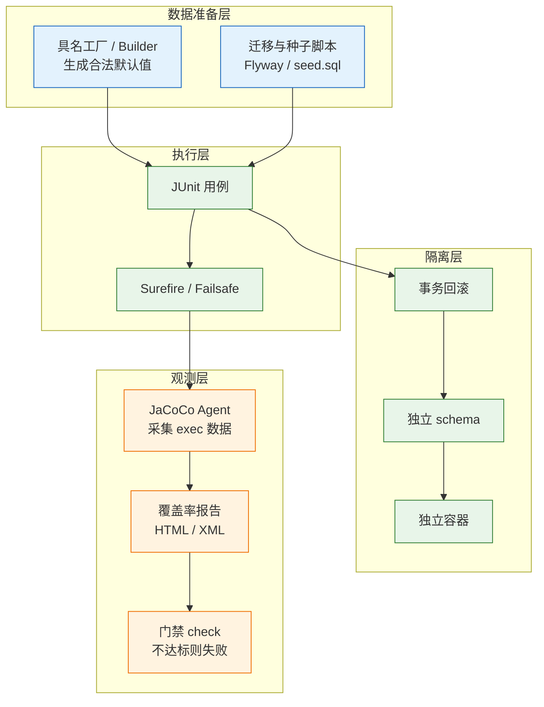
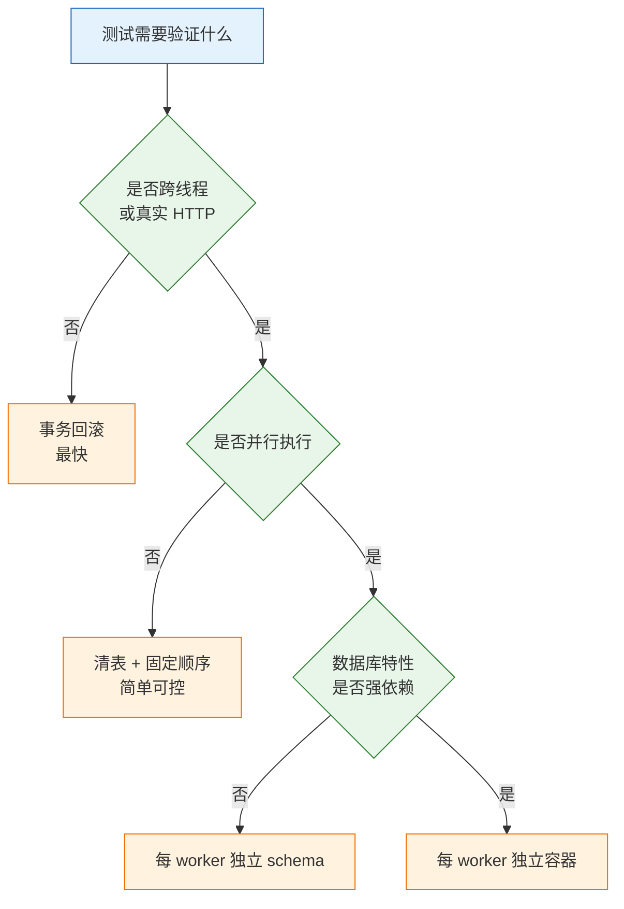
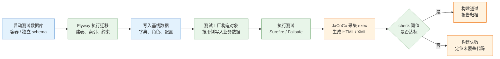

# 测试数据与覆盖率

---

## 一、测试数据与覆盖率是什么

### 1.1 核心概念

测试数据决定测试能否重复执行，覆盖率决定执行范围是否可见。两者都属于测试的隐式依赖：不写进用例，却直接决定结果可信度。数据不可控时，覆盖率再高也只是把偶发失败包装成绿灯。

**测试数据**是测试执行前必须存在的状态，包括数据库行、缓存键、消息、文件和外部系统返回值。一套可用的测试数据要同时满足三个性质：

- **可重复**：同一份代码在任何机器、任何时间执行，结果一致。
- **可并行**：多个用例、多个 worker 同时执行时互不遮挡。
- **可清理**：执行结束后能回到干净状态，不污染后续用例。

**覆盖率**是测试执行轨迹的度量，回答“哪些代码被执行过”，不回答“执行得对不对”。它由插桩代理在字节码中埋点，运行结束后汇总成报告。覆盖率的价值在于暴露完全没被走到的代码，而不是给测试质量打分。

两个概念经常一起失效：用例依赖固定客户号，单跑通过，并行时唯一键冲突；覆盖率显示 85%，但折扣叠加、权限组合这些真正会出事的路径一次没走。前者是数据隔离问题，后者是口径与断言强度问题。



### 1.2 与相邻技术的关系

测试数据不是孤立的一层，它和测试替身、迁移工具、容器化数据库、CI 平台各自解决不同问题，边界不能混。

| 技术 | 解决的问题 | 与本主题的边界 |
|---|---|---|
| Mock / Stub | 协作者的行为与返回值 | 只替换依赖，不提供数据库状态 |
| 数据工厂 / Object Mother | 快速构造合法对象 | 负责对象，不负责落库与隔离 |
| Flyway / Liquibase | schema 与种子数据的版本化 | 负责结构与基线，不负责用例级数据 |
| Testcontainers | 提供真实数据库的运行载体 | 负责隔离环境，不负责数据语义 |

**Mock 不能替代数据准备**。把 Repository 全部 mock 掉，测试确实不碰数据库，但也验证不了唯一索引、事务边界、级联删除这些只有真实数据库才有的行为。反过来说，所有用例都连真实库，单元测试会退化成慢速集成测试。

合理的分界是：**核心业务逻辑用真实对象和内存数据，跨越 SQL、事务、约束的路径用真实数据库**。前者追求速度和定位精度，后者追求行为真实。

**迁移工具与测试数据要分开管理**。schema 变更走 `db/migration`，测试基线数据走 `db/testdata`，两者版本独立。把测试数据写进业务迁移脚本，会导致生产库被塞入测试行；把 schema 变更写进测试脚本，则本地与 CI 的库结构会悄悄分叉。

### 1.3 架构组成

一套完整的测试数据与覆盖率体系由四个部分组成，缺一层都会出现“测试通过但无法解释”的情况。

| 组件 | 职责 | 产物 |
|---|---|---|
| 数据工厂 | 生成合法默认值，暴露具名构造方法 | Java 类、JSON fixture |
| 迁移与种子 | 建表、加索引、写入基线字典 | SQL 脚本、版本记录表 |
| 隔离机制 | 事务、schema、容器三选一 | 每次执行独立的数据空间 |
| 覆盖率工具链 | 插桩、采集、报告、门禁 | `jacoco.exec`、HTML、构建结果 |

数据工厂负责“对象长什么样”，迁移脚本负责“库长什么样”，隔离机制负责“这次执行能看见哪些行”，覆盖率工具负责“哪些代码被这些行触发”。四者的关系是串联的：工厂产出的对象经隔离层落库，用例执行时由 agent 记录轨迹，最后由 check 目标判定是否放行。

> **注意**：覆盖率 agent 只在测试 JVM 中生效。应用以独立进程启动的 E2E 测试，默认采集不到服务端代码；需要远程 agent 或改用集成测试覆盖服务端逻辑。

---

## 二、测试数据的来源与工厂设计

### 2.1 数据来源分类

| 来源 | 可控性 | 真实度 | 适用场景 |
|---|---|---|---|
| 用例内写死常量 | 高 | 低 | 单字段边界、纯函数 |
| Object Mother / 具名工厂 | 高 | 中 | 业务对象的主要构造方式 |
| Builder + 默认值 | 高 | 中 | 只改一两个字段的组合 |
| 生产脱敏快照 | 低 | 高 | 排查线上问题、容量评估 |

固定常量的优点是直观，缺点是复用即耦合。两个用例共用 `customerNo = "C001"`，只要并行执行就会互相覆盖；改一次客户号，所有引用处都要跟着改。常量适合留在单个测试方法内部，不适合抽成全局共享。

具名工厂解决可读性问题。`anExpiredOrder()`、`aPaidOrder()` 这类方法名直接表达业务语义，读用例时不需要逐字段核对。Builder 解决组合问题，适合“在合法默认值上只改金额”的场景。两者不是二选一：常见做法是 Object Mother 内部调用 Builder，对外只暴露有名字的工厂方法。

生产快照的真实度最高，但风险也最大。使用前必须脱敏，而且不是把姓名替换成 `***` 就结束：手机号、身份证、邮箱、地址、银行卡都要按规则替换，并保持原格式与长度。长度校验、格式校验、编码处理只有在数据形状不变时才测得到。映射表单独存放，不随测试数据提交。

合成数据介于工厂与快照之间。用 Faker 生成姓名、地址、备注，可以快速铺出规模，但必须固定随机种子，否则失败无法复现。更稳妥的做法是只让**非关键字段**随机，金额、状态、时间、标识这些影响断言的字段仍由工厂显式给定。随机值还要避开边界：长度恰好等于列上限、字符集包含生僻字、时间落在夏令时切换点，都会让测试偶发失败。

> **安全警告**：生产数据导入测试环境属于个人信息转移，必须有审批、脱敏记录和访问控制。未脱敏快照进入开发机或 CI 缓存，等同于数据泄露。

### 2.2 具名工厂与 Builder 组合

下面的工厂给出一份**合法默认值**，用例只覆盖本次关心的字段。默认值必须能通过所有校验，否则每个用例都要先修数据，工厂反而增加成本。

```java
// 订单测试数据工厂：默认值合法，用例只覆盖关心的差异
public final class OrderFixture {

    // 单 JVM 内递增，仅用于生成可读序号
    private static final AtomicLong SEQ = new AtomicLong();

    private OrderFixture() {
    }

    public static Order.OrderBuilder builder() {
        long n = SEQ.incrementAndGet();
        // 单号追加 UUID 片段：多个 JVM、多个 worker 并行时不会撞唯一键
        String orderNo = "ORD-" + n + "-"
                + UUID.randomUUID().toString().substring(0, 8);
        return Order.builder()
                .orderNo(orderNo)
                .userId(1000L + n)          // 每个订单独立用户，避免行锁集中
                .amountCents(1999L)         // 合法金额，边界用例再覆盖
                .status(OrderStatus.CREATED);
    }

    // 具名方法：方法名即业务语义，读用例时不必逐字段核对
    public static Order createdOrder() {
        return builder().build();
    }

    public static Order paidOrder() {
        return builder().status(OrderStatus.PAID).build();
    }

    public static Order expiredOrder() {
        return builder()
                .status(OrderStatus.CREATED)
                .createdAt(Instant.now().minus(31, ChronoUnit.DAYS))
                .build();
    }

    public static Order orderWithAmount(long amountCents) {
        return builder().amountCents(amountCents).build();
    }
}
```

用例只写差异，断言对准行为：

```java
@Test
void 金额为零时拒绝下单() {
    Order order = OrderFixture.orderWithAmount(0);
    assertThatThrownBy(() -> service.create(order))
            .isInstanceOf(IllegalArgumentException.class)
            .hasMessageContaining("金额");
}

@Test
void 正常订单创建后状态为待支付() {
    Order order = OrderFixture.createdOrder();
    Order saved = service.create(order);
    assertThat(saved.status()).isEqualTo(OrderStatus.CREATED);
}
```

执行单个测试类：

```bash
# -Dtest 指定类名；-q 只输出错误与测试摘要
mvn -q -Dtest=OrderServiceTest test
```

输出类似：

```text
Tests run: 2, Failures: 0, Errors: 0, Skipped: 0
```

工厂设计有三条硬约束：

1. **默认值必须合法**：能通过 Bean Validation、数据库非空约束和外键约束。
2. **不共享可变对象**：每次调用返回新实例，避免用例之间通过静态字段互相影响。
3. **不隐藏必填项**：Builder 的默认值只用于“业务上可以省略”的字段，关键字段应由用例显式给出。

| 工厂方法 | 表达的业务状态 | 典型用途 |
|---|---|---|
| `createdOrder()` | 新建待支付 | 创建流程、库存占用 |
| `paidOrder()` | 已支付 | 发货、对账、退款前置 |
| `expiredOrder()` | 超时未支付 | 关单任务、库存释放 |
| `orderWithAmount(n)` | 指定金额 | 金额边界、折扣计算 |

### 2.3 唯一标识与并行安全

唯一后缀解决“撞唯一键”，但不解决“查全表”。如果用例断言“按条件查询返回 3 条”，其他用例造的数据同样满足条件，断言就会随执行顺序变化。

| 方案 | 并行安全 | 可读性 | 注意事项 |
|---|---|---|---|
| 数据库自增 | 高 | 中 | 依赖库状态，回滚后序列仍前进 |
| UUID | 高 | 低 | 索引碎片、日志难读 |
| 时间戳 + 随机数 | 中 | 中 | 同一毫秒内仍可能重复 |
| 业务前缀 + worker 编号 | 高 | 高 | 需要显式传入 worker 标识 |

`AtomicLong` 只在单个 JVM 内递增。Surefire 配置了 `forkCount` 或多个测试类分片到不同机器时，每个 JVM 都从 1 开始，单号必然重复。解决方式是在单号中加入 UUID 片段或 CI 注入的 worker 编号：

```java
// CI 分片时通过 -Dtest.worker=3 注入；本地默认 0
private static final String WORKER =
        System.getProperty("test.worker", "0");

private static String nextOrderNo(long n) {
    return "ORD-W" + WORKER + "-" + n + "-"
            + UUID.randomUUID().toString().substring(0, 8);
}
```

> **注意**：唯一后缀只能保证“不撞键”，不能让统计类断言变可靠。凡是“总数”“最新一条”“列表第一条”这类断言，都必须带上本次执行的标识，或者依赖库/schema 级隔离。

---

## 三、测试数据的隔离与清理

### 3.1 隔离粒度选择

| 粒度 | 做法 | 适用场景 | 代价 |
|---|---|---|---|
| 事务回滚 | 测试方法加 `@Transactional` | 单线程 CRUD、约束校验 | 异步与真实 HTTP 失效 |
| 清表 | `@AfterEach` 执行 truncate | 多线程、需要真实提交 | 外键顺序、漏清关联表 |
| 独立 schema | 每个 worker 一个 schema | 大多数集成测试 | 迁移需重复执行 |
| 独立容器 | 每个 worker 一个数据库容器 | 并发高、隔离要求强 | 启动慢、占 CI 资源 |

事务回滚最快，也最容易被误用。它依赖 Spring TestContext 在当前线程开启事务，测试结束后回滚。凡是不在这个事务里发生的写入，都回滚不到。

清表适合需要验证提交行为的场景，但顺序必须按外键依赖倒序，或者临时关闭外键检查。漏掉关联表是常见问题：主表清了，明细表还在，下一次执行就出现脏数据。

独立 schema 是并行集成的折中方案。每个 worker 启动时创建 `test_w0`、`test_w1`，执行迁移后把连接指向自己的 schema。迁移脚本要能在空 schema 上重复执行，否则第二个 worker 会失败。

独立容器隔离最彻底，成本也最高。Testcontainers 的静态容器可以在多个测试类之间复用，但复用意味着数据会累积，仍需要清理策略。



### 3.2 事务回滚的失效条件

以下三类场景，`@Transactional` 测试一定回滚不掉：

| 失效场景 | 原因 | 处理方式 |
|---|---|---|
| 异步线程写入 | 新线程使用独立事务并提交 | 轮询等待，改为清表隔离 |
| 真实 HTTP 调用 | 服务端线程独立提交 | 用 API 清理或独立库 |
| DDL 语句 | MySQL、Oracle 隐式提交 | 迁移放到测试启动阶段 |

异步写入的典型表现是“测试里查不到，日志里已成功”。异步线程的事务与测试事务无关，测试回滚时它已经提交。正确做法是等待可见，而不是加 `Thread.sleep`：

```java
@Test
void 异步创建后应能查询到订单() {
    String orderNo = OrderFixture.createdOrder().orderNo();
    service.createAsync(OrderFixture.createdOrder());

    // 最多等 5 秒，每 100ms 查一次；避免固定 sleep 造成的偶发失败
    await().atMost(Duration.ofSeconds(5))
           .pollInterval(Duration.ofMillis(100))
           .untilAsserted(() ->
                   assertThat(repository.findByOrderNo(orderNo)).isPresent());
}
```

判断事务是否真的回滚，方法很直接：测试结束后另开一个连接查询。数据还在，说明写入发生在了测试事务之外。不要只看测试是否通过。

> **注意**：PostgreSQL 的 DDL 支持事务回滚，MySQL、Oracle 会隐式提交。跨数据库的测试不能假设 DDL 一定被回滚，迁移应在测试套件启动时单独执行。

### 3.3 清理策略与安全约束

清理的目标是“下一次执行从已知状态开始”，不是“把库清空”。两种策略要分开：

- **按标识删除**：只删本次执行创建的 `order_no` 前缀，适合共享库。
- **整表清空**：`TRUNCATE` 所有业务表，适合独占测试库。

整表清空必须带库名守卫。数据源配置错一行，清的就是开发库甚至生产库。

```bash
# 只允许清理名称以 _test 结尾的数据库
DB_NAME=$(psql "$DATABASE_URL" -tAc 'select current_database()')

case "$DB_NAME" in
  *_test)
    # CASCADE 会连带清空外键关联表；仅限独占测试库
    psql "$DATABASE_URL" -v ON_ERROR_STOP=1 \
      -c 'TRUNCATE orders, order_items, payments RESTART IDENTITY CASCADE'
    ;;
  *)
    echo "拒绝清理非测试库: $DB_NAME" >&2
    exit 1
    ;;
esac
```

> **安全警告**：`TRUNCATE ... CASCADE` 与 `flyway clean` 都会不可逆地删除数据。执行前必须确认连接串指向测试库，并在 CI 中禁止生产凭据注入测试 job；本地不要把 `.env` 指向共享开发库。

Flyway 从 9.0 起默认禁用 `clean`，这是保护而不是障碍。需要重建测试库时，用一次性容器或独立 schema，不要为了省事打开 `cleanDisabled=false`。

| 清理方式 | 速度 | 风险 | 适用 |
|---|---|---|---|
| 按业务标识删除 | 中 | 漏删关联表 | 共享库、并行执行 |
| `TRUNCATE` 整表 | 快 | 误清非测试库 | 独占测试库 |
| 删除并重建 schema | 中 | 迁移耗时 | 每 worker 独立 schema |
| 销毁容器 | 慢 | 无 | 一次性集成环境 |

---

## 四、覆盖率指标口径

### 4.1 行、分支与方法覆盖

| 口径 | 统计对象 | 能发现 | 发现不了 |
|---|---|---|---|
| 行覆盖 | 至少执行过一次的源码行 | 整段未执行 | 分支只走一半 |
| 分支覆盖 | `if`、`switch` 的每个分支 | 条件漏测 | 条件组合与短路 |
| 方法覆盖 | 是否被调用过 | 整块未使用 | 方法内部逻辑错误 |
| 指令覆盖 | 字节码指令 | 更细的执行粒度 | 与源码对应关系弱 |

行覆盖 100% 不代表分支覆盖 100%。下面这个方法只有一行：

```java
boolean canDiscount(boolean member, boolean hasCoupon) {
    return member && hasCoupon;
}
```

只测 `(true, true)` 与 `(false, true)`，这一行被执行过，行覆盖 100%；但 `member=true, hasCoupon=false` 从未出现，`&&` 的短路分支没有走全，分支覆盖低于 100%。如果业务规则是“会员且持券才打折”，漏掉的正是“会员没券”这一种真实情况。

断言强度同样决定覆盖率的意义。下面两个测试都能点亮同一行，保护力完全不同：

```java
// 弱断言：只要返回非空就通过，金额算错也不会红
assertThat(result).isNotNull();

// 强断言：校验具体金额与状态，改坏计算逻辑会立即失败
assertThat(result.discountCents()).isEqualTo(500);
assertThat(result.payableCents()).isEqualTo(1499);
```

### 4.2 增量覆盖率

总量覆盖率会被历史代码稀释。新增 200 行全部没测，若项目总行数是两万，总量只下降约一个百分点，门禁毫无感觉。因此门禁应同时看两个口径：

- **总量不低于基线**：防止存量继续恶化。
- **本次改动行覆盖不低于阈值**：保证新代码自带测试。

增量口径需要 diff 支持。JaCoCo 只产出“哪些行被执行”，不直接算 diff；通常由 CI 的覆盖率服务读取 XML 报告，再与 `git diff` 的行号求交集：

```bash
# 取本次分支相对主干的改动行；输出交给覆盖率服务做交集
git diff --unified=0 origin/main...HEAD -- 'src/main/java/**/*.java' \
  > build/coverage.diff
```

| 指标 | 计算方式 | 用途 | 失真风险 |
|---|---|---|---|
| 总行覆盖率 | 已执行行 / 可执行行 | 观察长期趋势 | 被历史代码稀释 |
| 改动行覆盖率 | 改动行中被执行的行 / 改动行 | PR 门禁 | diff 行号映射错误 |
| 分支覆盖率 | 已走分支 / 全部分支 | 条件逻辑校验 | 编译器生成分支干扰 |
| 变异得分 | 被杀死的变异体 / 全部变异体 | 验证断言强度 | 成本高、耗时长 |

> **注意**：diff 覆盖率依赖行号映射。重构导致行号整体位移时，报告可能把未改动行算进增量；生成代码、格式化提交也会污染统计。合入门禁前要确认工具使用了同一份 commit。

### 4.3 变异测试与断言有效性

覆盖率证明代码被执行，变异测试证明“代码被改坏后测试会不会红”。PIT 在字节码层面生成变异体，例如把 `>` 改成 `>=`、把返回值加一、删除方法调用，然后重跑测试。测试仍然通过，说明该变异体存活，对应断言无效。

```xml
<plugin>
  <groupId>org.pitest</groupId>
  <artifactId>pitest-maven</artifactId>
  <!-- 版本在父 POM 或 properties 中统一定义，取官方当前稳定版 -->
  <version>${pitest.version}</version>
</plugin>
```

只对核心包执行，避免全项目耗时失控：

```bash
# targetClasses 限定计价包；targetTests 限定对应测试
mvn -q test-compile pitest:mutationCoverage \
  -DtargetClasses='com.example.order.pricing.*' \
  -DtargetTests='com.example.order.pricing.*Test'
```

报告位于 `target/pit-reports/index.html`。一个变异体存活，意味着那行代码被改坏后测试仍然通过，通常对应三种情况：

| 变异结果 | 含义 | 处理 |
|---|---|---|
| Killed | 测试捕获了变异 | 正常 |
| Survived | 断言未覆盖该行为 | 补强断言或删无用代码 |
| No coverage | 该行从未执行 | 先补用例 |

变异测试适合金额、权限、状态机这类“错了就出事”的模块，不适合全量跑。它也不能替代集成测试：变异体只验证单元级断言，跨服务的一致性问题仍然要靠集成与契约测试。

---

## 五、覆盖率采集与门禁配置

### 5.1 JaCoCo 接入

JaCoCo 通过 Java Agent 在类加载时插桩，运行结束后写出 `jacoco.exec`。Maven 中由 `prepare-agent` 设置 `argLine`，`report` 生成 HTML/XML，`check` 读取执行数据并校验阈值。

```xml
<plugin>
  <groupId>org.jacoco</groupId>
  <artifactId>jacoco-maven-plugin</artifactId>
  <!-- 版本在父 POM 或 properties 中统一定义，取官方当前稳定版 -->
  <version>${jacoco.version}</version>
  <executions>
    <!-- 测试启动前挂载 agent，把 -javaagent 写入 argLine -->
    <execution>
      <id>prepare-agent</id>
      <goals>
        <goal>prepare-agent</goal>
      </goals>
    </execution>

    <!-- verify 阶段生成 HTML 与 XML 报告 -->
    <execution>
      <id>report</id>
      <phase>verify</phase>
      <goals>
        <goal>report</goal>
      </goals>
    </execution>

    <!-- verify 阶段校验阈值，不达标直接让构建失败 -->
    <execution>
      <id>check</id>
      <phase>verify</phase>
      <goals>
        <goal>check</goal>
      </goals>
      <configuration>
        <rules>
          <rule>
            <element>BUNDLE</element>
            <limits>
              <limit>
                <counter>LINE</counter>
                <value>COVEREDRATIO</value>
                <minimum>0.60</minimum>
              </limit>
              <limit>
                <counter>BRANCH</counter>
                <value>COVEREDRATIO</value>
                <minimum>0.50</minimum>
              </limit>
            </limits>
          </rule>
        </rules>
      </configuration>
    </execution>
  </executions>
</plugin>
```

若项目自定义了 Surefire 的 `argLine`，必须用 `@{argLine}` 引用 agent 参数，否则会覆盖掉 `prepare-agent` 写入的值，覆盖率恒为 0：

```xml
<plugin>
  <groupId>org.apache.maven.plugins</groupId>
  <artifactId>maven-surefire-plugin</artifactId>
  <configuration>
    <!-- @{argLine} 由 JaCoCo 注入；后面可追加时区等参数 -->
    <argLine>@{argLine} -Duser.timezone=UTC -Dfile.encoding=UTF-8</argLine>
  </configuration>
</plugin>
```

执行并查看报告：

```bash
# verify 会跑测试、生成报告并执行 check
mvn -q verify

# macOS 打开报告；Linux 使用 xdg-open
open target/site/jacoco/index.html
```

不达标时的失败信息类似：

```text
Rule violated for bundle order-service: lines covered ratio is 0.58,
but expected minimum is 0.60
```

### 5.2 门禁阈值设计

阈值不是越高越好。老项目一上来定 80%，第一天全组 PR 全红，规则很快会被 `continue-on-error` 或管理员强合绕过。可行路径是“先止血，再提升”：

| 阶段 | 总量要求 | 新增代码要求 | 目的 |
|---|---|---|---|
| 接入期 | 不低于当前值 | 不强制 | 先让门禁可信 |
| 稳定期 | 每次不下降 | 行覆盖 ≥ 80% | 阻止继续恶化 |
| 提升期 | 每季度上调 2–5 点 | 行覆盖 ≥ 80% | 逐步偿还欠账 |

核心模块单独提高要求，比全项目统一阈值更有效。计价、权限、支付漏一个分支的代价，与工具类漏一个分支完全不同。

```xml
<!-- 对核心包单独设置更高的分支覆盖要求 -->
<rule>
  <element>CLASS</element>
  <includes>
    <include>com.example.order.pricing.*</include>
  </includes>
  <limits>
    <limit>
      <counter>BRANCH</counter>
      <value>COVEREDRATIO</value>
      <minimum>0.80</minimum>
    </limit>
  </limits>
</rule>
```

> **运维提示**：阈值调整要和代码评审一样留记录。悄悄下调阈值，比没有门禁更危险，因为团队仍然以为门禁存在。

### 5.3 报告解读与排除规则

报告中的颜色含义固定：红色表示整行未执行，黄色表示分支只走了一部分，绿色表示该行所有分支都已执行。排查顺序是先看红色中的核心业务类，再看黄色中的条件判断。

不要按包的覆盖率排名决定补测顺序。一个 `util` 包 40% 可能无关紧要，`pricing` 包 95% 里漏掉的 5% 可能是退款金额计算。判断依据是“这行代码错了会不会造成资损或越权”，不是数字高低。

生成代码、DTO、配置类应从分母中排除，否则会长期拉低整体数字：

```xml
<configuration>
  <excludes>
    <!-- 纯数据传输对象，无业务逻辑 -->
    <exclude>**/dto/**</exclude>
    <!-- MapStruct、protobuf 等生成代码 -->
    <exclude>**/generated/**</exclude>
    <!-- 只有注解的配置类 -->
    <exclude>**/*Config.class</exclude>
  </excludes>
</configuration>
```

排除规则要同时写在 `report` 与 `check` 的配置里。只写在一处，会出现“报告里没有、门禁仍在算”的口径不一致。

> **注意**：排除规则必须评审。今天排除 `dto`，明天可能有人把 Service 放进 `dto` 包来抬数字。可以加一条反向检查：被排除的包中若出现 `@Service`、`@Transactional` 等注解，构建直接失败。

---

## 六、完整数据准备与覆盖率流水线

### 6.1 迁移与种子数据

一个可重复的测试库需要两部分脚本：结构迁移与基线数据。结构迁移由 Flyway 按版本号顺序执行，基线数据只包含字典、配置、权限点这类稳定内容。

```yaml
# application-test.yml
spring:
  datasource:
    # 指向独占测试库；库名以 _test 结尾，便于清理脚本做守卫
    url: jdbc:postgresql://localhost:5432/order_test
    username: app
    password: ${TEST_DB_PASSWORD}
  flyway:
    enabled: true
    # 结构与测试基线分开存放，避免测试数据进入生产迁移
    locations: classpath:db/migration,classpath:db/testdata
    # 禁止 clean，防止误删整个 schema
    clean-disabled: true
    # 测试库允许乱序执行，生产环境保持 false
    out-of-order: false
```

```sql
-- db/testdata/V100__baseline.sql
-- 基线只放稳定字典；业务数据由测试工厂生成
INSERT INTO currency (code, name, scale)
VALUES ('CNY', '人民币', 2),
       ('USD', '美元', 2);

INSERT INTO role (code, name)
VALUES ('ADMIN', '管理员'),
       ('OPERATOR', '操作员');
```

基线数据必须使用固定主键或唯一业务码，否则每次重建都会产生不同 ID，快照断言无法稳定。

### 6.2 从建库到报告的完整执行

```bash
# ========== 1. 准备独立测试库 ==========
# 用容器启动数据库，端口映射到宿主，避免依赖本机安装
docker run -d --name order-test-db \
  -e POSTGRES_DB=order_test \
  -e POSTGRES_USER=app \
  -e POSTGRES_PASSWORD="$TEST_DB_PASSWORD" \
  -p 5432:5432 \
  postgres:18-alpine

# ========== 2. 等待数据库就绪 ==========
# pg_isready 返回 0 才继续，避免迁移在启动中途执行
until docker exec order-test-db pg_isready -U app -d order_test; do
  sleep 1
done

# ========== 3. 执行测试、迁移、覆盖率检查 ==========
# verify 依次触发 flyway:migrate、surefire、failsafe、jacoco:report、jacoco:check
mvn -B clean verify

# ========== 4. 查看报告 ==========
open target/site/jacoco/index.html
```

执行成功时，日志末尾输出类似：

```text
[INFO] Tests run: <项目实际数>, Failures: 0, Errors: 0, Skipped: <项目实际数>
[INFO] BUILD SUCCESS
```

覆盖率不达标时，`check` 会让构建在 `verify` 阶段失败，日志中给出违反的规则、实际比例与阈值。先看这条信息定位到计数器类型，再打开 HTML 报告找对应类，不要直接重跑。

一次完整的执行链路如下：



### 6.3 常见反模式

| 反模式 | 表现 | 后果 | 替代做法 |
|---|---|---|---|
| 共享固定账号 | 并行时互相覆盖 | 偶发失败，重跑又绿 | 工厂生成唯一标识 |
| 用 `sleep` 等异步 | 高峰期随机红 | 反馈不可信 | 轮询等待可见 |
| 只追总覆盖率 | 数字涨、缺陷不降 | 虚假安全感 | 增量 + 变异测试 |
| 把测试数据混入迁移 | 生产出现测试行 | 数据污染 | 独立 `db/testdata` |
| 清表脚本无库名守卫 | 误清开发库 | 数据丢失 | 库名白名单校验 |
| 排除 Service 抬数字 | 报告好看、逻辑没测 | 门禁失效 | 排除规则评审 |

反模式的共同点是“让数字先变好”，而不是“让行为可验证”。判断一种做法是否可取，看它能否回答两个问题：失败能否复现，覆盖到的代码是否被断言验证。

---

## 七、常见排障

| 现象 | 最可能原因 | 处理 |
|---|---|---|
| 全量跑绿，单跑该类失败 | 依赖其他用例留下的数据 | 用例自造数据，补 `@AfterEach` 清理 |
| 并行后大量唯一键冲突 | 固定业务字段、`AtomicLong` 跨 JVM 重置 | 加 UUID 或 worker 前缀 |
| 测试事务里读不到异步写入 | 异步线程独立事务已提交 | 轮询等待，或改为清表隔离 |
| 覆盖率始终为 0% | agent 未挂载、`argLine` 被覆盖 | 检查 `prepare-agent`，Surefire 用 `@{argLine}` |
| 报告中仍出现已排除的类 | 排除只配在 `report` 或只配在 `check` | 两处配置保持一致 |
| 门禁开启后全组 PR 失败 | 阈值脱离存量现状 | 先“不下降”，再要求新增代码 |
| Faker 导致偶发失败 | 随机值触发长度、编码、边界 | 固定种子，边界用例显式传值 |
| 执行测试后开发库被清空 | 数据源指向本地库，清理脚本误跑 | 测试库独立，清表前校验库名 |
| H2 全绿、MySQL 报错 | 方言、函数、排序规则差异 | 改用 Testcontainers 同版本数据库 |
| Mock 全部依赖后覆盖率很高 | 被测逻辑被替身绕过 | 只 mock 协作者，核心逻辑用真实对象 |
| 断言“返回 3 条”并行时失败 | 其他用例数据混入 | 断言带本次标识，或按 worker 隔离 |
| 脱敏后格式校验失败 | 替换破坏长度或字符集 | 保持原格式与长度，使用固定映射表 |

排查按“数据、事务、观测、断言”的顺序推进，避免一上来就怀疑测试框架：

1. **看数据**：这条用例依赖了谁留下的行？清空后单独执行是否通过？
2. **看事务**：写入发生在哪个线程、哪个事务？测试结束后另开连接是否还能查到？
3. **看观测**：覆盖率异常先检查 `jacoco.exec` 是否生成、`argLine` 是否包含 agent，再怀疑测试。
4. **看断言**：执行到不等于验证到，确认断言是否校验了具体值而非仅非空。
