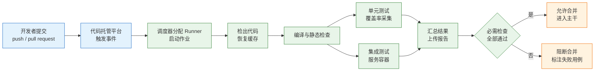
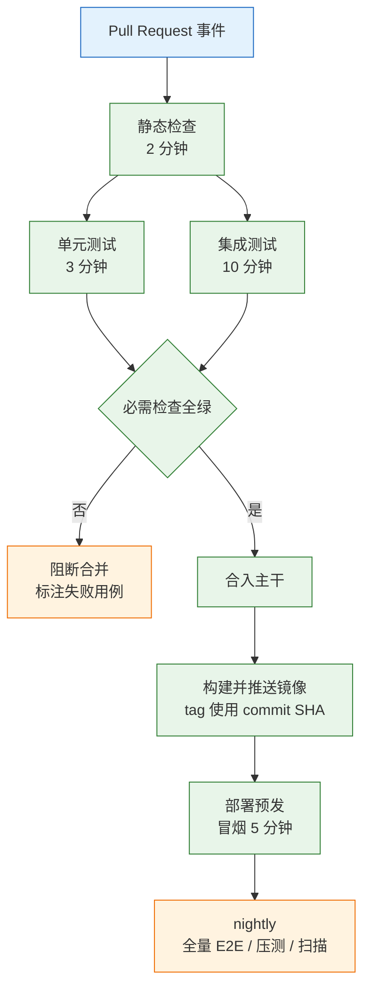
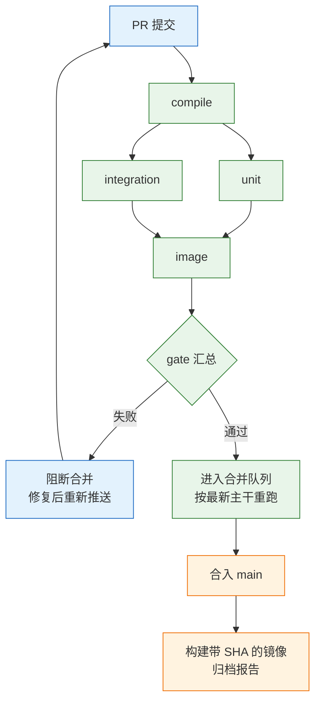

# 测试与 CI

---

## 一、测试与 CI 是什么

### 1.1 核心概念

持续集成的价值不在“每次提交跑一遍测试”，而在把“什么算通过”变成机器可执行的门禁，并在可接受的时间内给出可信答案。流水线一旦超过人的等待阈值，重试、强合、跳过就会取代修复，门禁名存实亡。

**持续集成（Continuous Integration，CI）** 指开发者频繁把改动合入主干，每次合入都由流水线自动完成构建、测试与检查，尽早暴露集成错误。它的三个必要条件是：

- **单一可信源**：代码、构建脚本、测试、环境配置都在版本库中。
- **自动化执行**：从提交到结果不需要人工点按钮。
- **快速反馈**：失败能在分钟级定位到具体用例与代码行。

**门禁（Quality Gate）** 是 CI 的输出规则：哪些检查必须通过，代码才允许合入。门禁不是“跑测试”的同义词。测试失败但合并按钮仍可点击，说明只有测试，没有门禁。

CI 要回答的问题只有一个：**这次改动能不能合入。** 能，就快速给出绿灯；不能，就明确指出哪一项、哪条用例、什么原因。回答不了这三个要素的流水线，只是自动化的日志播放器。



### 1.2 与相邻技术的关系

CI 不是单一工具，而是版本控制、构建工具、测试框架、制品仓库与代码托管平台的组合。每一层都有明确边界，混用会导致排障方向错误。

| 技术 | 解决的问题 | 与 CI 的边界 |
|---|---|---|
| Git / 代码托管 | 版本、分支、评审 | 提供触发事件，不负责执行 |
| Maven / Gradle | 依赖解析、编译、测试生命周期 | 定义可重复的构建步骤 |
| JUnit / Testcontainers | 用例组织、真实依赖 | 提供测试能力，不决定何时跑 |
| 制品仓库 | 镜像、包的版本留存 | 消费构建产物，不参与判定 |

**CI 与 CD 的区别**：CI 保证主干始终可构建、可测试；持续交付（CD）把通过验证的制品部署到环境。把部署塞进 PR 流水线，会让每次提交都触碰环境，反馈变慢且风险放大。PR 阶段最多构建镜像、部署预发；生产发布单独审批。

**CI 与测试框架的区别**：测试框架定义“怎么测”，CI 定义“什么时候测、测不过怎么办”。同一套测试在本地执行是开发反馈，在 CI 执行是合入依据。两者结果不一致时，先修环境差异，不要给 CI 单独加跳过规则。

**CI 与构建缓存的区别**：缓存是加速手段，不是正确性来源。缓存命中与否只影响耗时，不应影响测试结果。若清缓存后结果变化，说明构建依赖了未声明的状态，属于必须修复的缺陷。

### 1.3 架构组成

| 层 | 组件 | 职责 |
|---|---|---|
| 触发层 | Webhook、分支过滤、路径过滤 | 决定哪些事件启动流水线 |
| 调度层 | Runner、并发组、队列 | 分配资源、取消过期运行 |
| 执行层 | 构建、测试、服务容器 | 产生可验证的结果 |
| 观测层 | 日志、JUnit XML、制品 | 让失败可定位、可追溯 |
| 门禁层 | 分支保护、必需检查、合并队列 | 把结果转成合入许可 |

流水线的执行单元是**作业（job）**，作业内部由**步骤（step）**组成。作业之间默认隔离：不同 job 的文件系统、进程、环境变量互不共享，只能通过制品或缓存传递文件。把“上一步编译的产物”直接留给下一个 job 使用，是常见错误，下一个 job 根本看不到。

Runner 是实际执行作业的机器或容器。托管 Runner 每次都是干净环境，自建 Runner 可能残留上一次的文件与进程。自建 Runner 要定期清理工作目录，否则会出现“只有某台机器失败”的问题。

> **注意**：作业之间不共享工作区。需要跨 job 使用的文件必须用 `actions/upload-artifact` 与 `download-artifact` 显式传递，缓存只适合依赖目录，不适合作为构建产物的传递通道。

---

## 二、测试分层与反馈预算

### 2.1 分层模型

测试按“运行成本”和“定位精度”分层。越靠下越快、越稳定、定位越准；越靠上越接近真实用户，但越慢、越容易受环境影响。

| 层级 | 内容 | 时间预算 | 失败处理 |
|---|---|---|---|
| 静态检查 | 编译、格式、类型、依赖漏洞 | 2 分钟 | 阻断 |
| 单元测试 | 纯逻辑、Mock 协作者 | 3 分钟 | 阻断 |
| 集成测试 | 真实数据库、消息、缓存 | 10 分钟 | 阻断 |
| 端到端冒烟 | 5–10 条关键路径 | 5 分钟 | 阻断发布 |
| 全量回归 | 全用例、多浏览器、多版本 | 30 分钟以上 | 建 issue |

分层的目的不是分类好看，而是把**阻断权**放在又快又准的层。单元测试失败能直接指出类和方法；全量 E2E 失败往往只能指出“下单流程不通”，定位成本高一个数量级。



> **运维提示**：一个 PR 只跑受影响模块的测试，是合法的提速手段；但“受影响”必须由构建工具计算，不能靠人猜。猜错的代价是主干变红，修复成本远高于多跑几分钟。

### 2.2 时间预算与反馈阈值

反馈时间由三部分组成：排队等待、环境准备、实际执行。优化前先测清楚哪一段最长，否则容易把时间花在压缩只有几十秒的测试上。

| 指标 | 目标 | 测量方式 | 超限后果 |
|---|---|---|---|
| 排队时间 | 小于 1 分钟 | 触发到 job 开始 | 开发者切换任务 |
| 环境准备 | 小于 2 分钟 | 拉镜像、起服务容器 | 与执行时间混淆 |
| 执行时间 | 小于 10 分钟 | 第一步到最后一步 | 重试与强合增加 |
| 结果可见 | 小于 1 分钟 | 完成到页面展示 | 失败被忽略 |

人的等待耐心有明确拐点：3 分钟内会盯着看，10 分钟后开始做别的事，30 分钟后直接合并。流水线设计要围绕这个拐点，而不是围绕“理论上能跑多少检查”。

时间预算应按分位统计，而不是平均值。平均值 8 分钟、p95 是 25 分钟的流水线，最需要快速反馈的那批 PR 恰好体验最差。CI 平台通常提供每次运行的耗时，按周统计 p50 与 p95，才能发现长尾。

### 2.3 触发策略

| 事件 | 执行内容 | 是否阻断 |
|---|---|---|
| `pull_request` | 静态检查、单元、集成、构建镜像 | 是 |
| `push` 到主干 | 同 PR 检查 + 推送镜像 | 是 |
| `merge_group` | 合并队列中的完整检查 | 是 |
| `schedule` | 全量回归、压测、安全扫描 | 否，建 issue |
| 手动触发 | 特定分支、特定用例 | 视场景 |

路径过滤可以减少无关运行，但会带来“必需检查停在 Expected”的问题。文档改动不触发测试 job，分支保护仍在等待该检查，PR 永远无法合并。

可行方案是保留一个**总会运行的汇总 job**，它依赖所有实际检查，并在依赖被跳过时按成功处理。分支保护只要求这个汇总 job，不直接要求会被路径过滤的细项。

```yaml
# 汇总 job：无论上游是成功还是被跳过，都会运行
gate:
  if: always()
  needs: [compile, unit, integration]
  runs-on: ubuntu-latest
  steps:
    - name: 校验上游结果
      # 任一上游失败或取消，则汇总失败；被跳过视为通过
      run: |
        echo "compile=${{ needs.compile.result }}"
        echo "unit=${{ needs.unit.result }}"
        echo "integration=${{ needs.integration.result }}"
        if [ "${{ contains(needs.*.result, 'failure') }}" = "true" ] \
          || [ "${{ contains(needs.*.result, 'cancelled') }}" = "true" ]; then
          exit 1
        fi
```

> **注意**：被跳过的检查不能伪装成“已通过”。若某项检查因为路径过滤没有执行，应让汇总 job 明确记录“未执行”，并在评审中说明原因，而不是直接返回成功。

---

## 三、流水线编排

### 3.1 工作流结构

一份可维护的工作流包含六部分：名称、触发、并发控制、权限、作业、制品。顺序不是形式，权限与并发放错位置，会直接造成资源浪费或越权。

```yaml
name: pr-check

on:
  pull_request:
    branches: [main]
  # 合并队列触发时也执行同一套检查
  merge_group:

# 同一 PR 只保留最新一次运行，旧运行自动取消
concurrency:
  group: pr-${{ github.event.pull_request.number || github.run_id }}
  cancel-in-progress: true

# 默认只读；需要写评论或上传时再单独提权
permissions:
  contents: read
```

`concurrency` 的 `group` 必须能唯一标识一个 PR。只用分支名，fork PR 与同名的内部分支会互相取消；只用 `run_id`，则同一 PR 的多次推送会排队而不是取消。`github.event.pull_request.number` 在 `merge_group` 事件中为空，因此要提供兜底值。

`cancel-in-progress: true` 节省 Runner 资源，也避免旧提交的结果覆盖新提交。副作用是构建日志会被标记为取消，排查历史问题时要按 commit 找到对应运行。

### 3.2 并行与依赖

作业之间通过 `needs` 建立有向无环图。没有 `needs` 的作业默认并行；有依赖的作业等待上游完成。

| 关系 | 配置 | 效果 |
|---|---|---|
| 串行 | `needs: compile` | 上游失败则下游不启动 |
| 并行 | 不写 `needs` | 同时执行，一次拿到全部结果 |
| 汇总 | `if: always()` + `needs` | 无论成败都执行，适合门禁 |
| 矩阵 | `strategy.matrix` | 同一定义展开为多个作业 |

编译不过时没必要跑测试，所以测试依赖编译；单元测试与集成测试互不依赖，应并行。两者同时失败时，一次运行就能看到全部问题，比串行修复快一倍。

`fail-fast` 默认开启，矩阵中一个组合失败会取消其他组合。兼容性矩阵通常希望看全所有版本的结果，应显式设置 `fail-fast: false`。

> **注意**：`needs` 只表达依赖，不表达数据传递。下游 job 不会自动获得上游的 `target/` 目录，必须通过制品显式上传与下载。

### 3.3 报告与制品

| 制品 | 内容 | 保留期 | 用途 |
|---|---|---|---|
| JUnit XML | 用例名、耗时、失败堆栈 | 14 天 | 平台生成用例级视图 |
| 覆盖率报告 | HTML、XML、exec | 14 天 | 定位未覆盖代码 |
| 失败截图 | E2E 失败现场 | 14 天 | 复现界面问题 |
| 构建日志 | 完整标准输出 | 30 天 | 审计与追溯 |

报告必须在失败时也上传，否则页面只有一行 `exit code 1`。`if: always()` 是上传步骤的必备条件：

```yaml
- name: 上传测试报告
  # 测试失败时同样执行，否则无法定位具体用例
  if: always()
  uses: actions/upload-artifact@v4
  with:
    name: test-reports-${{ github.run_id }}
    path: |
      target/surefire-reports/
      target/failsafe-reports/
      target/site/jacoco/
    retention-days: 14
```

制品名带 `run_id`，避免同一工作流多次运行时相互覆盖。制品体积要控制：整个 `target/` 可能包含数百 MB 的 class 与 jar，只传报告目录与失败产物即可。

JUnit XML 是跨平台的通用格式，CI 平台据此生成用例级视图。自己解析文本日志既脆弱又无法聚合趋势，不应作为主要手段。

---

## 四、服务容器与缓存配置

### 4.1 服务容器

集成测试需要真实数据库、缓存或消息中间件。托管平台提供 `services` 声明，在作业开始前拉起容器，并等待健康检查通过。

```yaml
services:
  postgres:
    image: postgres:18-alpine
    env:
      POSTGRES_DB: app
      POSTGRES_USER: app
      # 仅用于 CI 临时库，不是任何环境的真实口令
      POSTGRES_PASSWORD: ci-only
    ports:
      - '5432:5432'
    options: >-
      --health-cmd "pg_isready -U app -d app"
      --health-interval 5s
      --health-timeout 3s
      --health-retries 10
```

健康检查决定测试何时开始。没有它，`mvn verify` 经常在数据库初始化到一半时启动，表现为随机的连接拒绝。

| 运行方式 | 主机名 | 端口 | 注意 |
|---|---|---|---|
| 作业直接跑在 Runner | `localhost` | 映射后的宿主端口 | 最常见 |
| 作业运行在容器中 | 服务名 | 容器内原端口 | 不要用 `localhost` |
| 自建 Runner + 宿主服务 | 宿主地址 | 实际监听端口 | 需放通防火墙 |

> **注意**：容器里的 `localhost` 指向容器自身，不是 Runner 主机。作业在容器中执行时，数据库地址必须写服务名，例如 `postgres:5432`；写成 `localhost` 一定连接失败。

`services` 与 Testcontainers 二选一。使用 Testcontainers 的 `@ServiceConnection` 时，测试连接由容器动态提供，外部注入的 `SPRING_DATASOURCE_URL` 会被覆盖。两者同时配置，排查时无法判断实际连的是哪个库。

### 4.2 缓存键设计

| 写法 | 结果 | 建议 |
|---|---|---|
| `key: maven-${{ github.run_id }}` | 每次都是新键，永不命中 | 禁止 |
| `key: maven-${{ hashFiles('**/pom.xml') }}` | 依赖不变则命中 | 推荐 |
| `key: maven-${{ hashFiles('**/pom.xml') }}-jdk21` | 绑定 JDK 主版本 | 推荐 |
| 缓存整个用户目录 | 体积大、含私有包 | 只缓存依赖目录 |

缓存的是依赖下载，不是构建产物。`target/` 不要缓存，旧 class 会让增量编译跳过本应重编的文件，测试结果不可信。

缓存键要包含影响依赖解析的全部输入：依赖清单、锁文件、JDK 主版本、构建工具版本。少写一项，换环境后会拿到不兼容的依赖，表现为“本地好好的，CI 编译报错”。

`restore-keys` 允许部分命中，适合多模块项目。命中旧缓存后，构建工具会补齐缺失依赖；完全未命中则从头下载。两者都正确，只是耗时不同。

> **运维提示**：缓存命中率突然从 90% 掉到 0，通常不是缓存服务故障，而是键里混入了每次变化的变量，例如时间戳、`run_id`、提交 SHA。

### 4.3 分片与矩阵

分片把测试集合切给多个作业并行执行，矩阵把同一作业按参数展开为多份。两者都能缩短墙钟时间，但代价不同。

| 策略 | 适用 | 代价 |
|---|---|---|
| 按测试类分片 | 后端单元/集成测试 | 类之间耗时不均 |
| 按文件分片 | 前端组件、E2E | 单文件过大时仍慢 |
| 版本矩阵 | 兼容性验证 | 作业数成倍增加 |
| 浏览器矩阵 | 前端 E2E | 资源消耗高 |

分片数不要超过测试文件数，否则必有空片。空片本身不报错，但会拉低资源利用率；若构建工具对“没有匹配到用例”报错，需要显式允许空片。

前端 Playwright 使用 `--shard=i/n`：

```bash
# 第 2 片，共 4 片；片内仍按文件粒度分配
npx playwright test --shard=2/4
```

后端按类列表切分时，配合 Surefire 的 `failIfNoSpecifiedTests=false`，让未匹配到用例的分片正常结束：

```bash
# 从全量类列表中取出本片负责的类，逗号分隔
mvn -B -ntp test \
  -Dtest="$SHARD_CLASSES" \
  -Dsurefire.failIfNoSpecifiedTests=false
```

分片的目标是**每片耗时接近**，不是每片数量相同。按文件平均分配，遇到一个超大测试类就会拖慢整片；应按历史耗时做加权分配，并定期重新测量。

---

## 五、门禁规则与分支保护

### 5.1 必需检查

| 检查 | 阻断级别 | 触发 | 超时 |
|---|---|---|---|
| 编译与静态检查 | 阻断合并 | 每次 PR | 10 分钟 |
| 单元测试 + 覆盖率 | 阻断合并 | 每次 PR | 15 分钟 |
| 集成测试 | 阻断合并 | 每次 PR | 20 分钟 |
| 镜像构建 | 阻断合并 | 每次 PR | 15 分钟 |
| 汇总门禁 | 唯一必需检查 | 每次 PR | 5 分钟 |

必需检查要少而硬。把 nightly 的全量回归也设为必需，等于要求每个 PR 等半小时；把安全扫描的每个告警都设为阻断，团队会习惯性忽略。

推荐只把**汇总 job** 设为必需检查，细项在汇总内部判定。这样调整细项时不需要同步修改分支保护，路径过滤也不会造成 Expected 悬挂。

分支保护还要配置：禁止直接推送、要求评审通过、要求分支与主干同步、禁止管理员绕过。少配一项，门禁就有旁路。

### 5.2 超时、并发与权限

```yaml
jobs:
  integration:
    runs-on: ubuntu-latest
    # 防止死锁或等待外部服务时无限占用 Runner
    timeout-minutes: 20
    permissions:
      contents: read
      # 需要把覆盖率写回 PR 时才添加
      pull-requests: write
```

超时是资源保护，也是故障信号。作业卡住不动，通常意味着等待一个永远不会就绪的服务、一个没有响应的外部接口，或者一个死锁的测试。没有超时，Runner 会被占满，后续 PR 全部排队。

权限遵循最小化原则。默认 `contents: read`；上传制品不需要额外权限；写评论、打标签、更新检查状态才需要 `pull-requests: write` 或 `checks: write`。

> **安全警告**：`pull_request_target` 会在目标仓库上下文中运行，并能获得 secrets。若在该事件中检出并执行 fork 的代码，等同于把仓库凭据交给外部提交者。需要评论 fork PR 时，应使用不执行代码的独立工作流。

### 5.3 绕过路径封堵

| 绕过方式 | 表现 | 封堵 |
|---|---|---|
| 重试直到变绿 | 同一提交反复重跑 | 统计重试率，超阈值按故障处理 |
| 管理员强合 | 红灯仍可合并 | 分支保护禁用 bypass |
| 路径过滤跳过 | 必需检查停在 Expected | 汇总 job 兜底 |
| 本地跳过钩子 | `--no-verify` 提交 | CI 仍执行同一检查 |
| 合并后补测试 | PR 绿、主干红 | 开启合并队列 |

**合并队列**值得开启。它在合并前按最新主干重跑检查，避免“各自绿、合起来红”。开启后，PR 上的绿灯只代表基于旧主干通过，最终以队列结果为准。

**重试**只能作为临时手段。每次重试都要记录原因与次数；重试率上升说明存在竞态、环境不稳或数据污染，属于必须修复的缺陷。

> **注意**：`continue-on-error: true` 会让失败步骤显示为通过，门禁读取的是作业结论，因此不会阻断。除了明确的上线观察项，不应在阻断检查中使用。

---

## 六、完整 PR 门禁流水线

### 6.1 前置准备

开始前需要确认四件事：

1. 仓库默认分支为 `main`，且已开启分支保护。
2. Runner 能访问依赖仓库、镜像仓库与测试数据库。
3. Secrets 已配置，fork PR 不会获得敏感凭据。
4. 本地能执行与 CI 相同的命令，环境差异已记录。

数据库优先使用服务容器或 Testcontainers，不依赖共享测试库。共享库会被多个 PR 同时写入，失败无法复现，也无法判断数据由谁留下。

### 6.2 工作流全文

下面的工作流包含编译、单元测试、集成测试、镜像构建与汇总门禁，可直接作为起点，按项目实际插件调整命令。

```yaml
name: pr-check

on:
  pull_request:
    branches: [main]
  merge_group:

# 同一 PR 的新提交取消旧运行；merge_group 事件没有 PR 编号，用 run_id 兜底
concurrency:
  group: pr-${{ github.event.pull_request.number || github.run_id }}
  cancel-in-progress: true

permissions:
  contents: read

env:
  # 统一时区与编码，减少本地与 CI 的差异
  TZ: Asia/Shanghai
  LANG: C.UTF-8

jobs:
  # ---------- 编译与静态检查 ----------
  compile:
    runs-on: ubuntu-latest
    timeout-minutes: 10
    steps:
      - uses: actions/checkout@v4
      - uses: actions/setup-java@v4
        with:
          distribution: temurin
          java-version: '21'
          # 缓存键由 setup-java 根据 pom.xml 生成，不要手工拼 run_id
          cache: maven
      - name: 编译
        run: mvn -B -ntp -DskipTests compile

  # ---------- 单元测试与覆盖率 ----------
  unit:
    needs: compile
    runs-on: ubuntu-latest
    timeout-minutes: 15
    steps:
      - uses: actions/checkout@v4
      - uses: actions/setup-java@v4
        with:
          distribution: temurin
          java-version: '21'
          cache: maven
      - name: 单元测试与覆盖率门禁
        # verify 触发 surefire、jacoco:report、jacoco:check
        run: mvn -B -ntp verify -DskipITs
      - name: 上传单元测试报告
        if: always()
        uses: actions/upload-artifact@v4
        with:
          name: unit-reports-${{ github.run_id }}
          path: |
            target/surefire-reports/
            target/site/jacoco/
          retention-days: 14

  # ---------- 集成测试 ----------
  integration:
    needs: compile
    runs-on: ubuntu-latest
    timeout-minutes: 20
    services:
      postgres:
        image: postgres:18-alpine
        env:
          POSTGRES_DB: app
          POSTGRES_USER: app
          # 仅 CI 临时库口令，生产凭据不得写入工作流
          POSTGRES_PASSWORD: ci-only
        ports:
          - '5432:5432'
        options: >-
          --health-cmd "pg_isready -U app -d app"
          --health-interval 5s
          --health-timeout 3s
          --health-retries 10
    steps:
      - uses: actions/checkout@v4
      - uses: actions/setup-java@v4
        with:
          distribution: temurin
          java-version: '21'
          cache: maven
      - name: 集成测试
        env:
          # 作业直接跑在 Runner 上，服务容器通过 localhost 映射访问
          SPRING_DATASOURCE_URL: jdbc:postgresql://localhost:5432/app
          SPRING_DATASOURCE_USERNAME: app
          SPRING_DATASOURCE_PASSWORD: ci-only
        # 先编译测试类，再单独执行 failsafe，避免重复跑单元测试
        run: |
          mvn -B -ntp test-compile
          mvn -B -ntp failsafe:integration-test failsafe:verify
      - name: 上传集成测试报告
        if: always()
        uses: actions/upload-artifact@v4
        with:
          name: it-reports-${{ github.run_id }}
          path: target/failsafe-reports/
          retention-days: 14

  # ---------- 镜像构建 ----------
  image:
    needs: [unit, integration]
    runs-on: ubuntu-latest
    timeout-minutes: 15
    steps:
      - uses: actions/checkout@v4
      - name: 构建镜像
        # 使用 commit SHA 作为 tag，保证产物可追溯到具体提交
        run: docker build -t app:${{ github.sha }} .

  # ---------- 汇总门禁 ----------
  gate:
    if: always()
    needs: [compile, unit, integration, image]
    runs-on: ubuntu-latest
    timeout-minutes: 5
    steps:
      - name: 汇总上游结果
        # 任一上游失败或取消则整体失败；被跳过按通过处理
        run: |
          echo "compile=${{ needs.compile.result }}"
          echo "unit=${{ needs.unit.result }}"
          echo "integration=${{ needs.integration.result }}"
          echo "image=${{ needs.image.result }}"
          if [ "${{ contains(needs.*.result, 'failure') }}" = "true" ] \
            || [ "${{ contains(needs.*.result, 'cancelled') }}" = "true" ]; then
            exit 1
          fi
```

执行成功时，日志末尾类似：

```text
[INFO] Tests run: <项目实际数>, Failures: 0, Errors: 0, Skipped: <项目实际数>
[INFO] BUILD SUCCESS
```

失败时类似：

```text
[ERROR] Tests run: 12, Failures: 1, Errors: 0, Skipped: 0
[ERROR]   OrderServiceTest.应付金额不能为负:27 expected: <0> but was: <-500>
[INFO] BUILD FAILURE
```

`-B` 关闭交互与彩色输出，日志在网页中更易读；`-ntp` 关闭依赖下载进度，减少日志噪音。`verify` 会跑完测试生命周期并触发覆盖率检查，是门禁应使用的阶段。

各作业的职责与依赖关系如下，调整时先看这张表，避免把测试塞进错误的层：

| 作业 | 依赖 | 主要产物 | 超时 |
|---|---|---|---|
| `compile` | 无 | 编译后的 class | 10 分钟 |
| `unit` | `compile` | 单测报告、覆盖率数据 | 15 分钟 |
| `integration` | `compile` | 集成测试报告 | 20 分钟 |
| `image` | `unit`、`integration` | 带 SHA 标签的镜像 | 15 分钟 |
| `gate` | 以上全部 | 合并许可 | 5 分钟 |

镜像作业依赖单元与集成两项，含义是“测试不过就不构建可交付产物”。若项目需要先产出镜像再跑 E2E，可以把依赖反过来，但不要让镜像在测试失败时被推送到仓库。

### 6.3 门禁验证与灰度

工作流写完不等于门禁生效，需要主动验证：

1. **配置分支保护**：把 `gate` 设为必需检查，禁止直接推送与管理员绕过。
2. **故意改坏断言**：把某个期望值改成明显错误的值，推送 PR。
3. **确认阻断**：`gate` 变红，合并按钮不可用，日志能定位到用例与行号。
4. **验证取消行为**：连续推送两次，旧运行应被取消，新运行使用最新代码。
5. **验证路径过滤**：只改文档，确认汇总 job 仍运行且不会永久 Expected。
6. **验证合并队列**：两个 PR 各自通过但语义冲突时，队列应拦下后合并的那个。



产物要可追溯：镜像 tag 使用 commit SHA，测试报告与镜像一起留存。出现问题时能回答“这个环境跑的是哪次提交、哪次测试、哪条用例通过”。

灰度上线新门禁时，先以“仅报告”模式运行一周，收集失败分布，再切换为阻断。直接阻断会让存量问题在同一时刻集中爆发，团队第一反应是绕过而不是修复。

---

## 七、常见反模式

| 反模式 | 表现 | 后果 | 替代做法 |
|---|---|---|---|
| 全量 E2E 放 PR | 每次等半小时 | 重试与强合 | 冒烟进 PR，全量放 nightly |
| 用重试压偶发 | 同一提交反复跑 | 红灯失去意义 | 隔离、定责、限期修复 |
| 缓存构建产物 | 缓存 `target/` | 旧 class 导致结果失真 | 只缓存依赖目录 |
| 密钥写进工作流 | 明文密码出现在 YAML | 凭据泄露 | 使用 Secrets 与 OIDC |
| 必需检查过细 | 分支保护列十几项 | 改流程即失效 | 只保护汇总 job |
| 作业间传文件靠缓存 | 下游找不到产物 | 随机失败 | 使用制品上传下载 |
| 只上传成功报告 | 失败时无报告 | 无法定位 | `if: always()` |
| 矩阵默认 fail-fast | 一个版本失败全取消 | 看不到全貌 | 兼容矩阵设 `false` |

反模式的共同点是“先让流水线看起来能跑”，而不是“让结果可信”。判断标准很简单：把缓存清空、把并发打乱、把机器换一台，结果是否仍然一致。

---

## 八、常见排障

| 现象 | 最可能原因 | 处理 |
|---|---|---|
| 本地绿，CI 日期断言失败 | Runner 时区或 locale 不同 | 固定 `TZ`、`Locale`，或改用相对时间 |
| 缓存日志一直 `not found` | 键含 `run_id`，或路径写错 | 用依赖清单哈希，核对缓存目录 |
| 服务显示 healthy，测试连不上 | 容器作业用了 `localhost` | Runner 用 `localhost`，容器作业用服务名 |
| 覆盖率在 CI 为 0% | agent 未挂载或 `argLine` 被覆盖 | 检查 `prepare-agent`，Surefire 用 `@{argLine}` |
| 测试失败但页面无报告 | 上传步骤没有 `if: always()` | 上传 surefire、failsafe、jacoco 目录 |
| PR 一直 `Expected — Waiting` | 分支保护指向旧 job 名 | 改名后同步分支保护，或只保护汇总 job |
| 分片后总有一片空跑 | 片数超过文件数或分配不均 | 按文件分片，按耗时加权 |
| 不稳定测试靠重试通过 | 未定位竞态、时间、数据问题 | 隔离到 quarantine，限期修复 |
| `npm ci` 在 CI 失败 | lock 文件与 `package.json` 不同步 | 本地更新 lock 并提交，不用 `npm install` 替代 |
| 构建镜像报 daemon 不可用 | 容器作业中没有 Docker | 使用 dind 或宿主 socket，评估安全边界 |
| fork PR 的集成测试全挂 | fork 拿不到 Secrets | 改为合并后执行，或用受信任环境 |
| 评论或上传步骤 403 | `GITHUB_TOKEN` 权限不足 | 显式声明 `permissions` |
| 合并后主干红了 | 未开合并队列，各自基于旧主干 | 开启 merge queue，合并前重跑 |
| 配了缓存反而更慢 | 缓存过大或命中坏依赖 | 只缓存依赖目录，定期清理旧键 |
| 上传报告超时或超限 | 上传了整个 `target/` | 只传报告与失败产物，设置保留期 |

排查按“环境、依赖、服务、门禁”的顺序推进：

1. **判断问题归属**：同一 commit 本地重跑。本地也红是代码问题，本地绿是环境差异。
2. **看完整日志**：定位第一个失败步骤，不要只看最后一行 `exit code 1`。
3. **核对环境**：JDK、Node、时区、locale、数据库版本是否与本地一致。
4. **核对服务**：健康检查、主机名、端口、迁移脚本是否执行完成。
5. **核对门禁**：必需检查名称、路径过滤、汇总 job 结果是否符合预期。
6. **最后才改测试或加重试**：重试不是修复，只是把确定性换成运气。
