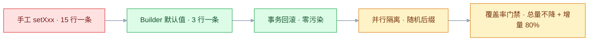
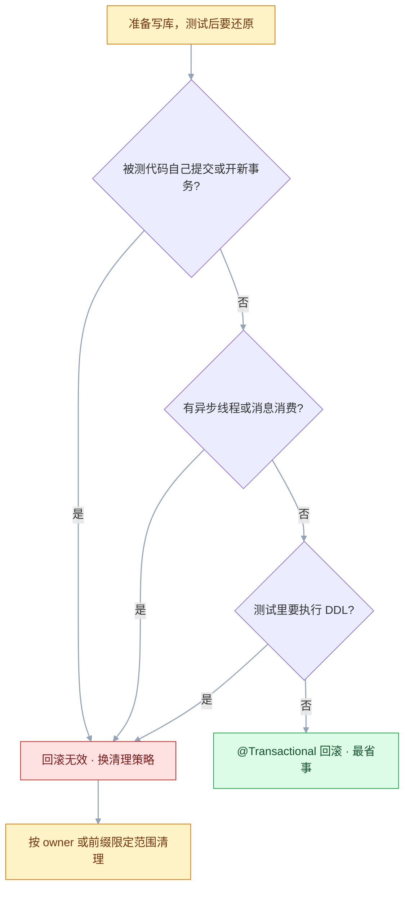

# 测试数据与覆盖率

## 一、工程案例：给 Spring Boot 任务系统搭数据工厂与覆盖率门禁

**场景**：一个 8 人维护的任务管理系统（Spring Boot 3 + JDK 17 + MySQL 8 + Maven 多模块），测试代码约 3100 行，其中 2700 行在手工 `setXxx` 造数据；覆盖率只在个别人的 IDE 里看过，合并请求上没有任何约束。目标是在两周内做到三件事：造一条任务从 15 行降到 3 行；测试可以并行、重复跑都稳定；合并请求上有一条覆盖率硬门禁。

**为什么必须做**：测试数据是测试代码里最大的一块技术债。造数据靠手写，加一个必填字段就要改 200 个文件；测试之间互相污染，全量跑绿、单跑挂，团队就开始不信测试；没有覆盖率门禁，覆盖率只会随着新代码加入一路下滑，直到没人再看。

**动手前确认**：本地有 Docker（Testcontainers 要用）；`mvn -v` 是 3.9+；CI 上能拿到镜像仓库权限。集成测试一律连容器里的 MySQL，不连本机开发库。

### 1.1 主线（按顺序执行）

**① 加测试依赖与 JaCoCo 插件**

```xml
<!-- pom.xml（task-service 模块，parent 用 spring-boot-starter-parent） -->
<dependency>
  <groupId>org.springframework.boot</groupId>
  <artifactId>spring-boot-starter-test</artifactId>
  <scope>test</scope>
</dependency>
<dependency>
  <groupId>org.springframework.boot</groupId>
  <artifactId>spring-boot-testcontainers</artifactId>   <!-- @ServiceConnection 靠它 -->
  <scope>test</scope>
</dependency>
<dependency>
  <groupId>net.datafaker</groupId>
  <artifactId>datafaker</artifactId>
  <version>2.4.2</version>          <!-- 以官方当前稳定版为准 -->
  <scope>test</scope>
</dependency>
<dependency>
  <groupId>org.testcontainers</groupId>
  <artifactId>junit-jupiter</artifactId>
  <scope>test</scope>              <!-- @Testcontainers / @Container 注解 -->
</dependency>
<dependency>
  <groupId>org.testcontainers</groupId>
  <artifactId>mysql</artifactId>
  <scope>test</scope>              <!-- 版本由 spring-boot-dependencies 管理 -->
</dependency>

<plugin>
  <groupId>org.jacoco</groupId>
  <artifactId>jacoco-maven-plugin</artifactId>
  <version>0.8.12</version>        <!-- 以官方当前稳定版为准 -->
  <configuration>
    <excludes>                     <!-- 匹配 class 相对路径，不带 .class 后缀（见 2.6） -->
      <exclude>**/dto/**</exclude>
      <exclude>**/config/**</exclude>
      <exclude>**/*Application</exclude>
    </excludes>
  </configuration>
  <executions>
    <execution><id>prepare-agent</id><goals><goal>prepare-agent</goal></goals></execution>
    <execution>
      <id>report</id><phase>test</phase><goals><goal>report</goal></goals>
      <configuration><formats>HTML,XML</formats></configuration>   <!-- XML 供合并检查工具读 -->
    </execution>
  </executions>
</plugin>
```

**② 写一个 Builder，默认值只维护一处**

```java
// src/test/java/com/example/task/support/UserBuilder.java
public class UserBuilder {
    private String username = "test_user";
    // 明文 "Passw0rd!" 的 BCrypt 值；随手编的假串会让 matches() 恒为 false
    private String password = "$2a$10$xY1DckjNV89jeVUW0BJ14eDBQ3np7DNl4qo6idjT2H2bpF.KYJrEy";
    private String email = "test@example.com";
    private String phone = "13800138000";
    private Integer status = 1;
    private String role = "USER";

    public static UserBuilder aUser() { return new UserBuilder(); }
    public UserBuilder withUsername(String v) { this.username = v; return this; }
    public UserBuilder withStatus(Integer v)  { this.status = v;   return this; }
    public UserBuilder withRole(String v)     { this.role = v;     return this; }

    public User build() {
        User u = new User();
        u.setUsername(username); u.setPassword(password); u.setEmail(email);
        u.setPhone(phone); u.setStatus(status); u.setRole(role);
        return u;
    }
}
```

```java
// src/test/java/com/example/task/support/Users.java
// 一组语义化预设，测试里读起来像业务语言
public final class Users {
    private static final AtomicLong seq = new AtomicLong();

    public static User normal()   { return a("normal").build(); }
    public static User admin()    { return a("admin").withRole("ADMIN").build(); }
    public static User disabled() { return a("disabled").withStatus(0).build(); }

    private static UserBuilder a(String prefix) {
        return UserBuilder.aUser().withUsername(prefix + "_" + seq.incrementAndGet());
    }
}
```

> 预设内部也带自增后缀：多个 worker 共用同一个测试库时，`Users.normal()` 被两次调用就会撞唯一键（原因见 2.2）。

```java
// src/test/java/com/example/task/support/TaskBuilder.java
public class TaskBuilder {
    private String title = "测试任务";
    private String status = "TODO";
    private LocalDate dueDate = LocalDate.now().plusDays(7);
    private User owner;

    public static TaskBuilder aTask() { return new TaskBuilder(); }
    public TaskBuilder withTitle(String v)      { this.title = v;   return this; }
    public TaskBuilder withStatus(String v)     { this.status = v;  return this; }
    public TaskBuilder withDueDate(LocalDate v) { this.dueDate = v; return this; }
    public TaskBuilder withOwner(User v)        { this.owner = v;   return this; }

    public Task build() {
        Task t = new Task();
        t.setTitle(title); t.setStatus(status); t.setDueDate(dueDate); t.setOwner(owner);
        return t;
    }
}
```

**③ 基类固定「一个测试一个事务，结束回滚」**

```java
// src/test/java/com/example/task/support/BaseIntegrationTest.java
@SpringBootTest
@Transactional                       // 每个测试方法结束后自动回滚
@Testcontainers
public abstract class BaseIntegrationTest {
    @Container
    @ServiceConnection               // 需 spring-boot-testcontainers，3.1+ 自动配数据源
    static MySQLContainer<?> mysql = new MySQLContainer<>("mysql:8.0")
            .withDatabaseName("task_test");

    @Autowired protected UserRepository userRepository;
    @Autowired protected TaskRepository taskRepository;
}
```

回滚只对「同一线程、同一事务、没有提前提交」的写入有效，边界见 3.5；异步链路和 `REQUIRES_NEW` 会绕过它。

**④ 改写一条真实测试：15 行变 3 行**

```java
// src/test/java/com/example/task/service/TaskServiceTest.java
// 改造前：字段全手写，User 加一个必填字段就编译不过
User user = new User();
user.setUsername("alice"); user.setPassword("hashed");
user.setEmail("alice@example.com");   // ……还有 phone/status/role 四行
userRepository.save(user);

// 改造后：只写这条测试关心的字段
User owner = userRepository.save(UserBuilder.aUser().withUsername("alice").build());
Task task = taskRepository.save(TaskBuilder.aTask().withOwner(owner).withStatus("TODO").build());
assertThat(taskService.delete(task.getId(), owner)).isTrue();
```

**⑤ 跑一次，确认覆盖率和报告都在**

```bash
mvn -B clean test jacoco:report
# 示例输出（条数随项目）：
# [INFO] Tests run: 312, Failures: 0, Errors: 0, Skipped: 2
# [INFO] BUILD SUCCESS
```

**⑥ 打开门禁，先松后紧**

```xml
<execution>
  <id>check</id><phase>verify</phase><goals><goal>check</goal></goals>
  <configuration>
    <rules>
      <rule><element>BUNDLE</element><limits>
        <limit><counter>LINE</counter><value>COVEREDRATIO</value><minimum>0.60</minimum></limit>
        <limit><counter>BRANCH</counter><value>COVEREDRATIO</value><minimum>0.50</minimum></limit>
      </limits></rule>
    </rules>
  </configuration>
</execution>
```

```bash
mvn -B verify
# 不达标时：
# [ERROR] Rule violated for bundle task-service: lines covered ratio is 0.58,
#         but expected minimum is 0.60
```

> 规则写在 `execution` 里，只能由 `mvn verify` 触发。直接敲 `mvn jacoco:check` 读到的是插件级配置，规则为空时它什么都不检查，看着照样 BUILD SUCCESS——这也是验收第 7 项容易假绿的原因。

多模块时这段放在各模块自己的 pom 里，数字按下面这张表填；只在一处配 `BUNDLE`，会把 `user-service` 也按 60% 卡住。

门禁阈值不是拍脑袋定的，先看现状再定：

| 模块 | 改造前行覆盖 | 首版门槛 | 定这个数的理由 |
|---|---|---|---|
| `task-service` | 58% | 行 60% / 分支 50% | 核心业务，只许升不许降 |
| `user-service` | 41% | 行 40% / 分支 35% | 历史包袱重，先锁住不退化 |
| `common-utils` | 72% | 行 70% / 分支 65% | 被全项目依赖，值得高要求 |
| `task-api`（Controller/DTO） | 23% | 不设独立门槛 | 纯转发与数据载体，只排除 `dto/` |

存量代码用「总覆盖率不下降」，新代码用「增量覆盖率 ≥ 80%」，两条一起才拦得住恶化。增量那条靠合并检查工具，最小配置如下（`patch` 检查要在仓库设置里设为必需）：

```yaml
# codecov.yml，放仓库根目录
coverage:
  status:
    project:
      default: { target: auto, threshold: 1% }
    patch:
      default: { target: 80% }
```

CI 里 `mvn -B verify` 之后上传 `target/site/jacoco/jacoco.xml`；JaCoCo 的 `report` 默认只出 HTML，所以要像 ① 那样显式写 `formats`。

### 1.2 验收（9 项全过才算交付）

| # | 检查项 | 命令或检查 | 通过标准 |
|---|---|---|---|
| 1 | 造数据不再手写字段 | `grep -rn "new User()" src/test/java \| grep -v UserBuilder \| wc -l` | 结果为 0（Builder 自己那处除外） |
| 2 | 字段新增不改测试 | 给 `User` 加一个 `nullable=false` 字段，只改 `UserBuilder` 一处默认值，跑 `mvn test` | 全绿，测试类零改动 |
| 3 | 单跑与全量一致 | 先 `mvn test`，再 `mvn test -Dtest=TaskServiceTest` | 两次都绿，顺序无关 |
| 4 | 并行稳定 | `mvn test -DforkCount=4` | 连续 3 次全绿，无唯一键冲突 |
| 5 | 数据不落库 | 新增 `RollbackIT`：测试 A 带 `@Transactional` 写 1 条不提交，测试 B 不加事务查 `count()` | B 查到 0 条 |
| 6 | 覆盖率报告生成 | `ls target/site/jacoco/index.html` | 文件存在且能打开 |
| 7 | 门禁真的会红 | 临时把门槛改成 `0.99` 再跑 `mvn -B verify` | 构建失败，报 `Rule violated` |
| 8 | 排除项生效 | 报告里搜 `TaskApplication`、`dto/` | 不出现，或不计入统计 |
| 9 | 增量门槛生效 | 提一个只加代码不加测试的 PR | patch 检查为红，无法合并 |

> **第 7 项必须做**。门禁最常见的故障不是「太严」，而是配置没生效——`check` 没绑到 `verify`、规则写在 execution 里却用 CLI 直接调 goal、执行被跳过，构建永远是绿的。
> **第 5 项用事务外的连接查**，不要看日志里的 `Rollback` 字样就放心；测试事务内的查询本来就看得到未提交的写入，查了等于没查。
> **第 4 项会起 4 个 JVM**，每个各带一个 MySQL 容器，CI 机器内存至少预留 4 GB。

### 1.3 复制到其他模块

三个模块照抄时，只有三处要改：容器镜像 tag、`BaseIntegrationTest` 的包名、门槛数字。下面四件事不能照抄：

| 约束 | 处理 |
|---|---|
| 每个模块的库名不同 | 容器用 `withDatabaseName`，别共用同一个 schema |
| 有的模块用 PostgreSQL | 换 `PostgreSQLContainer`，SQL 方言相关的断言要重写 |
| 老模块测试互相污染 | 先加 `@Transactional` 止血，再逐个拆掉静态共享状态 |
| 模块间有数据依赖 | 测试内自己造，不读别的模块留下的数据 |

覆盖率爬坡按季度排：首季度只要求「不下降」，第二季度新代码 60%，第三季度新代码 80%。一次把总覆盖率从 41% 提到 80%，唯一的结果是全组停下来补测试，业务需求全部延期。



---

## 二、高频问答：会卡住你的地方，也是面试最常问的

### 2.1 全量跑绿，单独跑这个类却挂

**现场**

先单跑这个类，再倒序跑一次。

```java
// 症状：断言"列表有 3 条"，其实依赖上一个测试插的 2 条
assertThat(taskService.listByOwner(alice.getId())).hasSize(3);

// 修法：测试自己造齐前提，断言只看自己造的数据
TaskFactory.createBatch(3, alice);
assertThat(taskService.listByOwner(alice.getId())).hasSize(3);
```

**要点**

- 这是顺序依赖，不是框架 bug：前一个测试留下的数据被当前测试当成了前提。
- 全量绿只说明这个执行顺序下能过，换顺序、换并行度就未必，别把全量绿当成测试健康的证据。
- 修法是测试自己造齐前提，断言只看自己造的那批数据。

**追问**

- 怎么用一条命令确认是顺序依赖？→ 用 `-Dtest=类名#方法名` 单跑，再用 `-Dsurefire.runOrder=reversealphabetical` 倒序跑，两次结果不一致即可确认。
- 为什么倒序跑能暴露依赖？→ 依赖的方向反了，靠别人留下的数据才会挂。
- 单跑挂了就一定是顺序依赖吗？→ 不一定，也可能是测试自己漏造了前提，两者都表现为「单独跑挂」。

### 2.2 加了 `-n 4` 之后大量唯一键冲突

**现场**

看报错里的键值是不是同一个固定字符串，再全局搜一遍这个值。

```python
# 固定值 → 并行必冲突
UserFactory(username="test_user")

# 每次调用生成新值；worker 前缀只用于排障
worker = os.environ.get("PYTEST_XDIST_WORKER", "master")
UserFactory(username=f"test_user_{worker}_{uuid.uuid4().hex[:8]}")
```

> 给 fixture 加 session 级后缀只能区分 worker，同一个 worker 里跑第二条仍会撞；唯一值必须按「每次造数据」生成。

**要点**

- 是数据没隔离，不是连接池不够：多个 worker 都在插 `username='test_user'`。
- 连接池耗尽报的是超时或 `too many connections`，唯一键冲突报的是 `Duplicate entry`，两者不能混。
- 唯一值必须按「每次造数据」生成，session 级后缀只够区分 worker。

**追问**

- 怎么快速确认不是容量问题？→ 并行度降到 1，冲突消失即可确认是数据隔离问题。
- 为什么固定值在单线程下没事？→ 单线程里重复值不会同时存在，冲突被清理或回滚盖住了。
- 每个 worker 一个 schema 能解决吗？→ 能，代价是建库和清理变慢。

### 2.3 `@Transactional` 测试里读不到异步线程写入的数据

**现场**

把异步改同步调一次，若能读到，就是事务可见性问题。

```java
// ✗ 测试事务里的插入对别的连接不可见
taskService.createAsync(task);
await().atMost(5, SECONDS).until(() -> taskRepository.count() == 1);   // 永远等不到

// ✓ 异步链路单独测：测试方法不加 @Transactional，或让被测方法开新事务
@Transactional(propagation = Propagation.REQUIRES_NEW)
public void createInNewTx(Task task) { ... }
```

> `REQUIRES_NEW` 必须经 Spring 代理调用；在同一个类里自调用不会开新事务，测出来还是看不见。

**要点**

- 测试事务尚未提交，异步线程用的是另一个连接，读不到未提交的数据。
- `sleep` 只会让测试更慢，不会让未提交的数据变可见。
- 异步链路要么测试方法不加 `@Transactional`，要么让被测方法开新事务；新事务必须经 Spring 代理调用。

**追问**

- 同库同表为什么还是读不到？→ 隔离级别下未提交的写入对其他事务不可见。
- 怎么证明是可见性问题？→ 异步线程打印事务 id 与连接 id，和测试线程对比，不同连接加未提交就是根因。
- 改同步测完就够了吗？→ 不够，异步的时序问题还得靠轮询断言兜住。

### 2.4 覆盖率一直是 0%，报告里全是红条

**现场**

看 JVM 启动参数里有没有 `-javaagent`，再看 `target/jacoco.exec` 是否存在、大小是否大于 0。

```xml
<!-- ✗ 直接写死 argLine，覆盖插件注入的值 -->
<argLine>-Xmx1g</argLine>

<!-- ✓ 保留插件注入的部分 -->
<argLine>@{argLine} -Xmx1g</argLine>
```

**要点**

- 0% 几乎总是「agent 没挂上」，不是插件版本不兼容。
- `prepare-agent` 往 `argLine` 写参数，surefire 自己配了 `<argLine>` 就会把它覆盖掉。
- 保留注入值用 `@{argLine}` 再拼自己的参数，用 `mvn help:effective-pom` 看最终 `argLine`。

**追问**

- 为什么 IDE 里覆盖率正常、命令行是 0%？→ IDE 自己挂了 agent，两套口径。
- `jacoco.exec` 存在但报告为 0%？→ report 阶段读错了 exec 路径。
- 多模块的 exec 怎么合？→ `jacoco:merge` 汇总各模块。

### 2.5 覆盖率 85%，把方法改成 `return null` 测试照样绿

**现场**

手动改一行返回值重跑测试；或用 PIT 跑一次变异测试。

```java
// 覆盖 100%，断言 0 条
@Test void testCalculate() { new DiscountService().calculate(null, 0); }

// 有断言才有价值
@Test void 普通用户不打折() {
    assertThat(service.calculate(100, UserType.NORMAL)).isEqualByComparingTo(new BigDecimal("100.00"));
}
```

**要点**

- 测试只调用、不断言：行被执行了所以计入覆盖，结果对不对没人检查。
- 覆盖率度量代码被触达的范围，不是断言的质量，「执行过」不等于「验证过」。
- 变异测试能给出断言强度的数字：pom 里配 `pitest-maven`、`targetClasses` 指向被测包，跑 `mutationCoverage`。

**追问**

- mutation score 远低于行覆盖率说明什么？→ 断言太弱，变异没被杀死。
- 变异测试能进每次 PR 吗？→ 太慢，通常是单测的 5~20 倍，只对核心模块按周跑。
- 分支覆盖 100% 能保证质量吗？→ 不能，只保证分支走到，不保证断言有效。

### 2.6 排除了 DTO，报告里还在

**现场**

报告里点进那个类，看页面顶部显示的类路径，照着它写 pattern；或在 `target/site/jacoco/jacoco.csv` 里 grep 类名。

```xml
<excludes>
  <exclude>**/dto/**</exclude>
  <exclude>**/entity/**</exclude>
  <exclude>**/config/**</exclude>
  <exclude>**/*Application</exclude>
  <exclude>**/*DTO</exclude>
</excludes>
```

> 写成 `**/*Application.class` 多半不生效：匹配对象是类名，没有 `.class`。测试源码目录里的 `*Builder` 本来就不在 `target/classes`，无需排除。

**要点**

- exclude 匹配的是 class 的相对路径（如 `com/example/dto/`），不是源码目录，也不带 `.class` 后缀。
- 它作用在字节码上，Lombok 生成的代码、内部类、lambda 都会被单独计算。
- 以为按源码目录过滤，是这条配置最常见的错法。

**追问**

- 为什么按源码包名写不生效？→ 匹配对象是字节码里的类名。
- 测试源码里的 `*Builder` 要排除吗？→ 不在 `target/classes`，不用排。
- Lombok 生成的代码怎么处理？→ 开 `lombok.addLombokGeneratedAnnotation`，让 JaCoCo 忽略。

### 2.7 门禁一开，全组 PR 全红

**现场**

看失败信息里的分子分母，对比 base 分支的同一指标；再拿一个只加 10 行代码的 PR 试跑。

```yaml
# codecov.yml：总覆盖率只要求"不下降"，新代码单独要求
coverage:
  status:
    project:
      default: { target: auto, threshold: 1% }
    patch:
      default: { target: 80% }
```

**要点**

- 错在用「全项目总覆盖率」当门槛，老代码基数大，任何人改动都会被历史包袱拖死。
- 降门槛会让门禁彻底失效，正确做法是换口径。
- 存量看「总覆盖率不下降」，新代码看「增量 ≥ 80%」，两条一起才拦得住恶化。

**追问**

- 为什么只加 10 行也会被拦？→ 分母是存量代码，分子没涨够。
- 总量为什么留 1% 浮动？→ 统计噪声，避免误伤。
- 删代码导致 patch 覆盖率变红怎么办？→ 标 neutral 或跳过，否则会出现「删代码导致门禁红」。

### 2.8 Faker 让测试偶发失败

**现场**

固定种子连跑 20 次（Datafaker 用 `new Faker(Locale.CHINA, new Random(42))`），仍失败就不是随机性；顺带统计失败率。

```java
// 参与断言的字段固定；只影响展示的字段随机
TaskBuilder.aTask()
    .withTitle("分页测试_" + i)                        // 断言用
    .withDescription(faker.lorem().sentence(6))        // 不用断言
    .build();
```

**要点**

- 随机值参与了断言，或者随机到了业务不允许的边界（超长、特殊字符）。
- 随机只应出现在不参与断言的字段上，否则测试从确定性资产变成概率事件。
- 能复现的失败不是 flaky，是断言写错了。

**追问**

- 固定种子就够了吗？→ 只能定位问题，长期还是要让断言字段固定。
- 为什么边界值最容易挂？→ 随机分布的尾部会撞上长度、格式校验。
- 描述类字段能随机吗？→ 能，只要不参与断言。

### 2.9 跑了一次测试，开发库的数据没了

**现场**

测试启动时打印 `spring.datasource.url`，或启动日志里搜 `HikariPool` 的 jdbcUrl。

```java
// 测试配置必须显式覆盖，且每次启动校验
@Autowired Environment env;

@BeforeEach
void guard() {
    String url = env.getProperty("spring.datasource.url");
    if (url == null || !url.contains("task_test")) {
        throw new IllegalStateException("测试库配置错误: " + url);
    }
}
```

> 别用 `@BeforeAll static` 读 `Environment`：静态字段注不进去，拿到 null 反而跳过校验。

**要点**

- 测试配置没生效，连到了 `application.yml` 里的默认库，清理逻辑 `DELETE FROM t_task` 直接执行。
- `application-test.yml` 没被加载、环境变量优先、IDE 运行配置覆盖，都会让测试连上错误的库。
- 配置必须显式覆盖且每次启动校验，不能假设 profile 一定生效。

**追问**

- 为什么 profile 配了还是连错库？→ 更高优先级的来源把它覆盖了。
- 怎么在启动时就拦住？→ `@BeforeEach` 校验 url 含测试库名。
- 已经删了怎么办？→ 只能靠备份，所以测试库必须和开发库物理隔离。

### 2.10 集成测试用 H2 全绿，上 MySQL 就报错

**现场**

把同一条 SQL 在 H2 和 MySQL 各跑一次，看执行计划与报错；再在 CI 里跑一次真实容器。

```java
// 用真实引擎，别用内存库代替
@Container @ServiceConnection
static MySQLContainer<?> mysql = new MySQLContainer<>("mysql:8.0");
```

**要点**

- H2 的兼容模式只兼容语法，不兼容语义。
- 方言、大小写、锁、`ON DUPLICATE KEY`、事务隔离、`group by` 的宽松程度、`varchar` 长度校验都不同。
- 本地用 H2 只当快速反馈，不当验收依据。

**追问**

- 为什么 `group by` 在 H2 能过、MySQL 报错？→ 宽松模式与 `ONLY_FULL_GROUP_BY` 不同。
- 用 Testcontainers 会不会太慢？→ 容器按 session 复用，比反复调试方言问题便宜。
- PostgreSQL 项目呢？→ 换 `PostgreSQLContainer`，方言相关的断言要重写。

### 2.11 Mock 掉一切，覆盖率很漂亮但什么都没测

**现场**

数一下测试里 `when(...)` 的数量；如果断言的值全是自己 stub 的，就是自证。随机改一处业务逻辑，测试仍然全绿也说明这条链路没被真正覆盖。

```java
// ✗ 断言的是自己 stub 的值
when(repo.findById(1L)).thenReturn(Optional.of(task));
assertThat(service.get(1L).getTitle()).isEqualTo("stub 的标题");

// ✓ 断言业务计算/状态变化
when(repo.findById(1L)).thenReturn(Optional.of(task));
service.complete(1L);
verify(task).setStatus("DONE");
```

**要点**

- 把被测类依赖的 Repository、Mapper 全 mock 了，等于在测 mock 的返回值，业务逻辑一行没验证。
- 隔离是为了让失败定位准确，不是为了绕开真实依赖。
- 断言要落在业务计算或状态变化上，不是自己 stub 的值。

**追问**

- 什么叫自证式测试？→ 输入和期望都来自同一个 stub。
- 哪些该 mock、哪些不该？→ 外部网络和慢依赖 mock，Repository、Mapper 该连真库。
- 单测也要连库吗？→ 不必，但集成测试必须覆盖这条链路。

### 2.12 造测试数据时顺手拷了生产手机号

**现场**

用正则扫测试资源与 fixture：手机号、身份证、邮箱、真实姓名；再检查 CI 日志有没有打印原始值。

```bash
grep -rEn "1[3-9][0-9]{9}|[0-9]{17}[0-9Xx]" src/test/resources tests/ | head
```

**要点**

- 测试数据会进日志、进 CI 制品、进开发者本机、进截图，测试库的访问控制通常远弱于生产库。
- 生产数据进测试环境本身就违反个人信息保护要求，「只是测试环境」不成立。
- 从数据来源倒查：fixture 是手写的还是从生产导的，导过就按脱敏流程重做一遍。

**追问**

- 掩码后的手机号能留吗？→ 能保留格式和号段，中间位必须换掉。
- 自由文本和附件怎么办？→ 备注里可能夹手机号要正则扫；扫描件无法可靠脱敏，正确做法是不导出。
- 密码、Token 算脱敏范畴吗？→ 不算，必须清空或重置。
---

## 三、核心知识：从零开始要建立的东西

### 3.1 测试数据的来源谱系

测试数据按「真实性」和「可控性」排成一条谱：

| 来源 | 可控性 | 真实性 | 维护成本 | 适用 |
|---|---|---|---|---|
| 硬编码 | 最高 | 最低 | 字段一改全挂 | 极少数固定场景 |
| 对象工厂 | 高 | 中 | 低 | 单元与集成测试的主力 |
| SQL 快照 | 中 | 中 | 字段变更要重导 | 复杂初始状态 |
| 生产脱敏 | 低 | 最高 | 需脱敏流程与审批 | 性能测试、全链路演练 |

选型的判断依据只有一条：**你希望这条测试的失败由代码变化解释，还是由数据变化解释**。单元测试要求后者接近零，所以用工厂；性能测试要真实分布，所以用脱敏数据。

### 3.2 对象工厂

工厂解决的是「默认值散落各处」。核心约定：**每个字段有一个合法默认值，测试只覆盖它关心的字段**。

```java
User u = UserBuilder.aUser().withStatus(0).build();
```

三条实践规则：

- 默认值必须能通过校验（非空、长度合法、外键存在），否则每个测试都要补同一批字段。
- 唯一字段用序列生成，不用固定值：`"user_" + seq.incrementAndGet()`；工厂只放在测试源码目录，不进主产物。
- 工厂里不写断言、不写业务分支；多步构造的场景交给 Object Mother（见 3.3）或走 API（见 3.7）。

### 3.3 Object Mother

Object Mother 是工厂之上的一层语义命名，把「一组常用状态」固化下来：

```java
public final class Tasks {
    public static Task todo(User owner)    { return TaskBuilder.aTask().withOwner(owner).withStatus("TODO").build(); }
    public static Task done(User owner)    { return TaskBuilder.aTask().withOwner(owner).withStatus("DONE").build(); }
    public static Task overdue(User owner) { return TaskBuilder.aTask().withOwner(owner)
                                                .withDueDate(LocalDate.now().minusDays(1)).build(); }
}
```

好处是测试名和准备代码说同一种语言：`Tasks.overdue(alice)` 比七个 `withXxx` 更容易 review。代价是预设多了会变成另一套需要维护的 API，控制在 5~10 个高频状态即可。

### 3.4 Fixture 与作用域

Fixture 是「测试前准备好、测试后清理掉」的资源。作用域决定了它被创建几次：

| 作用域 | 100 个测试的创建次数 | 速度 | 隔离性 | 典型用途 |
|---|---|---|---|---|
| function | 100 | 慢 | 最好 | 数据库会话、会被修改的数据 |
| class | 每类 1 次 | 中 | 中 | 类内共享的只读数据 |
| module | 每文件 1 次 | 快 | 较差 | 字典表、参考数据 |
| session | 1 | 最快 | 最差 | 引擎、连接池、容器 |

判断口诀：**越贵的资源作用域越大，越容易被改的数据作用域越小**；启动容器用 session，会被修改的用户对象用 function。`yield` 之后的清理在测试失败时也会执行，写法也更短；但 setup 中途抛异常时 `yield` 后面的代码不会跑到，这种场景用 `addfinalizer`——它注册即生效，两者按需选。

### 3.5 事务回滚的适用边界

事务回滚是最省事的隔离手段：测试开始开事务，结束回滚，数据库回到原样，不需要写任何 `DELETE`。

它的适用边界很明确：

| 场景 | 是否适用 | 原因 |
|---|---|---|
| 单线程、单数据源 | 适用 | 所有操作在同一事务内 |
| 被测代码开新事务（`REQUIRES_NEW`） | 不适用 | 新事务独立提交，回滚不到 |
| 异步线程、消息消费 | 不适用 | 另一条连接看不到未提交数据 |
| 需要验证提交后行为（触发器、binlog） | 不适用 | 永远走不到提交 |
| 测试里执行 DDL（建表、改表） | 不适用 | MySQL 的 DDL 会隐式提交当前事务 |
| 跨服务调用 | 不适用 | 事务不跨进程 |



不适用时的替代：测试后按范围清理（`deleteByOwnerId`）、每次重建 schema、每个 worker 独立 schema。清理一定要限定范围，`DELETE FROM t_task` 在并行下等于互相拆台。

> **面试**：常问「`@Transactional` 测试回滚在哪些场景会失效？」答：被测代码自己提交或开新事务、有异步线程或消息消费、测试里执行 DDL、跨服务调用时都回滚不到。

### 3.6 数据库隔离的三种粒度

| 粒度 | 做法 | 隔离强度 | 速度 | 适用 |
|---|---|---|---|---|
| 数据级 | 唯一后缀 + 作用域断言 | 中 | 最快 | 绝大多数项目 |
| schema 级 | 每个 worker 一个 schema | 高 | 中 | 表结构复杂、需要批量清理 |
| 数据库级 | 每个测试建库（模板克隆） | 最高 | 慢 | 迁移脚本、彻底隔离 |

数据级隔离的关键不是后缀本身，而是**断言范围**：不要断言「表里共 25 条」，要断言「我造的那批有 25 条」。前者在任何并行环境里都不成立。

```python
run_id = uuid.uuid4().hex[:6]                  # 每次运行一组独立数据
prefix = f"page_{run_id}_"
TaskFactory.create_batch(25, owner=alice, title=prefix + "任务")
page = task_service.list_tasks(owner_id=alice.id, title_prefix=prefix, page=1, size=20)
assert page.total == 25
```

### 3.7 造数据的四条路径

| 路径 | 速度 | 是否经过业务校验 | 适用 |
|---|---|---|---|
| 直接写库 / Repository | 快 | 否 | 单元、集成测试 |
| 调 API | 慢 | 是 | E2E、黑盒 |
| 导入 SQL 快照 | 中 | 否 | 复杂初始状态 |
| 克隆模板库 | 慢 | 否 | 需要完整真实结构 |

直接写库快，但可能造出业务上不可能存在的状态（比如已删除用户仍有进行中任务）；调 API 慢，但造出的数据一定合法。**集成测试用前者，E2E 用后者**，不要为了「真实」让所有测试都走 HTTP。

### 3.8 数据脱敏的四种变换

| 变换 | 保留什么 | 丢掉什么 | 适用字段 |
|---|---|---|---|
| 掩码 | 格式、长度、号段 | 中间位 | 手机号、身份证、卡号 |
| 替换 | 一致性（同一原值映射同一假值） | 真实身份 | 姓名、地址 |
| 洗牌 | 整体分布 | 行与行的对应关系 | 需要保持统计特征的数值列 |
| 伪造 | 格式合法性 | 原分布 | 不参与分析的展示字段 |

两个容易漏的点：

- **自由文本**。备注、工单描述、聊天记录里可能夹着手机号和姓名，正则扫一遍再人工抽查。
- **附件**。合同扫描件、身份证照片通常无法可靠脱敏，正确做法是不导出。

密码、Token、密钥不属于脱敏范畴，必须清空或重置——掩码后的密钥仍然是密钥格式，仍可能被撞库利用。

### 3.9 覆盖率插桩

覆盖率工具在代码执行时记录「哪一行/哪个分支被走到」。三种实现路线：

| 工具 | 机制 | 特点 |
|---|---|---|
| JaCoCo | 类加载时改字节码 | 需要 agent，报告精确到分支 |
| c8 / istanbul | 读 V8 原生覆盖率或插桩 | Node 生态，c8 无需改代码 |
| coverage.py | `sys.settrace` 逐行回调，新版本也支持 `sys.monitoring` | 纯 Python，开销较大 |

插桩和逐行回调都会带来额外开销，量级取决于插桩密度（从几个百分点到数倍不等）；c8 走 V8 原生覆盖率，开销明显更低。所以覆盖率任务不要和性能测试混在一次运行里。

### 3.10 覆盖率口径

```java
public String check(int age, boolean member) {
    if (age >= 18 && member) return "allowed";
    return "denied";
}
```

| 口径 | 含义 | 这段代码的差别 |
|---|---|---|
| 行覆盖 | 每行是否执行 | `check(20,true)` 就走满 2/3 行 |
| 分支覆盖 | 每个跳转的真假是否都走；JaCoCo 把 `&&` 拆成两个跳转 | 共 4 个分支，一组真、一组假盖不全 |
| 条件覆盖 | 复合条件里每个子条件是否都取过真假 | `&&` 短路时第二个条件可能从未求值 |
| 路径覆盖 | 所有路径组合 | 分支一多就指数爆炸 |
| MC/DC | 每个条件能独立影响结果 | 航空、金融的核心逻辑才用 |

关键反例：`check(20,true)` + `check(15,false)` 下来，3 行全执行（行覆盖 100%），但 `age>=18` 为假时 `member` 根本没求值，第二个跳转的 false 侧从未走到——按字节码计只有 3/4 个分支。要把分支盖满，得再来一条 `check(20,false)`。

**分支覆盖 100% 也不等于条件组合都验证过**：有些工具只按 `if` 的进出口算两支，上面两条就能报 100%，而「`age>=18` 且 `member=false`」这个组合从未出现。看报告前先确认工具按什么计分支，别把「分支绿了」当成「组合都测了」。

> **面试**：常问「行覆盖 100% 是不是就够了？分支覆盖和路径覆盖差在哪？」答：行覆盖只看每行是否执行，分支看每个跳转的真假，路径是组合会指数爆炸，分支满也不代表条件组合都验证过。

### 3.11 覆盖率报告阅读

报告里三种颜色对应三种动作：

| 标记 | 含义 | 动作 |
|---|---|---|
| 绿色 | 已执行 | 无需处理 |
| 黄色 | 分支只走了一部分（黄色菱形 = 该判断漏了某个方向） | **优先看**，通常是只测了成功路径 |
| 红色 | 从未执行（红色菱形 = 这个判断一次都没进） | 判断该补测试还是该排除 |

阅读顺序：先看包级总览找最低的模块，再看黄色菱形找「只走一半的 if」，最后看红色决定补测试还是加 exclude。红色不必然是问题——启动类、DTO、常量类本来就不该测。

### 3.12 增量覆盖率

总覆盖率会被存量代码稀释：一个 10 万行的老项目，新加 200 行全测到，总覆盖率可能只涨 0.2%。所以门禁要看两个数：

```text
project: target auto, threshold 1%     # 整体不许下降超过 1%
patch:   target 80%                    # 本次改动的新代码 ≥ 80%
```

增量口径的边界：删除代码、纯配置改动、只改注释时，patch 覆盖率可能无意义，需要在 CI 里跳过或标为 neutral，否则会出现「删代码导致门禁红」的荒唐结果。

> **面试**：常问「总覆盖率会被存量稀释，门禁该怎么定？」答：总量要求不下降、新代码用增量覆盖率卡 80%，两条一起才拦得住恶化。

### 3.13 变异测试

变异测试回答「测试能不能发现错误」：工具把 `>` 改成 `>=`、把 `return x` 改成 `return null`，然后跑测试。测试变红说明这个变异被杀死，仍然绿说明断言有漏洞。

| 指标 | 含义 | 参考 |
|---|---|---|
| mutation score | 被杀死的变异 / 全部变异 | 核心模块 70%+ 算健康 |
| survived | 存活的变异 | 逐个看，通常是断言缺失 |
| no coverage | 没被执行到的变异 | 对应行覆盖的盲区 |

变异测试很慢（通常是单测的 5~20 倍），只对核心模块按周跑，不要放进每次 PR 的流水线。

### 3.14 门禁的三个落点

| 落点 | 工具 | 反馈速度 | 作用 |
|---|---|---|---|
| 本地 | IDE 覆盖率插件 | 秒级 | 写代码时看到红条 |
| 构建 | `jacoco:check`、`coverage report --fail-under` | 分钟级 | 本模块不达标就失败 |
| 合并 | Codecov / SonarQube | 分钟级 | 增量覆盖率、趋势、PR 评论 |

三层缺一不可：只有本地，靠自觉；只有合并，反馈太晚；只有构建，看不到趋势。门禁生效的前提是它被配置成**必需检查**，否则红灯只是一个装饰。

### 3.15 断言强度

覆盖率统计不到断言，但测试的价值几乎全在断言上。四种常见弱断言：

```java
assertNotNull(result);                            // 只证明没返回 null
assertEquals(service.calc(1), service.calc(1));   // 同义反复
assertTrue(result.getItems().size() > 0);         // 不验证内容与数量
try { service.calc(-1); } catch (Exception ignored) { }  // 吞掉异常，等于没断言
```

强度递增的写法：断言具体值 → 断言集合内容与顺序 → 断言副作用（DB 状态、发出的消息）→ 断言异常类型与消息。一条测试至少要有一次「如果实现改错就会失败」的断言。

---

## 四、冷门知识汇总

这一节是「遇到再查」的清单：低频、概念不重、知道关键词就能上手。需要长期投入的实践（比如变异测试）放在第三节讲清取舍，不往这里塞。

| 知识点 | 为什么冷门 | 用到时的关键词 |
|---|---|---|
| 测试方法排序 | 多数项目靠随机顺序暴露问题，很少主动配置 | `@TestMethodOrder`、`MethodOrderer.Random` |
| 嵌套事务保存点 | 业务几乎不用保存点，排障时才遇到 | `PROPAGATION_NESTED`、`SAVEPOINT` |
| 序列不随回滚重置 | 回滚了数据但自增值继续涨，有人误以为数据没清干净 | `AUTO_INCREMENT`、`setval` |
| JaCoCo 离线插桩 | 只有无法挂 agent 的环境才用 | `jacoco:instrument`、`offline instrumentation` |
| 覆盖率合并 | 多模块/多测试任务各生成一份 exec 才需要 | `jacoco:merge`、`executionData` |
| 排除 Lombok 生成代码 | 不排会虚低，排错会误伤 | `lombok.addLombokGeneratedAnnotation=true` |
| JaCoCo 与 JDK 升级 | 平时不动，换 JDK 才报 agent 不兼容 | `Unsupported class file major version`、agent 版本 |
| 测试数据过期 | 字典表改版后旧快照静默失效 | 固定 `fixture_version`、启动校验 |
| 数据库时区 | 时间断言飘 8 小时才被想起 | `serverTimezone`、`connectionTimeZone` |
