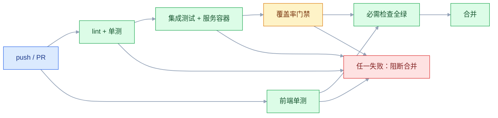
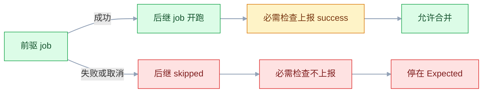

# 测试与 CI

## 一、工程案例：给一个前后端项目搭合并门禁

**场景**：一个 8 人团队维护任务管理系统，后端 Spring Boot 3（Maven + JDK 17），前端 Vue 3 + Vite。仓库没有 CI，测试靠自觉：本地全量跑 12 分钟，大家只跑自己改的那几个类；主分支每月大约有 3 次「拉下来编译不过」；数据库迁移脚本改错，要等到测试环境部署才发现。目标是把「测试没跑」变成物理上不可能：PR 必须通过 lint、单测、集成测试、覆盖率四项检查才能合并，反馈控制在 5 分钟内。

**为什么必须做**：CI 的价值不在「自动跑一遍」，而在**失败时阻止合并**。没有分支保护的流水线只是一块装饰性的绿灯，红灯亮着照样能合。另一半价值是环境一致性：本地 Asia/Shanghai、CI 默认 UTC，本地有 `node_modules`、CI 全新安装，这些差异只有让 CI 成为唯一可信执行环境才会暴露。

**动手前确认**：仓库有 admin 权限（配分支保护要用）；Actions 已启用；CI 能拉取基础镜像；数据库迁移脚本能在空库上跑通。

### 1.1 主线（按顺序执行）

**① 先写快检作业，把最便宜的检查放最前面**

```yaml
# .github/workflows/pr-check.yml
name: PR Check
on:
  pull_request:
    branches: [main]
    types: [opened, synchronize, reopened]

concurrency:                       # 同一个 PR 连推 3 次，只跑最后一次
  group: pr-${{ github.event.pull_request.number }}
  cancel-in-progress: true

env:
  TZ: Asia/Shanghai                # 不设则 runner 是 UTC，日期断言会莫名失败

jobs:
  fast-check:
    name: lint-and-unit-test
    runs-on: ubuntu-latest
    timeout-minutes: 10
    steps:
      - uses: actions/checkout@v4
      - uses: actions/setup-java@v4
        with: { java-version: '17', distribution: 'temurin', cache: 'maven' }
      - uses: actions/setup-node@v4
        with: { node-version: '20', cache: 'npm', cache-dependency-path: frontend/package-lock.json }
      - name: 后端风格检查
        run: mvn -B -q checkstyle:check
      - name: 后端单元测试
        run: mvn -B test -Dtest='!*IT' -DfailIfNoTests=false
      - name: 前端依赖与检查
        working-directory: frontend
        run: |
          npm ci
          npx vue-tsc --noEmit
          npm run lint
```

**② 集成测试用服务容器，不 mock 数据库**

先让 pom 真的产出覆盖率数据。`prepare-agent` 不绑上，`target/jacoco.exec` 根本不会生成；`jacoco:check` 没有 `rules` 时只打印一句 skip，等于没有门禁：

```xml
<!-- pom.xml -->
<plugin>
  <groupId>org.jacoco</groupId>
  <artifactId>jacoco-maven-plugin</artifactId>
  <executions>
    <execution><goals><goal>prepare-agent</goal></goals></execution>
  </executions>
  <configuration>
    <rules>
      <rule><element>BUNDLE</element><limits>
        <limit><counter>LINE</counter><value>COVERAGE</value><minimum>0.70</minimum></limit>
      </limits></rule>
    </rules>
  </configuration>
</plugin>
```

```yaml
# 接着在同一个 jobs: 下追加第二个 job
  integration-test:
    name: integration-test
    runs-on: ubuntu-latest
    timeout-minutes: 20
    needs: fast-check                  # 单测挂了就别浪费 8 分钟
    services:
      mysql:
        image: mysql:8.0
        env:
          MYSQL_ROOT_PASSWORD: test123
          MYSQL_DATABASE: task_test
        ports: ['3306:3306']
        options: >-
          --health-cmd="mysqladmin ping -h 127.0.0.1 -ptest123"
          --health-interval=10s --health-timeout=5s --health-retries=5
      redis:
        image: redis:7
        ports: ['6379:6379']
        options: --health-cmd="redis-cli ping" --health-interval=10s --health-retries=5
    env:
      DB_URL: 'jdbc:mysql://127.0.0.1:3306/task_test?useSSL=false&serverTimezone=Asia/Shanghai'
      DB_USERNAME: root
      DB_PASSWORD: test123
      REDIS_HOST: 127.0.0.1
    steps:
      - uses: actions/checkout@v4
      - uses: actions/setup-java@v4
        with: { java-version: '17', distribution: 'temurin', cache: 'maven' }
      - name: 集成测试 + 覆盖率
        run: mvn -B verify -Dtest='*IT' -DfailIfNoTests=false jacoco:report
      - name: 覆盖率门禁
        run: mvn -B jacoco:check
      - name: 在 Actions 页面展示失败用例
        if: always()                   # 失败时报告最需要看，必须 always
        uses: mikepenz/action-junit-report@v4
        with:
          report_paths: 'target/surefire-reports/TEST-*.xml'
          include_passed: false
          fail_on_failure: true
      - name: 保留报告
        if: always()
        uses: actions/upload-artifact@v4
        with: { name: test-reports, path: target/surefire-reports/, retention-days: 7 }
```

**③ 前端单测与 E2E 分开放**

```yaml
  frontend-test:
    name: frontend-test
    runs-on: ubuntu-latest
    timeout-minutes: 15
    steps:
      - uses: actions/checkout@v4
      - uses: actions/setup-node@v4
        with: { node-version: '20', cache: 'npm', cache-dependency-path: frontend/package-lock.json }
      - working-directory: frontend
        run: npm ci
      - working-directory: frontend
        run: npx vitest run --coverage --reporter=junit --outputFile=test-results/junit.xml
      - if: always()
        uses: actions/upload-artifact@v4
        with: { name: vitest-results, path: frontend/test-results/ }
```

**④ 本地跑一次，确认命令和 CI 完全一致**

```bash
mvn -B clean verify -Dtest='!*IT'      # 对应 fast-check
mvn -B verify -Dtest='*IT' -DfailIfNoTests=false jacoco:report
mvn -B jacoco:check
cd frontend && npm ci && npx vitest run --coverage
```

**⑤ 用一次真实的失败验证「门禁真的会拦」**

```bash
git switch -c demo/break-test
# 手动把 TaskServiceTest 里某个 assertEquals 的期望值改成 999
git commit -am "test: 故意让断言失败" && git push -u origin demo/break-test
gh pr create --fill
gh pr checks --watch
# 期望：
# lint-and-unit-test   fail   1m12s
# integration-test     skipped
# frontend-test        pass   1m40s
```

**⑥ 开分支保护，把检查变成必需项**

```bash
gh api -X PUT repos/<owner>/<repo>/branches/main/protection --input - <<'JSON'
{"required_status_checks": {"strict": true,
   "contexts": ["lint-and-unit-test", "integration-test", "frontend-test"]},
 "enforce_admins": true, "restrictions": null,
 "required_pull_request_reviews": {"required_approving_review_count": 1}}
JSON
```

界面路径：Settings → Branches → Add branch protection rule，勾选 `Require a pull request before merging`、`Require status checks to pass before merging`、`Require branches to be up to date`，并关闭 force push。

覆盖率是 `integration-test` 里的一个步骤，不是独立 job，所以 required contexts 只列三个；想让覆盖率单独成为必需项，得把它拆成 `coverage` job。

**⑦ 看一次完整耗时，决定要不要分片**

```bash
gh run list --workflow=pr-check.yml --limit 5
gh run view <run-id> --json jobs \
  --jq '.jobs[] | [.name, .conclusion, ((.completedAt|fromdate) - (.startedAt|fromdate))] | @tsv'
```

| 环节 | 无缓存 | 有缓存 | 占缓存后墙钟 |
|---|---|---|---|
| 下载 Maven 依赖 | 3m48s | 8s | 3% |
| 跑单测 | 1m10s | 1m10s | 23% |
| 跑集成测试 | 3m40s | 3m40s | 74% |
| **合计** | **约 9m** | **约 5m** | |

缓存把「等待下载」压掉之后，8m38s 的流水线落进 5 分钟以内，剩下的时间几乎全在集成测试上，这时候分片才有意义。

### 1.2 验收（10 项全过才算交付）

| # | 检查项 | 命令或检查 | 通过标准 |
|---|---|---|---|
| 1 | PR 自动触发 | 推一个空提交到 PR 分支 | 30 秒内出现新的 run |
| 2 | 失败会阻断合并 | 故意改坏一个断言后看 PR 页面 | 合并按钮禁用，提示 required status |
| 3 | 检查项名称一致 | `gh pr checks` | 三项名字与保护规则里的 context 完全相同 |
| 4 | 缓存命中 | 看 setup-java 步骤日志 | 出现 `Cache restored from key:`，非 `Cache not found` |
| 5 | 服务容器可用 | 集成测试日志开头 | MySQL ready，且测试连的是 127.0.0.1:3306 |
| 6 | 时区固定 | 失败日志时间戳 / `date` 步骤 | 输出 `+0800`（CST），日期断言不随 runner 变化 |
| 7 | 报告可见 | Actions Summary 页面 | 列出失败用例名、期望值、实际值、行号 |
| 8 | 覆盖率非零且能拦 | 先看报告数字，再把 `minimum` 临时改成 `1.0` | 行覆盖率 > 0，且 `jacoco:check` 必然失败 |
| 9 | 旧运行被取消 | 连续推两次，看 Actions 列表 | 第一次显示 cancelled |
| 10 | 管理员也绕不过 | 用 admin 账号直接 push main | 被拒绝（`enforce_admins` 生效） |

> **第 3 项最容易翻车**：`name:` 改了、job 被 `if` 跳过、矩阵 job 的名字带变量，都会让 required check 永远等不到。**第 10 项**要真的试一次，很多团队留着管理员绕过，出事时第一个绕过的就是管理员。

### 1.3 复制到其他仓库

多个仓库共用一套模板时，只有三处不同：语言工具链、服务容器、覆盖率命令。剩下的是纪律：

| 约束 | 处理 |
|---|---|
| 仓库语言不同 | 用 reusable workflow（`workflow_call`）抽公共部分，各仓库只传参数 |
| 私有依赖源 | 缓存 key 里加入 `settings.xml` 的 hash，否则换源会命中旧依赖 |
| PR 来自 fork | Secrets 不注入，集成测试要跳过或改用无需凭据的容器 |
| 单仓多模块 | 先 `-pl` 只跑受影响模块，合并前再跑全量 |
| 流水线超过 10 分钟 | 先加缓存，再分片，最后才优化慢测试 |



---

## 二、高频问答：会卡住你的地方，也是面试最常问的

### 2.1 本地全绿，CI 上日期断言失败

**现场**

看 CI 日志时间戳是不是以 `Z` 结尾；本地用 `TZ=UTC` 跑同一条用例复现。

```bash
TZ=UTC mvn -B test -Dtest='TaskServiceIT#按日期分组'
# expected: 3 but was: 2  → 复现成功
```

```yaml
env: { TZ: Asia/Shanghai }        # 防御性配置，双保险
```

**要点**

- runner 默认 UTC，本地是 Asia/Shanghai，`LocalDate.now()` 在两地差 8 小时，跨天断言必挂。
- 重跑能过只是因为这次恰好没跨天，问题仍在。
- 根治办法是测试注入固定 `Clock`，业务代码不读 `systemDefault()`。

**追问**

- 为什么 CI 上是 UTC？→ runner 默认不设时区。
- 只在 workflow 里设 `TZ` 够吗？→ 是双保险，代码侧仍要注入 `Clock`。
- 用 `TZ=America/New_York` 再跑一次有什么用？→ 两次结果不同就说明测试依赖时区。

### 2.2 配了缓存，日志里永远是 `not found`

**现场**

看日志里的 `Cache Key`，两次运行是否相同；再连续推两次不改依赖的提交。

```yaml
# ✗ 每次都不同
key: ${{ runner.os }}-maven-${{ github.run_id }}

# ✓ 依赖变了才失效
key: ${{ runner.os }}-maven-${{ hashFiles('**/pom.xml') }}
restore-keys: ${{ runner.os }}-maven-
```

**要点**

- key 里用了 `run_id` / `run_number`，每次都是新 key，永远不可能命中。
- 缓存不命中不是服务问题，是 key 设计问题。
- key 必须由会影响依赖内容的文件决定，加 `restore-keys` 可以做部分命中。

**追问**

- 只命中 `restore-keys` 算成功吗？→ 算部分成功，精确 key 没中时退回上一版本补增量。
- 为什么不缓存 `target/`？→ 增量编译的幽灵问题，类文件是旧的。
- 换私有依赖源要注意什么？→ cache key 里加入 `settings.xml` 的 hash。

### 2.3 服务容器显示 healthy，测试却连不上数据库

**现场**

日志里搜实际 jdbcUrl；在 job 里加一步 `nc -vz 127.0.0.1 3306`，连不上时打印 `/etc/hosts` 和解析结果。

```yaml
# GitHub Actions
DB_URL: jdbc:mysql://127.0.0.1:3306/task_test

# GitLab CI（服务名即主机名）
services:
  - { name: mysql:8.0, alias: mysql }
variables:
  DB_URL: jdbc:mysql://mysql:3306/task_test
```

**要点**

- 连接地址写错：GitHub Actions 的 `services` 通过端口映射到 runner 的 `127.0.0.1`；GitLab CI 的 `services` 在另一个容器里，必须用 alias 当主机名。
- `healthy` 只说明容器里的进程起来了，不说明你的进程能找到它。
- 别用加长 `sleep` 解决，先做一次连接探测再跑测试。

**追问**

- 为什么 GitLab 里写 `127.0.0.1` 连不上？→ 服务在另一个容器，localhost 指的是自己。
- 服务容器没配健康检查会怎样？→ 只保证容器启动，测试会在前几秒随机失败。
- 端口该写容器内还是映射后？→ 走 host 侧就用映射后的端口。

### 2.4 覆盖率在 CI 里是 0%，本地正常

**现场**

`mvn -X test | grep javaagent`，或直接 `ls -l target/jacoco.exec` 看文件是否存在。

```xml
<argLine>@{argLine} -Xmx1g -Dfile.encoding=UTF-8</argLine>
```

**要点**

- surefire 的 `argLine` 被自定义参数覆盖，`-javaagent` 没传进去；本地正常往往是用了 IDE 自带的覆盖率。
- exec 不存在是 agent 没挂上；存在但报告为 0%，是 report 阶段读错了 exec 路径。
- 把 `@{argLine}` 前置拼接，才能既保留插桩参数又加自己的 JVM 参数。

**追问**

- 为什么本地命令行也是 0%、IDE 却正常？→ 两套执行入口，IDE 自己挂了 agent。
- CI 上该先看哪一步？→ 先看 agent 有没有加载，再看 report。
- 多模块 exec 怎么汇总？→ `jacoco:merge`。

### 2.5 测试明明失败了，Summary 页面什么都没有

**现场**

看失败的 run 里有没有「展示测试结果」这一步；没有就是被跳过。

```yaml
- uses: mikepenz/action-junit-report@v4
  if: always()                     # 关键
  with: { report_paths: 'target/surefire-reports/TEST-*.xml' }
```

**要点**

- 展示步骤没加 `if: always()`，前一步失败后它被跳过。
- 默认的步骤串联是「前一步失败，后面全跳过」，而失败时恰恰最需要报告。
- 另一种原因是 `report_paths` 与实际输出目录不一致。

**追问**

- 为什么 artifact 上传也要 `always()`？→ 失败时报告最需要看，跳过了就没证据。
- XML 里 `<failure>` 和 `<error>` 有区别吗？→ 断言失败 vs 意外异常，排查方向不同。
- 分片之后报告怎么合？→ `merge-multiple: true` 加一个汇总 job。

### 2.6 PR 一直显示 `Expected — Waiting for status to be reported`

**现场**

`gh pr checks` 列出实际检查名，和仓库保护规则里的 contexts 逐字比对。

```bash
gh api repos/<owner>/<repo>/branches/main/protection \
  --jq '.required_status_checks.contexts'
gh pr checks 42
```

**要点**

- 保护规则里的 check 名字与实际 job 名不一致；或该 job 被 `paths-ignore` / `if` 跳过，永远不会上报。
- 矩阵 job 的名字会带 `(1, 2, 3, 4)` 后缀，配 protection 时要写完整，或者单独加一个汇总 job。
- 不出现不等于失败：`skipped` 和 `cancelled` 都不算通过。

**追问**

- 为什么改个 `name:` 就卡住？→ required context 是按名字匹配的。
- 矩阵 job 怎么处理？→ 写完整后缀，或用一个汇总 job 统一上报。
- 怎么核实？→ 把 required contexts 抄下来，与 `gh pr checks` 的输出逐字比对。

### 2.7 分片之后总有一片报「没有测试可跑」

**现场**

看失败片的 `classes=` 输出是否为空，并打印每片的类名数量。

```bash
mvn -B verify -Dtest="$CLASSES" -DfailIfNoTests=false
```

**要点**

- 某些片确实分不到类（类数少于片数），而 Maven 在 `-Dtest=` 为空或没匹配时默认失败。
- 分片数不应超过测试类数，且必须允许空片通过。
- 长期为 0 才是分片函数的 bug。

**追问**

- 为什么 4 片的最后一片总是空？→ 类数不够分，不是脚本算错。
- 按什么分片更稳？→ 按类名哈希稳定，按历史耗时更均匀但会漂。
- 分片能省钱吗？→ 不省，它买的是墙钟时间。

### 2.8 不稳定测试靠重试压住，团队逐渐不看红灯

**现场**

同一 commit 连跑 20 次统计失败率，再看 JUnit XML 里同一用例跨 run 的失败分布。

```bash
for i in $(seq 1 20); do
  mvn -B test -Dtest=TaskServiceTest > /tmp/r-$i.log 2>&1
  grep -q "BUILD SUCCESS" /tmp/r-$i.log && echo "PASS" || echo "FAIL"
done
```

**要点**

- 重试只掩盖症状，核心链路的测试重试通过，意味着它在生产里有 10%~20% 概率失败。
- 失败率 > 20% 立刻修；5%~20% 本周修；< 5% 可以隔离但必须带 issue 编号。
- 核心业务测试不允许重试。

**追问**

- 隔离和删除的区别？→ 隔离是摘出门禁但仍继续收集数据。
- 怎么标记隔离？→ JUnit 5 用 `@Tag("flaky")` 加 `-DexcludedGroups=flaky`。
- 为什么还要留一个 `continue-on-error` 的作业？→ 否则永远不知道它有没有变好。

### 2.9 `npm ci` 在 CI 上失败，本地 `npm install` 正常

**现场**

看报错是否含 `can only install packages when your package.json and package-lock.json are in sync`；再在干净目录跑一次 `npm ci`。

```bash
npm ci                       # CI 用这个：严格按 lock，先删 node_modules
npm install                  # 只在需要更新依赖时用，并提交 lock
```

**要点**

- `package-lock.json` 与 `package.json` 不一致，有人本地 `install` 后没提交 lock。
- `npm ci` 的严格是特性不是缺陷，它会直接报错而不是修复。
- 本地能过说明 lock 是同步的，失败就按提示重新生成并提交。

**追问**

- CI 为什么不用 `npm install`？→ 它会改 lock，构建结果不可复现。
- 缓存 `node_modules` 行不行？→ 不行，换 Node 版本或换平台会拿到 ABI 不匹配的原生模块。
- `setup-node` 的 `cache: 'npm'` 缓存的是什么？→ 包缓存目录，不是 `node_modules`。

### 2.10 构建镜像时 `Cannot connect to the Docker daemon`

**现场**

看报错里的 socket 路径，`env | grep DOCKER`，并在 job 里跑 `docker info` 看有没有 Server 段。

```yaml
# GitLab CI：dind 是另一个容器，必须显式指过去
variables:
  DOCKER_HOST: tcp://docker:2376
  DOCKER_TLS_CERTDIR: "/certs"
services: [docker:26-dind]
```

GitHub Actions 的 `services` 不按服务名解析，要映射端口后走 `127.0.0.1`：`services: { docker: { image: 'docker:26-dind', ports: ['2375:2375'] } }`，配 `DOCKER_HOST: tcp://127.0.0.1:2375` 和 `DOCKER_TLS_CERTDIR: ''`。

**要点**

- 用了 dind 服务却没设 `DOCKER_HOST` 和 `DOCKER_TLS_CERTDIR`，CLI 仍在找本机 socket。
- GitLab CI 的 dind 是另一个容器，必须显式指过去；GitHub Actions 要走端口映射到 `127.0.0.1`。
- 服务起来不等于接上了，`docker info` 能看到 Server 段才算连通。

**追问**

- `docker info` 里看什么？→ 有 Server 段，说明客户端连到了 daemon。
- `DOCKER_TLS_CERTDIR` 为什么必须设？→ dind 用证书端口，不设会走明文连不上。
- 托管 runner 上能直接用宿主 docker 吗？→ 不能，要用 dind 或自带 docker 的 runner。

### 2.11 fork 来的 PR 里集成测试全挂

**现场**

日志里出现空密码或 `unauthorized`，同时 `github.event.pull_request.head.repo.fork == true`。

```yaml
- name: 集成测试（fork PR 跳过）
  if: github.event.pull_request.head.repo.fork == false
  run: mvn -B verify -Dtest='*IT'
```

**要点**

- fork PR 不注入 Secrets（这是安全设计），数据库密码、私有镜像凭据都是空串。
- 这是凭据缺失，不是贡献者的代码有问题。
- 集成测试要 `if` 跳过，或改用无需凭据的容器。

**追问**

- 为什么 fork PR 拿不到 Secrets？→ 防止恶意 PR 直接偷走凭据。
- 能改用 `pull_request_target` 吗？→ 能拿到 Secrets，但绝不能 checkout 并执行 fork 提交的代码。
- fork PR 就不测了吗？→ 跑不依赖凭据的检查，集成测试留到主仓库内的分支。

### 2.12 发布或评论步骤报 `Resource not accessible by integration`

**现场**

确认报错只出现在没有声明 `permissions` 的步骤；用 API 看仓库默认权限是不是 `read`。

```yaml
permissions:
  contents: read            # 整个工作流先给最小
jobs:
  publish:                  # runs-on / steps 省略
    permissions:
      contents: write       # 只在这一步放大
      packages: write
```

**要点**

- `GITHUB_TOKEN` 默认最小权限：仓库或组织把默认权限设成 read-only，fork PR 的令牌还会再降一级。
- 推 tag、推镜像、写 PR 评论都需要显式声明，不是平台权限系统出 bug。
- 工作流级给最小，需要的 job 级再放大。

**追问**

- fork PR 能有写权限吗？→ 永远不能。
- `pull_request_target` 的坑在哪？→ 在里面 checkout 执行 fork 代码，等于把 Secrets 交给外部。
- 怎么核实是权限问题？→ 看该步骤的 token 权限，或给 job 加 scope 后重跑。
---

## 三、核心知识：从零开始要建立的东西

### 3.1 反馈预算与分层

流水线的唯一稀缺资源是「开发者的注意力」。等待超过 10 分钟，人就会切去做别的事，反馈等于失效。按反馈速度分三层：

| 层级 | 内容 | 预算 | 触发 | 失败处理 |
|---|---|---|---|---|
| 快 | lint、类型检查、单元测试 | < 5 分钟 | 每次 push / PR | 立刻阻断 |
| 中 | 集成测试、镜像构建、部署测试环境 | 10~20 分钟 | PR | 阻断合并 |
| 慢 | E2E、性能、安全扫描、全量回归 | 30~60 分钟 | 合并后 / 每晚 | 告警并阻断发布 |

分层的依据不是测试类型，而是**这条测试失败时，值不值得让作者当场停下来**。

### 3.2 流水线作业图

`jobs` 之间默认并行，`needs` 建立依赖。默认的语义是：前驱失败，后继跳过。这正是 fail fast 想要的，也是「必需检查停在 Expected」的根源（见 2.6）。



这些状态里只有 `success` 能放行：`skipped` 和 `cancelled` 都不算通过，`if` 写错还会让 job 根本不出现。

三个设计原则：便宜的先跑；互不依赖的并行；任一失败即停。反例是「先花 3 分钟构建镜像，再花 30 秒跑 lint 发现拼写错误」。

> **面试**：常问「为什么必需检查会一直停在 Expected？」答：前驱失败或 job 被跳过时后继不会上报，而 `skipped`、`cancelled` 都不算通过。

### 3.3 触发与并发控制

| 事件 | 用途 | 注意 |
|---|---|---|
| `pull_request` | PR 检查 | fork PR 无 Secrets |
| `push` | 主分支构建与部署 | 合并后跑全量 |
| `schedule` | 夜间回归 | cron 是 UTC |
| `workflow_dispatch` | 手动重跑 | 排障时最有用 |

并发控制解决「连推三次，三次都在跑」：

```yaml
concurrency:
  group: ${{ github.workflow }}-${{ github.event.pull_request.number || github.ref }}
  cancel-in-progress: true
```

`group` 用 PR 号而不是分支名，好处是同一 PR 的多个工作流共享一把锁：PR 事件的 `github.ref` 本来就是 `refs/pull/<N>/merge`，改名和强推都不会让分组漂移；push 事件则退回按分支名归组。

### 3.4 运行器与依赖缓存

缓存的对象是**依赖目录**，不是构建产物。`target/` 缓存会带来增量编译的幽灵问题：类文件是旧的，测试却以为是最新代码。

| 生态 | 目录 | 官方 action 的一行写法 |
|---|---|---|
| Maven | `~/.m2/repository` | `cache: 'maven'` |
| npm | `~/.npm` | `cache: 'npm'` |
| pip | `~/.cache/pip` | `cache: 'pip'` |

`setup-node` 的 `cache: 'npm'` 只缓存包缓存目录，不碰 `node_modules`；自己缓存 `node_modules` 会在换 Node 版本或换平台时拿到 ABI 不匹配的原生模块。

自建缓存时，key 必须由**会影响依赖内容的文件**决定：`pom.xml`、`package-lock.json`、`requirements.txt`。加 `restore-keys` 可以做部分命中：精确 key 没中时退回到上一个版本，只下载新增的几个包。

### 3.5 服务容器与健康检查

集成测试需要真实中间件。两条路：

| 方式 | 生命周期 | 适用 |
|---|---|---|
| `services:` | 随 job 创建销毁 | 标准 MySQL/Redis/Postgres |
| Testcontainers | 由测试代码管理 | 需要自定义初始化、镜像版本跟随代码 |

`services` 的关键是健康检查。没有 `--health-cmd`，GitHub 只保证容器启动，不保证数据库可接受连接，测试会在前几秒随机失败。

```yaml
options: >-
  --health-cmd="mysqladmin ping -h 127.0.0.1 -ptest123"
  --health-interval=10s --health-timeout=5s --health-retries=5
```

> **面试**：常问「CI 里的服务容器和 Testcontainers 怎么选？」答：标准中间件用 `services` 随 job 创建销毁，需要自定义初始化或镜像版本跟随代码就用 Testcontainers。

### 3.6 测试报告协议

JUnit XML 是跨语言的通用格式，CI 平台靠它渲染失败列表：

| 框架 | 输出方式 |
|---|---|
| Maven Surefire | 默认写 `target/surefire-reports/TEST-*.xml` |
| pytest | `--junitxml=reports/junit.xml` |
| Vitest | `--reporter=junit --outputFile=...` |
| Playwright | `reporter: [['junit', { outputFile: 'results.xml' }]]` |

XML 里 `<failure>` 是断言失败，`<error>` 是意外异常，`<skipped>` 是跳过。三者要分开统计：断言失败说明行为不符预期，异常说明环境或代码崩了，混在一起会误导排查方向。

### 3.7 覆盖率门禁口径

覆盖率在 PR 上要回答两个问题：整体有没有退化，这次改动有没有被测到。

```yaml
# codecov.yml
coverage:
  status:
    project: { default: { target: auto, threshold: 1% } }
    patch:   { default: { target: 80% } }
```

只设总量，老代码会稀释新代码；只设增量，整体可以缓慢烂掉。两个都要，且总量允许 1% 的浮动，避免因统计噪声误伤。

### 3.8 分支保护与必需检查

分支保护是一组约束的集合，真正让 CI 生效的是其中两条：

| 设置 | 作用 |
|---|---|
| Require a pull request | 禁止直接 push 主分支 |
| Require status checks | 检查未过不能合并 |
| Require branches up to date | 合并前必须基于最新主分支跑过 |
| Dismiss stale approvals | 新提交后旧批准失效 |
| Include administrators | 管理员也不能绕 |

「up to date」有代价：主分支一动，所有 PR 都要重新跑。团队大、合并频繁时会造成排队，可以改用 merge queue 缓解。

> **面试**：常问「分支保护里哪几项真正让 CI 生效？」答：禁止直接 push 加必需状态检查，缺一条流水线就只是装饰性的绿灯。

### 3.9 测试分片

分片把测试类按稳定规则分配到多个 job。两种分法：

| 分法 | 依据 | 均匀度 | 稳定性 |
|---|---|---|---|
| 按文件名哈希 | 类名 | 一般 | 高（同一类总在同一片） |
| 按历史耗时 | 上一轮 JUnit XML | 高 | 中（耗时变化后要重算） |

```javascript
// 稳定哈希：类名固定落到某一片，缓存友好
const mine = all.filter(cls =>
  [...cls].reduce((s, c) => s + c.charCodeAt(0), 0) % total === shard - 1);
```

分片的上限由「固定开销 + 最慢单片」决定。每个 job 有 20~30 秒的启动与 checkout 开销，8 片之后收益迅速衰减。真正要降时间，得去优化最慢的那几个测试。

### 3.10 不稳定测试的判定

不稳定（flaky）指同样代码、同样环境，结果时好时坏。判定要看统计，不看单次：

| 失败率 | 处理 | 时限 |
|---|---|---|
| > 20% | 立即修，或从门禁移除并标注 | 当天 |
| 5%~20% | 建 issue，排期修 | 本周 |
| < 5% | 可隔离到单独的容忍作业 | 本迭代 |

隔离不是删除：JUnit 5 用 `@Tag("flaky")` 加 surefire `-DexcludedGroups=flaky`，pytest 用 `-m "not flaky"`，从门禁里摘出去；同时保留一个 `continue-on-error` 的作业继续收集数据，否则永远不知道它有没有变好。

### 3.11 环境差异来源

「本地过、CI 挂」几乎总能归到这张表里：

| 差异 | 症状 | 处理 |
|---|---|---|
| 时区 | 日期断言差一天 | 显式 `TZ` + 注入 `Clock` |
| 编码 | 中文乱码、字符串比较失败 | `LANG=C.UTF-8`、`-Dfile.encoding=UTF-8` |
| 大小写敏感 | 本地 macOS 过，Linux 找不到文件 | import 路径与文件名严格一致 |
| 依赖版本 | 本地有旧 `node_modules` | `npm ci` + 提交 lock |
| CPU 核数 | 并发断言失败 | 用轮询替代 sleep，断言「至少 N」 |
| 端口占用 | `Address already in use` | `server.port=0` 随机端口 |
| 内存 | OOM、进程被杀 | 限制堆大小，拆分大测试 |
| 外部网络 | 超时 | 用服务容器或 mock，不连真实第三方 |

排查顺序：先用 `TZ=UTC` 复现，再在容器里跑同一条命令，最后才怀疑代码。

### 3.12 凭据与最小权限

三档管理：

| 类型 | 存放 | 例子 |
|---|---|---|
| 非敏感配置 | workflow 的 `env` | 数据库主机、超时时间 |
| 测试专用凭据 | 可直接写在 workflow | 测试库密码 `test123` |
| 真实凭据 | Secrets / OIDC | 生产密钥、云账号 |

优先用 OIDC 换短期凭证，而不是长期 AK/SK。日志打码是按 Secret 的**原值**做字面替换：`echo "jdbc:mysql://host:${DB_PASSWORD}"` 里的密码照样会变成 `***`，但 base64、URL 编码、JSON 转义或截断后的值不再匹配。所以真正的纪律是别把整个环境变量表、请求体打进日志。

### 3.13 制品与可追溯性

每次构建都要能回答「线上跑的是哪个 commit」。三条规则：

- 镜像 tag 用 commit SHA，不用 `latest`：同一个 tag 在不同时间可能指向不同镜像，出事时无法回溯。
- 部署记录写清镜像 digest，回滚按 digest 回，不按 tag 回。
- 测试与覆盖率报告作为 artifact 保留 7~14 天，按 run 号可取回。

### 3.14 部署后冒烟与回滚

部署完成不等于可用。冒烟测试要在 30 秒内给出结论，失败自动回滚：

```bash
#!/usr/bin/env bash
set -euo pipefail
BASE_URL="${1:?用法: smoke.sh <base-url>}"
FAILED=0
check() {
  local name="$1" url="$2" expect="${3:-200}" code
  code=$(curl -s -o /dev/null -w '%{http_code}' --max-time 5 "$url") || code=000
  [ "$code" = "$expect" ] && echo "  OK  $name ($code)" \
    || { echo "  NG  $name (期望 $expect 实际 $code)"; FAILED=$((FAILED+1)); }
}
check "健康检查"    "$BASE_URL/actuator/health" 200
check "未登录拦截"  "$BASE_URL/api/tasks"       401
check "静态资源"    "$BASE_URL/"                200
if [ "$FAILED" -gt 0 ]; then exit 1; fi
exit 0                     # 别省这行：set -e 下最后一条 [ ] 失败会把脚本判成 1
```

三个检查点覆盖三类故障：进程没起来（健康检查）、鉴权被误关（401）、前端资源 404（首页）。E2E 不放这里——它太慢，而且会写数据。

### 3.15 流水线成本模型

CI 的账单由三部分组成：运行分钟数、并发数、存储。优化顺序应该是：

| 手段 | 省什么 | 代价 |
|---|---|---|
| 缓存依赖 | 每次 2~4 分钟 | 缓存 key 设计 |
| 取消旧运行 | 重复推送的整条流水线 | 无 |
| 分片 | 墙钟时间 | 并行分钟数上升，账单不变或略增 |
| 夜间跑重测试 | PR 反馈时间 | 问题发现延后 |

分片不省钱，它买的是时间。真正省钱的是缓存和取消旧运行。私有仓库按分钟计费时，8 片并行跑 3 分钟和 1 片跑 20 分钟，账单差不多，但开发者体验差一个量级。

---

## 四、冷门知识汇总

| 知识点 | 为什么冷门 | 用到时的关键词 |
|---|---|---|
| 本地复现 Actions | 多数人直接改 workflow 试错 | `act -j <job> -P ubuntu-latest=...` |
| 合并队列 | 团队小的时候用不到 | GitHub merge queue、`merge_group` 事件 |
| OIDC 换云凭证 | 还在用长期 AK/SK 的项目不会碰 | `permissions: id-token: write` |
| 复用工作流 | 单仓库项目不需要 | `workflow_call`、`secrets: inherit` |
| 缓存作用域 | 命中率异常时才查 | 按分支隔离、可用 base 分支缓存、PR 之间不共享 |
| JUnit 报告合并 | 分片后才需要 | `merge-multiple: true` + 汇总 job |
| 超时与取消语义 | 只在卡死时才发现默认 360 分钟 | `timeout-minutes`、`cancel-in-progress` |
| 部署环境审批 | 小团队直接上生产 | `environment: production` + required reviewers |
| 运行器磁盘不足 | 大项目构建到一半才炸 | `Free disk space` step、`df -h` |
| 只重跑失败作业 | 只知道点整条重跑 | `gh run rerun <run-id> --failed` |
