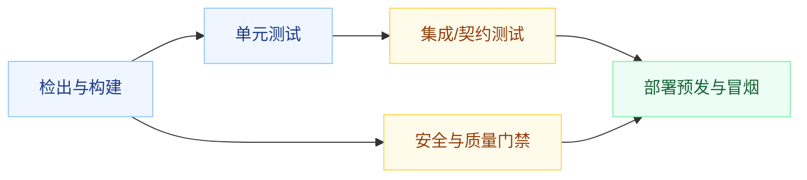

# CI流水线与测试治理

> 这篇从持续集成（Continuous Integration，CI）要回答的问题和阶段模型讲起，经过 GitHub Actions 最小流水线、阶段依赖与并行缓存、测试报告与制品、Flaky 测试治理，最后落到质量门禁、度量体系和一个把 22 分钟流水线治理到 9 分钟的完整案例。
>
> 学完能独立搭建分阶段 CI 流水线，用缓存和分片把反馈压进 10 分钟，建立 Flaky 检测与隔离机制，并用分支保护和质量门禁守住主干。

## 一、CI 的目标与流水线模型

CI 的唯一目标是：**每次提交后，快速、可信地回答“这次变更能不能合入”**。流水线慢，开发者就会积攒大批量提交或直接绕过；流水线不可信，红灯就会被忽略。所有阶段划分、缓存、并行、门禁，都服务于“快”和“可信”这两个约束。

### 1.1 CI 回答的三类问题

| 问题 | 对应阶段 | 决策 |
|---|---|---|
| 代码能不能编译、单元测试过不过 | 构建 + 单元 | 不过不许合 |
| 集成环境和数据交互是否正常 | 集成 + 契约 | 不过不许合 |
| 安全、覆盖率、性能有没有退化 | 门禁 + 巡检 | 退化阻断或告警 |

三类问题的反馈时限不同：单元问题要在 5 分钟内暴露，集成问题 10 分钟内，巡检类可以异步。把所有检查塞进一个串行阶段，是流水线慢的第一大原因。

### 1.2 阶段模型

一条标准的 PR 流水线分五个阶段，每个阶段有独立的失败语义：



| 阶段 | 时限目标 | 失败处理 |
|---|---|---|
| 检出与构建 | < 3 分钟 | 直接失败 |
| 单元测试 | < 5 分钟 | 直接失败 |
| 集成/契约测试 | < 10 分钟 | 直接失败 |
| 安全与质量门禁 | < 3 分钟 | 按策略阻断 |
| 预发冒烟 | < 5 分钟 | 阻断部署 |

“检出与构建”是后续所有阶段的依赖：构建产物（JAR、镜像）只构建一次，测试阶段复用，不做重复构建。

### 1.3 快速反馈三原则

1. **失败即停（fail fast）**：构建失败就不要跑测试，测试失败就不要部署。每个阶段只在依赖成功后运行；
2. **只测变更影响面**：全量测试留给主干和夜间巡检，PR 上跑受影响模块的增量测试；
3. **取消过时执行**：同一分支新提交推送后，取消旧的排队执行，避免队列越积越长。

### 1.4 CI 平台选型

本文主线用 GitHub Actions：与仓库一体、免运维、生态完整。企业内常见等价物：

| 平台 | 配置形式 | 与 Actions 的对应 |
|---|---|---|
| GitLab CI | `.gitlab-ci.yml` | job / stage / cache / artifacts |
| Jenkins | `Jenkinsfile` | node / stage / stash |
| 云效/CodeArts | 可视化 + YAML | 流水线模板 |

概念一一对应，迁移的是语法不是方法论。自建 Jenkins 单机不再是主线，本文只在对照表中提及。

## 二、环境与最小流水线

这一章解决“一个 Java 服务在 GitHub Actions 上跑通构建和测试”。版本基线：GitHub Actions（2026-11）、JDK 21、Maven 3.9+。Runner 用 `ubuntu-latest`，需要浏览器或数据库时按阶段引入容器服务。

### 2.1 Workflow 语法核心

一个 workflow 文件由五个部分组成：

```yaml
# .github/workflows/ci.yml
name: ci                # 名称，显示在 Checks 页
on:                     # 触发条件
  pull_request:
  push:
    branches: [main]
jobs:
  build:                # 一个 job = 一台独立虚拟机
    runs-on: ubuntu-latest
    steps:
      - uses: actions/checkout@v4      # uses 复用官方/社区 Action
      - run: mvn -B -ntp verify        # run 执行 shell 命令
```

关键点：

- job 之间默认并行，用 `needs` 建立依赖；
- 同一 job 内的 step 串行，共享文件系统；
- job 之间不共享文件，传产物要用 `actions/upload-artifact`；
- `run` 的退出码非 0 即失败，`continue-on-error` 要慎用。

### 2.2 最小可运行流水线

```yaml
name: ci
on:
  pull_request:
    branches: [main]

jobs:
  build-and-test:
    runs-on: ubuntu-latest
    steps:
      - uses: actions/checkout@v4
      - uses: actions/setup-java@v4
        with:
          distribution: temurin
          java-version: '21'
          cache: maven      # setup-java 内置缓存：按 pom.xml 哈希还原 ~/.m2
      - name: Build and unit test
        run: mvn -B -ntp verify
      - name: Upload test reports
        if: always()        # 失败也要上传报告，否则排障只能靠日志
        uses: actions/upload-artifact@v4
        with:
          name: test-reports
          path: '**/target/surefire-reports/*.xml'
```

预期执行结果（PR Checks 页面关键片段，示例）：

```text
Run mvn -B -ntp verify
[INFO] Tests run: 184, Failures: 0, Errors: 0, Skipped: 2
[INFO] BUILD SUCCESS
Artifacts: test-reports (1)
ci / build-and-test (pull_request) succeeded in 3m 42s
```

`-B` 关掉交互式下载日志，`-ntp` 关掉传输进度条，两者的目的都是让 CI 日志可读。

### 2.3 触发与并发控制

```yaml
on:
  pull_request:
    branches: [main]
  push:
    branches: [main]

concurrency:
  group: ci-${{ github.event_name }}-${{ github.ref }}
  # 只取消 PR 的旧执行；主干推送串行验证，避免发布被后来的提交打断
  cancel-in-progress: ${{ github.event_name == 'pull_request' }}
```

> 边界：主干（main）的执行不要取消——`cancel-in-progress` 对推送触发的主干构建会打断正在发布的验证。用 `github.event_name` 把 PR 和 push 分到不同的组，主干保持串行。

### 2.4 验证流水线本身

流水线配置也是代码，修改后同样要验证：

```bash
# 本地先跑通将要 CI 执行的命令
mvn -B -ntp verify

# 用 actionlint 检查 YAML 语法和表达式
brew install actionlint
actionlint
# 无输出即通过；输出会指出未定义的 secret、错误的表达式
```

`actionlint` 能发现拼错的 <span v-pre>`${{ }}`</span> 表达式、不存在的 input 和未定义的环境变量，比推上去红了再改快得多。

## 三、阶段划分与依赖编排

阶段划分的原则：按“失败越早越便宜”排序，快的在前，慢的在后；能并行的并行，有数据依赖的串行。PR 总时长由最长的关键路径决定，不是所有阶段之和。

### 3.1 needs 与失败即停

```yaml
jobs:
  build:
    runs-on: ubuntu-latest
    steps:
      - uses: actions/checkout@v4
      - uses: actions/setup-java@v4
        with: { distribution: temurin, java-version: '21', cache: maven }
      - run: mvn -B -ntp package -DskipTests
      - uses: actions/upload-artifact@v4
        with:
          name: build-output
          path: |
            order-service/target/*.jar
            order-service/target/classes
            order-service/target/test-classes

  unit:
    needs: build          # 构建失败则不消耗测试资源
    runs-on: ubuntu-latest
    steps:
      - uses: actions/checkout@v4
      - uses: actions/setup-java@v4
        with: { distribution: temurin, java-version: '21', cache: maven }
      - uses: actions/download-artifact@v4
        with:
          name: build-output
          path: order-service/target   # 连编译后的 test-classes 一起还原，surefire 才有用例可跑
      - run: mvn -B -ntp -pl order-service surefire:test

  integration:
    needs: unit           # 单元不过，集成无意义
    runs-on: ubuntu-latest
    services:
      mysql:
        image: mysql:8.4
        env:
          MYSQL_ROOT_PASSWORD: root
          MYSQL_DATABASE: order
        ports: ['3306:3306']
        options: >-
          --health-cmd "mysqladmin ping"
          --health-interval 5s --health-timeout 3s --health-retries 10
    steps:
      - uses: actions/checkout@v4
      - uses: actions/setup-java@v4
        with: { distribution: temurin, java-version: '21', cache: maven }
      - uses: actions/download-artifact@v4
        with:
          name: build-output
          path: order-service/target
      - run: mvn -B -ntp -pl order-service failsafe:integration-test failsafe:verify
```

`services` 起 MySQL 容器并带健康检查，避免“应用比数据库先启动”的偶发失败。

> 上面的产物复用按单模块工程写；多模块工程要把各模块的 `target/classes` 与 `target/test-classes` 一并上传，或先 `mvn install -DskipTests`，否则 `-pl` 选中的模块找不到兄弟模块。

### 3.2 单元与集成的边界

| 维度 | 单元测试阶段 | 集成测试阶段 |
|---|---|---|
| 依赖 | 无外部进程 | Testcontainers/服务容器 |
| 时长 | 秒级单类 | 分钟级全量 |
| 反馈 | < 5 分钟 | < 10 分钟 |
| 失败定位 | 类内逻辑 | 接口契约与环境 |

把依赖真实数据库的测试放进单元阶段，是 PR 流水线变慢且不稳定的常见根源。分层依据是测试的依赖，不是测试的规模。

### 3.3 受影响范围与增量

多模块 Maven 只构建受影响模块及其依赖：

```bash
# -pl 指定模块，-am 连带构建其依赖
mvn -B -ntp -pl order-service -am test

# GitLab/Jenkins 中对应 git diff 决定模块列表，再传给 -pl
```

增量要保留逃生通道：合并到主干时跑全量，PR 上跑增量，夜间跑全量加巡检。只有增量会出现“单模块都绿、合起来红”的跨模块问题。

### 3.4 主干与分支策略

- **主干开发（trunk-based）**：短生命周期分支 + PR 流水线门禁，主干每日多次部署预发；
- **发布分支**：只 cherry-pick 修复，不引入新功能，分支上只跑回归；
- **长生命周期功能分支**：CI 无法掩盖合并冲突，用 nightly 全量对主干做 rebase 验证。

主干的质量由 PR 门禁守，不是由“合完再测”守。合并后失败的每一次都要归因：门禁漏了什么，还是环境差异。

## 四、并行、缓存与矩阵

PR 流水线的时长公式：`总时长 = 关键路径上串行阶段之和 + 排队时间`。优化只有三个手段：缓存让每个阶段更快，并行让长阶段拆开，取消过时执行让队列不积压。

### 4.1 缓存

依赖下载是构建慢的最大单一因素。Maven 缓存键以 `pom.xml` 哈希为准：

```yaml
- uses: actions/cache@v4
  with:
    path: ~/.m2/repository
    key: maven-${{ hashFiles('**/pom.xml') }}
    restore-keys: maven-    # 键不完全命中时用最近的版本，只增量下载差异
```

各构建工具的缓存配置：

| 工具 | 缓存路径 | 键 |
|---|---|---|
| Maven | `~/.m2/repository` | `pom.xml` 哈希 |
| Gradle | `~/.gradle/caches` | `*.gradle*` 哈希 |
| npm | `~/.npm` | `package-lock.json` 哈希 |
| pnpm | `~/.local/share/pnpm/store` | `pnpm-lock.yaml` 哈希 |
| Docker | `type=gha` buildx 缓存 | Git SHA |

```yaml
- uses: actions/setup-node@v4
  with:
    node-version: '22'
    cache: 'npm'
```

> 边界：`~/.m2/repository` 会随时间膨胀，GitHub Actions 缓存有总量限额，按“最近最少使用”淘汰。不要把 `target/` 或构建产物放进缓存，那是构建结果不是依赖。

### 4.2 Docker 构建缓存

```yaml
- uses: docker/setup-buildx-action@v3
- uses: docker/build-push-action@v6
  with:
    context: .
    push: false
    tags: order:${{ github.sha }}
    cache-from: type=gha     # 复用上一次构建的层
    cache-to: type=gha,mode=max
```

层缓存命中的前提是 Dockerfile 分层正确：先复制依赖清单再复制源码，源码变化就不会打掉依赖层。

### 4.3 矩阵并行

矩阵（matrix）把一个 job 复制成多个并行实例：

```yaml
  unit:
    needs: build
    runs-on: ubuntu-latest
    strategy:
      fail-fast: false        # 一个分片失败不影响其他分片出结果
      matrix:
        module: [order-api, order-service, order-query]
    steps:
      - uses: actions/checkout@v4
      - uses: actions/setup-java@v4
        with: { distribution: temurin, java-version: '21', cache: maven }
      - run: mvn -B -ntp -pl ${{ matrix.module }} -am test
      - uses: actions/upload-artifact@v4
        if: always()
        with:
          name: reports-${{ matrix.module }}
          path: ${{ matrix.module }}/target/surefire-reports/*.xml
```

`fail-fast: false` 是治理的基础：分片被取消时无法知道它自己的真实结果，Flaky 统计会失真。

> 边界：`-am` 会连带构建并测试依赖模块，`order-api` 的测试可能在多个分片里重复跑。依赖模块测试较重时，在 build 阶段先 `mvn install -DskipTests`，分片只跑 `-pl` 指定的模块；或者按模块依赖拓扑合并分片，避免重复。

### 4.4 测试分片

模块粒度不够时，按类名取模拆分测试分片：

```bash
# scripts/shard.sh：把测试类按哈希均分到 N 片
# 用法: ./scripts/shard.sh 4 1  输出第 1 片的类列表
```

```yaml
      - run: |
          CLASSES=$(./scripts/shard.sh 4 ${{ matrix.shard }})
          mvn -B -ntp test -Dtest="$CLASSES" -Dsurefire.failIfNoSpecifiedTests=false
```

分片要点：

- 用稳定哈希（类名）分组，不用文件顺序，否则类列表变化会导致分片漂移；
- 各分片时长要均衡，最长分片决定并行收益；
- 分片数与 Runner 并发数匹配，超了就排队，时间反而变长。

### 4.5 并发与资源治理

| 手段 | 效果 | 误用后果 |
|---|---|---|
| `concurrency` 取消旧执行 | 队列不积压 | 主干执行被误取消 |
| 模块矩阵 | 并行扩展 | 分片漂移、报告割裂 |
| Testcontainers | 环境隔离 | 容器启动占时长 |
| 自托管 Runner | 降排队 | 维护成本转嫁给团队 |

并行度不是越高越好。团队共用 Runner 池时，先把单 PR 的关键路径画出来（构建 → 最慢测试分片 → 门禁），对最慢的一环加并行，其他环节加了也无效。

## 五、测试报告与制品

测试的产出不是退出码，是可读、可追溯、可统计的报告。报告要回答三个问题：哪个测试失败、失败时发生了什么、和历史比是不是新问题。

### 5.1 JUnit XML 与 Surefire

Maven Surefire 默认在 `target/surefire-reports/` 生成 JUnit XML，这是所有报告工具的通用格式：

```bash
# 失败时也保留报告
- uses: actions/upload-artifact@v4
  if: always()
  with:
    name: surefire-reports
    path: '**/target/surefire-reports/*.xml'

# 命令行直接看失败摘要
grep -rl --include='*.xml' 'failures="[1-9]' .
```

集成测试用 Failsafe 插件，报告在 `target/failsafe-reports/`。两者的区别：Surefire 失败即失败，Failsafe 先跑完再失败——集成测试要看完整结果，不能一个失败就放弃其余用例。

### 5.2 PR 上的报告

```yaml
  report:
    needs: [unit, integration]
    if: always()      # 依赖失败也要出报告，否则只能翻日志
    runs-on: ubuntu-latest
    permissions:
      checks: write       # test-reporter 创建 Check Run
      pull-requests: write
      contents: read
    steps:
      - uses: actions/download-artifact@v4
        with: { pattern: '*reports*', merge-multiple: true }
      - uses: dorny/test-reporter@v1
        with:
          name: test-results
          path: '**/*.xml'
          reporter: java-junit
          token: ${{ secrets.GITHUB_TOKEN }}
```

PR 页面出现汇总表格（示例）：

```text
test-results
  1  846  0  2   1m 12s   3 tests failed
```

失败摘要要包含：测试名、断言差异、所属模块。开发者不打开日志就能判断“是不是我改出来的”。

### 5.3 覆盖率报告

JaCoCo 在 `verify` 阶段生成覆盖率数据：

```xml
<plugin>
  <groupId>org.jacoco</groupId>
  <artifactId>jacoco-maven-plugin</artifactId>
  <version>0.8.12</version>
  <executions>
    <execution>
      <goals><goal>prepare-agent</goal></goals>
    </execution>
    <execution>
      <id>report</id>
      <phase>verify</phase>
      <goals><goal>report</goal></goals>
    </execution>
  </executions>
</plugin>
```

```bash
mvn -B -ntp verify
# 生成 target/site/jacoco/index.html
```

PR 上不追求覆盖率数字精确到小数点，重点是**行覆盖变化**（diff coverage）：这次改动新增的代码测到了没有。

### 5.4 留档与追溯

- 制品（JAR/镜像）与构建号、Git SHA、流水线日志同 ID 归档；
- 测试报告保留时长与发布版本对齐，至少覆盖一个发布周期；
- 生产事故复盘时能回答“这个版本当时哪个测试没覆盖”。

## 六、Flaky 测试治理

Flaky 测试是指“同一代码、同一提交，重跑结果不稳定”的测试。它比测试缺失更有害：红灯不再是信号，团队养成“重跑一次就好了”的习惯，真正的失败被淹没。治理目标不是零 Flaky，而是让每个 Flaky 都被识别、隔离、限期修复。

### 6.1 Flaky 的定义与成本

```text
Flaky 率 = 重跑后由红变绿的测试次数 / 总失败次数
```

成本包括：每次重跑的 Runner 时间、开发者等待与上下文切换、以及最贵的——对红灯的信任崩塌。经验阈值：PR 流水线的 Flaky 率超过 2% 时，重跑行为开始失控。

### 6.2 检测：重跑与标记

Surefire 支持失败重跑并标记 Flaky：

```bash
# 失败的测试最多重跑 2 次；先失败后通过的在报告中标记为 flake
mvn -B -ntp test -Dsurefire.rerunFailingTestsCount=2
```

报告输出：

```text
[INFO] Tests run: 846, Failures: 0, Errors: 0, Skipped: 3, Flakes: 14
```

`Flakes: 14` 是治理的核心输入：它单独列出“第一次失败、重跑通过”的测试，而不是混进失败里。

CI 里的分级策略：

```yaml
      - name: Unit test (rerun flaky)
        run: mvn -B -ntp test -Dsurefire.rerunFailingTestsCount=1
```

重跑的作用是**发现**Flaky，不是**解决**Flaky。报告里的每个 Flake 都要进治理清单，否则重跑只是把问题藏进绿色里。

### 6.3 根因分类

| 根因 | 典型表现 | 修复方向 |
|---|---|---|
| 时间依赖 | `Thread.sleep` 等待 | 等待条件而非等待时间 |
| 测试顺序耦合 | 单跑绿、全量红 | 每个测试自建数据 |
| 共享可变状态 | 静态变量、单例缓存 | 每测试隔离上下文 |
| 真实网络 | 调第三方沙箱 | 挡板/mock |
| 数据残留 | 上一轮留下的行 | 随机键名或事务回滚 |
| 并发竞争 | 被测代码本身 | 先判断是实现 bug |

最容易被忽略的一类：Flaky 不是测试的问题，是被测代码的竞态。修复方向要以“单跑一千次”的结果为证据：

```bash
# 循环重复执行同一个测试类，复现偶发失败；只跑一次无法判断竞态
for i in $(seq 1 200); do
  mvn -q -ntp -Dtest=OrderServiceTest test || { echo "failed at run $i"; break; }
done
```

### 6.4 隔离与限期修复

确认 Flaky 后先隔离，让主干恢复可信。下面是隔离用的测试类骨架（片段），实际测试方法保留原逻辑：

```java
@Tag("quarantine")
@DisplayName("JIRA-1042: 修复前隔离，重跑通过率 70%")
class OrderPaymentFlakyTest {
}
```

```bash
# 主流水线排除隔离区
mvn -B -ntp test -DexcludedGroups=quarantine

# 夜间单独跑隔离区，防止“隔离即遗忘”
mvn -B -ntp test -Dgroups=quarantine
```

隔离要有规则：

- 每个隔离测试挂 issue 编号和原因；
- 隔离区上限（如 1%），超过就停止新增测试，先还债；
- 隔离超过 14 天自动在团队例会上升。

### 6.5 预防

- 新测试默认禁用 `Thread.sleep`，用 Awaitility 等条件等待；
- 集成测试用 Testcontainers 每次全新环境，不复用状态；
- CI 上用“随机顺序执行”发现顺序耦合：`-Dsurefire.runOrder=random`；
- 每周输出 Flaky 榜单，前 5 名排进迭代。

## 七、质量门禁与治理

门禁是“不合格变更无法合入主干”的机制，由分支保护 + 必需检查（required checks）+ 覆盖率规则共同实现。治理的关键是：门禁要少而硬，每一个都必须有明确的不通过处置流程。

### 7.1 门禁清单

| 门禁 | 工具 | 阻断条件 |
|---|---|---|
| 编译与单元测试 | Maven Surefire | 任何失败 |
| 集成测试 | Failsafe + Testcontainers | 任何失败 |
| 覆盖率 | JaCoCo check | 行覆盖低于下限 |
| 依赖漏洞 | Trivy | 新增 CRITICAL |
| 密钥泄露 | gitleaks | 任何命中 |
| 代码审查 | CODEOWNERS | 无审批不许合 |

门禁数量控制在 5–7 个。每加一个门禁都要回答：误报率多少、失败后开发者第一步做什么。

### 7.2 分支保护与必需检查

仓库设置（Settings → Branches → Branch protection）：

- Require a pull request before merging；
- Require status checks to pass：勾选 `build`、`unit`、`integration`、`security-scan`；
- Require branches to be up to date：保证合入前与主干最新代码验证过；
- 勾选后，任何绕过红灯的直接 push 都被拒绝。

矩阵分片的必需检查要逐分片勾选（如 `unit (order-service)`），否则单分片被跳过时门禁形同虚设。

### 7.3 覆盖率门禁与棘轮

```xml
<execution>
  <id>coverage-check</id>
  <goals><goal>check</goal></goals>
  <configuration>
    <rules>
      <rule>
        <element>BUNDLE</element>
        <limits>
          <limit>
            <counter>LINE</counter>
            <value>COVEREDRATIO</value>
            <minimum>0.72</minimum>   <!-- 棘轮值：只升不降 -->
          </limit>
        </limits>
      </rule>
    </rules>
  </configuration>
</execution>
```

棘轮（ratchet）模式：当前值是历史最高值，只允许上升。新代码把覆盖率拉高后，把 `minimum` 同步上调；绝不因为赶进度下调——下调一次，棘轮就废了。

### 7.4 度量体系

治理要靠数据说话，四个核心指标：

| 指标 | 定义 | 健康线 |
|---|---|---|
| PR 流水线 P95 时长 | 推送到出结果 | < 10 分钟 |
| 提交到合并时长 | 含排队与返工 | < 4 小时 |
| Flaky 率 | 重跑变绿比例 | < 1% |
| 测试逃逸率 | 生产缺陷中未被 CI 拦截的比例 | 持续下降 |

度量落点：每周在团队同步一次趋势，而不是出事才看。逃逸的每个缺陷都要回答“哪个层级本该拦住它”，答案变成新的用例或新的门禁。

### 7.5 流水线本身的质量

流水线是团队使用频率最高的系统，它自己也要有质量标准：

- 配置进版本控制，修改走 PR；
- 用 `actionlint` 做静态检查；
- Action 版本固定（`@v4` 或 commit SHA），不用浮动标签；
- 流水线文档化：每个阶段为什么存在、失败了第一步看哪里；
- 定期清理不再使用的 job 和缓存。

```yaml
# 固定到主版本并保持更新，供应链风险最低
- uses: actions/checkout@v4
- uses: actions/setup-java@v4
```

## 八、最佳实践案例

### 8.1 案例背景

某电商订单平台是 Maven 多模块仓库：`order-api`、`order-service`、`order-query` 三个后端模块加一个前端目录，后端约 1200 个测试。团队 6 人，用 GitHub Actions。现状（示例）：PR 流水线 22 分钟，其中依赖下载约 4 分钟；近 30 天 31% 的 PR 至少重跑过一次，抽样统计 Flaky 率 3.1%；主干没有必需检查，出现过两次红灯被直接合入。目标：PR 反馈压进 10 分钟，Flaky 率降到 1% 以下，主干门禁上线。约束：不换 CI 平台、不改测试代码结构、夜间可跑全量。

### 8.2 案例实操

第一步，先测量再动手。在 workflow 里加计时输出，跑 10 个 PR 取 P95：

```text
checkout+下载依赖   4m 10s
编译打包           2m 20s
单元测试（串行）    9m 40s
集成测试（串行）    5m 30s
合计              21m 40s（关键路径，无并行）
```

瓶颈判断：依赖下载占 19%，单元测试占 45%，全部串行。优先级：缓存 → 并行 → Flaky。

第二步，加缓存并一次性构建产物。

```yaml
name: ci
on:
  pull_request:
    branches: [main]

concurrency:
  group: ci-pr-${{ github.ref }}
  cancel-in-progress: true    # 只取消 PR 旧执行，主干单独分组

jobs:
  build:
    runs-on: ubuntu-latest
    steps:
      - uses: actions/checkout@v4
      - uses: actions/setup-java@v4
        with:
          distribution: temurin
          java-version: '21'
          cache: maven          # 依赖层走缓存，pom 未变时零下载
        # 构建 jar 一次，测试阶段下载复用
      - run: mvn -B -ntp package -DskipTests
      - uses: actions/upload-artifact@v4
        with:
          name: app-jar
          path: '**/target/*.jar'
          retention-days: 3     # PR 制品不需要长期留档
```

第三步，单元测试按模块矩阵并行，失败重跑打开 Flaky 标记。

```yaml
  unit:
    needs: build
    runs-on: ubuntu-latest
    strategy:
      fail-fast: false
      matrix:
        module: [order-api, order-service, order-query]
    steps:
      - uses: actions/checkout@v4
      - uses: actions/setup-java@v4
        with: { distribution: temurin, java-version: '21', cache: maven }
      - run: |
          mvn -B -ntp -pl ${{ matrix.module }} -am test \
            -Dsurefire.rerunFailingTestsCount=1 \
            -Dsurefire.runOrder=random
      - uses: actions/upload-artifact@v4
        if: always()
        with:
          name: reports-${{ matrix.module }}
          path: ${{ matrix.module }}/target/surefire-reports/*.xml
```

第四步，集成测试用 Testcontainers 每次全新环境，替代共享预发数据库——共享库的数据残留是 Flaky 的最大来源。

```yaml
  integration:
    needs: unit
    runs-on: ubuntu-latest
    steps:
      - uses: actions/checkout@v4
      - uses: actions/setup-java@v4
        with: { distribution: temurin, java-version: '21', cache: maven }
      - name: Integration test
        run: |
          mvn -B -ntp -pl order-service -am failsafe:integration-test failsafe:verify \
            -Dspring.profiles.active=it
        env:
          TESTCONTAINERS_RYUK_DISABLED: 'false'  # ryuk 保证容器必然被回收
      - uses: actions/upload-artifact@v4
        if: always()
        with:
          name: it-reports
          path: order-service/target/failsafe-reports/*.xml
```

第五步，聚合报告与门禁。

```yaml
  report:
    needs: [unit, integration]
    if: always()
    runs-on: ubuntu-latest
    permissions:
      checks: write
      pull-requests: write
      contents: read
    steps:
      - uses: actions/download-artifact@v4
        with: { pattern: '*reports*', merge-multiple: true }
      - uses: dorny/test-reporter@v1
        with:
          name: test-results
          path: '**/*.xml'
          reporter: java-junit
          token: ${{ secrets.GITHUB_TOKEN }}
```

```yaml
  security:
    needs: build
    runs-on: ubuntu-latest
    steps:
      - uses: actions/checkout@v4
        with: { fetch-depth: 0 }
      - uses: gitleaks/gitleaks-action@v2
        env:
          GITHUB_TOKEN: ${{ secrets.GITHUB_TOKEN }}
      - uses: aquasecurity/trivy-action@0.28.0
        with:
          scan-type: fs
          severity: CRITICAL,HIGH
          exit-code: '1'
```

第六步，治理 Flaky。两周内按报告累计 Flakes 榜单（示例前 5）：

| 测试类 | 重跑通过率 | 根因 |
|---|---|---|
| PaymentCallbackTest | 62% | `Thread.sleep(500)` 等回调 |
| CouponServiceTest | 70% | 共享静态缓存未清理 |
| OrderQueryIT | 74% | 共享预发库数据残留 |
| StockDeductTest | 81% | 被测代码竞态，非测试问题 |
| AddressParseTest | 88% | 第三方地址库沙箱抖动 |

处理：三个测试问题当迭代修复；`StockDeductTest` 确认是被测代码的并发缺陷，开 issue 转开发修复；`AddressParseTest` 改为本地挡板。修不完的挂 `@Tag("quarantine")` 进隔离区，夜间单独跑。

```bash
# 主流水线排除隔离区，夜间只跑隔离区
mvn -B -ntp test -DexcludedGroups=quarantine
mvn -B -ntp test -Dgroups=quarantine
```

第七步，开分支保护。必需检查勾选 `build`、`unit (order-api)`、`unit (order-service)`、`unit (order-query)`、`integration`、`security`，要求分支最新，合并需要一名 codeowner 审批。

### 8.3 案例结果

治理前后对比（示例，10 个 PR 的 P95）：

| 指标 | 治理前 | 治理后 | 目标 |
|---|---|---|---|
| PR 流水线时长 | 21m 40s | 8m 55s | < 10m |
| 依赖下载耗时 | 4m 10s | 12s | 缓存命中 |
| 单元测试阶段 | 9m 40s | 3m 20s（并行最长分片） | 并行 |
| Flaky 率 | 3.1% | 0.4% | < 1% |
| PR 重跑比例 | 31% | 6% | — |
| 红灯被直接合入 | 2 次/30 天 | 0 | 门禁生效 |

分阶段耗时（治理后）：

```text
checkout/启动    0m 20s
build           1m 45s
unit (并行)     3m 20s
integration     3m 05s
report          0m 25s
security        0m 40s（与 unit/integration 并行，不计关键路径）
关键路径合计     8m 55s
```

失败模式复盘：

- 第一次矩阵分片用文件顺序切分，模块内类列表变化导致分片时长漂移到 6 分钟；改为类名稳定哈希后回到 3 分钟左右；
- `fail-fast` 忘了关，一个分片失败取消其他分片，Flaky 统计失真两周；分片型 job 一律 `fail-fast: false`；
- 缓存键只写了 `maven-` 前缀，导致每次都全量下载；键必须含 `hashFiles('**/pom.xml')`；
- 有一名开发者把隔离区当“垃圾桶”，把一个还没定位的失败测试也打了 `quarantine` 标签；补上规则：隔离必须挂 issue 编号和通过率数据，超过 14 天自动上升；
- 覆盖率棘轮从 0.68 起步上调到 0.72，靠的是新代码门禁（diff coverage），不是逼存量代码突击补测试。

结论：流水线治理的顺序永远是“先测量、再缓存、再并行、最后治理 Flaky”。门禁生效的前提是流水线足够快——22 分钟时没人愿意等红灯，9 分钟时门禁才真正被遵守。
